# 学会这些方法，logo设计也就游刃有余｜大鱼品牌设计

## 导入：ANOTHER 字形重排

本段是片头示例。作者没有解释这些步骤的用意。

### A1 · 一行单词 ANOTHER

约 0.6s（录屏 16.4s）

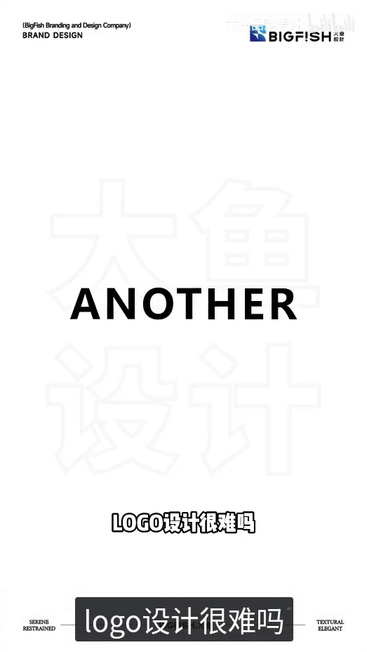

- **作者明确说法**：「LOGO设计很难吗」
- **播放器字幕**：「logo设计很难吗」
- **整理者观察**：白底上是一行黑色无衬线大写「ANOTHER」，尚未重排，也没有外框。

### A2 · 重排成叠字

约 1.4s（录屏 17.2s）

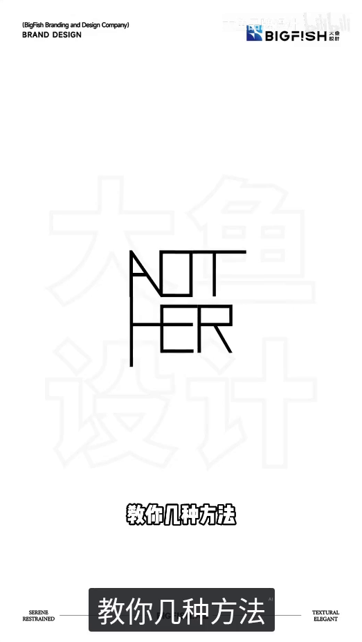

- **作者明确说法**：「教你几种方法」
- **整理者观察**：原来的一行单词变成线面构成的叠字。左侧可见 A 形的斜笔与长竖，中上部可读作 NOT，下方可读作 HER，部分笔画看起来被共用。还没有外框。

### A3 · 加上方框

约 2.2s（录屏 18.0s）

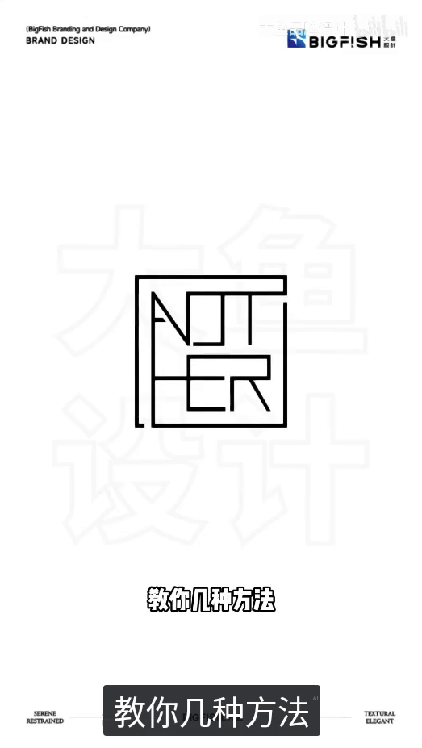

- **作者明确说法**：「教你几种方法」
- **整理者观察**：同一叠字外围加了方框。左侧长竖的下端伸出框外。

### A4 · 反白用到照片上

约 2.8s（录屏 18.6s）

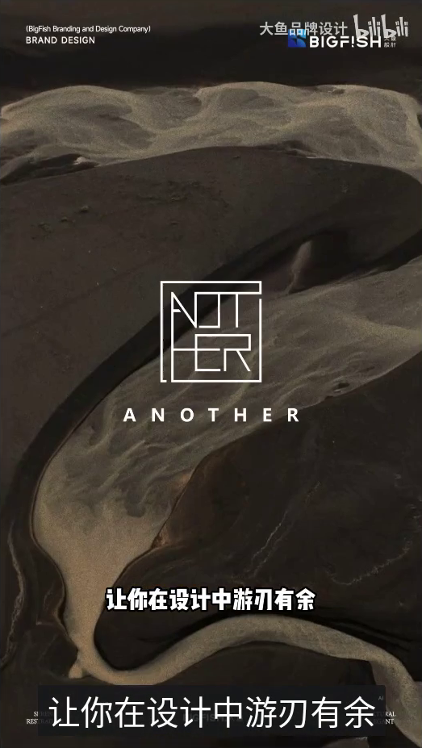

- **作者明确说法**：「让你在设计中游刃有余」
- **整理者观察**：白色带框叠字压在砂石/泥地类照片上，框下另有疏排的白色「ANOTHER」。

### 思路与前后关系（整理者分析，非作者原话）

画面上能看到从一行单词，到重排叠字，再到加框，最后反白放到照片上。作者没有解释这样重排和加框的用意。

---

## 案例一：G 与花苞

### G1 · 画面气泡提出字母 G

约 4.4s（录屏 20.2s）

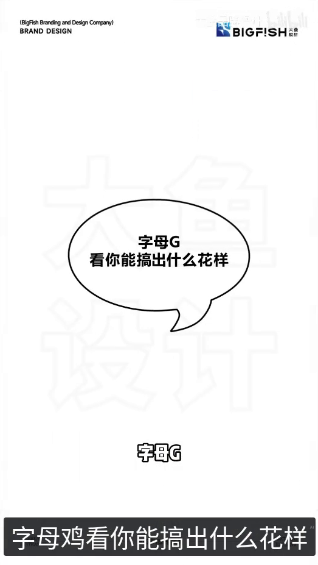

- **作者明确说法**：「字母G」
- **播放器字幕**：「字母鸡看你能搞出什么花样」
- **整理者观察**：白底中央是一个线框气泡，两行写着「字母G / 看你能搞出什么花样」。字母标志尚未出现。

### G2 · 复制翻转法

约 7.0s（录屏 22.8s）

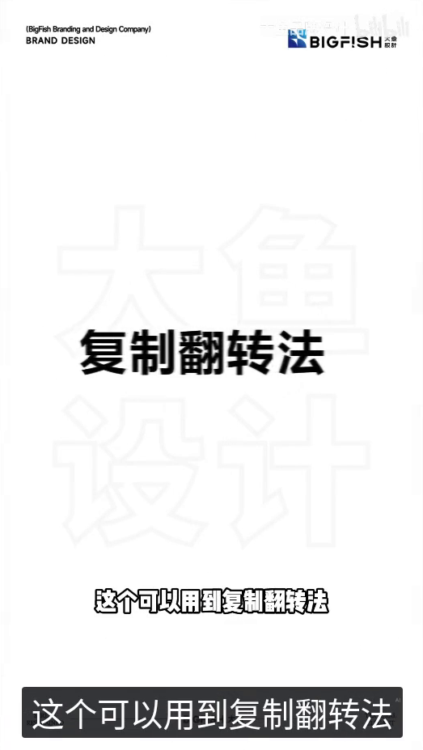

- **作者明确说法**：「这个可以用到复制翻转法」
- **整理者观察**：白底上是黑色标题「复制翻转法」，还没有字母 G。

### G3 · 正体 G

约 9.6s（录屏 25.4s）

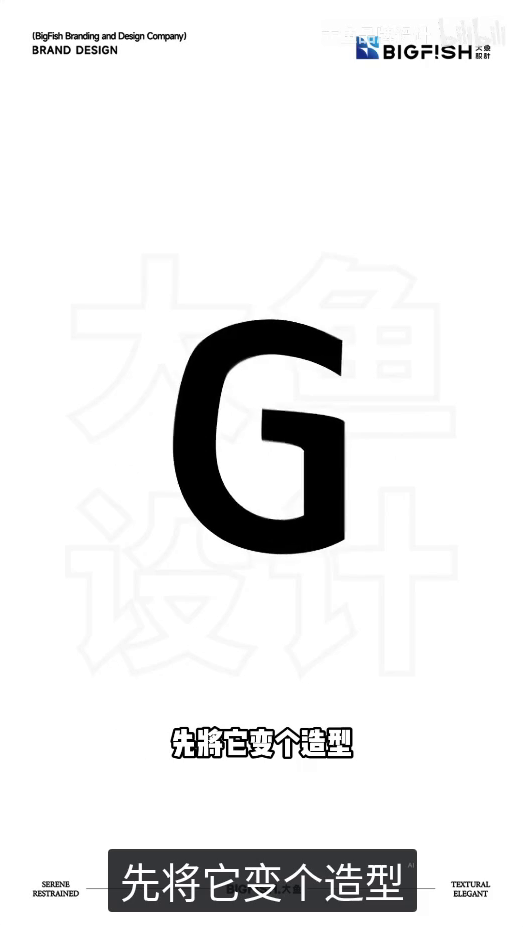

- **作者明确说法**：「先將它变个造型」
- **播放器字幕**：「先将它变个造型」
- **整理者观察**：中央是常规黑实笔 G，向右开口。

### G4 · 变成空心轮廓

约 9.8s（录屏 25.6s）

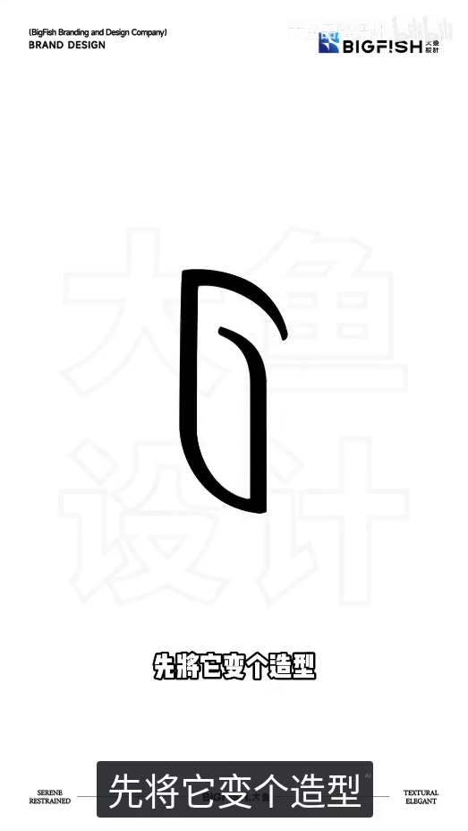

- **作者明确说法**：「先將它变个造型」
- **播放器字幕**：「先将它变个造型」
- **整理者观察**：正体 G 已变成黑色描边的空心轮廓。外缘左侧近乎竖直，底部圆转向右，顶部另有一弧伸向右上；内侧有一条竖向线，上端不到顶弧。线与线之间留白。

### G5 · 镜像复制中间态

约 10.8s（录屏 26.6s）

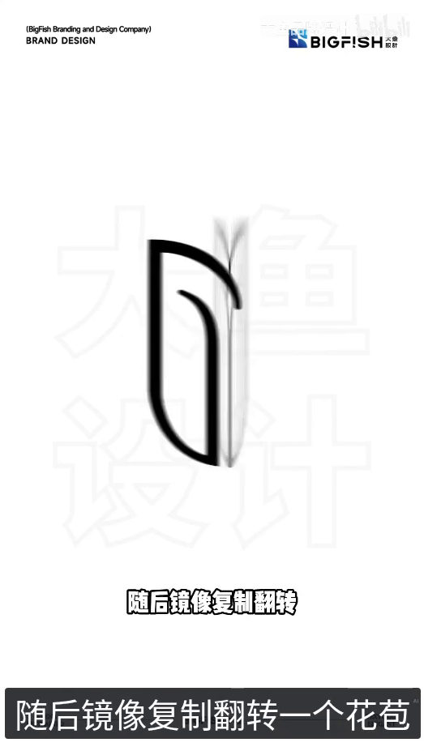

- **作者明确说法**：「随后镜像复制翻转」
- **播放器字幕**：「随后镜像复制翻转一个花苞」
- **整理者观察**：左侧仍是 G4 那样的空心单片；右侧对称的一片正在出现，带运动残影，尚未与左侧同样实线、完整。

### G6 · 左右合成花苞

约 11.0s（录屏 26.8s）

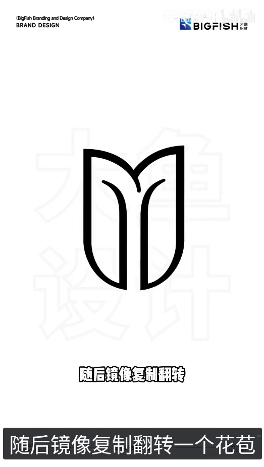

- **作者明确说法**：「随后镜像复制翻转」
- **播放器字幕**：「随后镜像复制翻转一个花苞」
- **整理者观察**：左右两片空心轮廓相对，中缝相接，合成一个花苞形。

### G7 · 反白用到照片上

约 14.2s（录屏 30.0s）

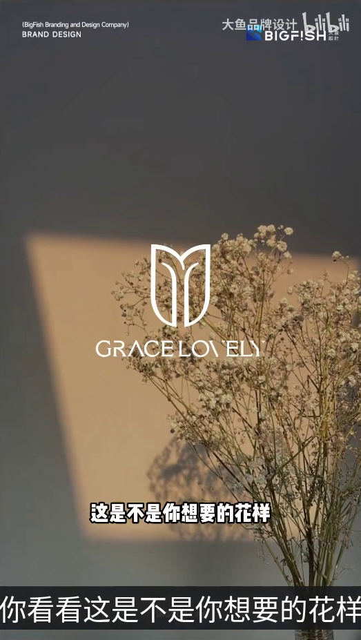

- **作者明确说法**：「这是不是你想要的花样」
- **播放器字幕**：「你看看这是不是你想要的花样」
- **整理者观察**：白色花苞标志压在米色墙面、干花枝的照片上。标志下方是两词全大写「GRACE LOVELY」，中间有空格。

### 思路与前后关系（整理者分析，非作者原话）

先把正体 G 改成单片空心轮廓，外缘接近瓣/叶的形状，内有竖线。再把这一片镜像复制到对面，左右相对后形成花苞。复制翻转的作用，是让同一半形生成对称的另一半，从而用一轮造型得到可被看作花苞的对称结构。最后把反白后的花苞放到带干花的墙面照片上。

---

## 案例二：SiH 与正负形

开场片内大字是「Sih」，气泡写「SIH」，回顾卡为「SiH+正负形」。

### S1 · 画面气泡提出 SIH

约 16.0s（录屏 31.8s）

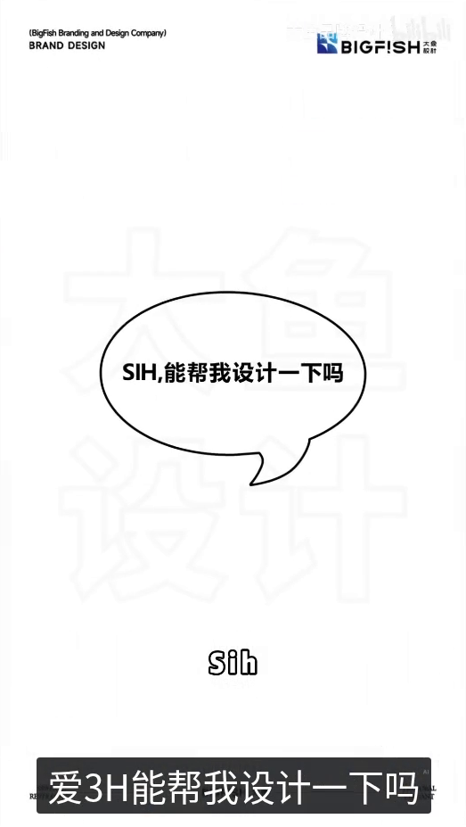

- **作者明确说法**：「Sih」
- **播放器字幕**：「爱3H能帮我设计一下吗」
- **整理者观察**：白底上一个线框气泡，一行写着「SIH,能帮我设计一下吗」。

### S2 · 正负形设计

约 18.6s（录屏 34.4s）

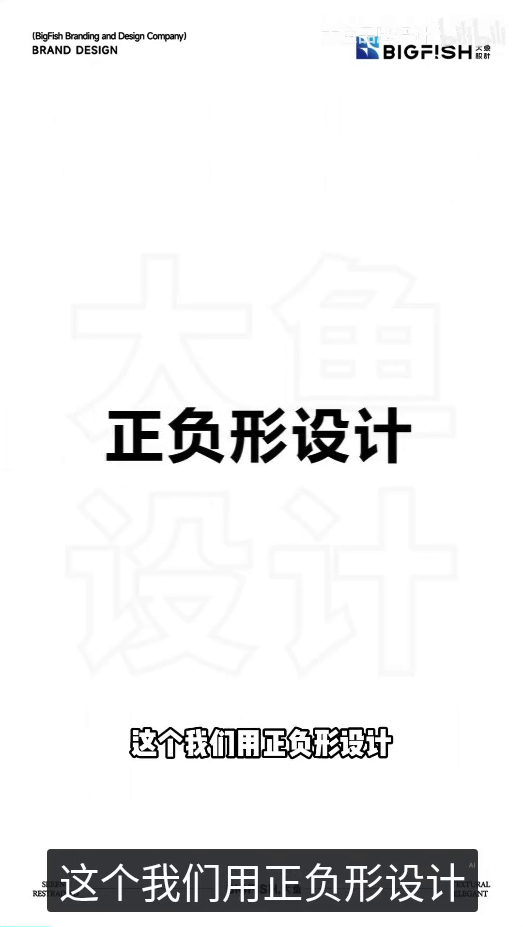

- **作者明确说法**：「这个我们用正负形设计」
- **整理者观察**：白底上是黑色标题「正负形设计」，字母尚未出现。

### S3 · 只取大写 SI

约 20.2s（录屏 36.0s）

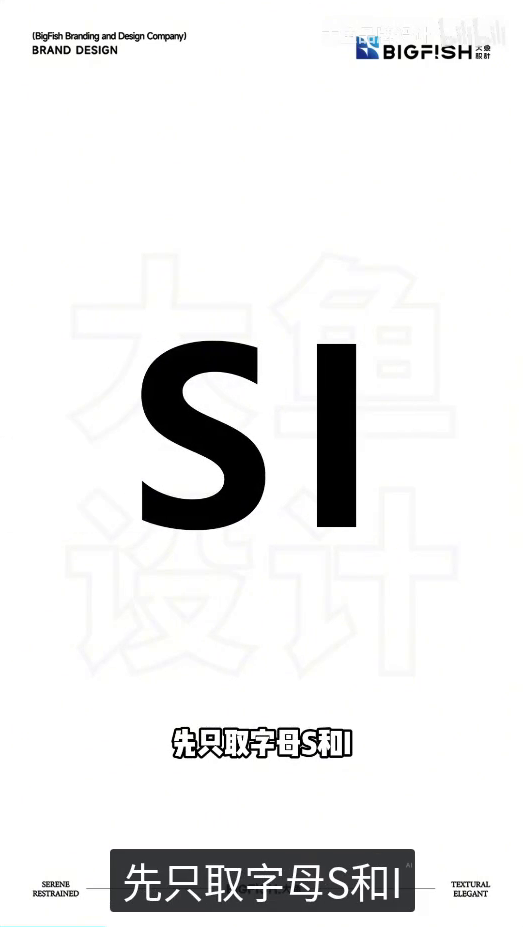

- **作者明确说法**：「先只取字母S和I」
- **整理者观察**：黑色大写 S 与 I 左右并置，I 仍是大写，两者都还是常规字形。

### S4 · I 改为小写的中间态

约 21.4s（录屏 37.2s）

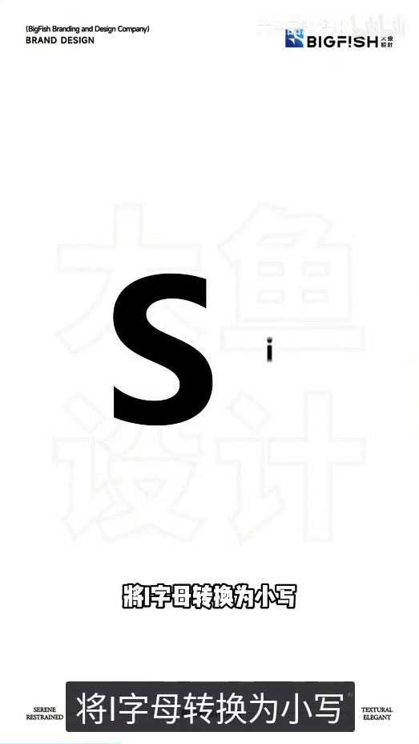

- **作者明确说法**：「將I字母转换为小写」
- **播放器字幕**：「将I字母转换为小写」
- **整理者观察**：左侧仍是大写 S；右侧出现较小的 i，点和竖笔已可辨，大小和位置还没有完全落稳。

### S5 · 变成 Si

约 22.2s（录屏 38.0s）

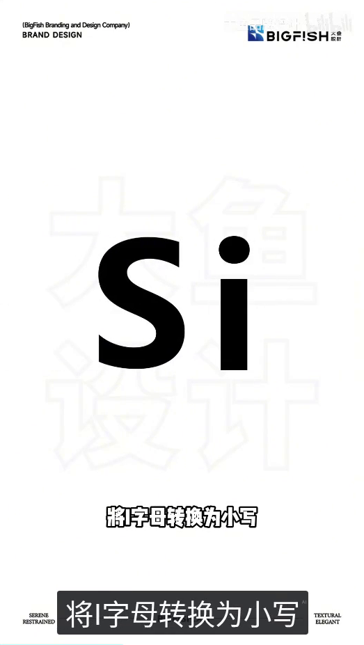

- **作者明确说法**：「將I字母转换为小写」
- **播放器字幕**：「将I字母转换为小写」
- **整理者观察**：大写 S 与小写 i 并置，已稳定，轮廓还没有改成波形。

### S6 · 开始调整造型

约 23.0s（录屏 38.8s）

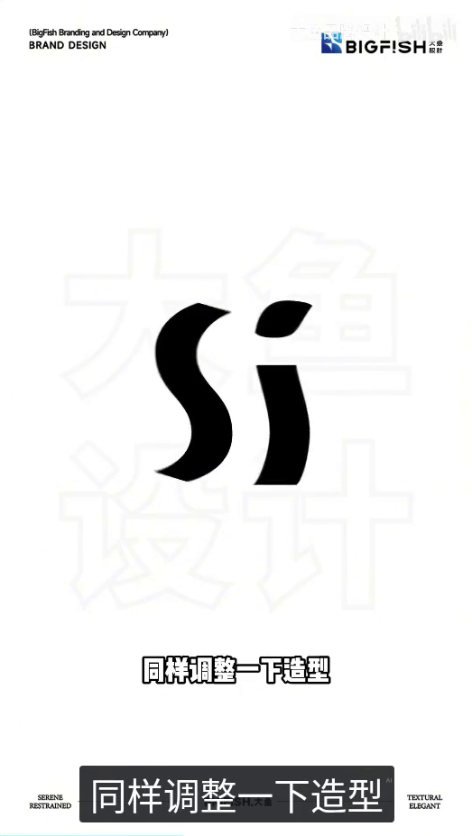

- **作者明确说法**：「同样调整一下造型」
- **整理者观察**：Si 的笔画被拉斜、变窄，开始呈波状，还不是两道完整的波形。

### S7 · 两个波形

约 25.4s（录屏 41.2s）

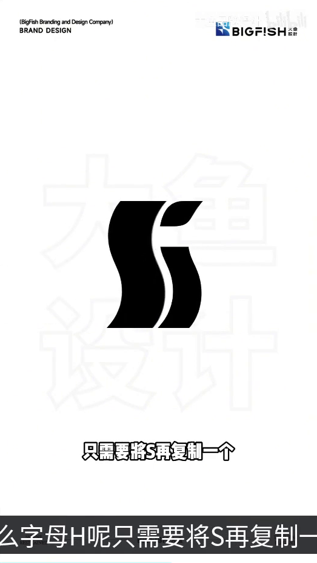

- **作者明确说法**：「只需要將S再复制一个」
- **播放器字幕**：「那么字母H呢只需要将S再复制一个」
- **整理者观察**：两个黑色波状竖笔并置，像两道拉斜的 S。第三个波形还没有出现。

### S8 · 第三个波形出现

约 25.6s（录屏 41.4s）

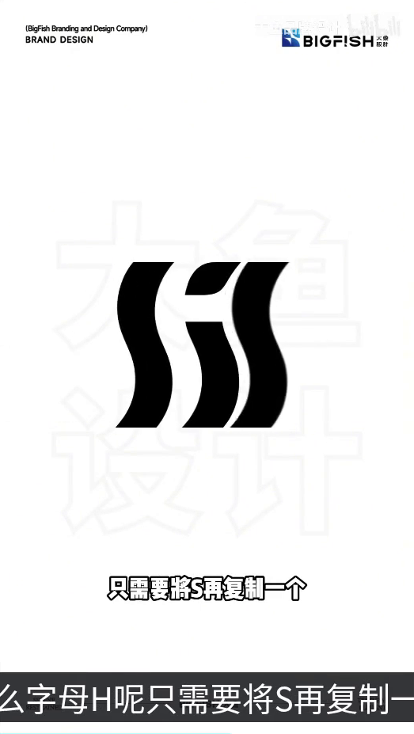

- **作者明确说法**：「只需要將S再复制一个」
- **播放器字幕**：「那么字母H呢只需要将S再复制一个」
- **整理者观察**：在两个波形之外，右侧又出现一道较淡的波形，尚未与前两道同样实色、对齐。

### S9 · 三个波形

约 26.2s（录屏 42.0s）

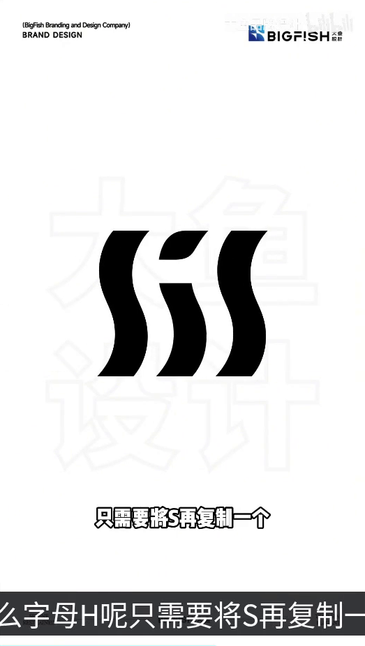

- **作者明确说法**：「只需要將S再复制一个」
- **播放器字幕**：「那么字母H呢只需要将S再复制一个」
- **整理者观察**：三道黑色波形已经并置齐整，间隙里还没有绿色。

### S10 · 负形中出现绿色 H

约 27.6s（录屏 43.4s）

- **作者明确说法**：「你看负形部分字母H是不是有了」
- **播放器字幕**：「你看复形部分字母H是不是有了方法」
- **整理者观察**：三道黑波形仍在；它们之间的空隙被填成绿色，绿色块可读成一个 H。

### S11 · 绿色去掉，只剩黑波形

约 28.6s（录屏 44.4s）

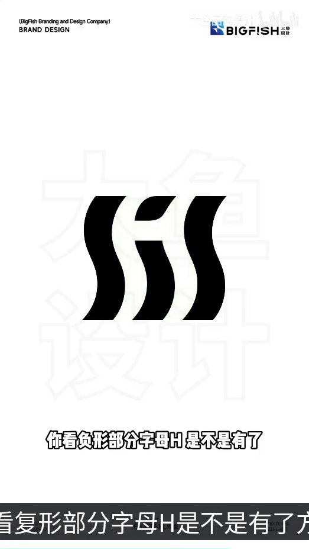

- **作者明确说法**：「你看负形部分字母H是不是有了」
- **播放器字幕**：「你看复形部分字母H是不是有了方法」
- **整理者观察**：绿色填充已不见，只剩三道黑波形。中间一道中部有开口，上下为黑、中段留白。

### S12 · 反白用到照片上

约 30.2s（录屏 46.0s）

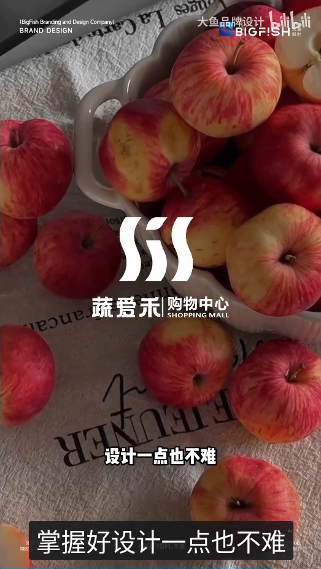

- **作者明确说法**：「设计一点也不难」
- **播放器字幕**：「掌握好设计一点也不难」
- **整理者观察**：白色三波形标志压在白容器里的苹果、以及带印刷字的纸/布面上。标志下方可见「蔬爱禾|购物中心」，其下为「SHOPPING MALL」。

### 思路与前后关系（整理者分析，非作者原话）

先只取 S 和 I，把 I 改成小写 i，再把字形收成波状；然后复制一道 S，变成三道并置的波形。H 并不是另写上去的独立字母，而是由波形之间的空隙被填成绿色后认出来的（片内称「负形」）。去掉绿色之后，应用里用的是反白的三道波形。这样 S 的重复轮廓与 H 的识别可以落在同一组形状上。

---

## 案例三：赫兹与手写体

### H1 · 画面气泡提出赫兹

约 31.8s（录屏 47.6s）

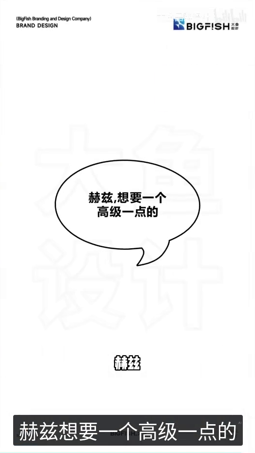

- **作者明确说法**：「赫兹」
- **播放器字幕**：「赫兹想要一个高级一点的」
- **整理者观察**：白底上一个线框气泡，两行写着「赫兹,想要一个 / 高级一点的」。

### H2 · 高级感与手写体设计

约 35.0s（录屏 50.8s）

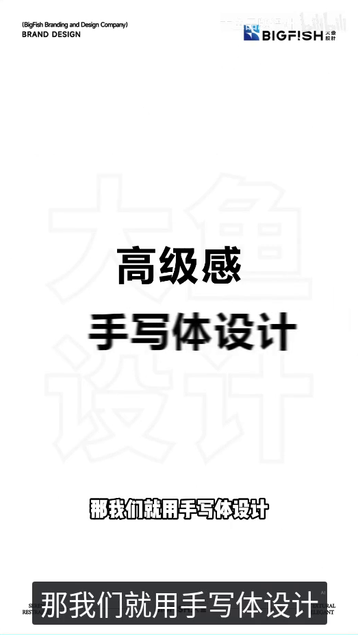

- **作者明确说法**：「那我们就用手写体设计」
- **整理者观察**：白底上两行黑字，上为「高级感」，下为「手写体设计」。字母尚未出现。

### H3 · 首字母 h S

约 36.6s（录屏 52.4s）

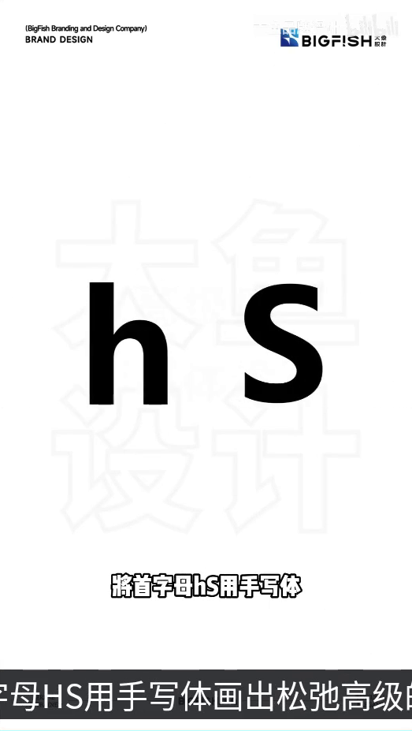

- **作者明确说法**：「將首字母hS用手写体」
- **播放器字幕**：「将首字母HS用手写体画出松弛高级的感觉」
- **整理者观察**：左侧是小写 h，右侧是大写 S，两字中间有空隙，都还是常规印刷体。

### H4 · 只留下第一笔

约 37.6s（录屏 53.4s）

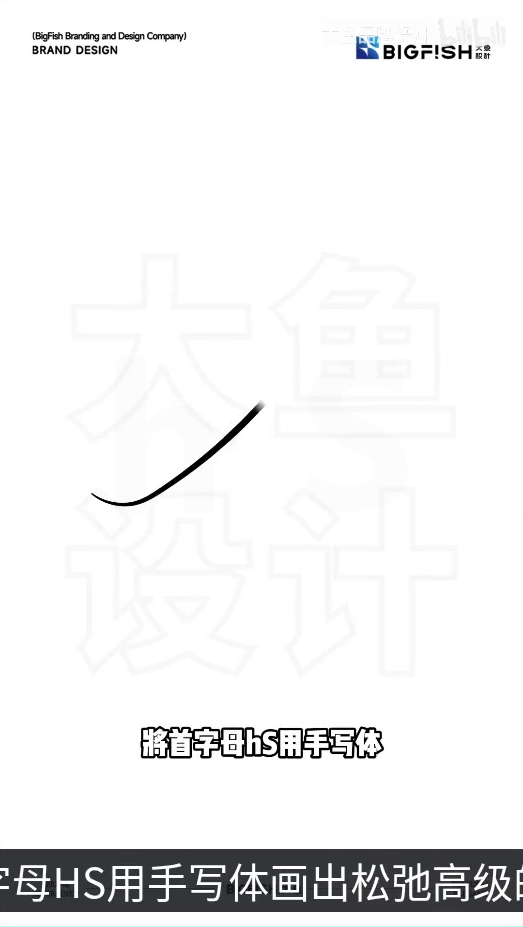

- **作者明确说法**：「將首字母hS用手写体」
- **播放器字幕**：「将首字母HS用手写体画出松弛高级的感觉」
- **整理者观察**：印刷体的 h 与 S 已不在。画面上只有一道由左下向右上扬起的手写笔画，还没有 h 的主体，也没有 s。

### H5 · 笔锋转过最高点

约 37.8s（录屏 53.6s）

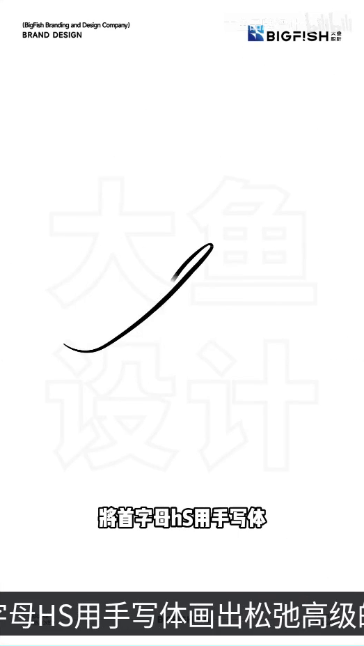

- **作者明确说法**：「將首字母hS用手写体」
- **播放器字幕**：「将首字母HS用手写体画出松弛高级的感觉」
- **整理者观察**：同一笔画伸到最高点后向下折回一截，形成一个小弯，向下的主笔还没有拉下来。

### H6 · 写下笔，尚未成 h

约 38.0s（录屏 53.8s）

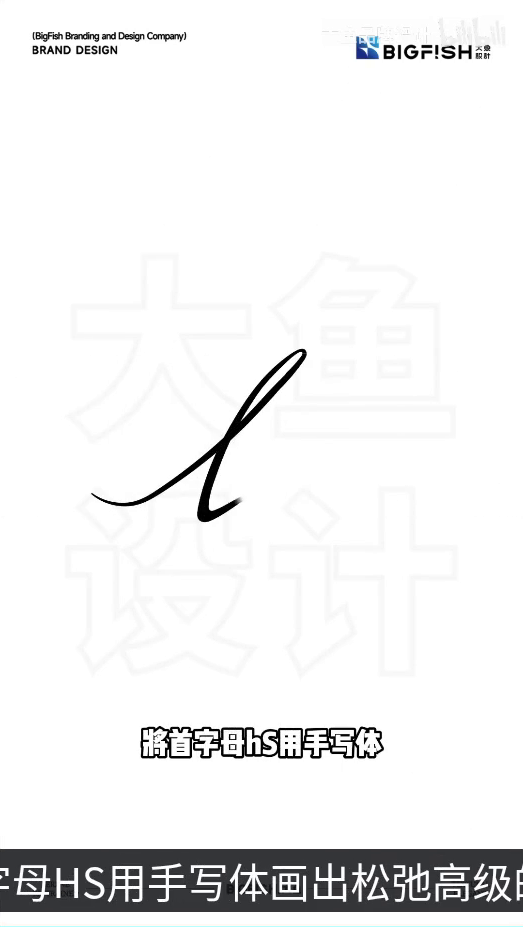

- **作者明确说法**：「將首字母hS用手写体」
- **播放器字幕**：「将首字母HS用手写体画出松弛高级的感觉」
- **整理者观察**：下笔已经拉下，与起笔交叉，末端向右略收。h 向右的肩部还没有写出，也没有 s。

### H7 · h 的主体写出

约 38.2s（录屏 54.0s）

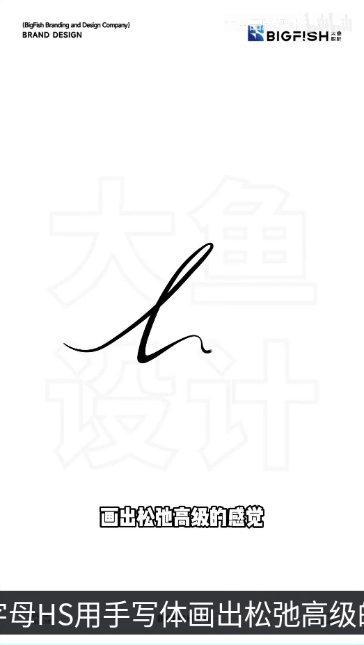

- **作者明确说法**：「画出松弛高级的感觉」
- **播放器字幕**：「将首字母HS用手写体画出松弛高级的感觉」
- **整理者观察**：从下笔末端向右伸出一道起伏的收笔，手写 h 的主体已经形成。右侧还没有 s。

### H8 · 后半的 s 开始出现

约 38.8s（录屏 54.6s）

- **作者明确说法**：「画出松弛高级的感觉」
- **播放器字幕**：「将首字母HS用手写体画出松弛高级的感觉」
- **整理者观察**：h 右侧出现一段向上翻起的短弯，像 s 的起笔，字形还不完整，也还没有向右的长收笔。

### H9 · 手写 hs 写完

约 39.6s（录屏 55.4s）

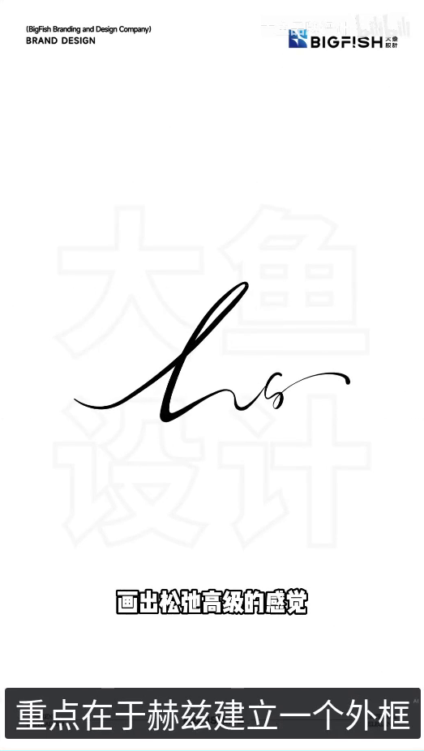

- **作者明确说法**：「画出松弛高级的感觉」
- **播放器字幕**：「将首字母HS用手写体画出松弛高级的感觉」
- **整理者观察**：手写 s 已经写完，并向右拉出一道较长的收笔。此时还没有圆框，也没有波纹。

### H10 · 外框弧线尚未合拢

约 41.0s（录屏 56.8s）

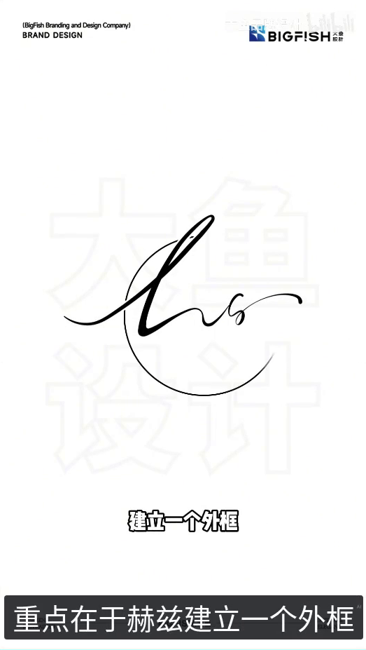

- **作者明确说法**：「建立一个外框」
- **播放器字幕**：「重点在于赫兹建立一个外框」
- **整理者观察**：手写 hs 仍在。一道弧线从左上绕过底部到右下，右上仍未闭合。

### H11 · 圆框基本画出

约 41.2s（录屏 57.0s）

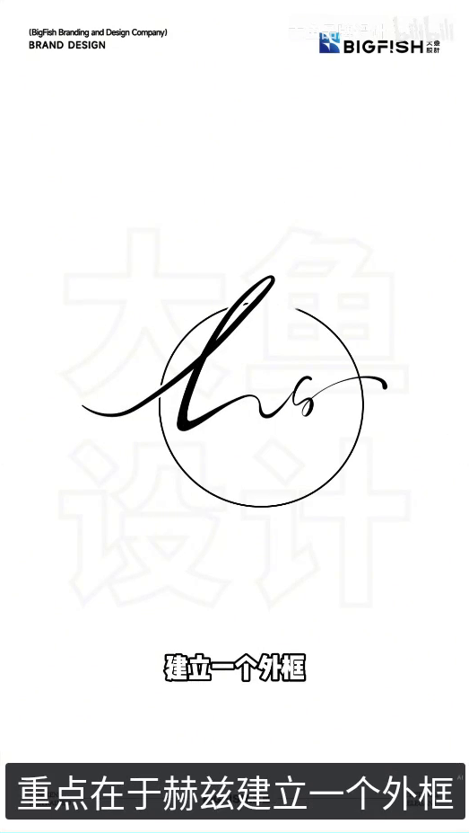

- **作者明确说法**：「建立一个外框」
- **播放器字幕**：「重点在于赫兹建立一个外框」
- **整理者观察**：细线圆框已绕住 hs，顶部仍留有开口，h 的上笔从开口处穿出。框内右下还没有波纹。

### H12 · 下沿出现稀疏波纹

约 42.0s（录屏 57.8s）

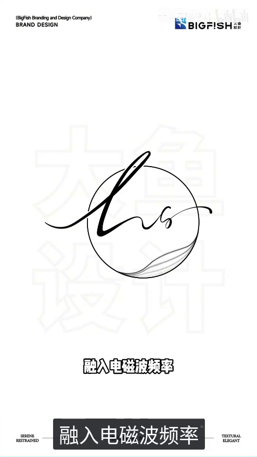

- **作者明确说法**：「融入电磁波频率」
- **整理者观察**：圆框右下沿里出现几道较浅、间距较疏的平行弧线，数量还不多，也尚未填满这一角。

### H13 · 波纹增多

约 42.2s（录屏 58.0s）

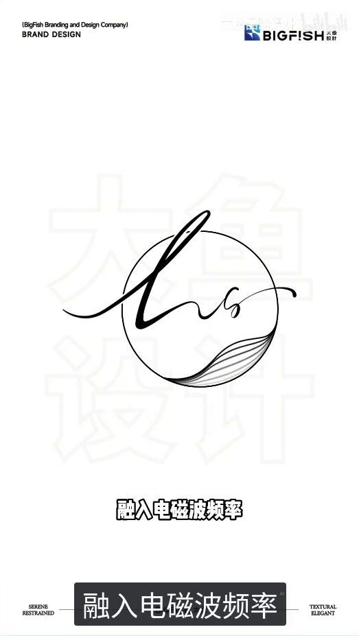

- **作者明确说法**：「融入电磁波频率」
- **整理者观察**：同一位置的平行弧线比上一帧更密、更高一些，仍没有最后那么紧。

### H14 · 波纹加密

约 42.4s（录屏 58.2s）

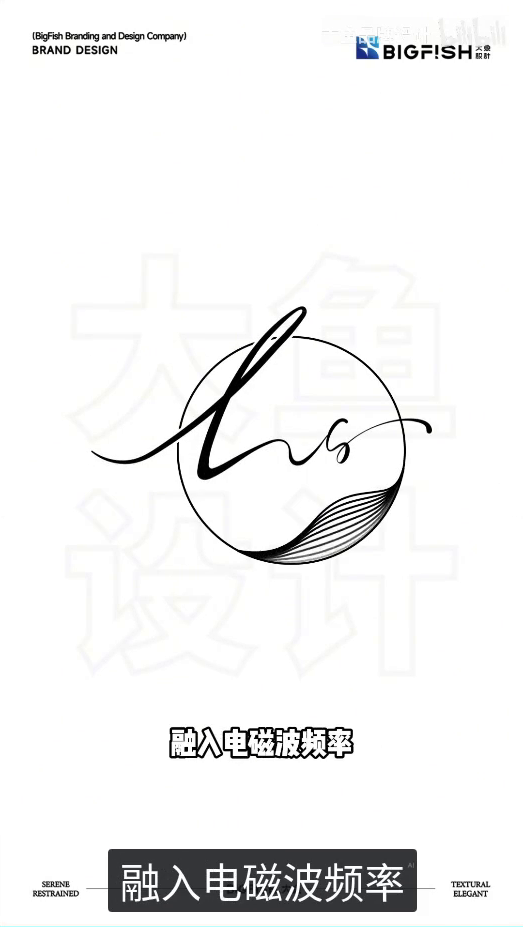

- **作者明确说法**：「融入电磁波频率」
- **整理者观察**：右下角的平行弧线进一步加密，形成一个更紧的扇形波纹区。标志下方还没有「HERS」「赫姿」。

### H15 · 加上 HERS / 赫姿

约 43.2s（录屏 59.0s）

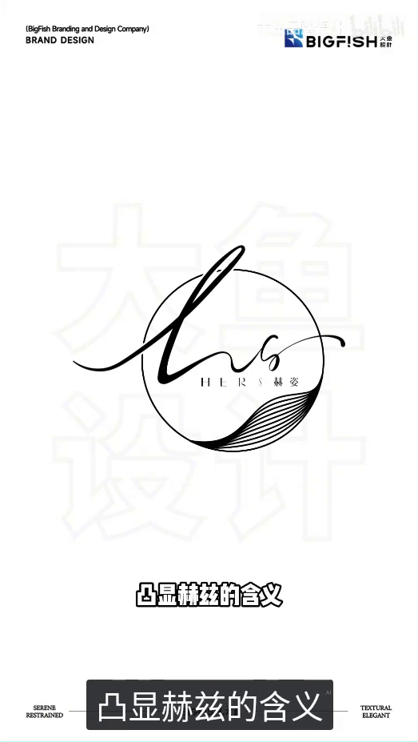

- **作者明确说法**：「凸显赫兹的含义」
- **整理者观察**：圆框手写与右下波纹已经齐备。框内下方有疏排的「HERS」，其右为「赫姿」。

### H16 · 反白用到室内照片上

约 45.2s（录屏 61.0s）

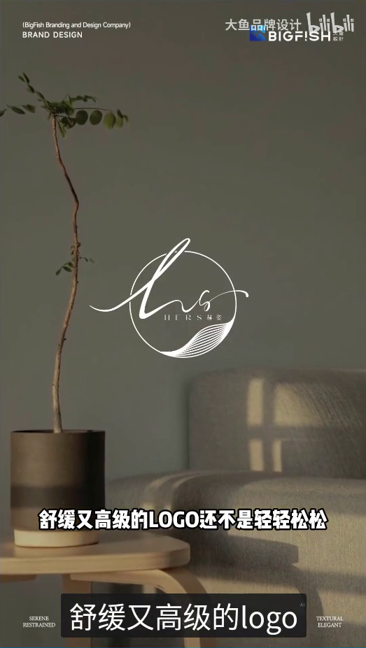

- **作者明确说法**：「舒缓又高级的LOGO还不是轻轻松松」
- **播放器字幕**：「舒缓又高级的logo」
- **整理者观察**：白色圆框手写标志压在绿灰色室内照片上，可见盆栽和沙发一类家具。

### 思路与前后关系（整理者分析，非作者原话）

先把并置的 h 与 S 按书写顺序逐笔改成连笔，写出较松的 hs（片内说「画出松弛高级的感觉」）。再逐步加上圆框，并在框内右下用一层层加密的平行弧线表示电磁波频率，用来「凸显赫兹的含义」。手写承担轻松、舒展的线质，波纹把「频率」接到同一枚标志里。完成稿在图形下写出「HERS」「赫姿」。

---

## 收束：三例并列

约 48.2s（录屏 64.0s）

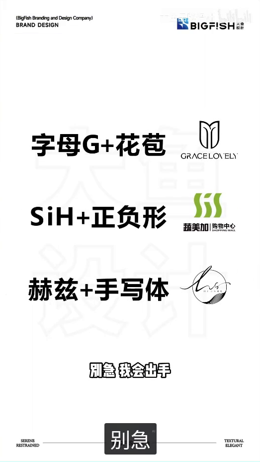

- **作者明确说法**：「别急我会出手」
- **播放器字幕**：「别急」
- **整理者观察**：左侧三行文字为「字母G+花苞」「SiH+正负形」「赫兹+手写体」，右侧是三枚完成态标志。第二行标志旁写有「蔬美加|购物中心」和「SHOPPING MALL」。本帧没有再讲解做法。
