# [如果你学会联想，LOGO设计也就手拿把掐](https://www.bilibili.com/video/BV11xaZ6pEjJ/)｜大鱼品牌设计

文中「约 00:mm」是按播放器时钟校准的近似时刻，误差约 ±1s；括号内为录屏精确秒。

## 案例一：数字 3 + 书 / BOOKHAVEN / LITERARY SOCIETY

### BH1 · 原形：黑色「3」和练习册并置

约 00:02（录屏 21.8s）

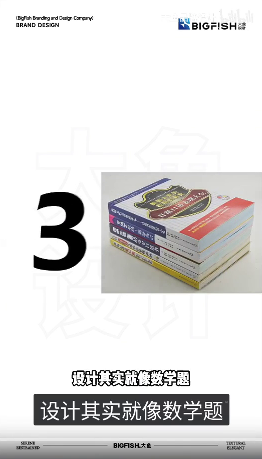

- **作者明确说法**：「设计其实就像数学题」
- **整理者观察**：左边是一枚黑色的「3」，右边是一叠彩色练习册，两者分开并置，还没有叠在一起。

### BH2 · 「3」斜化，叠到书本上

约 00:02（录屏 22.0s）

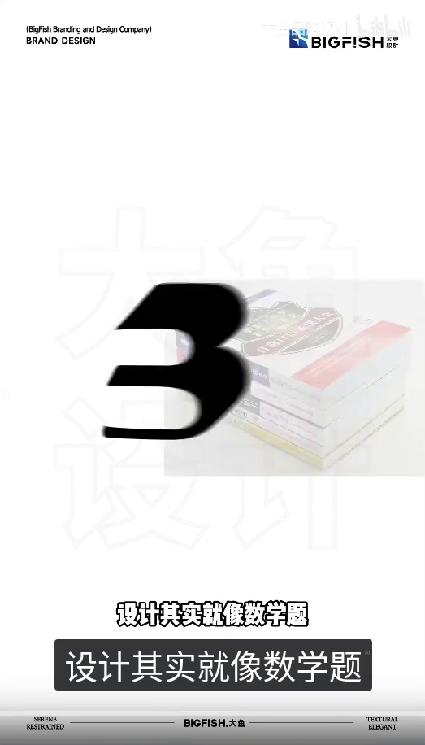

- **作者明确说法**：「设计其实就像数学题」
- **整理者观察**：原来那枚「3」变成更利落的风格化字形，向右移到练习册照片上，两者重叠。画面上仍是一枚黑色的「3」，没有另外复制出彩色的「3」。

### BH3 · 居中的风格化「3」，还没有页线

约 00:03（录屏 22.8s）

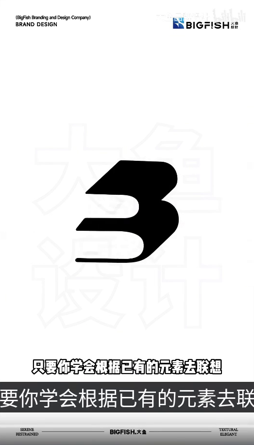

- **作者明确说法**：「只要你学会根据己有的元素去联想」
- **整理者观察**：风格化的黑「3」已经居中。上下两个钵都是实心黑色，还没有抽出页边线。

### BH4 · 下钵出现页线，上钵仍是实心

约 00:03（录屏 22.9s）

- **作者明确说法**：「只要你学会根据己有的元素去联想」
- **整理者观察**：下钵里已经抽出页线，上钵仍是实心黑色。

### BH5 · 上下两钵都有页线，成标

约 00:03（录屏 23.13s）

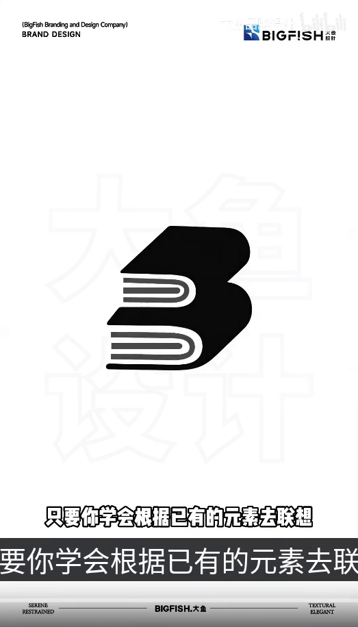

- **作者明确说法**：「只要你学会根据己有的元素去联想」
- **整理者观察**：上下两个钵里都已经抽出页线。每钵外沿是白色页边，中间夹着灰色的页线，不是简单的全黑白。这是这一案线标的黑色完成态。

### BH6 · 用到打开的书和城市场景上，BOOKHAVEN / LITERARY SOCIETY

约 00:05（录屏 24.67s）

- **作者明确说法**：「任何创意都手到擒来」
- **整理者观察**：同一件标志反白，平面叠在打开的书和城市场景上。字标为「BOOKHAVEN」和「LITERARY SOCIETY」。

### 思路与前后关系（整理者分析，非作者原话）

黑色的「3」和练习册先分开并置，再把「3」改成风格化字形，叠到书本上。居中之后，先在下钵抽出页线，再补上上钵；完成态里，白色页边中间夹着灰色页线，看起来像一本摊开的书。用到打开的书和城市场景上时，字标写成「BOOKHAVEN」和「LITERARY SOCIETY」。

---

## 案例二：饭团 / 便当熊 / BIANDANGXIONG

### BD1 · 对话框

约 00:07（录屏 26.5s）

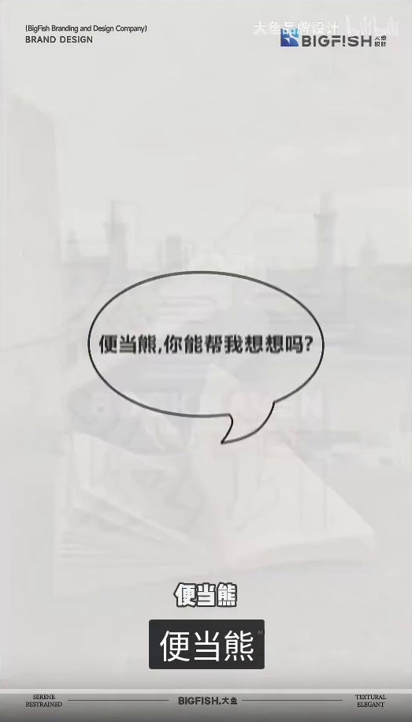

- **作者明确说法**：同一画面上，气泡里写着「便当熊,你能帮我想想吗?」。
- **整理者观察**：白底中央是一个线框气泡，尾朝右下。

### BD2 · 便当

约 00:09（录屏 28.73s）

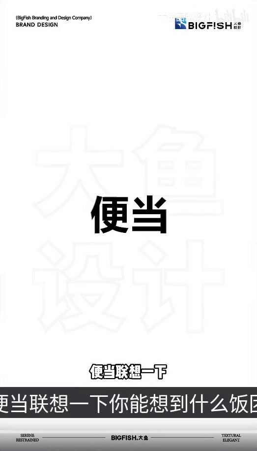

- **作者明确说法**：「便当联想一下」
- **整理者观察**：气泡已经退去，白底正中是大字「便当」。

### BD3 · 原形：带着脸的卡通饭团

约 00:11（录屏 31.0s）

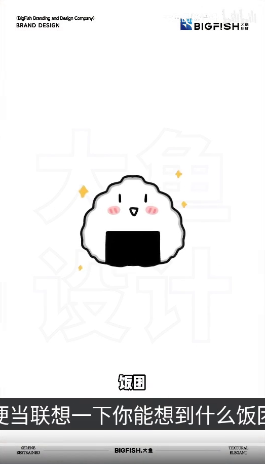

- **作者明确说法**：「饭团」
- **整理者观察**：白底中央是一只卡通饭团：白身、黑轮廓、两点眼睛、v形嘴、粉腮红、一块黑色矩形海苔，旁边还有黄色闪光。这时已经有五官。

### BD4 · 外轮廓和海苔改成粉红色，白色内部及原五官保留

约 00:12（录屏 32.0s）

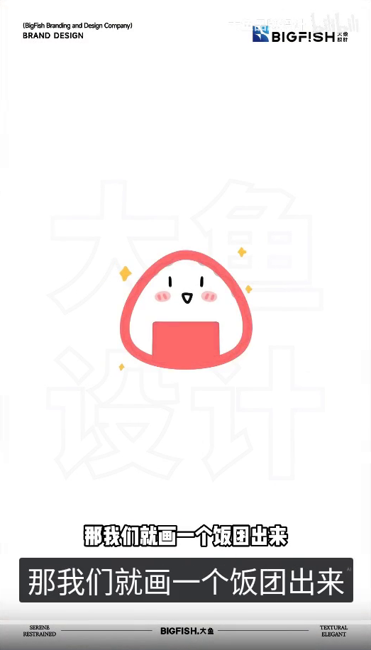

- **作者明确说法**：「那我们就画一个饭团出来」
- **整理者观察**：外轮廓和海苔改成粉红色，白色内部及原五官保留；眼睛、嘴巴、腮红和闪光都还在。

### BD5 · 去掉五官，收成几何红轮廓

约 00:13（录屏 32.47s）

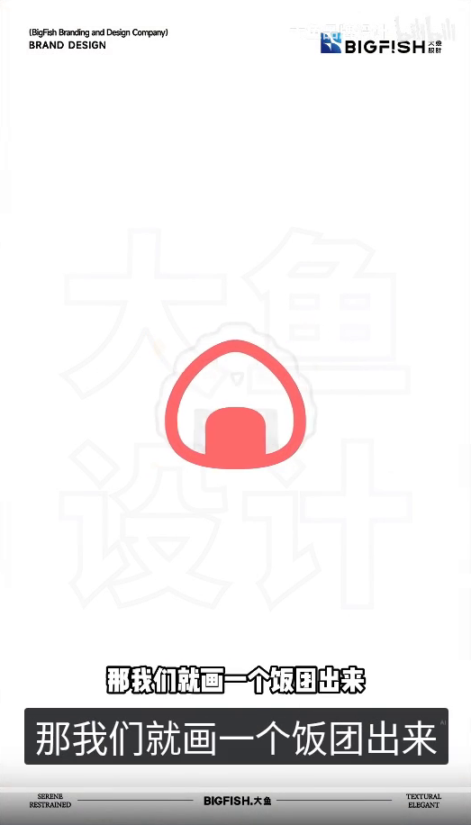

- **作者明确说法**：「那我们就画一个饭团出来」
- **整理者观察**：变成几何形的红轮廓饭团，里面是白色，海苔收成红色的圆角块。脸和闪光已经去掉。

### BD6 · 外轮廓转黑，海苔仍是红色

约 00:15（录屏 34.5s）

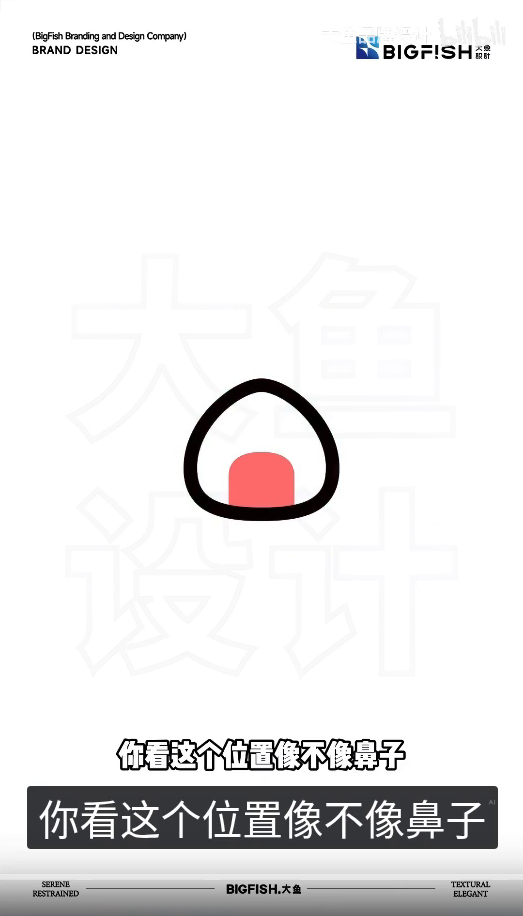

- **作者明确说法**：「你看这个位置像不像鼻子」
- **整理者观察**：外面的轮廓已经转成黑色，海苔那一块仍是粉红色，贴在下轮廓上。还没有眼睛。

### BD7 · 轮廓外上方出现两个浅灰圆点

约 00:16（录屏 36.0s）

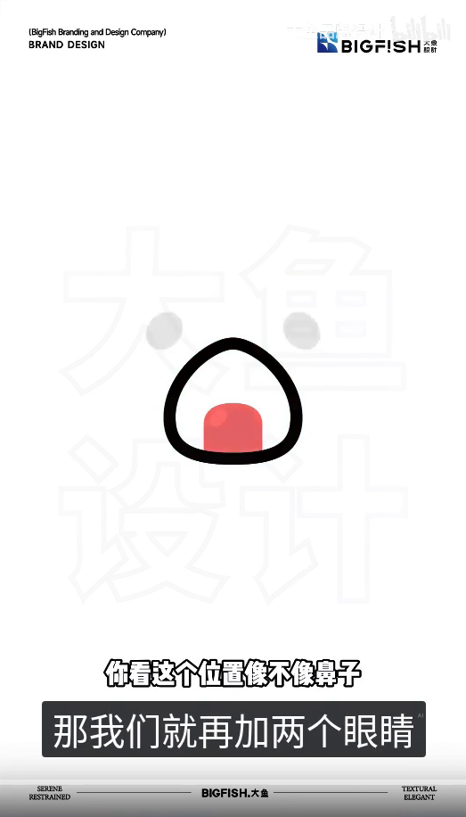

- **作者明确说法**：「你看这个位置像不像鼻子」
- **整理者观察**：轮廓外上方出现两个浅灰圆点，不在轮廓里面，也不是白眼圈。粉红色的鼻子已经和下轮廓连在一起。

### BD8 · 圆点转成黑点，鼻子还留着一点粉

约 00:16（录屏 36.23s）

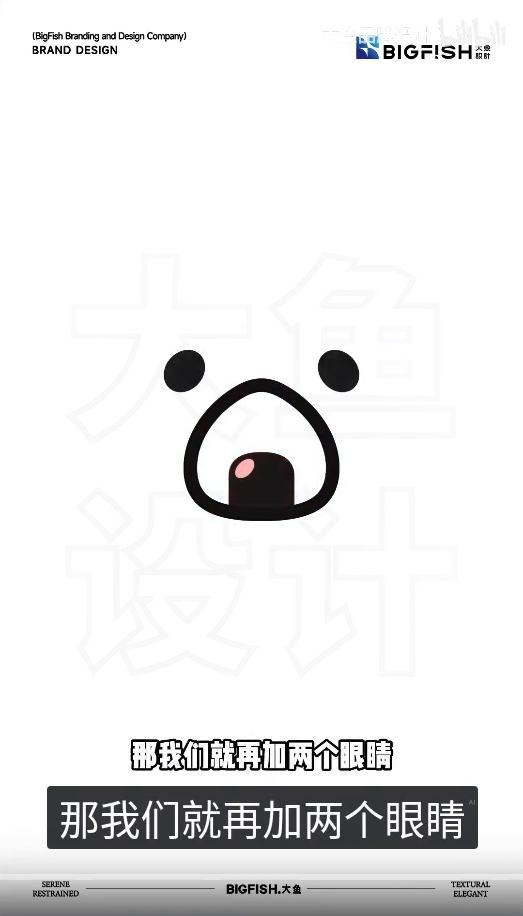

- **作者明确说法**：「那我们就再加两个眼睛」
- **整理者观察**：轮廓外上方已经是两枚互不相连的黑圆点。鼻子正在转黑，还留着一点粉红色，并带着白色高光，和下轮廓连在一起。

### BD9 · 成标：轮廓外的黑点和连在下沿的鼻子

约 00:17（录屏 36.5s）

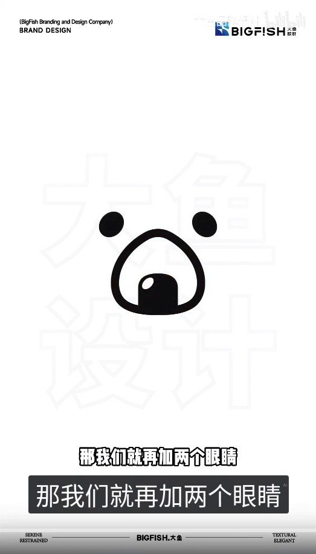

- **作者明确说法**：「那我们就再加两个眼睛」
- **整理者观察**：浅粉已经退尽。作者所说的「眼睛」是轮廓外上方两枚互不相连的黑圆点；黑色鼻子连在下轮廓上，带着一块白色高光；里面是白色。这是这一案线标的黑色完成态。

### BD10 · 用到野餐画面上，便当熊 / BIANDANGXIONG

约 00:21（录屏 40.5s）

- **作者明确说法**：「思路是不是一瞬间就打开了」
- **整理者观察**：同一件标志反白，平面叠在野餐草地的画面上，能看到面包、饮料和草地。字标为「便当熊」和「BIANDANGXIONG」。

### 思路与前后关系（整理者分析，非作者原话）

先画出一只已经带着脸的卡通饭团，再把外轮廓和海苔改成粉红色，白色内部及原五官保留；随后去掉五官，收成几何轮廓。外轮廓转黑之后，红色的海苔留在下沿当鼻子；随后在轮廓外上方加上两个圆点——作者把它们叫做眼睛——鼻子上的红色再撤掉，变成带高光的黑鼻子。用到野餐画面上时，字标写成「便当熊」和「BIANDANGXIONG」。

---

## 案例三：字母 M + 冲锋衣 + 勺子 / MECHANISM / 户外用品

### MK1 · 对话框

约 00:23（录屏 43.0s）

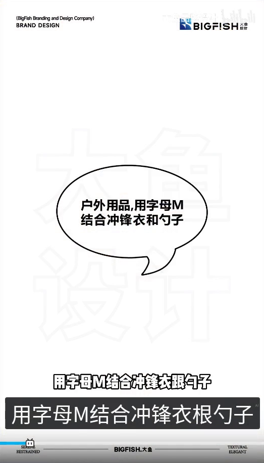

- **作者明确说法**：「用字母M结合冲鋒衣跟勺子」。同一画面上，气泡里写着「户外用品,用字母M」「结合冲锋衣和勺子」。
- **整理者观察**：白底中央是一个线框气泡，尾朝右下，下面另有一行描边字。

### MK2 · 原形：黑色字母 M

约 00:26（录屏 46.0s）

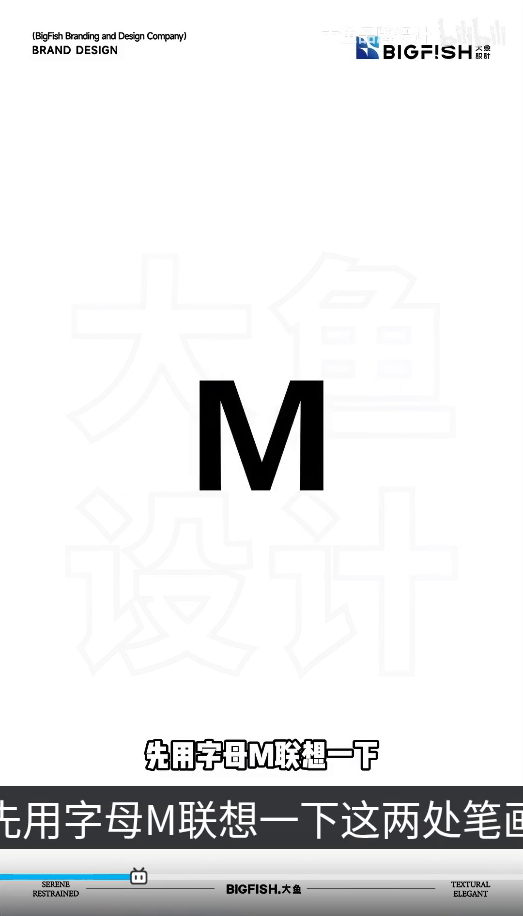

- **作者明确说法**：「先用字母M联想一下」
- **整理者观察**：白底中央是一枚很大的黑色无衬线 M，还没有改形，也没有颜色提示。

### MK3 · 两外侧竖笔下段出现粉红色

约 00:28（录屏 47.5s）

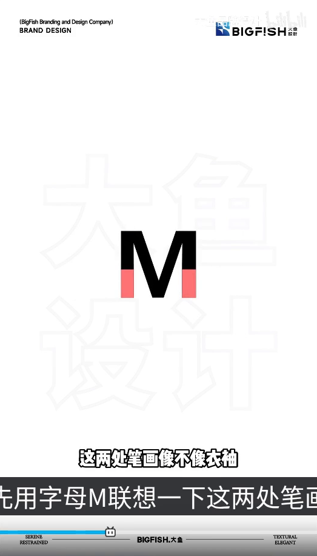

- **作者明确说法**：「这两处笔画像不像衣袖」
- **整理者观察**：左右两根竖笔的下段变成粉红色，其余部分仍是黑色。字形还是原来的 M，没有开始变形。

### MK4 · 粉红色撤掉，仍是常规的 M

约 00:29（录屏 49.0s）

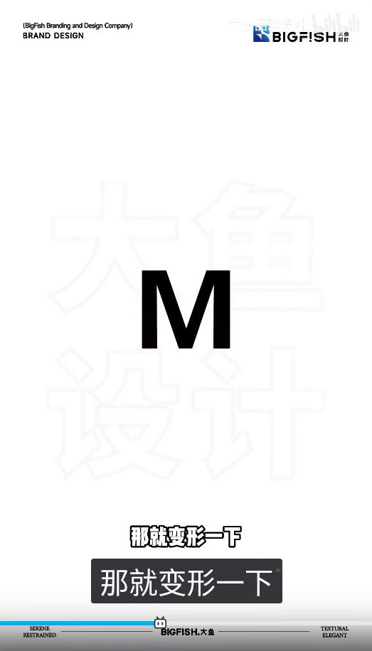

- **作者明确说法**：「那就变形一下」
- **整理者观察**：刚才的粉红色已经撤掉，看起来仍是一枚普通的黑色 M。颜色撤回和后面的变形是分开的两步。

### MK5 · 变形开始：顶部趋平，外侧外扩，内 V 还在

约 00:30（录屏 49.47s）

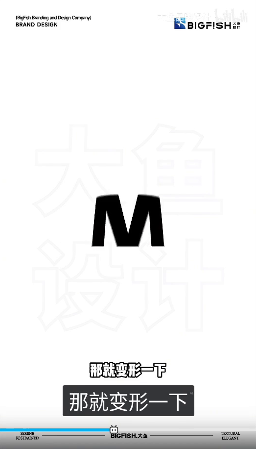

- **作者明确说法**：「那就变形一下」
- **整理者观察**：整字开始变形：顶部趋于平整，外侧两腿向外张开，中间的 V 仍然很低，快到下沿。还没有变成衣服的轮廓。

### MK6 · 收成冲锋衣剪影

约 00:30（录屏 49.5s）

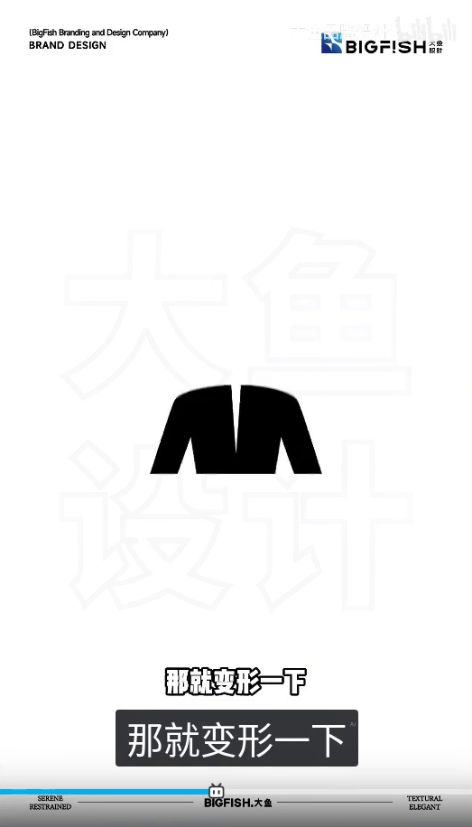

- **作者明确说法**：「那就变形一下」
- **整理者观察**：已经收成一件冲锋衣剪影：肩膀圆了，袖管向外张开，头顶中心有一条向下开的窄白缝。原来那个低低的 V 已经不在。这时还没有帽子。

### MK7 · 顶缝收细，仍没有帽子

约 00:30（录屏 49.73s）

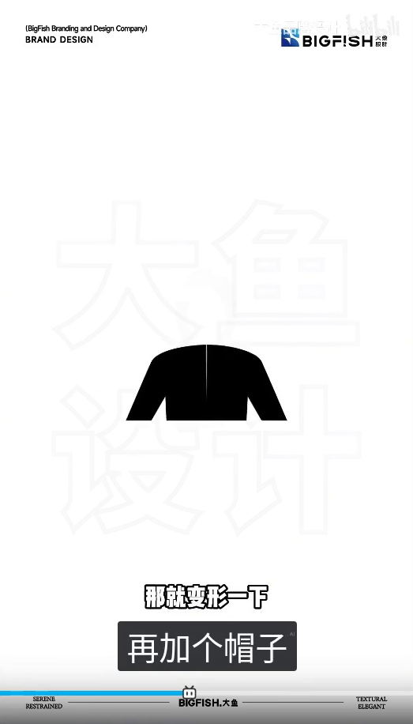

- **作者明确说法**：「那就变形一下」
- **整理者观察**：头顶那条白缝收细成一条中线，还是没有帽子或兜帽。

### MK8 · 浅灰色的兜帽开始出现

约 00:30（录屏 49.77s）

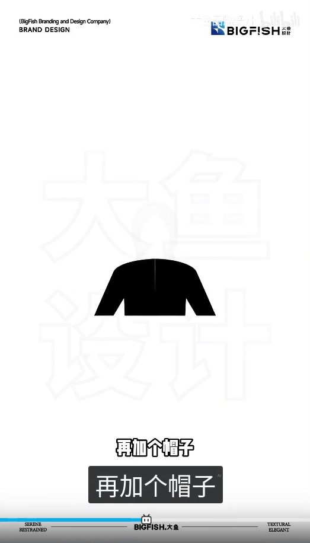

- **作者明确说法**：「再加个帽子」
- **整理者观察**：头顶开始出现浅灰色的兜帽，原来那条细缝还能看见。

### MK9 · 灰色兜帽和白色脸口

约 00:30（录屏 50.0s）

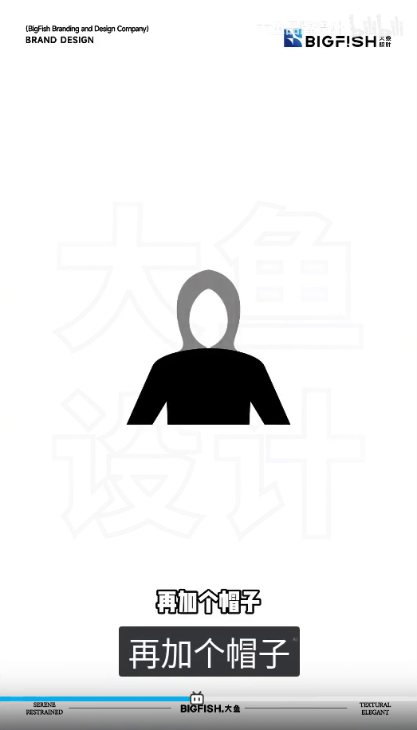

- **作者明确说法**：「再加个帽子」
- **整理者观察**：灰色兜帽已经清楚，中间留着一个白色椭圆形的脸口。

### MK10 · 兜帽转成黑色，连到衣身

约 00:30（录屏 50.23s）

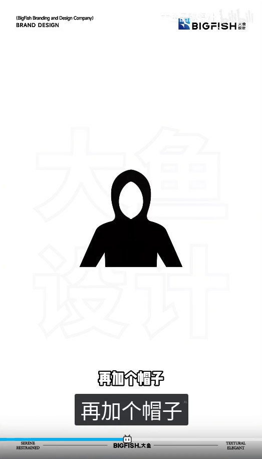

- **作者明确说法**：「再加个帽子」
- **整理者观察**：兜帽已经转成实心黑色，和衣身连在一起，中间仍是白色椭圆脸口。

### MK11 · 临时叠上一把灰色的勺子

约 00:32（录屏 52.0s）

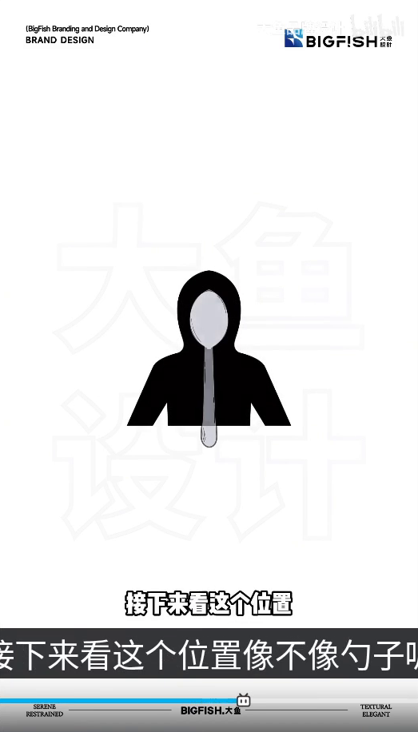

- **作者明确说法**：「接下来看这个位置」
- **整理者观察**：一把浅灰色的勺子叠在衣服上：碗落在已有的脸口里，柄顺着身体向下，末端略低于下摆。这是临时加上去的提示，还不是完成态里的负形。

### MK12 · 把勺子撤掉，只留下椭圆脸口

约 00:34（录屏 54.13s）

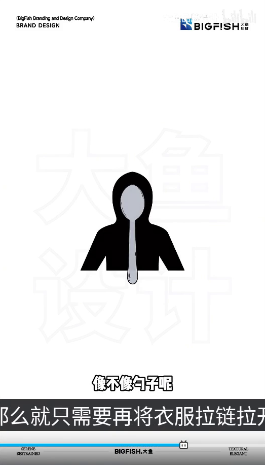

- **作者明确说法**：「像不像勺子呢」
- **整理者观察**：灰色勺子已经撤掉，回到冲锋衣、兜帽和白色椭圆脸口。躯干上还没有拉开的缝。

### MK13 · 拉链开始打开

约 00:35（录屏 54.9s）

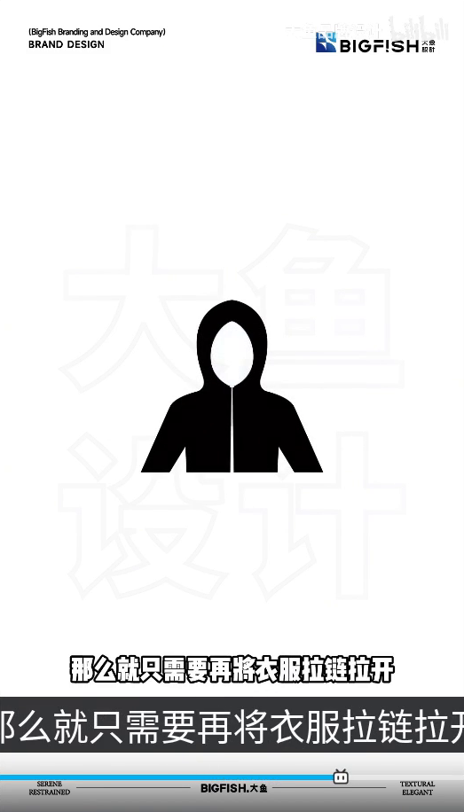

- **作者明确说法**：「那么就只需要再將衣服拉链拉开」
- **整理者观察**：从椭圆脸口下方，沿躯干出现一条细细的白色竖缝，拉链刚开始打开。

### MK14 · 成标：拉开后的白色勺子

约 00:35（录屏 55.23s）

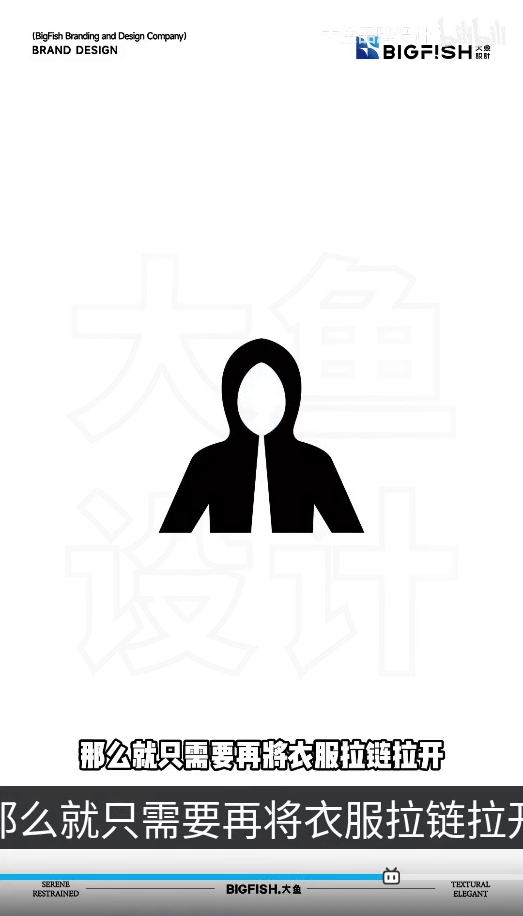

- **作者明确说法**：「那么就只需要再將衣服拉链拉开」
- **整理者观察**：白缝加宽之后，椭圆脸口成了勺碗，拉链缝成了勺柄。柄是下宽上细，白缝一直通到下摆的开口，不是上下一般粗的一条缝。这是这一案线标的黑色完成态：白色勺子是拉开拉链之后留下的负形，不是把先前那把灰勺拉宽。

### MK15 · 用到森林画面上，MECHANISM / 户外用品

约 00:36（录屏 56.2s）

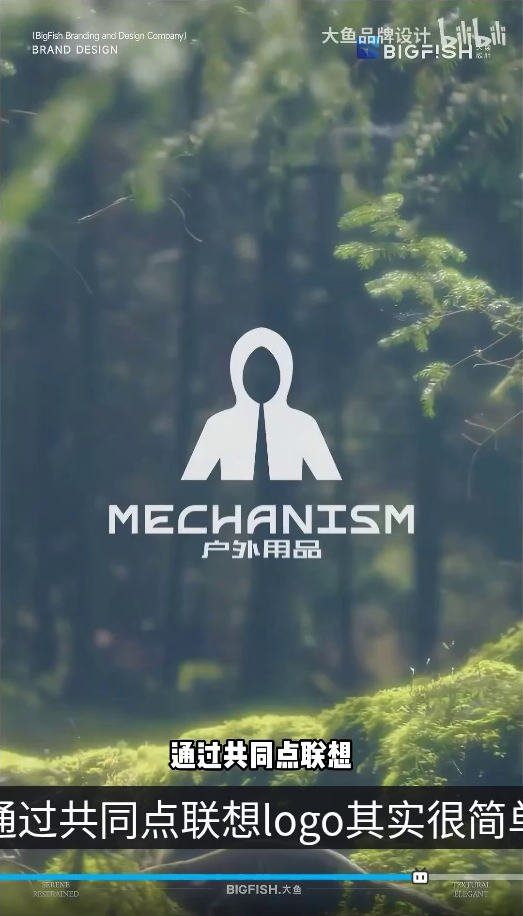

- **作者明确说法**：「通过共同点联想」
- **整理者观察**：同一件标志反白，平面叠在森林画面上。字标为「MECHANISM」和「户外用品」。

### 思路与前后关系（整理者分析，非作者原话）

先画出一枚黑色的 M，用粉红色提示两处衣袖，再把颜色撤掉。随后整字变形，收成冲锋衣剪影，再加上带脸口的兜帽。一把灰色勺子先叠上去作提示，随即撤掉；把衣服拉链拉开之后，白色的脸口和通到下摆的缝才组成勺子。用到森林画面上时，字标写成「MECHANISM」和「户外用品」。

---

## 案例四：打板器、摄像机 / 猩猩影视 / orangutan movies

### XX1 · 对话框

约 00:40（录屏 59.5s）

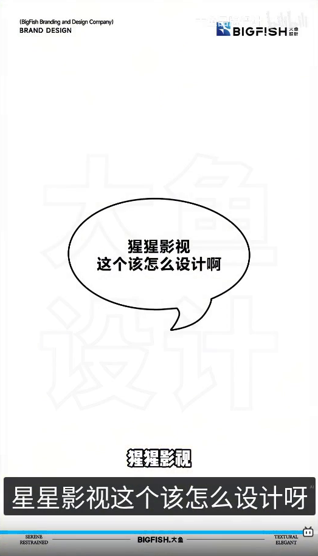

- **作者明确说法**：「猩猩影视」。同一画面上，气泡里写着「猩猩影视」「这个该怎么设计啊」。
- **整理者观察**：白底中央是一个线框气泡，尾朝右下，下面另有一行描边字。

### XX2 · 影视

约 00:42（录屏 61.77s）

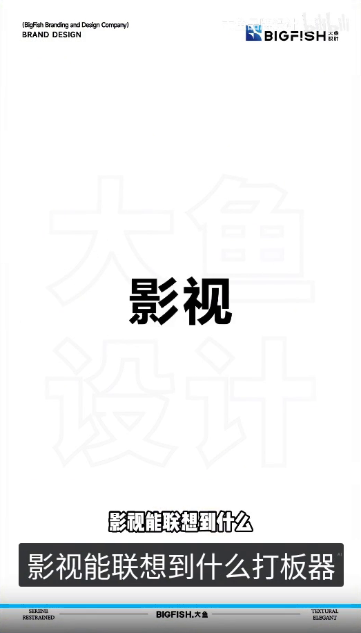

- **作者明确说法**：「影视能联想到什么」
- **整理者观察**：气泡已经退去，白底正中是大字「影视」。

### XX3 · 先放出写实的打板器

约 00:43（录屏 63.0s）

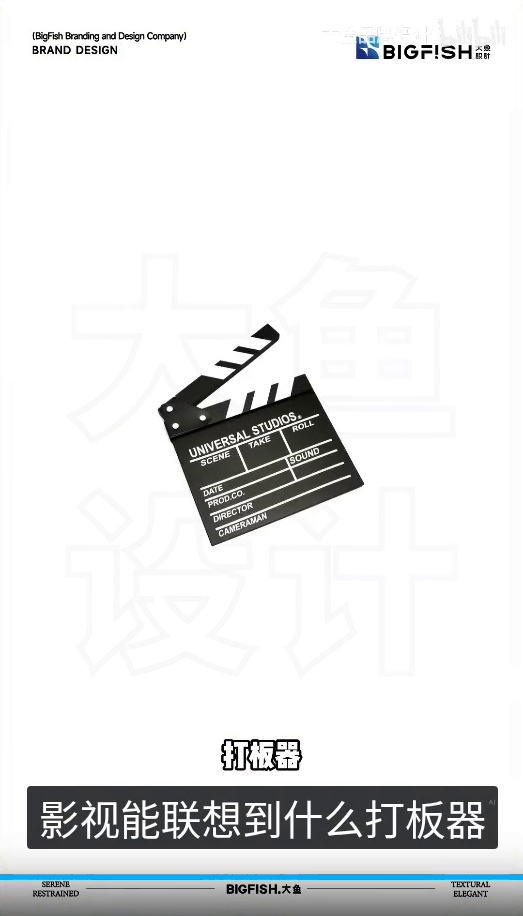

- **作者明确说法**：「打板器」
- **整理者观察**：白底中央是一块写实的电影打板器，还能读到 SCENE、TAKE 等栏目。这时下面还没有猩猩。

### XX4 · 打板器和卡通猩猩并置

约 00:45（录屏 65.0s）

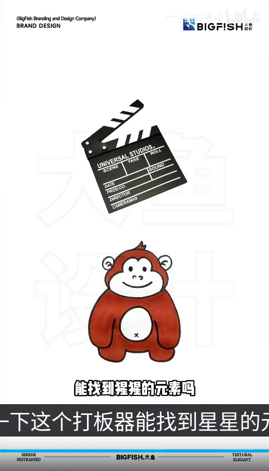

- **作者明确说法**：「能找到猩猩的元素吗」
- **整理者观察**：打板器下面出现一只棕色的卡通猩猩，白肚子上有一个小叉，在微笑。两者上下并置，打板器没有变成猩猩。

### XX5 · 用白色的 X 否决这次尝试

约 00:46（录屏 66.27s）

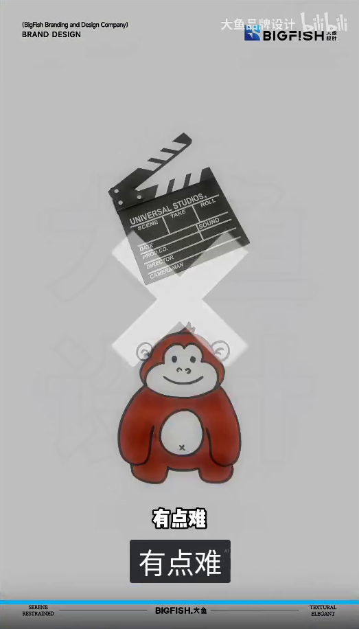

- **作者明确说法**：「有点难」
- **整理者观察**：画面蒙上灰色，一个白色的大 X 同时打在打板器和猩猩上。这是把第一次尝试划掉，不是把打板器改成猩猩。

### XX6 · 换一个元素

约 00:47（录屏 67.1s）

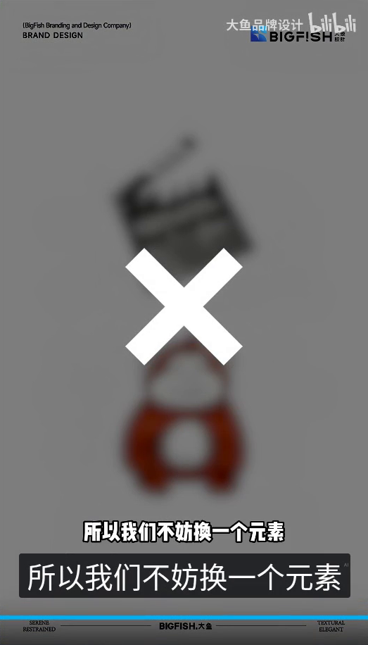

- **作者明确说法**：「所以我们不妨换一个元素」
- **整理者观察**：打板器和猩猩已经发虚、退去，白色的 X 还留在上面。

### XX7 · 摄像机线描在被否决的画面上淡入

约 00:49（录屏 68.77s）

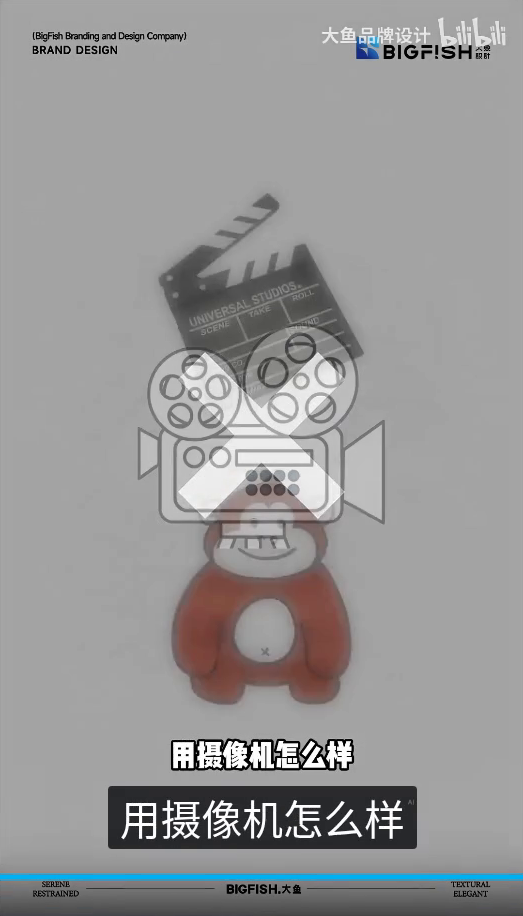

- **作者明确说法**：「用摄像机怎么样」
- **整理者观察**：电影摄像机的线描正在灰色底子上淡入，原先被划掉的残影还在。这是换元素时的中间状态，轮廓还没有完全清楚。

### XX8 · 详细的线描电影摄像机

约 00:49（录屏 69.0s）

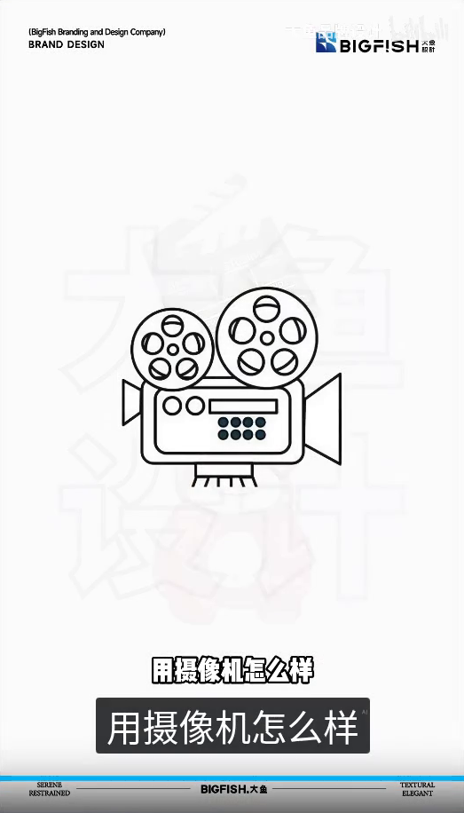

- **作者明确说法**：「用摄像机怎么样」
- **整理者观察**：白底上是一枚详细的黑色线描电影摄像机：两只片盘、机身、镜头和按钮都画出来了，还没有填成实心。

### XX9 · 用粉红椭圆标出两只片盘

约 00:50（录屏 70.0s）

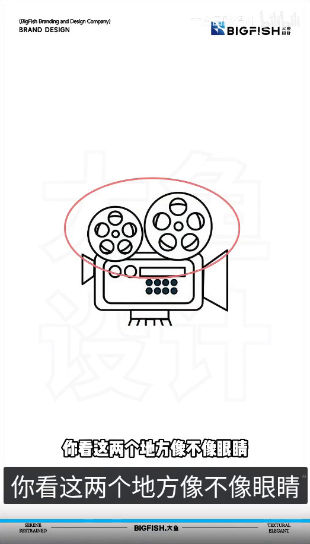

- **作者明确说法**：「你看这两个地方像不像眼睛」
- **整理者观察**：一个粉红色的椭圆圈住上方两只片盘。这是临时的提示，摄像机仍是原来的详细线描。

### XX10 · 粉红椭圆撤掉，仍是详细线描

约 00:52（录屏 71.73s）

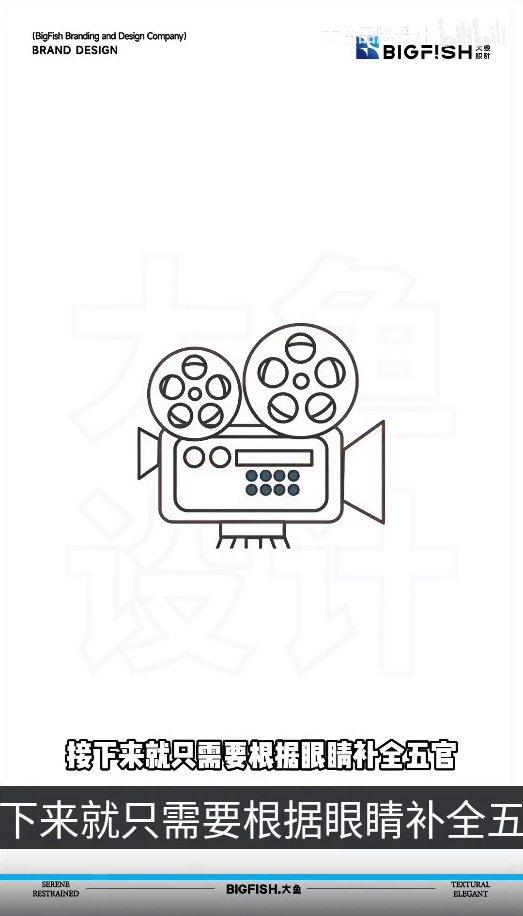

- **作者明确说法**：「接下来就只需要根据眼睛补全五官」
- **整理者观察**：粉红色椭圆已经撤掉，仍是那枚详细的线描摄像机，内部零件还在。

### XX11 · 收成红色的简化空心轮廓

约 00:52（录屏 72.0s）

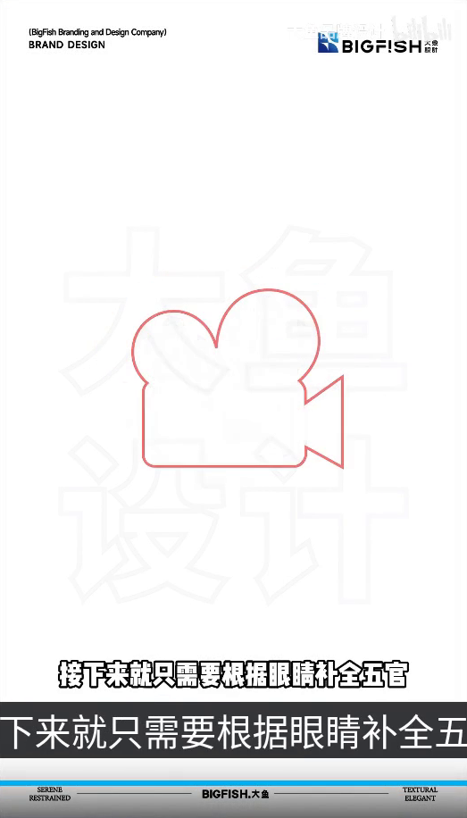

- **作者明确说法**：「接下来就只需要根据眼睛补全五官」
- **整理者观察**：详细线描已经换成简化的红色轮廓：顶上两个圆片盘，机身是矩形，右边是镜头的三角，中间是空心的白色，内部零件已经没有了。

### XX12 · 红轮廓里填上灰色

约 00:53（录屏 72.53s）

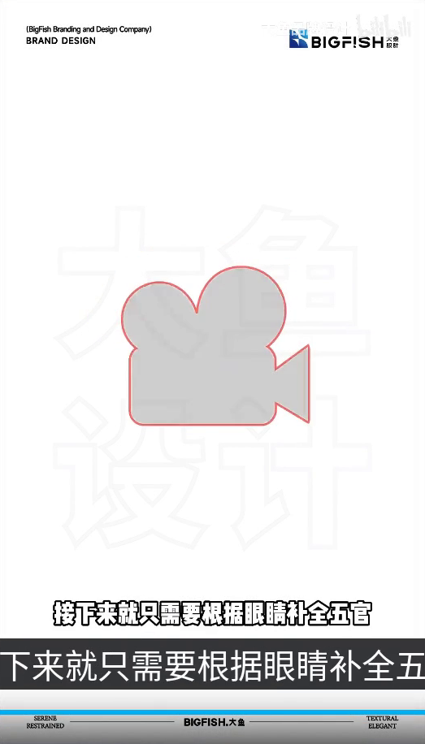

- **作者明确说法**：「接下来就只需要根据眼睛补全五官」
- **整理者观察**：空心里面填上中灰色，红色轮廓还看得见。这时还没有五官。

### XX13 · 实心黑色剪影，还没有五官

约 00:53（录屏 73.0s）

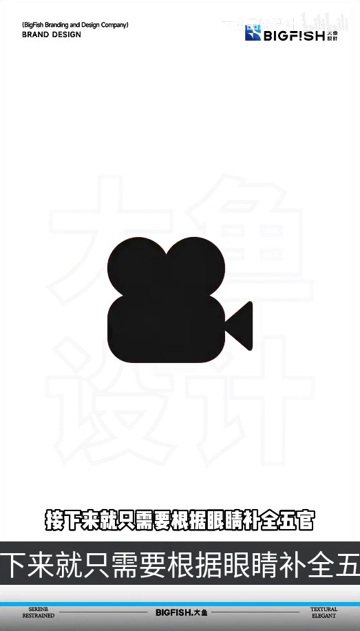

- **作者明确说法**：「接下来就只需要根据眼睛补全五官」
- **整理者观察**：已经收成实心黑色的摄像机剪影，红色轮廓几乎退尽，还没有眼睛和嘴。

### XX14 · 五官浅浅地一齐显出

约 00:53（录屏 73.07s）

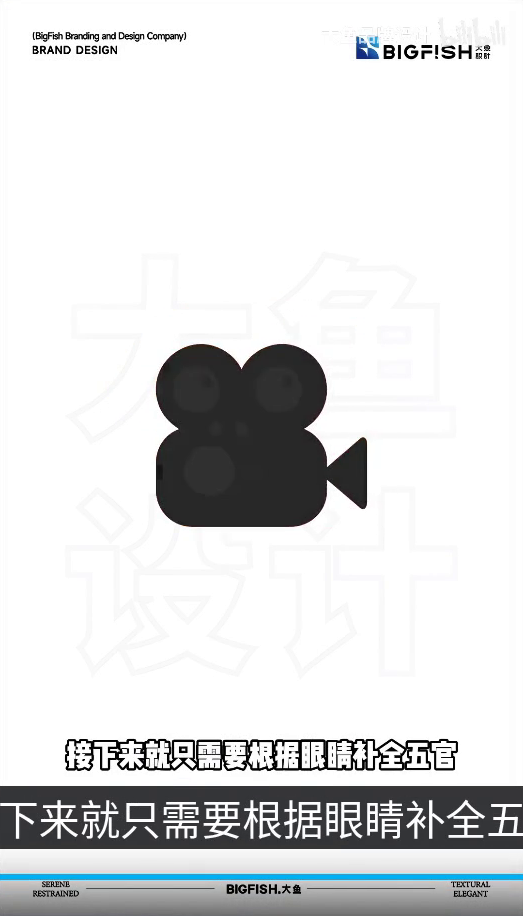

- **作者明确说法**：「接下来就只需要根据眼睛补全五官」
- **整理者观察**：浅淡的白色五官已经一起显出来：两只片盘位置上是眼圈和瞳孔，左下方是口鼻，眼睛和嘴之间还有小白点。还不是最后的对比。

### XX15 · 成标：白色负形五官稳住

约 00:53（录屏 73.23s）

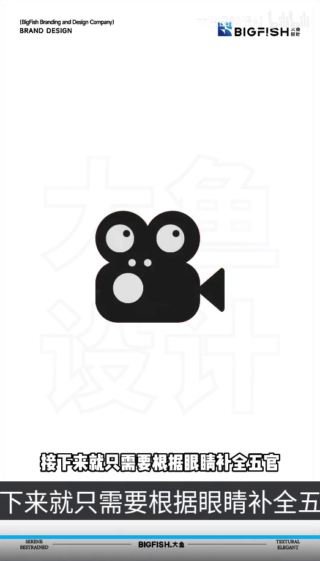

- **作者明确说法**：「接下来就只需要根据眼睛补全五官」
- **整理者观察**：白色的眼睛和口鼻已经清楚稳住。这是这一案线标的黑色完成态。

### XX16 · 用到电影器材画面上，猩猩影视 / orangutan movies

约 00:55（录屏 74.73s）

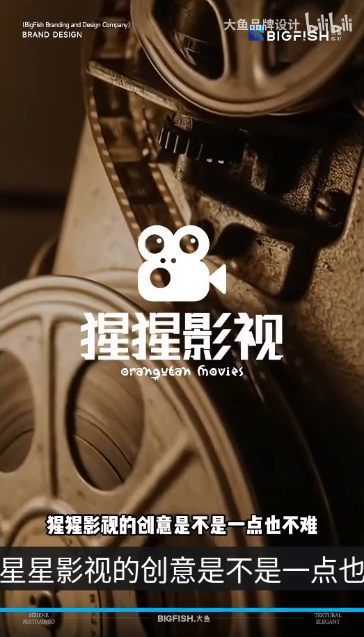

- **作者明确说法**：「猩猩影视的创意是不是一点也不难」
- **整理者观察**：同一件标志反白，平面叠在褐色的电影器材画面上。字标为「猩猩影视」和「orangutan movies」。

### 思路与前后关系（整理者分析，非作者原话）

先尝试把打板器和卡通猩猩放在一起，觉得难之后用白色的 X 把这次尝试划掉，再改用电影摄像机。详细的线描先用椭圆标出两只片盘，随即把提示撤掉，再收成红色的简化轮廓，填成黑色剪影，最后才显出五官。用到电影器材画面上时，字标写成「猩猩影视」和「orangutan movies」。

---

## 收束：三例并列

约 00:59（录屏 78.5s）

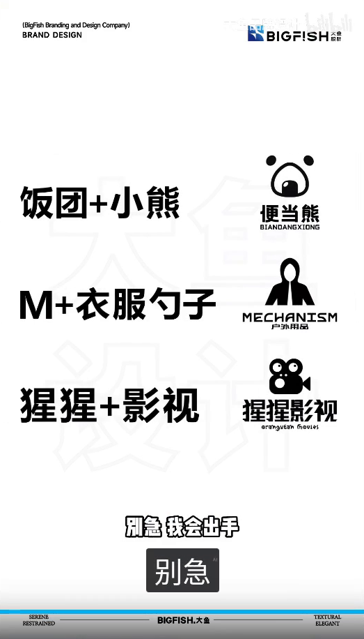

- **作者明确说法**：「别急 我会出手」
- **整理者观察**：白底三行并列，没有片头的书和 BOOKHAVEN。左侧写着「饭团+小熊」、「M+衣服勺子」、「猩猩+影视」；右侧各配对应的完成态标志，以及字标便当熊 / BIANDANGXIONG、MECHANISM / 户外用品、猩猩影视 / orangutan movies。
