# [只要学会找关键词，LOGO设计你就手拿把掐](https://www.bilibili.com/video/BV13pp46QES8)｜大鱼品牌设计

## 案例一：咖啡杯 + 乌鸦 / BlackFeather COFFEE

### BF1 · 咖啡杯和乌鸦

约 0.75s（录屏 25.5s）

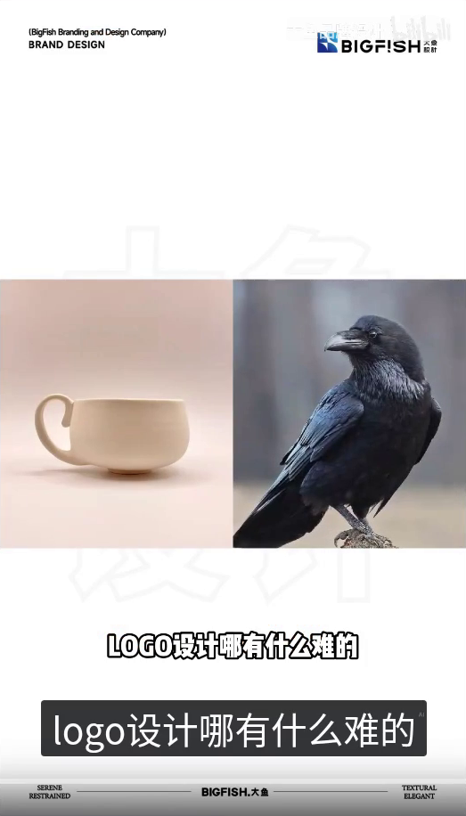

- **作者明确说法**：「LOGO设计哪有什么难的」
- **整理者观察**：左右并置两张照片，中间没有叠在一起。左边是米白色陶瓷杯，杯把在左侧，口沿能看到浅色内侧；右边是一只自然站姿的乌鸦。此时还没有粉色遮罩。

### BF2 · 叠上粉色遮罩

约 1.05s（录屏 25.8s）

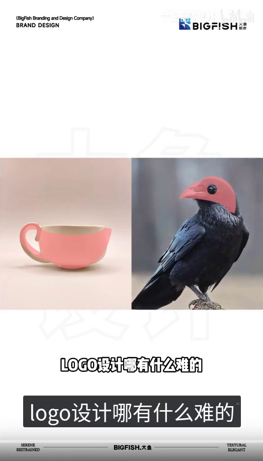

- **作者明确说法**：「LOGO设计哪有什么难的」
- **整理者观察**：杯身被填成珊瑚粉，杯把仍是原来的陶瓷色。乌鸦的头和喙上覆着粉色遮罩，并露出一枚黑眼点。这些色块还叠在照片上，没有脱离成独立标志。

### BF3 · 杯弧和鸟头会合

约 1.85s（录屏 26.6s）

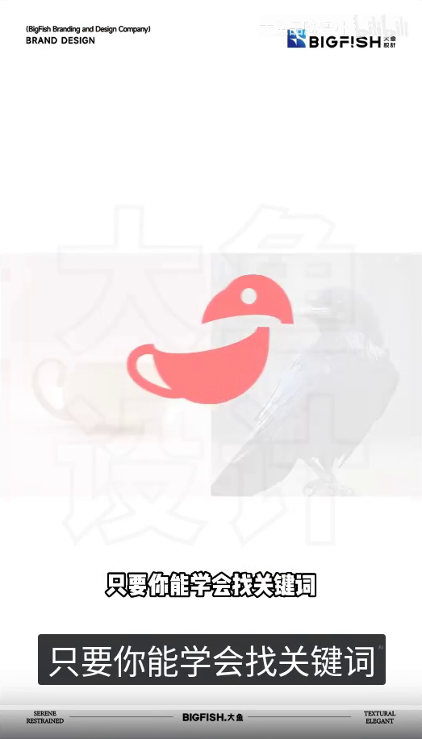

- **作者明确说法**：「只要你能学会找关键词」
- **整理者观察**：两张照片已经明显变淡。珊瑚红的杯弧带着左侧杯把，和右侧的鸟头在中央会合，还看不见腿。

### BF4 · 红身鸟杯形，还没有腿

约 2.05s（录屏 26.8s）

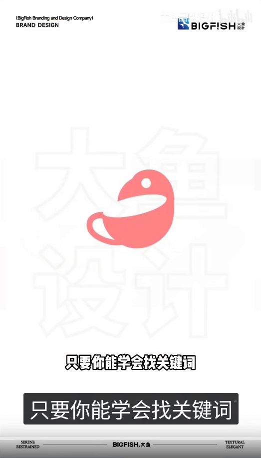

- **作者明确说法**：「只要你能学会找关键词」
- **整理者观察**：照片已经退去。留下珊瑚红的鸟杯形：头部有圆形白眼，杯口是一弯白色新月，左侧是开环的杯把。这一帧还看不见腿。

### BF5 · 添上浅灰的腿

约 2.25s（录屏 27.0s）

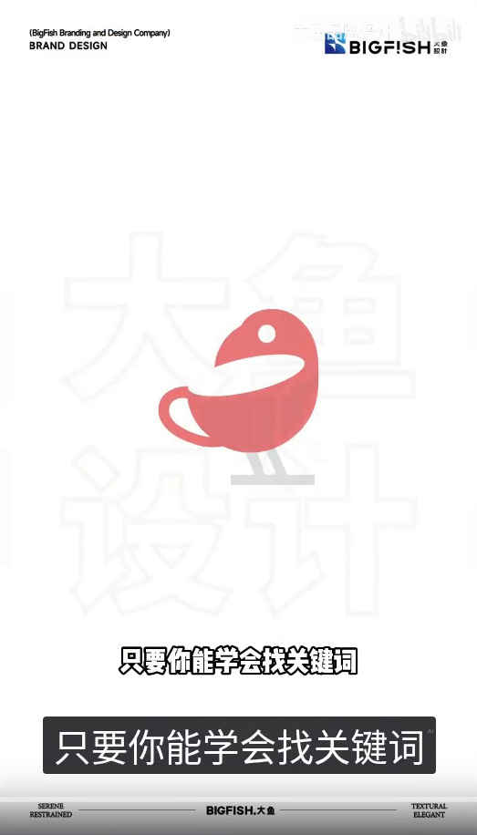

- **作者明确说法**：「只要你能学会找关键词」
- **整理者观察**：鸟杯形的身体仍是珊瑚红，白眼和白新月还在；下方新出现两只浅灰色的腿和一条横档。腿不是红色，所以这一帧还不是整枚红标。

### BF6 · 改成黑标

约 3.25s（录屏 28.0s）

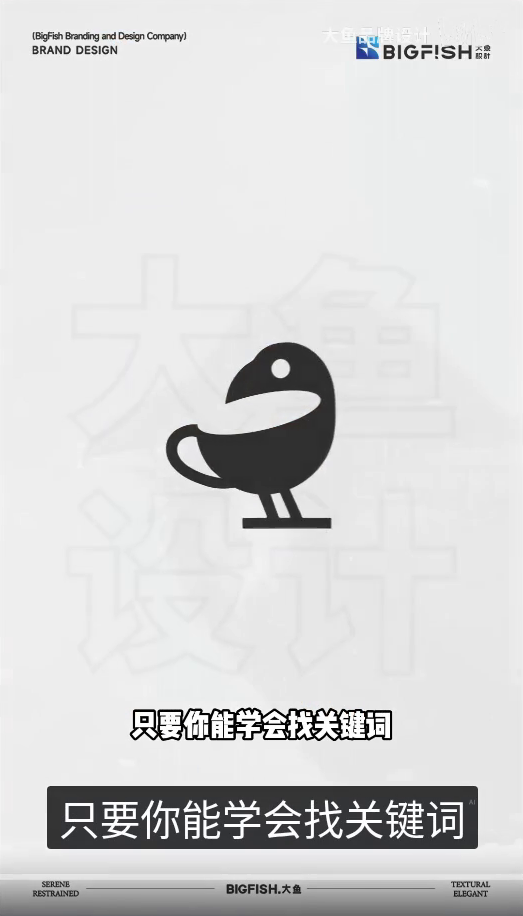

- **作者明确说法**：「只要你能学会找关键词」
- **整理者观察**：同一件鸟杯形连同腿和横档都改成了黑色，白眼和白咖啡新月留作镂空。这是这一案线标的黑色完成态。

### BF7 · 用到乌鸦照片上，BlackFeather COFFEE

约 4.25s（录屏 29.0s）

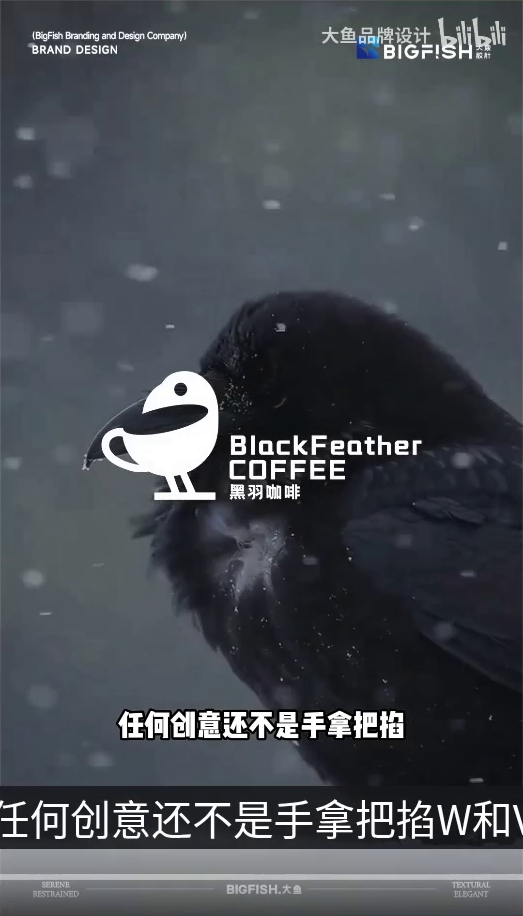

- **作者明确说法**：「任何创意还不是手拿把掐」
- **播放器字幕**（非作者原话）：同一句后面还接着出现「W和V」。
- **整理者观察**：白色平面标志压在暗色乌鸦照片上，画面里有飞雪，是平面叠加，不是立体标。字标为 BlackFeather COFFEE，BlackFeather 连写，COFFEE 在第二行；其下是「黑羽咖啡」。

### 思路与前后关系（整理者分析，非作者原话）

杯身和鸟头被收成同一件图形：左边的杯把、白色新月（既是液面也是喙下的分界）和双腿，可以同时读成杯子和鸟。

---

## 案例二：W + V + 皇冠 / WINNER. VALUE

### WV1 · 对话框

约 6.25s（录屏 31.0s）

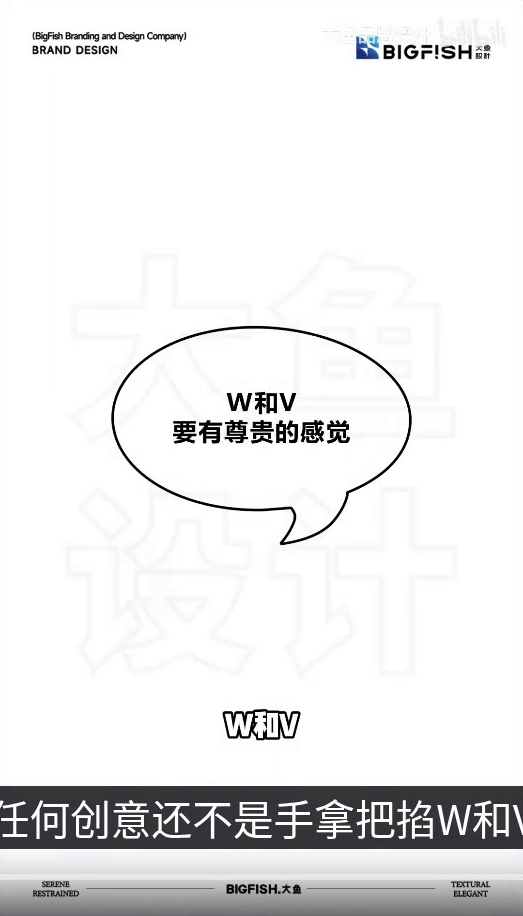

- **作者明确说法**：「W和V」。同一画面上，气泡里写着「W和V」「要有尊贵的感觉」。
- **整理者观察**：白底中央是一个线框椭圆气泡，下面另有一行衬线描边字。

### WV2 · 关键词「尊贵」

约 8.25s（录屏 33.0s）

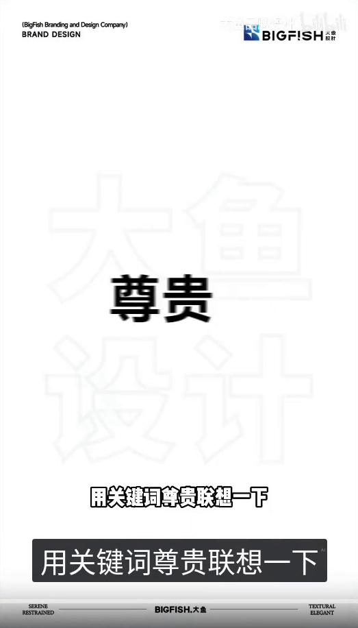

- **作者明确说法**：「用关键词尊贵联想一下」
- **整理者观察**：白底正中是两字标题「尊贵」。

### WV3 · 皇冠参考

约 10.25s（录屏 35.0s）

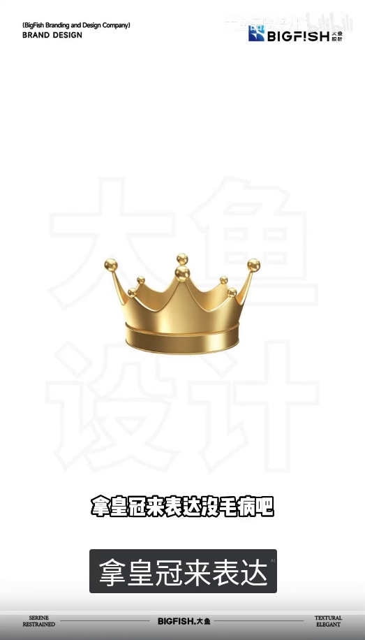

- **作者明确说法**：「拿皇冠来表达没毛病吧」
- **整理者观察**：一顶金色皇冠的渲染，尖顶上有圆珠，下部有一圈冠箍。这是联想用的参考，不是后面那枚平面成标。

### WV4 · 字母 W 和 V

约 12.25s（录屏 37.0s）

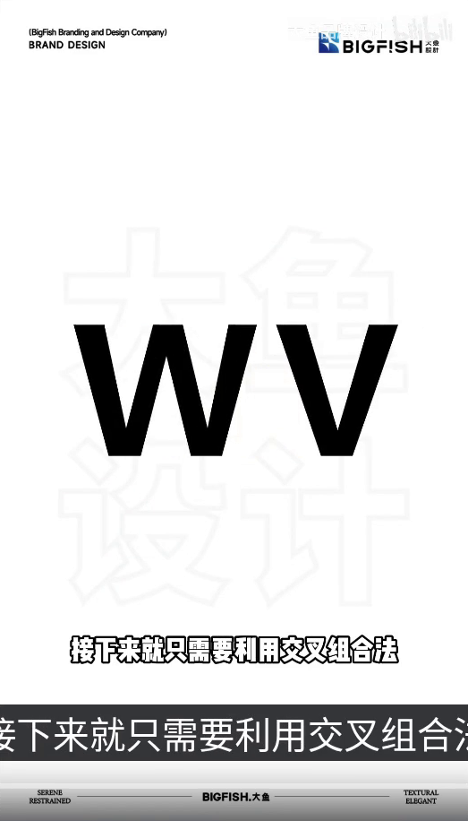

- **作者明确说法**：「接下来就只需要利用交叉组合法」
- **整理者观察**：两枚粗无衬线字母左右分开，W 在左、V 在右，中间有明显白缝，还没有叠上。

### WV5 · 交叉叠合中

约 12.65s（录屏 37.4s）

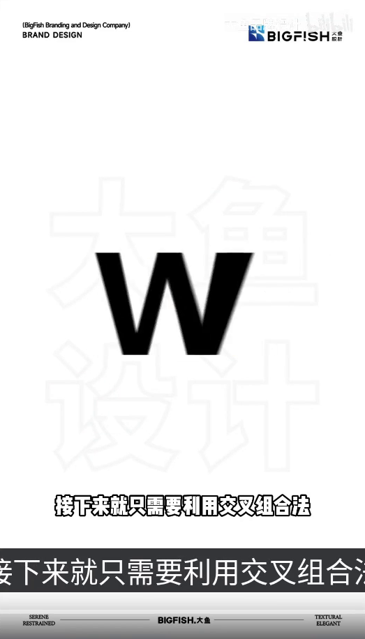

- **作者明确说法**：「接下来就只需要利用交叉组合法」
- **整理者观察**：两枚字母正在靠近、开始叠合，轮廓还带着运动残影。这是中间态，不是完成形。

### WV6 · 实心交叉

约 13.25s（录屏 38.0s）

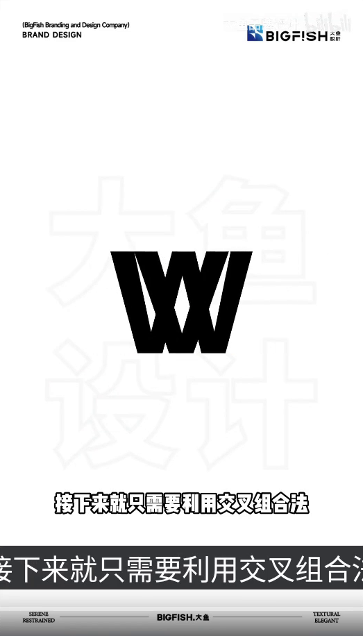

- **作者明确说法**：「接下来就只需要利用交叉组合法」
- **整理者观察**：W 和 V 已经叠成一块实心组合。中心的菱形是交叉形成的空隙；左侧竖笔上还能看见一条细白缝。三个尖顶上还没有圆点。

### WV7 · 改成描边

约 14.25s（录屏 39.0s）

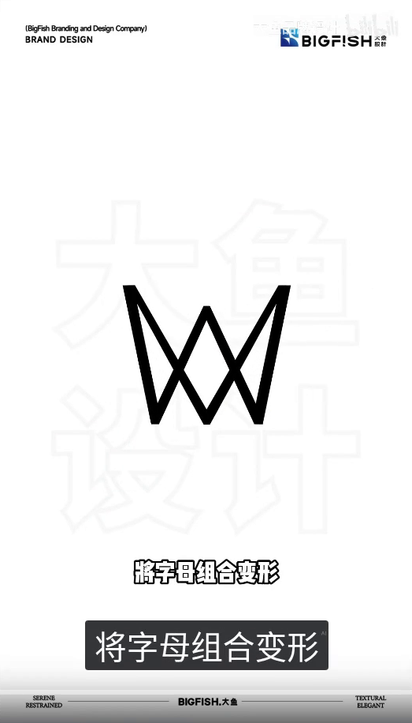

- **作者明确说法**：「將字母组合变形」
- **整理者观察**：实心块改成空心描边，交叉关系更清楚。两处交叉都是均匀的实心黑，笔画在交叉处贴在一起。尖顶上仍没有圆点。

### WV8 · 加上三个圆点

约 15.25s（录屏 40.0s）

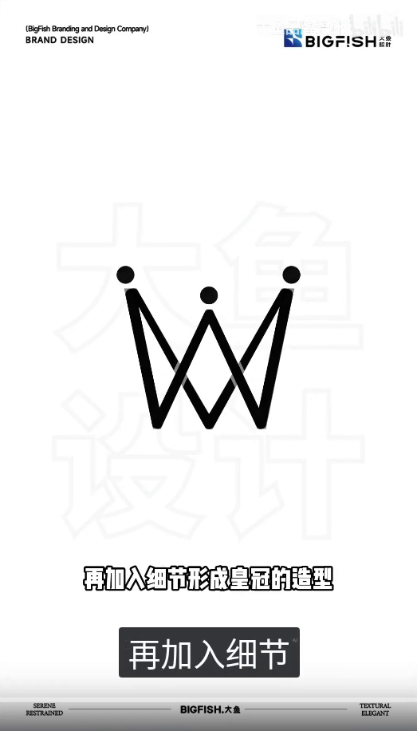

- **作者明确说法**：「再加入细节形成皇冠的造型」
- **整理者观察**：三个独立的实心圆点坐在三个尖顶上方，点和笔画之间看得到细缝。和上一帧相比，两处交叉多出灰色短段和明暗变化：一侧笔画看起来压在另一侧上面，被挡住的那段颜色变浅。这里只按看到的明暗来写，不把灰色说成白镂空，也不把交叉说成已经连死或完全断开。

### WV9 · 用到金粉照片上，WINNER. VALUE

约 17.25s（录屏 42.0s）

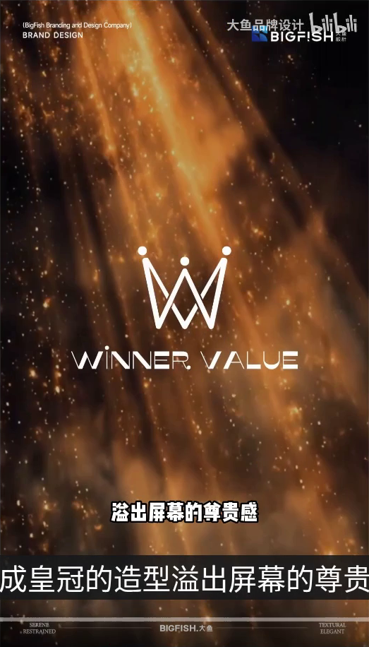

- **作者明确说法**：「溢出屏幕的尊贵感」
- **整理者观察**：同一件标志反白，平面叠在金色火花照片上，不是立体标。三个圆点仍在尖顶上方。两处交叉能看见穿插断口：一根笔画在前，另一根在交叉处断开，露出后面的金色。字标为 WINNER. VALUE，WINNER 后面有一个点。

### 思路与前后关系（整理者分析，非作者原话）

W 和 V 交叉之后，三个尖顶配上圆点，可以同时读成两枚字母和一顶皇冠。

---

## 案例三：数字 9 + 鱼 / NINE 水族馆

### NI1 · 对话框

约 20.25s（录屏 45.0s）

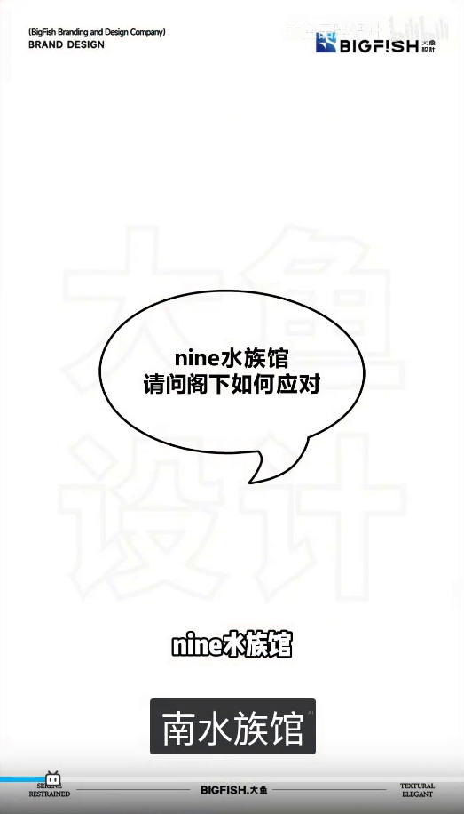

- **作者明确说法**：「nine水族馆」。同一画面上，气泡里写着「nine水族馆」「请问阁下如何应对」。
- **整理者观察**：白底中央是一个线框椭圆气泡，下面另有一行衬线描边字。

### NI2 · 关键词「水族馆」

约 23.25s（录屏 48.0s）

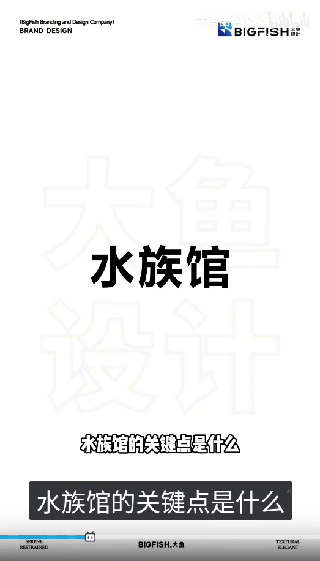

- **作者明确说法**：「水族馆的关键点是什么」
- **整理者观察**：白底正中是三字标题「水族馆」。

### NI3 · 水族馆照片

约 24.25s（录屏 49.0s）

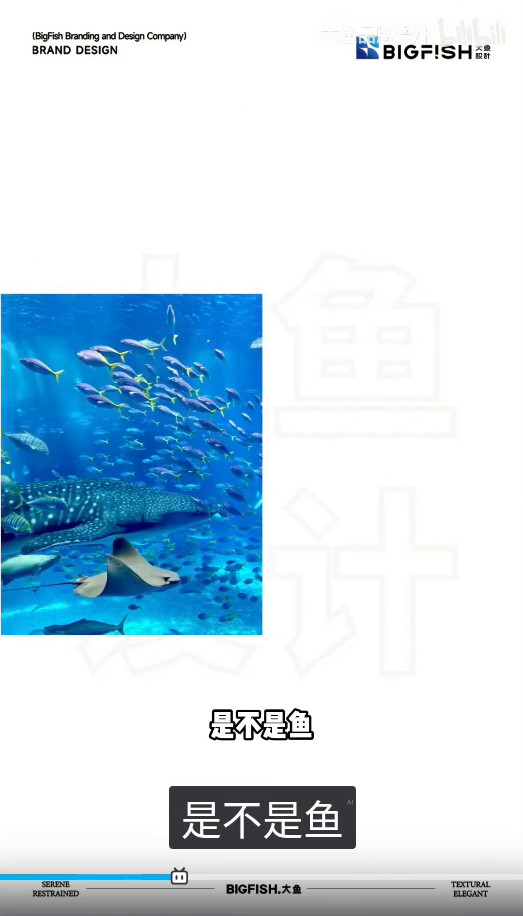

- **作者明确说法**：「是不是鱼」
- **整理者观察**：左侧是一张水族馆照片，能看到鲸鲨、鳐和一群鱼。右侧暂时还是空白。

### NI4 · 小写 nine

约 25.25s（录屏 50.0s）

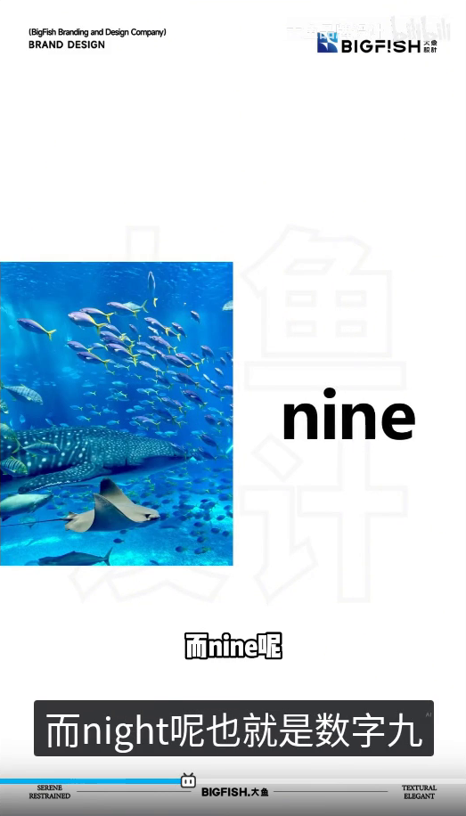

- **作者明确说法**：「而nine呢」
- **整理者观察**：构图与上一帧相近，照片右侧多出小写的 nine。

### NI5 · 照片旁的数字 9

约 26.25s（录屏 51.0s）

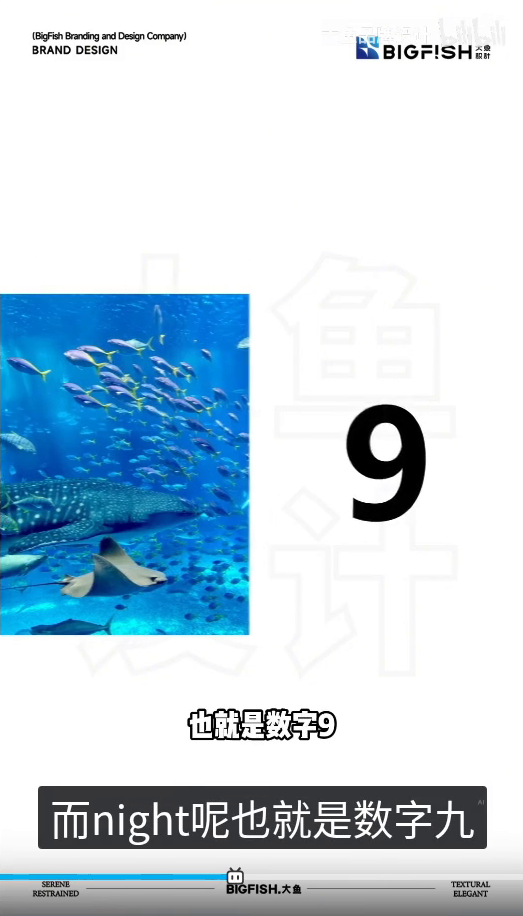

- **作者明确说法**：「也就是数字9」
- **整理者观察**：小写 nine 换成一枚完整的阿拉伯数字 9，碗和竖笔还连在一起，没有拆开。这是后面变形用的原形。

### NI6 · 白底上的完整 9

约 26.65s（录屏 51.4s）

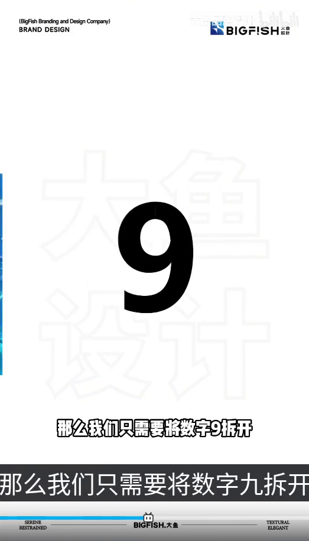

- **作者明确说法**：「那么我们只需要將数字9拆开」
- **整理者观察**：照片已经滑出画面，白底上只剩一枚放大的粗 9。碗和竖笔顶部仍然连着，还是一整块，没有纵向白缝。

### NI7 · 拆成左右两块

约 27.25s（录屏 52.0s）

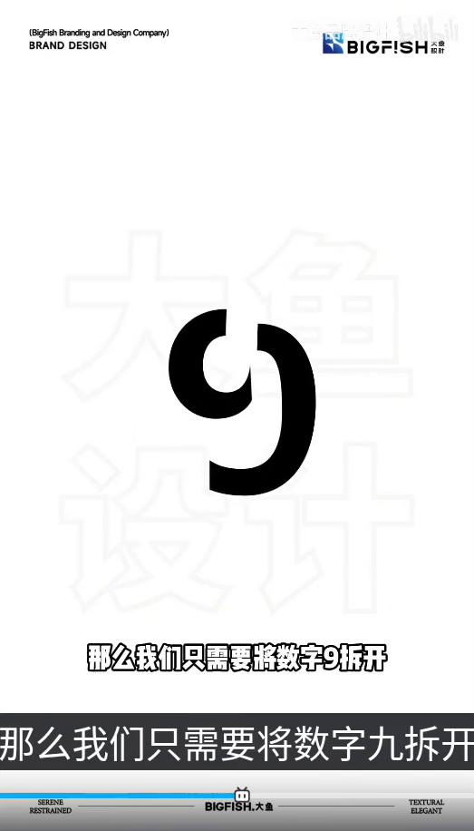

- **作者明确说法**：「那么我们只需要將数字9拆开」
- **整理者观察**：这枚 9 已经分成左右两块，中间有一条纵向白缝。左块是 9 的碗，右块是 9 的竖笔，两者完全分开，还没有换成鱼的外形。

### NI8 · 开始变成两条鱼

约 28.85s（录屏 53.6s）

- **作者明确说法**：「左右分别替换成一大一小两条鱼」
- **整理者观察**：左右两块已经开始长出鱼的头、尾和鳍，整体仍读成 9。两鱼之间的缝隙比完成态更紧。这是变形中间态。

### NI9 · 一大一小两条鱼，成标

约 29.25s（录屏 54.0s）

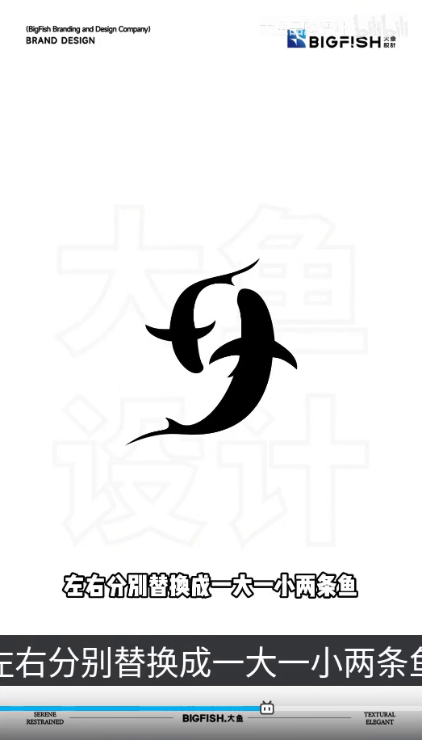

- **作者明确说法**：「左右分别替换成一大一小两条鱼」
- **整理者观察**：两鱼已经完全分开，中间有明显白缝，合在一起仍读成 9。左侧较小的鱼，头在下方、朝下略偏右，尾甩向右上；身体两侧伸出来的是鳍，不是头。右侧较大的鱼，头在上方、朝上略偏右，尾指向左下；向右伸出的那一块是鳍，不是头。这是这一案线标的完成态。

### NI10 · 用到水面照片上，NINE 水族馆

约 31.25s（录屏 56.0s）

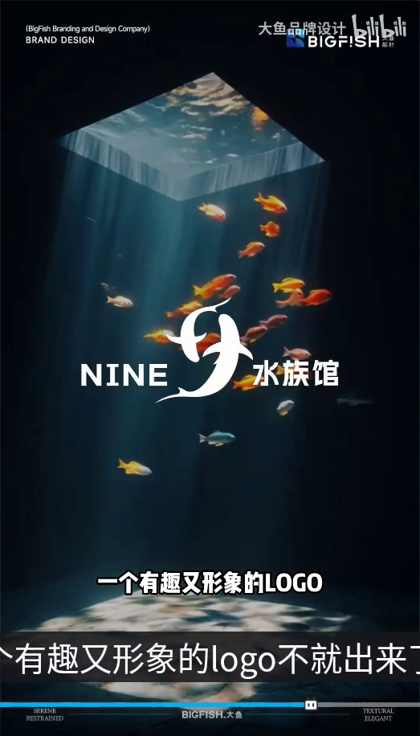

- **作者明确说法**：「一个有趣又形象的LOGO」
- **整理者观察**：同一件标志反白，平面叠在仰视的方形水面照片上，水面上有光线投下，周围有橙色等鱼，不是立体标。字标为 NINE，标志居中，右侧是「水族馆」。

### 思路与前后关系（整理者分析，非作者原话）

数字 9 从中缝拆成左右两块，再分别换成头朝向不同的两条鱼；两条鱼完全分开，拼在一起仍然读成 9。

---

## 案例四：字母 G + 回收 / GREAT 交易平台

### GR1 · 对话框

约 34.25s（录屏 59.0s）

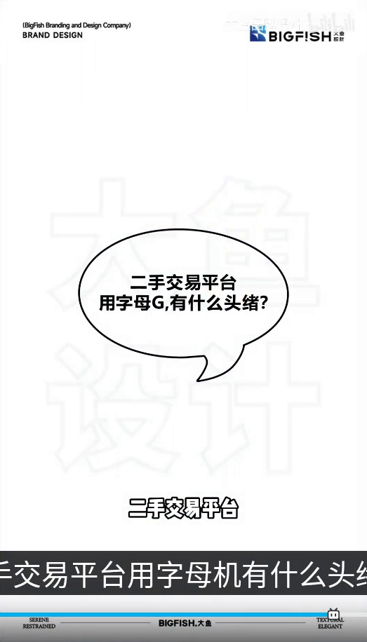

- **作者明确说法**：「二手交易平台」。同一画面上，气泡里写着「二手交易平台」「用字母G,有什么头绪?」。
- **整理者观察**：白底中央是一个线框气泡，下面另有一行衬线描边字。

### GR2 · 「回收」「交易」

约 38.25s（录屏 63.0s）

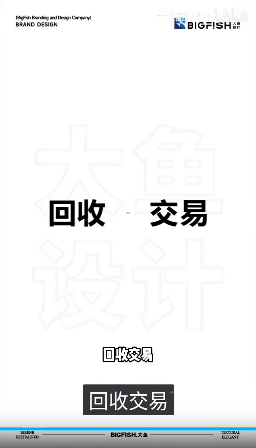

- **作者明确说法**：「回收交易」
- **整理者观察**：白底上左右分开写着「回收」和「交易」。

### GR3 · 回收符号和字母 G

约 41.25s（录屏 66.0s）

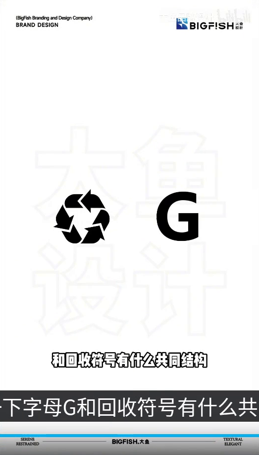

- **作者明确说法**：「和回收符号有什么共同结构」
- **整理者观察**：左边是标准的三箭头回收符号，右边是一枚常规字母 G，中间有白缝，两者分开。这是对照用的参考，还不是后面的成标。

### GR4 · 只留字母 G

约 42.25s（录屏 67.0s）

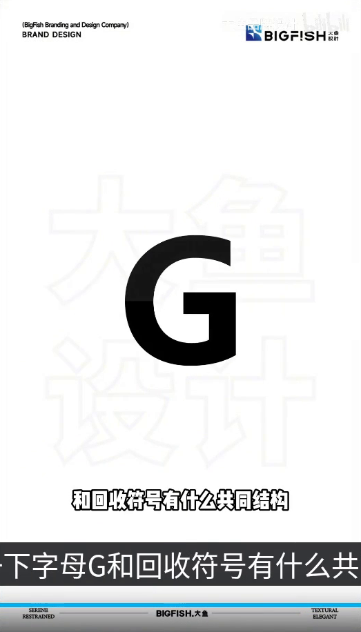

- **作者明确说法**：「和回收符号有什么共同结构」
- **整理者观察**：三箭头回收符号已经消失，只留下完整的字母 G。

### GR5 · 裁掉一半

约 43.25s（录屏 68.0s）

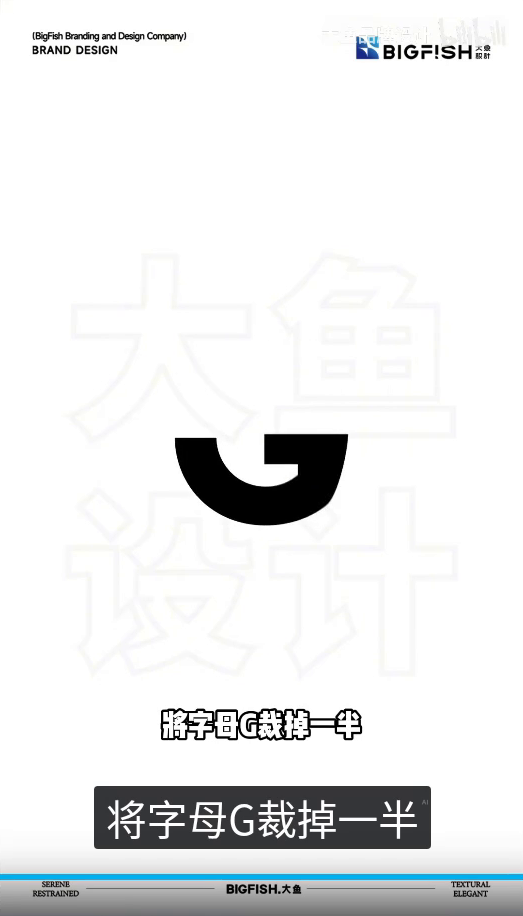

- **作者明确说法**：「將字母G裁掉一半」
- **整理者观察**：G 的上半被齐齐切掉，只留下碗，以及向内伸的那一横。还没有加上右边的竖笔。

### GR6 · 加一笔，形成朝右上的箭头

约 44.25s（录屏 69.0s）

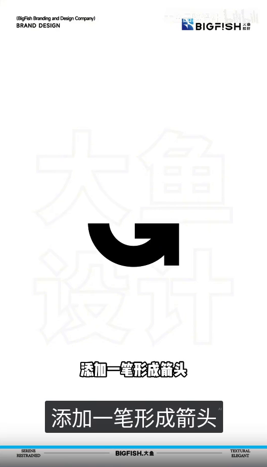

- **作者明确说法**：「添加一笔形成箭头」
- **整理者观察**：在半个 G 的右侧加上一截向下的竖笔。箭头头部是右边那个直角：一翼是朝左的横笔，一翼是朝下的竖笔，合起来构成指向右上的箭头；左侧的弧形碗是箭身。这是一枚指向右上的弧形箭头，不是朝下的箭头。

### GR7 · 复制旋转中

约 45.65s（录屏 70.4s）

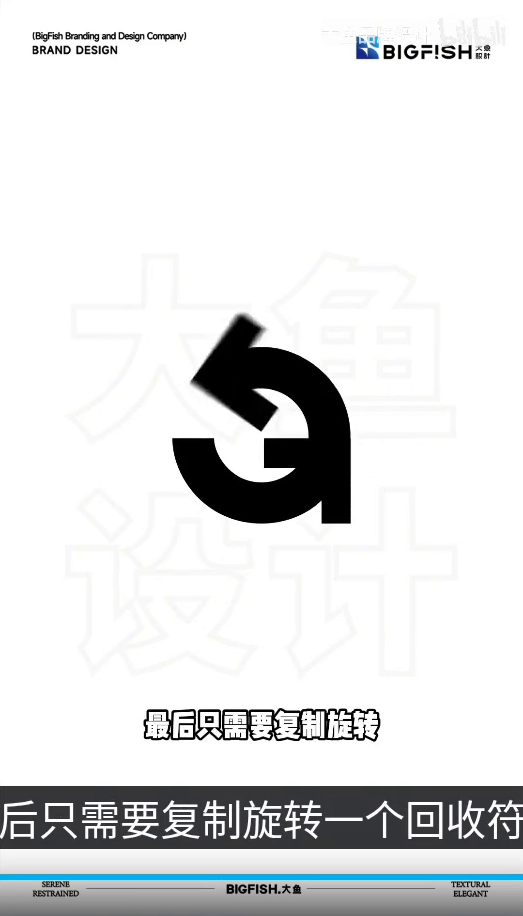

- **作者明确说法**：「最后只需要复制旋转」
- **整理者观察**：下面仍是指向右上的那枚弧形箭头；上面一截正在转进来，轮廓发虚。这是复制旋转的中间态。

### GR8 · 两截循环，成标

约 48.25s（录屏 73.0s）

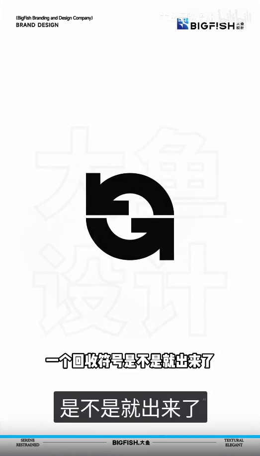

- **作者明确说法**：「一个回收符号是不是就出来了」
- **整理者观察**：只剩两截，中间一道横向白缝把它们完全隔开。下半仍是指向右上的弧形箭头；上半是它大约旋转 180 度的复制，箭头指向左下。这是两截对指的循环，不是三条追逐的箭头。这是这一案线标的完成态。

### GR9 · 用到碗盘照片上，GREAT 交易平台

约 49.25s（录屏 74.0s）

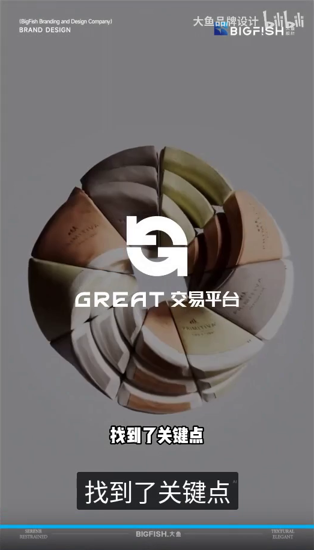

- **作者明确说法**：「找到了关键点」
- **整理者观察**：同一件标志反白，平面叠在俯视的环形陶瓷碗盘照片上，部分盘面有 PRIMITIVA 字样，不是立体标。字标为 GREAT 交易平台。

### 思路与前后关系（整理者分析，非作者原话）

半个 G 加上右边一竖，构成指向右上的弧形箭头；再复制旋转，两截隔着横缝对指，可以同时读成 G 和回收循环。

---

## 收束：三例并列

约 52.25s（录屏 77.0s）

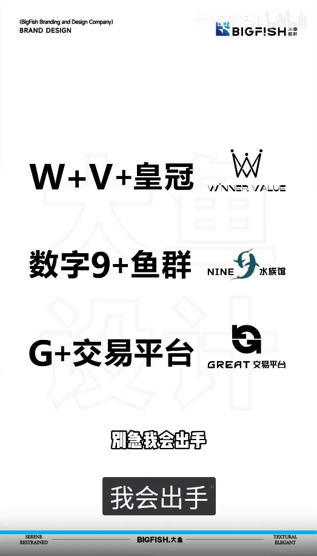

- **作者明确说法**：「别急我会出手」
- **整理者观察**：三行并列，没有片头的 BlackFeather COFFEE。左侧写着「W+V+皇冠」「数字9+鱼群」「G+交易平台」，右侧各配对应的完成态标志和字标 WINNER. VALUE、NINE 水族馆、GREAT 交易平台。中间一行的标志是青绿色，另外两行是黑色。
