# [只要元素越小，LOGO就越有创意](https://www.bilibili.com/video/BV15chi6TEp7/)｜大鱼品牌设计

文中「约 00:mm」是按播放器时钟校准的近似时刻，误差约 ±1s；括号内为录屏精确秒。

## 案例一：猫与房屋 / GUARDHOME

### GH1 · 原形：上为猫、下为房屋

约 00:01（录屏 56.300s）

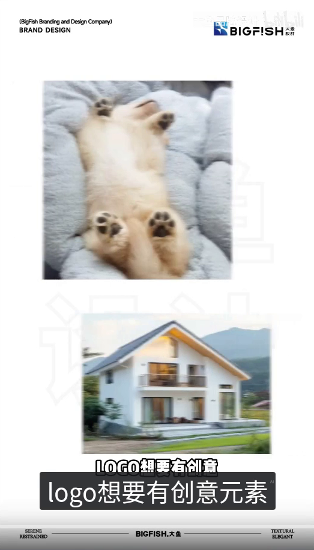

- **作者明确说法**：「LOGO想要有创意」
- **整理者观察**：这是播放中的原形，不是起播前的暂停预览。白底上、下两张照片：上面是一只浅色猫躺在灰色绒垫上，四爪朝向镜头；下面是带暖光的两层房屋。还没有收成爪印标。

### GH2 · 房屋收成粉色剪影

约 00:02（录屏 57.300s）

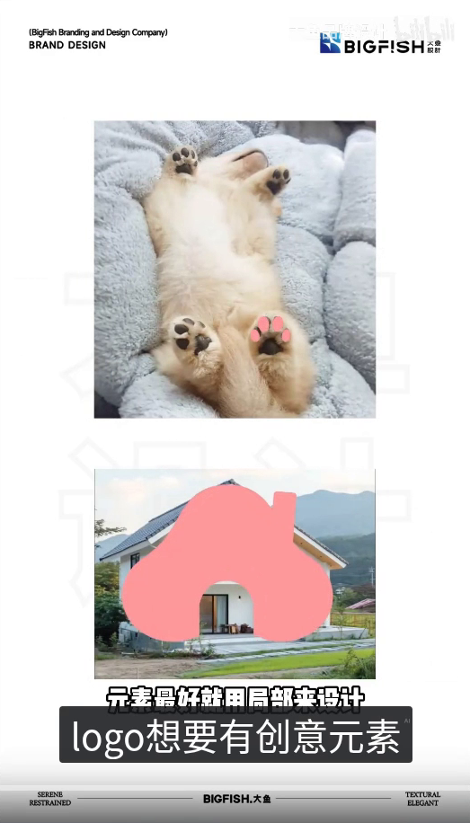

- **作者明确说法**：「元素最好就用局部来设计」
- **整理者观察**：下面的房屋已经收成带右烟囱和拱门的粉色剪影，外轮廓已经像圆顶的爪垫；门洞里仍透出原来的照片。上面的猫大体还是照片，但右下的脚趾已经出现粉色，不是完全未变。

### GH3 · 爪开始成形，房屋仍在下方

约 00:02（录屏 57.500s）

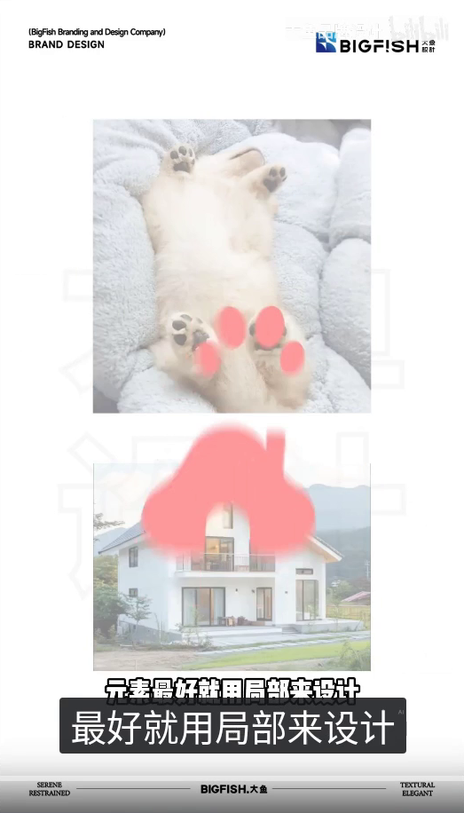

- **作者明确说法**：「元素最好就用局部来设计」
- **整理者观察**：猫的四爪开始收成粉色爪印，身体变淡。粉色房屋剪影还留在下方，外轮廓仍带屋顶和右烟囱，拱门向下开口。

### GH4 · 房屋并入大垫

约 00:02（录屏 57.667s）

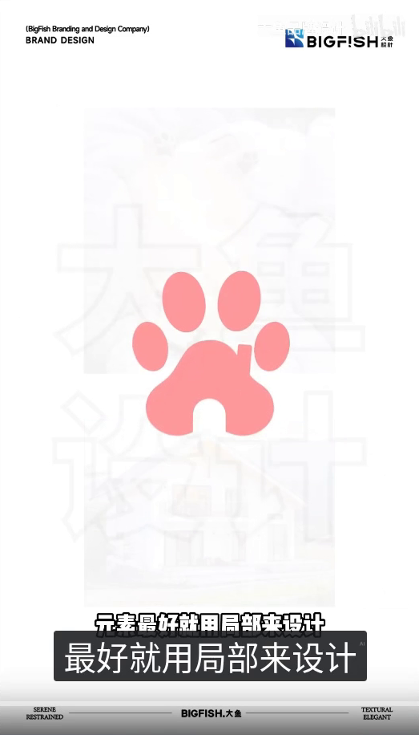

- **作者明确说法**：「元素最好就用局部来设计」
- **整理者观察**：粉色房屋剪影已经向上并入爪印的大垫。大垫的外轮廓本身就是屋顶和右烟囱（烟囱顶在右侧趾垫之间），白色只是大垫下部向下开口的拱门，不是整栋房屋都留白。

### GH5 · 粉色爪印稳住

约 00:02（录屏 57.800s）

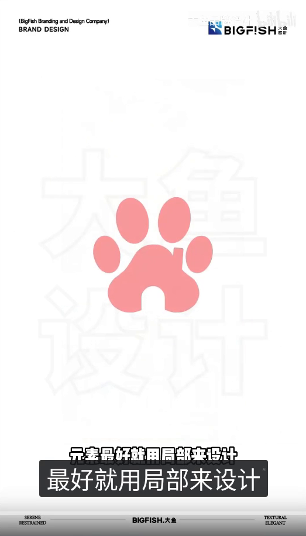

- **作者明确说法**：「元素最好就用局部来设计」
- **整理者观察**：粉色爪印已经稳住。读法与上一帧相同：大垫外轮廓是屋顶加右烟囱，白色只是向下的拱门。

### GH6 · 粉色转为褐色

约 00:02（录屏 58.000s）

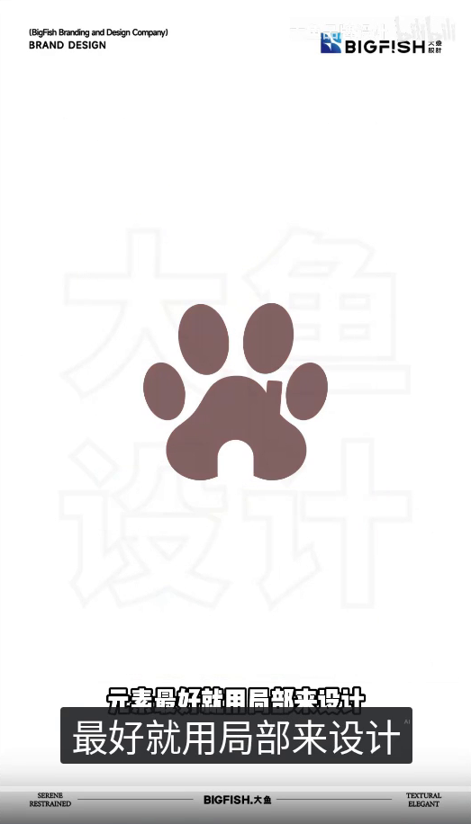

- **作者明确说法**：「元素最好就用局部来设计」
- **整理者观察**：同一件爪印由粉转成褐色，还没有到全黑。屋顶、右烟囱和向下的拱门都还在。

### GH7 · 黑标稳住

约 00:03（录屏 58.233s）

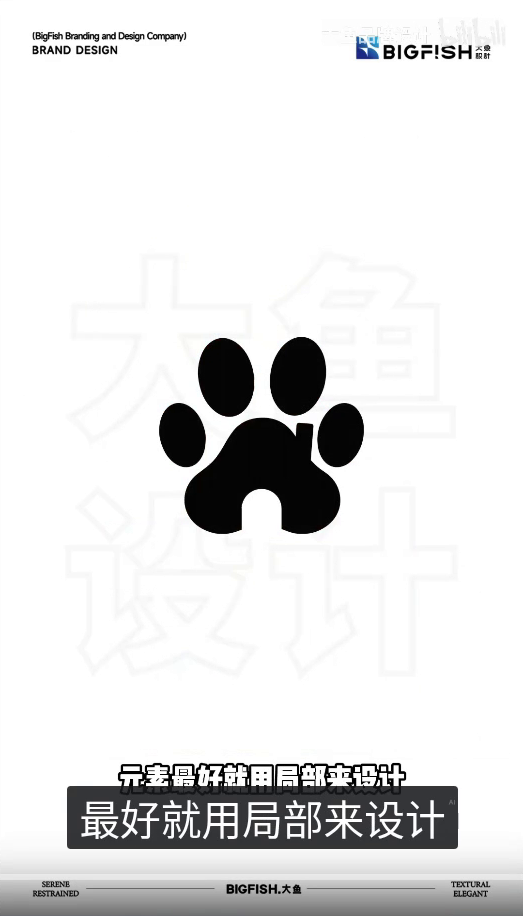

- **作者明确说法**：「元素最好就用局部来设计」
- **整理者观察**：爪印已经收成全黑。黑色大垫本身呈屋顶和右烟囱轮廓，白色仅是向下开口的拱门。这是这一案线标的黑色完成态。

### GH8 · 用到车窗与秋色照片上，GUARDHOME

约 00:04（录屏 60.000s）

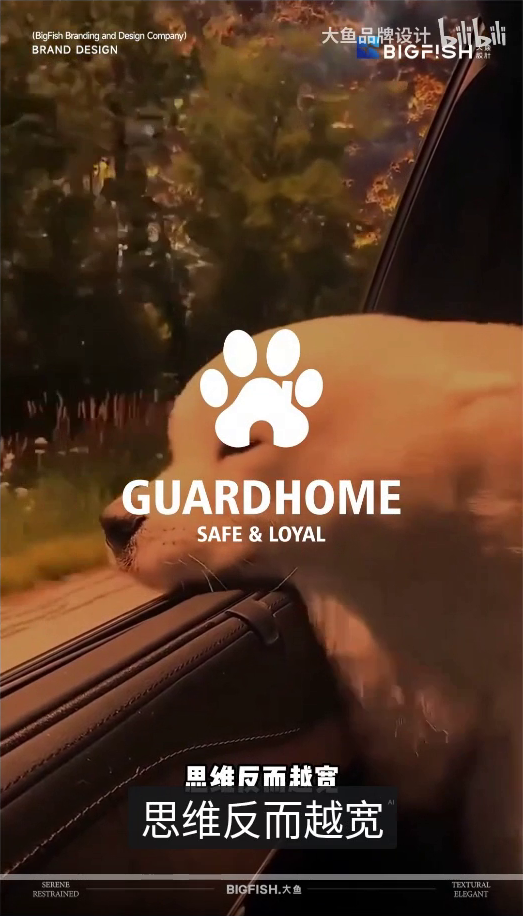

- **作者明确说法**：「思维反而越宽」
- **整理者观察**：同一件标志反白，平面叠在车窗边、秋天树色和浅色狗的照片上。字标为「GUARDHOME」，其下是「SAFE & LOYAL」。

### 思路与前后关系（整理者分析，非作者原话）

播放中先给出上为猫、下为房屋的照片。房屋先收成带屋顶和右烟囱的粉色剪影，猫爪再收成粉色爪印；并入之后，是大垫的外轮廓本身变成屋顶和右烟囱，白色只留下向下开口的拱门。爪印由粉转褐，再收成黑标。用到照片上时，字标写成「GUARDHOME」和「SAFE & LOYAL」。

---

## 案例二：鸟与树 / ROOTKEEPER

### RK1 · 对话框

约 00:06（录屏 62.000s）

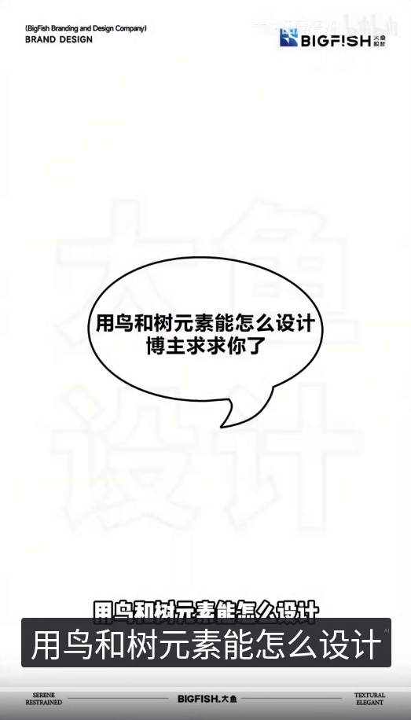

- **作者明确说法**：「用鸟和树元素能怎么设计」。同一画面上，气泡里两行写着「用鸟和树元素能怎么设计」「博主求求你了」。
- **整理者观察**：白底中央是一个线框气泡，尾朝右下。

### RK2 · 原形：一棵树上停着一只鸟

约 00:10（录屏 66.000s）

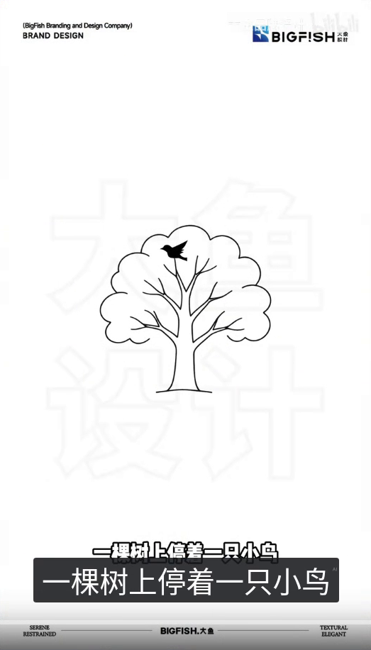

- **作者明确说法**：「一棵树上停着一只小鸟」
- **整理者观察**：白底上是一棵树的线稿，左上方的树冠里停着一只黑色的鸟。

### RK3 · 鸟不在了，只剩下树

约 00:11（录屏 67.000s）

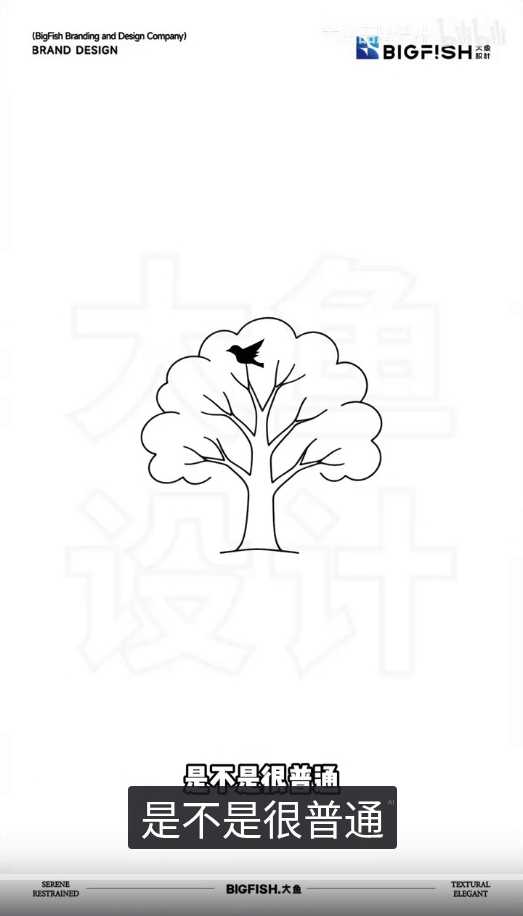

- **作者明确说法**：「是不是很普通」
- **整理者观察**：树的线稿还在，树上的鸟已经看不见了。

### RK4 · 只剩下一只黑鸟

约 00:13（录屏 69.000s）

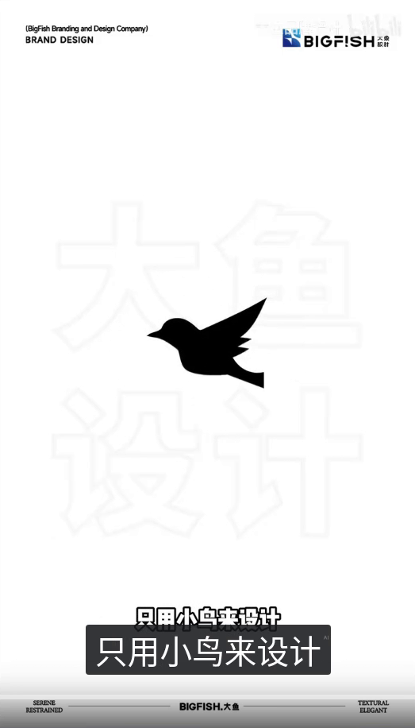

- **作者明确说法**：「只用小鸟来设计」
- **整理者观察**：树已经退去，白底上只剩一只侧向的黑色小鸟，喙朝左。

### RK5 · 复制出第二只鸟

约 00:15（录屏 70.200s）

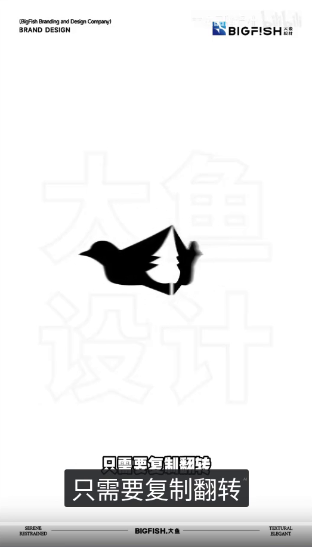

- **作者明确说法**：「只需要复制翻转」
- **整理者观察**：右侧出现第二只鸟。左鸟喙朝左，右鸟喙朝右，两喙朝向左右外侧，并不是对喙。尾上缘向中间收拢，中间已经开始出现树形留白。

### RK6 · 尾上缘在中间相接，树形留白清楚

约 00:15（录屏 70.800s）

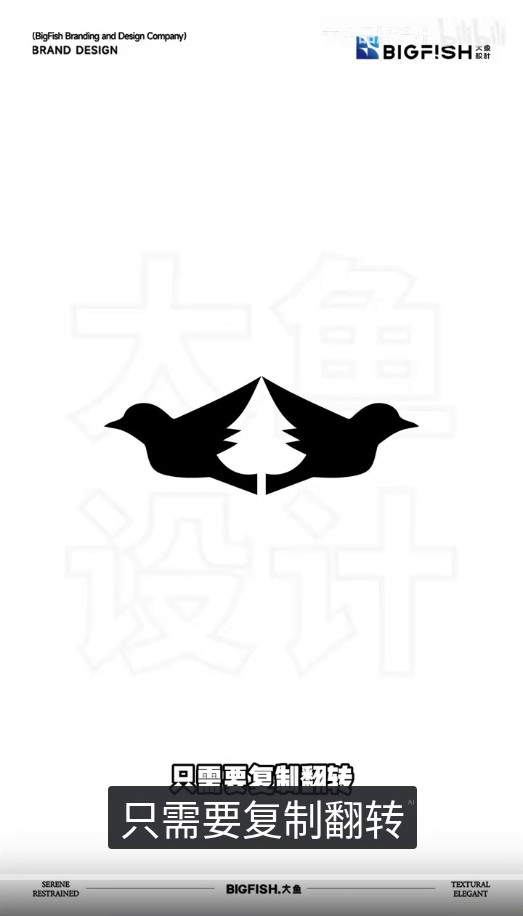

- **作者明确说法**：「只需要复制翻转」
- **整理者观察**：两只鸟已经左右对称。喙朝向左右外侧，尾上缘在中间收成一个尖点相接，并不是喙与喙相接。两鸟内轮廓围出的白色树形留白已经清楚，里面还没有填绿。

### RK7 · 树形留白中填入绿色

约 00:16（录屏 71.400s）

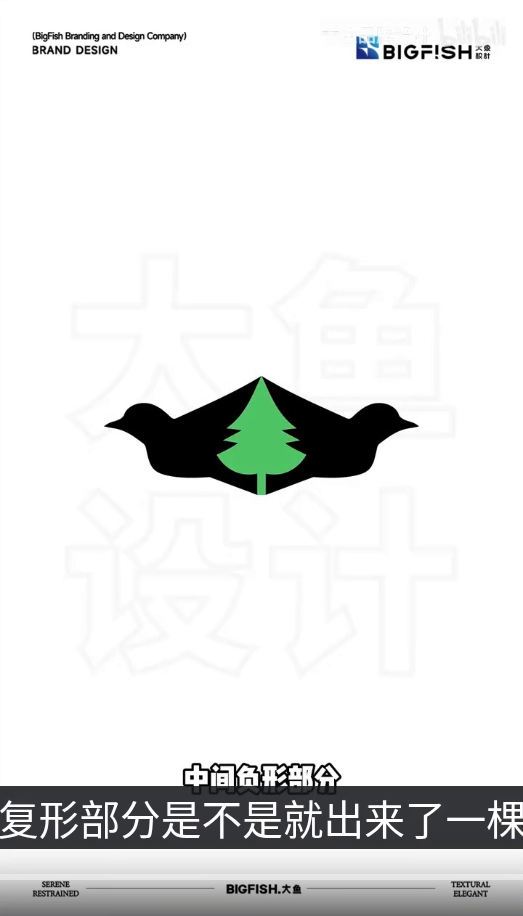

- **作者明确说法**：「中间负形部分」
- **整理者观察**：中间的树形留白里已经填入绿色的树。两只鸟仍是黑色，喙仍朝外侧。

### RK8 · 绿色开始撤去

约 00:17（录屏 72.800s）

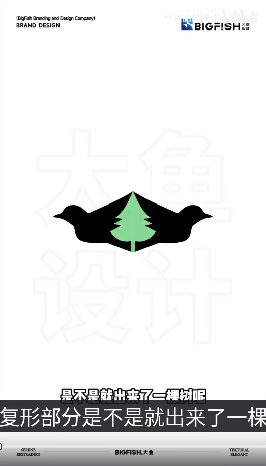

- **作者明确说法**：「是不是就出来了一棵树呢」
- **整理者观察**：中间的绿色开始减淡，还没有完全退尽。两只黑鸟还在。

### RK9 · 绿已撤尽，白底净标

约 00:17（录屏 73.067s）

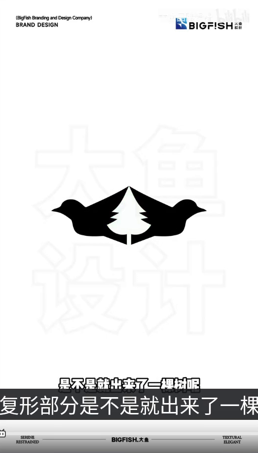

- **作者明确说法**：「是不是就出来了一棵树呢」
- **整理者观察**：绿色已经撤尽。白底上是两只黑鸟，中间仍是透白的树形留白。这是进入应用之前的净标，不能从绿树直接跳到应用。

### RK10 · 用到林间照片上，ROOTKEEPER

约 00:19（录屏 75.000s）

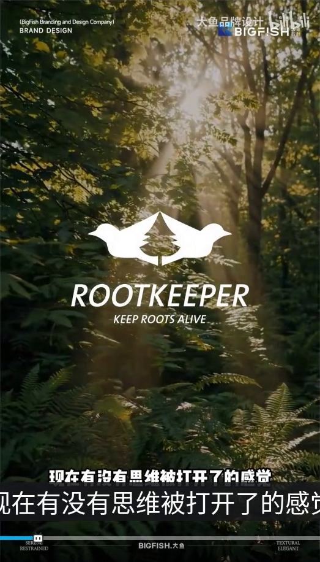

- **作者明确说法**：「现在有没有思维被打开了的感觉」
- **整理者观察**：同一件标志反白，平面叠在林间光影的照片上。两只鸟是实心的白鸟；中间的树形是透明留白，透出后面的森林，不是和白鸟同色的实心白树。字标为「ROOTKEEPER」，其下是「KEEP ROOTS ALIVE」。

### 思路与前后关系（整理者分析，非作者原话）

先给出一棵树上停着一只鸟的线稿，再把元素收到一只黑鸟，复制出左右两只。两只鸟的喙朝向左右外侧，尾上缘在中间收成尖点相接，中间围出树形留白。留白里先填入绿色，再把绿色撤去，回到白底黑鸟、中间透白树形的净标，然后才用到林间照片上。用到照片上时，树形是透出森林的留白，字标写成「ROOTKEEPER」和「KEEP ROOTS ALIVE」。

---

## 案例三：女巫帽 / WIZARMS

### WZ1 · 对话框

约 00:21（录屏 77.000s）

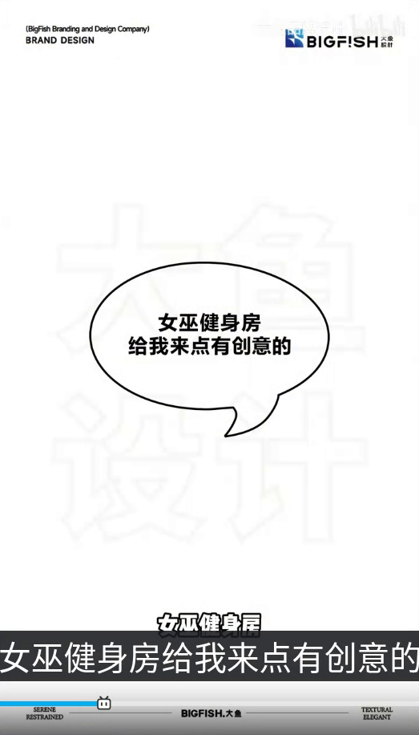

- **作者明确说法**：「女巫健身房」。同一画面上，气泡里两行写着「女巫健身房」「给我来点有创意的」。
- **整理者观察**：白底中央是一个线框气泡，尾朝右下。

### WZ2 · 原形：举手的女巫全身线稿

约 00:24（录屏 79.500s）

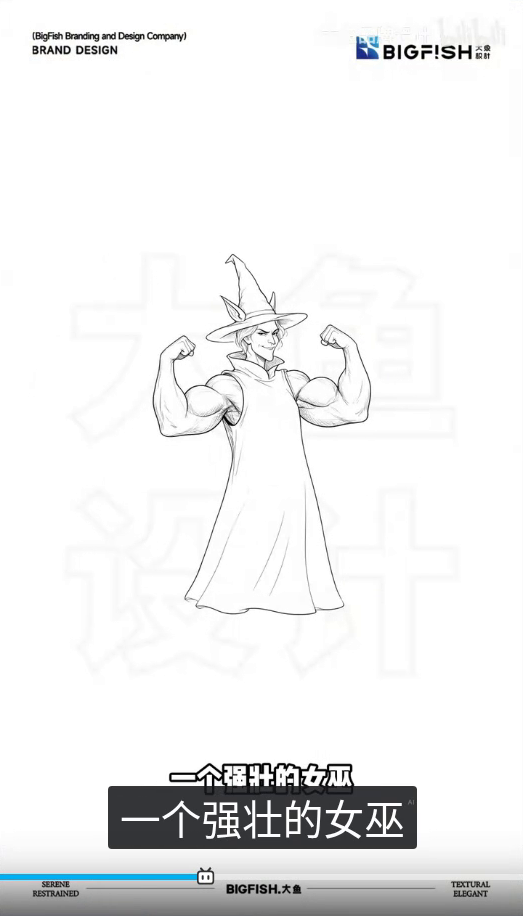

- **作者明确说法**：「一个强壮的女巫」
- **整理者观察**：白底上是一个戴着女巫帽、双臂举起的女巫全身线稿。

### WZ3 · 身体退去，只留下帽

约 00:26（录屏 81.400s）

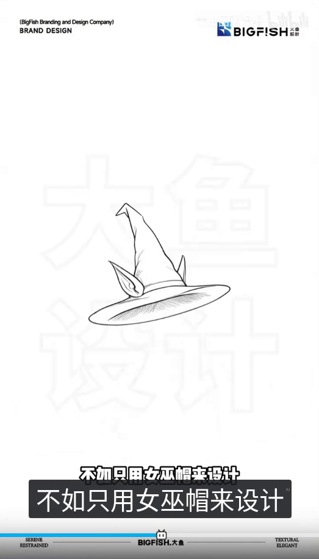

- **作者明确说法**：「不如只用女巫帽来设计」
- **整理者观察**：身体和裙子正在变淡，画面上主要留下女巫帽，并开始简化。

### WZ4 · 线描的帽

约 00:27（录屏 83.000s）

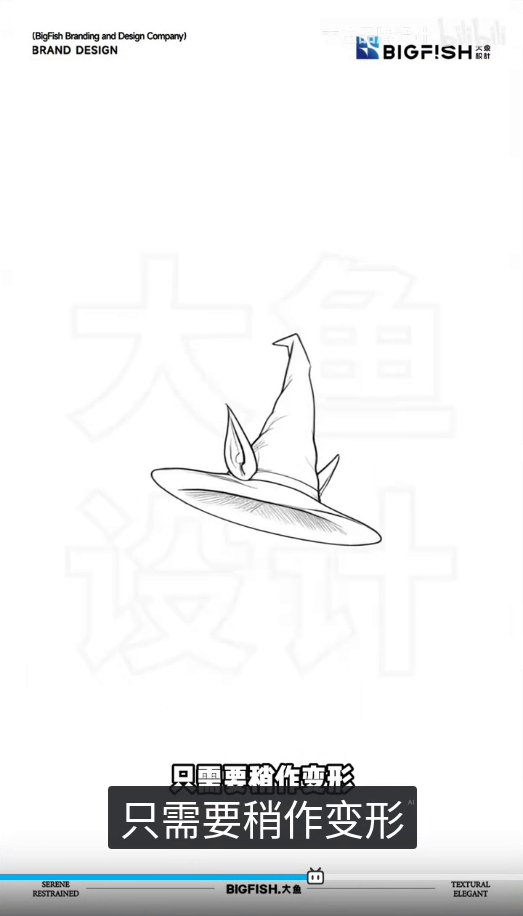

- **作者明确说法**：「只需要稍作变形」
- **整理者观察**：已经只剩一顶线描的女巫帽。帽尖还是尖的，帽身仍是锥体，帽沿在下。

### WZ5 · 收成黑帽，帽尖仍尖

约 00:28（录屏 84.000s）

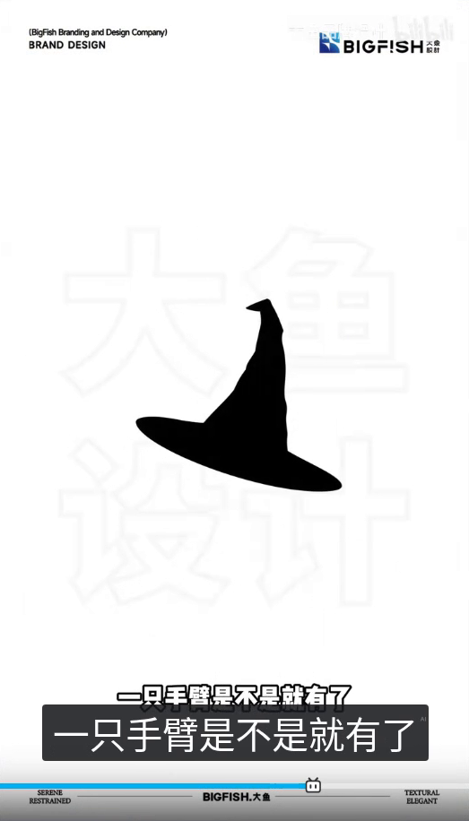

- **作者明确说法**：「一只手臂是不是就有了」
- **整理者观察**：帽已经收成黑色。此时帽尖仍比较尖，帽身仍是锥体，还没有卷成拳，也还没有弯成臂。

### WZ6 · 帽尖初卷成拳，帽身开始弯折

约 00:29（录屏 84.367s）

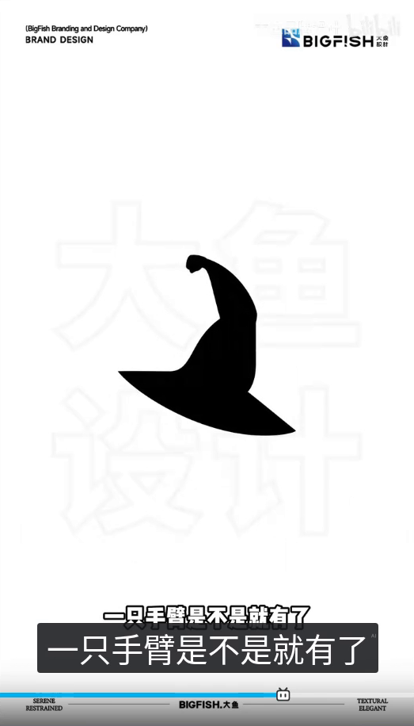

- **作者明确说法**：「一只手臂是不是就有了」
- **整理者观察**：帽尖已经开始向内卷，收成带拇指凸起的拳状；帽身（锥体）同时已经弯折，开始像屈臂。此时帽沿仍贴在帽身下，二者之间还没有缝。这是黑帽到屈臂完成之间的中态。

### WZ7 · 帽尖卷成拳，帽身弯成臂

约 00:29（录屏 84.800s）

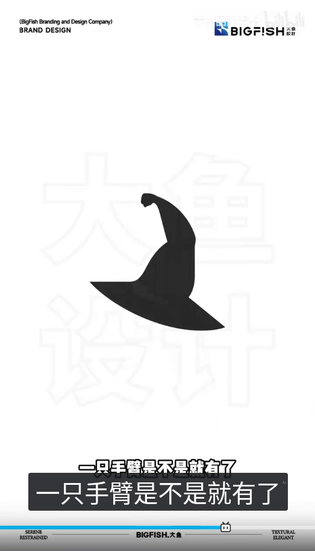

- **作者明确说法**：「一只手臂是不是就有了」
- **整理者观察**：帽尖已经收成带拇指凸起的拳状，帽身（原来的锥体）弯成屈臂。帽沿仍在底部，和帽身之间还没有缝。

### WZ8 · 帽身与帽沿之间开出白缝

约 00:30（录屏 85.200s）

- **作者明确说法**：「一只手臂是不是就有了」
- **整理者观察**：帽身左下与帽沿之间出现一道留白缝，屈臂的读法更清楚。帽尖仍是拳，帽沿仍在底部。这是这一案线标的黑色完成态。

### WZ9 · 用到室内照片上，WIZARMS

约 00:31（录屏 87.000s）

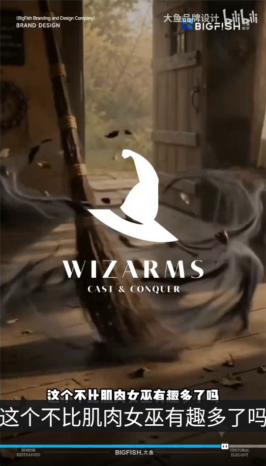

- **作者明确说法**：「这个不比肌肉女巫有趣多了吗」
- **整理者观察**：同一件标志反白，平面叠在带扫帚和木门的室内照片上。字标为「WIZARMS」，其下是「CAST & CONQUER」。

### 思路与前后关系（整理者分析，非作者原话）

先画出举手的女巫全身，再只用女巫帽：线描收成黑帽时，帽尖还是尖的、帽身还是锥体；随后先见到帽尖初卷、帽身开始弯折，再到帽尖成拳、帽身屈臂，帽沿仍在底部；再往后，帽身与帽沿之间开出一道白缝，黑标稳住。用到室内照片上时，字标写成「WIZARMS」和「CAST & CONQUER」。

---

## 案例四：鱼与蟹钳 / 海得渔业

### HF1 · 对话框

约 00:33（录屏 89.000s）

- **作者明确说法**：「水产行业交给老师了」。同一画面上，气泡里两行写着「终于轮到我了吗？」「水产行业,交给老师了」。
- **整理者观察**：白底中央是一个线框气泡，尾朝右下。片内这一句没有逗号；气泡第二行在「行业」后面有逗号。

### HF2 · 海底线稿

约 00:36（录屏 91.600s）

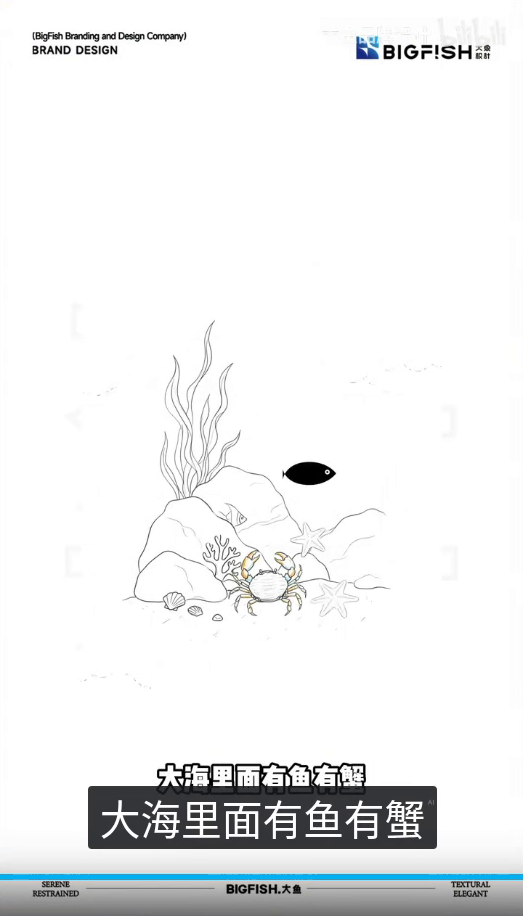

- **作者明确说法**：「大海里面有鱼有蟹」
- **整理者观察**：白底上是海底、水草和蟹等线稿。

### HF3 · 原形：一枚黑椭圆

约 00:38（录屏 93.200s）

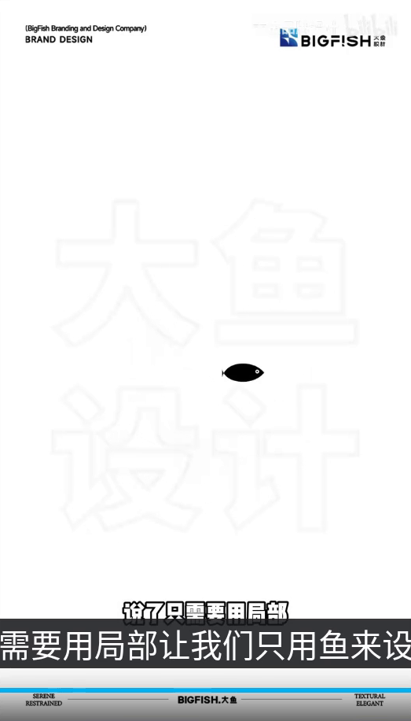

- **作者明确说法**：「说了只需要用局部」
- **整理者观察**：线稿已经退去，白底上只剩一枚黑色椭圆，还没有眼睛，也还没有尾尖。

### HF4 · 长出眼睛和尾巴，成为一条鱼

约 00:39（录屏 95.000s）

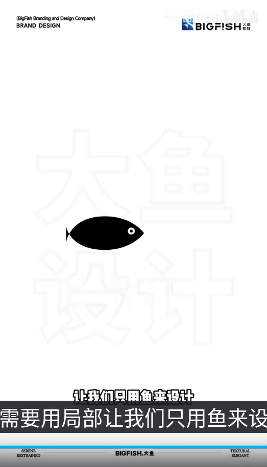

- **作者明确说法**：「让我们只用鱼来设计」
- **整理者观察**：已经收成一条头朝右的黑鱼，右侧有白圈眼，左侧有一个简单的尖尾。此时还没有尾侧的长弧，也还没有头后的短弧。

### HF5 · 四条朝右的正形鱼

约 00:40（录屏 95.567s）

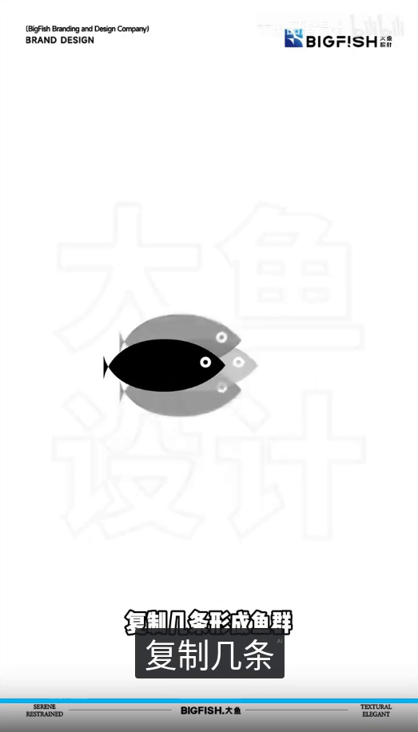

- **作者明确说法**：「复制几条形成鱼群」
- **整理者观察**：已经可以同时认出四条朝右的正形鱼：原来的黑色居中偏左，上、下各一条灰鱼，右中再露出一条更浅的灰鱼头。四条都有白圈眼。

### HF6 · 出现尾侧长弧和头后短弧

约 00:41（录屏 96.333s）

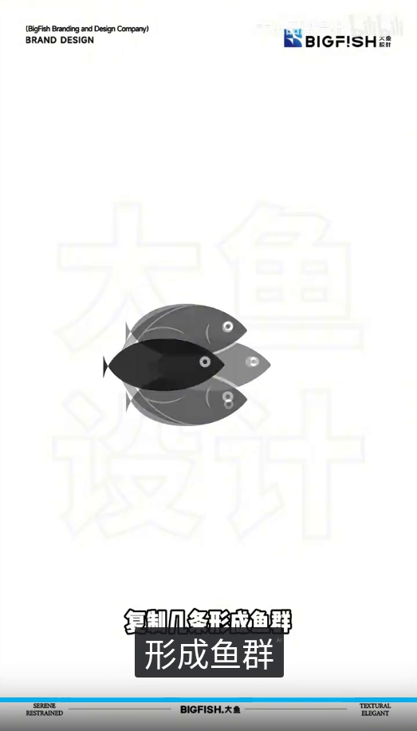

- **作者明确说法**：「复制几条形成鱼群」
- **整理者观察**：四条鱼仍都头朝右。上、下两条鱼上可以看到尾侧的长弧，以及头后的短弧。中间那条仍比较深。

### HF7 · 中间那条转白，负形第四鱼出现

约 00:41（录屏 96.533s）

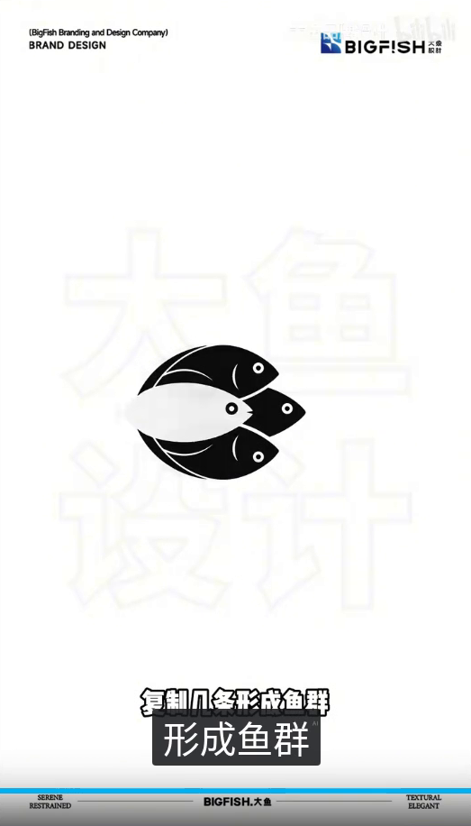

- **作者明确说法**：「复制几条形成鱼群」
- **整理者观察**：中间原来的那条已经转白，左侧开口里出现一条同样朝右的负形第四鱼，带黑圈反向眼。白鱼左端还略露出一点尾尖，还没有收干净。三条黑色正形鱼仍头朝右。

### HF8 · 负形第四鱼稳住，左端尾尖收净

约 00:41（录屏 96.800s）

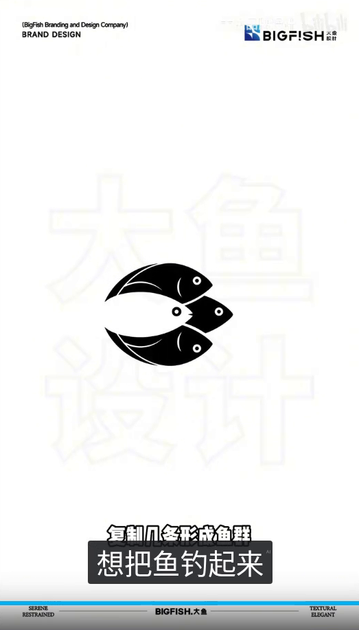

- **作者明确说法**：「复制几条形成鱼群」
- **整理者观察**：已经收成三条朝右的黑色正形鱼，加上左侧开口里一条同样朝右的白色负形鱼。黑鱼是白圈眼，白鱼是黑圈反向眼。白鱼左端的尾尖已经收净，开口是光顺的左向弧。上、下两鱼仍有尾侧长弧和头后短弧。右侧还没有鱼钩。四条鱼的头始终朝右。

### HF9 · 右侧出现淡钩线

约 00:42（录屏 97.900s）

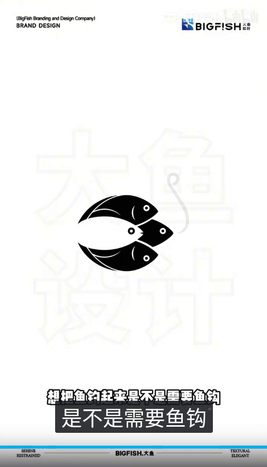

- **作者明确说法**：「想把鱼钓起来是不是需要鱼钩」
- **整理者观察**：最右侧鱼头外侧出现淡灰色的钩线，已经看得见上端的弯头，和鱼头之间有空隙，并不相接。四条鱼仍是上一态的位置。这是钩画完之前的中态。

### HF10 · 右侧独立鱼钩画完

约 00:43（录屏 98.800s）

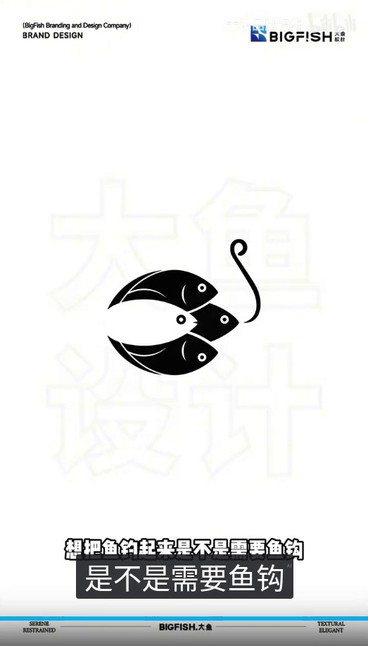

- **作者明确说法**：「想把鱼钓起来是不是需要鱼钩」
- **整理者观察**：鱼钩已经画完，位于最右侧鱼头的外侧，钩的弧和环都在，和鱼身之间有空隙，并不相接。四条鱼的位置没有变。

### HF11 · 与手绘蟹钳图叠化

约 00:44（录屏 99.400s）

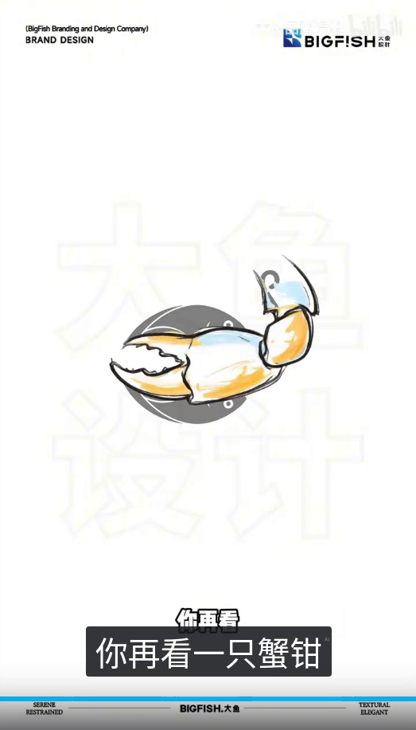

- **作者明确说法**：「你再看」
- **整理者观察**：平面黑标与一张手绘蟹钳图叠化在一起。这是整张插画，不是只在局部涂的提示色。插画上有白和浅蓝的高光，以及橙黄色的阴影。钳口朝左张开，右侧上扬的臂末端仍能看见鱼钩。

### HF12 · 插画撤去，黑净标稳住

约 00:45（录屏 101.000s）

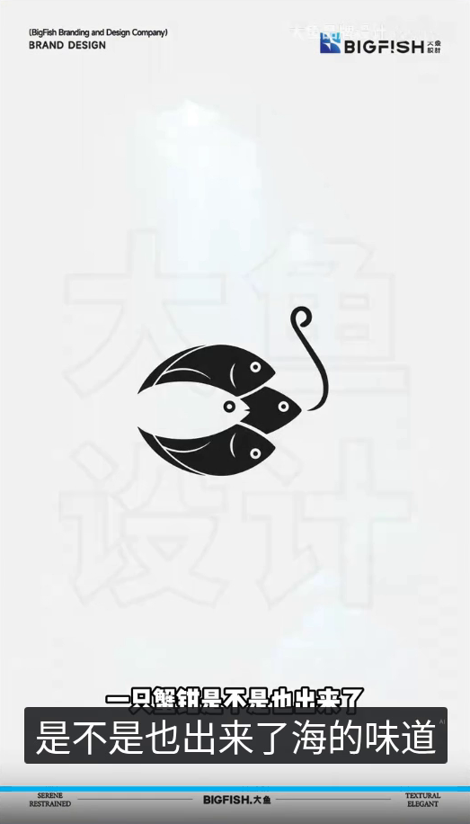

- **作者明确说法**：「一只蟹钳是不是就出来了」
- **整理者观察**：手绘插画已经撤去，回到全黑标：三条朝右的黑色正形鱼，加上左侧开口里一条朝右的白色负形第四鱼（黑圈反向眼），右侧仍是那枚与鱼头不相接的独立鱼钩。这是这一案线标的黑色完成态。

### HF13 · 用到海底照片上，海得渔业

约 00:47（录屏 102.400s）

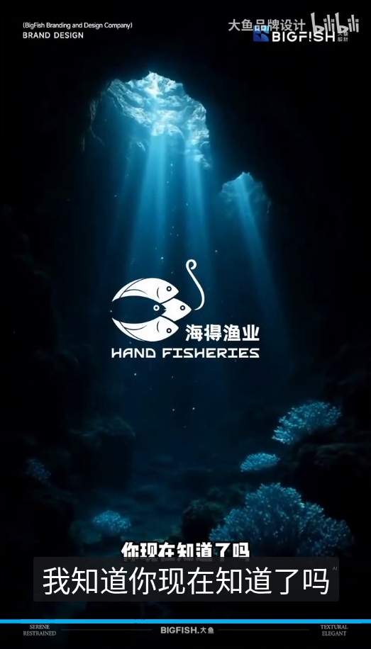

- **作者明确说法**：「你现在知道了吗」
- **整理者观察**：同一件标志反相，平面叠在海底光柱和珊瑚的照片上：三条朝右的白色正形鱼，加上左侧开口里一条朝右的暗色负形第四鱼（白圈反向眼），右侧白色鱼钩仍独立、不接鱼。中文「海得渔业」，英文「HAND FISHERIES」。

### 思路与前后关系（整理者分析，非作者原话）

先把局部收到一枚椭圆，再长出眼睛和尾巴，成为一条朝右的鱼；随后同时出现四条朝右的正形鱼，并带上尾侧长弧和头后短弧。中间那条转白后，左侧开口里出现一条同样朝右的负形第四鱼，随后左端尾尖收净。鱼钩先在右侧以淡线出现，再画完，始终不接到鱼身。之后与一张手绘蟹钳图叠化（整张插画，带高光和橙黄色阴影，钳口朝左），再把插画撤去，回到四鱼加独立钩的黑净标。用到海底照片上时，标志反相，字标写成「海得渔业」和「HAND FISHERIES」。

---

## 收束：三例并列

约 00:49（录屏 104.400s）

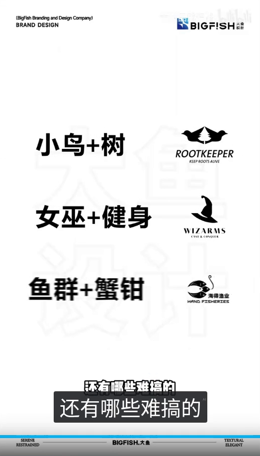

- **作者明确说法**：「还有哪些难搞的」
- **整理者观察**：白底两列三行并列，没有片头的猫爪房屋和 GUARDHOME。左列写着「小鸟+树」「女巫+健身」「鱼群+蟹钳」；右列各配对应的完成态标志，以及字标「ROOTKEEPER / KEEP ROOTS ALIVE」「WIZARMS / CAST & CONQUER」「海得渔业 / HAND FISHERIES」。
