# [只要你们将元素具象化，LOGO设计就手拿把掐](https://www.bilibili.com/video/BV16tJX6YEJx)｜大鱼品牌设计

## 案例一：A + B + 鸟 / 航鸟 AVIABIRD

### AB1 · 字母 A、B 和第一张鸟的照片

约 0.6s（录屏 18.4s）

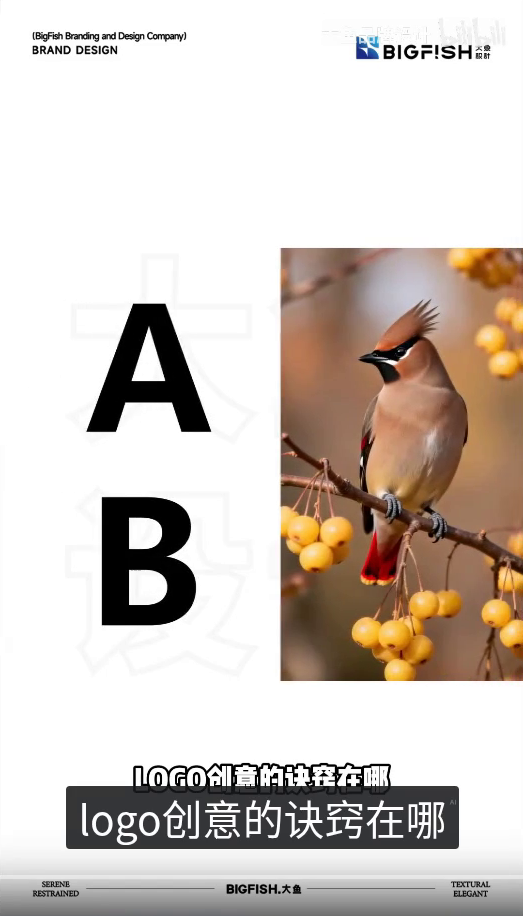

- **作者明确说法**：「LOGO创意的诀窍在哪」
- **整理者观察**：白底上，左侧上下分写着黑色字母 A 和 B；右侧是一张照片，一只带冠羽的鸟停在结着黄果的枝上。

### AB2 · A、B 收近，鸟照还在

约 1.2s（录屏 19.0s）

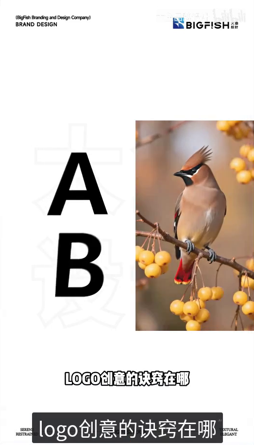

- **作者明确说法**：「LOGO创意的诀窍在哪」
- **整理者观察**：A、B 仍是上下分写，间距已经收窄，位置略向右移；右侧那张黄果枝上的鸟照还在。

### AB3 · 连成字标，鸟照退去

约 1.7s（录屏 19.5s）

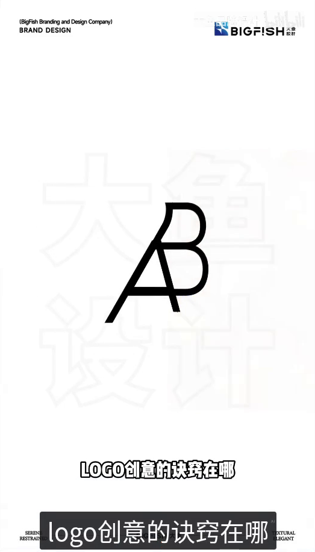

- **作者明确说法**：「LOGO创意的诀窍在哪」
- **整理者观察**：两个字母已经叠成一件连字。A 的左右两笔都是斜笔；B 的脊向左倾，上段与 A 的左斜边部分共用；A 的横笔和 B 下碗的底横看起来也在同一条水平线上。右斜笔下端此时还没有短横脚。鸟的照片已经退去。

### AB4 · 连字收稳

约 2.4s（录屏 20.2s）

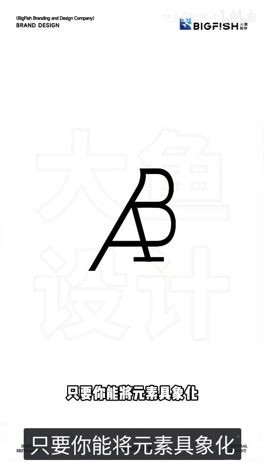

- **作者明确说法**：「只要你能將元素具象化」
- **整理者观察**：连字收稳。A 的右斜笔向下伸出，末端多了一小截横脚。它仍是可以读成 A 和 B 的字母组合；画面上没有把这件连字改画成鸟形的步骤。

### AB5 · 用到另一张鸟的照片上，航鸟 / AVIABIRD

约 4.0s（录屏 21.8s）

- **作者明确说法**：「创意其实没什么难的」
- **整理者观察**：同一件连字收成白色，压在另一张蓝、黄相间的鸟的照片上，右侧字标为「航鸟 / AVIABIRD」。这是这一案的完成态。

### 思路与前后关系（整理者分析，非作者原话）

两个字母靠共用的斜笔压合在一起，成为一件仍读得出 A 和 B 的连字。鸟的含义来自旁边和后来叠上的照片，以及字标「航鸟 / AVIABIRD」；作者没有说明连字本身如何变成鸟形。

---

## 案例二：字母 T + 钉子、火箭 / LAUNCHPIN 发射钉

### T1 · 对话框

约 5.6s（录屏 23.4s）

- **作者明确说法**：「字母T加工业和火箭元素」。同一对话框画面上，片内随后改为「你行吗」。
- **整理者观察**：气泡分两行写着「字母T加工业和火箭」「你行吗？」。

### T2 · 字母 T

约 8.2s（录屏 26.0s）

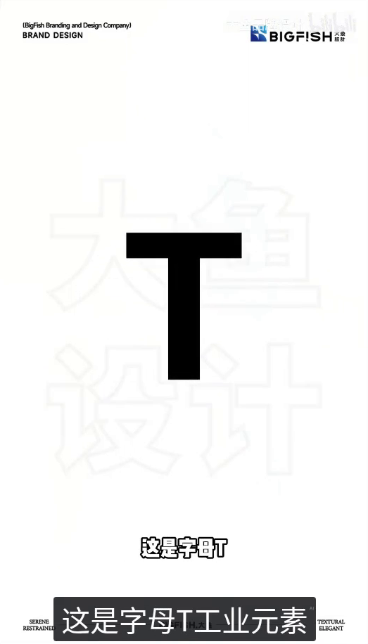

- **作者明确说法**：「这是字母T」。同一字母画面上，片内随后改为「工业元素」。
- **播放器字幕**：「这是字母T工业元素」
- **整理者观察**：白底上是一个黑色大写字母 T。

### T3 · T 下端收尖

约 9.0s（录屏 26.8s）

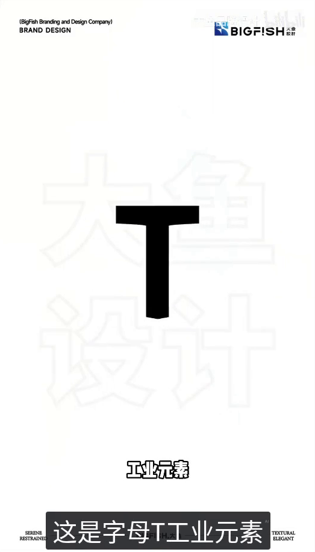

- **作者明确说法**：「工业元素」
- **整理者观察**：T 的横画还在，竖画下端已经略收尖，开始像一颗钉子。

### T4 · 收成一颗钉子

约 10.6s（录屏 28.4s）

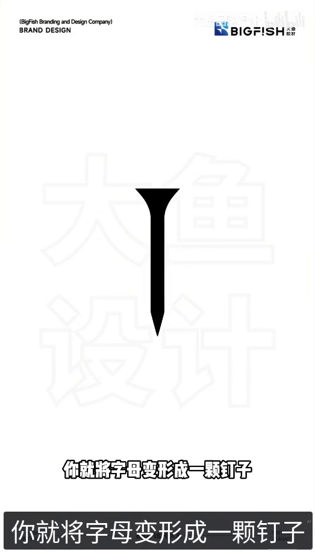

- **作者明确说法**：「你就將字母变形成一颗钉子」。同一颗钉子画面上，片内随后改为「至于火箭」。
- **整理者观察**：已经收成一颗钉子：钉帽在上、钉尖朝下，此时还只有一颗。

### T5 · 复制出第二颗

约 13.2s（录屏 31.0s）

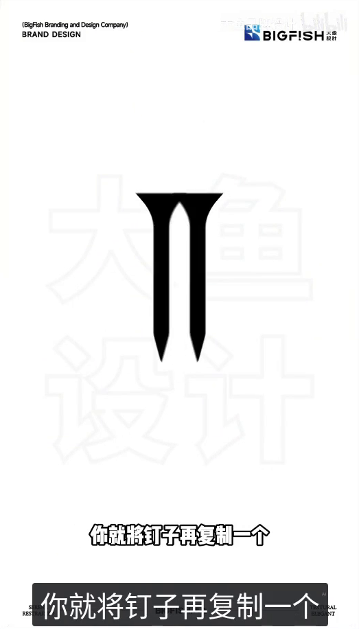

- **作者明确说法**：「你就將钉子再复制一个」
- **整理者观察**：相同的钉子并排出第二颗，两颗都是帽朝上、尖朝下，中间已经留出一条缝，尾下还没有喷焰。

### T6 · 两钉分开，尚未加喷焰

约 14.2s（录屏 32.0s）

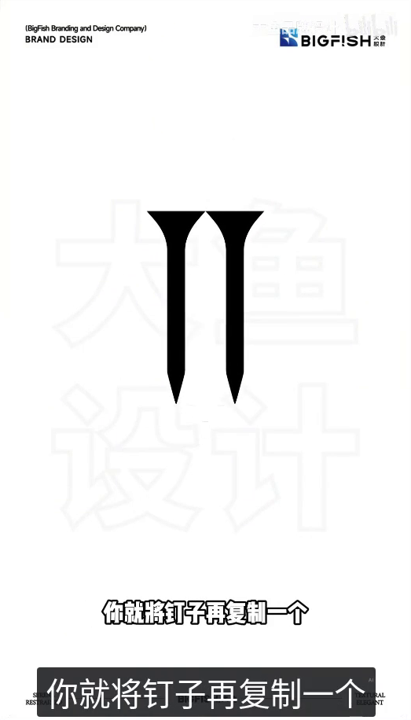

- **作者明确说法**：「你就將钉子再复制一个」
- **整理者观察**：两颗钉子左右分开更明显，中间空隙加宽，尾下仍是空白。

### T7 · 尾下加上三道喷焰

约 14.6s（录屏 32.4s）

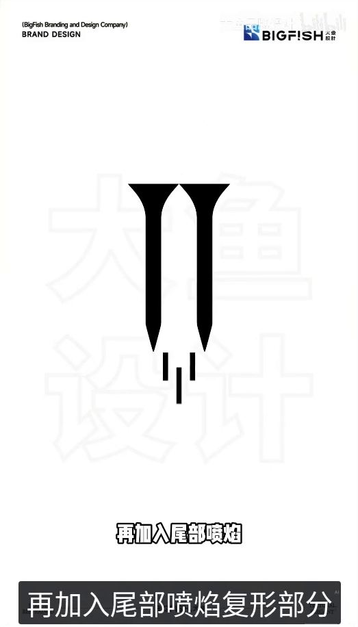

- **作者明确说法**：「再加入尾部喷焰」
- **播放器字幕**：「再加入尾部喷焰复形部分」
- **整理者观察**：两颗钉尖下方出现三道短竖，方向竖直朝下，中间一道略长。这是这一案线标的完成态。

### T8 · 用到发射云的照片上（无字标）

约 16.6s（录屏 34.4s）

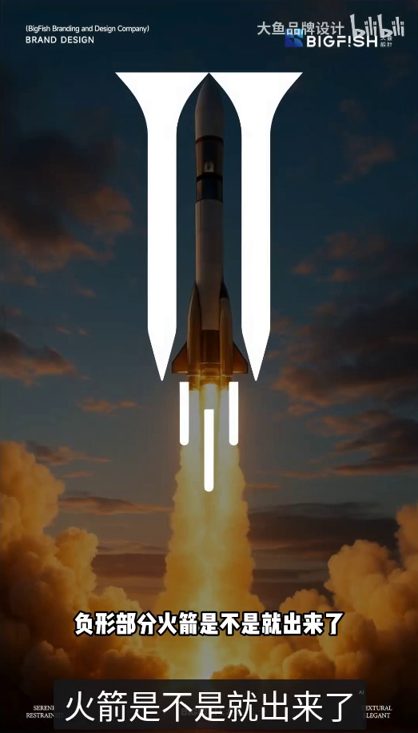

- **作者明确说法**：「负形部分火箭是不是就出来了」
- **整理者观察**：同一套轮廓收成白色，压在火箭升空、周围是云烟的照片上。两钉之间的空隙里能看见照片里的火箭，三道白竖压在尾焰上。这一张应用没有字标。

### T9 · 用到星空地平线的照片上，LAUNCHPIN / 发射钉

约 18.0s（录屏 35.8s）

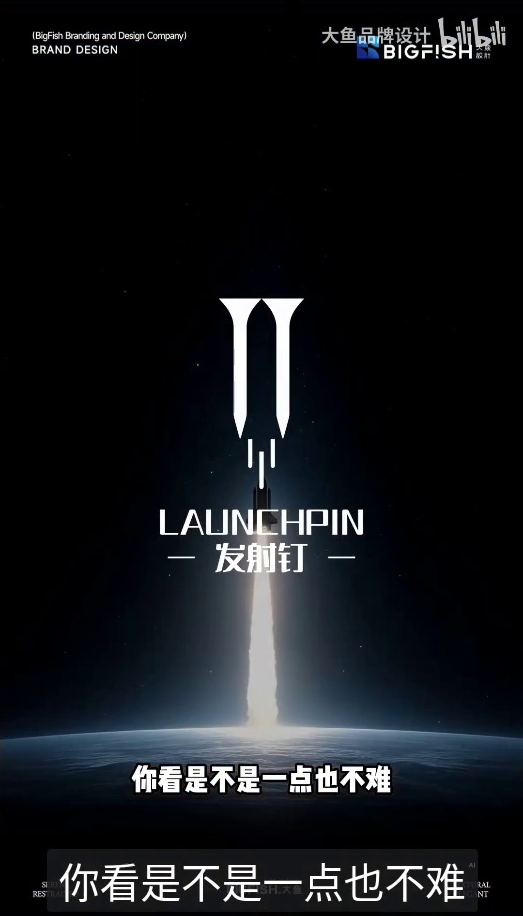

- **作者明确说法**：「你看是不是一点也不难」
- **整理者观察**：同一枚白色标志压在地球地平线与星空的照片上，下方字标为 LAUNCHPIN / — 发射钉 —。

### 思路与前后关系（整理者分析，非作者原话）

T 的横画收成钉帽、竖画收成钉尖之后，并排的两枚钉子在中间留出箭体似的空隙，尾下三道短竖补上喷焰，负形就能读成火箭。

---

## 案例三：插头 + 插座 / 易动力 EPOWER

### E1 · 对话框

约 20.0s（录屏 37.8s）

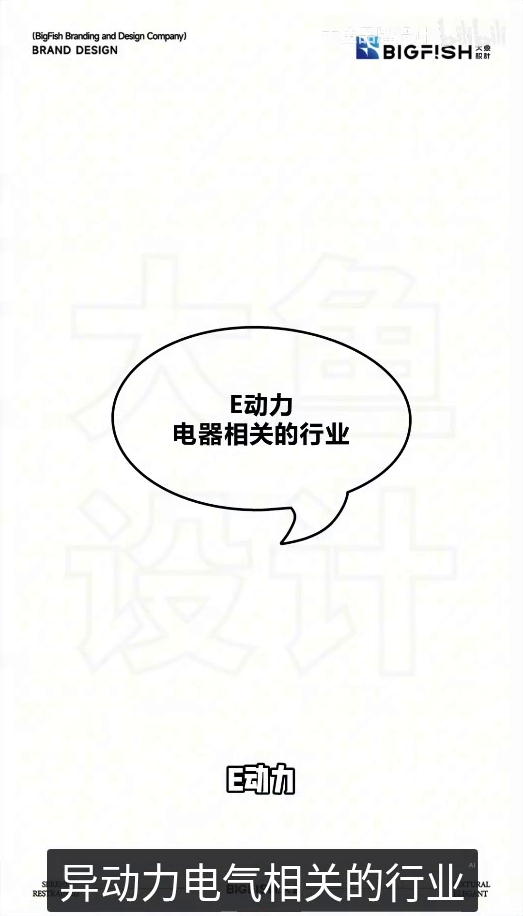

- **作者明确说法**：「E动力」
- **播放器字幕**：「异动力电气相关的行业」
- **整理者观察**：气泡分两行写着「E动力」「电器相关的行业」。

### E2 · 画面上的「动力」「电器」

约 22.0s（录屏 39.8s）

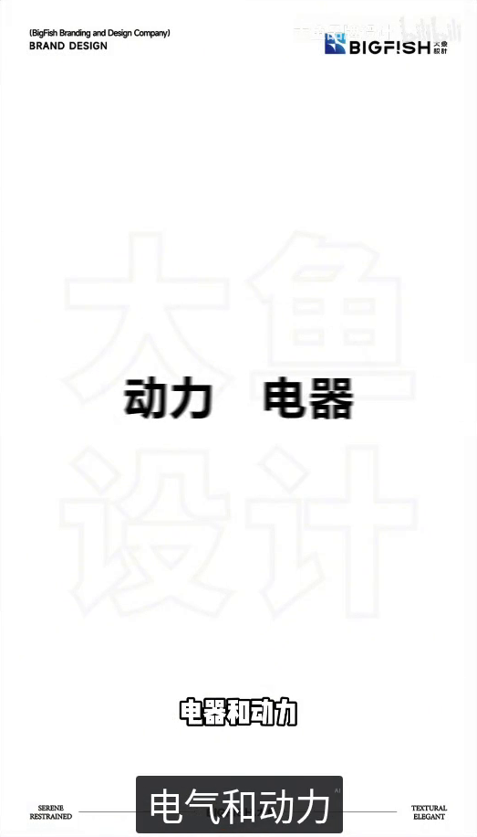

- **作者明确说法**：「电器和动力」
- **播放器字幕**：「电气和动力」
- **整理者观察**：白底上并排写着「动力」「电器」。

### E3 · 右侧出现两脚插头

约 24.6s（录屏 42.4s）

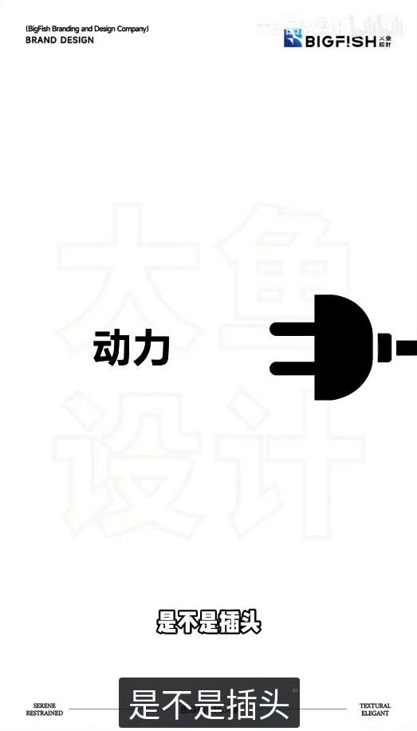

- **作者明确说法**：「是不是插头」。同一插头画面上，片内随后改为「那插头有了」。
- **整理者观察**：右侧出现一个黑色两脚插头，插脚朝左；左侧还留着「动力」二字。

### E4 · 左侧出现插座，两者相对留缝

约 26.4s（录屏 44.2s）

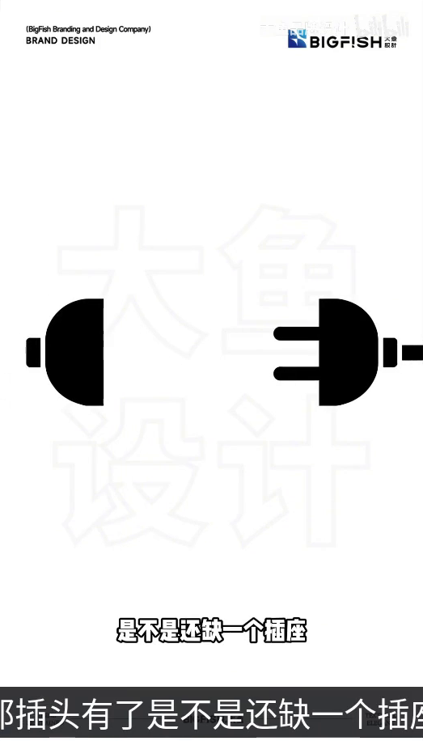

- **作者明确说法**：「是不是还缺一个插座」
- **整理者观察**：左侧出现黑色插座，开口朝右；右侧插头的两脚仍朝左。两者相向对着，中间留着明显空隙，脚尖还没有碰到插座立面。

### E5 · 相向靠拢，粉色标出中间的 E（脚尖尚未碰到插座）

约 27.4s（录屏 45.2s）

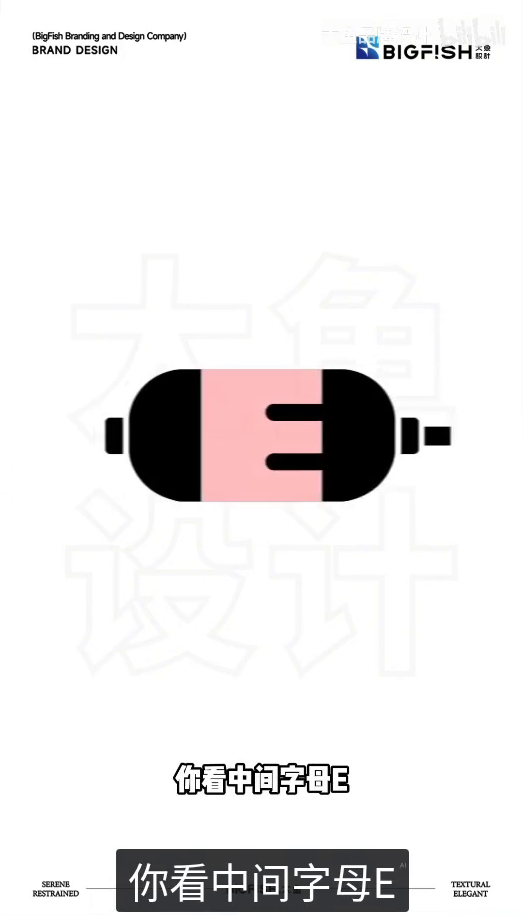

- **作者明确说法**：「你看中间字母E」
- **整理者观察**：两者继续相向靠拢。中间出现一块较宽的粉色，被两只黑脚分成三横，可以读成 E；两脚尖端此时尚未触到左侧插座立面。

### E6 · 粉色区域收窄，脚尖仍未碰到

约 28.2s（录屏 46.0s）

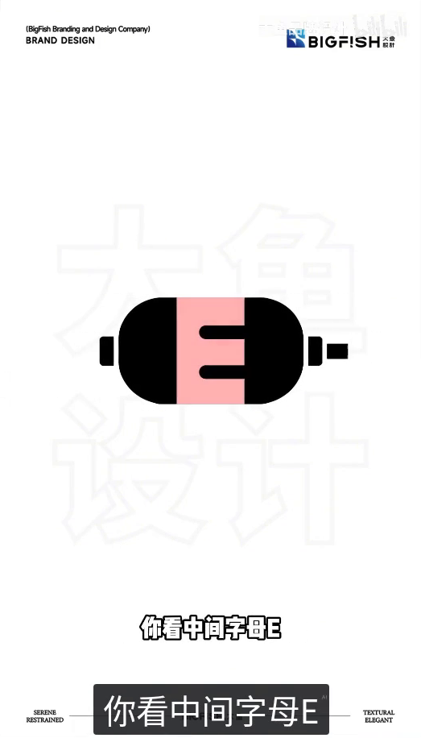

- **作者明确说法**：「你看中间字母E」
- **整理者观察**：粉色区域明显收窄，两脚更靠近插座，但尖端仍未碰到，中间还留着空隙。

### E7 · 粉色退去，成标仍有空隙

约 28.6s（录屏 46.4s）

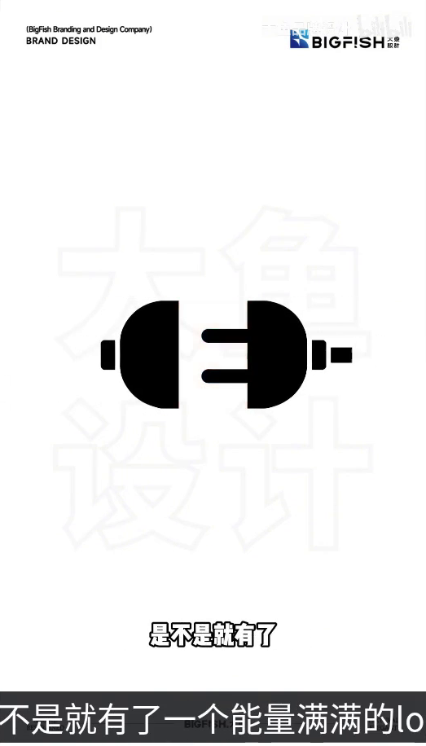

- **作者明确说法**：「是不是就有了」
- **整理者观察**：粉色已经退去。两脚与插座立面之间仍有一道白缝；中间这块留白被两只黑脚分成三横，仍可读成 E。这是这一案线标的完成态。

### E8 · 用到室内墙面照片上，易动力 / EPOWER

约 30.2s（录屏 48.0s）

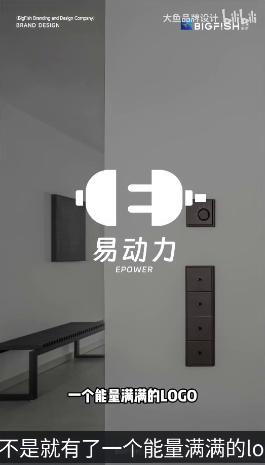

- **作者明确说法**：「一个能量满满的LOGO」
- **整理者观察**：同一枚标志反白，压在室内墙面的照片上：左侧较亮的墙前有深色长凳，右侧灰墙上有方形旋钮面板和一列四格面板。下方字标为「易动力 / EPOWER」。成标中间的空隙仍然看得见。

### 思路与前后关系（整理者分析，非作者原话）

插头和插座相向靠拢，两只插脚始终没有碰到左侧插座立面；中间这块留白被两只黑脚分成上、中、下三横，左缘是插座立面，所以能读成 E。成标里这道缝仍然在。

---

## 案例四：f + G + 吉他 / 放克吉他行 FUNK GUITAR

### FG1 · 对话框

约 32.2s（录屏 50.0s）

- **作者明确说法**：「fG加吉他」
- **播放器字幕**：「FG加吉他老师有没有办法呢」
- **整理者观察**：气泡分两行写着「fG加吉他」「老师有没有办法呢？」。

### FG2 · 小写 f 和大写 G

约 34.8s（录屏 52.6s）

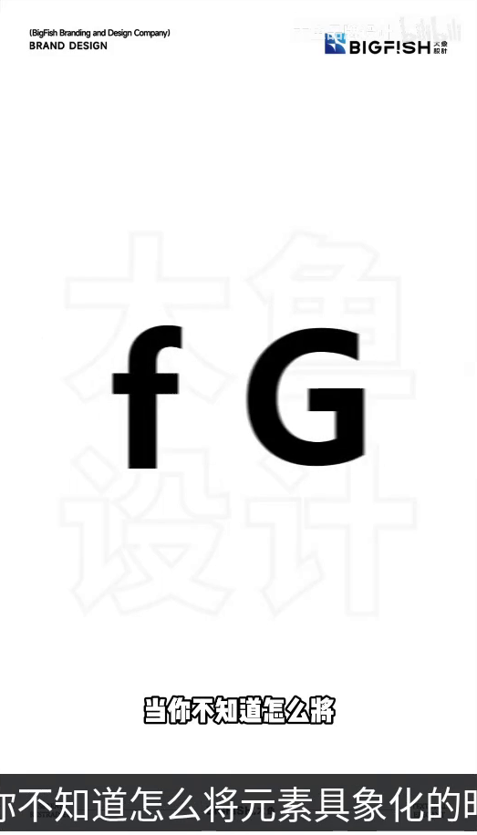

- **作者明确说法**：「当你不知道怎么將」。同一组画面上，片内随后改为「元素具象化的时候」。
- **整理者观察**：白底上左侧是小写 f，右侧是大写 G。随后画面一度铺上灰底和问号，没有否决标记，随即回到这两个字母。

### FG3 · 不妨尝试着反推

约 37.4s（录屏 55.2s）

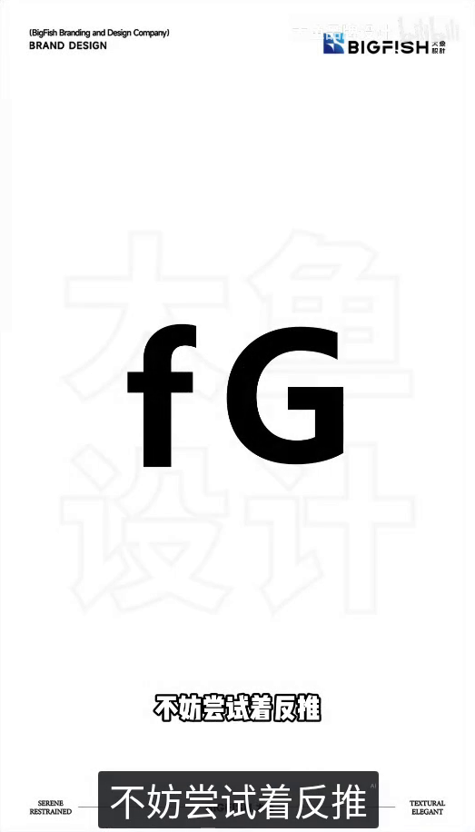

- **作者明确说法**：「不妨尝试着反推」
- **整理者观察**：灰底和问号已经退去，仍是并排的小写 f 和大写 G。

### FG4 · 吉他置于底层

约 38.4s（录屏 56.2s）

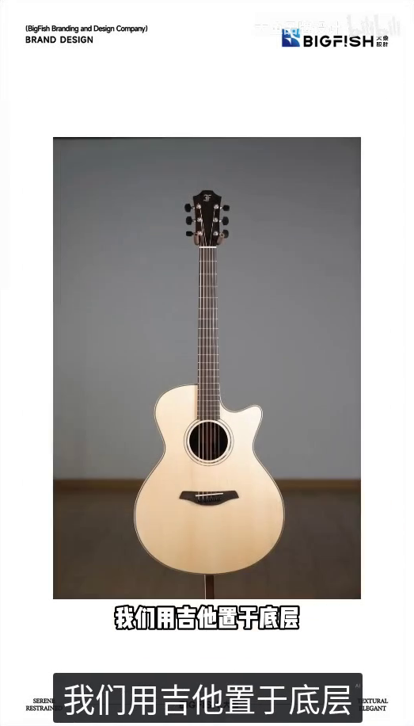

- **作者明确说法**：「我们用吉他置于底层」。吉他照片停留期间，片内随后改为「看看能不能临摹出字母f和G的轮廓」。
- **整理者观察**：一张浅色切角木吉他的照片，琴头朝上、琴身朝下，音孔和琴桥都看得清。

### FG5 · 粉色勾出 G

约 42.6s（录屏 60.4s）

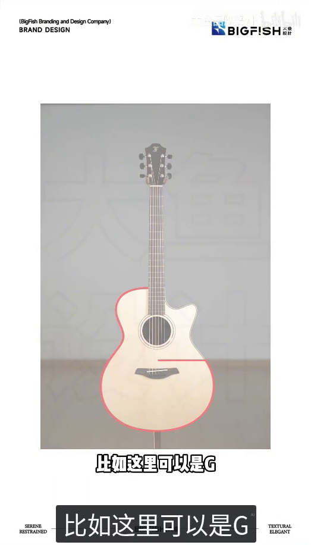

- **作者明确说法**：「比如这里可以是G」
- **整理者观察**：在仍在的吉他照片上，先用粉色沿琴身外轮廓描了一圈，并在琴腹中部加了一道粉色横笔，作为 G。

### FG6 · 青绿线勾出 f

约 43.6s（录屏 61.4s）

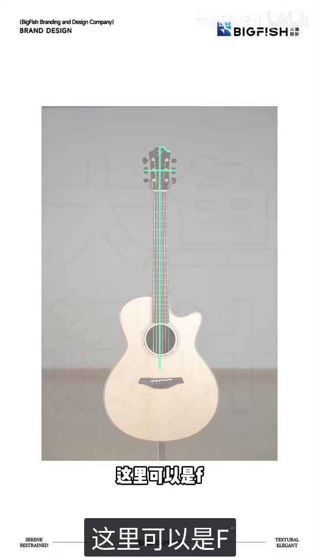

- **作者明确说法**：「这里可以是f」
- **播放器字幕**：「这里可以是F」
- **整理者观察**：粉色的 G 线已经退去。改用青绿线沿琴头勾出 f 的钩和横笔，再沿琴颈向下拉出竖笔，一直落到音孔附近。两色临摹是先后出现的。

### FG7 · 回到字母

约 45.0s（录屏 62.8s）

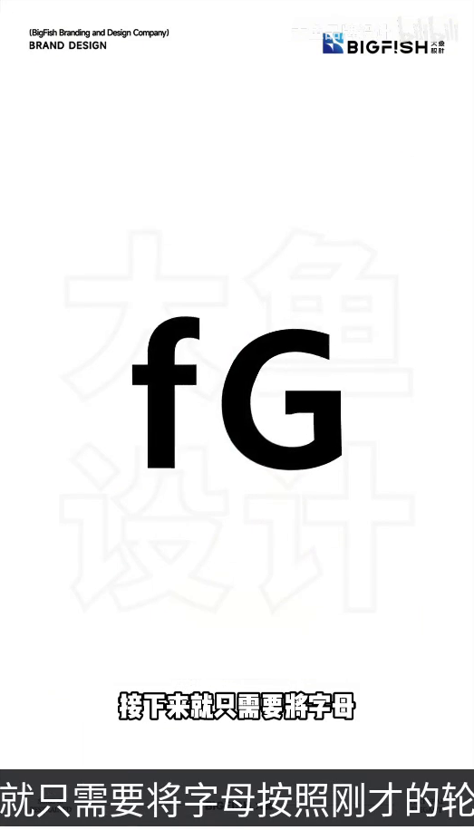

- **作者明确说法**：「接下来就只需要將字母」。同一变形过程中，片内随后改为「按照刚才的轮廓变形」。
- **整理者观察**：吉他照片已退去，又回到并排的小写 f 和大写 G，此时还没有按刚才的轮廓改写。

### FG8 · 按轮廓收成中间态

约 45.4s（录屏 63.2s）

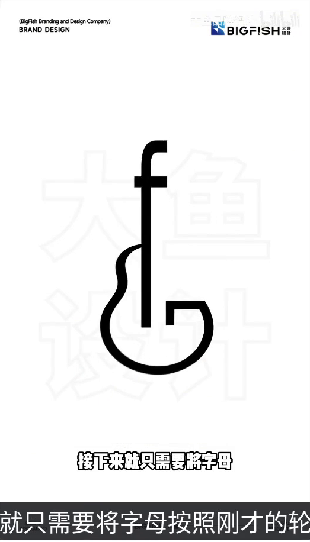

- **作者明确说法**：「接下来就只需要將字母」
- **整理者观察**：字母已经收成可读成吉他的形态：f 的竖笔充当琴颈，G 的碗充当琴身。琴身左上肩与 f 的竖笔相连，大约在竖笔中段接上。62.8 到 63.2 之间有一帧发虚，看不清笔画如何一步步改写，所以这里用发虚之后第一张清晰的邻帧。

### FG9 · 左上肩离开竖笔，缝还较窄

约 45.5s（录屏 63.3s）

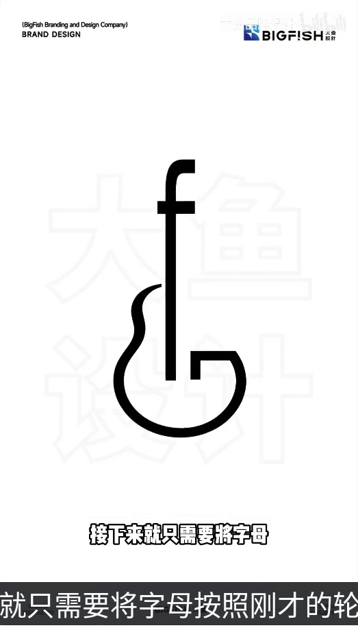

- **作者明确说法**：「接下来就只需要將字母」
- **整理者观察**：琴身左上肩的端头已经离开 f 的竖笔，中间出现白缝，但肩端离竖笔还比较近。这是断开过程中的清晰中间态。

### FG10 · 成标

约 45.8s（录屏 63.6s）

- **作者明确说法**：「接下来就只需要將字母」
- **整理者观察**：成标里，左上肩端与 f 的竖笔明显分开，中间留着一道更宽的白缝；肩端又往左收了一些，没有再连上竖笔。这是这一案线标的完成态。

### FG11 · 用到吉他照片上，放克吉他行 / FUNK GUITAR

约 47.8s（录屏 65.6s）

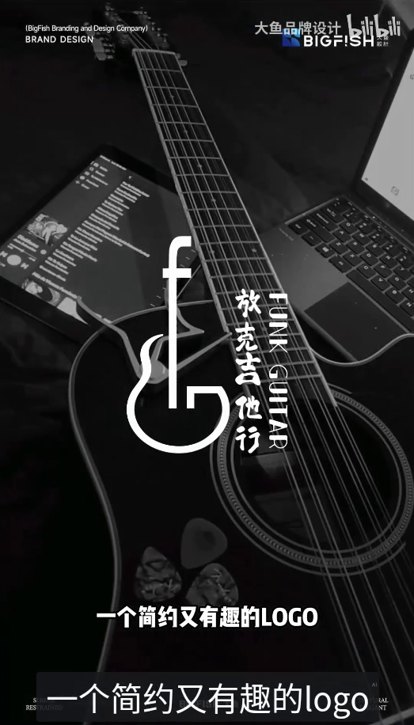

- **作者明确说法**：「一个简约又有趣的LOGO」。同一应用画面上，片内随后改为「不也手拿把掐」。
- **整理者观察**：同一枚标志反白，压在深色吉他的照片上：琴身边有三枚拨片，左上是平板、右上是笔记本电脑，右侧竖排字标为「放克吉他行 / FUNK GUITAR」。

### 思路与前后关系（整理者分析，非作者原话）

粉色线勾出的琴身曲线对应 G 的碗和横笔，青绿线勾出的琴头与琴颈对应 f 的钩、横和竖笔；字母按这两条轮廓收拢，可以同时读成 fG 和一把吉他。成标时 f 的竖笔与 G 的左上肩留出一道缝，好让两个字母保持可识别。

---

## 收束：三例并列

约 50.6s（录屏 68.4s）

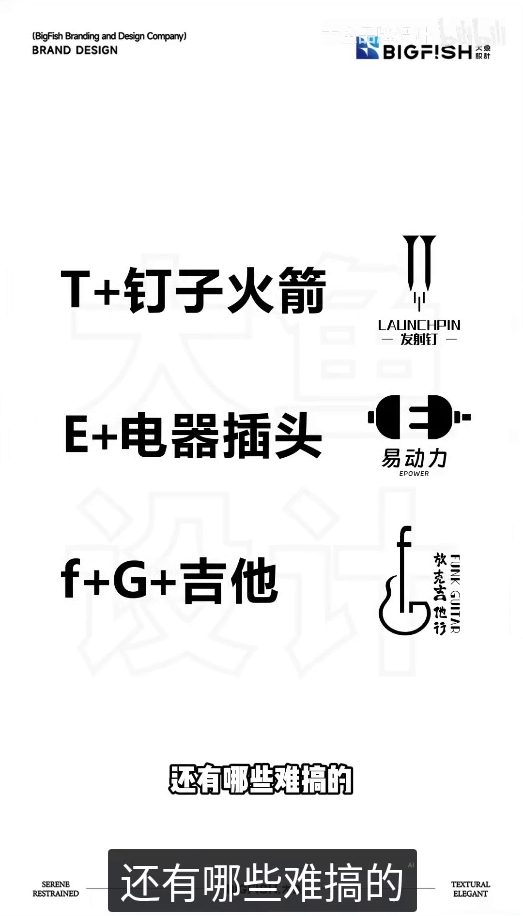

- **作者明确说法**：「还有哪些难搞的」。收束画面出现前后，片内随后改为「别急 我会出手」。
- **整理者观察**：三行并列：左侧写着「T+钉子火箭」「E+电器插头」「f+G+吉他」，右侧各配对应的完成态标志和字标。本片开头的「航鸟 / AVIABIRD」没有出现在这块回顾板上。
