# 只要脑洞够大，LOGO设计也就简简单单｜大鱼品牌设计

## 案例一：叉子 + 树

### FT1 · 叉子与树并置

约 1.2s（录屏 15.0s）

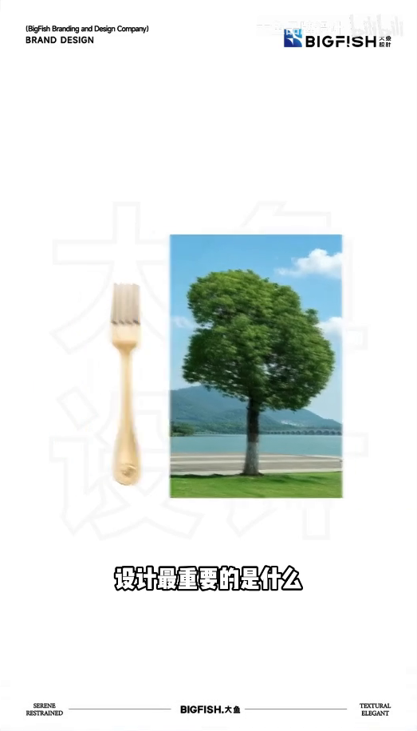

- **作者明确说法**：「设计最重要的是什么」
- **整理者观察**：白底上，左侧是一把浅色四齿餐叉，齿向上；右侧是一棵树的照片，树后有水面和山。同期片内是开场问句，未说明二者如何对位。

### FT2 · 叉子叠到树上

约 1.7s（录屏 15.5s）

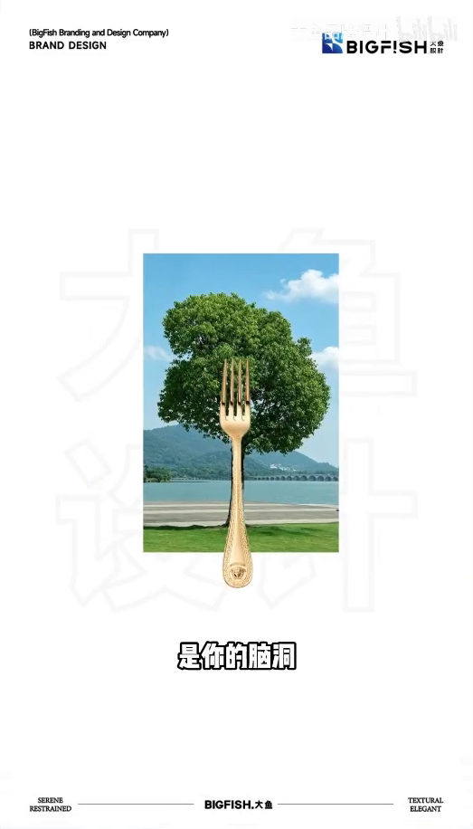

- **作者明确说法**：「是你的脑洞」
- **整理者观察**：这把参考餐叉是四齿，叠到树的照片上，叉齿置于树冠内，叉柄顺着树干，柄端伸出照片下沿。同期片内未说明如何对位。

### FT3 · 树冠收成黑影

约 2.3s（录屏 16.1s）

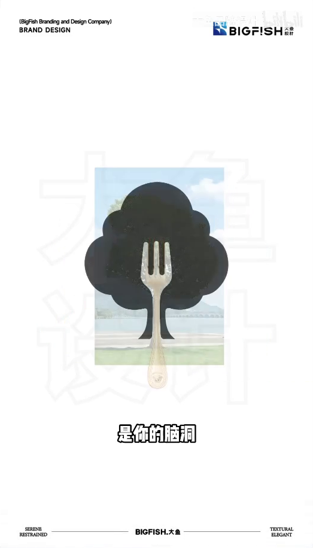

- **作者明确说法**：「是你的脑洞」
- **整理者观察**：照片外框还在，四周仍露出天空、水面和远山；树冠已收成多瓣圆叶轮廓的黑影，中间仍叠着浅色的叉子。

### FT4 · 树影里的负形叉子

约 2.7s（录屏 16.5s）

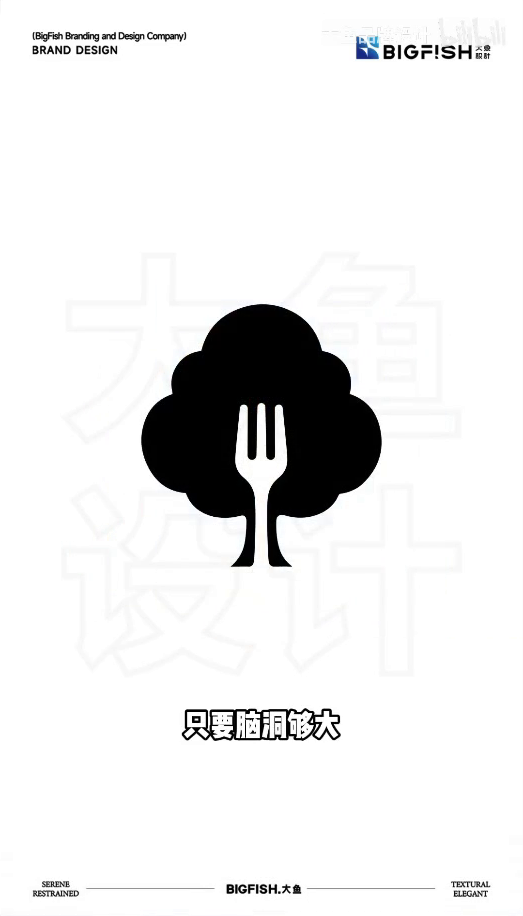

- **作者明确说法**：「只要脑洞够大」
- **整理者观察**：白底上是一枚黑色标志：树冠是多瓣圆叶轮廓，中间留出白色负形叉子，三齿向上；叉柄把树干分成两只脚。这是这一案的完成态。

### FT5 · 用到深色表面照片上

约 4.2s（录屏 18.0s）

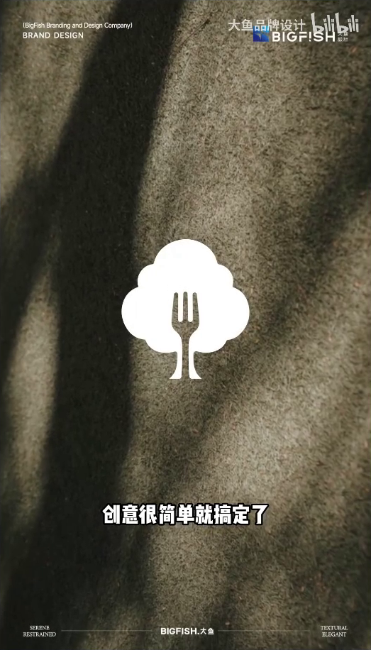

- **作者明确说法**：「创意很简单就搞定了」
- **整理者观察**：同一枚标志反白，压在深色、带阴影的纹理表面照片上，叉子的负形透出底下的表面。

### 思路与前后关系（整理者分析，非作者原话）

叉齿置于树冠内，叉柄与树干共用纵向；照片里的四齿餐叉在成标时概括为三齿白形，这一简化是整理者观察，不是作者的解释。完成态把树收成多瓣圆叶轮廓的实心黑影，叉子留成白色负形，所以同一枚图形既能读作树，也能读作叉子。

---

## 案例二：铅笔 + 显微镜 / LabWrite

### LW1 · 对话框

约 6.2s（录屏 20.0s）

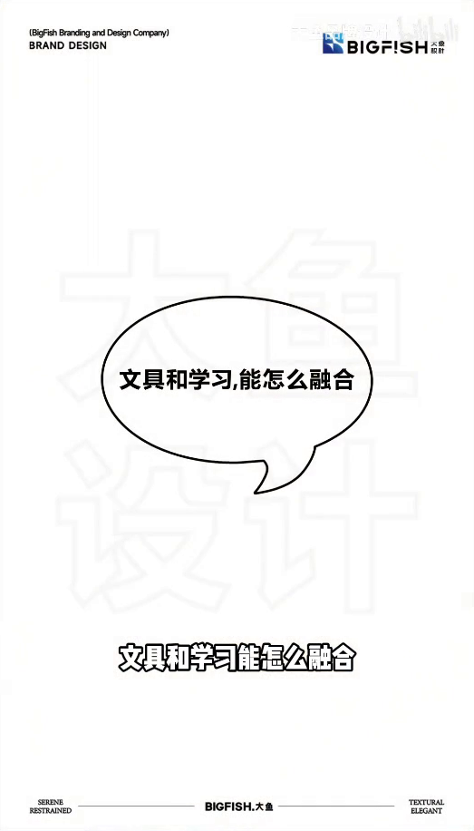

- **作者明确说法**：「文具和学习能怎么融合」
- **整理者观察**：白底上一个线框气泡，写着「文具和学习,能怎么融合」。

### LW2 · 铅笔

约 8.2s（录屏 22.0s）

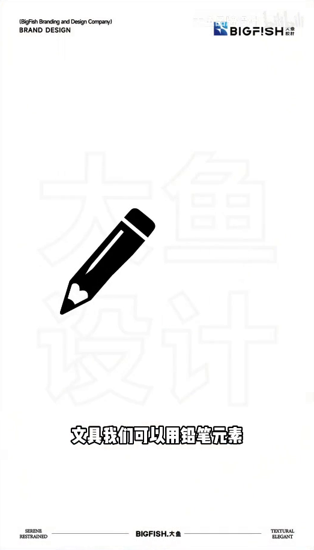

- **作者明确说法**：「文具我们可以用铅笔元素」
- **整理者观察**：黑色铅笔斜放，靠近笔尖有心形镂空；上方一道白斜带，是铅笔端部的轮廓隔缝。

### LW3 · 铅笔与放大镜并置

约 10.2s（录屏 24.0s）

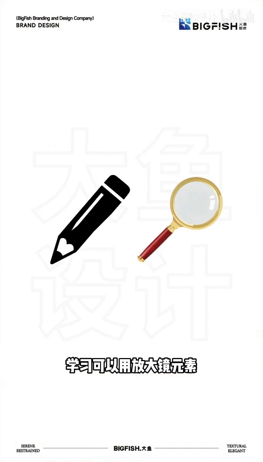

- **作者明确说法**：「学习可以用放大镜元素」
- **整理者观察**：左侧仍是那支铅笔，右侧加上一枚放大镜：金黄色镜圈、深红色镜柄。

### LW4 · 放大镜仍在，片内开脑洞

约 12.2s（录屏 26.0s）

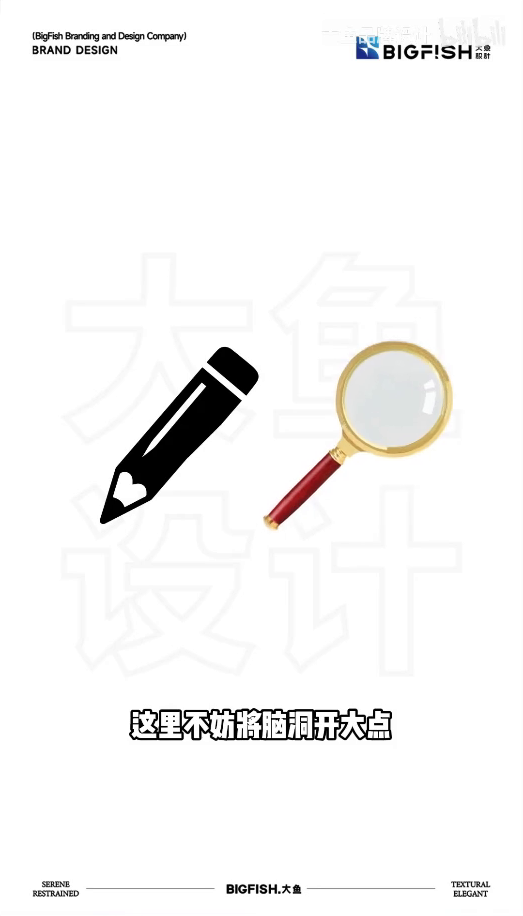

- **作者明确说法**：「这里不妨將脑洞开大点」
- **整理者观察**：画面仍是铅笔与放大镜并置，图形没有改，片内转到把脑洞开大。

### LW5 · 换成显微镜

约 12.7s（录屏 26.5s）

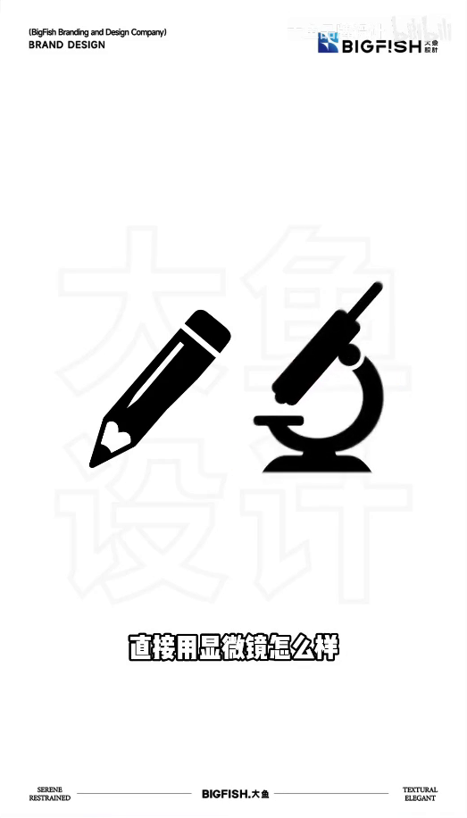

- **作者明确说法**：「直接用显微镜怎么样」
- **整理者观察**：左侧铅笔不动，右侧放大镜换成一架黑色显微镜，可见镜筒、支架、载物台和底座。

### LW6 · 圈出二者的相同元素

约 14.2s（录屏 28.0s）

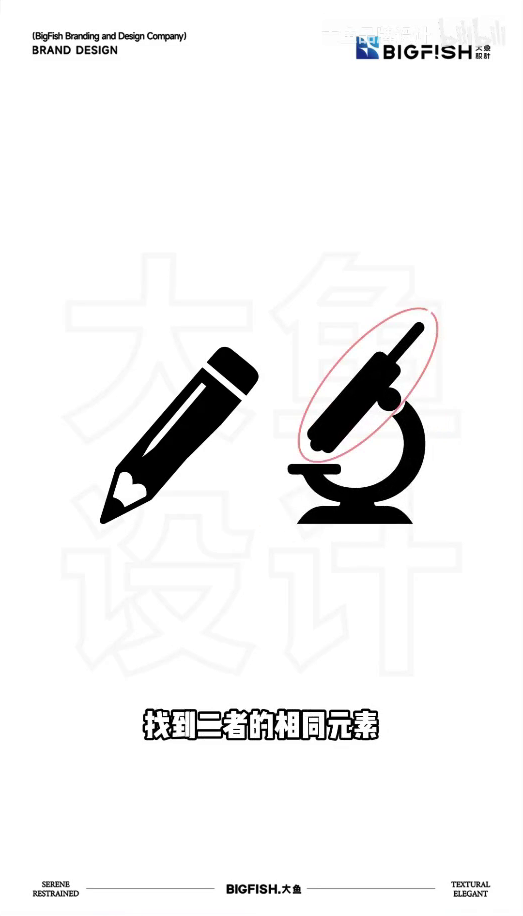

- **作者明确说法**：「找到二者的相同元素」
- **整理者观察**：铅笔与显微镜仍左右并置，一道浅红色椭圆圈在显微镜的镜筒、目镜一带。

### LW7 · 替换中间态

约 15.5s（录屏 29.3s）

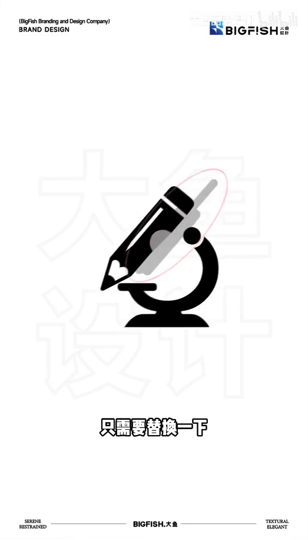

- **作者明确说法**：「只需要替换一下」
- **整理者观察**：铅笔已经移到显微镜镜筒的位置，原来的镜筒呈浅色残影，红圈也还在。

### LW8 · 铅笔换到镜筒位置

约 16.2s（录屏 30.0s）

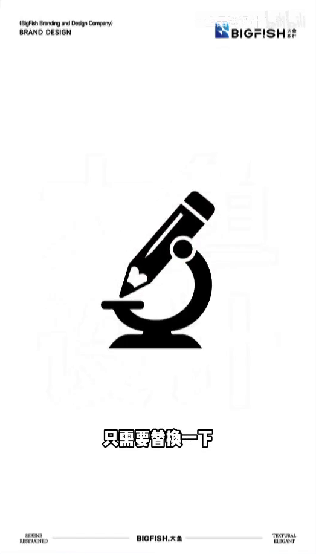

- **作者明确说法**：「只需要替换一下」
- **整理者观察**：残影和红圈都已去掉。铅笔取代镜筒，心形镂空还在；支架、载物台和底座仍是显微镜。这是这一案的完成态。

### LW9 · 用到显微镜特写上

约 17.2s（录屏 31.0s）

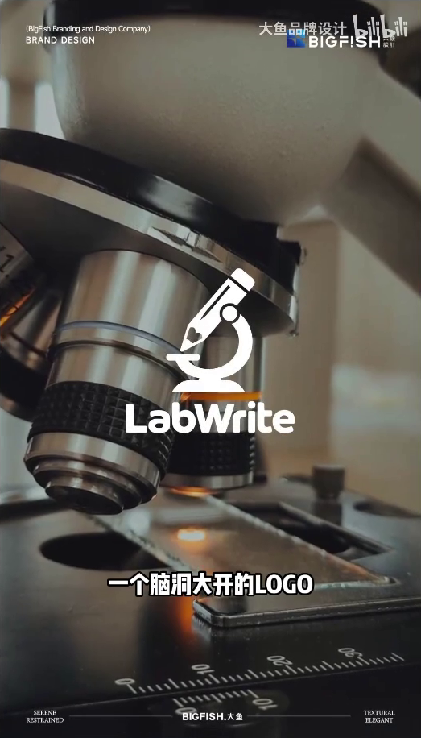

- **作者明确说法**：「一个脑洞大开的LOGO」。同一应用画面上，随后片内改为「也就轻轻松松」。
- **整理者观察**：同一枚标志反白，压在显微镜物镜和载物台的特写照片上，下方写着 LabWrite。

### 思路与前后关系（整理者分析，非作者原话）

铅笔和显微镜都有一段细长的筒状。按片内「找到二者的相同元素」，把铅笔换到镜筒的位置，支架和底座仍是显微镜，所以完成态同时是文具、也是学习用具。

---

## 案例三：鲸鱼 + 购物车

### WH1 · 对话框

约 20.2s（录屏 34.0s）

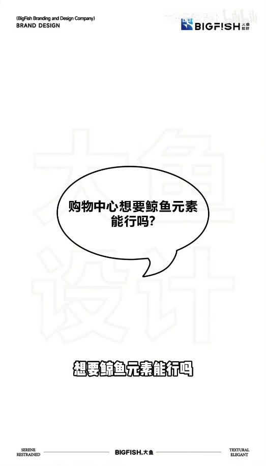

- **作者明确说法**：「想要鲸鱼元素能行吗」
- **整理者观察**：线框气泡写着「购物中心想要鲸鱼元素能行吗？」，比片内多出「购物中心」。

### WH2 · 袋子上印鲸鱼

约 22.4s（录屏 36.2s）

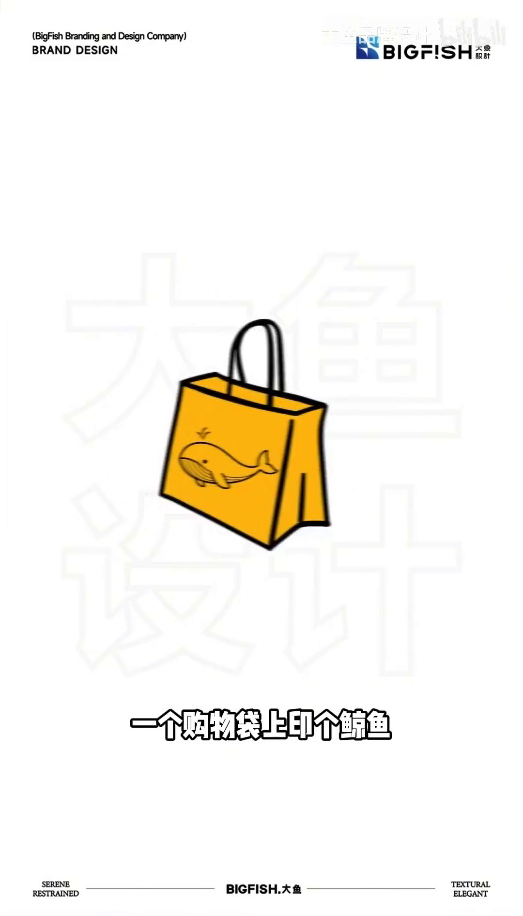

- **作者明确说法**：「一个购物袋上印个鲸鱼」
- **整理者观察**：一只黄色购物袋，袋面上印着线描鲸鱼，能看到喷水、眼睛和鳍。

### WH3 · 脑洞还不够

约 24.2s（录屏 38.0s）

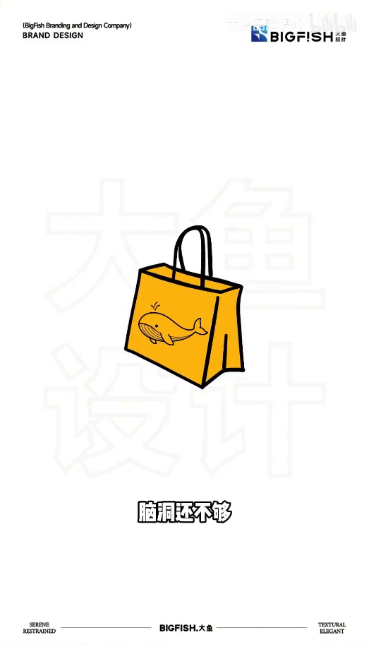

- **作者明确说法**：「脑洞还不够」
- **整理者观察**：画面仍是那只印着鲸鱼的购物袋，片内把这一方案收掉。

### WH4 · 取出购物车

约 25.2s（录屏 39.0s）

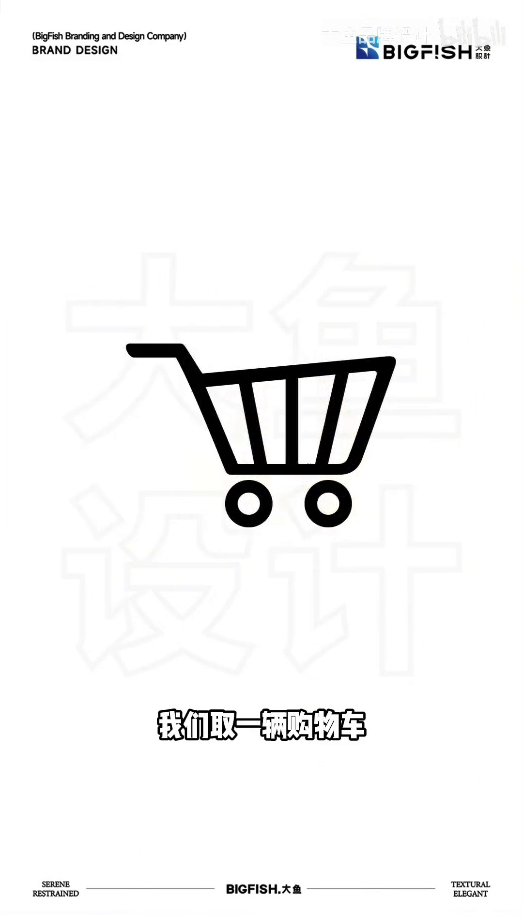

- **作者明确说法**：「我们取一辆购物车」
- **整理者观察**：白底上出现一辆线框购物车，把手、车架和两只轮子都在，筐里已有几条竖线。

### WH5 · 筐内仍是竖线

约 26.2s（录屏 40.0s）

- **作者明确说法**：「只需要將线条变一下」
- **整理者观察**：购物车外形未改，筐内仍是竖线。同期片内只说把线条变一下，未逐步解释后面如何弯曲、点眼。

### WH6 · 竖线改成斜线

约 26.7s（录屏 40.5s）

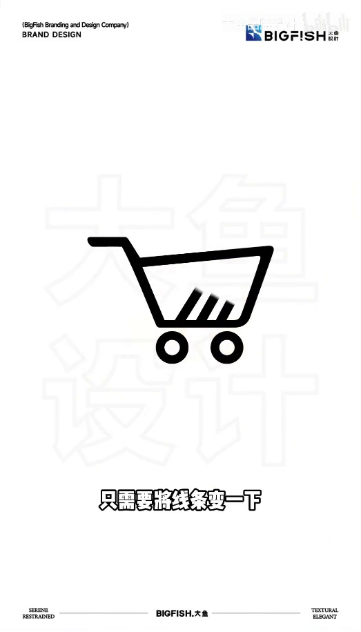

- **作者明确说法**：「只需要將线条变一下」
- **整理者观察**：筐内的线条已改成几条短斜线，还没有连成弯曲的轮廓，上沿也还没有点眼。同期片内未逐步解释这一步。

### WH7 · 斜线弯成鲸身轮廓

约 27.1s（录屏 40.9s）

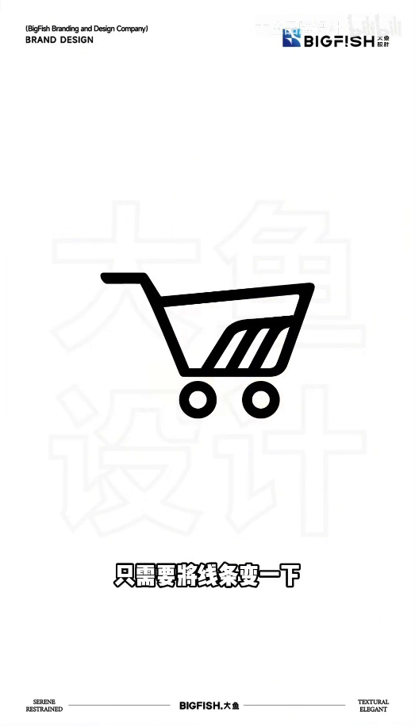

- **作者明确说法**：「只需要將线条变一下」
- **整理者观察**：斜线拉长并弯连，在筐内形成鲸身和鳃纹的轮廓；把手、车架和轮子仍在，上沿还没有点眼。同期片内未逐步解释如何弯曲。

### WH8 · 上沿点眼，完成态

约 28.2s（录屏 42.0s）

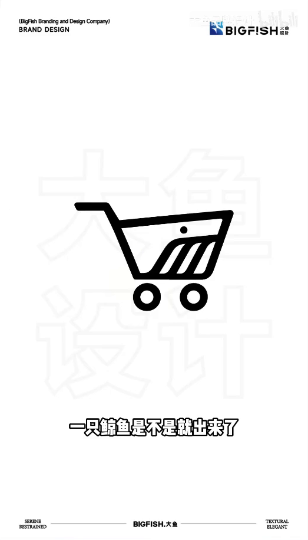

- **作者明确说法**：「一只鲸鱼是不是就出来了」
- **整理者观察**：上沿点了一个眼。鲸鱼的形体大部分是筐里的空间，内弯线构成鲸身和鳃纹的轮廓；把手、车架和轮子都还在。这是这一案的完成态。

### WH9 · 用到商场中庭照片上

约 30.2s（录屏 44.0s）

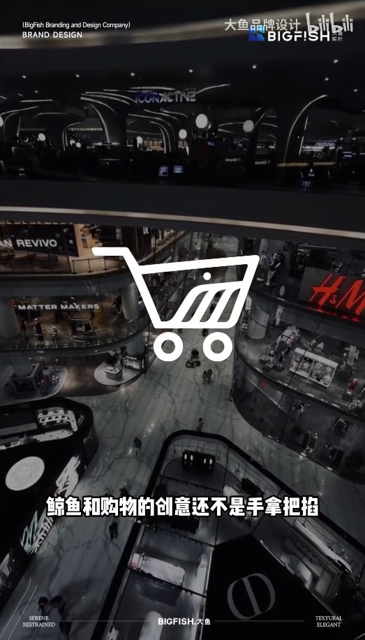

- **作者明确说法**：「鲸鱼和购物的创意还不是手拿把掐」
- **整理者观察**：同一枚标志反白，压在商场中庭的俯视照片上，画面里可见 H&M 等店招。

### 思路与前后关系（整理者分析，非作者原话）

袋上直接印鲸鱼被片内「脑洞还不够」收掉之后，改从购物车入手：把手、车架和轮子保持不动，只把筐里的线条弯成鲸身和鳃纹，并在上沿点眼。鲸鱼占用的是筐的内部空间，所以完成态同时读得出车和鲸。

---

## 案例四：口罩 + 奖杯 / MaskWin

### MW1 · 对话框

约 33.2s（录屏 47.0s）

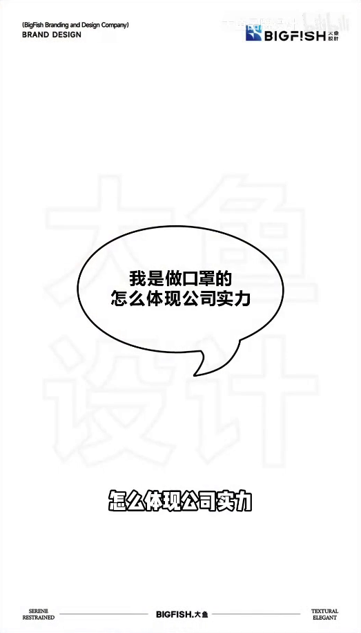

- **作者明确说法**：「怎么体现公司实力」
- **整理者观察**：线框气泡写着「我是做口罩的怎么体现公司实力」，比片内多出前半句。气泡之后画面短暂出现一张猫的表情包照片，片内为「公司很有实力」，这是插图过场，不是标志方案。

### MW2 · 奖杯

约 36.2s（录屏 50.0s）

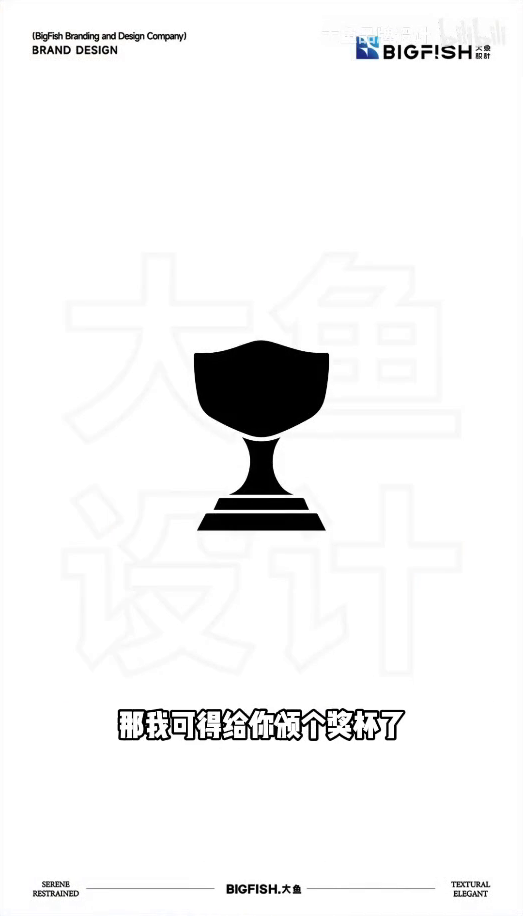

- **作者明确说法**：「那我可得给你颁个奖杯了」
- **整理者观察**：黑色奖杯。杯体上缘中间向上拱凸；杯体与杯柱之间已有一道白缝；底下是杯柱，再下面是两块梯形构成的分层底座。

### MW3 · 红线勾出杯体

约 37.7s（录屏 51.5s）

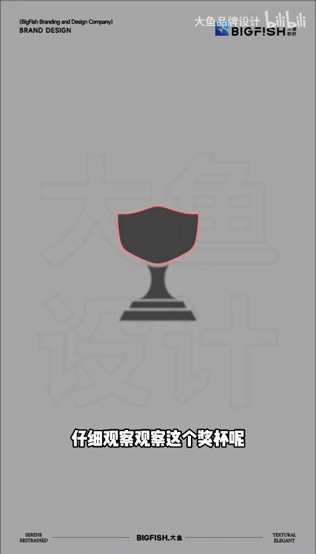

- **作者明确说法**：「仔细观察观察这个奖杯呢」
- **整理者观察**：底子改成灰色，奖杯也变成深灰。一道红线只勾出杯体的外轮廓，杯柱和底座没有被勾。

### MW4 · 加上内弧线和耳挂短笔

约 39.2s（录屏 53.0s）

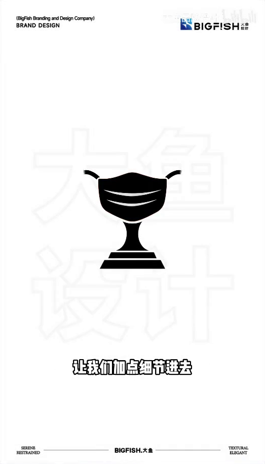

- **作者明确说法**：「让我们加点细节进去」
- **整理者观察**：底子回到白，奖杯回到黑色。杯体内加上白色内弧线，两侧伸出尚未闭合的耳挂短笔；杯柱、白缝和两层梯形底座都还在。同期片内未说明加的是哪些细节。

### MW5 · 耳挂收成圆环，完成态

约 40.7s（录屏 54.5s）

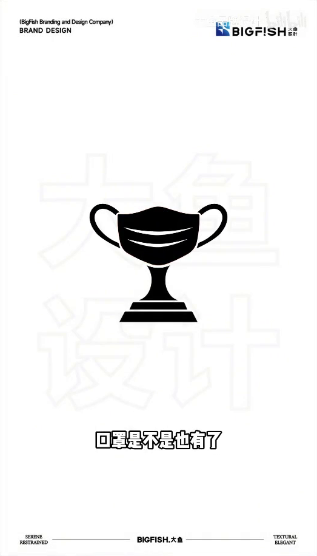

- **作者明确说法**：「口罩是不是也有了」
- **整理者观察**：两侧短笔收成圆环，像口罩耳挂，也像奖杯把手。杯体内的白色内弧线仍在；杯柱、白缝和两层梯形底座没有改。这是这一案的完成态。

### MW6 · 用到口罩照片上

约 42.2s（录屏 56.0s）

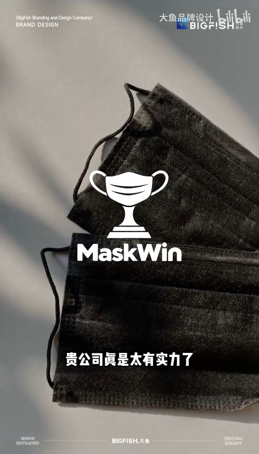

- **作者明确说法**：「贵公司真是太有实力了」。同一应用画面上，片内先为「不错」，随后改为本句。
- **整理者观察**：同一枚标志反白，压在几只叠放的黑色口罩照片上，下方写着 MaskWin。

### 思路与前后关系（整理者分析，非作者原话）

奖杯杯体的外轮廓已经接近口罩，杯体与杯柱之间也留着白缝。再加上杯体内的白色弧线和两侧耳挂圆环，杯体就被读成口罩；杯柱和两层梯形底座仍标明这是奖杯。

---

## 收束：三例并列

约 45.2s（录屏 59.0s）

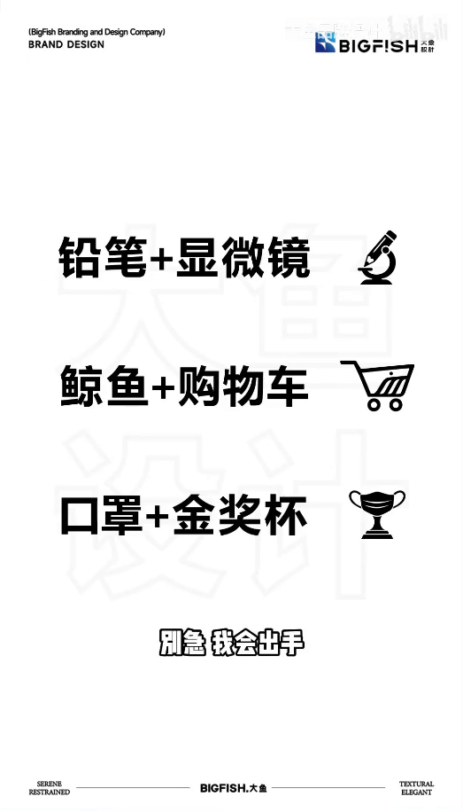

- **作者明确说法**：「别急 我会出手」。收束画面出现前后，片内先为「还有哪些难搞的」，随后改为本句。
- **整理者观察**：三行并列：左侧写着「铅笔+显微镜」「鲸鱼+购物车」「口罩+金奖杯」，右侧各配对应的完成态标志。「金奖杯」是画面上的标注文字。
