# [LOGO创意设计，其实很简单](https://www.bilibili.com/video/BV18oem6uEw4/)｜大鱼品牌设计

文中「约 00:mm」是按播放器时钟校准的近似时刻，误差约 ±1s；括号内为录屏精确秒。

## 案例一：剪刀与 g / GLOSCUT

### GC1 · 原形：金属剪刀照片与字母 g

约 00:01（录屏 79.400s）

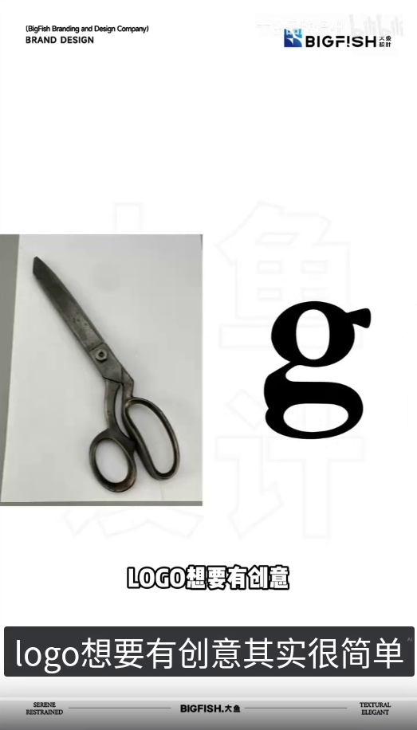

- **作者明确说法**：「LOGO想要有创意」
- **整理者观察**：这是播放中的原形，不是起播前的暂停预览。白底左侧是一把金属剪刀的照片，刀口朝左上，照片里已经能看到两个手柄圆环和中间的轴钉；右侧是一枚黑体字母 g。两件还是分开的，没有收成组合标。

### GC2 · 照片退去，留下红色剪刀图形

约 00:03（录屏 81.000s）

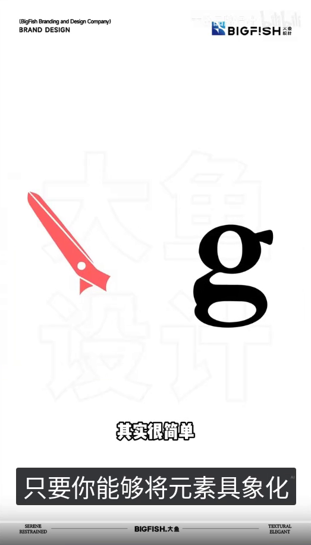

- **作者明确说法**：「其实很简单」
- **整理者观察**：原来的金属质感和手柄照片已经退去，左侧只剩红色的剪刀图形，刀口仍朝左上；右侧的黑色 g 还在，两件仍然分开。

### GC3 · 红色剪刀转到水平，与 g 相接

约 00:03（录屏 81.400s）

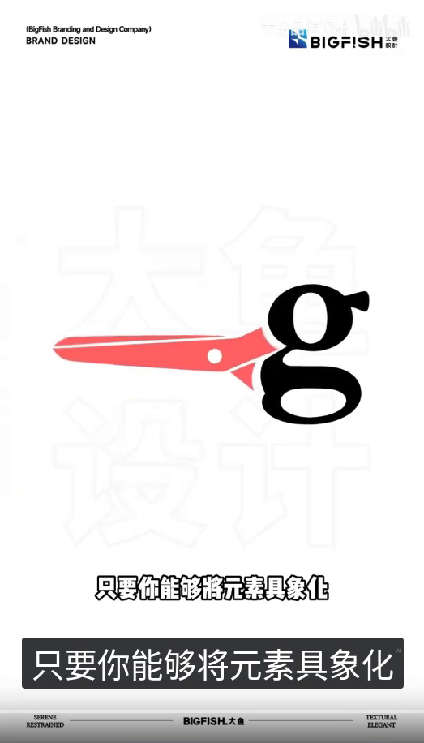

- **作者明确说法**：「只要你能够將元素具象化」
- **整理者观察**：红色剪刀已经转到接近水平，刃部向左，右侧与黑色的 g 相接，中间能看到轴孔。剪刀仍是红色，还没有收成全黑标。

### GC4 · 黑标稳住

约 00:04（录屏 82.200s）

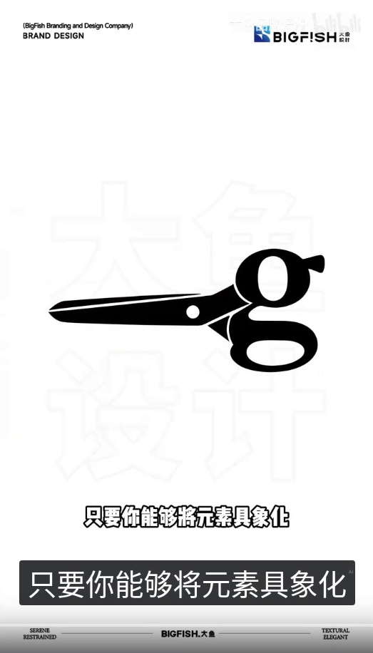

- **作者明确说法**：「只要你能够將元素具象化」
- **整理者观察**：白底上的黑色组合标已经稳住。左侧是尖刃，两片刃之间留出一道白缝，中间有轴孔；上方圆环是 g 的字碗和字耳，下方圆环是 g 的降部回环。

### GC5 · 用到理发照片上，GLOSCUT

约 00:05（录屏 83.200s）

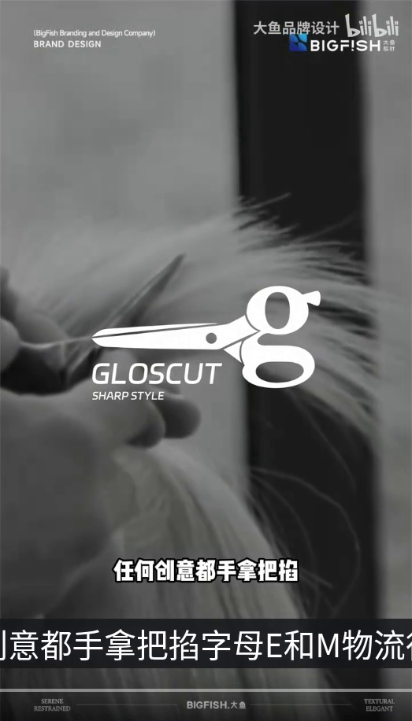

- **作者明确说法**：「任何创意都手拿把掐」
- **整理者观察**：同一件标志反白，叠在黑白理发照片上。字标为「GLOSCUT」，其下是「SHARP STYLE」。

### 思路与前后关系（整理者分析，非作者原话）

播放中先给出金属剪刀照片和字母 g，再把照片收到红色剪刀图形，转到水平后与 g 相接，并收成黑标。完成后，上方圆环来自 g 的字碗和字耳，下方圆环来自 g 的降部回环，而这两个圆环同时落在剪刀手柄的位置上：字母与刀柄在图形上共用这一对环，所以同一件标既能读成剪刀，也能读成 g。这是整理者根据可见结构作的归纳，片内没有单独解释这一步。用到照片上时，字标写成「GLOSCUT」和「SHARP STYLE」。

---

## 案例二：包裹与 EM / 恩明速递

### EM1 · 气泡：字母 E 和 M、物流

约 00:07（录屏 85.200s）

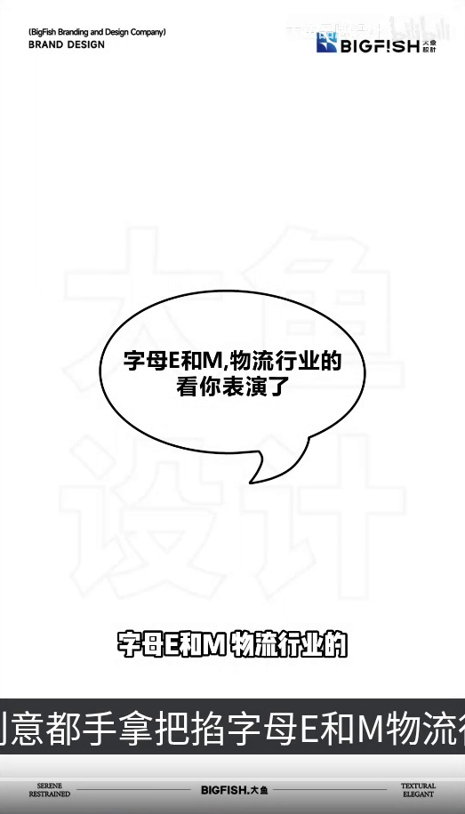

- **作者明确说法**：「字母E和M 物流行业的」。同一画面上，气泡里两行写着「字母E和M,物流行业的」「看你表演了」。
- **整理者观察**：白底中央是一个线框圆角气泡，尾朝右下。片内是「字母E和M 物流行业的」（中间空格、没有逗号）；气泡第一行在「M」后有逗号。

### EM2 · 原形：纸箱照片

约 00:12（录屏 90.000s）

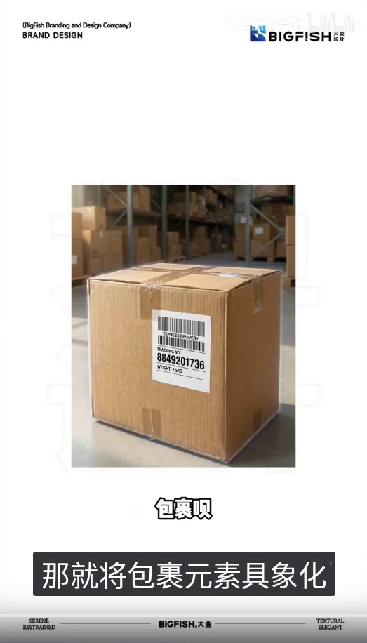

- **作者明确说法**：「包裹呗」
- **整理者观察**：仓库货架前的一只纸箱，箱面贴着运单，可见「EXPRESS DELIVERY」和追踪号「8849201736」。还没有浅蓝色线框，也还没有字母 EM。

### EM3 · 叠上浅蓝透视线框

约 00:13（录屏 91.000s）

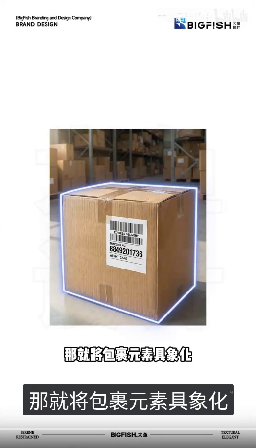

- **作者明确说法**：「那就將包裹元素具象化」
- **整理者观察**：同一只纸箱上叠了一圈浅蓝色的透视线框，勾出箱子的体积。还没有出现字母 EM。

### EM4 · 字母 EM

约 00:14（录屏 91.800s）

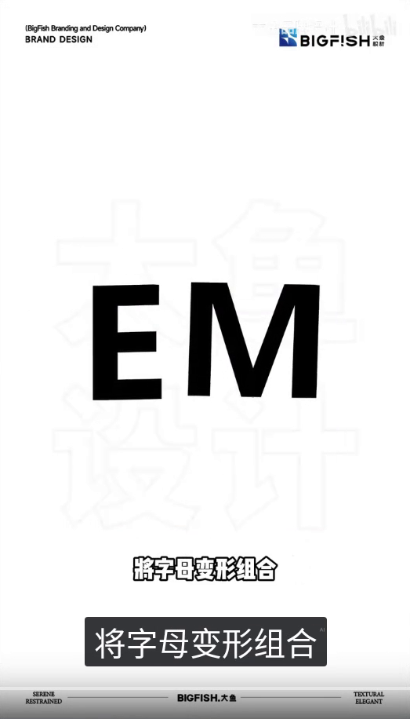

- **作者明确说法**：「將字母变形组合」
- **整理者观察**：白底上是一对粗黑体字母 EM，仍是平面字母，还没有折成立体。

### EM5 · 折叠之后，尚未延长

约 00:14（录屏 92.300s）

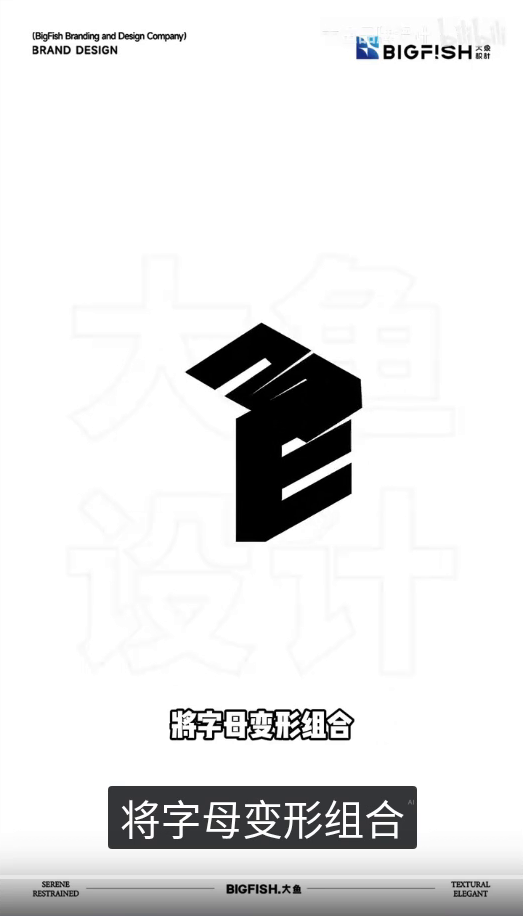

- **作者明确说法**：「將字母变形组合」
- **整理者观察**：EM 已经折成立体的转折结构，边角仍尖。笔画还没有拉成后来的包裹体块。

### EM6 · 笔画延长之后，尚未圆角

约 00:16（录屏 93.600s）

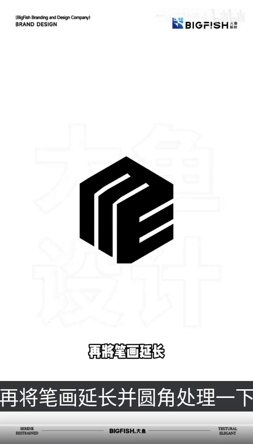

- **作者明确说法**：「再將笔画延长」
- **整理者观察**：转折后的笔画已经拉成接近包裹的六面体轮廓，左右面上已经能看到白色缝隙；外角和缝端仍是尖的，还没有做圆角。

### EM7 · 圆角净标

约 00:18（录屏 96.000s）

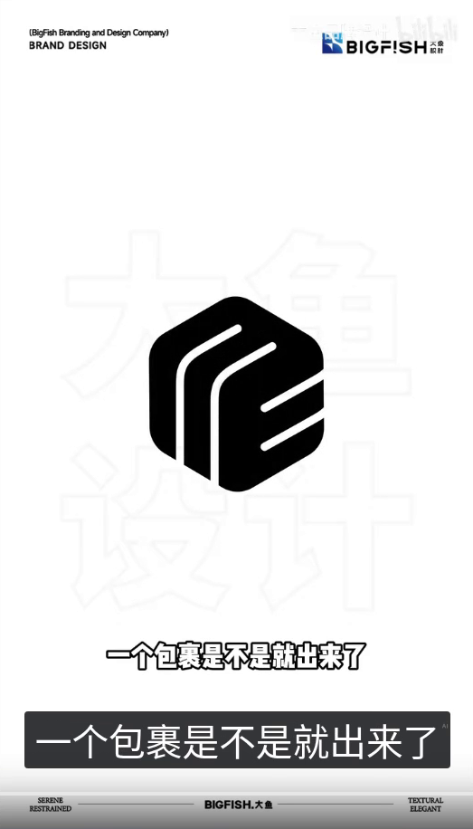

- **作者明确说法**：「一个包裹是不是就出来了」
- **整理者观察**：白底上的黑色包裹标已经稳住。等轴测的圆角体块，左面两条竖直白缝，右面两条水平白缝。这是这一案线标的黑色完成态。

### EM8 · 用到货轮照片上，恩明速递

约 00:20（录屏 97.600s）

- **作者明确说法**：「一个形象又直观的LOGO」
- **整理者观察**：同一件标志反白，叠在红色货轮的航拍照片上。标志右侧是竖排「恩明速递」，再右侧是整词旋转约 90° 的竖排「EM EXPRESS」。

### 思路与前后关系（整理者分析，非作者原话）

先用气泡提出字母 E、M 和物流，再给出纸箱照片，叠上浅蓝透视线框，然后用字母 EM 折叠成立体，把笔画延长成包裹体块，再做圆角，得到黑净标。折叠后的立体方向把字母笔画收成箱子的棱；圆角则把延长后仍显尖硬的转角收软，看起来更像一只包裹。这是整理者根据变形步骤作的归纳，片内只说了「將字母变形组合」「再將笔画延长」「并圆角处理一下」，没有另说为何这样会像箱子。用到照片上时，字标写成「恩明速递」和竖排的「EM EXPRESS」。

---

## 案例三：字母 R / 瑞特家居

### RR1 · 气泡：家居行业与字母 R

约 00:22（录屏 100.200s）

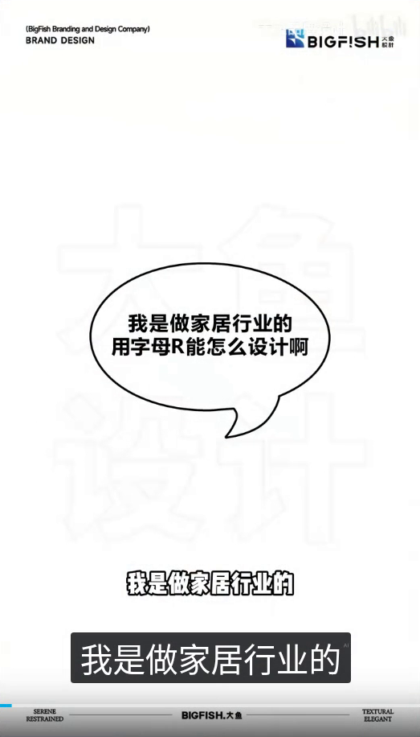

- **作者明确说法**：「我是做家居行业的」。同一画面上，气泡里两行写着「我是做家居行业的」「用字母R能怎么设计啊」。
- **整理者观察**：白底中央是一个线框圆角气泡，尾朝右下。

### RR2 · 粗黑体 R

约 00:26（录屏 103.600s）

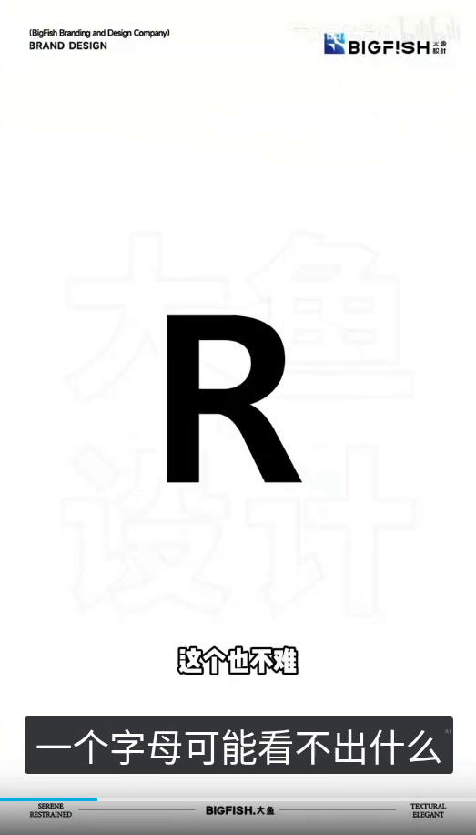

- **作者明确说法**：「这个也不难」
- **整理者观察**：白底上一个粗黑体大写 R，实心，还没有改成细线。

### RR3 · 细线单 R

约 00:27（录屏 105.200s）

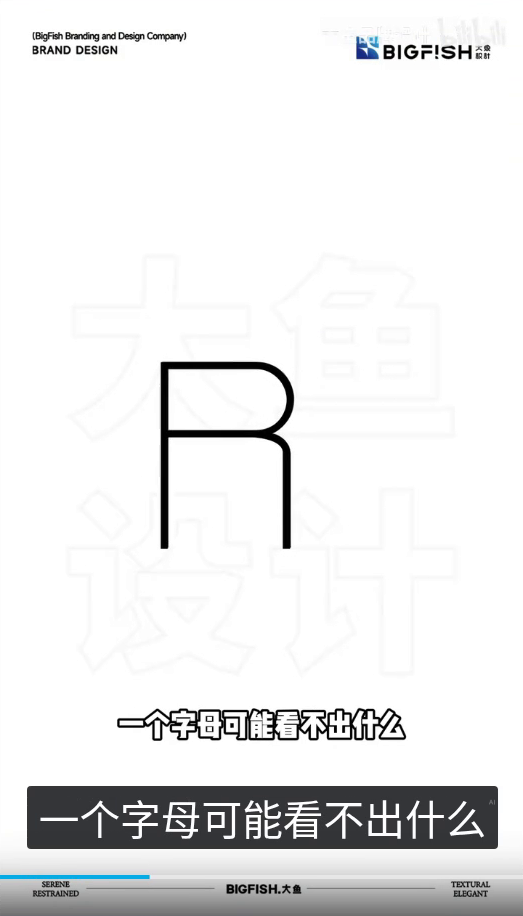

- **作者明确说法**：「一个字母可能看不出什么」
- **整理者观察**：同一个 R 已经收成细线空心轮廓，仍是单个字母，还没有出现第二个 R。

### RR4 · 双 R

约 00:28（录屏 105.800s）

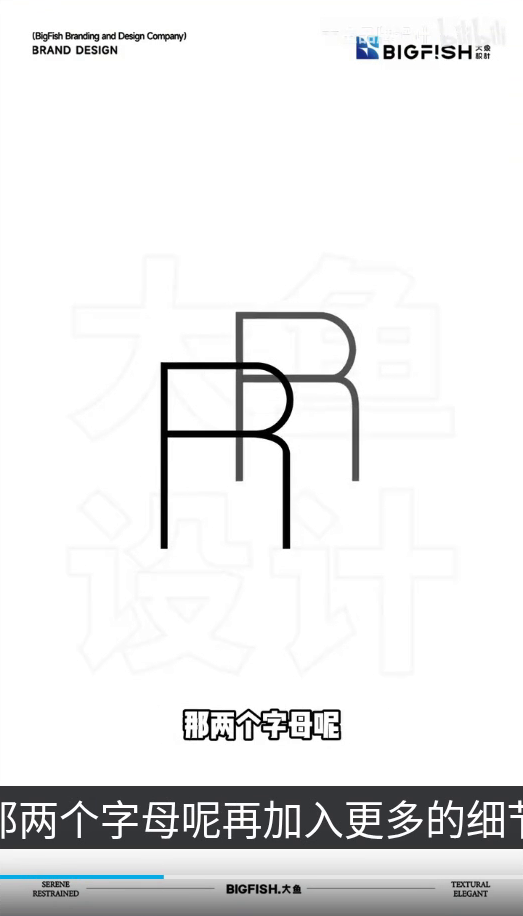

- **作者明确说法**：「那两个字母呢」
- **整理者观察**：细线 R 已经叠出第二个 R，看起来像椅子的线框；还没有灰色的座面和靠背。

### RR5 · 加入灰色座面与靠背

约 00:30（录屏 107.600s）

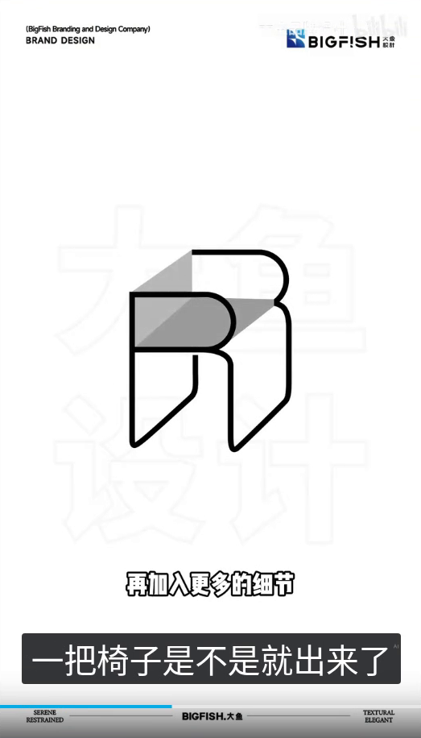

- **作者明确说法**：「再加入更多的细节」
- **整理者观察**：椅面和翻折的靠背已经填上灰色。两只椅腿都朝下：左腿尖略向左下，右腿更接近竖直向下。线标还在微调。

### RR6 · 椅子净标

约 00:31（录屏 108.800s）

- **作者明确说法**：「一把椅子是不是就出来了」
- **整理者观察**：白底上的椅子形 R 已经稳住。灰色座面、顶部翻折平面，两腿都朝下。这是这一案线标的完成态。

### RR7 · 用到街道与圆凳照片上，瑞特家居

约 00:33（录屏 110.600s）

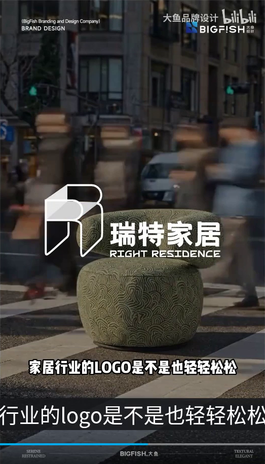

- **作者明确说法**：「家居行业的LOGO是不是也轻轻松松」
- **整理者观察**：同一件标志反白，叠在街道和绿色花纹圆凳的照片上。字标为「瑞特家居」，其下是「RIGHT RESIDENCE」。

### 思路与前后关系（整理者分析，非作者原话）

先用气泡提出家居和字母 R，再给出粗黑体 R，收成细线单 R，叠成双 R 椅框，填上灰色座面和靠背，得到椅子净标。两套 R 错开叠在一起，正好读出椅子的前框和后框；灰色座面和靠背折面让体积可以读出来。两只椅腿都朝下：左腿尖略向左下，右腿更接近竖直向下。这是整理者根据可见结构作的归纳，片内只说了「那两个字母呢」「再加入更多的细节」，没有另说错位和灰面的作用。用到照片上时，字标写成「瑞特家居」和「RIGHT RESIDENCE」。

---

## 案例四：TIME 与领带 / TIME TIE

### TT1 · 气泡：钟表与绅士

约 00:35（录屏 113.400s）

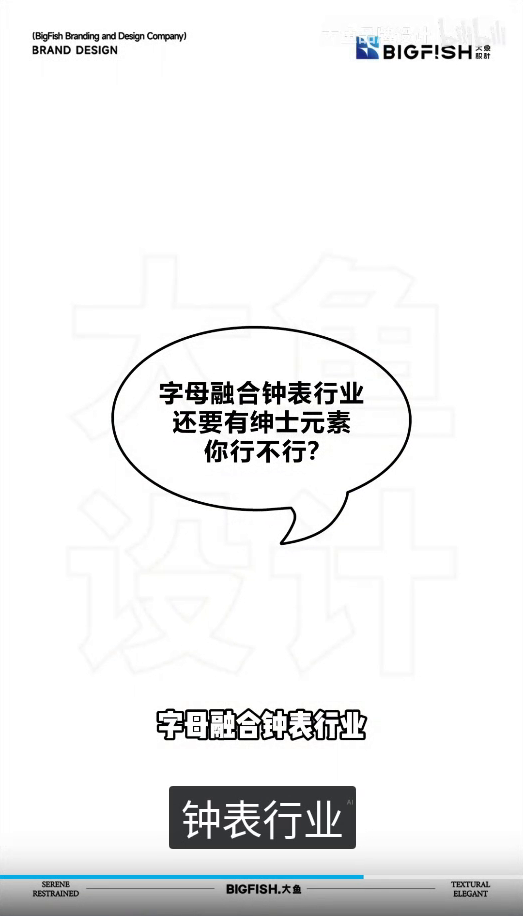

- **作者明确说法**：「字母融合钟表行业」。同一画面上，气泡里三行写着「字母融合钟表行业」「还要有绅士元素」「你行不行？」。
- **整理者观察**：白底中央是一个线框圆角气泡，尾朝右下。片内「你行不行」没有问号；气泡第三行带「？」。

### TT2 · 字母用 TIME 来代表

约 00:40（录屏 117.800s）

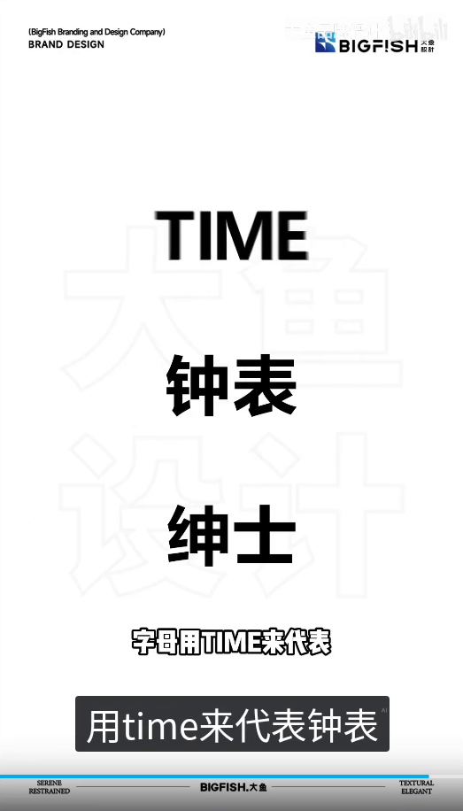

- **作者明确说法**：「字母用TIME来代表」
- **整理者观察**：白底上竖列三个词：TIME、钟表、绅士。

### TT3 · 表盘、蝴蝶结与领带

约 00:42（录屏 120.400s）

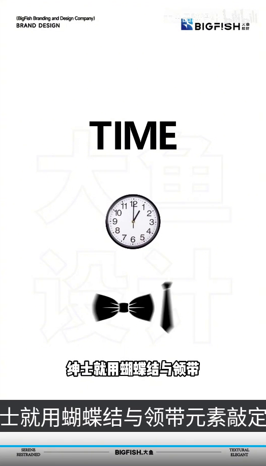

- **作者明确说法**：「绅士就用蝴蝶结与领带」
- **整理者观察**：上方是「TIME」；中间是带数字刻度和指针的表盘；下方左侧是蝴蝶结图标，右侧是领带图标。这三件还没有收进同一件标志。

### TT4 · 完整表盘与指针（裁半之前）

约 00:46（录屏 124.000s）

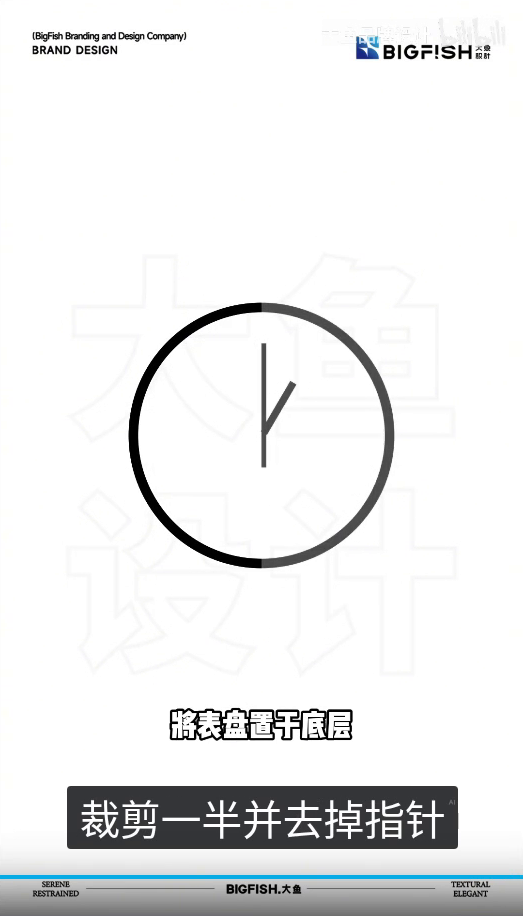

- **作者明确说法**：「將表盘置于底层」
- **整理者观察**：白底上是线描的完整圆表盘，分针朝上，时针朝右上。指针和右半圆弧都还在。约 124.033 出现肉眼可辨的变淡，约 124.100 时变淡已经清楚。

### TT5 · 指针与右弧正在变淡

约 00:46（录屏 124.133s）

- **作者明确说法**：「裁剪一半并去掉指针」
- **整理者观察**：分针、时针和右半圆弧都已经明显变淡，左半圆弧仍较实。还没有完全只剩左弧。

### TT6 · 只剩左弧

约 00:46（录屏 124.400s）

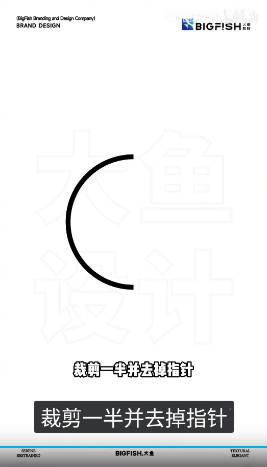

- **作者明确说法**：「裁剪一半并去掉指针」
- **整理者观察**：指针和右半圆弧已经看不见，白底上只剩开口朝右的左半圆弧。约 124.233–124.267 已经只剩左弧；本帧是左弧稳住后的画面。还没有出现领带或蝴蝶结。

### TT7 · 很小的蝴蝶结与领带出现

约 00:47（录屏 125.467s）

- **作者明确说法**：「裁剪一半并去掉指针」
- **整理者观察**：左弧内侧出现很小的一组形：上端已经能看见很小的蝴蝶结，下面连着一段短领带。约 125.433 只有一个小点，本帧已经能看成整组，只是还很小。

### TT8 · 放大后，蝴蝶结仍紧邻领带结

约 00:48（录屏 125.800s）

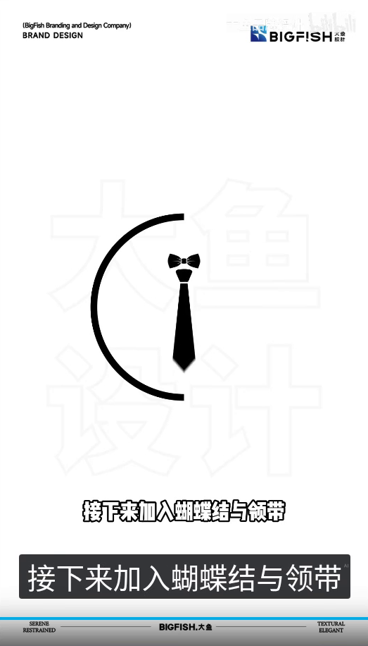

- **作者明确说法**：「接下来加入蝴蝶结与领带」
- **整理者观察**：整组已经放大到清楚可读。蝴蝶结仍紧邻下方的领带结，大约在弧的中上部（蝴蝶结约在画面 y370 一带）。蝴蝶结还没有上移到弧顶，领带结和领带尖也还在相对靠上的位置。约 125.867–127.233 这一组位置基本保持。

### TT9 · 蝴蝶结上移，领带结与领带尖下移

约 00:50（录屏 127.600s）

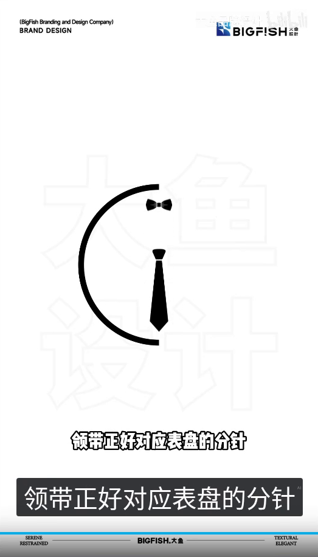

- **作者明确说法**：「领带正好对应表盘的分针」
- **整理者观察**：约 127.333 起位置开始移动，约 127.500–127.800 变化最明显。本帧里，蝴蝶结已经离开领带结向上靠近弧顶，领带结和领带尖正在下移，两者之间拉开空隙。就画面看，结下至尖的高度仍大致相当，主要是整条领带下移，并与上方的蝴蝶结分开。

### TT10 · 位移后的稳定位置

约 00:50（录屏 128.200s）

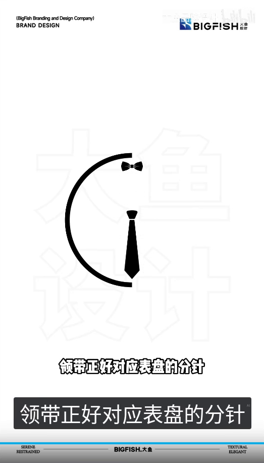

- **作者明确说法**：「领带正好对应表盘的分针」
- **整理者观察**：约 127.900 起位置已经稳住。蝴蝶结靠近弧顶（约在画面 y329 一带），与下方的领带结之间有一段明显空隙；领带结和领带尖都比 125.800 时更靠下，领带尖更接近弧底。此后直到加入时针，这一位置保持不变。

### TT11 · 加入黑色时针，尚无粉色提示

约 00:52（录屏 130.000s）

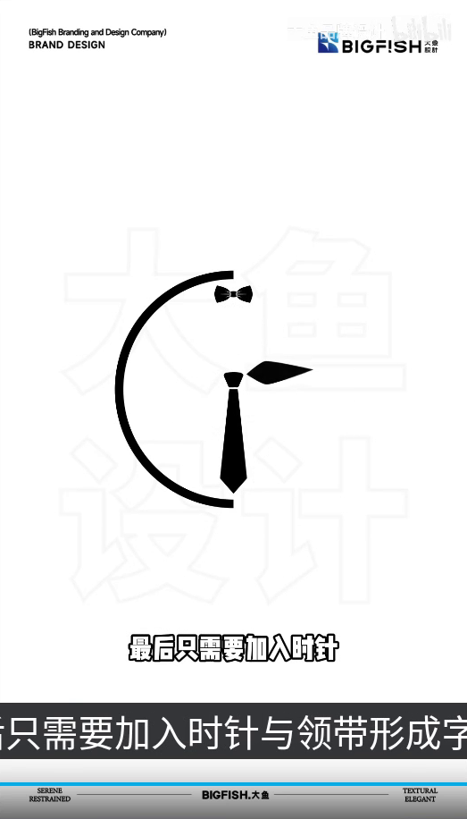

- **作者明确说法**：「最后只需要加入时针」
- **整理者观察**：黑色、末端带尖的时针从领带结右侧水平伸出，指向右方。上方的蝴蝶结仍靠近弧顶，与领带结之间有明显空隙。此时还没有粉色的横条或竖条。约 129.400–129.733 时针从领带结一侧长出，约 129.800–130.333 这根黑时针已经清楚、仍无粉色。

### TT12 · 粉色 T 字提示叠上

约 00:53（录屏 130.800s）

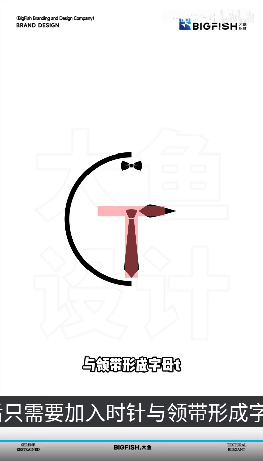

- **作者明确说法**：「与领带形成字母t」
- **整理者观察**：粉色的 T 字提示叠在已有形上：竖向粉条从领带结向下画到领带尖，横向粉条覆盖在黑色时针上；时针右侧的黑色尖头仍露在粉条外面。上方的蝴蝶结仍靠近弧顶，与领带结和竖向粉条之间隔着一段空隙。这是一层粉色提示叠在黑色时针和领带上面。此时右侧还没有 IME。

### TT13 · 加入 IME，粉色提示仍在

约 00:54（录屏 132.000s）

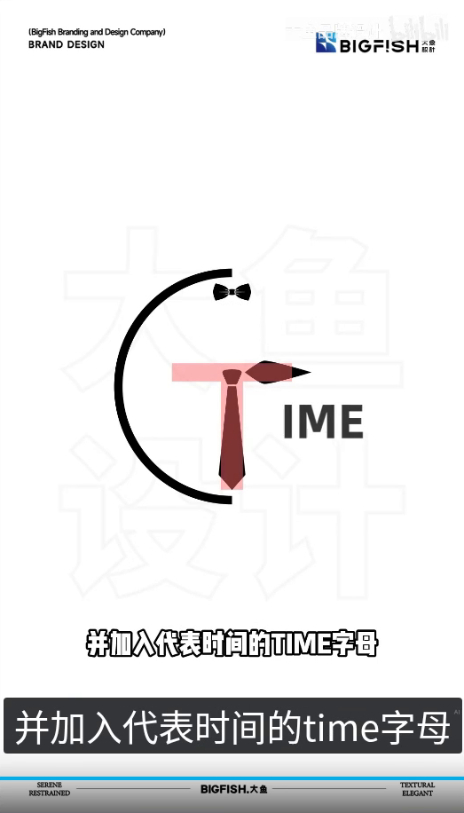

- **作者明确说法**：「并加入代表时间的TIME字母」
- **整理者观察**：时针右侧已经出现 IME，与领带、时针一起读成 TIME。粉色 T 字提示还在：竖向粉条仍从领带结向下到领带尖，透过暗红的领带；横向粉条仍盖在黑箭头上，黑尖头仍露在横条右侧。上方蝴蝶结仍靠近弧顶，与领带结之间有空隙。

### TT14 · 粉色提示正在撤去

约 00:55（录屏 132.933s）

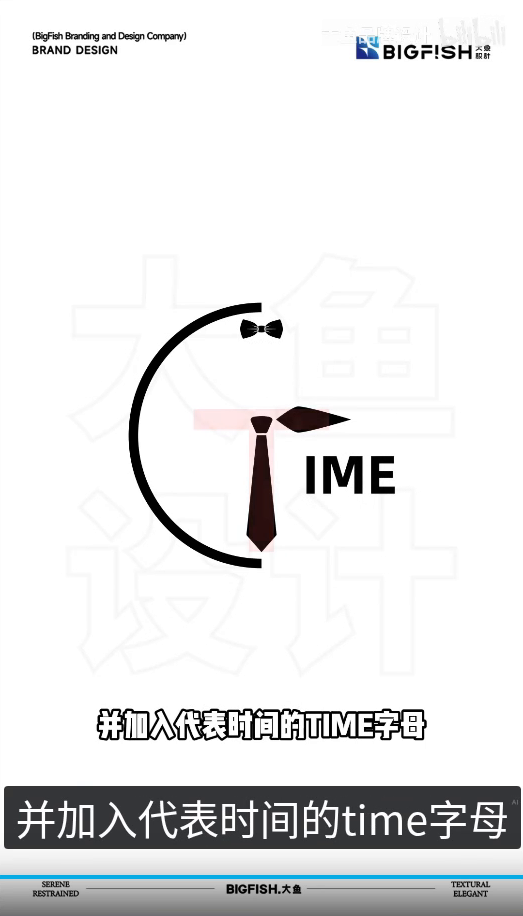

- **作者明确说法**：「并加入代表时间的TIME字母」
- **整理者观察**：横向和竖向的粉色正在变淡。黑时针、黑领带和 IME 越来越清楚，提示还没有完全撤尽。蝴蝶结、领带结和时针的位置仍与位移后的稳定位置相同。

### TT15 · 撤去提示后的黑净标

约 00:55（录屏 133.200s）

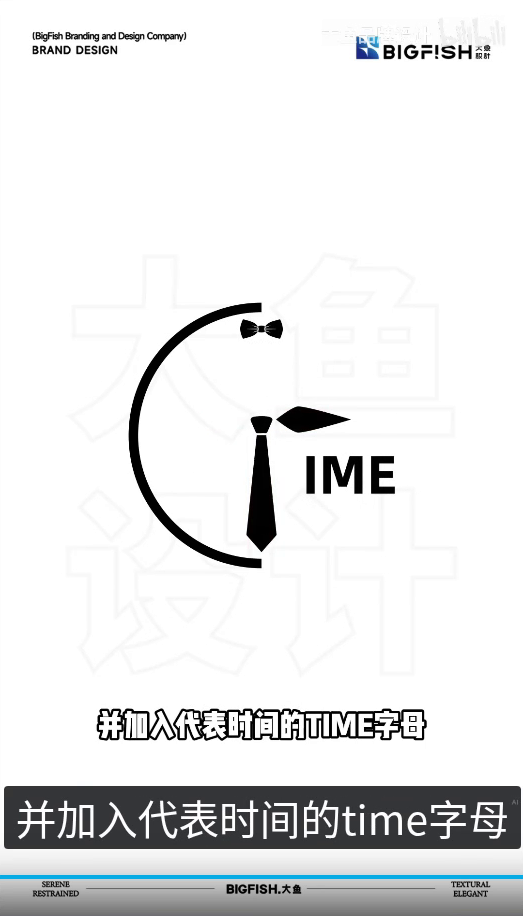

- **作者明确说法**：「并加入代表时间的TIME字母」
- **整理者观察**：粉色提示已经看不见。白底上是黑色完成态：左半圆弧，靠近弧顶的蝴蝶结，与下方领带结之间有明显空隙，领带结右侧是向右的黑色尖头时针，领带垂直落下，右侧是 IME。约 133.100 起提示已基本撤尽。这是撤去提示后的黑净标。

### TT16 · 用到暗色金属照片上，TIME TIE

约 00:56（录屏 134.400s）

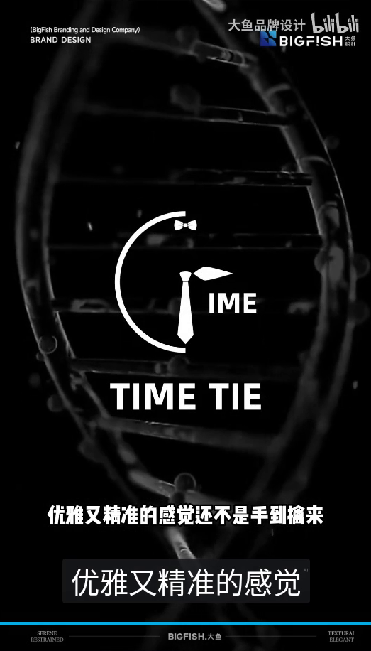

- **作者明确说法**：「优雅又精准的感觉还不是手到擒来」
- **整理者观察**：同一件标志反白，叠在暗色螺旋金属结构的照片上。标志下方是「TIME TIE」。

### 思路与前后关系（整理者分析，非作者原话）

先用气泡提出钟表和绅士，再列出 TIME、钟表、绅士，并给出带数字的表盘和蝴蝶结、领带图标。把线描表盘放到底层后，右半圆弧和指针变淡退去，只留左弧。随后在弧内出现很小的一组蝴蝶结与领带，再放大到清楚可读；此时蝴蝶结仍紧邻领带结，大约在弧的中上部。约 127.3–127.9，蝴蝶结上移靠近弧顶，领带结和领带尖下移，中间留出空隙，并在约 127.9 稳住。之后从领带结右侧加入黑色尖头时针，再叠上粉色 T 字提示（竖条从领带结到领带尖，横条盖住黑时针），并加上 IME；随后把粉色提示撤掉，留下白底黑净标，再应用到照片上，字标写成「TIME TIE」。时针与领带组成字母 T，再加上 IME，同一件标里既写出时间（时针、TIME），也留下绅士（蝴蝶结与领带）。这是整理者根据可见结构作的归纳；片内说的是「与领带形成字母t」「并加入代表时间的TIME字母」，没有另说这一层兼顾。

---

## 收束：三例并列

约 01:00（录屏 138.200s）

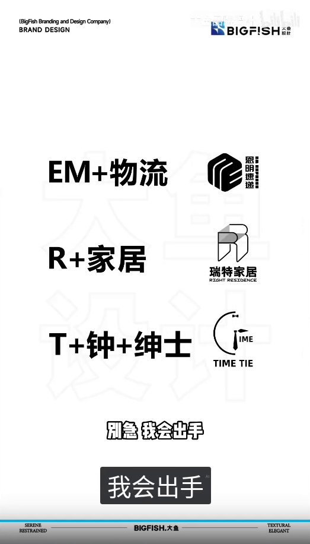

- **作者明确说法**：「别急 我会出手」
- **整理者观察**：白底上是三行。左列是「EM+物流」「R+家居」「T+钟+绅士」；右列分别是三件净标，以及「恩明速递」与竖排「EM EXPRESS」、「瑞特家居」与「RIGHT RESIDENCE」、「TIME TIE」。左列是回顾里的配方写法，右列才是各案用到的字标。
