# [打开思维，设计LOGO才能更有创意](https://www.bilibili.com/video/BV1Aqnv6tEZV)｜大鱼品牌设计

## 案例一：皇冠 + 锅铲 + 酒瓶 / VINOCROWN

### VC1 · 皇冠与锅铲的照片

约 0.6s（录屏 17.5s）

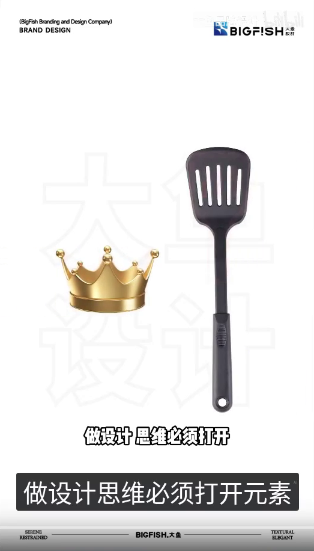

- **作者明确说法**：「做设计 思维必须打开」
- **播放器字幕**：「做设计思维必须打开元素」
- **整理者观察**：白底上，左侧是一顶金色皇冠的照片，冠尖朝上；右侧是一把黑色锅铲的照片，铲头在上、柄朝下，铲面有多道竖向开槽，看起来多于三道。

### VC2 · 照片上描出红线

约 1.1s（录屏 18.0s）

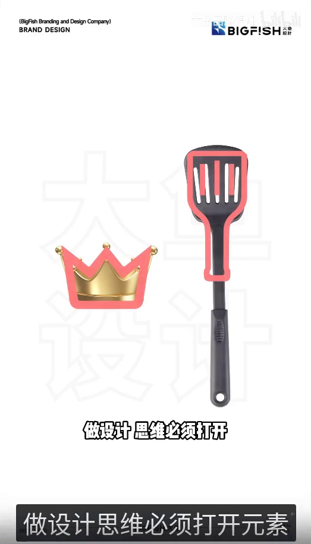

- **作者明确说法**：「做设计 思维必须打开」
- **播放器字幕**：「做设计思维必须打开元素」
- **整理者观察**：两张照片都还在，外面已经描了红色勾线。皇冠的红线冠尖朝上；锅铲的红线柄仍朝下，铲面上的红线是三道竖线。

### VC3 · 抽出红色线稿

约 1.5s（录屏 18.4s）

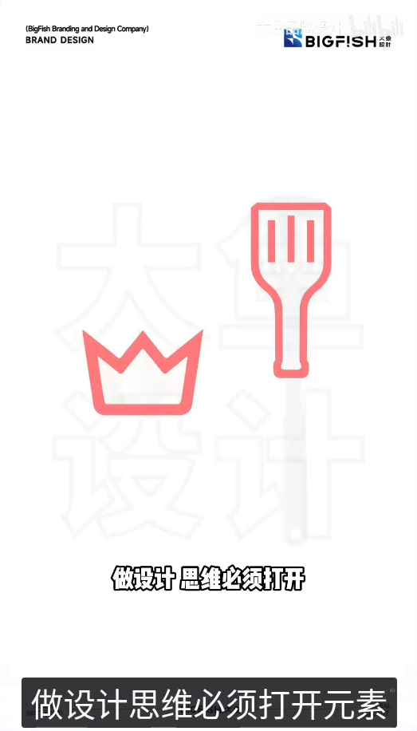

- **作者明确说法**：「做设计 思维必须打开」
- **播放器字幕**：「做设计思维必须打开元素」
- **整理者观察**：两张照片已退去，只剩红色线稿。左侧皇冠仍是冠尖朝上；右侧锅铲仍是铲头在上、柄朝下，铲面已收成三道竖线。

### VC4 · 酒瓶出现在两份线稿之间

约 2.1s（录屏 19.0s）

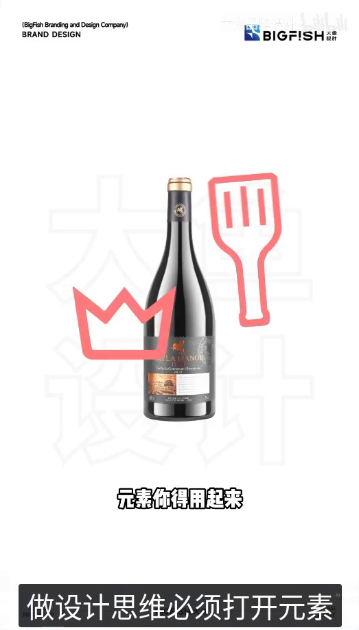

- **作者明确说法**：「元素你得用起来」
- **整理者观察**：一瓶红酒的照片出现在两份线稿中间，瓶颈、瓶标都看得清。皇冠线稿仍在左、冠尖朝上；锅铲线稿仍在右、柄朝下。酒瓶是后来加上的第三件，不是由锅铲改画而成。

### VC5 · 锅铲线稿翻转，柄改朝上

约 2.5s（录屏 19.4s）

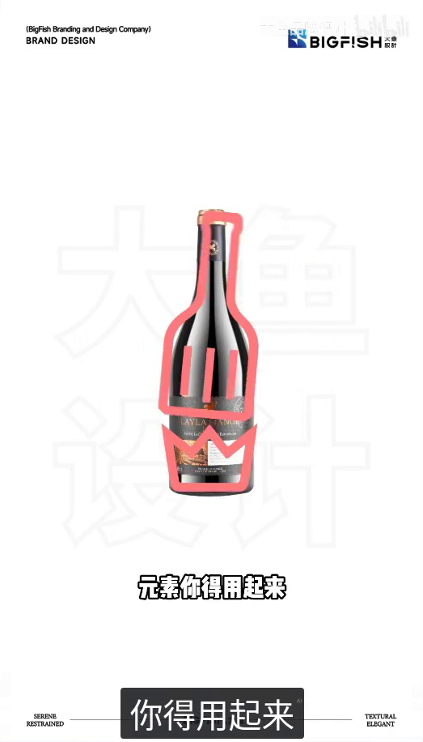

- **作者明确说法**：「元素你得用起来」
- **整理者观察**：锅铲线稿已经翻转，柄改朝上，正贴向瓶颈，三道竖线落在瓶身，整体还略有错位。皇冠线稿移到瓶的下段，冠尖仍朝上，还没有完全对齐。

### VC6 · 两份线稿对齐到瓶上

约 2.6s（录屏 19.5s）

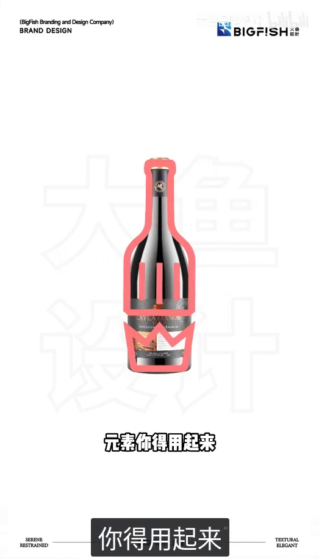

- **作者明确说法**：「元素你得用起来」
- **整理者观察**：两份线稿已经对齐。锅铲的柄顺着瓶颈朝上，三道竖线落在瓶身；皇冠在瓶的下段，冠尖朝上。

### VC7 · 用到红酒入杯的照片上

约 3.3s（录屏 20.2s）

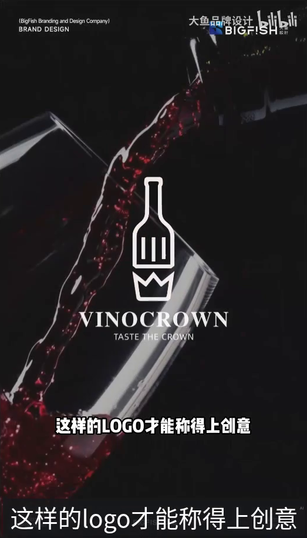

- **作者明确说法**：「这样的LOGO才能称得上创意」
- **整理者观察**：同一套轮廓收成白色线标，压在红酒倒入杯中的深色照片上。瓶身可见三道竖线，下段是冠尖朝上的皇冠。字标为 VINOCROWN / TASTE THE CROWN。这是这一案的完成态。

### 思路与前后关系（整理者分析，非作者原话）

柄转到朝上之后，与瓶颈共用纵向；铲面的三道竖线落在瓶腹，皇冠停在瓶底、冠尖朝上。这三处沿同一条纵轴对位，所以能收成一件既是瓶、也看得出铲和冠的标志。

---

## 案例二：河马 + 手柄 / HIPARCADE

### HA1 · 对话框

约 5.7s（录屏 22.6s）

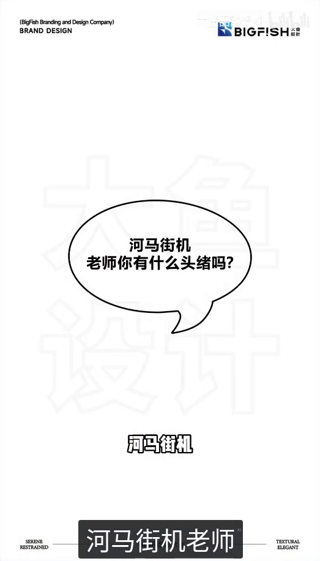

- **作者明确说法**：「河马街机」。同一对话框画面上，片内随后改为「老师你有什么头绪吗」。
- **整理者观察**：线框气泡分两行写着「河马街机」「老师你有什么头绪吗？」。

### HA2 · 河马在玩游戏的插图

约 8.5s（录屏 25.4s）

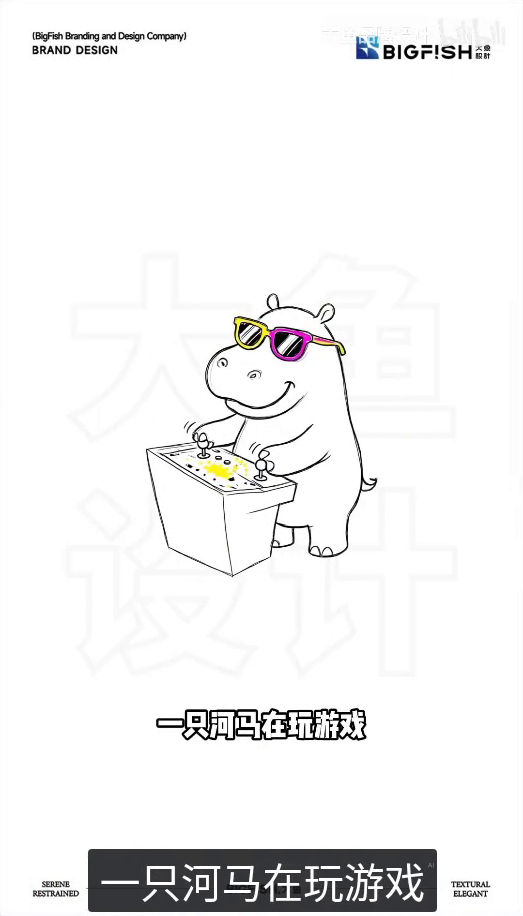

- **作者明确说法**：「一只河马在玩游戏」。插图停留期间，片内随后改为「说了多少次要把思维打开」。
- **整理者观察**：一只白色河马戴着黄、粉色墨镜，站在带摇杆和按键的小型街机台前。这是情景插图，画面上没有否决标记。

### HA3 · 游戏手柄

约 11.3s（录屏 28.2s）

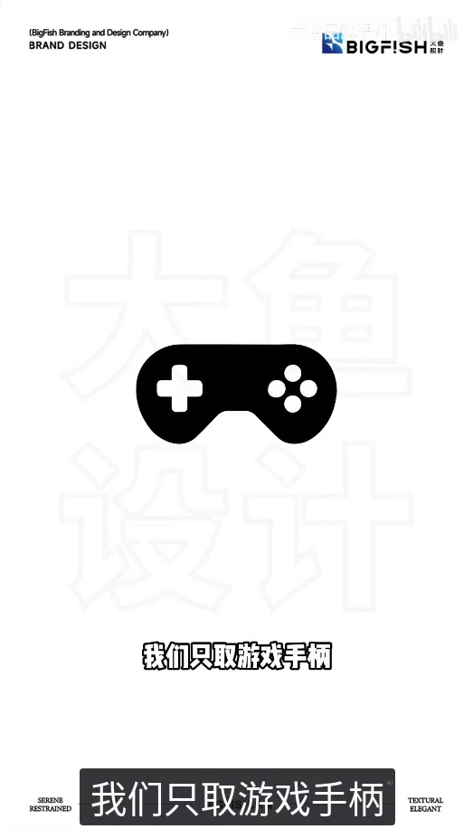

- **作者明确说法**：「我们只取游戏手柄」
- **整理者观察**：只剩下黑色游戏手柄：左侧是白色十字键，右侧是四颗键，两端是握把。

### HA4 · 手柄叠到河马鼻子上

约 13.1s（录屏 30.0s）

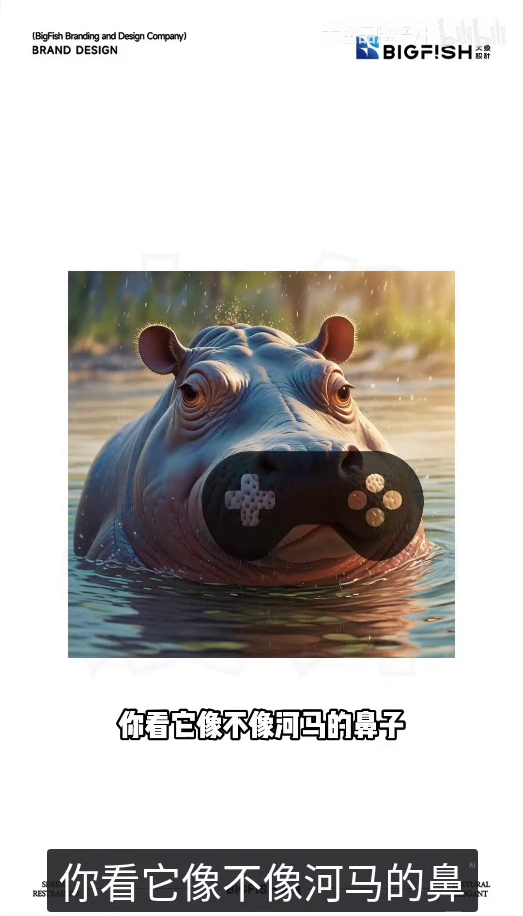

- **作者明确说法**：「你看它像不像河马的鼻子」
- **整理者观察**：写实河马在水中的照片上，同一枚黑色手柄对准口鼻叠上去，十字键和四颗键仍在。

### HA5 · 补上未闭合的耳形和下颌线

约 14.3s（录屏 31.2s）

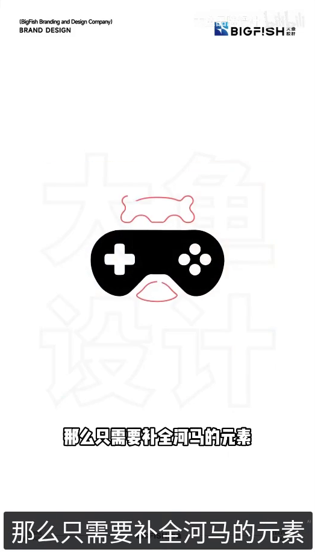

- **作者明确说法**：「那么只需要补全河马的元素」
- **整理者观察**：照片已退去。手柄上方出现一条耳状或顶形的红线，线有断点，还没有闭合；两只握把之间下方是一条未闭合的下颌弧线。十字键和四颗键没有改。

### HA6 · 耳和下颌填黑，完成态

约 15.1s（录屏 32.0s）

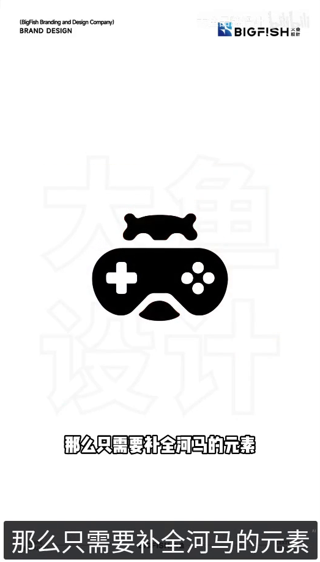

- **作者明确说法**：「那么只需要补全河马的元素」
- **整理者观察**：上方的耳状顶形和下方的颌状突起都已填成黑色，与手柄合成一件。这是这一案的完成态。

### HA7 · 用到街机厅照片上

约 17.1s（录屏 34.0s）

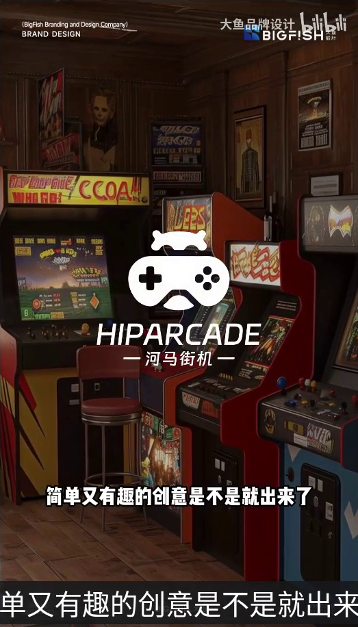

- **作者明确说法**：「简单又有趣的创意是不是就出来了」
- **整理者观察**：同一枚标志反白，压在有多台街机的室内照片上，下方写着 HIPARCADE / — 河马街机 —。

### 思路与前后关系（整理者分析，非作者原话）

手柄两侧握把的外轮廓已经接近河马宽口鼻的外形，叠到鼻位之后只需补上耳状顶形和下颌，十字键和按键保持原样，同一件就能同时读作手柄和河马的脸。

---

## 案例三：汉堡 + 炸弹 / BOOMBURGER

### BB1 · 对话框

约 18.9s（录屏 35.8s）

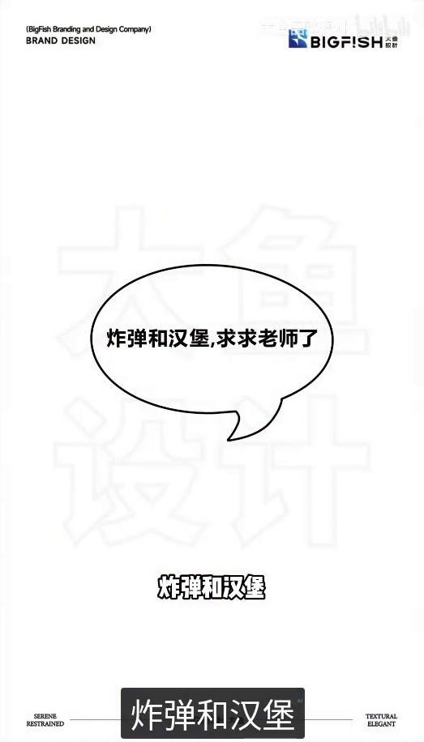

- **作者明确说法**：「炸弹和汉堡」。同一对话框画面上，片内随后改为「求求老师了」。
- **整理者观察**：线框气泡写着「炸弹和汉堡,求求老师了」。

### BB2 · 汉堡

约 20.7s（录屏 37.6s）

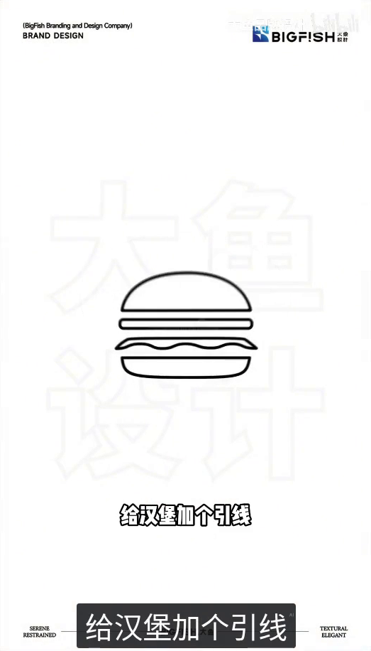

- **作者明确说法**：「给汉堡加个引线」
- **整理者观察**：白底上是一枚汉堡线稿，能看出上层面包、中间馅料和底层包。同期片内还没有加上引线。

### BB3 · 汉堡顶上加引线

约 21.9s（录屏 38.8s）

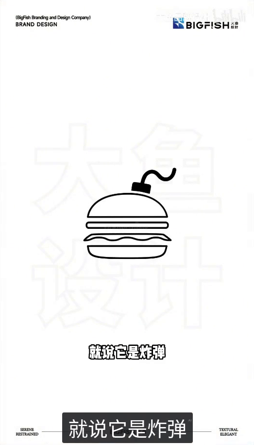

- **作者明确说法**：「就说它是炸弹」
- **整理者观察**：汉堡顶上多出一截短引信和向旁弯曲的引线。

### BB4 · 加引线的方案被划掉

约 23.3s（录屏 40.2s）

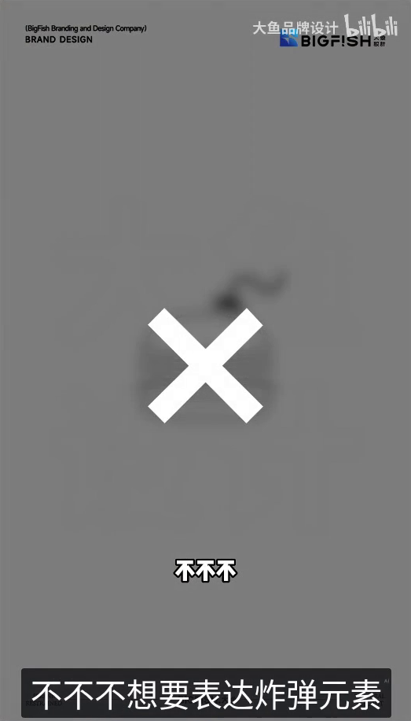

- **作者明确说法**：「不不不」。同一否决画面上，片内随后改为「想要表达炸弹元素」。
- **整理者观察**：底子改成灰色，汉堡加引线已经虚化，上面压着白色大 X。

### BB5 · 引线点燃

约 26.5s（录屏 43.4s）

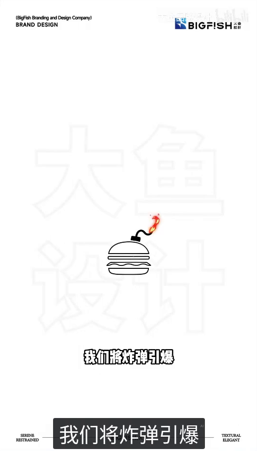

- **作者明确说法**：「我们將炸弹引爆」
- **整理者观察**：汉堡加引线再次出现在浅底上，引线端部已经点着火焰。画面出现前后，片内先为「我有更好的方式」，随后改为本句。

### BB6 · 轰的一声

约 27.5s（录屏 44.4s）

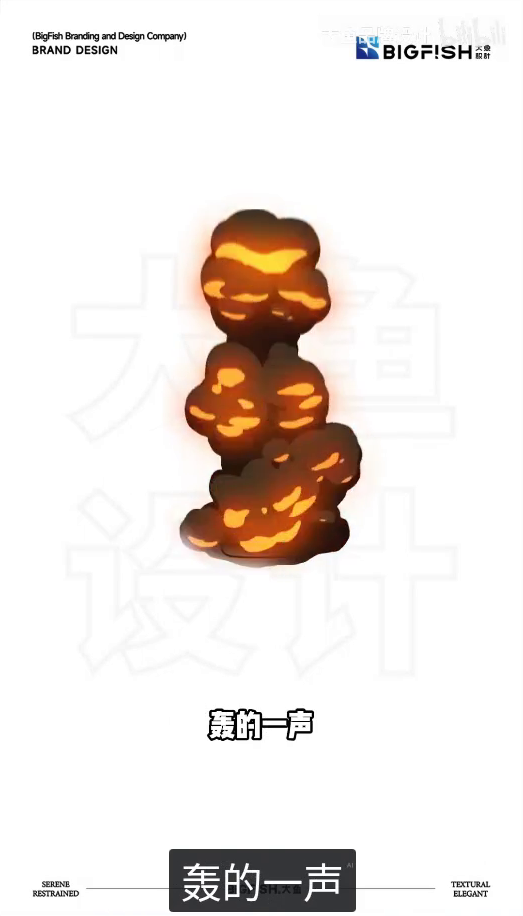

- **作者明确说法**：「轰的一声」
- **整理者观察**：汉堡已经不见，画面中央是一柱橙黑相间的火球。

### BB7 · 火球转成烟柱

约 27.9s（录屏 44.8s）

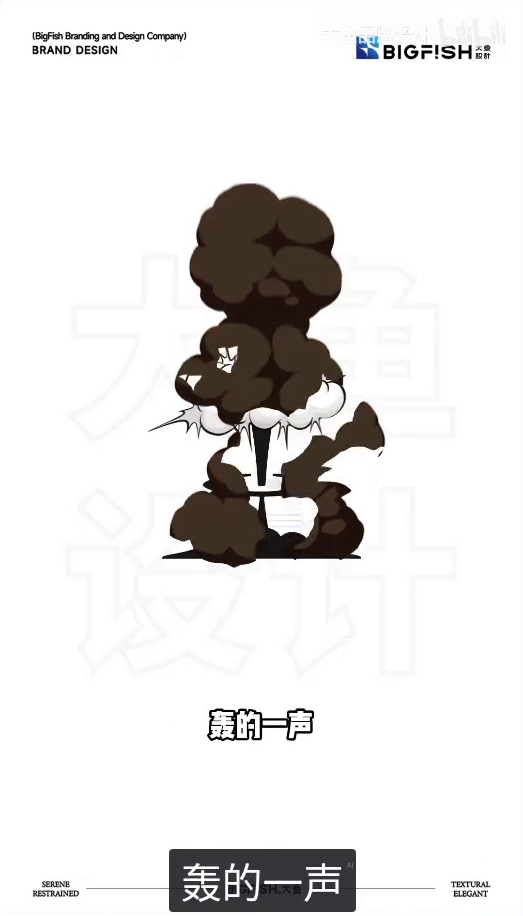

- **作者明确说法**：「轰的一声」
- **整理者观察**：橙黑火球已经收成一柱深褐色的烟。顶部和底部是团状烟云，中段已经能看出茎和环，还不是后面那枚黑白分色的蘑菇云图标。

### BB8 · 蘑菇云

约 28.3s（录屏 45.2s）

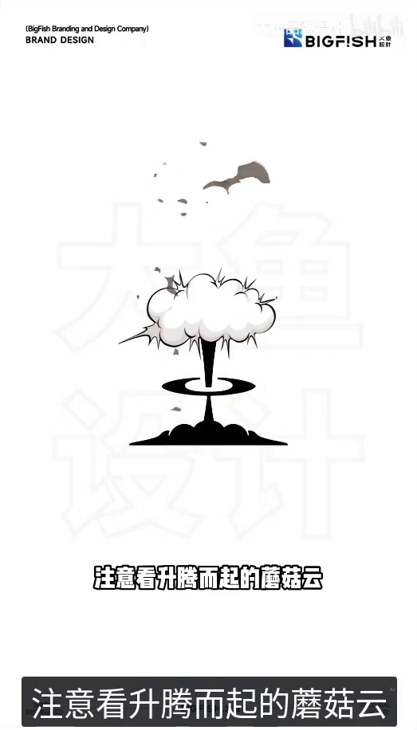

- **作者明确说法**：「注意看升腾而起的蘑菇云」
- **整理者观察**：火球收成一枚蘑菇云图标：上部是带轮廓的白色云帽，下部是黑色的茎、中部圆环和地面云。

### BB9 · 去掉云帽，留下茎和座

约 30.1s（录屏 47.0s）

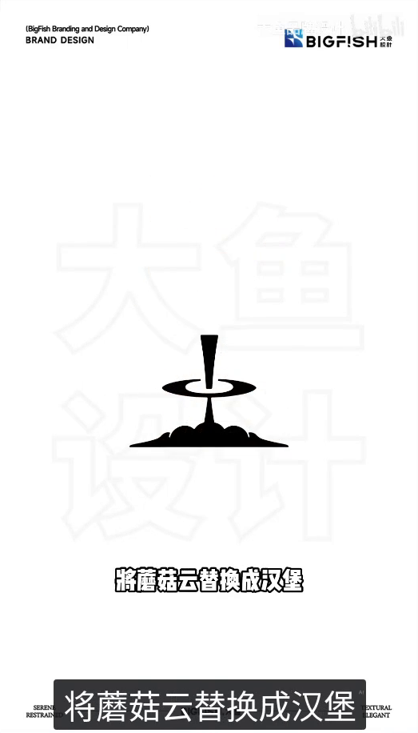

- **作者明确说法**：「將蘑菇云替换成汉堡」
- **整理者观察**：白色云帽已经拿掉，只留下向上的黑色茎、中部圆环和底部的地面云。

### BB10 · 汉堡换上云帽的位置，完成态

约 30.5s（录屏 47.4s）

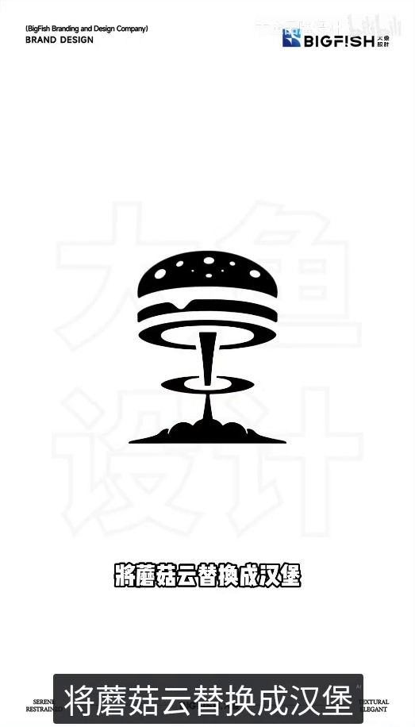

- **作者明确说法**：「將蘑菇云替换成汉堡」
- **整理者观察**：一枚带芝麻点的黑色汉堡落在原来云帽的位置，下面仍是茎、圆环和地面云。这是这一案的完成态。

### BB11 · 用到汉堡照片上

约 32.3s（录屏 49.2s）

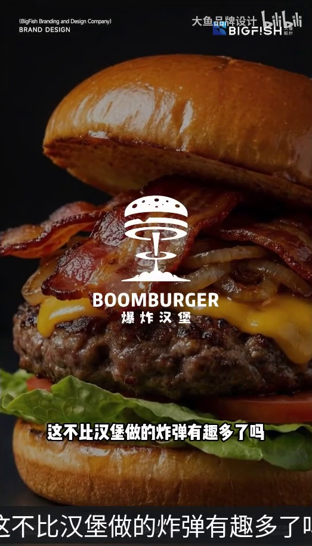

- **作者明确说法**：「这不比汉堡做的炸弹有趣多了吗」
- **整理者观察**：同一枚标志反白，压在汉堡特写照片上，下方写着 BOOMBURGER / 爆炸汉堡。

### 思路与前后关系（整理者分析，非作者原话）

给汉堡加引线的直白拼法被划掉之后，改用蘑菇云的茎和座来承担「炸弹」，再把云帽换成汉堡，所以完成态同时读得出爆炸和汉堡。

---

## 案例四：公文包 + 人 / CAREERPOP

### CP1 · 对话框

约 34.5s（录屏 51.4s）

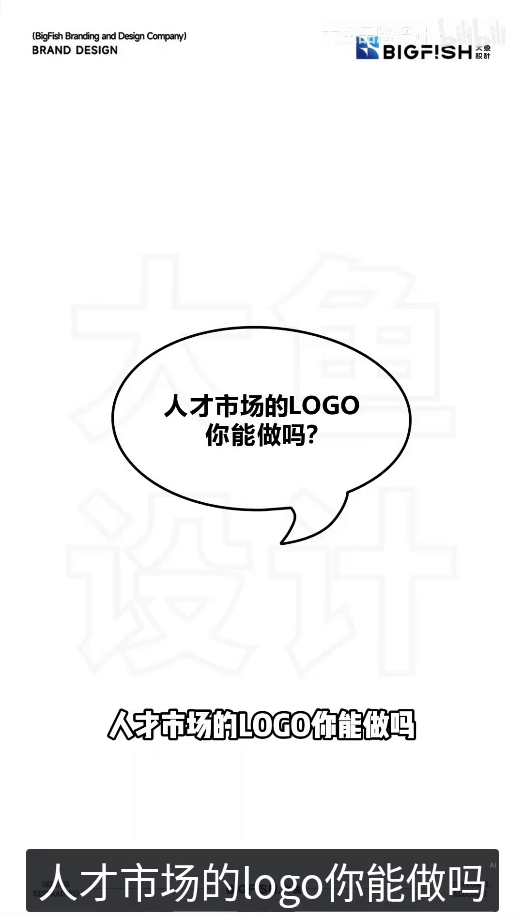

- **作者明确说法**：「人才市场的LOGO你能做吗」
- **整理者观察**：线框气泡分两行写着「人才市场的LOGO」「你能做吗？」。

### CP2 · 人才市场

约 36.3s（录屏 53.2s）

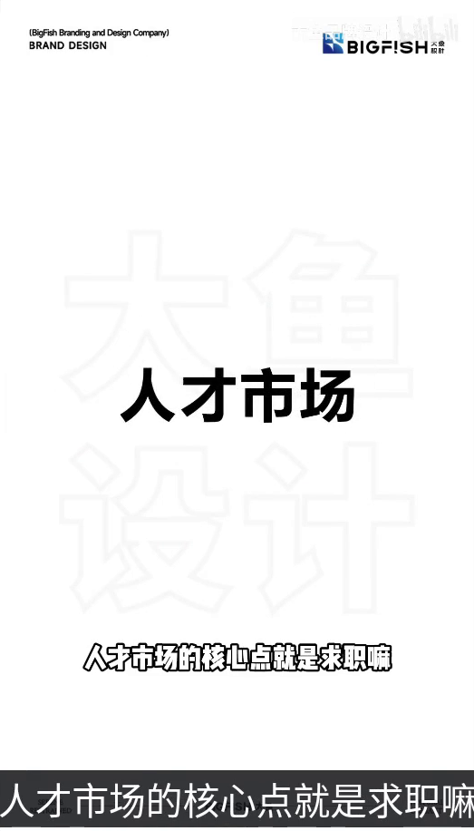

- **作者明确说法**：「人才市场的核心点就是求职嘛」
- **整理者观察**：白底中央是「人才市场」四个大字。

### CP3 · 求职

约 37.7s（录屏 54.6s）

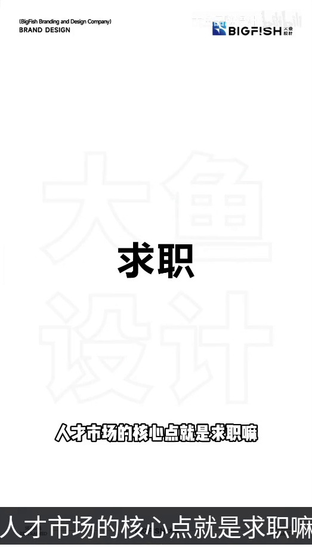

- **作者明确说法**：「人才市场的核心点就是求职嘛」
- **整理者观察**：大字换成「求职」。

### CP4 · 公文包

约 38.7s（录屏 55.6s）

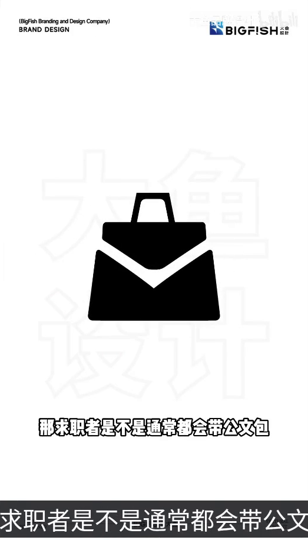

- **作者明确说法**：「那求职者是不是通常都会带公文包」
- **整理者观察**：黑色公文包。上方是中间留白的梯形提手，包身中部有一道白色 V 形夹角。

### CP5 · 叠上「人才」

约 40.7s（录屏 57.6s）

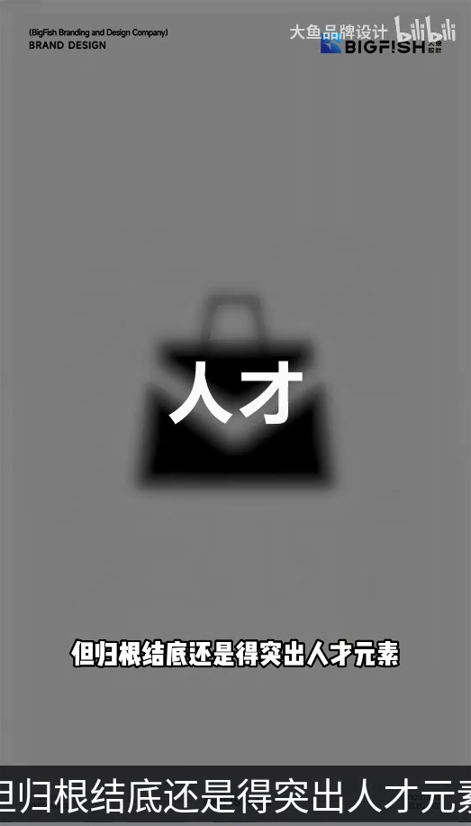

- **作者明确说法**：「但归根结底还是得突出人才元素」
- **整理者观察**：公文包发虚，白色「人才」二字压在包身中部。

### CP6 · 把包身再加一些空白

约 43.1s（录屏 60.0s）

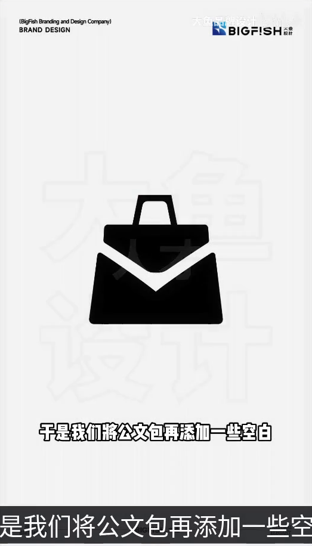

- **作者明确说法**：「于是我们將公文包再添加一些空白」
- **整理者观察**：公文包重新画实。与前面相比，中部那道白色 V 形夹角明显加宽。

### CP7 · 留白里出现圆

约 43.9s（录屏 60.8s）

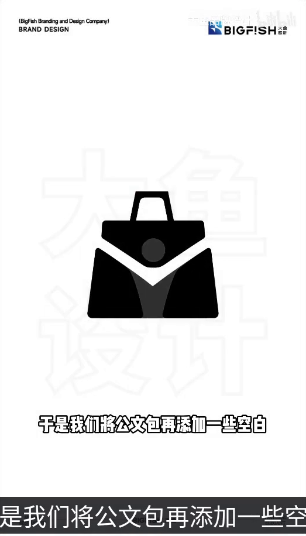

- **作者明确说法**：「于是我们將公文包再添加一些空白」
- **整理者观察**：加宽后的白色夹角上部出现一个白圆。

### CP8 · 留白张开成圆头上举双臂的人形，完成态

约 44.7s（录屏 61.6s）

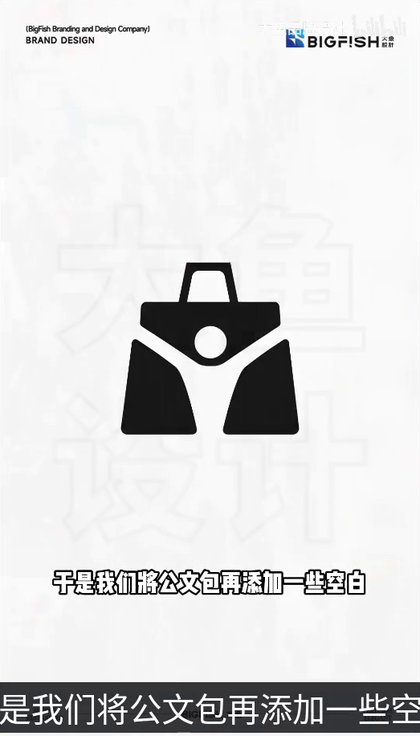

- **作者明确说法**：「于是我们將公文包再添加一些空白」
- **整理者观察**：白色区域向下张开，成为圆头、双臂上举的人形负形；两侧留下两块黑色包身，提手仍在。这是这一案的完成态。

### CP9 · 用到展会俯拍照片上

约 45.5s（录屏 62.4s）

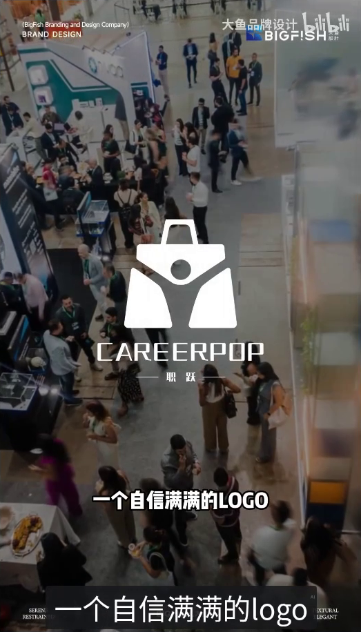

- **作者明确说法**：「一个自信满满的LOGO」。同一应用画面上，片内随后改为「不也就手拿把掐」。
- **整理者观察**：同一枚标志反白，压在室内展会、人群的俯拍照片上，下方写着 CAREERPOP / — 职跃 —。

### 思路与前后关系（整理者分析，非作者原话）

公文包中部原有的空白被加宽之后，圆头和上举的双臂从同一块负形里读出来，两侧黑色包身和提手仍标明这是公文包。

---

## 收束：三例并列

约 49.7s（录屏 66.6s）

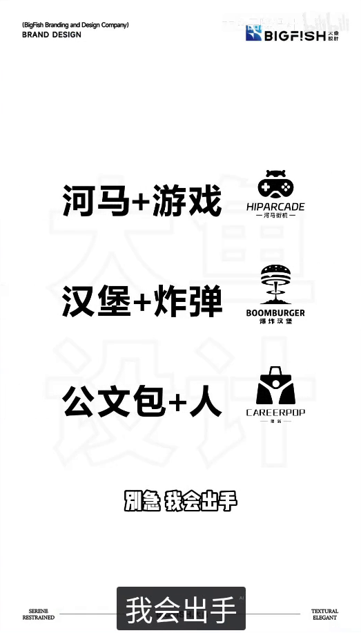

- **作者明确说法**：「别急 我会出手」。收束画面出现前后，片内先为「还有哪些难搞的」，随后改为本句。
- **整理者观察**：三行并列：左侧写着「河马+游戏」「汉堡+炸弹」「公文包+人」，右侧各配对应的完成态标志。本片开头的 VINOCROWN 没有出现在这块回顾板上。
