# 高级感十足的LOGO怎么设计？｜大鱼品牌设计

## 案例一：Y & C

### YC1 · Y 与 C 并置

约 0.6s（录屏 15.4s）

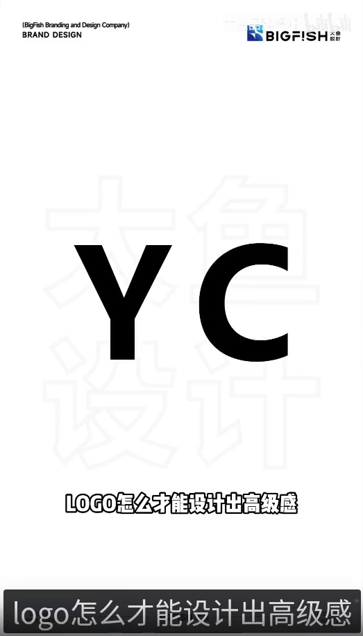

- **作者明确说法**：「LOGO怎么才能设计出高级感」
- **播放器字幕**：「logo怎么才能设计出高级感」
- **整理者观察**：白底上黑色大写 Y 和 C 左右分开排列，两字之间留有空隙，还没有重叠。

### YC2 · Y 与 C 相向重叠

约 1s（录屏 15.8s）

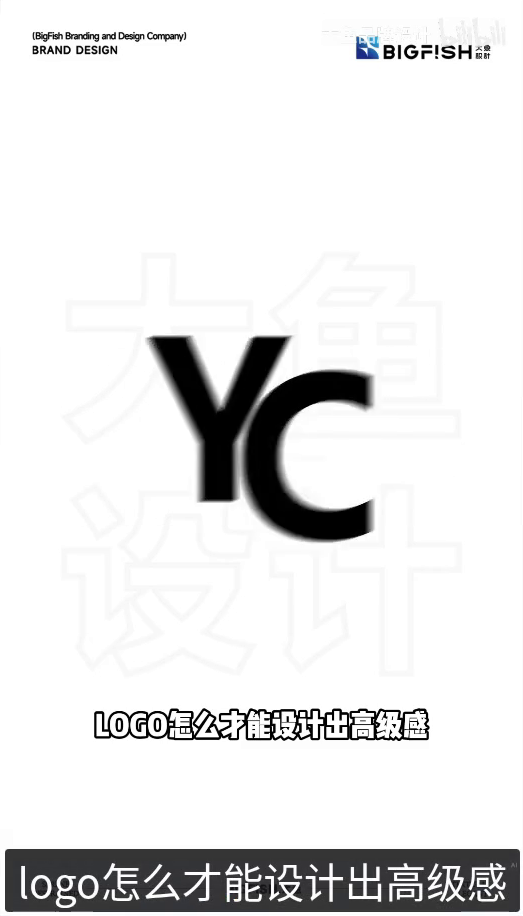

- **作者明确说法**：「LOGO怎么才能设计出高级感」
- **播放器字幕**：「logo怎么才能设计出高级感」
- **整理者观察**：两字向中间靠拢，C 的左弧已经进入 Y 的右臂，轮廓还带着移动时的残影。这是合并成连字之前的中间态。

### YC3 · 实心连字

约 1.4s（录屏 16.2s）

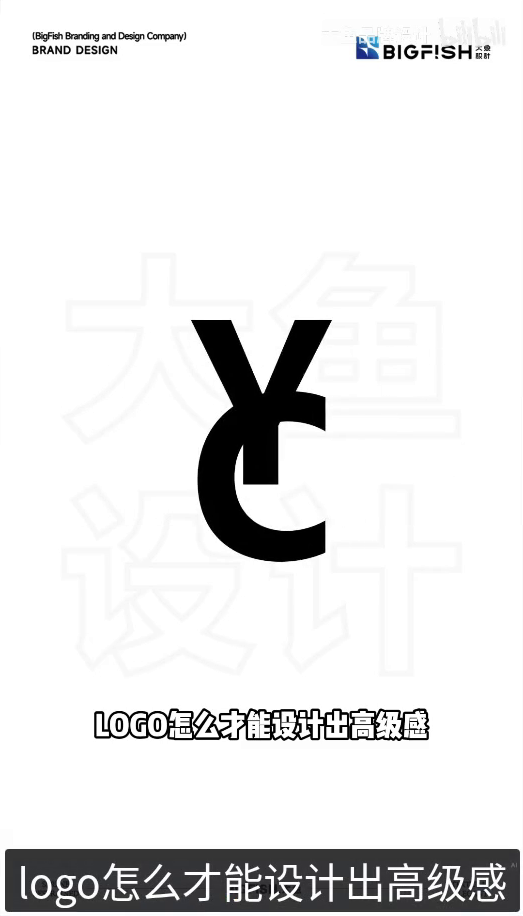

- **作者明确说法**：「LOGO怎么才能设计出高级感」
- **播放器字幕**：「logo怎么才能设计出高级感」
- **整理者观察**：Y 的字干向下穿过 C，C 的弯弧环在字干下部，开口仍向右。两字收成一枚实心连字。

### YC4 · 笔划正在减细

约 1.9s（录屏 16.7s）

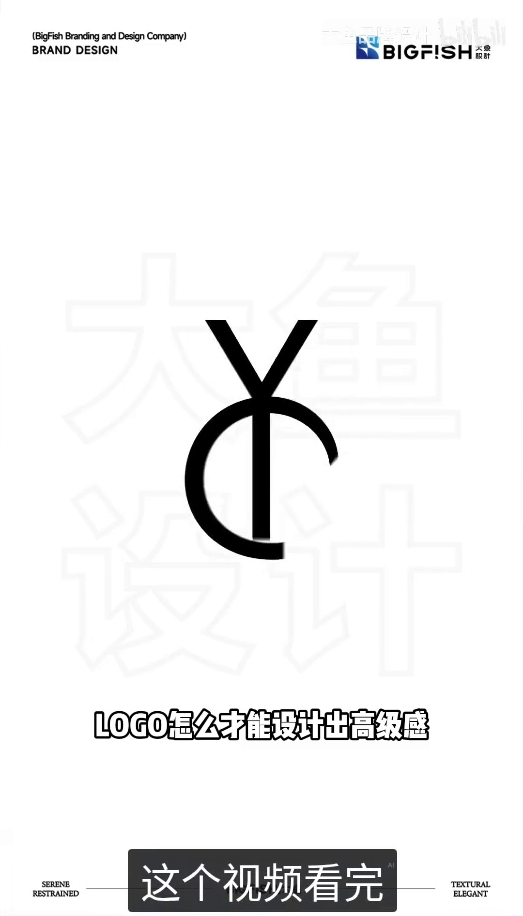

- **作者明确说法**：「LOGO怎么才能设计出高级感」
- **播放器字幕**：「这个视频看完」
- **整理者观察**：Y 的两臂和字干变细，C 也收成环绕字干的弧笔，右端收成一勾。仍比后面的细线稿更粗，是由实心转向线稿的中间态。

### YC5 · 细线单体

约 2.5s（录屏 17.3s）

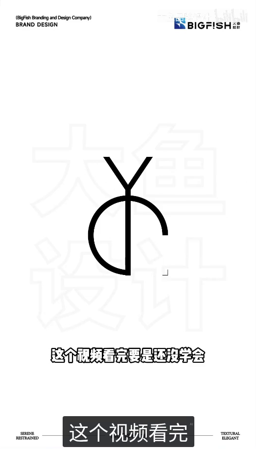

- **作者明确说法**：「这个视频看完要是还没学会」
- **播放器字幕**：「这个视频看完」
- **整理者观察**：已经收成均匀的细线：上方是 Y 的开叉，一竖向下穿过左侧较圆的 C 形弧线，C 的右端停在字干右侧，没有外框。

### YC6 · 端点短笔出现

约 2.7s（录屏 17.533s）

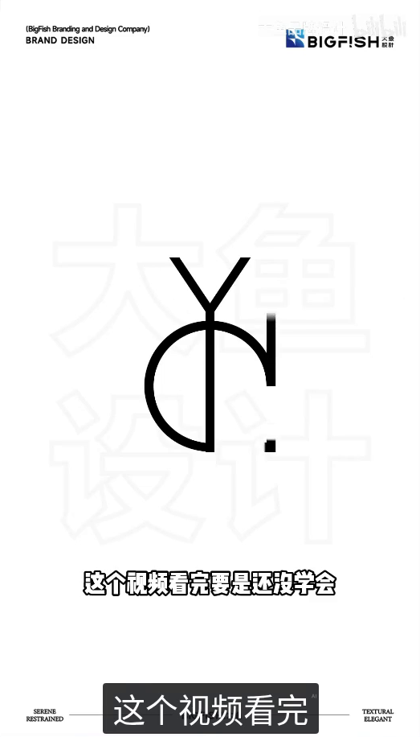

- **作者明确说法**：「这个视频看完要是还没学会」
- **播放器字幕**：「这个视频看完」
- **整理者观察**：细线单体仍在。C 的右端向上伸出一小段竖笔，右下角另有一小截黑笔。外框还没有连起来。

### YC7 · 外框正在形成

约 2.9s（录屏 17.7s）

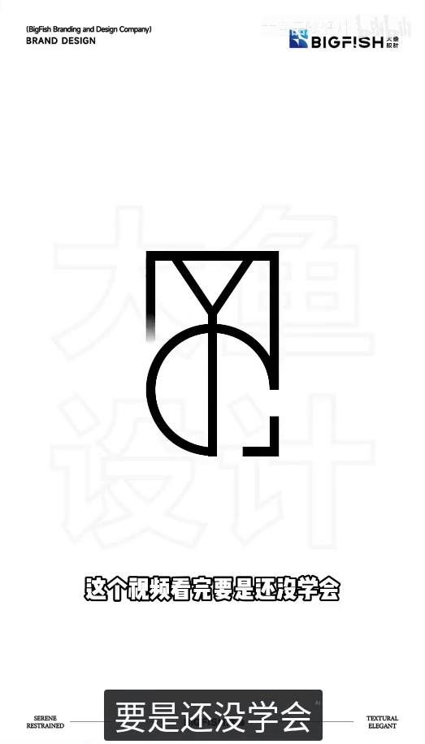

- **作者明确说法**：「这个视频看完要是还没学会」
- **播放器字幕**：「要是还没学会」
- **整理者观察**：顶边横笔已经把 Y 的两臂连进一个方框，右侧竖笔和右下的横折也已出现；左侧竖笔下半段还没有完全落下。这是外框收拢过程中的中间态。

### YC8 · 几何纹章

约 3.4s（录屏 18.2s）

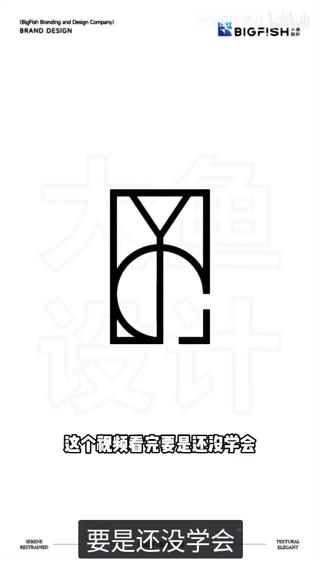

- **作者明确说法**：「这个视频看完要是还没学会」
- **播放器字幕**：「要是还没学会」
- **整理者观察**：外轮廓呈矩形框式：顶边和左边连贯，右边中下有一处断口，底边右半在 Y 竖笔右侧与右下短横之间也留出缺口。框内上方是 Y 的开叉和竖笔，C 的弧线在左侧，内部 Y、C 轮廓与外轮廓共用边界。这是这一案的完成态标志。

### YC9 · 用到石柱画面上

约 4.2s（录屏 19s）

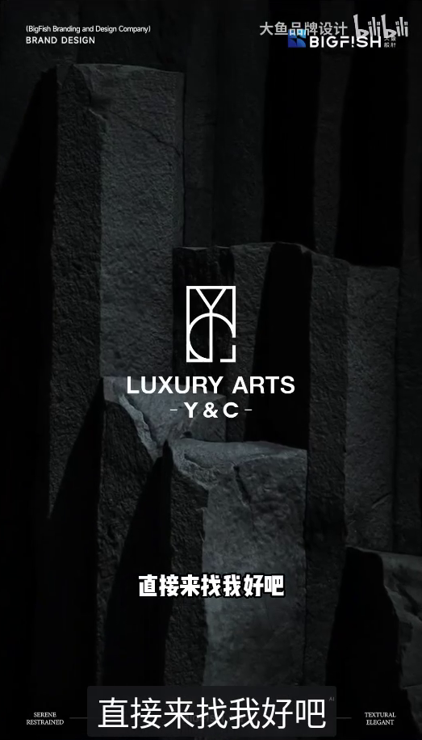

- **作者明确说法**：「直接来找我好吧」
- **整理者观察**：深色石柱排列的画面上，压着同一枚白色线框纹章，下方写着「LUXURY ARTS」和「- Y&C -」。

### 思路与前后关系（整理者分析，非作者原话）

Y 和 C 先左右分开（YC1），再相向重叠（YC2），直到 C 的弧线环住 Y 的下半字干，收成一枚实心连字（YC3）。随后笔划逐步减细，从较粗的过渡态（YC4）收到均匀细线（YC5）。细线两端先冒出短笔（YC6），再被拉成矩形框式的外轮廓（YC7、YC8）：顶边和左边连贯，右边中下与底边右半（Y 竖笔右侧）都保留断口；内部的 Y 开叉、竖笔与 C 的弧线同外轮廓共用边界（YC8），并反白用到石柱画面上（YC9）。矩形框式的外轮廓与内部字母共用边界，把 Y 和 C 收在同一枚纹章里，所以完成态既能读出 Y，也能读出 C。

---

## 案例二：R + Z

### RZ1 · R 与 Z 并置

约 6s（录屏 20.8s）

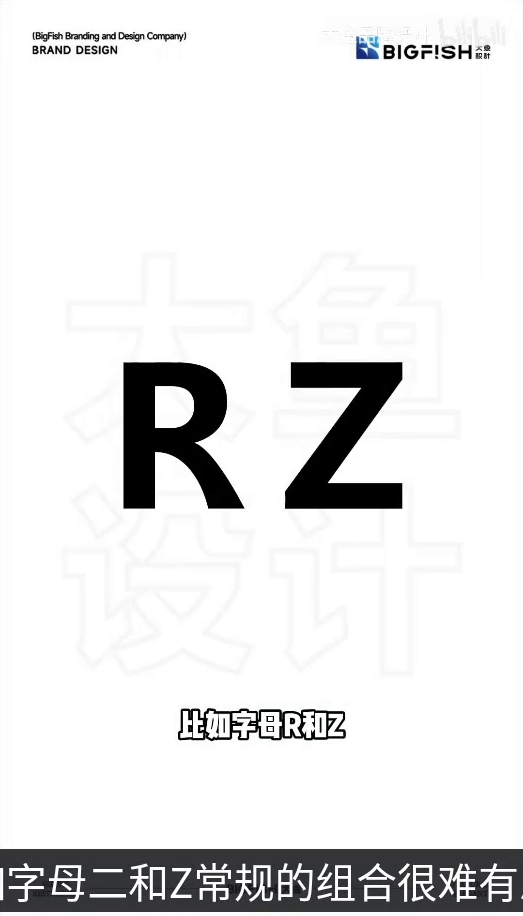

- **作者明确说法**：「比如字母R和Z」
- **播放器字幕**：「比如字母二和Z常规的组合很难有思路」
- **整理者观察**：白底上黑色大写 R、Z 左右分开排列，还没有重叠。

### RZ2 · Z 叠到 R 上

约 6.6s（录屏 21.4s）

- **作者明确说法**：「常规的组合很难有思路」
- **播放器字幕**：「比如字母二和Z常规的组合很难有思路」
- **整理者观察**：Z 向左移到 R 上，斜笔横切过 R 的字腔，两字叠在一起。

### RZ3 · Z 下移

约 7.4s（录屏 22.2s）

- **作者明确说法**：「常规的组合很难有思路」
- **播放器字幕**：「字母二和Z常规的组合很难有思路」
- **整理者观察**：Z 正在向下落，R 已大致位于上方，两字仍有部分重叠。这是由完全重叠走向上下错位的中间态。

### RZ4 · R 在上、Z 在下

约 7.7s（录屏 22.5s）

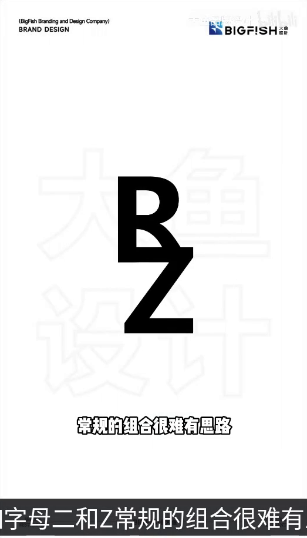

- **作者明确说法**：「常规的组合很难有思路」
- **播放器字幕**：「字母二和Z常规的组合很难有思路」
- **整理者观察**：R 在上、Z 在下，左右略错开，两字仍然相接。

### RZ5 · 只取字母 R

约 8.6s（录屏 23.4s）

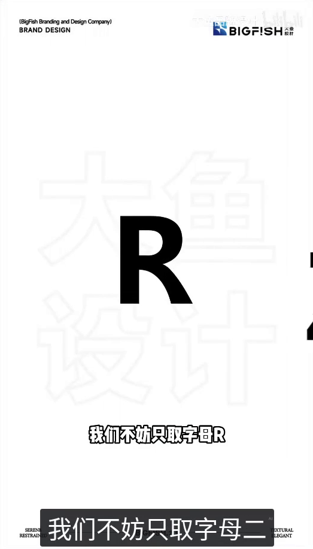

- **作者明确说法**：「我们不妨只取字母R」
- **播放器字幕**：「我们不妨只取字母二」
- **整理者观察**：Z 已经离开画面，只剩下正体、竖笔垂直的黑色大写 R，字腔与字干仍连在一起。

### RZ6 · R 的笔划开始倾斜、断开

约 9.6s（录屏 24.4s）

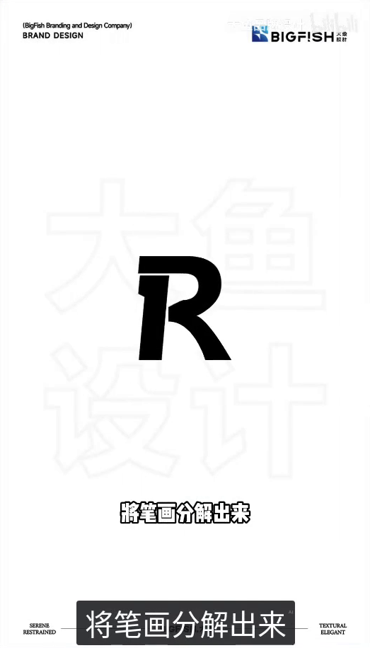

- **作者明确说法**：「将笔画分解出来」
- **整理者观察**：仍可读作 R，但左侧竖笔已经倾斜，上沿呈斜切，竖笔与字腔相接处留出缝隙，局部笔划变细。拆笔已经开始，结构还没有完全拉开。

### RZ7 · 拆笔过程中

约 9.7s（录屏 24.533s）

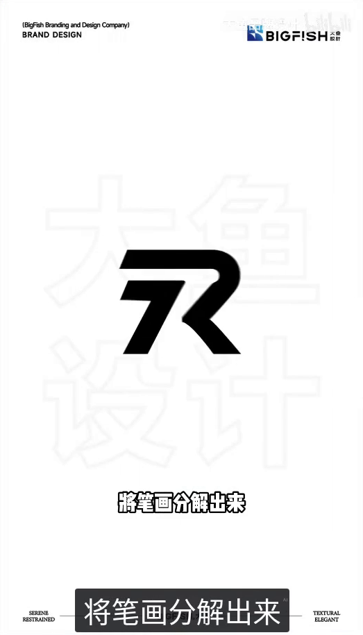

- **作者明确说法**：「将笔画分解出来」
- **整理者观察**：顶横已向左伸出，左中出现一笔折画，左下斜笔分离出来；右侧仍是 R 的字腔和右腿。左右两组笔划正在拉开，这是拆笔的中间态。

### RZ8 · 拆笔后的结构

约 10.4s（录屏 25.2s）

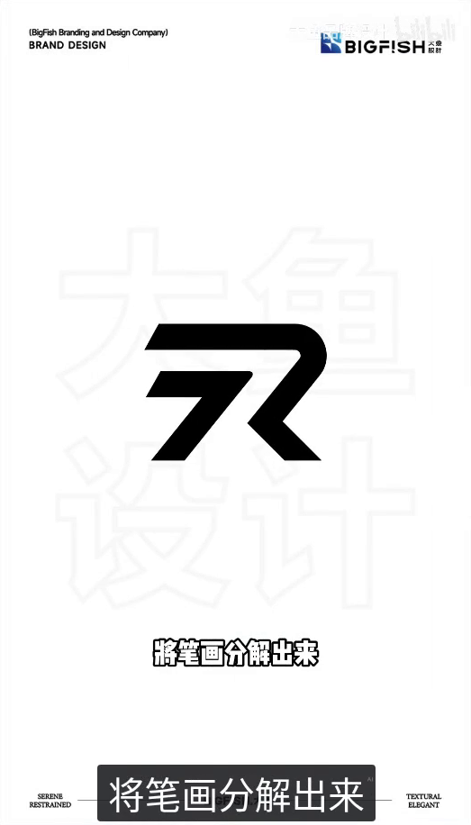

- **作者明确说法**：「将笔画分解出来」
- **整理者观察**：结构已经分开并稳住。顶横加左中折画和左下斜笔，可看成一组 Z；右侧仍是 R 的字腔与右腿。底部两笔之间有空隙，还没有三角形。

### RZ9 · 底隙出现一小笔

约 10.7s（录屏 25.533s）

- **作者明确说法**：「再添加一笔」
- **整理者观察**：左右结构与 RZ8 同类。底部空隙里刚出现一小截黑色细笔，位置在左下斜笔与 R 右腿之间，还没有收成三角形。

### RZ10 · 线框三角形

约 11.2s（录屏 26s）

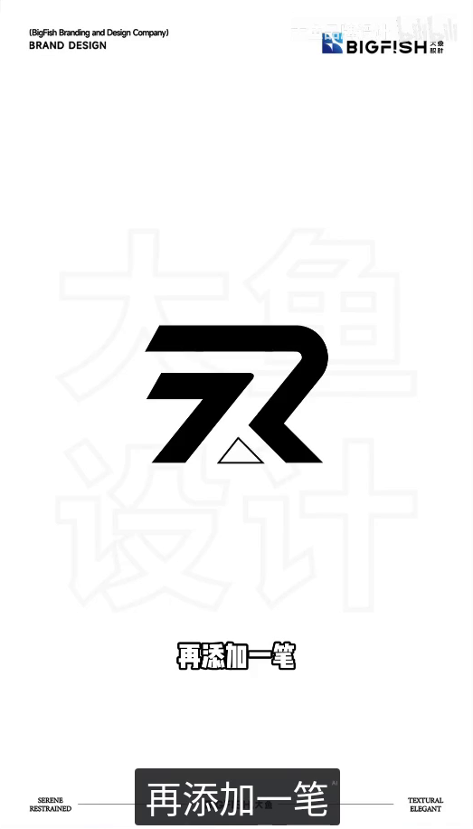

- **作者明确说法**：「再添加一笔」
- **整理者观察**：那一小笔已经收成一个尖朝上的空心三角形，落在底部空隙里，三角形内部仍透出白底。

### RZ11 · 实心三角，浅粉标出 Z

约 11.9s（录屏 26.7s）

- **作者明确说法**：「字母z是不是就有了」
- **播放器字幕**：「字母Z是不是就有了一个高级感十足的logo」
- **整理者观察**：三角形已经填成实心黑块。左侧一组笔划上叠着一道浅粉折线，沿左中和左下的笔划描出一个 Z 的走向。

### RZ12 · 浅粉撤去，黑色完成态

约 12.4s（录屏 27.2s）

- **作者明确说法**：「字母z是不是就有了」
- **播放器字幕**：「字母Z是不是就有了一个高级感十足的logo」
- **整理者观察**：浅粉折线已经不在。留下的是黑色结构：左侧 Z 形笔划、右侧 R，底部一枚实心三角。这是这一案的完成态标志。

### RZ13 · 用到林间照片上

约 13.7s（录屏 28.5s）

- **作者明确说法**：「一个高级感十足的LOGO」
- **播放器字幕**：「字母Z是不是就有了一个高级感十足的logo」
- **整理者观察**：林间树干与光斑的照片上，压着同一枚白色标志，右侧写着「芮智」和「RUISDOM」。

### 思路与前后关系（整理者分析，非作者原话）

R 和 Z 先并置、重叠，再收成上下错位（RZ1–RZ4）。片内说「我们不妨只取字母R」之后，Z 离画，只留下 R（RZ5）。拆笔从竖笔倾斜、与字腔断开就已经开始（RZ6），随后才被拉成左右两组（RZ7、RZ8）——左侧可读作 Z，右侧保留 R 的字腔和右腿。片内「再添加一笔」对应底部空隙里先出现的一小截细笔（RZ9），再收成空心三角（RZ10），最后填实（RZ11）。浅粉折线只在 RZ11 沿左侧笔划描出 Z 的走向，到 RZ12 已经撤掉，完成态是纯黑结构，并反白用到林间照片上（RZ13）。拆开 R 的笔划，同时得到左边的 Z 和右边的 R。底部空隙里再加的三角形是一笔独立的补笔，与左侧那组可被浅粉折线标出的 Z 形笔划共同参与完成态的识别，所以完成态能同时读出这两个字母。

---

## 案例三：B + E + G

### BG1 · 对话框

约 17.2s（录屏 32s）

- **作者明确说法**：「能不能帮我设计一个高级一点的」
- **播放器字幕**：「BJ能不能帮我设计一个高级一点的」
- **整理者观察**：白底上一个线框气泡，内文为「BEG,能不能帮我设计一个高级一点的?」。片内大字没有写出 BEG。

### BG2 · 小写 e

约 19.2s（录屏 34s）

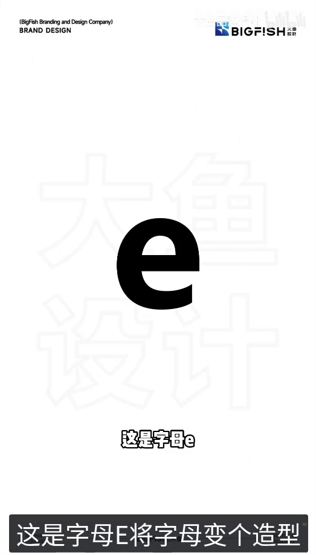

- **作者明确说法**：「这是字母e」
- **播放器字幕**：「这是字母E将字母变个造型」
- **整理者观察**：气泡已不在。白底中央是一枚黑色常规小写 e，字眼闭合，横笔穿心。

### BG3 · 字母变造型的中间态

约 19.9s（录屏 34.7s）

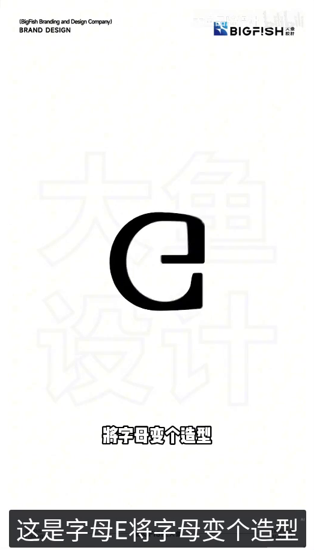

- **作者明确说法**：「将字母变个造型」
- **整理者观察**：e 的字眼正在打开，右上收成较方的转角，中横与下方开口拉开，形体介乎打开的 e 与几何 G 之间。这是变形过程中的中间态。

### BG4 · 几何字

约 20.4s（录屏 35.2s）

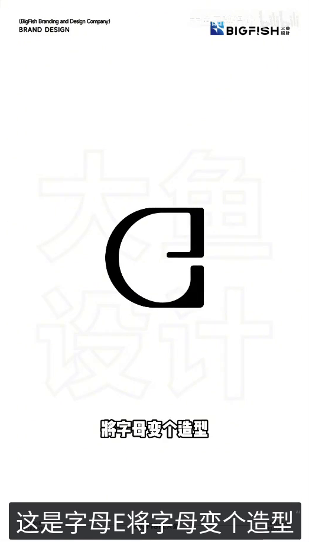

- **作者明确说法**：「将字母变个造型」
- **整理者观察**：已经收成稳定的实心几何字：左侧是圆润的碗，右侧有中横和下方开口。仍是单枚字母，还没有上下叠合。

### BG5 · 向下翻转中

约 21s（录屏 35.8s）

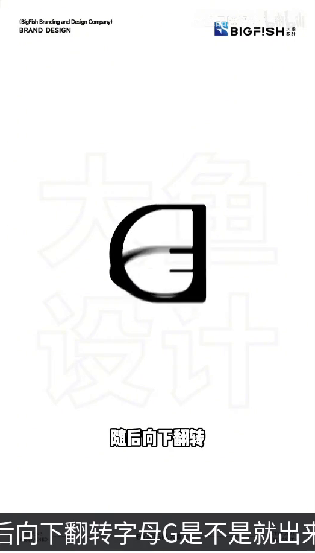

- **作者明确说法**：「随后向下翻转」
- **播放器字幕**：「随后向下翻转字母G是不是就出来了」
- **整理者观察**：原来的几何字还在上方，第二枚形体正在它的下方转出，中部有运动残影，横笔看起来像叠出了两层。这是向下翻转过程中的中间态。

### BG6 · 上下叠成线稿

约 21.4s（录屏 36.2s）

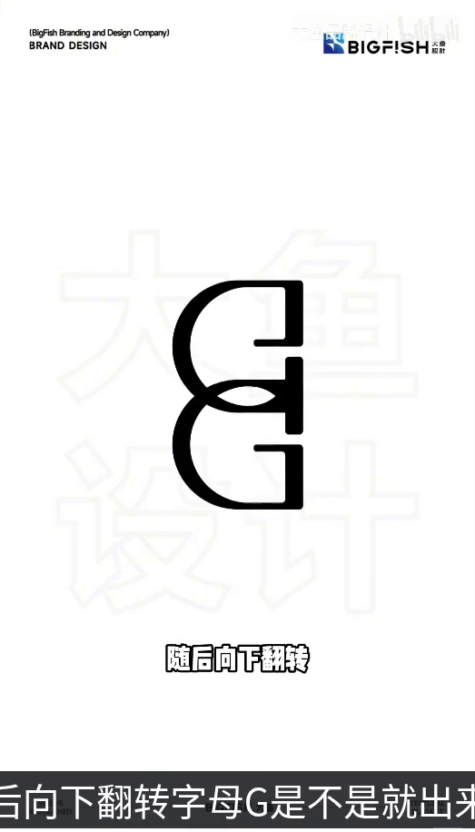

- **作者明确说法**：「随后向下翻转」
- **播放器字幕**：「随后向下翻转字母G是不是就出来了」
- **整理者观察**：已经收成黑色描边：上方是打开后的几何字，下方是带中横和开口的 G，两字在中部相叠。从左侧看，上下两个字碗已经可以读成一个 B。字腔都透出白底。

### BG7 · 下方 G 改成浅粉描边

约 22.2s（录屏 37s）

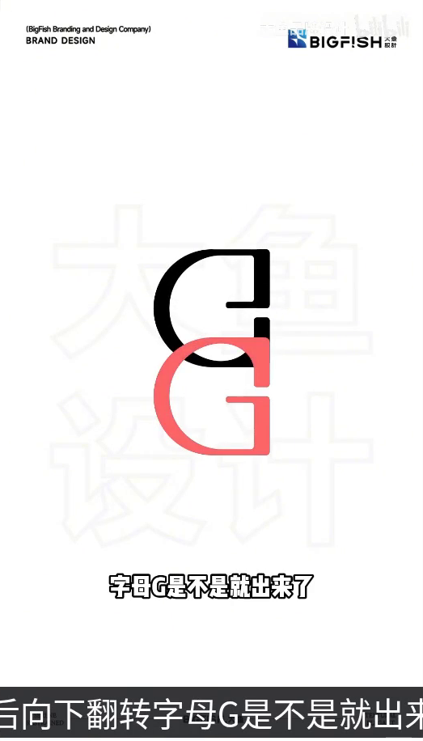

- **作者明确说法**：「字母G是不是就出来了」
- **播放器字幕**：「随后向下翻转字母G是不是就出来了」
- **整理者观察**：上下结构与 BG6 同类。上方仍是黑色描边，下方 G 的描边改成浅鲑粉色，字腔透白。

### BG8 · 描边恢复为黑色

约 24.2s（录屏 39s）

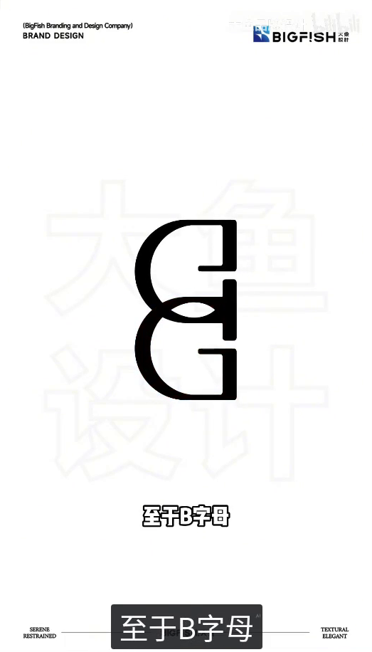

- **作者明确说法**：「至于B字母」
- **整理者观察**：浅粉描边已经不在，上下两字恢复为全黑描边，形态与 BG6 同类。片内此时说到 B 字母。

### BG9 · 整体复制翻转中

约 24.6s（录屏 39.4s）

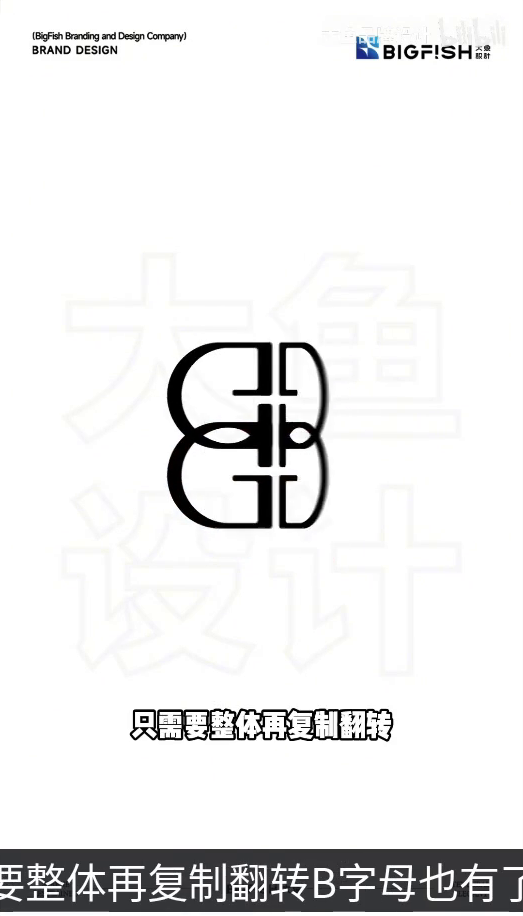

- **作者明确说法**：「只需要整体再复制翻转」
- **播放器字幕**：「只需要整体再复制翻转B字母也有了不错」
- **整理者观察**：左侧仍是黑色的上下叠合结构；右侧出现它的左右镜像，碗口朝右，中缝处还有叠影，颜色此时仍是黑色。这是整体复制、左右翻转过程中的中间态。

### BG10 · 左右对称

约 25.4s（录屏 40.2s）

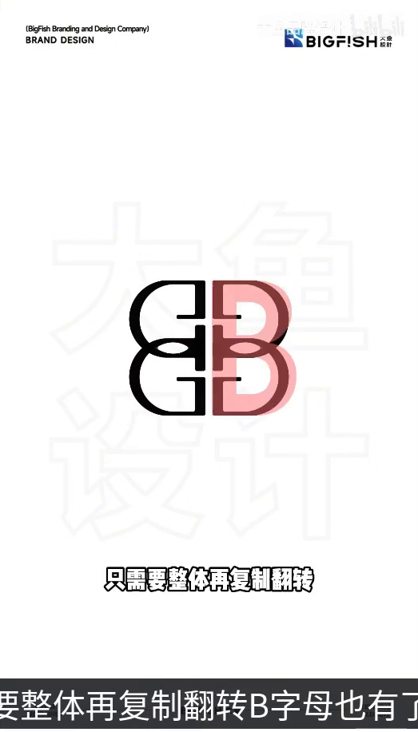

- **作者明确说法**：「只需要整体再复制翻转」
- **播放器字幕**：「只需要整体再复制翻转B字母也有了不错」
- **整理者观察**：左右已经对称收稳。左半是黑色描边，右半是同一结构的左右镜像：描边为绛红色，笔划内部带浅粉，B 的字腔仍透出白底。这是这一案过程稿上的完成态。

### BG11 · 用到深色板上

约 27.4s（录屏 42.2s）

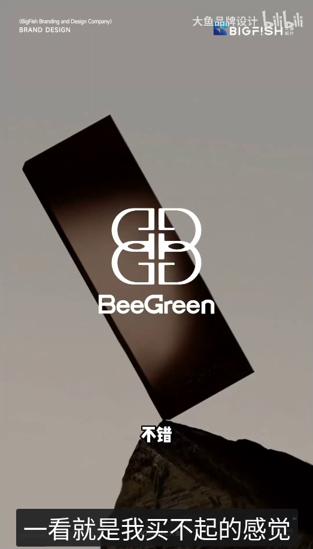

- **作者明确说法**：「不错」
- **播放器字幕**：「一看就是我买不起的感觉」
- **整理者观察**：浅灰色背景里，一块深棕色长方形板斜靠在岩石上。板上是同一枚白色线框对称标志，左右两半都是白线，下方写着「BeeGreen」。

### 思路与前后关系（整理者分析，非作者原话）

气泡先给出 B、E、G 三个字母（BG1），过程却从一枚小写 e 起手（BG2），按「将字母变个造型」收成打开的几何字（BG3、BG4）。「随后向下翻转」，第二枚形体落到原字下面（BG5），稳住后上为几何字、下为 G，二者在中部相叠，左侧的两个字碗已经可以读成 B（BG6）。浅粉只改了下方 G 的描边颜色，用来对应片内「字母G是不是就出来了」（BG7），随后描边回到全黑，片内转到「至于B字母」（BG8）。再按「整体再复制翻转」，把这一叠结构向右做左右镜像（BG9、BG10），B 的阅读被对称成一枚标志，并反白用到深色板上，字标为 BeeGreen（BG11）。同一枚几何字向下翻转后既给出 G，又补全了 B 的下半字碗；再左右镜像，三个字母被收进同一枚对称图形里。

---

## 案例四：L + H / 向上

### LH1 · 对话框

约 30.2s（录屏 45s）

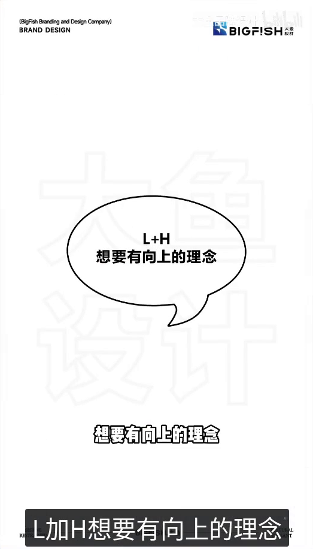

- **作者明确说法**：「想要有向上的理念」
- **播放器字幕**：「L加H想要有向上的理念」
- **整理者观察**：线框气泡里是两行「L+H」和「想要有向上的理念」。片内大字是第二行。

### LH2 · 字母 L

约 32.2s（录屏 47s）

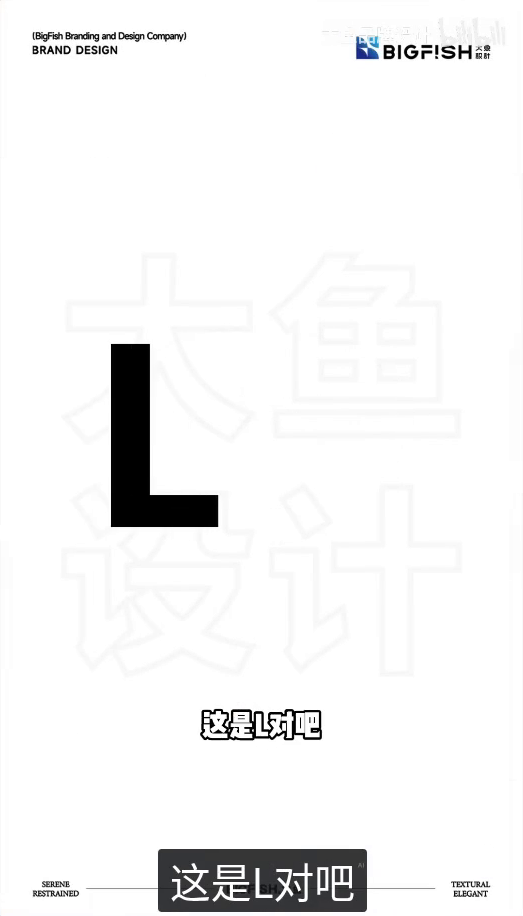

- **作者明确说法**：「这是L对吧」
- **整理者观察**：白底中央是一枚黑色粗体大写 L，端头方正，内侧是直角。

### LH3 · L 与「向上」

约 33.5s（录屏 48.3s）

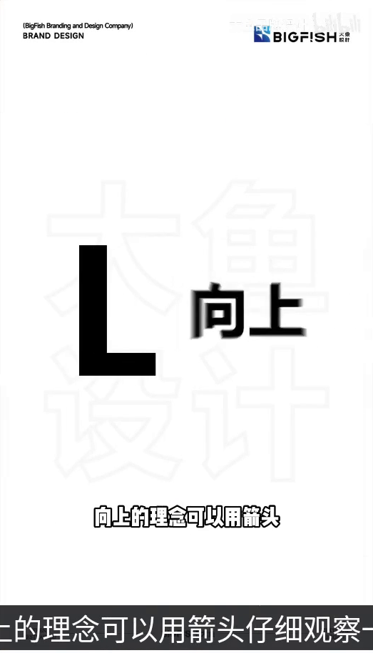

- **作者明确说法**：「向上的理念可以用箭头」
- **播放器字幕**：「向上的理念可以用箭头仔细观察一下」
- **整理者观察**：L 仍在左侧，右侧出现黑体「向上」二字，还没有箭头。

### LH4 · L 与右上箭头

约 33.8s（录屏 48.6s）

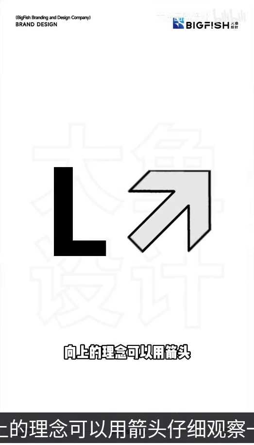

- **作者明确说法**：「向上的理念可以用箭头」
- **播放器字幕**：「向上的理念可以用箭头仔细观察一下」
- **整理者观察**：「向上」二字换成一枚浅灰填充、黑描边的粗箭头，指向右上方。L 仍是端头方正的原形，两者分开并置。

### LH5 · 它们有相同点吗

约 36.2s（录屏 51s）

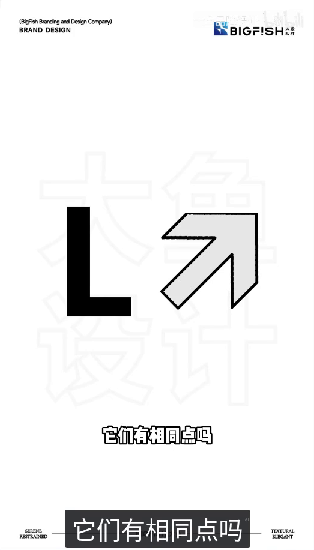

- **作者明确说法**：「它们有相同点吗」
- **整理者观察**：L 与右上箭头仍并置，形态与 LH4 同类，还没有比较用的线条。

### LH6 · 浅粉折线标出内角

约 37.2s（录屏 52s）

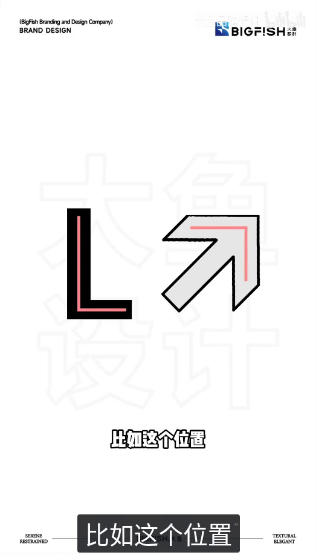

- **作者明确说法**：「比如这个位置」
- **整理者观察**：L 的内直角被一道浅粉折线描出；箭头头部内侧的对应直角，同样被一道浅粉折线描出。L 与箭头本身还在。

### LH7 · 只留下 L

约 38.2s（录屏 53s）

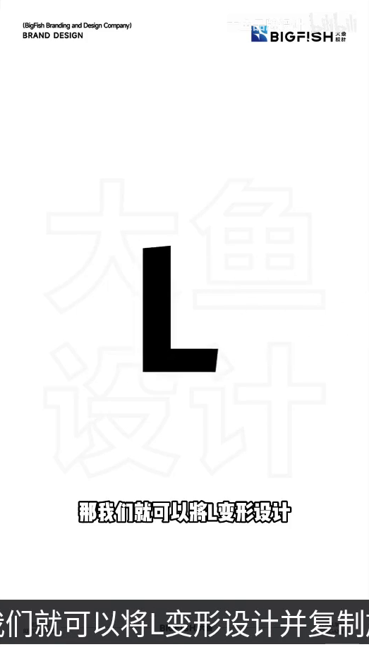

- **作者明确说法**：「那我们就可以將L变形设计」
- **播放器字幕**：「那我们就可以将L变形设计并复制旋转」
- **整理者观察**：箭头和浅粉折线已经不在，画面只剩 L。竖笔上端和横笔末端此时仍较方正。

### LH8 · L 切角

约 38.4s（录屏 53.2s）

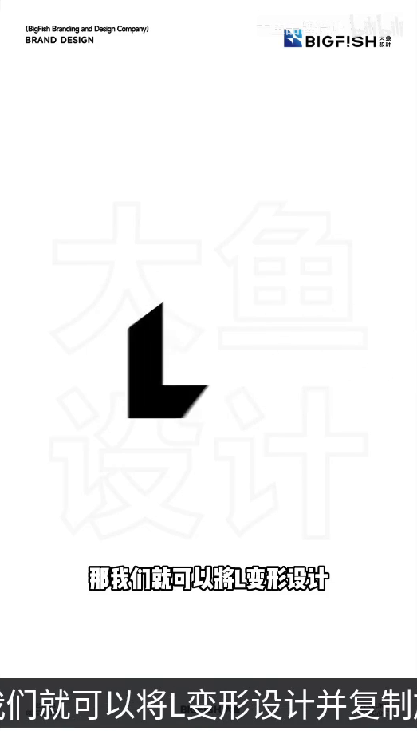

- **作者明确说法**：「那我们就可以將L变形设计」
- **播放器字幕**：「那我们就可以将L变形设计并复制旋转」
- **整理者观察**：同一枚 L，竖笔上端和横笔末端已经被切成斜角，内侧仍是直角，外侧变成尖角。

### LH9 · 复制旋转中

约 39.9s（录屏 54.7s）

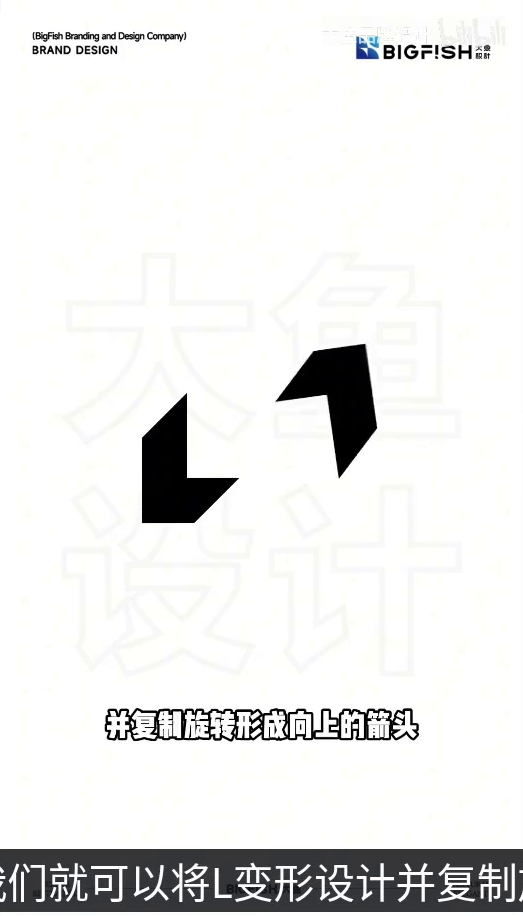

- **作者明确说法**：「并复制旋转形成向上的箭头」
- **播放器字幕**：「那我们就可以将L变形设计并复制旋转」
- **整理者观察**：左边仍是切角后的 L；右边出现它的副本，正处于旋转过程中，还没有收成稳定的箭头形，轮廓略有残影。这是复制旋转的中间态。

### LH10 · 形成向上的箭头

约 40.4s（录屏 55.2s）

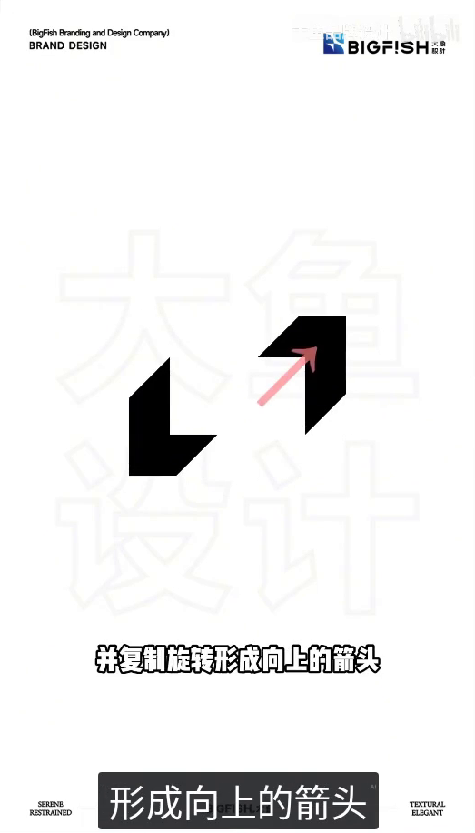

- **作者明确说法**：「并复制旋转形成向上的箭头」
- **播放器字幕**：「形成向上的箭头」
- **整理者观察**：右形已经收成与切角 L 同构、指向右上的箭头形。其上叠着一枚浅粉的指示小箭头，方向同样朝右上。

### LH11 · 两形并置

约 42.4s（录屏 57.2s）

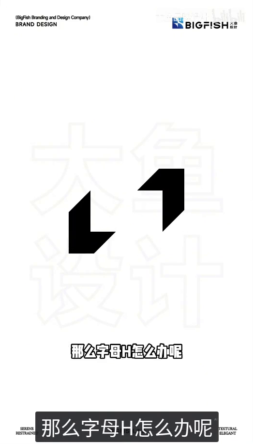

- **作者明确说法**：「那么字母H怎么办呢」
- **整理者观察**：浅粉指示箭头已经不在。左为切角 L，右为同构的箭头形，两形分开并置，还没有咬合成一枚标志。

### LH12 · 再复制、错位叠合中

约 43.2s（录屏 58s）

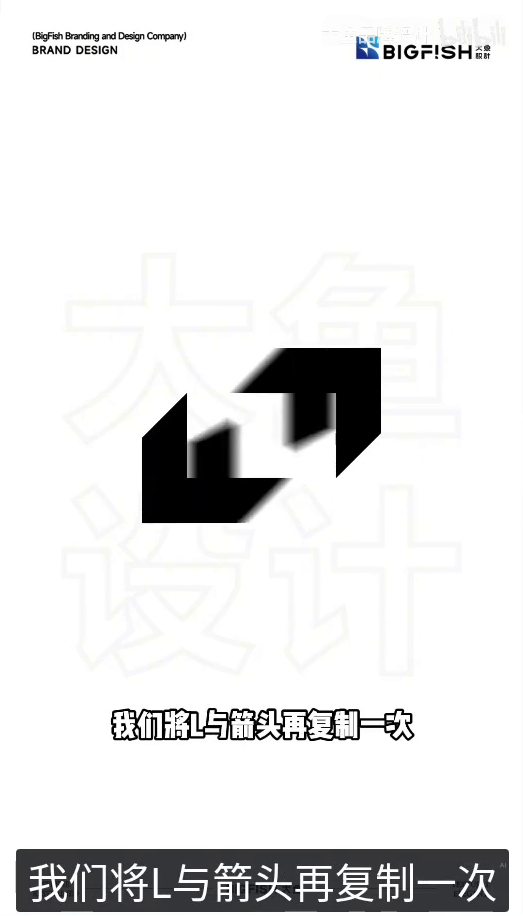

- **作者明确说法**：「我们將L与箭头再复制一次」
- **播放器字幕**：「我们将L与箭头再复制一次」
- **整理者观察**：两形正在向中间错位靠拢，中部轮廓发虚，中间的空白还没有收成稳定的字形。这是再复制、错位叠合的中间态。

### LH13 · 中间空出 H 形

约 43.4s（录屏 58.2s）

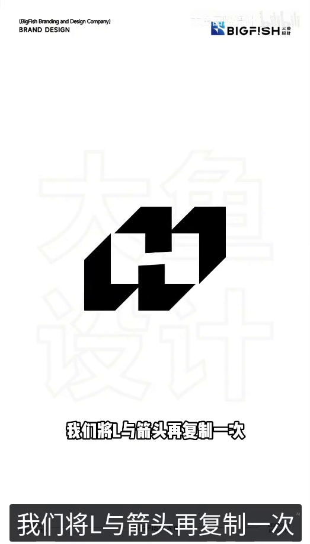

- **作者明确说法**：「我们將L与箭头再复制一次」
- **播放器字幕**：「我们将L与箭头再复制一次」
- **整理者观察**：切角 L 与箭头形已经错位咬合成一枚黑色标志。中间空出的白色空隙，轮廓是大写 H（两竖一横），此时这处空隙仍透出白底。

### LH14 · 浅粉标出 H 的轮廓

约 45.2s（录屏 60s）

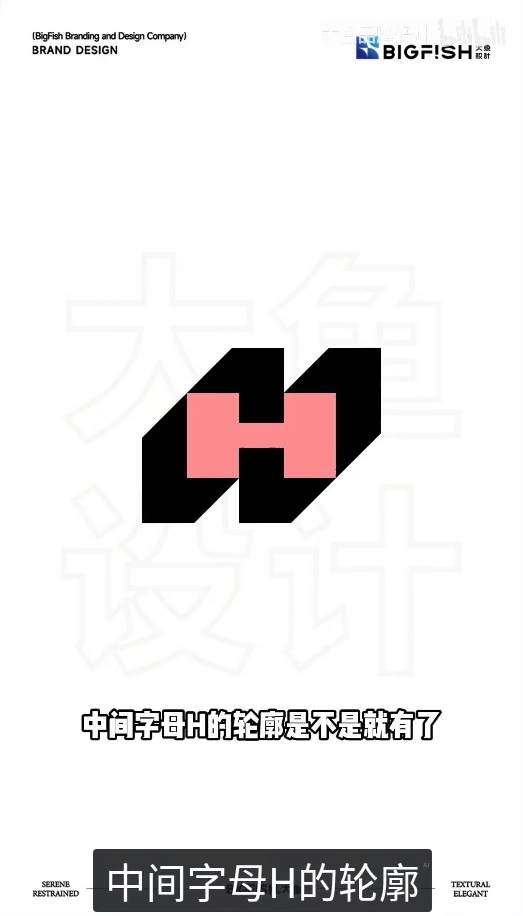

- **作者明确说法**：「中间字母H的轮廓是不是就有了」
- **播放器字幕**：「中间字母H的轮廓」
- **整理者观察**：黑色咬合结构与 LH13 同类。中间原先透白的 H 形空缺被填上浅粉色，把 H 的轮廓标出来。

### LH15 · 用到室内墙面上

约 48.4s（录屏 63.2s）

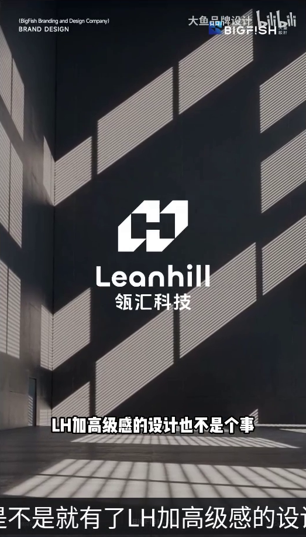

- **作者明确说法**：「LH加高级感的设计也不是个事」
- **播放器字幕**：「是不是就有了LH加高级感的设计」
- **整理者观察**：深色室内墙面上有斜向的光影。同一枚标志改为白色，中间 H 形空缺透出墙面的光影，下方写着「Leanhill」和「领汇科技」。

### 思路与前后关系（整理者分析，非作者原话）

气泡先提出 L+H，并写下「想要有向上的理念」（LH1）。L 出场后，先配上「向上」二字，再换成指向右上的箭头（LH2–LH4）。片内问「它们有相同点吗」，接着用浅粉折线标出 L 的内直角和箭头头部内侧的对应直角（LH5、LH6）。共同的内角被当作变形依据：先把 L 的外端切成斜角（LH7、LH8），再复制并旋转，使副本收成与切角 L 同构的向上箭头（LH9、LH10）。浅粉小箭头只在 LH10 指示方向，到 LH11 已经撤掉。随后按「我们將L与箭头再复制一次」，两形错位咬合（LH12、LH13），中间空出的白底正好是 H 的轮廓；LH14 用浅粉把这块空缺填实，对应片内「中间字母H的轮廓是不是就有了」。应用时标志反白，H 仍是中间的空缺，透出墙面光影，字标为 Leanhill、领汇科技（LH15）。切角后的 L 一经旋转就成为「向上」的箭头，再错位叠合，L、箭头和 H 便落在同一枚结构里：前两者是黑色块面，H 是它们中间的负空间。

---

## 收束：三例并列

约 50.4s（录屏 65.2s）

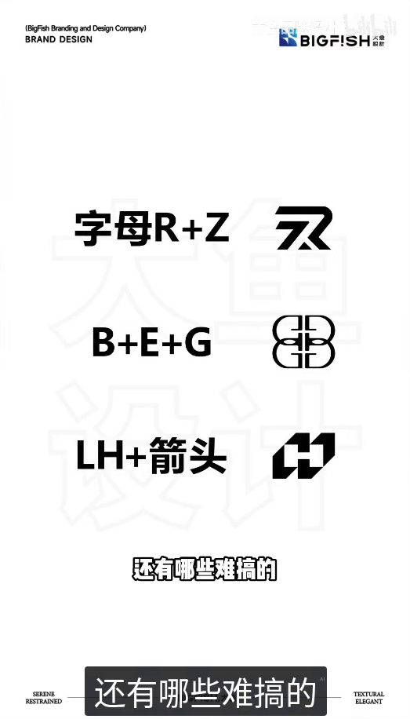

- **作者明确说法**：「还有哪些难搞的」
- **整理者观察**：三行文字和完成态标志并列，分别为「字母R+Z」配含实心三角的标志、「B+E+G」配全黑的对称线框标志、「LH+箭头」配咬合标志。片内没有在本帧再讲解做法。
