# 抓住重点，其实LOGO设计不难｜大鱼品牌设计

## 导入：E 与法槌

### E1 · E 与法槌并置

约 0.4s（录屏 14.3s）

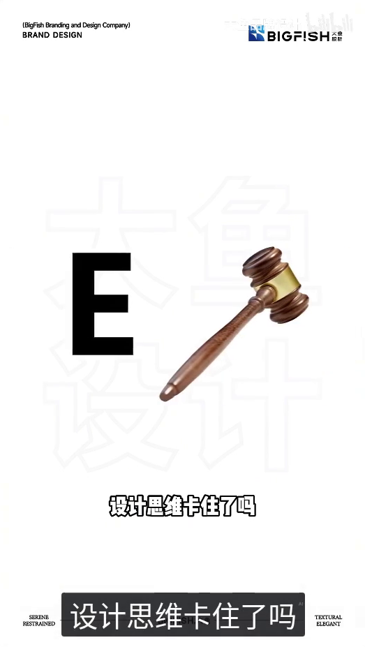

- **作者明确说法**：「设计思维卡住了吗」
- **整理者观察**：白底左侧是黑色正体 E，右侧是一柄木制法槌的照片，槌柄朝左下、槌头朝右上。

### E2 · 单独的 E，给出方法

约 1.7s（录屏 15.6s）

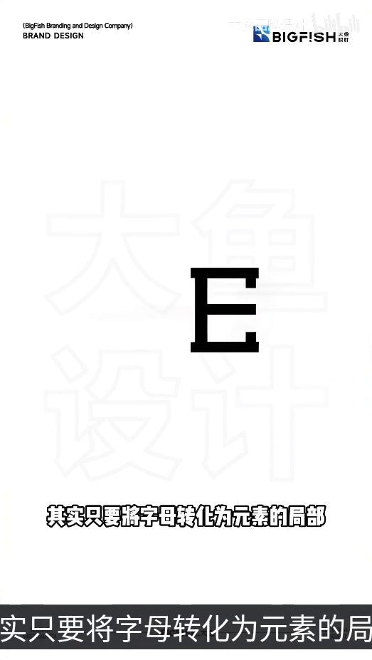

- **作者明确说法**：「其实只要將字母转化为元素的局部」
- **播放器字幕**：「其实只要将字母转化为元素的局部」
- **整理者观察**：法槌照片已撤下，画面中央只剩一枚黑色正体 E。

### E3 · 端点出现小方块

约 2.1s（录屏 16.0s）

- **作者明确说法**：「其实只要將字母转化为元素的局部」
- **播放器字幕**：「其实只要将字母转化为元素的局部」
- **整理者观察**：上横右上方、下横右下方各多出一枚黑色小方块。中横左端已略微伸出。

### E4 · 中横出柄，上下外侧加短平行线

约 2.3s（录屏 16.2s）

- **作者明确说法**：「其实只要將字母转化为元素的局部」
- **播放器字幕**：「其实只要将字母转化为元素的局部」
- **整理者观察**：中横向左伸出较长的柄。上横上方、下横下方各多出一条较短的平行横线；原先两端的小方块已经没有了。

### E5 · 转成柄左下、槌头右上的斜向

约 3.1s（录屏 17.0s）

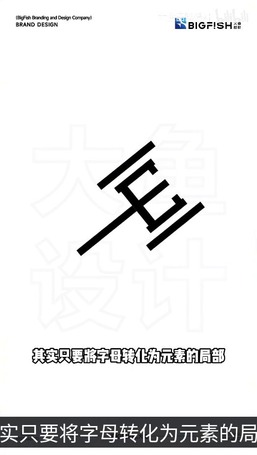

- **作者明确说法**：「其实只要將字母转化为元素的局部」
- **播放器字幕**：「其实只要将字母转化为元素的局部」
- **整理者观察**：整个图形转成柄在左下、槌头在右上的斜向。槌头仍由 E 的三横与外侧短平行线构成，中横连着长柄。字母 E 的结构仍可辨认。

### E6 · 斜向法槌用到照片上

约 4.6s（录屏 18.5s）

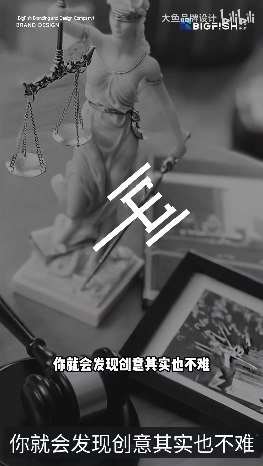

- **作者明确说法**：「你就会发现创意其实也不难」
- **整理者观察**：白色斜向法槌标志压在照片上。照片里有手持天平的雕像，前下方还有一柄实物木槌。

### 思路与前后关系（整理者分析，非作者原话）

作者开篇问「设计思维卡住了吗」，随即给出方法：「其实只要將字母转化为元素的局部」。画面先把字母 E 和法槌照片并置，再改 E 的端点和中横，并转成柄在左下、槌头在右上的斜向，最后把完成的标志放到相关照片上。作者说「你就会发现创意其实也不难」。

这枚标志能同时读作 E 和法槌，是因为三横仍保留字母 E 的识别，中横延长成为槌柄，上下外侧的短平行线则加强槌头。

---

## 案例一：S 与松鼠

### S1 · 画面气泡提出 S 加松鼠

约 6.4s（录屏 20.3s）

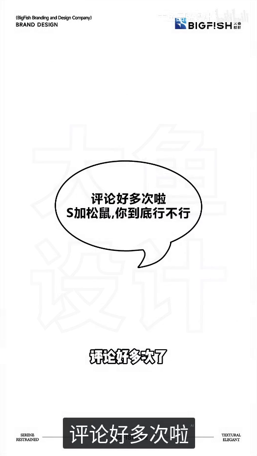

- **作者明确说法**：「评论好多次了」
- **播放器字幕**：「评论好多次啦」
- **整理者观察**：白底中央是一个线框气泡，两行写着「评论好多次啦 / S加松鼠,你到底行不行」。字母标志尚未出现。

### S2 · S 与松鼠照片并置

约 10.6s（录屏 24.5s）

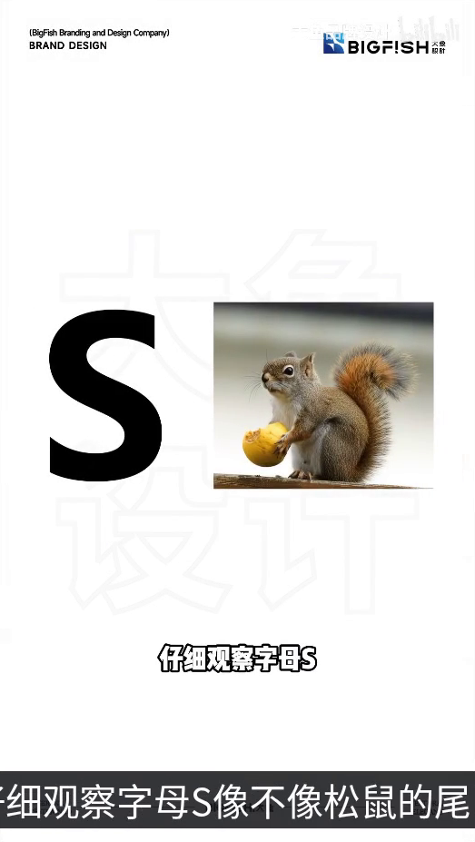

- **作者明确说法**：「仔细观察字母S」
- **播放器字幕**：「仔细观察字母S像不像松鼠的尾巴」
- **整理者观察**：左侧是黑色正体 S，右侧是一张松鼠照片，尾巴向上弯起。字母和照片上都还没有描边高亮。

### S3 · 珊瑚色细线同时描出 S 与尾巴

约 12.1s（录屏 26.0s）

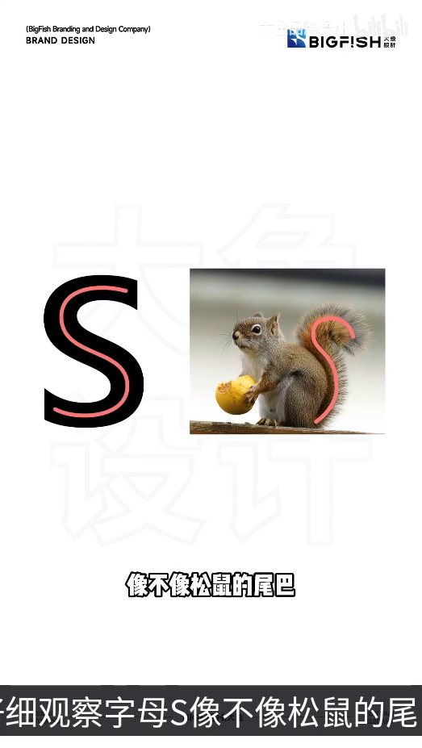

- **作者明确说法**：「像不像松鼠的尾巴」
- **播放器字幕**：「仔细观察字母S像不像松鼠的尾巴」
- **整理者观察**：字母 S 的内侧，以及照片里向上弯起的尾巴，都出现一条珊瑚色细描边，勾出同样的 S 形曲线。

### S4 · 字母变个造型

约 14.9s（录屏 28.8s）

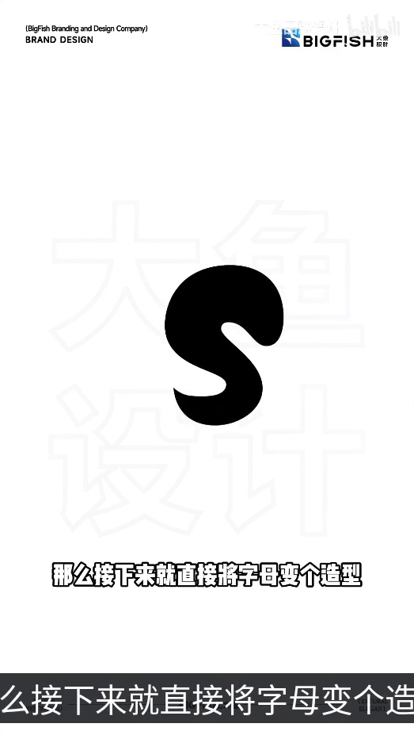

- **作者明确说法**：「那么接下来就直接將字母变个造型」
- **播放器字幕**：「那么接下来就直接将字母变个造型」
- **整理者观察**：照片已撤下。中央是一枚加粗、端头圆润的黑色 S，仍单独出现。

### S5 · 灰色身体接上

约 15.1s（录屏 29.0s）

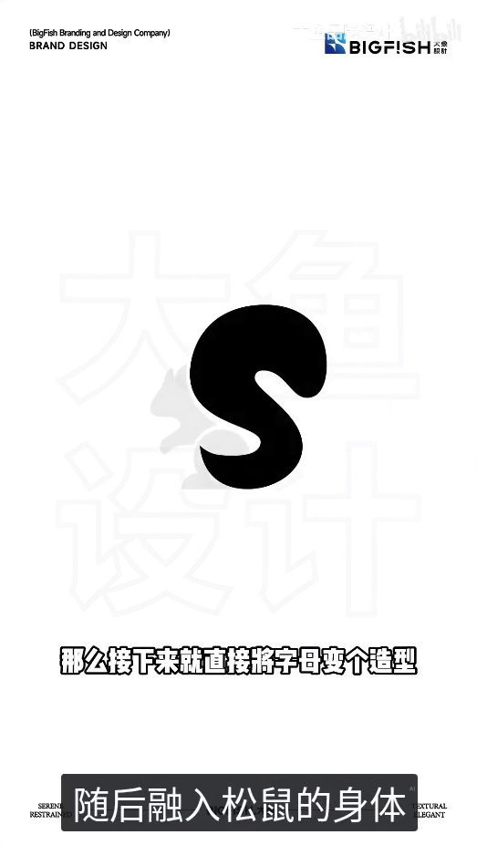

- **作者明确说法**：「那么接下来就直接將字母变个造型」
- **播放器字幕**：「随后融入松鼠的身体」
- **整理者观察**：圆润 S 的左侧出现浅灰色的松鼠身体侧影。S 本身仍是黑色，接在身体后部。

### S6 · 合成全黑松鼠标志

约 16.3s（录屏 30.2s）

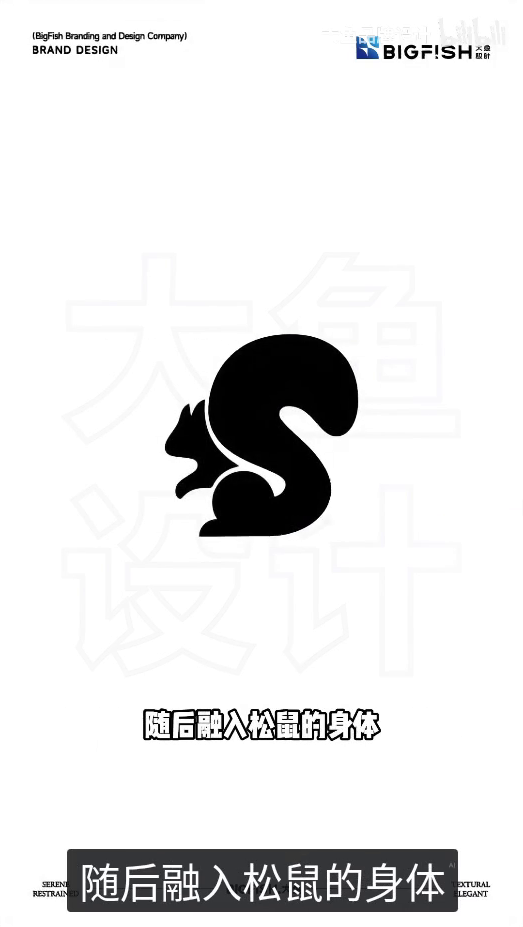

- **作者明确说法**：「随后融入松鼠的身体」
- **整理者观察**：身体与 S 合成一枚全黑标志。头、耳、前肢和背部轮廓清楚，S 仍是翘起的尾巴。

### S7 · 反白用到照片上

约 17.3s（录屏 31.2s）

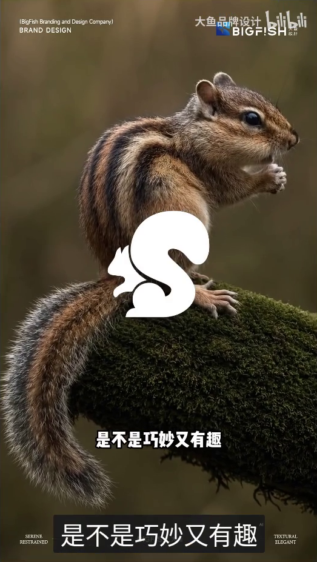

- **作者明确说法**：「是不是巧妙又有趣」
- **整理者观察**：白色松鼠标志叠在一张铺着苔藓的枝桠、以及枝上动物的照片上。

### 思路与前后关系（整理者分析，非作者原话）

评论气泡提出「S加松鼠」。作者先让人「仔细观察字母S」，并问「像不像松鼠的尾巴」——画面同时用珊瑚色细线，在字母内侧和照片尾巴上描出同一条 S 形曲线。随后「將字母变个造型」，把 S 改得更圆、更粗，再「融入松鼠的身体」，完成一枚以 S 为尾巴的松鼠标志。作者问「是不是巧妙又有趣」。

字母与尾巴能落在同一轮廓上，是因为共用那条弯曲的主干；左侧补上的身体则补足松鼠的物种识别。

---

## 案例二：A 与皮划艇

### A1 · 画面气泡提出 A 加船

约 19.0s（录屏 32.9s）

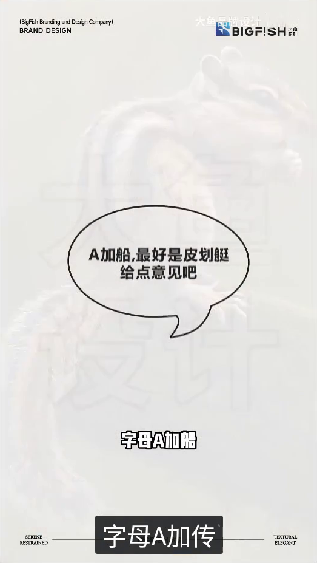

- **作者明确说法**：「字母A加船」
- **播放器字幕**：「字母A加传」
- **整理者观察**：白底中央是一个线框气泡，两行写着「A加船,最好是皮划艇 / 给点意见吧」。字母标志尚未出现。

### A2 · 把 A 当作帆船的风帆

约 23.3s（录屏 37.2s）

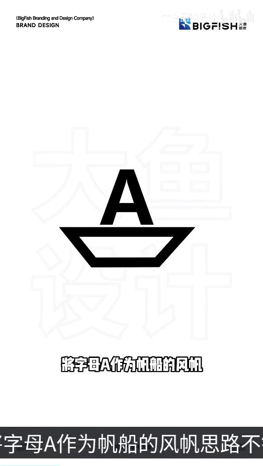

- **作者明确说法**：「將字母A作为帆船的风帆」
- **播放器字幕**：「将字母A作为帆船的风帆思路不错」
- **整理者观察**：一枚正体黑色 A 立在梯形船体上，充当风帆。

### A3 · 客户想要的是皮划艇

约 25.3s（录屏 39.2s）

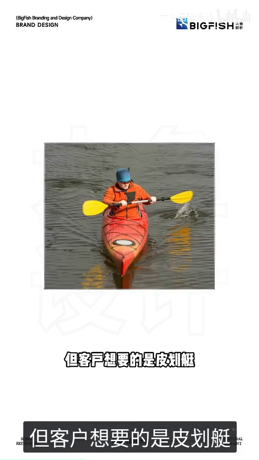

- **作者明确说法**：「但客戶想要的是皮划艇」
- **播放器字幕**：「但客户想要的是皮划艇」
- **整理者观察**：中央是一张水面皮划艇照片，船上一人持桨。

### A4 · 回到单个正体 A

约 27.1s（录屏 41.0s）

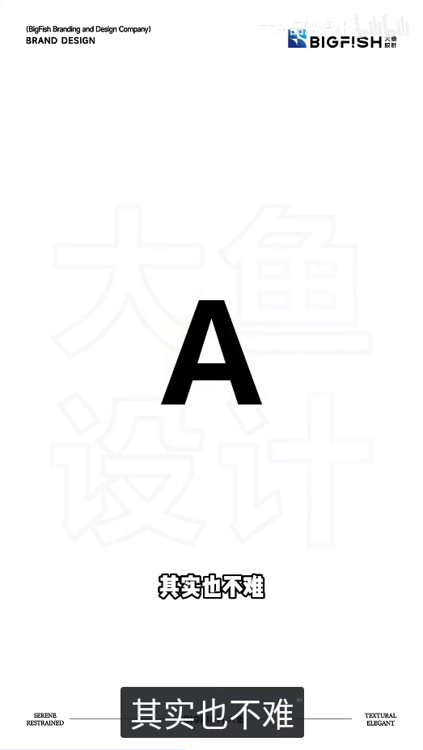

- **作者明确说法**：「其实也不难」
- **整理者观察**：画面回到白底上的一枚黑色正体 A。

### A5 · 复制一份

约 27.7s（录屏 41.6s）

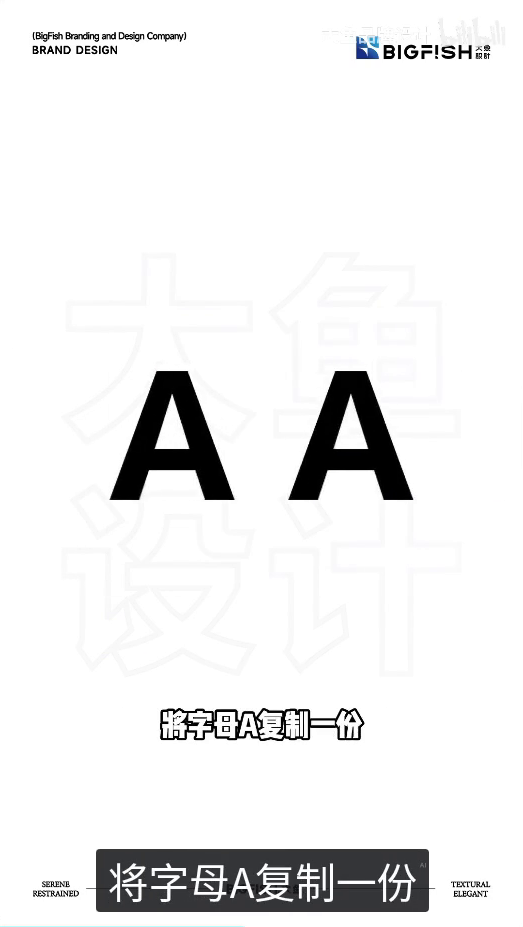

- **作者明确说法**：「將字母A复制一份」
- **播放器字幕**：「将字母A复制一份」
- **整理者观察**：两枚同样的黑色正体 A 左右并排。

### A6 · 两枚变成尖叶弧形

约 28.3s（录屏 42.2s）

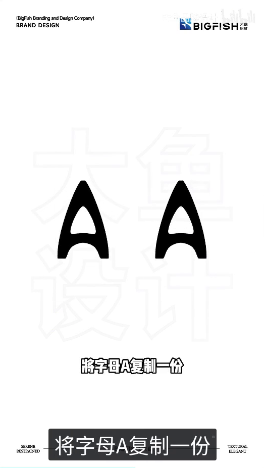

- **作者明确说法**：「將字母A复制一份」
- **播放器字幕**：「将字母A复制一份」
- **整理者观察**：两枚正体 A 已变成直立的尖叶弧形，尖端朝上，字腔呈三角形，底边向外撇开。

### A7 · 两枚倾斜调整位置

约 29.0s（录屏 42.9s）

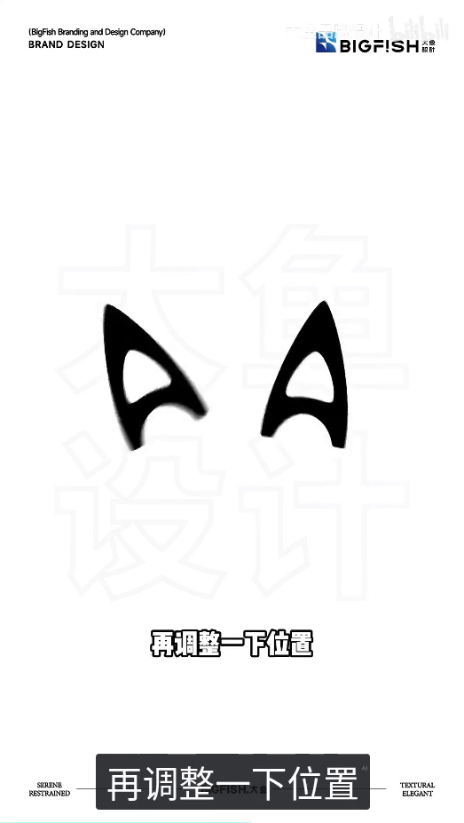

- **作者明确说法**：「再调整一下位置」
- **整理者观察**：两枚尖叶弧形正在倾斜，带有运动模糊。左侧尖端朝向左上，右侧尖端朝向右上。

### A8 · 斜向对合，中腰仍有空隙

约 29.2s（录屏 43.1s）

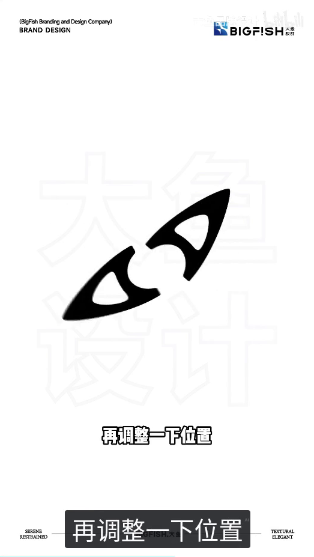

- **作者明确说法**：「再调整一下位置」
- **整理者观察**：两枚已转到斜向并相互靠近，中腰仍留出空隙，座舱尚未闭合。

### A9 · 对合成艇

约 29.4s（录屏 43.3s）

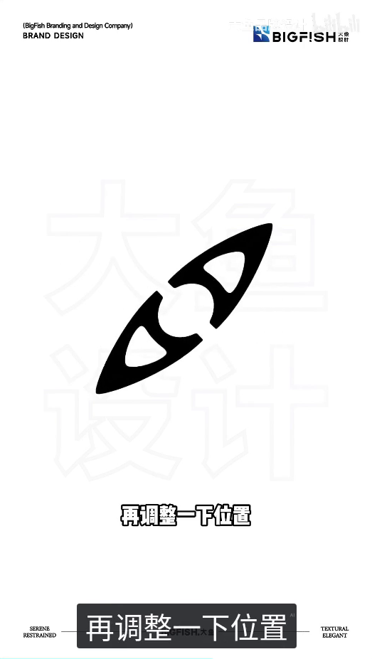

- **作者明确说法**：「再调整一下位置」
- **整理者观察**：两枚对合成一艘两端尖、中腰收窄的艇形，中央出现圆形座舱，腰侧仍可见对合的细缝。

### A10 · 加入船桨

约 30.6s（录屏 44.5s）

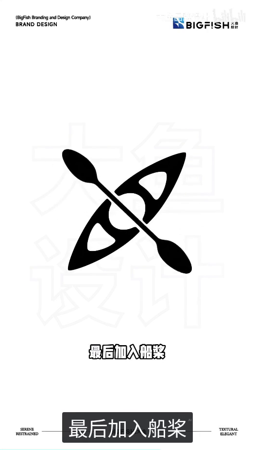

- **作者明确说法**：「最后加入船桨」
- **整理者观察**：一根长桨斜压在艇身上，两端都有桨叶。

### A11 · 反白用到俯瞰水面照片上

约 31.3s（录屏 45.2s）

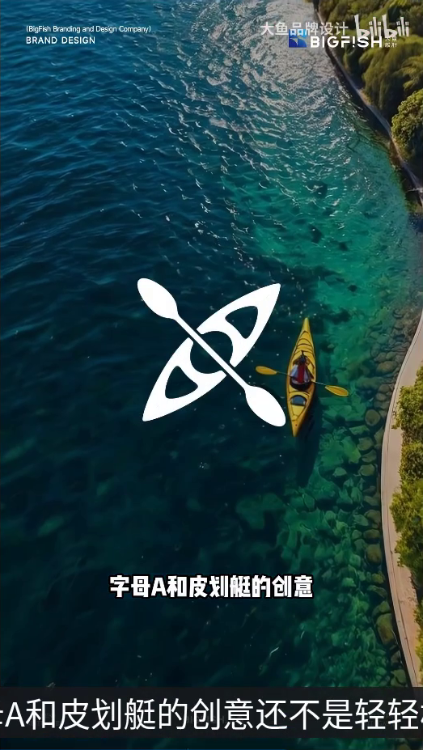

- **作者明确说法**：「字母A和皮划艇的创意」
- **播放器字幕**：「字母A和皮划艇的创意还不是轻轻松松」
- **整理者观察**：白色艇形加桨标志叠在俯瞰水面的照片上，右侧可见一艘黄色小艇。

### 思路与前后关系（整理者分析，非作者原话）

气泡写「A加船,最好是皮划艇」。先出现「將字母A作为帆船的风帆」的做法，随即说明「但客戶想要的是皮划艇」，画面回到单个 A。作者说「其实也不难」，再「將字母A复制一份」，把两枚字母改成尖叶弧形，然后「调整一下位置」，旋转并对合成艇，最后「加入船桨」。

两枚尖叶弧形对合后，弧形与原来的三角字腔形成艇的两端，中央留白成为座舱；斜压过艇身、两端都有桨叶的长桨，把这枚标志与前面的帆船方案区分开来。

---

## 案例三：S 与骑士剑

### K1 · 画面气泡提出骑士与 S

约 34.6s（录屏 48.5s）

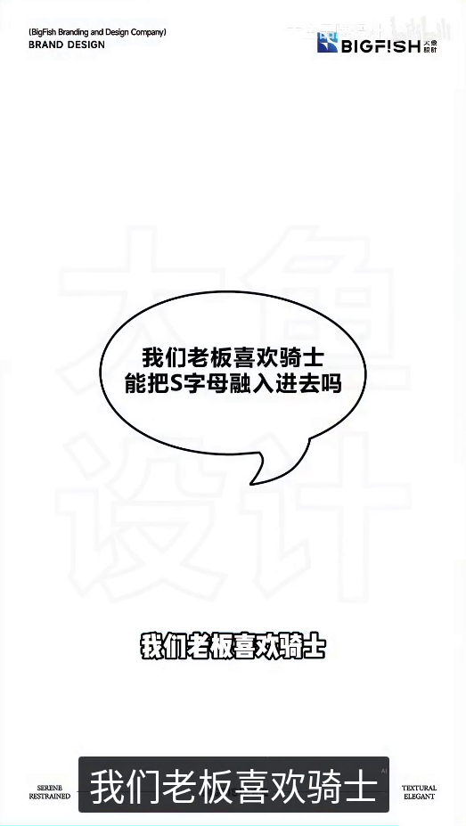

- **作者明确说法**：「我们老板喜欢骑士」
- **整理者观察**：白底中央是一个线框气泡，两行写着「我们老板喜欢骑士 / 能把S字母融入进去吗」。字母标志尚未出现。

### K2 · 一幅骑士绘画

约 38.5s（录屏 52.4s）

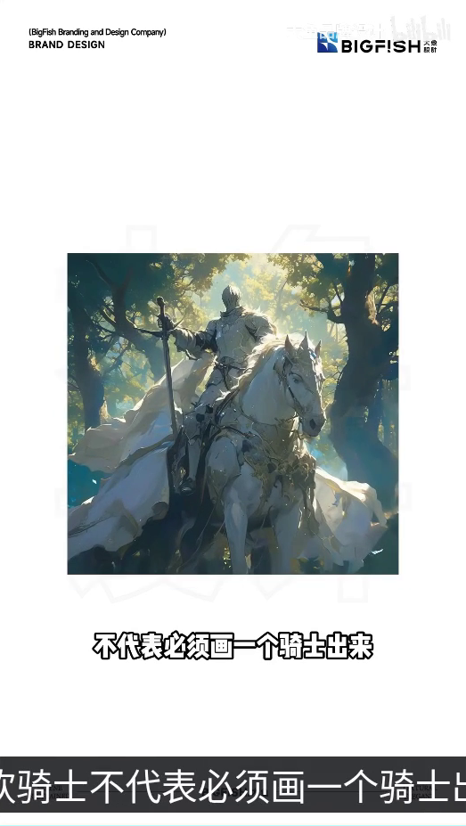

- **作者明确说法**：「不代表必须画一个骑士出来」
- **播放器字幕**：「喜欢骑士不代表必须画一个骑士出来」
- **整理者观察**：画面是一幅骑士骑马的绘画，人物持剑，骑在马上。

### K3 · 寻找骑士身上的锚点元素

约 41.6s（录屏 55.5s）

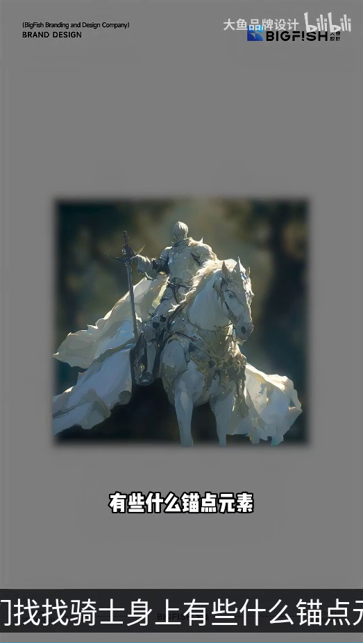

- **作者明确说法**：「有些什么锚点元素」
- **播放器字幕**：「我们找找骑士身上有些什么锚点元素」
- **整理者观察**：同一幅骑士绘画仍留在画面中央，四周已压成灰色。上一句约 41.1s（录屏 55.0s）的片内字幕是「我们找找骑士身上」。

### K4 · S 与头盔并置

约 44.1s（录屏 58.0s）

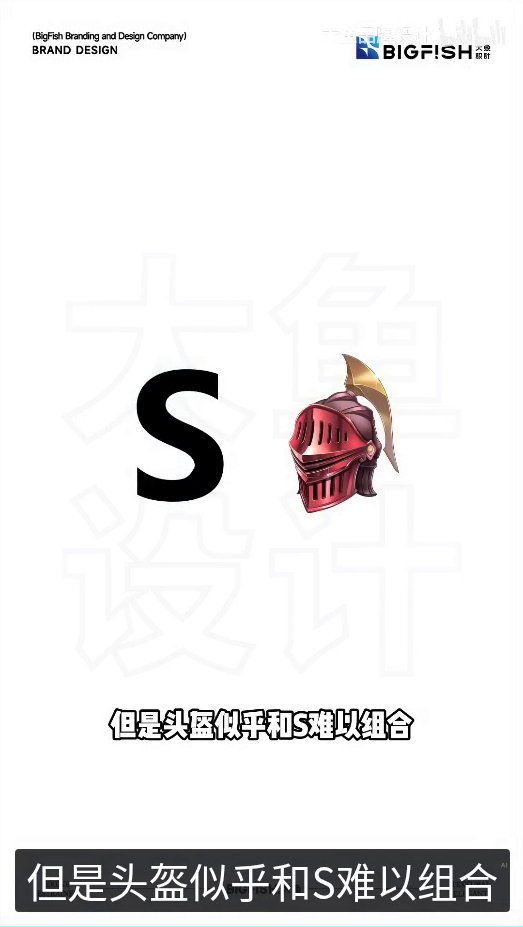

- **作者明确说法**：「但是头盔似乎和S难以组合」
- **整理者观察**：左侧是黑色正体 S，右侧是一顶红色头盔的照片。

### K5 · S 与长剑并置

约 46.3s（录屏 60.2s）

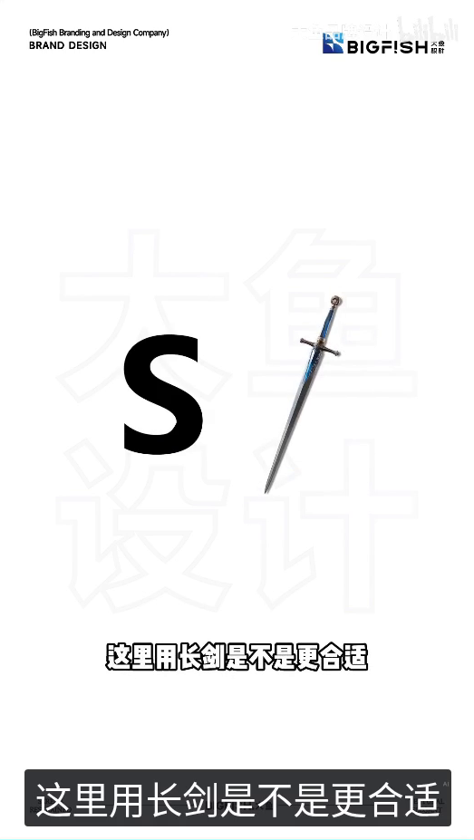

- **作者明确说法**：「这里用长剑是不是更合适」
- **整理者观察**：左侧是黑色正体 S，右侧是一把写实长剑，剑尖朝下、剑柄朝上。

### K6 · 字母线条化，叠在写真上

约 48.3s（录屏 62.2s）

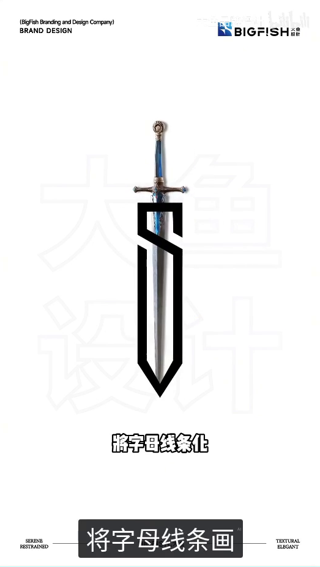

- **作者明确说法**：「將字母线条化」
- **播放器字幕**：「将字母线条画」
- **整理者观察**：长剑写真仍在。黑色线条沿着剑身画出 S 形的刃部轮廓，叠在写真上；上方的剑柄仍是照片。

### K7 · 写真消失，尚未加柄

约 49.1s（录屏 63.0s）

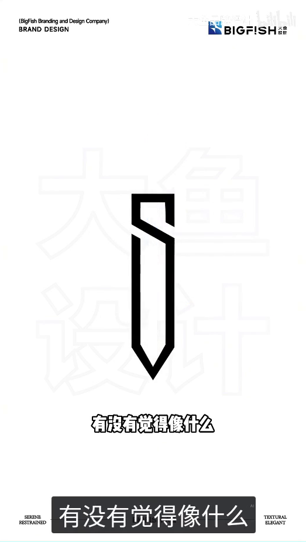

- **作者明确说法**：「有没有觉得像什么」
- **整理者观察**：写真已完全消失，只剩黑色线条构成的剑身，顶部尚未加柄。

### K8 · 加入剑柄

约 50.3s（录屏 64.2s）

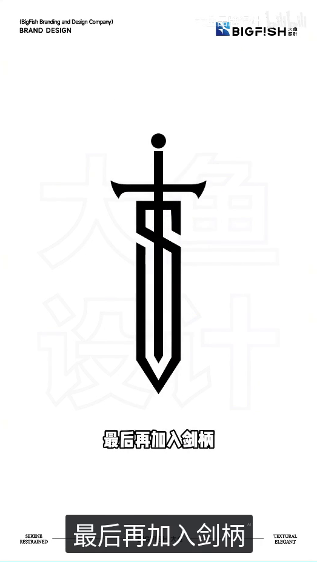

- **作者明确说法**：「最后再加入剑柄」
- **整理者观察**：剑身上加入弧形护手、竖直握柄和圆形剑首，图形已经完整。

### K9 · 反白用到照片上

约 51.3s（录屏 65.2s）

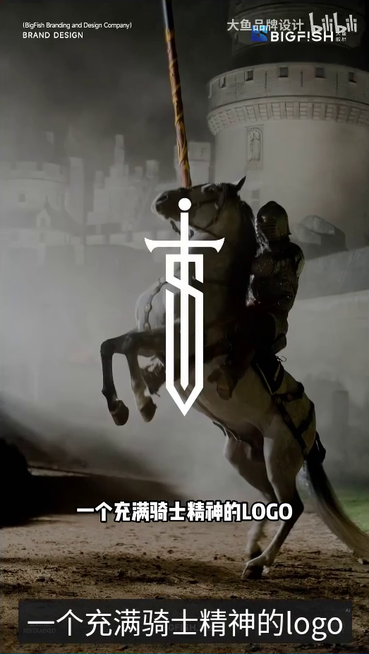

- **作者明确说法**：「一个充满骑士精神的LOGO」
- **播放器字幕**：「一个充满骑士精神的logo」
- **整理者观察**：白色完成剑标叠在一匹扬起前蹄的马和骑马者的照片上。

### 思路与前后关系（整理者分析，非作者原话）

气泡写「我们老板喜欢骑士」，并问能否把 S 字母融入进去。作者说「不代表必须画一个骑士出来」。约 41.1s（录屏 55.0s）片内是「我们找找骑士身上」，约 41.6s（录屏 55.5s）接上「有些什么锚点元素」——这时骑士绘画仍留在画面上。约 42.6s（录屏 56.5s）提到「比如头盔」。头盔与 S 并置后，作者说「但是头盔似乎和S难以组合」，转而问「这里用长剑是不是更合适」。接着「將字母线条化」，写真消失后再「加入剑柄」。完成的标志放到应用照片上，作者称为「一个充满骑士精神的LOGO」。

S 的折线被收成剑身，上部仍保留 S 的转折，因而还能读作字母；再加入的剑柄与剑格提供剑的识别，而不必画出完整的骑士细节，以免挤掉字母。

---

## 收束

### 三例并列

约 54.9s（录屏 68.8s）

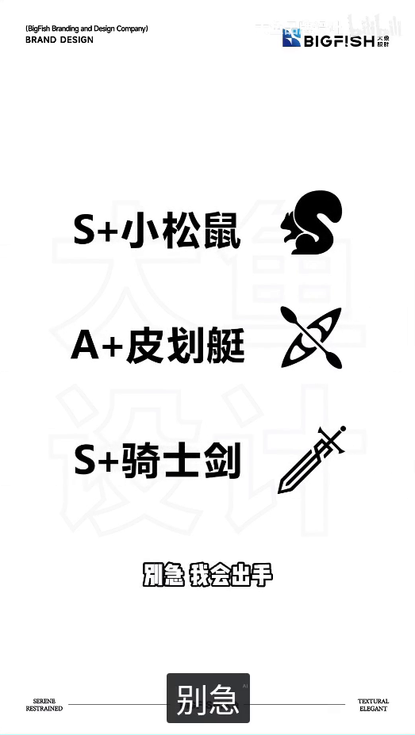

- **作者明确说法**：「别急我会出手」
- **播放器字幕**：「别急」
- **整理者观察**：三行分别写着「S+小松鼠」「A+皮划艇」「S+骑士剑」，右侧是对应的三枚完成态标志。剑标为斜向。
