# [只要你会找特征，任何设计你都能手到擒来](https://www.bilibili.com/video/BV1KptJ6TE47/)｜大鱼品牌设计

约视频时刻按本条 0.5× 录屏实测，约等于（录屏秒 − 82.467）÷ 2，范围 ±1s。图是录屏裁切，不是原片逐帧。

## 案例一：真鹿与手势鹿角 / EVOLUTION

### EV1 · 并置源图：左是真鹿，右是手势鹿角

约 1s（录屏 85.400s）

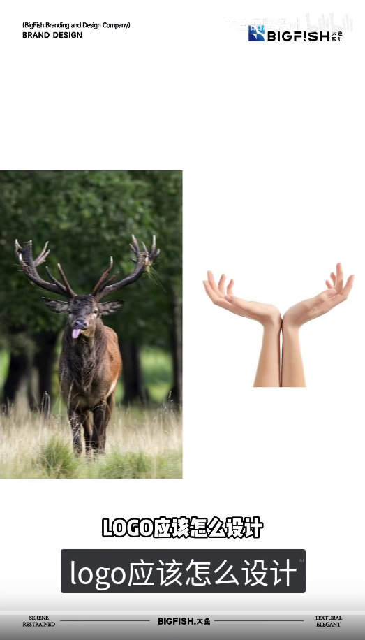

- **作者明确说法**：「LOGO应该怎么设计」
- **播放器字幕**：「logo应该怎么设计」
- **整理者观察**：左右并置。左边是一张真实的鹿，走在草地上，舌头伸在外面，角是完整的。右边是一双手腕并拢、掌心向上向外分开，形状像一副鹿角。还没有提示用的椭圆。开播后照片是从两侧滑入的，这一帧已经看清。

### EV2 · 鹿角和手势上各出现一枚橙红椭圆

约 2s（录屏 86.667s）

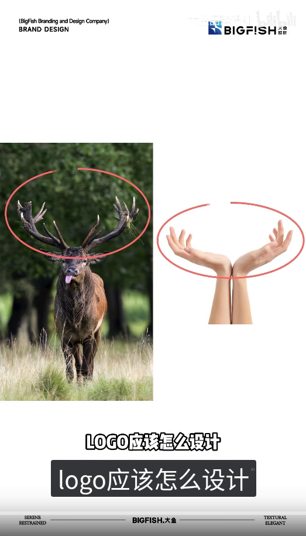

- **作者明确说法**：「LOGO应该怎么设计」
- **播放器字幕**：「logo应该怎么设计」
- **整理者观察**：构图仍是左右并置。左侧鹿角、右侧手势上各有一枚橙红椭圆。片内这一帧还是开场那句。

### EV3 · 手叠到鹿角上，一枚大椭圆圈住叠合区

约 3s（录屏 88.333s）

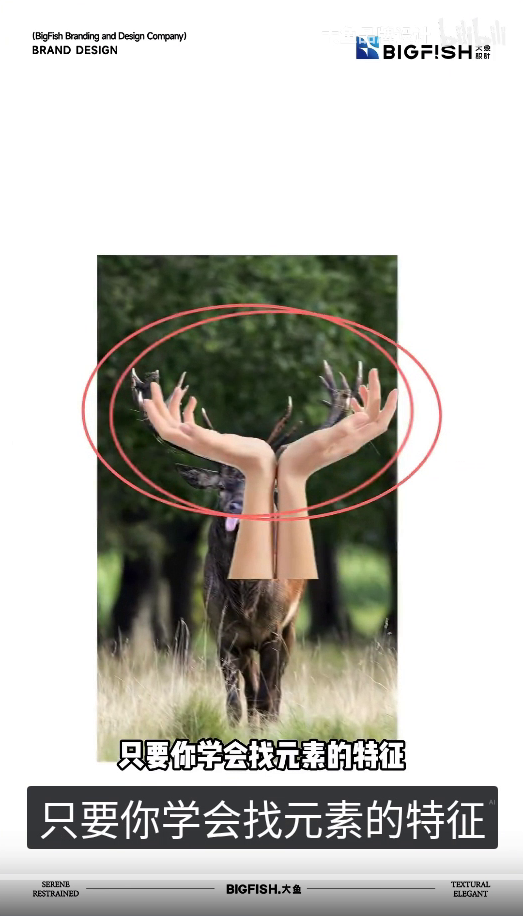

- **作者明确说法**：「只要你学会找元素的特征」
- **整理者观察**：右手势已经叠到左侧鹿照的角上，两张照片重在一起。原来的两枚小椭圆收成一枚大的橙红椭圆，圈住叠合的区域。

### EV4 · 黑色标志出现，底图和椭圆正在变淡

约 3s（录屏 88.867s）

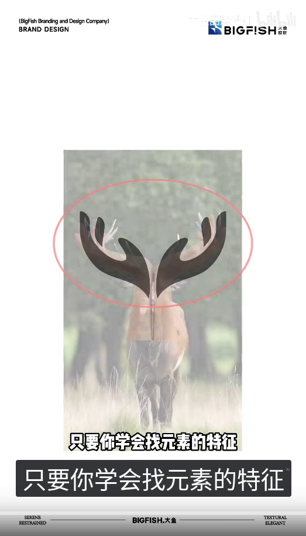

- **作者明确说法**：「只要你学会找元素的特征」
- **整理者观察**：黑色的两瓣标志已经可以认出来，底上的鹿和手还在，颜色变浅，橙红椭圆也在变淡。这是画面上的渐变。

### EV5 · 白底黑净标：两瓣相对，底部中间有白缝

约 3s（录屏 89.333s）

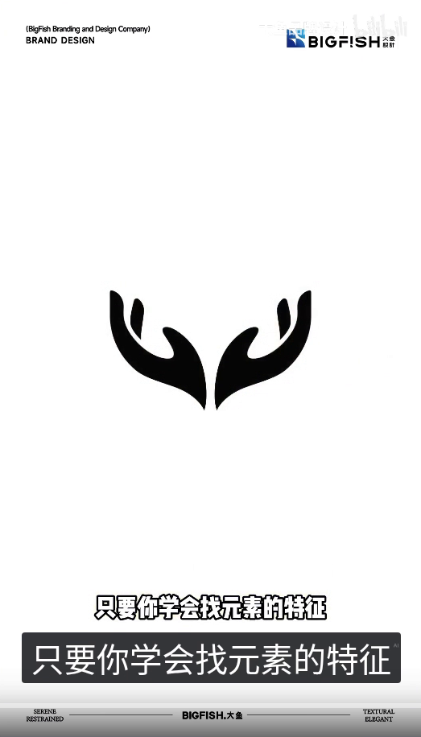

- **作者明确说法**：「只要你学会找元素的特征」
- **整理者观察**：底图和橙红椭圆已经撤掉。白底上是黑色净标：左右两瓣相对，底部中间有一条白缝，两瓣并不相连；每一瓣的上部有两支向上的尖，既像手指，也像角叉。

### EV6 · 同一枚黑净标下，雪地驯鹿照片正在淡入

约 4s（录屏 90.400s）

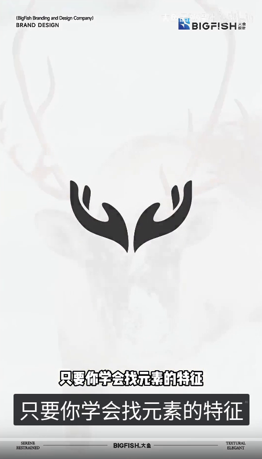

- **作者明确说法**：「只要你学会找元素的特征」
- **整理者观察**：标志仍是黑色，结构与上一帧相同，底部的白缝还在。底上开始透出一张雪地驯鹿的照片，还没有完全铺满。

### EV7 · 用到雪地驯鹿照片上，EVOLUTION

约 5s（录屏 93.000s）

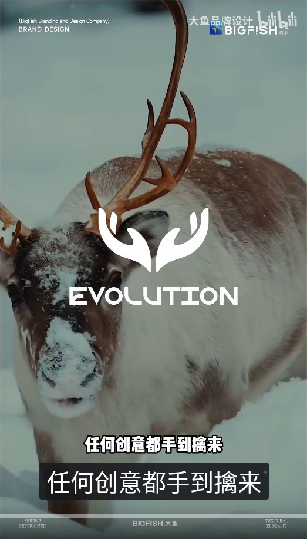

- **作者明确说法**：「任何创意都手到擒来」
- **整理者观察**：浅色标志用到一张雪地驯鹿的照片上，结构与黑净标相同，两瓣相对，底部的白缝仍在。下方字标是全大写的 EVOLUTION，没有中文伴随。90.867 起播放器字幕已经换成这句，当时片内还停在上一句。

### 思路与前后关系（整理者分析，非作者原话）

先并排放出真实的鹿和手势鹿角，用橙红椭圆标出两边共有的角状特征，再把双手叠到鹿角上。随后收成一枚两瓣相对、底部留缝的黑色标志，撤掉提示用的椭圆，再用到雪地驯鹿照片上，字标写成 EVOLUTION。这是整理者根据可见结构作的归纳，片内说的是「LOGO应该怎么设计」「只要你学会找元素的特征」「任何创意都手到擒来」。

---

## 案例二：字母 m 与长颈鹿 / 壹米鹿

### YM1 · 气泡：一米鹿，用长颈鹿设计

约 7s（录屏 97.000s）

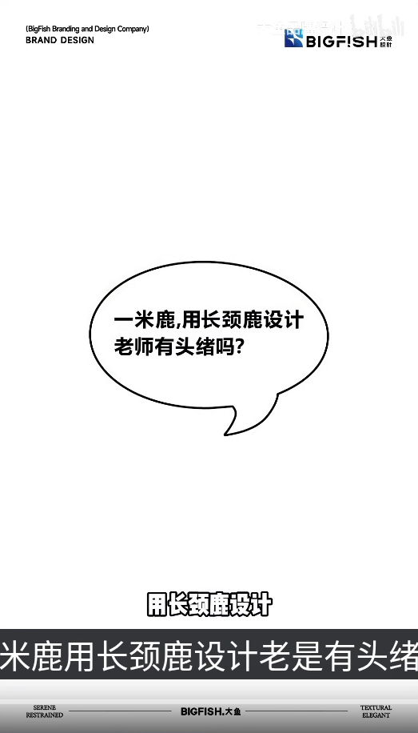

- **作者明确说法**：「用长颈鹿设计」
- **播放器字幕**：竖片左缘被裁掉开头，可见「米鹿用长颈鹿设计老是有头绪」；其中是「老是」，与对话泡里的「老师」不同。
- **整理者观察**：白底上是一个对话泡，两行写着「一米鹿,用长颈鹿设计」和「老师有头绪吗?」。「一米鹿」后面有逗号，句末是问号。这一帧的片内是「用长颈鹿设计」。气泡里的「一米鹿」与后面应用字标的「壹米鹿」用字不同。

### YM2 · 长颈鹿参考照片

约 11s（录屏 105.333s）

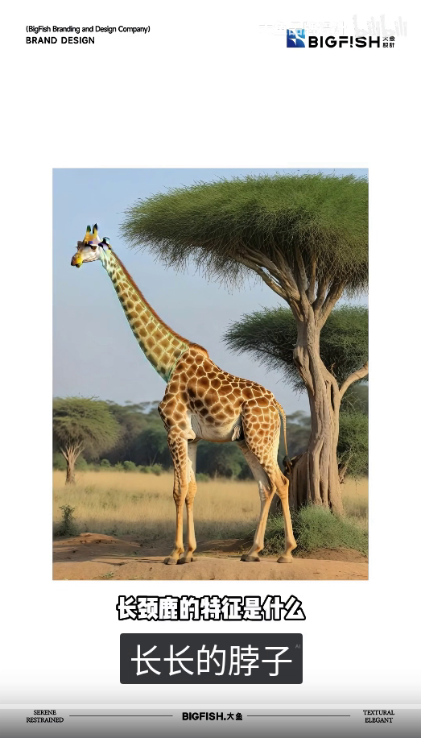

- **作者明确说法**：「长颈鹿的特征是什么」
- **播放器字幕**：「长长的脖子」
- **整理者观察**：画面中央是一张长颈鹿站在树下的照片，还没有字母。

### YM3 · 同一张照片上，脖子被标成绿色

约 12s（录屏 106.533s）

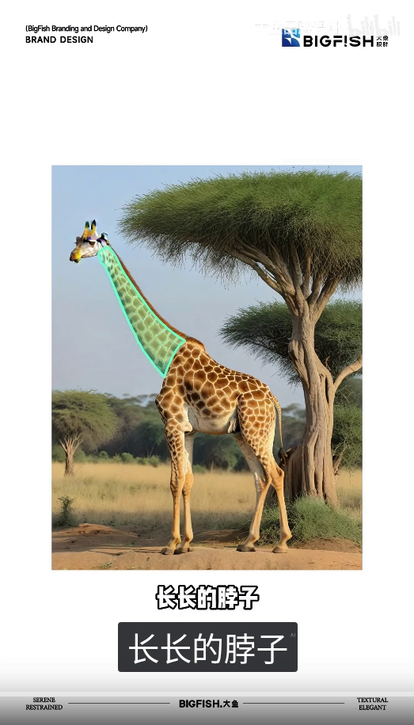

- **作者明确说法**：「长长的脖子」
- **整理者观察**：还是上一张长颈鹿照片。长脖子上覆着一层半透明的绿色，把「长」这一截标了出来。

### YM4 · 白底上是常规小写 m

约 13s（录屏 108.200s）

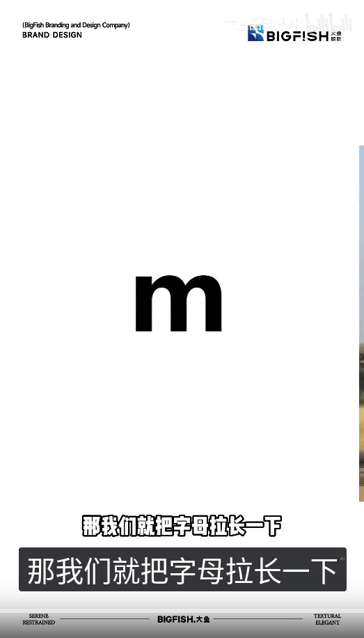

- **作者明确说法**：「那我们就把字母拉长一下」
- **整理者观察**：长颈鹿照片已经移出。白底中央是一个常规小写 m，三条竖画高度相同。

### YM5 · m 的左竖正在向上伸长

约 14s（录屏 109.533s）

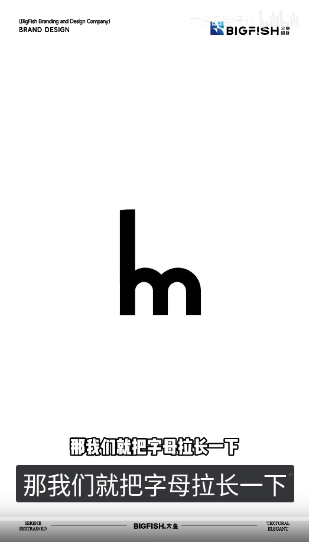

- **作者明确说法**：「那我们就把字母拉长一下」
- **整理者观察**：被拉长的是 m 的左竖，不是中间那一竖，也不是右边那一竖。左竖已经向上伸出一截，顶端仍是平的，高度还没有到后来那样。

### YM6 · 左竖已经拉长，顶端仍平，还没有旗和耳

约 14s（录屏 110.533s）

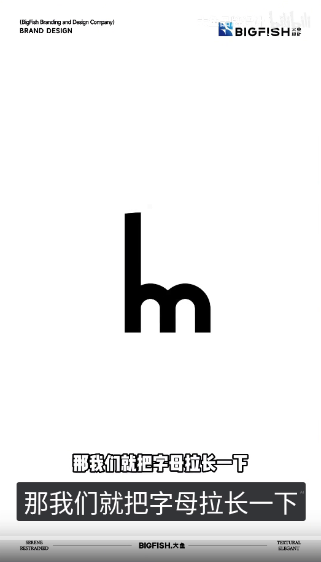

- **作者明确说法**：「那我们就把字母拉长一下」
- **整理者观察**：左竖已经拉到后来的高度，顶端仍是平的。还没有「1」左侧的短旗，左竖顶的右侧也还没有那一小片耳。

### YM7 · 左旗和右上的耳同时以浅灰出现

约 14s（录屏 110.600s）

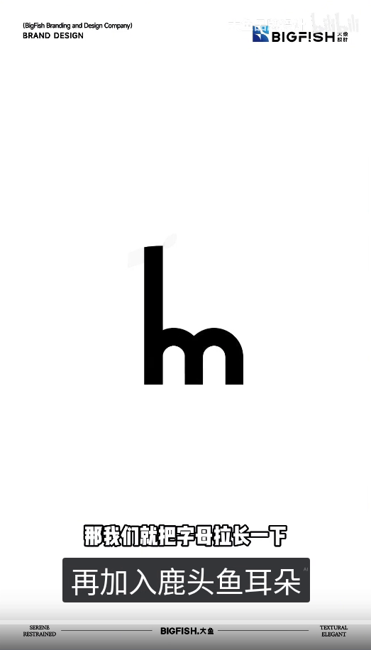

- **作者明确说法**：「那我们就把字母拉长一下」
- **播放器字幕**：「再加入鹿头鱼耳朵」
- **整理者观察**：左竖顶端的左侧出现一片浅灰的短旗，右侧同时出现一小片浅灰的叶形。两者是在同一帧开始显出来的。这一帧片内仍是「那我们就把字母拉长一下」。

### YM8 · 左旗和耳加深，1 的顶部成形

约 14s（录屏 110.800s）

- **作者明确说法**：「再加入鹿头与耳朵」
- **播放器字幕**：「再加入鹿头鱼耳朵」
- **整理者观察**：左旗和右上的耳都比上一帧更深。左旗在左竖顶的左侧，耳在左竖顶的右侧，整段左竖看起来已经像数字 1 的顶部。片内是「与」字，播放器字幕是「鱼」字。

### YM9 · 黑 1m 加耳收实

约 14s（录屏 111.400s）

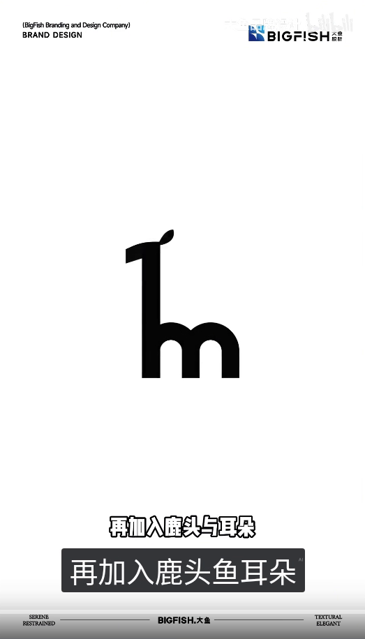

- **作者明确说法**：「再加入鹿头与耳朵」
- **播放器字幕**：「再加入鹿头鱼耳朵」
- **整理者观察**：整枚仍是黑色。左竖连同左旗构成数字 1 的形状，耳在左竖顶的右侧，右边是 m 原来的中缝和右竖。

### YM10 · 左竖和左旗改成橙红，耳和其余部分仍是黑的

约 16s（录屏 113.733s）

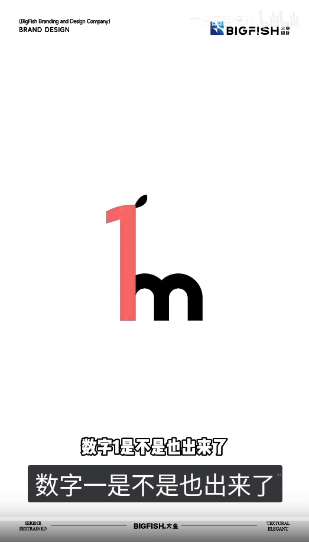

- **作者明确说法**：「数字1是不是也出来了」
- **播放器字幕**：「数字一是不是也出来了」
- **整理者观察**：提示色只涂在左竖和左旗上，也就是那个「1」；耳和 m 的其余部分仍是黑色。片内是阿拉伯数字 1，播放器字幕是汉字「一」。

### YM11 · 长颈鹿照片淡入，橙红开始变浅

约 17s（录屏 116.200s）

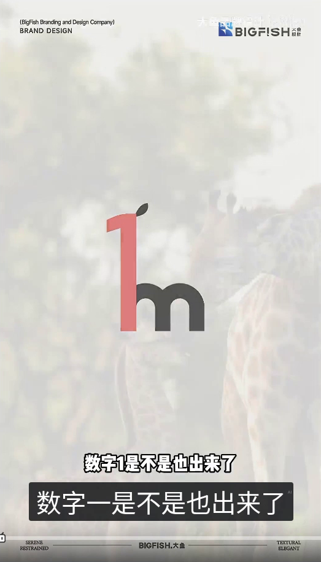

- **作者明确说法**：「数字1是不是也出来了」
- **播放器字幕**：「数字一是不是也出来了」
- **整理者观察**：长颈鹿的照片正在从底下透出来。标志还在原来的位置，橙红已经变浅，整枚开始往浅色走。

### YM12 · 用到长颈鹿照片上，壹米鹿／one meter deer

约 18s（录屏 117.800s）

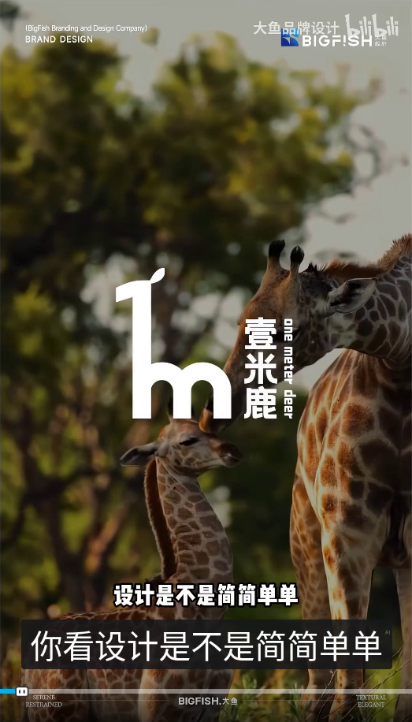

- **作者明确说法**：「设计是不是简简单单」
- **播放器字幕**：「你看设计是不是简简单单」
- **整理者观察**：浅色 1m 用到一张长颈鹿母子的照片上，左旗和耳都在，整枚已经改白，橙红撤掉。右侧中文是竖排三字「壹米鹿」，首字是「壹」不是「一」；中文右边是竖排小写英文 one meter deer。片内这一句以「设计」起头，前面那句「你看」在 116.667 一带。

### 思路与前后关系（整理者分析，非作者原话）

对话泡里先提出「一米鹿，用长颈鹿设计」。放出长颈鹿照片，标出长长的脖子，再落到小写 m：先把左竖向上拉长，顶端仍是平的；随后在左竖顶的左侧出现短旗、右侧出现小耳，收成带「1」的 1m。再用橙红只涂左竖和左旗，提示这个「1」。最后把浅色标志用到长颈鹿照片上，字标写成壹米鹿和 one meter deer。这是整理者根据可见结构作的归纳，片内说的是「用长颈鹿设计」「长颈鹿的特征是什么」「长长的脖子」「那我们就把字母拉长一下」「再加入鹿头与耳朵」「数字1是不是也出来了」「设计是不是简简单单」。

---

## 案例三：线描猫与酒杯 / NIGHTCAT BAR／猫夜酒馆

### NC1 · 气泡：猫夜酒馆，求求老师给点建议吧

约 20s（录屏 122.800s）

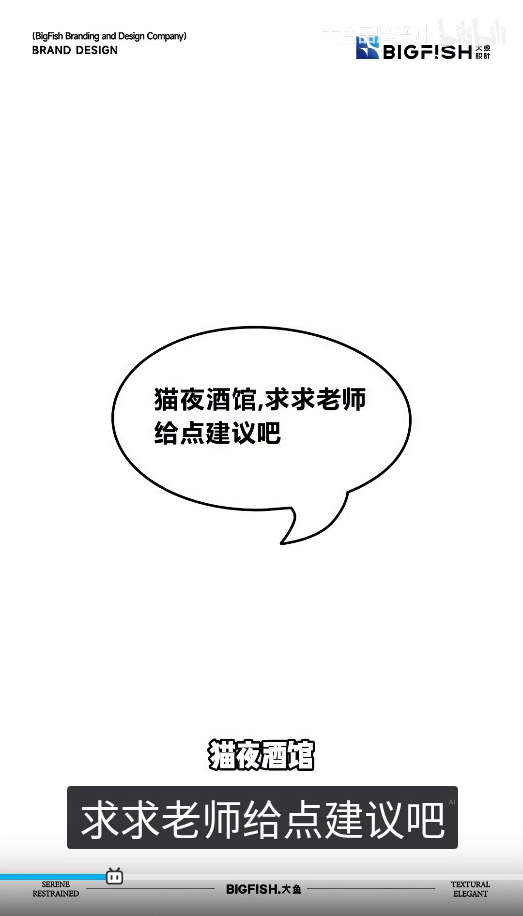

- **作者明确说法**：「猫夜酒馆」
- **播放器字幕**：「求求老师给点建议吧」
- **整理者观察**：白底上是一个对话泡，两行写着「猫夜酒馆,求求老师」和「给点建议吧」。「猫夜酒馆」后面有逗号。

### NC2 · 线描猫举着酒杯

约 23s（录屏 129.000s）

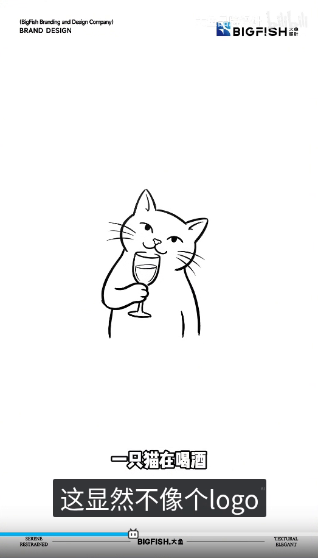

- **作者明确说法**：「这显然不像个LOGO」
- **播放器字幕**：「这显然不像个logo」
- **整理者观察**：白底上是一只线描猫，两爪举着一只酒杯。这是后面用来找特征的对照，还没有提示用的椭圆。片内是大写 LOGO，播放器字幕是小写 logo。

### NC3 · 线描上出现三枚橙红椭圆，分别圈左须、酒杯和右须

约 25s（录屏 133.200s）

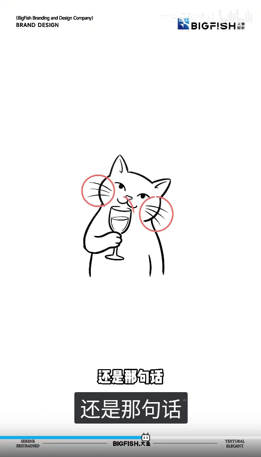

- **作者明确说法**：「还是那句话」
- **整理者观察**：仍是那只举杯的线描猫。三枚橙红椭圆分别圈在左侧胡须、酒杯和右侧胡须上。131.567 起先在左须一带出现小红点，随后才收成这三圈。这一帧片内还是「还是那句话」，「要学会找特征」要到 135.000 一带才落到片内。

### NC4 · 线描猫变成残影，黑描酒杯和红酒转到正面，三圈将撤

约 27s（录屏 135.667s）

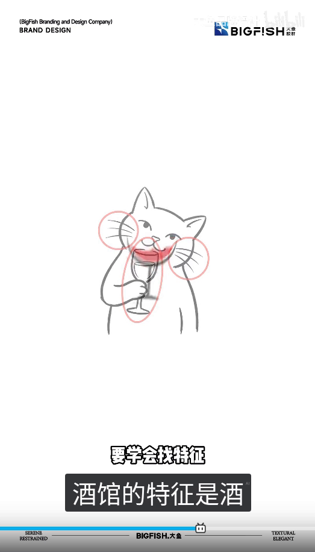

- **作者明确说法**：「要学会找特征」
- **播放器字幕**：「酒馆的特征是酒」
- **整理者观察**：原来的线描猫只剩下淡影。正面换成一只黑描的高脚酒杯，杯里是红酒。三枚橙红椭圆还在，已经变淡。这是画面上的交替。

### NC5 · 净杯：红酒、杯沿两尖，还没有胡须

约 27s（录屏 136.200s）

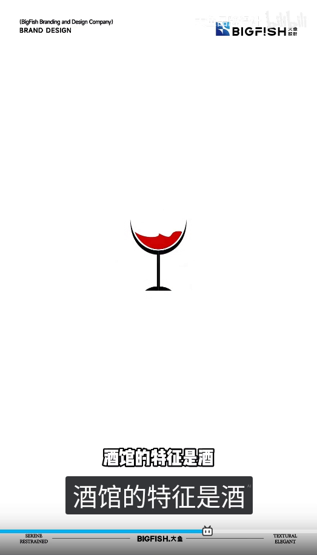

- **作者明确说法**：「酒馆的特征是酒」
- **整理者观察**：线描猫和橙红椭圆都已经撤掉。剩下的是一只黑色高脚杯，杯中是红酒。杯口两端向上收成尖，看起来像一对耳，它们就是杯沿的两尖，不是另外画上去的耳形。这一帧还没有胡须。

### NC6 · 杯茎两侧出现须的起点

约 28s（录屏 138.867s）

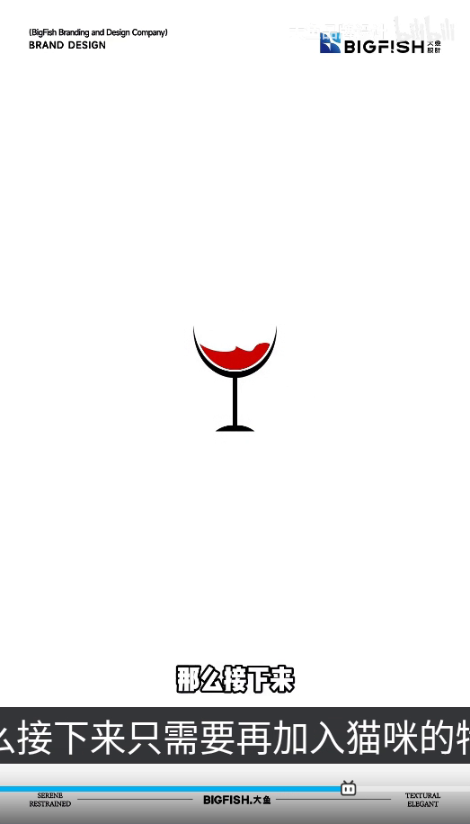

- **作者明确说法**：「那么接下来」
- **播放器字幕**：长句左缘被裁，可见「么接下来只需要再加入猫咪的特」
- **整理者观察**：仍是同一只带红酒的净杯。杯茎两侧开始出现很小的点或短画，胡须还只是一个起头。

### NC7 · 两侧短须伸出

约 28s（录屏 139.400s）

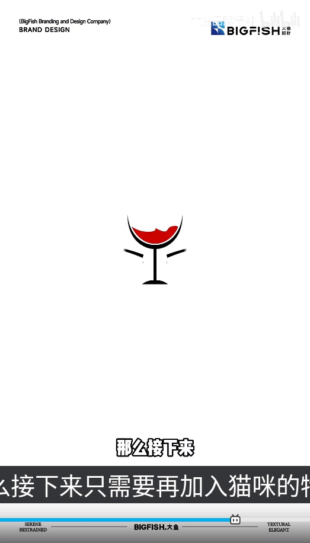

- **作者明确说法**：「那么接下来」
- **播放器字幕**：长句左缘被裁，可见「么接下来只需要再加入猫咪的特」
- **整理者观察**：两侧的须已经明显伸出，还比较短。片内这一句「只需要再加入猫咪的特征」要到 139.800 一带才落到画面上。

### NC8 · 白底净标收实：黑杯、红酒、六根须、杯沿两尖

约 30s（录屏 142.200s）

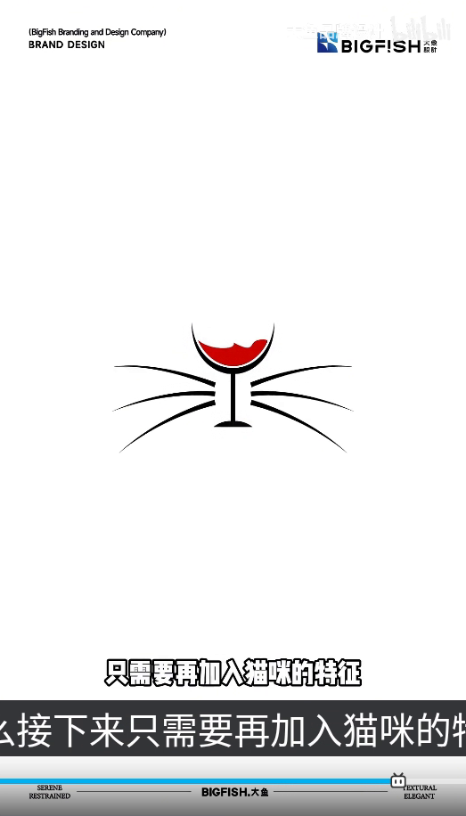

- **作者明确说法**：「只需要再加入猫咪的特征」
- **整理者观察**：左右大约各三根须，最下面一根较长、向下弯。须根和杯茎之间留着白缝，并不是焊死的。杯沿两尖仍在。142.600 起底上才会开始透出碰杯的照片。

### NC9 · 用到碰杯照片上，NIGHTCAT BAR／猫夜酒馆

约 32s（录屏 145.800s）

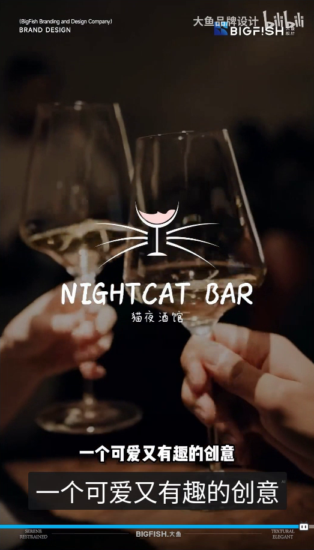

- **作者明确说法**：「一个可爱又有趣的创意」
- **整理者观察**：浅色标志用到一张双手碰杯的照片上，结构与黑净标相同：杯沿两尖、左右胡须都在。杯中的酒液改成浅粉色，和过程里那杯正红不一样。上行英文是全大写的两词 NIGHTCAT BAR，下行中文是「猫夜酒馆」。

### 思路与前后关系（整理者分析，非作者原话）

对话泡里先提出「猫夜酒馆」。先画出一只举杯的线描猫，并写成「这显然不像个LOGO」，再用橙红椭圆标出胡须和酒杯。随后画面转到一只带红酒的黑描酒杯，杯沿两端收成尖；橙红椭圆撤掉。胡须是后来一根根长出来的：先是点，再是短须，最后左右各三根。最后把浅色标志用到碰杯照片上，酒液改成浅粉，字标写成 NIGHTCAT BAR 和「猫夜酒馆」。这是整理者根据可见结构作的归纳，片内说的是「猫夜酒馆」「这显然不像个LOGO」「还是那句话」「要学会找特征」「酒馆的特征是酒」「那么接下来」「只需要再加入猫咪的特征」「一个可爱又有趣的创意」。

---

## 案例四：针线与字母 R / RIDLEIFVG／DRESS

### RD1 · 气泡：我是做纺织行业的，用字母 R 能行吗

约 34s（录屏 151.000s）

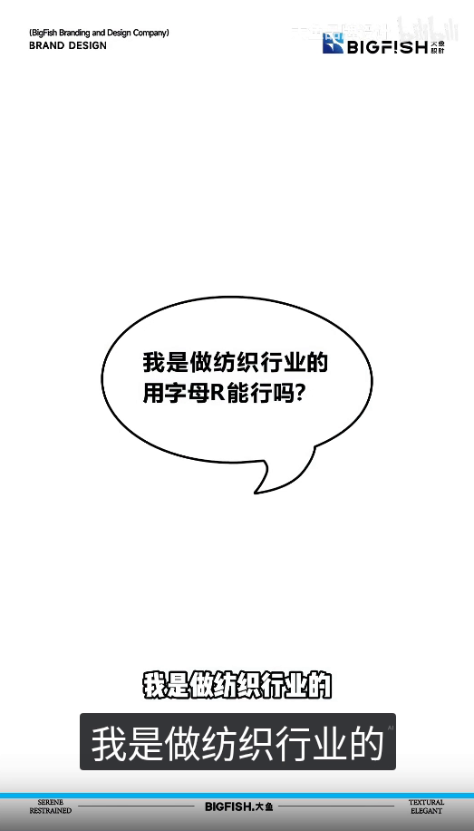

- **作者明确说法**：「我是做纺织行业的」
- **整理者观察**：白底上是一个对话泡，两行写着「我是做纺织行业的」和「用字母R能行吗?」。

### RD2 · 中央写出「纺织品」三字

约 38s（录屏 158.000s）

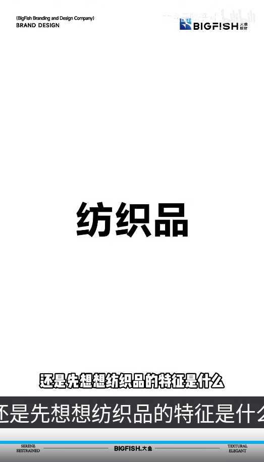

- **作者明确说法**：「还是先想想纺织品的特征是什么」
- **整理者观察**：白底中央是黑体「纺织品」三个字，还没有针和线的照片。

### RD3 · 参考照片：七根斜针和三团白线

约 39s（录屏 160.000s）

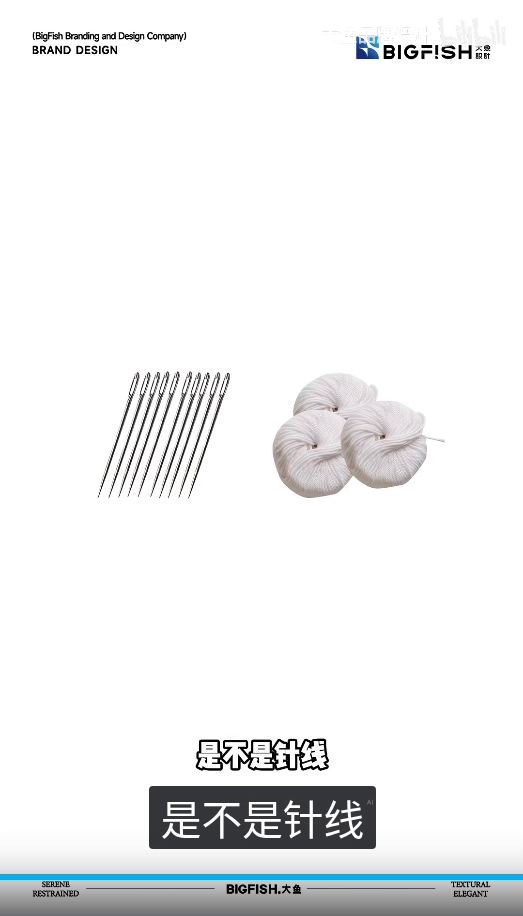

- **作者明确说法**：「是不是针线」
- **整理者观察**：参考照片里，左侧七根银色的针整体向左下倾斜，不是竖直摆正的；右侧是三团白线。

### RD4 · 一枚倾斜的图形针

约 40s（录屏 161.533s）

- **作者明确说法**：「那么接下来只需要穿针引线」
- **整理者观察**：照片已经淡出。剩下的是一枚黑色图形针，针孔在上，针身向左下倾斜，不是直立的。

### RD5 · 针左侧出现短线，开始向针孔一带延伸

约 40s（录屏 162.267s）

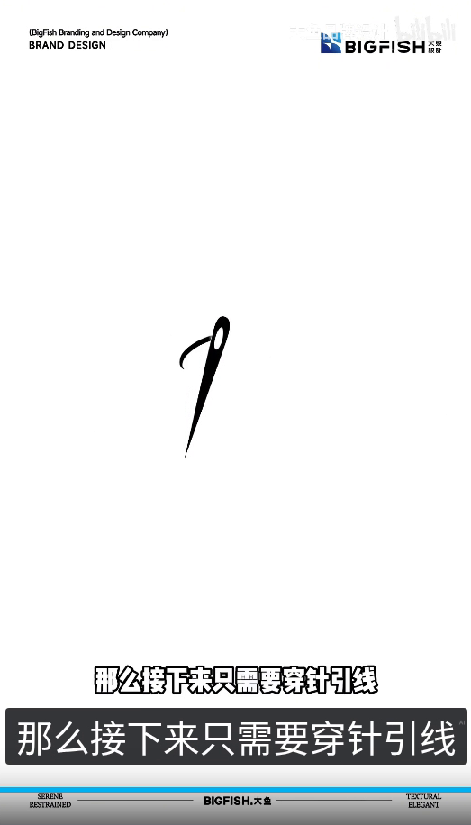

- **作者明确说法**：「那么接下来只需要穿针引线」
- **整理者观察**：针的左侧先出现墨点，随后是一段向针孔一带延伸的短线，在针左侧留下一个弯钩。线是从这一侧长出来的。

### RD6 · 线穿过针孔一带，右侧绕出 R 的上腹

约 40s（录屏 162.533s）

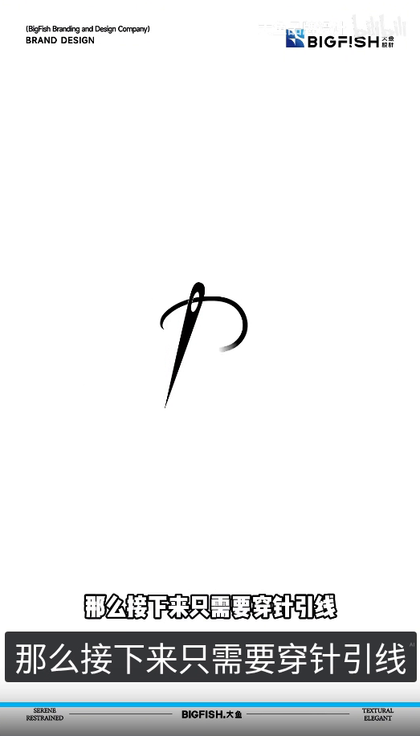

- **作者明确说法**：「那么接下来只需要穿针引线」
- **整理者观察**：同一条线穿过针孔附近，在针的右侧绕出 R 的上腹部，前锋还在向下走。

### RD7 · 同一条线从右腹下延，再向右，前锋到右下

约 40s（录屏 162.667s）

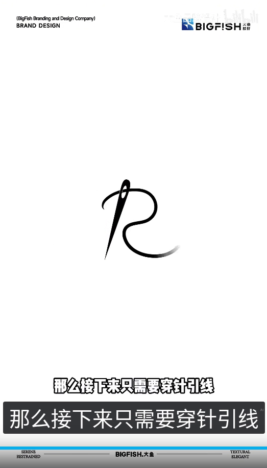

- **作者明确说法**：「那么接下来只需要穿针引线」
- **整理者观察**：上腹之后，这条线从右侧回弯、向下，再转向右，R 的腹线已经可以认出来。前锋在右下方。

### RD8 · 腹线在右下回弯后向外，沿右侧向上越过顶端

约 40s（录屏 162.800s）

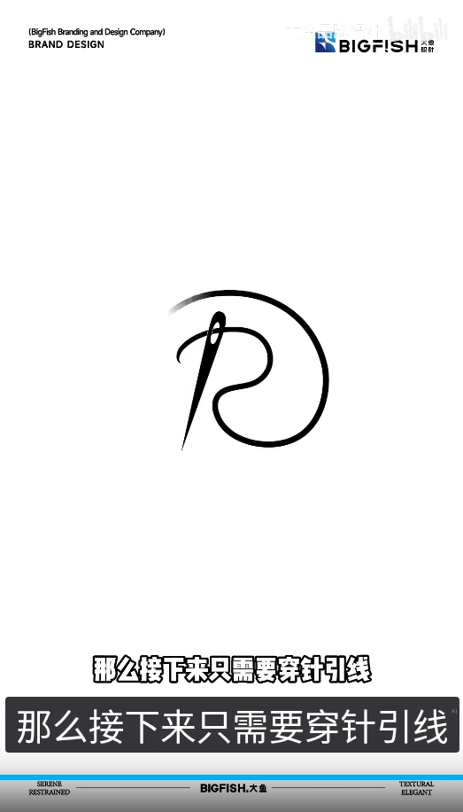

- **作者明确说法**：「那么接下来只需要穿针引线」
- **整理者观察**：腹线在右下回弯之后继续向外走：先沿着右侧向上，再越过顶端转到左侧。这一帧前锋在左上方，还没有落到左下。这是刚才那条腹线的延续，不是另外加上的一圈。

### RD9 · 前锋走到左下，右下的开口已经在

约 40s（录屏 163.067s）

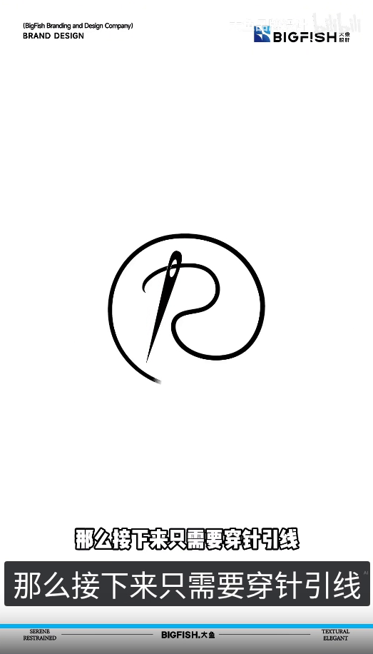

- **作者明确说法**：「那么接下来只需要穿针引线」
- **整理者观察**：前锋沿左侧向下，走到针尖外侧的左下方，末端还比较虚。此时底部的外绕线还没有走到右下，右下方内侧的腹线和尚未到达的下沿之间，已经是一大块留白。

### RD10 · 前锋转到画面底部，向右延伸，末端仍短

约 40s（录屏 163.200s）

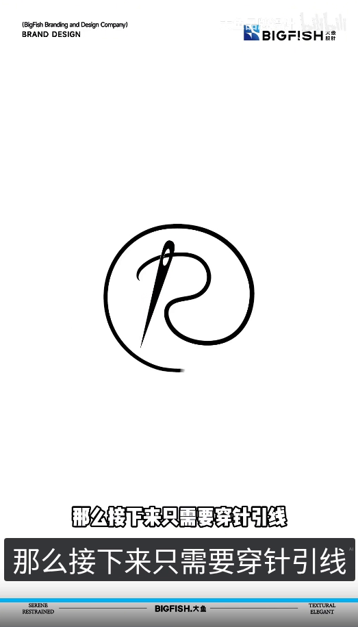

- **作者明确说法**：「那么接下来只需要穿针引线」
- **整理者观察**：前锋转到画面底部，开始向右走，末端还短，略微发虚。右下的尖端还没有收住，和内侧腹线之间仍是大白隙。

### RD11 · 下沿向右，末端在右下收成尖，开口仍在

约 40s（录屏 163.400s）

- **作者明确说法**：「那么接下来只需要穿针引线」
- **整理者观察**：下沿继续向右，末端收成尖，停在右下方。尖端和内侧那条腹线之间仍有大白隙。针仍向左下倾斜，针孔是一个可见的白洞，针尖不碰到外线。

### RD12 · 白底净标收实，右下仍是收尖的开口

约 41s（录屏 165.000s）

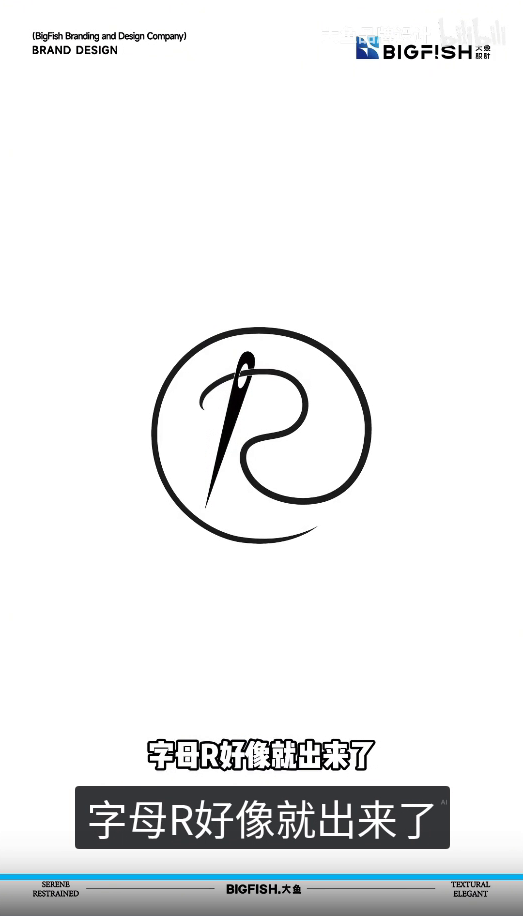

- **作者明确说法**：「字母R好像就出来了」
- **整理者观察**：结构与 163.400 相同：一枚斜针，一条连续的线从左侧弯钩穿过针孔一带，绕成 R 的右腹，再向外绕行，末端在右下收尖，和内侧腹线之间仍有大白隙。这一帧片内已经换成「字母R好像就出来了」。

### RD13 · 用到织物照片上，RIDLEIFVG／DRESS

约 44s（录屏 170.533s）

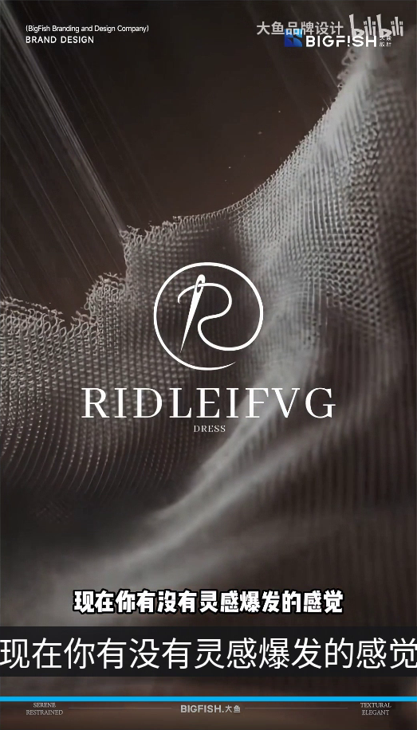

- **作者明确说法**：「现在你有没有灵感爆发的感觉」
- **整理者观察**：浅色标志用到一张织物、纱线的照片上，结构与黑净标相同，右下仍然收尖，和内侧腹线之间的白隙还在。上行英文是衬线全大写的 RIDLEIFVG，九个字母从左到右是 R、I、D、L、E、I、F、V、G；下行小字是 DRESS。167.533 一带片内先经过「怎么样」，这一帧已经是「现在你有没有灵感爆发的感觉」。

### 思路与前后关系（整理者分析，非作者原话）

对话泡里先问能不能用字母 R 做纺织。先写出「纺织品」，再放出七根斜针和三团白线的照片，随后落到一枚同样倾斜的图形针。一条线从针左侧长出，穿过针孔一带，绕成 R 的右腹；同一条线再从右腹下延，在右下回弯后向外，沿右侧向上、越过顶端、落到左侧，再沿底部向右，末端在右下收成尖，和内侧腹线之间留下白隙。最后把浅色标志用到织物照片上，字标写成 RIDLEIFVG 和 DRESS。这是整理者根据可见结构作的归纳，片内说的是「我是做纺织行业的」「还是先想想纺织品的特征是什么」「是不是针线」「那么接下来只需要穿针引线」「字母R好像就出来了」「现在你有没有灵感爆发的感觉」。

---

## 收束：三行回顾

约 47s（录屏 176.000s）

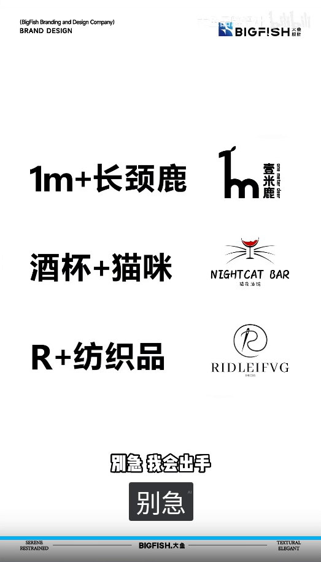

- **作者明确说法**：「别急 我会出手」
- **播放器字幕**：「别急」
- **整理者观察**：白底上是三行回顾，没有片头 EVOLUTION 那一案。第一行是「1m+长颈鹿」，右侧是 1m 标志，以及壹米鹿／one meter deer；第二行是「酒杯+猫咪」，右侧是酒杯须标，以及 NIGHTCAT BAR／猫夜酒馆；第三行是「R+纺织品」，右侧是斜针和外绕线的标志，以及 RIDLEIFVG／DRESS。片内「急」和「我」之间有空档。播放器字幕这一帧只有「别急」，到 176.267 才换成「我会出手」。
