# [LOGO想要有意思，不妨看看这些方法](https://www.bilibili.com/video/BV1LPpR6BETK)｜大鱼品牌设计

## 案例一：咖啡俯视 + S / SENSE TASTY

### ST1 · 白瓷咖啡杯和字母 S

约 0.45s（录屏 13.2s）

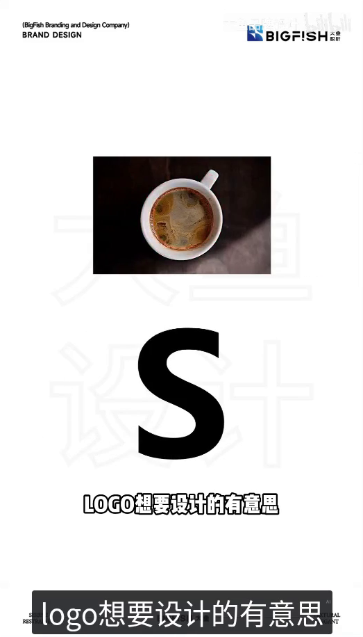

- **作者明确说法**：「LOGO想要设计的有意思」
- **整理者观察**：照片在上、粗黑 S 在下，中间留着白间隔，还没有叠在一起。照片是深色桌面上的白色陶瓷杯俯视，右上角有白色杯把，杯内是浅棕与乳白的泡沫纹。

### ST2 · 杯口叠上粉色环

约 1.25s（录屏 14.0s）

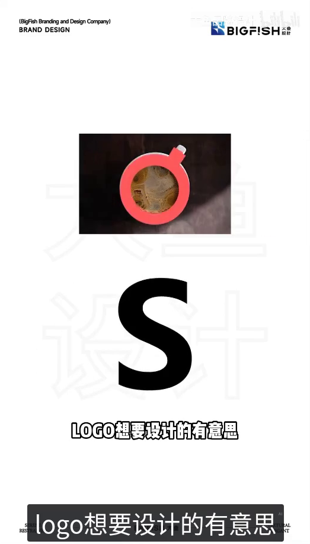

- **作者明确说法**：「LOGO想要设计的有意思」
- **整理者观察**：照片上叠了一圈珊瑚粉粗环，右上角环断开并向外凸出一截，位置像杯把；环内仍看得到咖啡液面。粗黑 S 还在照片下方，两者仍然分开。

### ST3 · 两只粉环叠到 S 上

约 1.85s（录屏 14.6s）

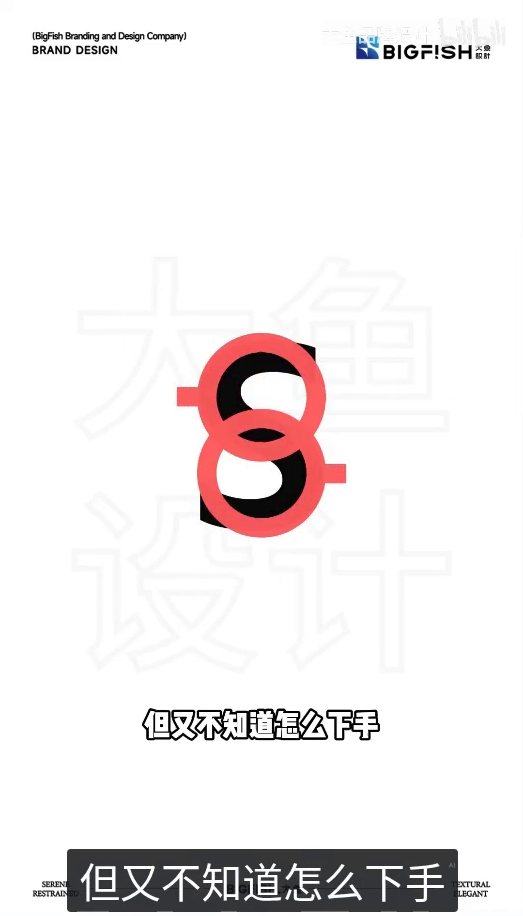

- **作者明确说法**：「但又不知道怎么下手」
- **整理者观察**：照片已经退去。两只珊瑚粉粗环上下交叠，上环左侧、下环右侧各伸出一截短柄。红环底下还压着原来的实心黑 S。

### ST4 · 收成开口双环 S，成标

约 2.65s（录屏 15.4s）

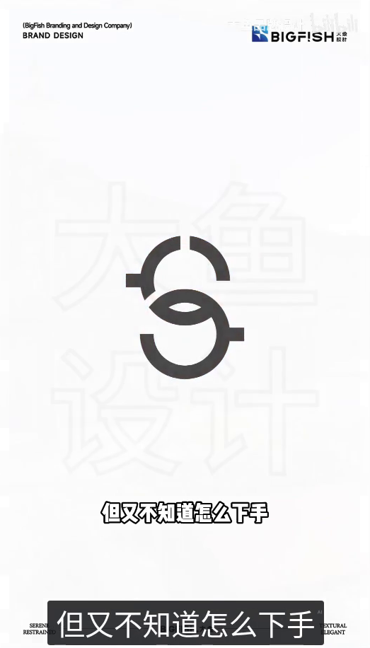

- **作者明确说法**：「但又不知道怎么下手」
- **整理者观察**：粉色和实心黑块都已消失，留下深灰空心描边。上圆顶部有一段断口，不是封闭圆；中部两段圆弧交叠，中间夹着一块透镜形白空；上环朝左、下环朝右仍各有短柄。这是这一案线标的完成态。

### ST5 · 用到河岸街景上，SENSE TASTY

约 3.25s（录屏 16.0s）

- **作者明确说法**：「那不妨看看以下几种方法」
- **整理者观察**：同一件标志反白，压在欧式河岸城镇的照片上：河对岸是一排坡顶楼房和尖塔，近景有露台、木桌、浅蓝色椅子、白花和路灯。字标为 SENSE TASTY，SENSE 是浅青色，TASTY 是深蓝；其下更小的一行是 Sweet Health。

### 思路与前后关系（整理者分析，非作者原话）

杯口被收成两只开口的圆环，上下交叠后中部夹出透镜形白空，再加上左右短柄，可以同时读成 S 和一对杯子口沿。

---

## 案例二：J + 大象 / JOY ELEPHANT

### JE1 · 对话框

约 5.25s（录屏 18.0s）

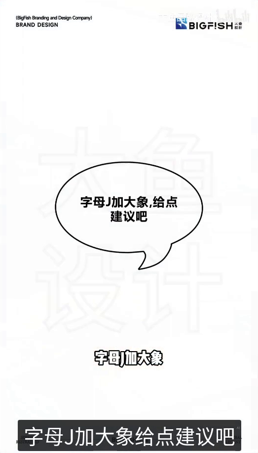

- **作者明确说法**：「字母J加大象」。同一画面上，气泡里写着「字母J加大象,给点建议吧」。
- **整理者观察**：白底中央是一个线框椭圆气泡，下面另有一行衬线描边字。

### JE2 · 正负形设计

约 8.25s（录屏 21.0s）

- **作者明确说法**：「正负形设计」。同一画面下沿写着「这个可以用到正负形」。
- **整理者观察**：白底正中是四字标题「正负形设计」。

### JE3 · 粉色大象剪影和字母 J

约 9.45s（录屏 22.2s）

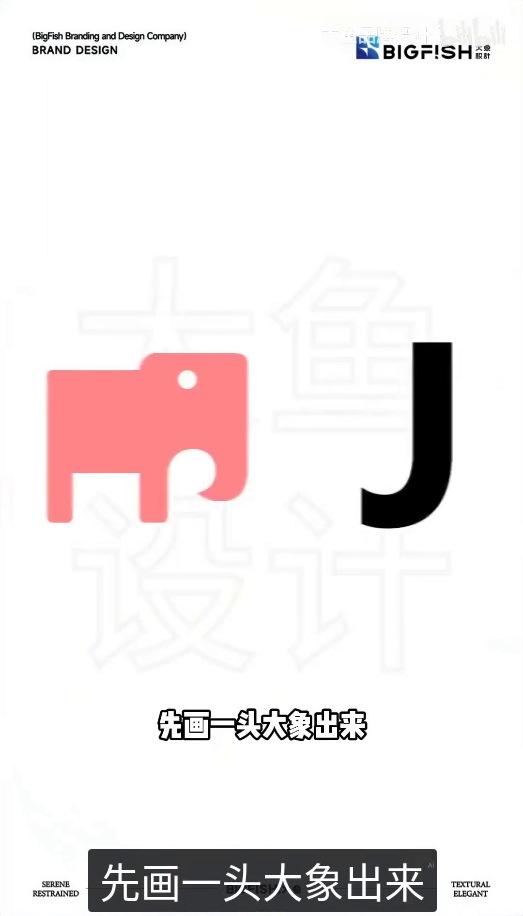

- **作者明确说法**：「先画一头大象出来」
- **整理者观察**：左侧是朝右的珊瑚粉几何象：右上方有圆形白洞作眼睛，右下方身体里有一块弧形凹缺，左侧是方形后臀，两条矩形腿。右侧是一枚常规粗黑 J，顶部是平截的，弯钩开口比较开，末端圆钝，还没有衬线，也还没有卷成象鼻。象和 J 中间有明显白缝，并不相连。

### JE4 · J 贴上象的轮廓，并改字形

约 11.05s（录屏 23.8s）

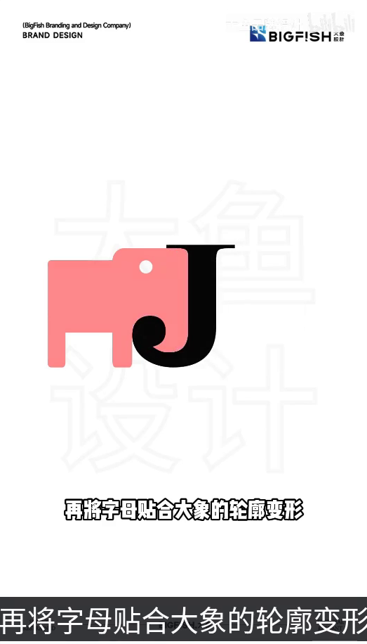

- **作者明确说法**：「再将字母贴合大象的轮廓变形」
- **整理者观察**：J 的弯钩贴进大象右侧那块预先留出的弧形凹缺，顶部压在象背右侧。和 22.2s 的原 J 相比，这里的顶部已经伸出左右短衬线，弯钩末端已经收成一卷象鼻。粉色象身（后臀、双腿、白眼点）都还在，两色仍分得开。

### JE5 · 粉色退去，显出卷鼻，成标

约 11.65s（录屏 24.4s）

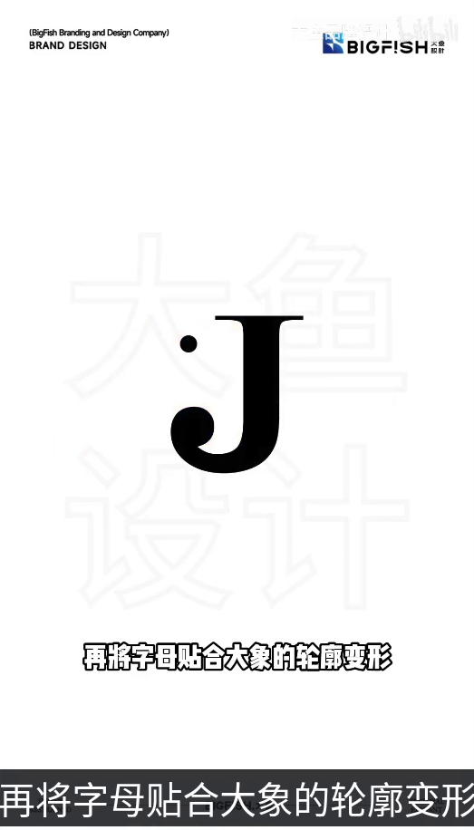

- **作者明确说法**：「再将字母贴合大象的轮廓变形」
- **整理者观察**：粉色正形退去，露出的黑 J 与 23.8s 的钩和顶部衬线是同一轮廓，并不是去粉之后又改了一轮字形。竖笔左上方留着一枚独立的黑圆点，位置就是原来的眼睛，圆点与竖笔之间有白缝，并不相连。画面上没有另外描出象头轮廓。这是这一案线标的完成态。

### JE6 · 用到草原照片上，JOY ELEPHANT

约 12.45s（录屏 25.2s）

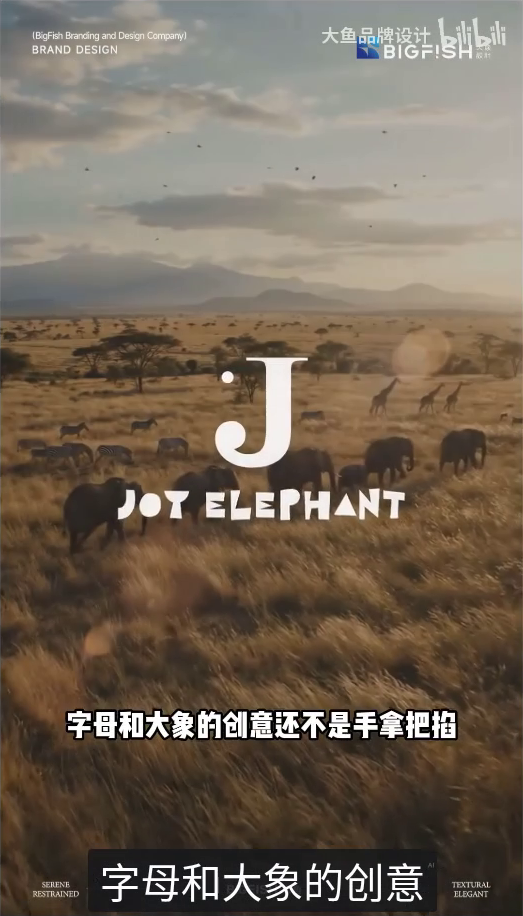

- **作者明确说法**：「字母和大象的创意还不是手拿把掐」
- **整理者观察**：同一件标志反白，压在金黄草场的照片上，远处有伞形树、象群、斑马和长颈鹿。字标为 JOY ELEPHANT，字母宽扁，边缘略不规则。

### 思路与前后关系（整理者分析，非作者原话）

J 贴进象身预留的凹缺时，已经改出顶部衬线和卷鼻；粉色退去后，这枚改过的字母和原来的眼点留在白底上，字母和象头可以一起读。

---

## 案例三：E + D 共笔 / EASILY DELIG

### ED1 · 对话框

约 15.25s（录屏 28.0s）

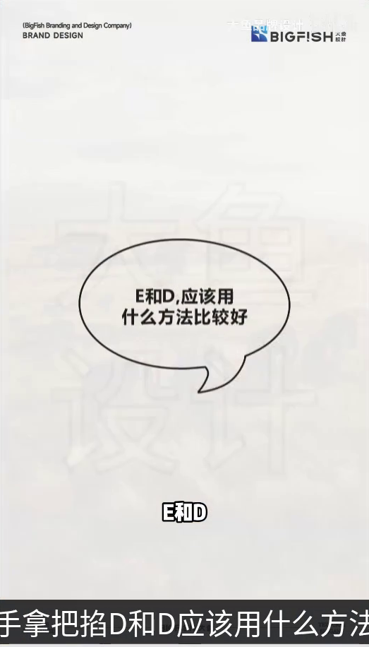

- **作者明确说法**：「E和D」。同一画面上，气泡里写着「E和D,应该用什么方法比较好」。
- **整理者观察**：浅底上出现线框气泡，下面另有一行「E和D」。

### ED2 · 共笔组合法

约 18.25s（录屏 31.0s）

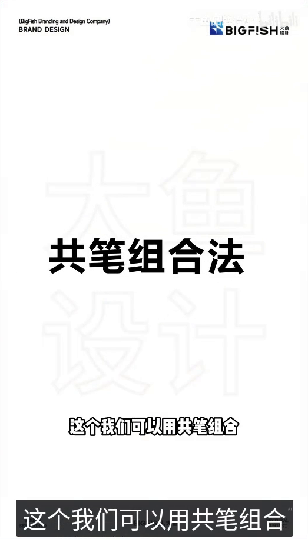

- **作者明确说法**：「共笔组合法」。同一画面下沿写着「这个我们可以用共笔组合」。
- **整理者观察**：白底正中是四字标题「共笔组合法」。

### ED3 · 粗黑体 E 和 D

约 19.85s（录屏 32.6s）

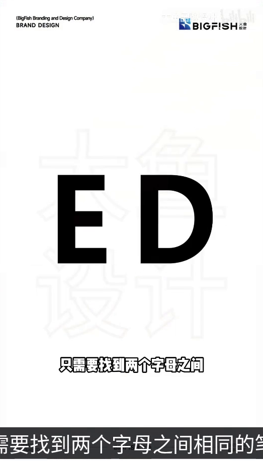

- **作者明确说法**：「只需要找到两个字母之间」
- **整理者观察**：粗黑几何无衬线的 E、D 左右并排，中间有白间隔，还没有标色，也还没有改成衬线。

### ED4 · 用红色标出相同的横画

约 21.05s（录屏 33.8s）

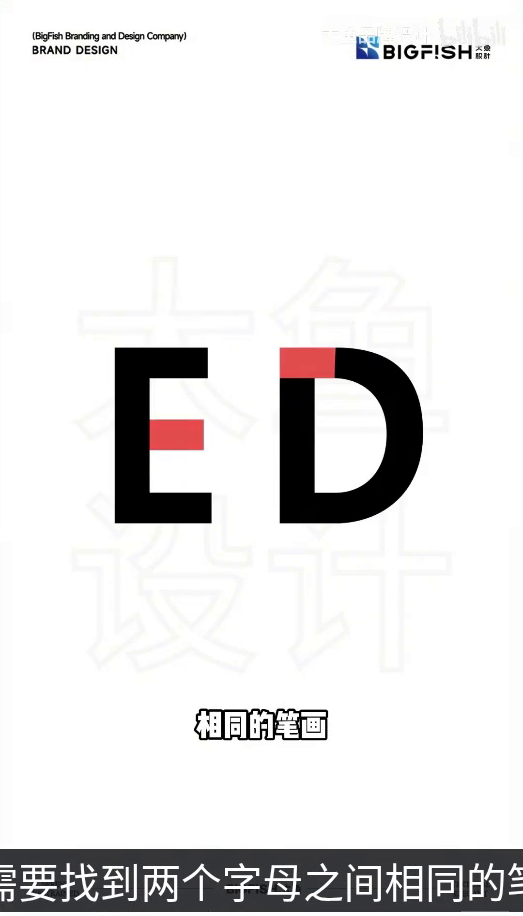

- **作者明确说法**：「相同的笔画」
- **整理者观察**：字母位置和黑体结构未变。E 的中间那一横被标成红色；D 顶部、贴近右弓起笔处也有一截横向的红短横。两字仍然分开。

### ED5 · 字形开始调整

约 21.85s（录屏 34.6s）

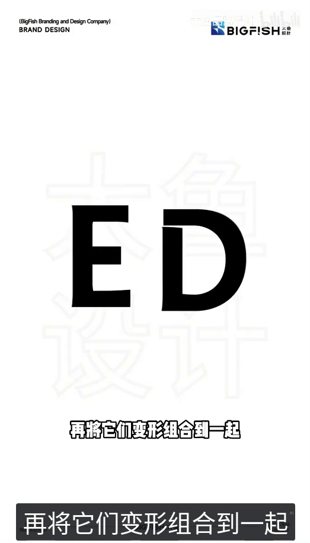

- **作者明确说法**：「再将它们变形组合到一起」
- **整理者观察**：红色已经去掉。E、D 仍左右分开，笔画还是粗黑的，只是边缘略微收尖、露出一点微衬线，并不是后面那种细笔高对比衬线。D 的左竖顶部有一道白缝。这是字形开始调整的过渡。

### ED6 · 衬线叠合中

约 22.05s（录屏 34.8s）

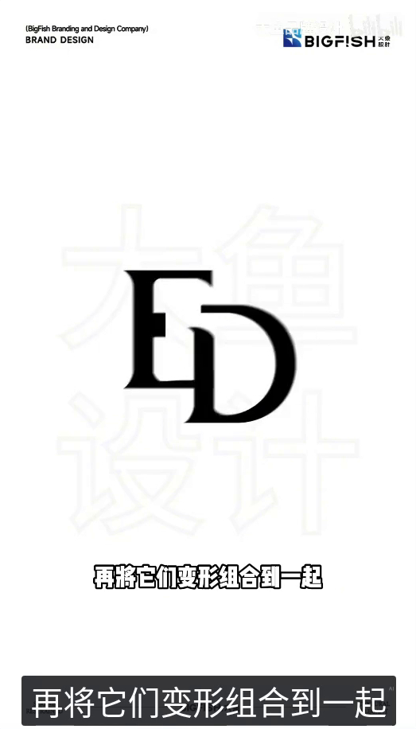

- **作者明确说法**：「再将它们变形组合到一起」
- **整理者观察**：两字已经靠拢并开始叠上，笔画比上一帧收细，衬线更清楚，但仍略有发虚。还没有停在下一帧的错位完成态。清晰结构以 35.2s 为准。

### ED7 · 错位叠合，成标

约 22.45s（录屏 35.2s）

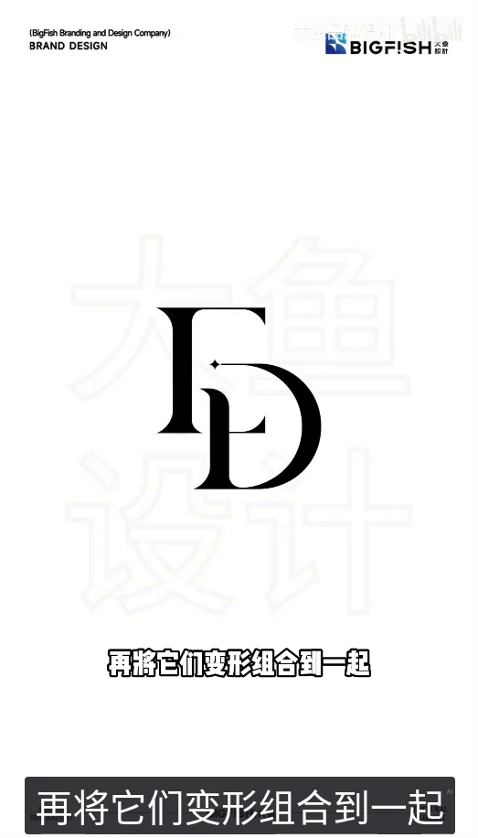

- **作者明确说法**：「再将它们变形组合到一起」
- **整理者观察**：D 整体偏到 E 的右下方。E 的左竖和 D 的左竖是分开的两笔；E 最上面那一横只停在 E 自己的顶部，右端有下垂的衬线，并不充当 D 的顶画。E 的中横从左端一枚菱点向右接到 D 上弓的顶部；E 的底横从 D 左竖后边穿过去，在 D 的字腔里还能看到它的末端。这是这一案线标的完成态。

### ED8 · 用到麦田照片上，EASILY DELIG

约 24.05s（录屏 36.8s）

- **作者明确说法**：「一个高级又国际化的LOGO」
- **播放器字幕**（非作者原话）：「高级又国际化的logo不就出来」
- **整理者观察**：同一件标志反白，压在麦田夕照上，地平线上有一棵树。字标为 EASILY DELIG，在 G 处结束，字母间距拉开；其下更小的一行是 RELAXED AND HAPPY  FASHION BY ME。

### 思路与前后关系（整理者分析，非作者原话）

两字错开叠上，只在中腰和底部共用横画，各自仍保住自己的左竖，E 留下顶横，D 留下右弓，所以还能同时读出 E 和 D。

---

## 案例四：L + H + S / LIGHT HIGH STRONG

### LHS1 · 对话框

约 26.45s（录屏 39.2s）

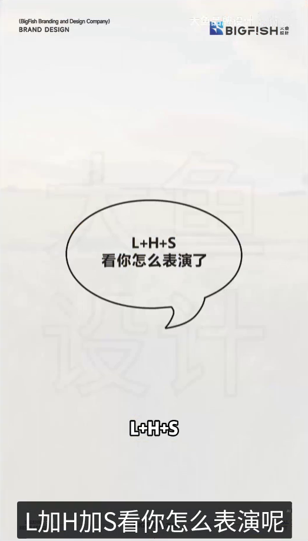

- **作者明确说法**：「L+H+S」。同一画面上，气泡里写着「L+H+S / 看你怎么表演了」。
- **整理者观察**：白底中央是线框气泡，上面一行是 L+H+S。

### LHS2 · 两种方法一起用

约 29.25s（录屏 42.0s）

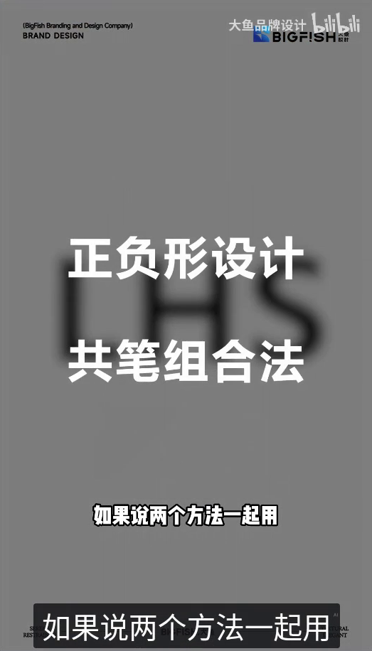

- **作者明确说法**：「正负形设计」「共笔组合法」。同一画面下沿写着「如果说两个方法一起用」。
- **整理者观察**：灰底上叠着两行白字标题，背后隐约有放大的 LHS。

### LHS3 · 字母 L、H、S

约 31.05s（录屏 43.8s）

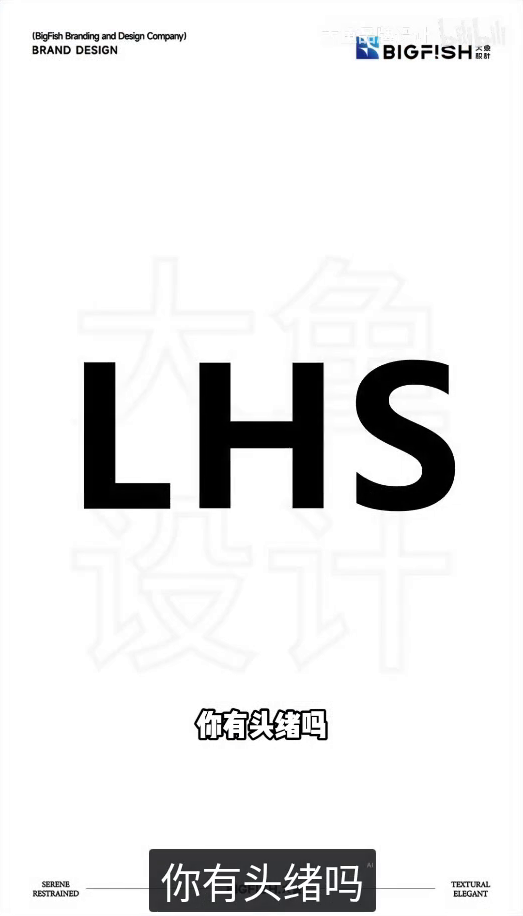

- **作者明确说法**：「你有头绪吗」
- **整理者观察**：粗黑几何字母 L、H、S 左右并排。H 有中间的横笔，L 有底部的横笔，S 是圆润的 S。

### LHS4 · 先取 L 和 S

约 31.45s（录屏 44.2s）

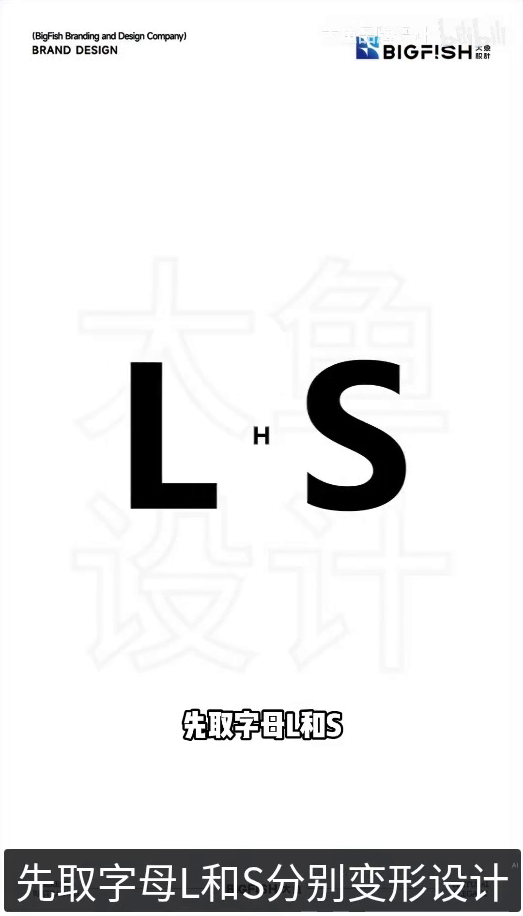

- **作者明确说法**：「先取字母L和S」
- **整理者观察**：L 和 S 仍是大号字母，原来的 H 缩成两者中间一枚很小的 H，还没有完全消失。

### LHS5 · L 和 S 变成方笔

约 33.05s（录屏 45.8s）

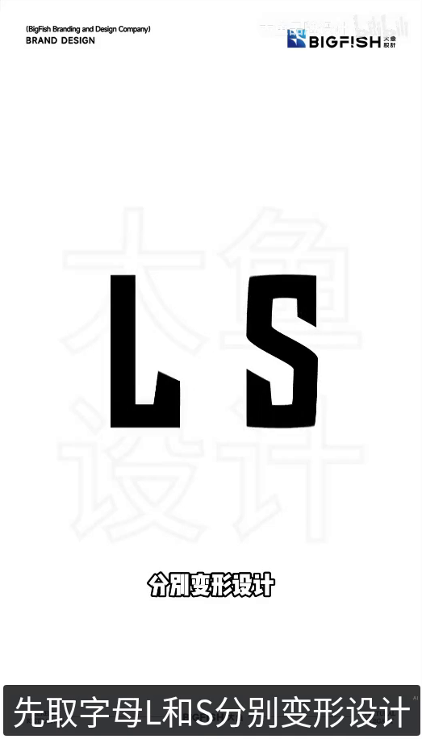

- **作者明确说法**：「分别变形设计」
- **整理者观察**：中间那枚小 H 已经没有了。L 变得更方，底部的横笔还在。S 从圆润双曲改成折角的方 S。

### LHS6 · 用粉色标出相同的竖画

约 34.85s（录屏 47.6s）

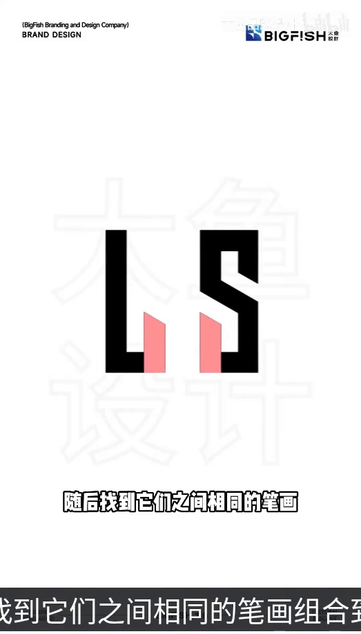

- **作者明确说法**：「随后找到它们之间相同的笔画」
- **整理者观察**：L 的内侧底部、S 的左侧各立着一截顶部倾斜的粉红竖笔。两个字母中间仍有白缝，还没有叠上。

### LHS7 · 靠拢叠合中

约 35.25s（录屏 48.0s）

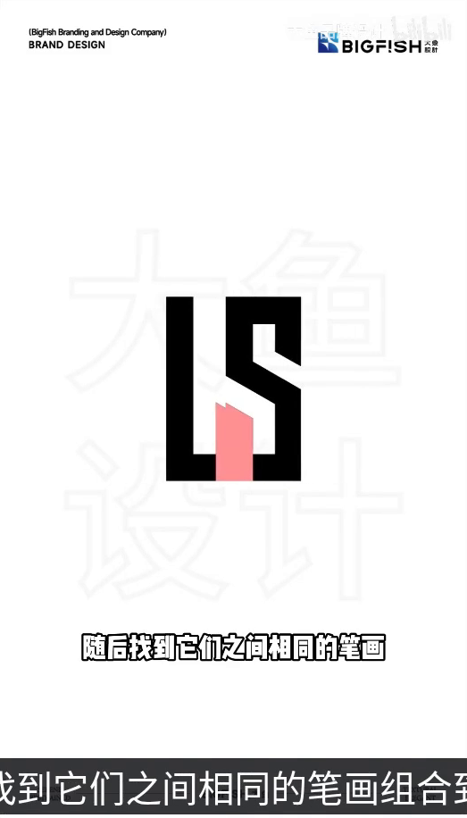

- **作者明确说法**：「随后找到它们之间相同的笔画」
- **整理者观察**：L 和 S 已经靠到一起，两条粉竖也贴近来了，但顶部仍是两个错开的尖，只是部分叠合，还没有收成一条完整的共笔。

### LHS8 · 收成黑色合体

约 36.65s（录屏 49.4s）

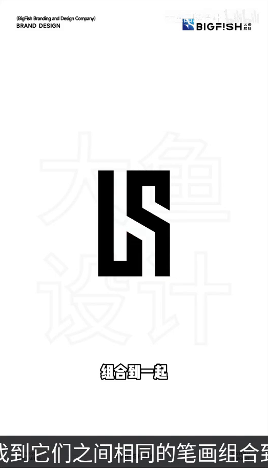

- **作者明确说法**：「组合到一起」
- **整理者观察**：粉色已经消失，留下全黑的 LS 合体，中间那一竖已经是稳定的黑色共笔。L 的底横还在，中间的白色空隙已经现出可以双读的 h 形。

### LHS9 · 负形用青绿色高亮

约 38.45s（录屏 51.2s）

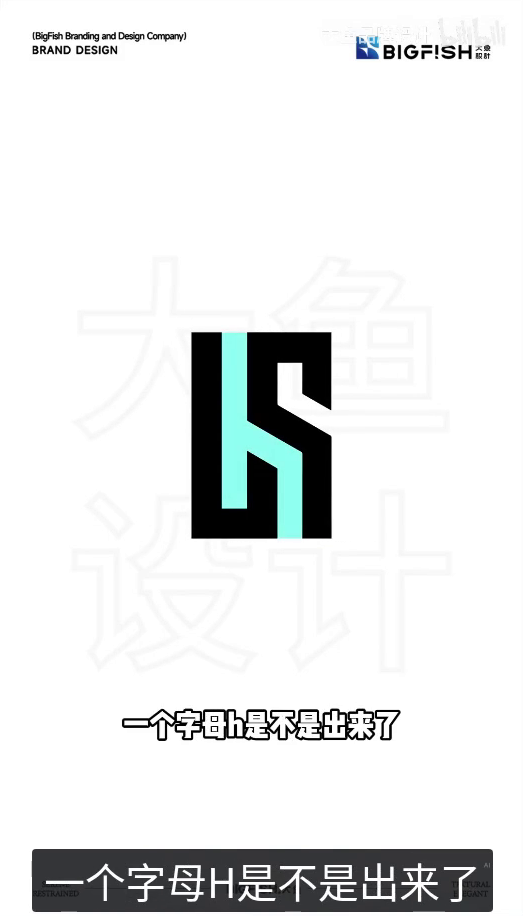

- **作者明确说法**：「一个字母h是不是出来了」
- **整理者观察**：中间那块负形被填成青绿/薄荷色，看起来像小写 h：左竖较高，右部斜着接过去。黑色正形仍是 L 和方 S 的合体。

### LHS10 · 去掉高亮，成标

约 39.25s（录屏 52.0s）

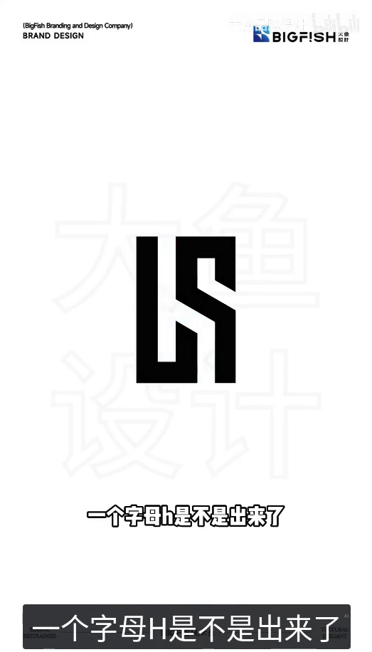

- **作者明确说法**：「一个字母h是不是出来了」
- **整理者观察**：青色已经去掉，只剩黑标和中间的白色 h 形空隙。这是这一案线标的完成态。

### LHS11 · 用到桥的照片上，LIGHT HIGH STRONG

约 40.45s（录屏 53.2s）

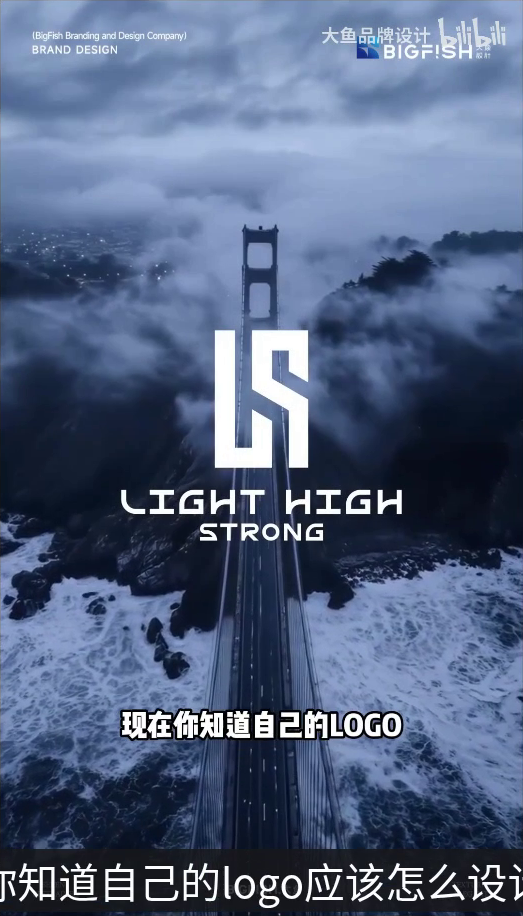

- **作者明确说法**：「现在你知道自己的LOGO」
- **播放器字幕**（非作者原话）：「你知道自己的logo应该怎么设计」
- **整理者观察**：同一件标志反白，压在雾中悬索桥的俯视照片上：桥塔、缆索和路面伸向塔身，两侧是岸石和白浪。字标为 LIGHT HIGH，其下居中是 STRONG。

### 思路与前后关系（整理者分析，非作者原话）

L 和 S 改成方笔后共用中间那一竖；黑标中间的负形被青绿色点出来，可以读成小写 h，所以同一件标志里同时站着 L、h 和 S。

---

## 收束：三例并列

约 44.25s（录屏 57.0s）

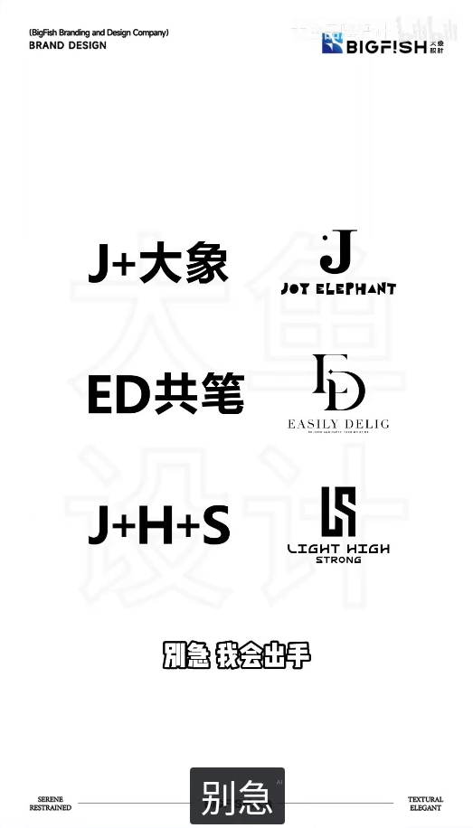

- **作者明确说法**：「别急 我会出手」
- **整理者观察**：三行并列，没有片头的 SENSE TASTY。左侧写着「J+大象」「ED共笔」「J+H+S」，右侧各配对应的完成态标志和字标 JOY ELEPHANT、EASILY DELIG、LIGHT HIGH STRONG。第三行左侧写的是 J+H+S，与前面题目和过程里用的 L+H+S 不同，这里按画面照录。
