# [只要善于观察，字母LOGO也就手拿把掐](https://www.bilibili.com/video/BV1Myte6EEhx/)｜大鱼品牌设计

约视频时刻按本条录屏实测，约等于录屏秒减去 61.1s，范围 ±1s。图是录屏裁切，不是原片逐帧。

## 案例一：字母 T 与光影 / JT.ONE

### JT1 · 开播前预览：字母 T

约预览（录屏 0.000s）

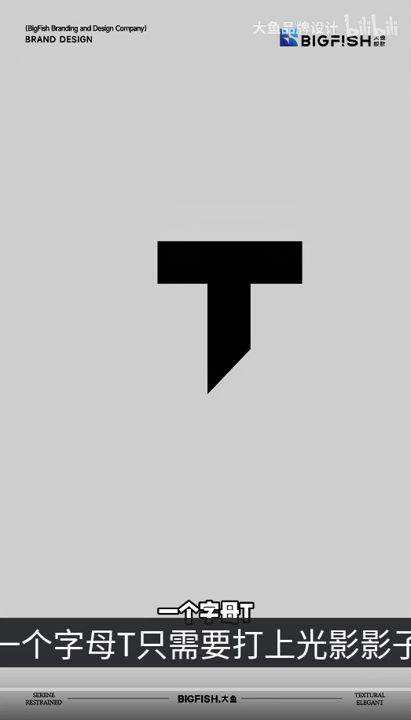

- **作者明确说法**：「一个字母T」
- **播放器字幕**：「一个字母T只需要打上光影影子」
- **整理者观察**：这是开播前的暂停预览。浅灰底上已经是设计源图：一个黑色大写 T，竖画下端的右侧被斜切成尖。还没有光影。

### JT2 · 光锥初现：右半变成空心框，左半仍实心

约 2s（录屏 63.000s）

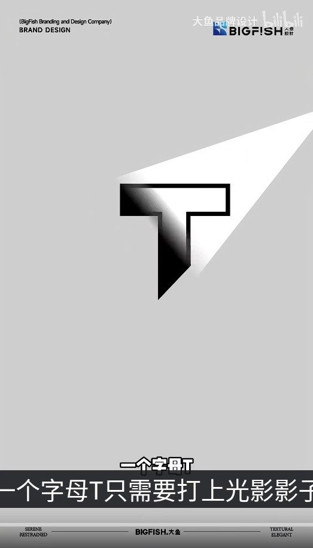

- **作者明确说法**：「一个字母T」
- **播放器字幕**：「一个字母T只需要打上光影影子」
- **整理者观察**：右上方出现一道白光锥，打在原来的 T 上。受光的右半变成白底黑框的空心轮廓，左半仍是实心黑块，交界是一条斜向的灰度过渡。这一帧片内仍是「一个字母T」。

### JT3 · 左侧实心块外扩，J 开始成形

约 2s（录屏 63.100s）

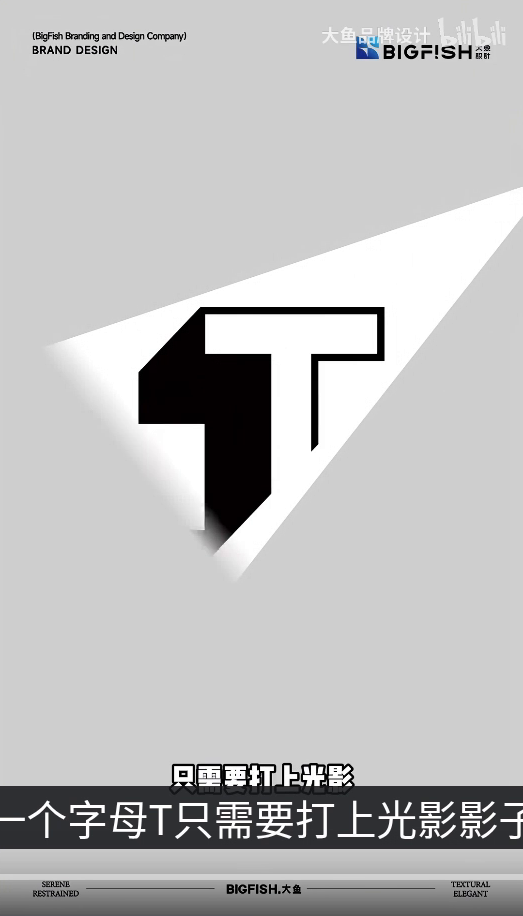

- **作者明确说法**：「只需要打上光影」
- **播放器字幕**：「一个字母T只需要打上光影影子」
- **整理者观察**：光锥比上一帧更大。左侧实心块已经向外、向下扩展，J 的左上斜切和下沿开始成形，下缘还带着软边和浅影。片内这一帧已换成「只需要打上光影」，句中没有「影子」二字。

### JT4 · 光影收实：左边是 J，右边是空心 T

约 2s（录屏 63.200s）

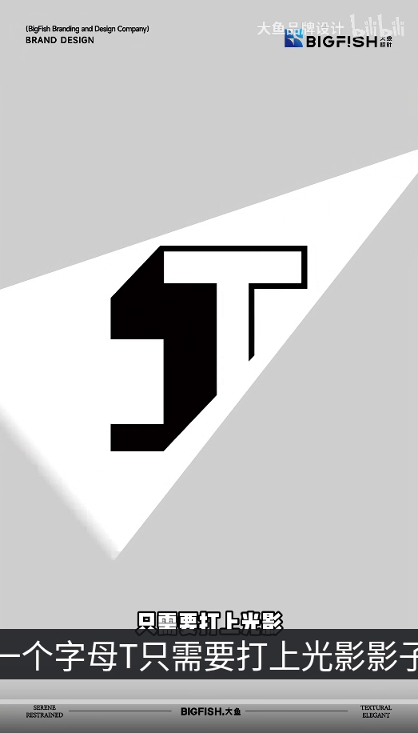

- **作者明确说法**：「只需要打上光影」
- **播放器字幕**：「一个字母T只需要打上光影影子」
- **整理者观察**：JT 已经收实。左边是实心黑 J：左上有斜切，中下靠左有一个方形缺口，右边外缘向下斜切落下。右边是黑框空心 T。白光锥从右上贯向左下。63.200 到 63.500 都是这一形态，片内同一句。

### JT5 · 仍是收实的 JT，片内换句

约 3s（录屏 64.500s）

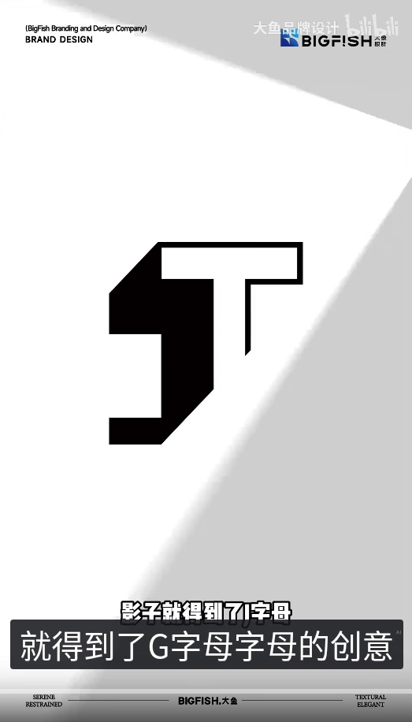

- **作者明确说法**：「影子就得到了JT字母」
- **播放器字幕**：「就得到了G字母字母的创意」
- **整理者观察**：标志形态与 63.200 相同。片内这一句以「影子」起头，字母写的是拉丁 JT。播放器字幕写成「G」，并且连用了两个「字母」，还接上「的创意」。

### JT6 · 用到胶片机照片上，JT.ONE

约 6s（录屏 67.000s）

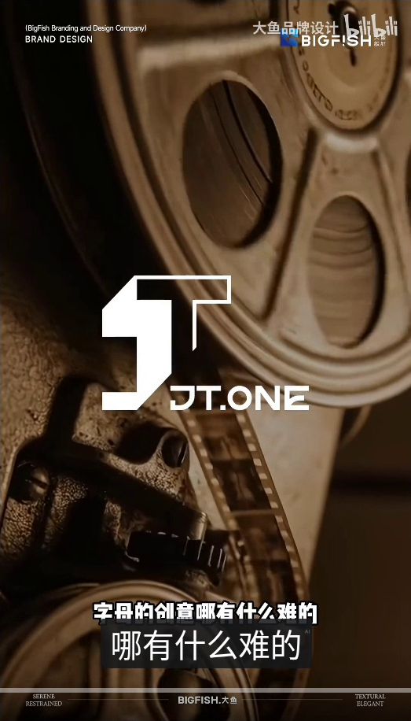

- **作者明确说法**：「字母的创意哪有什么难的」
- **播放器字幕**：「哪有什么难的」
- **整理者观察**：浅色 JT 用到一张胶片机、片盘和胶片的照片上，结构和白底净标相同：J 中下靠左仍是方形缺口，右侧是斜切的外边。字标是全大写的 JT.ONE，JT 与 ONE 之间是一个句点，左右没有空格。66.000 片内已经是这句话，当时播放器字幕还停留在「就得到了G字母字母的创意」。这一案没有进入片尾三行回顾。

### 思路与前后关系（整理者分析，非作者原话）

开播前的预览里就已经放上字母 T。播放中先打上一道白光锥：T 的右半被照成空心框，左半仍是实心，随后左侧实心块扩成 J，收成 JT。J 的方形缺口在中下靠左，右侧外缘是斜切。再把浅色标志用到胶片机照片上，字标写成 JT.ONE。这是整理者根据可见结构作的归纳，片内说的是「一个字母T」「只需要打上光影」「影子就得到了JT字母」「字母的创意哪有什么难的」。

---

## 案例二：字母 SY 与火炬 / 漾·日式高端抗衰・YOUNG SKIN

### SY1 · 气泡：SY+火炬

约 8s（录屏 69.000s）

- **作者明确说法**：「有没有信心能做出来」
- **整理者观察**：白底上出现对话泡，两行是「SY+火炬」和「有没有信心能做出来?」，中间用的是加号，句末有问号。68.000 起片内是「SY加火炬」，用的是「加」字；这一帧片内已经换成「有没有信心能做出来」。

### SY2 · 对照：线描火炬的托杯里写着 SY

约 10s（录屏 71.500s）

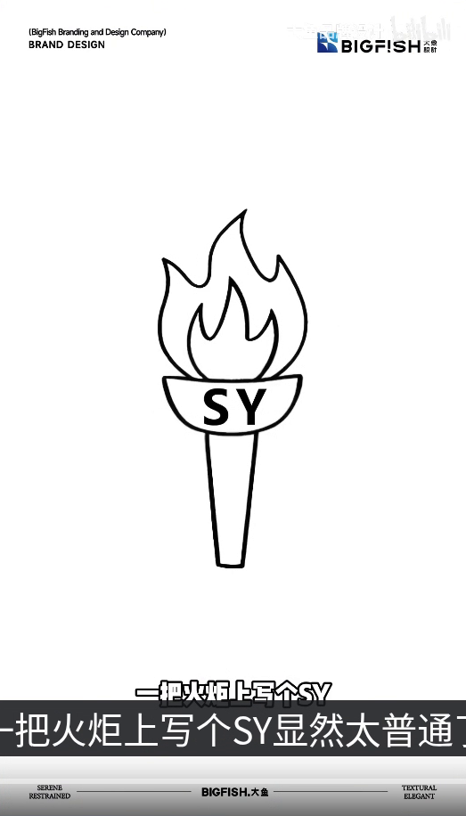

- **作者明确说法**：「一把火炬上写个SY」
- **播放器字幕**：「一把火炬上写个SY显然太普通了」
- **整理者观察**：白底上是一枚线描火炬，火焰、碗形托杯和锥形柄都是勾线。托杯里写着黑体大写 SY。播放器字幕已经把后一句「显然太普通了」接在同一栏里；片内这一帧还没有「显然太普通了」。73.000 起片内换成「显然太普通了」。

### SY3 · 回退中：粗黑 Y 叠在尚未消失的火炬上

约 12s（录屏 73.433s）

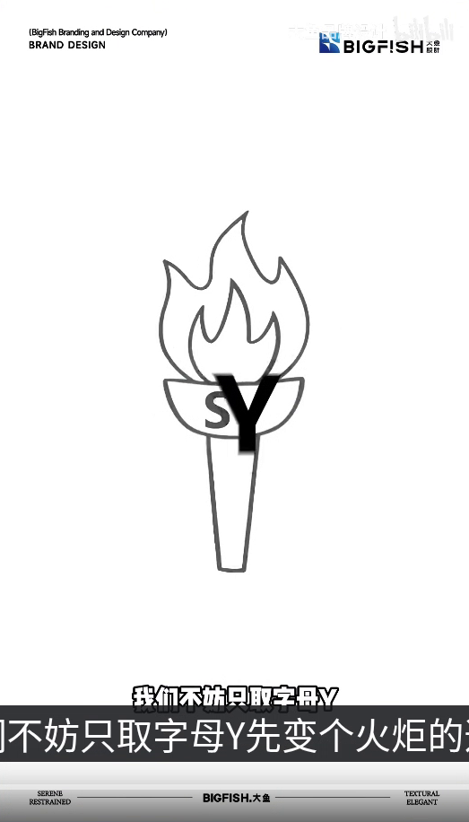

- **作者明确说法**：「我们不妨只取字母Y」
- **播放器字幕**：「我们不妨只取字母Y先变个火炬的造型」
- **整理者观察**：一个粗黑的大写 Y 已经叠在线描火炬上，托杯里的 SY 也还能看见。火炬线稿还没有抽走。播放器字幕已经把后一句「先变个火炬的造型」接在同一栏里。

### SY4 · 只留下几何粗黑 Y

约 13s（录屏 74.000s）

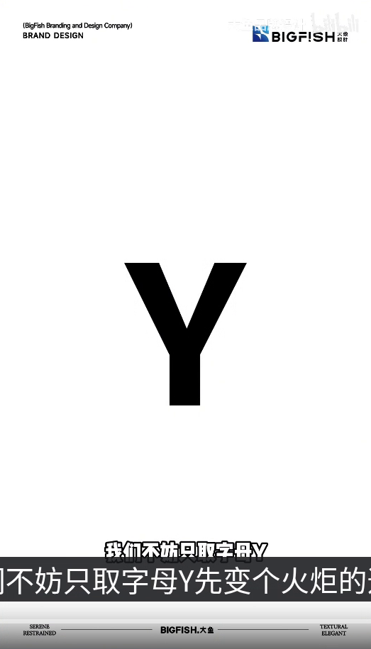

- **作者明确说法**：「我们不妨只取字母Y」
- **播放器字幕**：「我们不妨只取字母Y先变个火炬的造型」
- **整理者观察**：火炬线稿已经抽走，白底上只剩一个粗黑的几何大写 Y，两臂平直，底部没有开脚。

### SY5 · Y 的两臂开始外撇，向杯口变化

约 14s（录屏 75.100s）

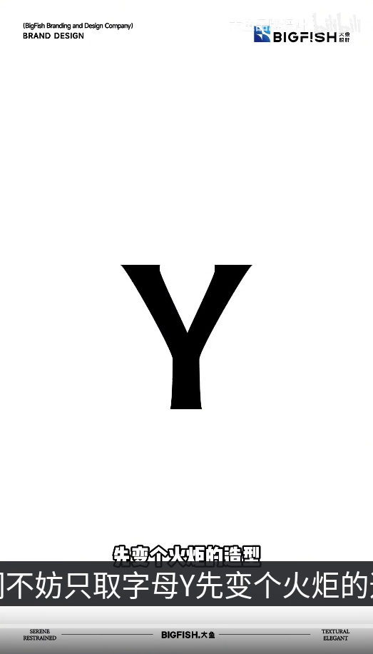

- **作者明确说法**：「先变个火炬的造型」
- **播放器字幕**：「我们不妨只取字母Y先变个火炬的造型」
- **整理者观察**：两臂已经开始向外撇，内侧略微内凹，竖画底部稍微加宽。还没有收成完整的杯口，也还没有 S。片内这一帧已经换成「先变个火炬的造型」。

### SY6 · Y 收成杯口外撇的托杯形

约 15s（录屏 76.000s）

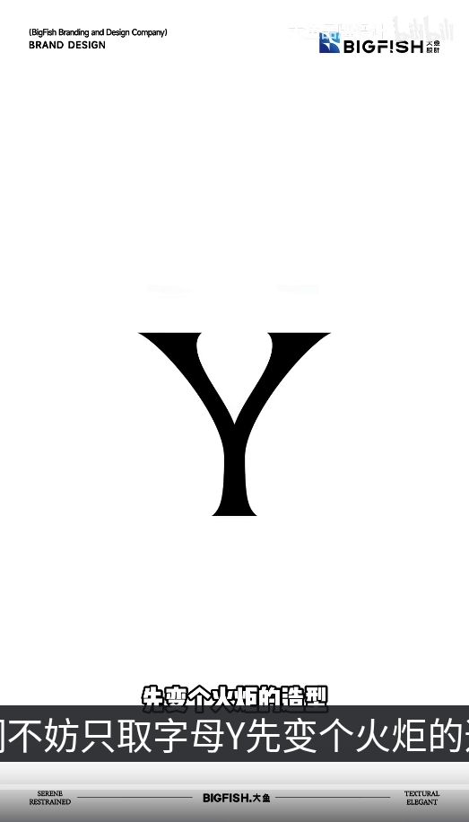

- **作者明确说法**：「先变个火炬的造型」
- **播放器字幕**：「我们不妨只取字母Y先变个火炬的造型」
- **整理者观察**：Y 已经收成火炬托杯的造型：两臂外撇成杯口，内侧内弯，底部开脚。这一帧还没有 S。

### SY7 · S 的下碗出现，右上仍缺

约 15s（录屏 76.500s）

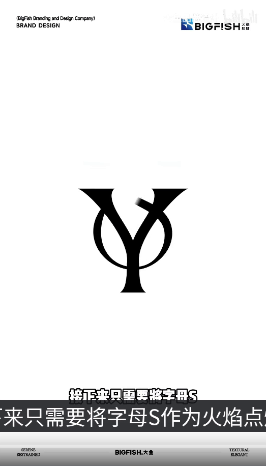

- **作者明确说法**：「接下来只需要將字母S」
- **播放器字幕**：「接下来只需要将字母S作为火焰点燃它」
- **整理者观察**：S 的下碗已经从左侧绕到 Y 的右侧，右上还缺一截，残画末端发虚。片内「將」是繁体；播放器字幕是简体「将」，并且已经把后一句「作为火焰点燃它」接在同一栏里。

### SY8 · S 的上钩升起，右侧交叉仍连在一起

约 16s（录屏 77.000s）

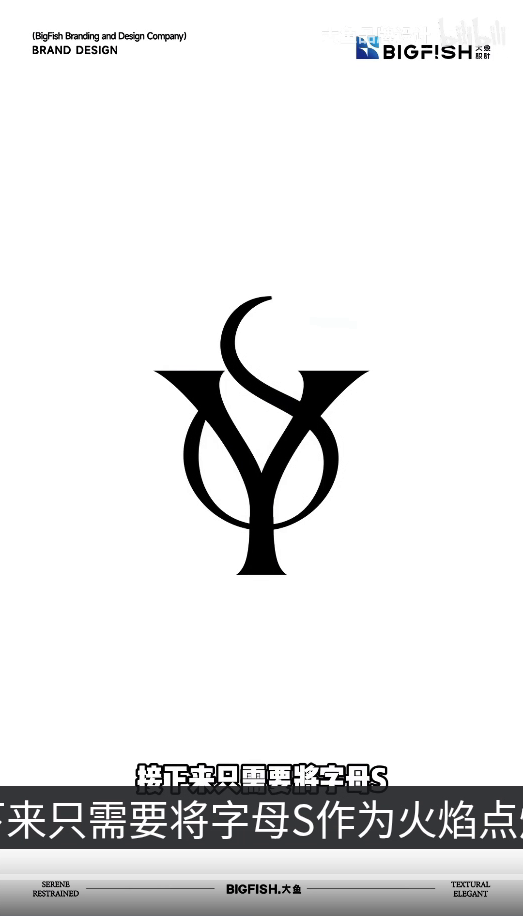

- **作者明确说法**：「接下来只需要將字母S」
- **播放器字幕**：「接下来只需要将字母S作为火焰点燃它」
- **整理者观察**：S 的上钩已经像火焰一样升到杯口之上。右侧交叉处，Y 的右臂和 S 的笔画仍连成一块实心黑，还没有分开。

### SY9 · 右侧 Y 臂分成两截留白，左侧斜臂连续，S 在下方汇入竖画

约 17s（录屏 78.000s）

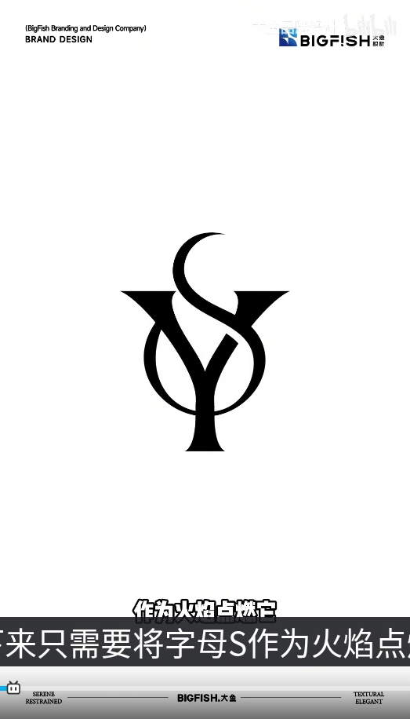

- **作者明确说法**：「作为火焰点燃它」
- **播放器字幕**：「接下来只需要将字母S作为火焰点燃它」
- **整理者观察**：交接已经改成这一态：右侧 Y 臂被分成上下两截，中间留白，S 的笔画从中连续越过；左侧 Y 斜臂是连续的，S 的左弧延到这斜臂的外侧，并在下方汇入 Y 的竖画。78.000 到 78.500 都是白底上的这一净标。

### SY10 · 用到火堆照片上，漾·日式高端抗衰／YOUNG SKIN

约 19s（录屏 80.000s）

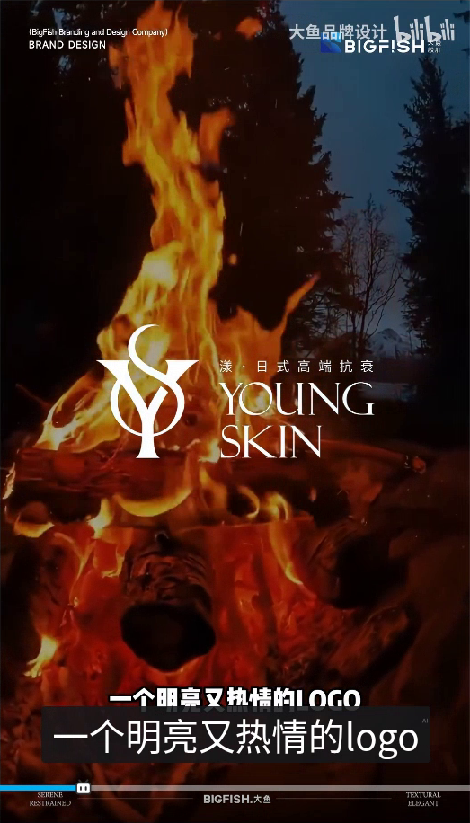

- **作者明确说法**：「一个明亮又热情的LOGO」
- **播放器字幕**：「一个明亮又热情的logo」
- **整理者观察**：浅色标志用到一张木柴火堆、背景有树的照片上，结构和白底净标相同。左侧是标志，右侧英文分两行全大写 YOUNG、SKIN，字距较宽；英文上方有一行字距拉开的小字「漾·日式高端抗衰」，首字是三点水的「漾」，中间是间隔号。片内的 LOGO 是大写，播放器字幕是小写 logo。80.500 起片内换成「还不是手拿把掐」，与播放器字幕一致。

### 思路与前后关系（整理者分析，非作者原话）

先用对话泡提出 SY 和火炬。先出现的是一枚线描火炬，托杯里写着 SY；作者说「一把火炬上写个SY」，随后说「显然太普通了」。接着把火炬撤掉，只取字母 Y：先叠在尚未消失的火炬上，再留下几何 Y，再把两臂外撇成杯口托杯。然后把 S 作为火焰加进去：下碗先出现、右上仍缺，上钩升起时右侧交叉还连在一起，再收成右侧分两截留白、左侧斜臂连续、S 在下方汇入竖画的净标。最后用到火堆照片上，字标写成「漾·日式高端抗衰」和 YOUNG SKIN。这是整理者根据可见结构作的归纳，片内说的是「SY加火炬」「有没有信心能做出来」「一把火炬上写个SY」「显然太普通了」「我们不妨只取字母Y」「先变个火炬的造型」「接下来只需要將字母S」「作为火焰点燃它」「一个明亮又热情的LOGO」「还不是手拿把掐」。

---

## 案例三：字母 L 与轮船 / LAIKEGANG・莱客港

### L1 · 气泡：海上贸易，用字母 L

约 22s（录屏 83.500s）

- **作者明确说法**：「用字母L能设计吗」
- **整理者观察**：白底上出现对话泡，两行是「我是做海上贸易的」和「用字母L能设计吗?」，句末有问号。片内这一帧是第二行这句。

### L2 · 只留下大写 L，竖画与底横相连

约 24s（录屏 85.500s）

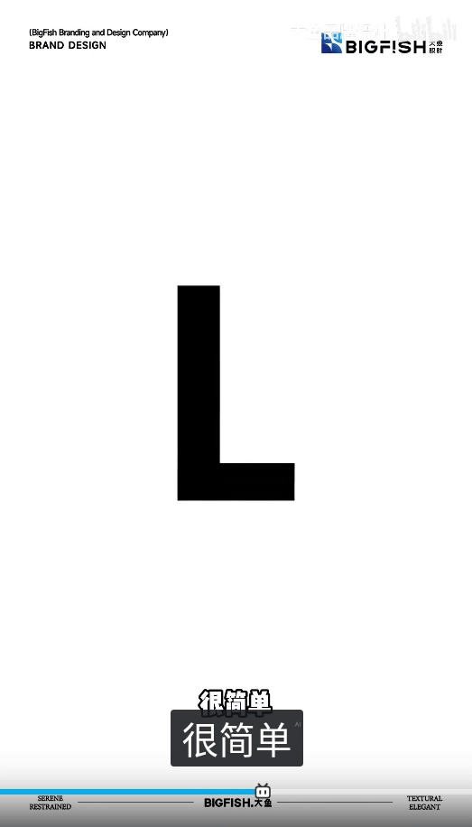

- **作者明确说法**：「很简单」
- **整理者观察**：气泡已经抽走，白底上只剩一个粗黑的大写 L。竖画和底横完全相连，交接处还没有白缝。

### L3 · 竖画与底横之间出现白缝

约 25s（录屏 85.800s）

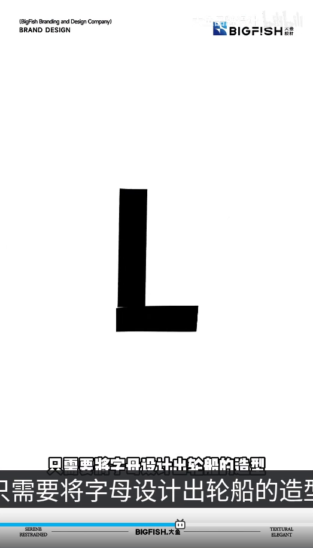

- **作者明确说法**：「只需要將字母设计出轮船的造型」
- **播放器字幕**：「只需要将字母设计出轮船的造型」
- **整理者观察**：竖画和底横的交接处已经出现一条清楚的白缝，底横右端略斜。片内「將」是繁体，播放器字幕是简体「将」。

### L4 · 快速变形：竖画倾斜，底横改向船形，带着重影

约 25s（录屏 86.000s）

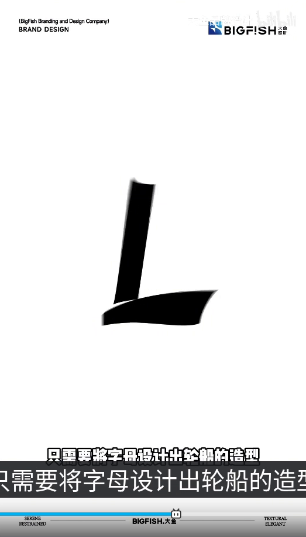

- **作者明确说法**：「只需要將字母设计出轮船的造型」
- **播放器字幕**：「只需要将字母设计出轮船的造型」
- **整理者观察**：这一帧还在快速变形中，边缘带着运动模糊和重影。竖画已经开始向左倾斜，底横正向船形变化，白缝加宽。

### L5 · 船形底与倾斜竖画，尚无波浪和帆

约 25s（录屏 86.500s）

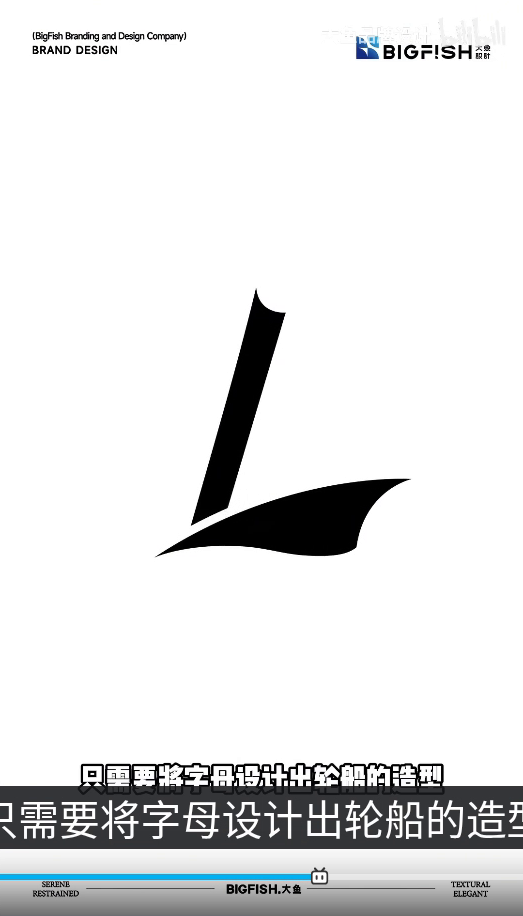

- **作者明确说法**：「只需要將字母设计出轮船的造型」
- **播放器字幕**：「只需要将字母设计出轮船的造型」
- **整理者观察**：竖画已经左倾，顶端有一个右凹的缺口；底横收成左尖、右翘、底部带弧的船形。竖画底端和船体之间仍有一条清楚的白缝，两者不相接。这一帧还没有下波浪，也还没有帆。

### L6 · 船首下出现尚未完成的短波浪

约 27s（录屏 87.967s）

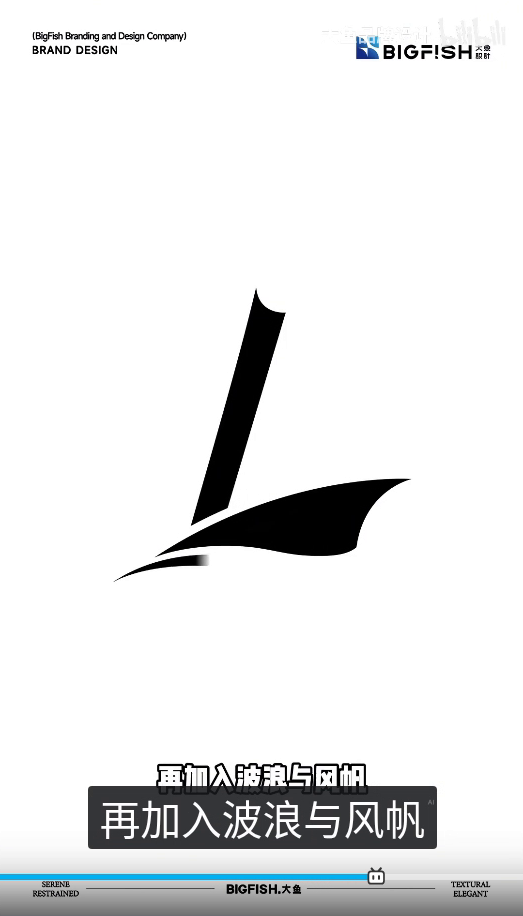

- **作者明确说法**：「再加入波浪与风帆」
- **整理者观察**：船首下方开始出现一段短波浪，右端发虚，还没有收完整。船体和这截浪之间已经隔着白缝。这一帧还没有帆。片内已经换成「再加入波浪与风帆」。

### L7 · 波浪收完整，弯帆从左侧淡入

约 27s（录屏 88.500s）

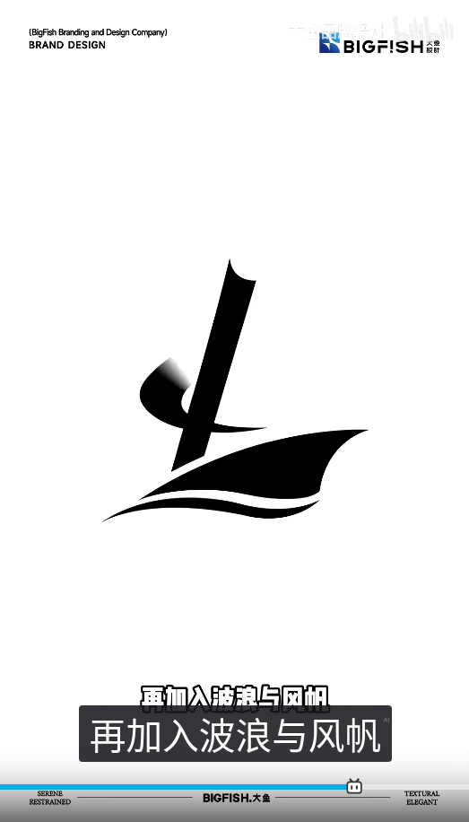

- **作者明确说法**：「再加入波浪与风帆」
- **整理者观察**：下波浪已经拉成完整的一条，和船体之间留着白缝。左侧开始出现一块弯帆，左上仍带着虚边和半透明，还没有收实；帆已经绕到桅杆附近，相交处露出白弯缺，右端伸出一个尖。

### L8 · 弯帆收实，绕着桅杆，留下三条白缝

约 28s（录屏 88.900s）

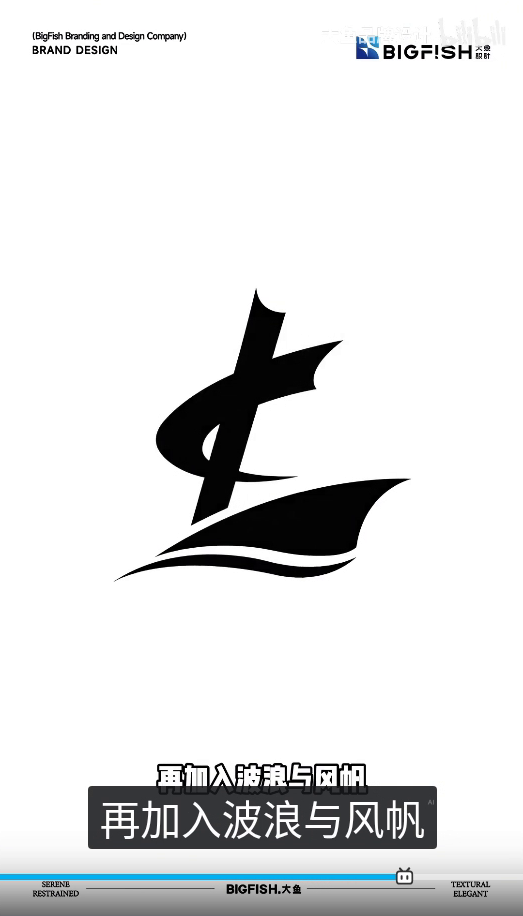

- **作者明确说法**：「再加入波浪与风帆」
- **整理者观察**：帆已经收实，是一条绕着桅杆的弧带：左端圆润，右端收尖。桅从帆面中间穿过，相交处留下白色弯缺。另外还有两条白缝：竖画底端与船体不相接，船体与下方波浪不相接。

### L9 · 用到日落帆船照片上，LAIKEGANG／莱客港

约 29s（录屏 90.000s）

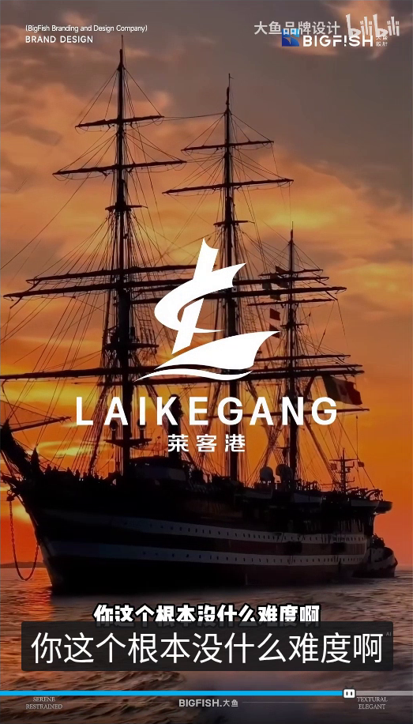

- **作者明确说法**：「你这个根本没什么难度啊」
- **整理者观察**：浅色标志用到一张日落里停着帆船的照片上，结构与白底净标相同：绕桅的弯帆、船体和下波浪，三条白缝都还在。上行英文是连写的全大写 LAIKEGANG，字距较宽；下行中文是「莱客港」三字。91.000 起片内换成「下一个」，播放器字幕写成「下一个到我了」。

### 思路与前后关系（整理者分析，非作者原话）

先用对话泡提出海上贸易和字母 L，再只留下 L。竖画和底横先是完全相连，随后交接处裂出白缝，底横改成船形，竖画左倾，船体与桅之间始终留白。接着在船下加入波浪：先出现右端发虚的短浪，再收完整。帆则是一条绕着桅杆的弧带，从左侧带着虚边淡入，收实后桅从帆中穿过，留下白弯缺。最后用到日落帆船照片上，字标写成 LAIKEGANG 和「莱客港」。这是整理者根据可见结构作的归纳，片内说的是「用字母L能设计吗」「很简单」「只需要將字母设计出轮船的造型」「再加入波浪与风帆」「你这个根本没什么难度啊」「下一个」。

---

## 案例四：字母 WJ 与灯笼 / WANJIA LIGHTS・万佳灯火

### WJ1 · 气泡：万佳灯火

约 32s（录屏 93.000s）

- **作者明确说法**：「万佳灯火」
- **播放器字幕**：「万家灯火」
- **整理者观察**：白底上出现对话泡，两行是「到我了到我了,万佳灯火」和「你能帮我想一个吗?」。两个「到我了」连写，逗号在第二个「了」之后、在「万佳灯火」之前。片内和气泡都是「万佳」；播放器字幕写成「万家灯火」。

### WJ2 · 并排的粗黑 WJ

约 35s（录屏 96.000s）

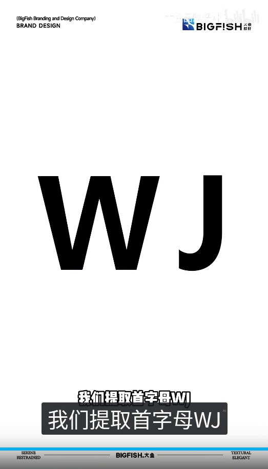

- **作者明确说法**：「我们提取首字母WJ」
- **整理者观察**：气泡已经抽走，白底上是并排的粗黑大写 W 和 J。W 是四笔的几何形，J 的钩向左。

### WJ3 · 灯笼参考照片

约 36s（录屏 97.000s）

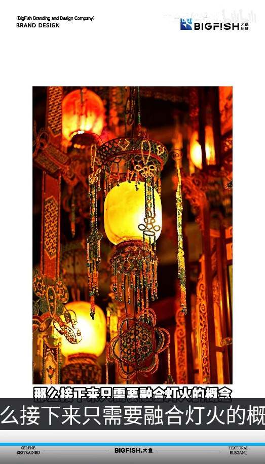

- **作者明确说法**：「那么接下来只需要融合灯火的概念」
- **整理者观察**：画面换成一张暖色的灯笼照片：悬挂的宫灯灯体浑圆，下面垂着珠串和结饰，周围还有别的灯。这一帧是参考照片，还不是标志。

### WJ4 · 回到并排的 WJ

约 38s（录屏 99.000s）

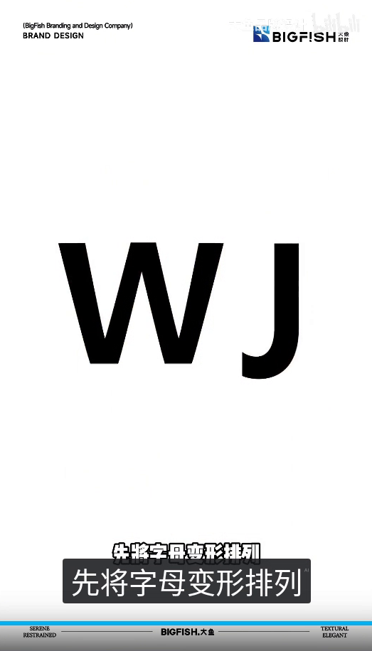

- **作者明确说法**：「先將字母变形排列」
- **播放器字幕**：「先将字母变形排列」
- **整理者观察**：灯笼照片已经抽走，白底上又是并排的粗黑 WJ，和 96.000 那一帧同类。变形还没有开始。片内「將」是繁体，播放器字幕是简体「将」。

### WJ5 · 快速聚拢：两字带着重影向中间收

约 38s（录屏 99.233s）

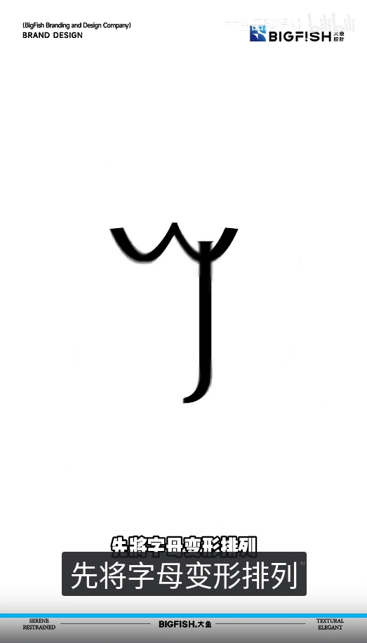

- **作者明确说法**：「先將字母变形排列」
- **播放器字幕**：「先将字母变形排列」
- **整理者观察**：两字已经离开原来的并排位置，带着明显的运动模糊和重影，向中间收拢。这一帧还没有收成清楚的帽檐和中轴。

### WJ6 · W 压成顶上的双弧帽檐，J 变成中央细竖

约 38s（录屏 99.500s）

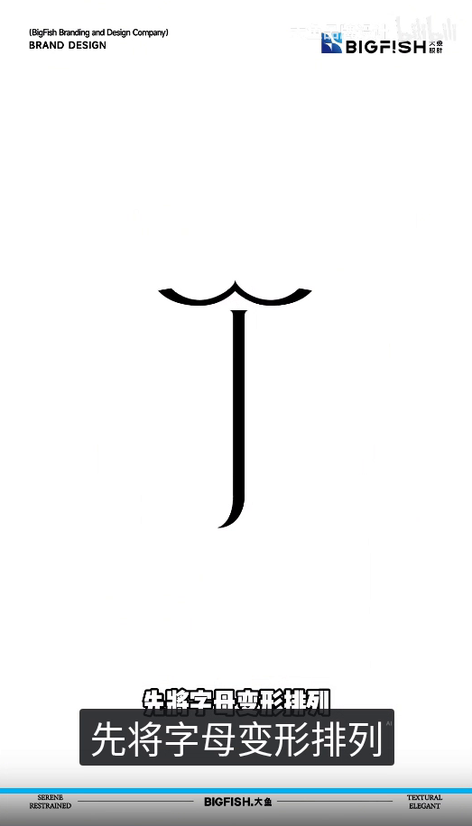

- **作者明确说法**：「先將字母变形排列」
- **播放器字幕**：「先将字母变形排列」
- **整理者观察**：W 已经被压成顶上两道下弯的浅弧，在中峰相接，像一顶帽檐；J 变成中央一根细竖，底端的钩向左。两字已经改成上下排列。99.500 到 100.000 都是这一结构。

### WJ7 · 中峰出现星点，内侧竖肋以灰色淡入

约 39s（录屏 100.200s）

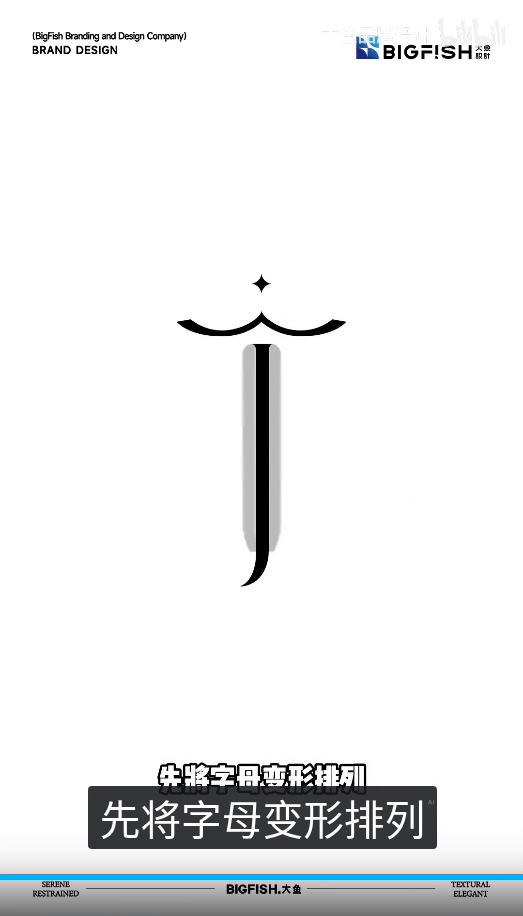

- **作者明确说法**：「先將字母变形排列」
- **播放器字幕**：「先将字母变形排列」
- **整理者观察**：帽檐中峰上已经多出一颗四尖星点。中央 J 的两侧开始出现半透明的灰色竖肋，还没有压实。片内这一帧仍是「先將字母变形排列」。

### WJ8 · 内侧竖肋已经压实，外侧一对仍是灰色

约 40s（录屏 100.700s）

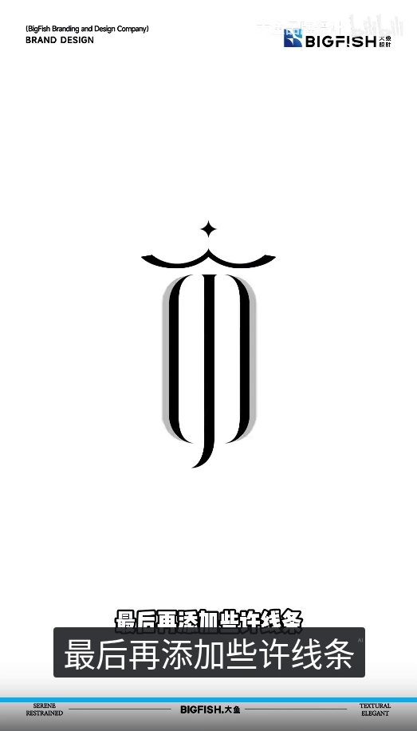

- **作者明确说法**：「最后再添加些许线条」
- **整理者观察**：靠近中央 J 的那一对竖肋已经压成实心黑，外侧那一对仍是半透明的灰。片内这一帧已经换成「最后再添加些许线条」。

### WJ9 · 白底灯笼净标：四条竖肋和星点都已压实

约 40s（录屏 101.000s）

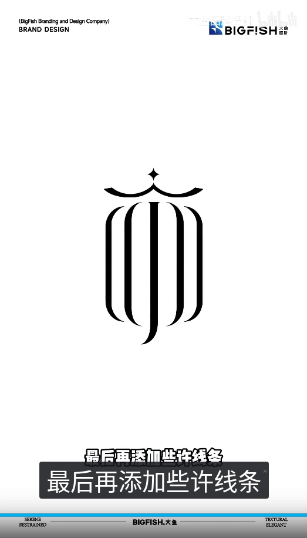

- **作者明确说法**：「最后再添加些许线条」
- **整理者观察**：四条竖肋和顶上的星点都已经压成实心黑。左右肋看起来左右对称，但中央 J 的底钩只在左侧，整枚标志并不是左右完全对称。101.000 到 101.200 都是白底上的这一净标。

### WJ10 · 用到河岸孔明灯照片上，WANJIA LIGHTS／万佳灯火

约 42s（录屏 103.000s）

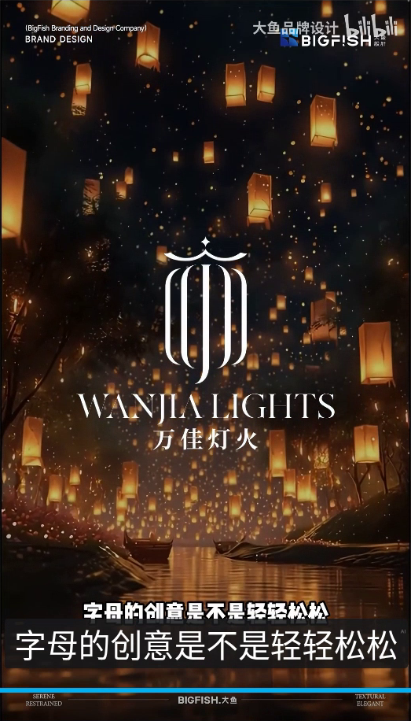

- **作者明确说法**：「字母的创意是不是轻轻松松」
- **整理者观察**：浅色标志用到一张夜空、河岸和孔明灯的照片上，结构与黑净标相同。上行英文是全大写的两词 WANJIA LIGHTS；下行中文是「万佳灯火」，其中是「佳」字。

### 思路与前后关系（整理者分析，非作者原话）

先用对话泡提出「万佳灯火」。先抽出并排的首字母 WJ，中途切到一张宫灯照片作参考，再回到并排的 WJ。随后把两字向中间聚拢：W 压成顶上的双弧帽檐，J 变成中央细竖。再添加线条：中峰先出现星点，内侧竖肋以灰色淡入，接着外侧一对也由灰到实，收成灯笼净标。最后用到河岸孔明灯照片上，字标写成 WANJIA LIGHTS 和「万佳灯火」。这是整理者根据可见结构作的归纳，片内说的是「万佳灯火」「你能帮我想一个吗」「我们提取首字母WJ」「那么接下来只需要融合灯火的概念」「先將字母变形排列」「最后再添加些许线条」「怎么样」「字母的创意是不是轻轻松松」。

---

## 收束：三行回顾

约 44s（录屏 105.500s）

- **作者明确说法**：「还有没有难搞的」
- **整理者观察**：白底上是三行回顾，没有片头 JT 那一案。第一行是「SY+火炬」，右侧是 SY 标志，以及「漾·日式高端抗衰」和 YOUNG SKIN；第二行是「L+海轮船」，右侧是轮船标志，以及 LAIKEGANG／莱客港；第三行是「WJ+灯笼」，右侧是灯笼标志，以及 WANJIA LIGHTS／万佳灯火。105.000 起已经是这三行，片内同一句。106.000 起片内是「别急 我会出手」，「急」和「我」之间有空；播放器字幕当时只有「别急」，稍后才换成「我会出手」。
