# [只要找出共同点，LOGO设计你就手拿把掐](https://www.bilibili.com/video/BV1NUnn6XEjm)｜大鱼品牌设计

## 导入：滚筒刷 + 鹤 / PAINT CRANE 漆鹤

### P1 · 滚筒刷与鹤的照片

约 0.2s（录屏 19.5s）

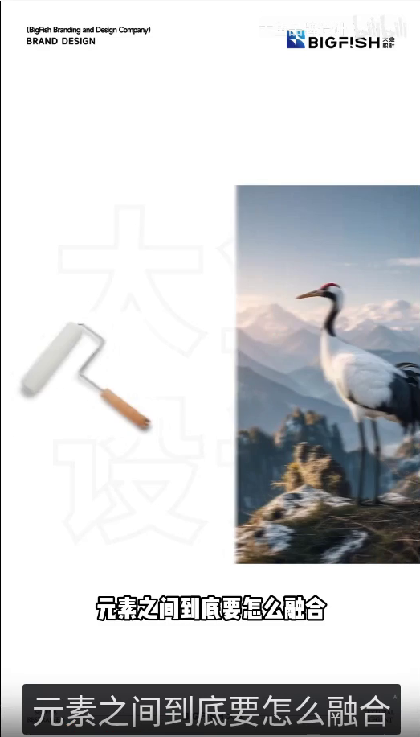

- **作者明确说法**：「元素之间到底要怎么融合」
- **整理者观察**：白底上，左侧是一把滚筒刷的照片：白色泡沫滚筒、金属支架、带圆孔的木柄；右侧是站在山石上的丹顶鹤照片。

### P2 · 标出滚筒与鹤喙的相近走向

约 0.9s（录屏 20.2s）

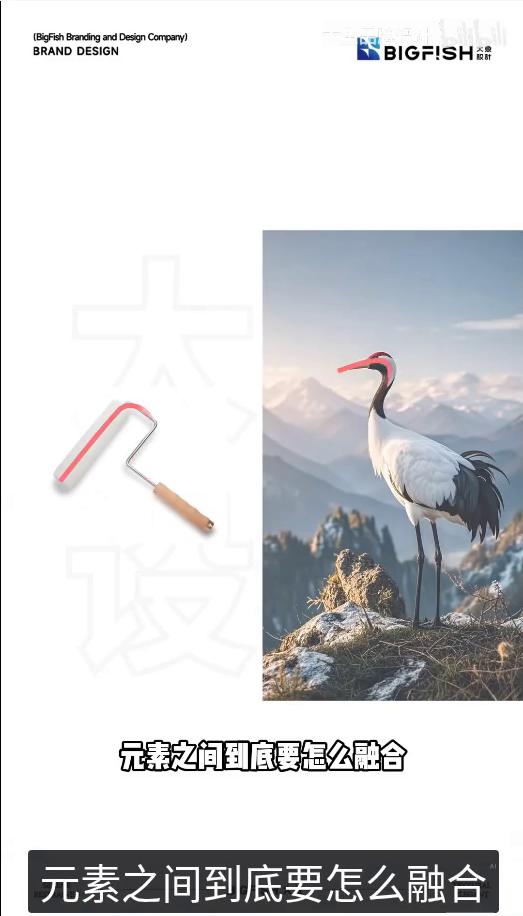

- **作者明确说法**：「元素之间到底要怎么融合」
- **整理者观察**：红线主要画在泡沫滚筒和支架顶端的小弯上；鹤的喙和头顶也叠了一道红线。金属支架本身已经弯折，下段和木柄还没有描红。末端圆孔仍可见。

### P3 · 沿支架描出S形红线，并沿鹤颈向下延长

约 1.6s（录屏 20.9s）

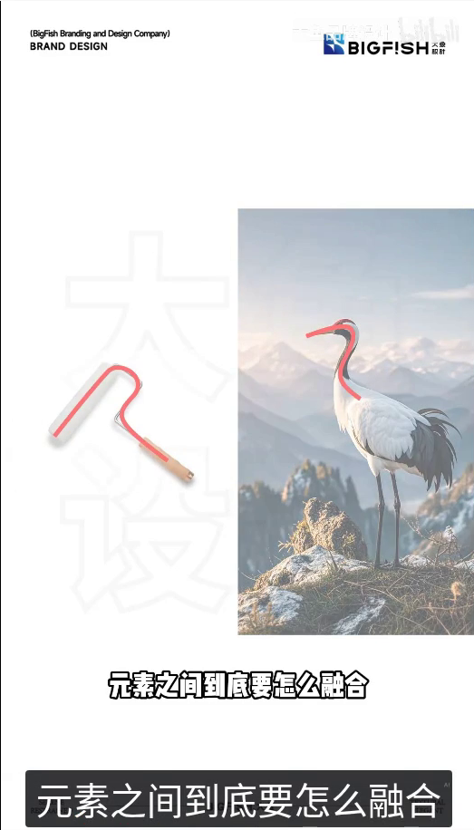

- **作者明确说法**：「元素之间到底要怎么融合」
- **整理者观察**：沿已经弯折的金属支架描出 S 形红线，把支架包住。鹤这边的红线从喙、头顶继续落到颈下，和支架上的红线走向相近。木柄仍在。

### P4 · 滚筒收成色块，鹤仍是照片

约 2.5s（录屏 21.8s）

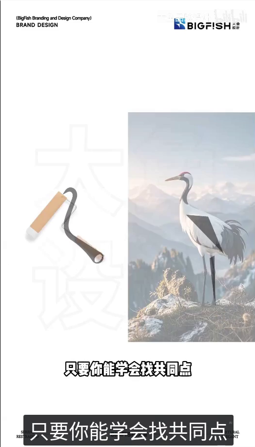

- **作者明确说法**：「只要你能学会找共同点」
- **整理者观察**：左侧滚筒刷正在收成色块：泡沫滚筒变成橙色长方形，向左斜下，一端还留着白色；金属支架变成黑色 S 弯，下端仍是带孔的柄。右侧鹤还是照片，翅和腿开始出现深色块面。

### P5 · 两者都收成色块，仍分开

约 2.8s（录屏 22.1s）

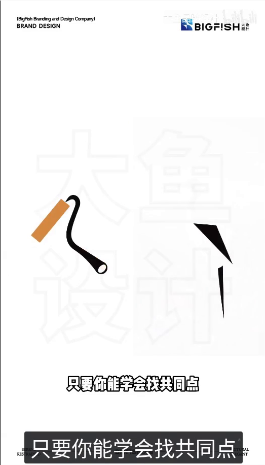

- **作者明确说法**：「只要你能学会找共同点」
- **整理者观察**：照片已退去。左侧是完整的滚筒刷色块：橙色长方形滚筒向左斜下横伸，黑色 S 弯支架下方是带椭圆孔的原柄。右侧是黑色三角形的鹤身、翅，下面有一条细腿。两件还分在左右。

### P6 · 两件相向靠拢

约 3.5s（录屏 22.8s）

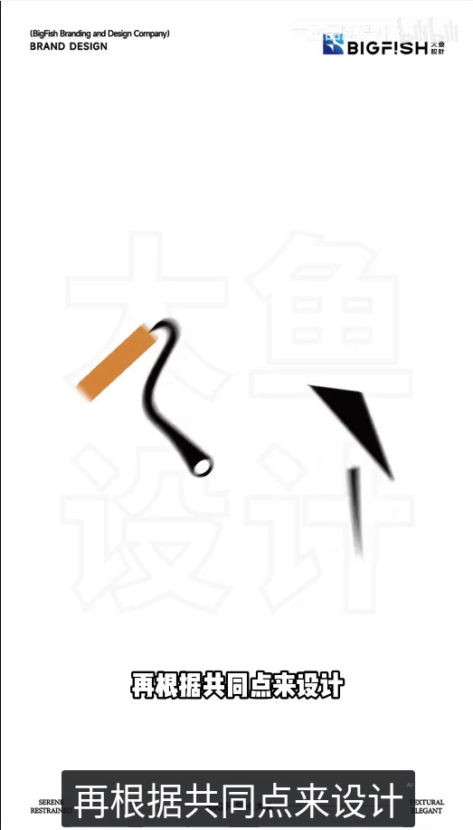

- **作者明确说法**：「再根据共同点来设计」
- **整理者观察**：左右两件正在相向靠拢，中间仍有空隙；轮廓带一些运动模糊。

### P7 · 继续靠近，尚未合成

约 3.6s（录屏 22.9s）

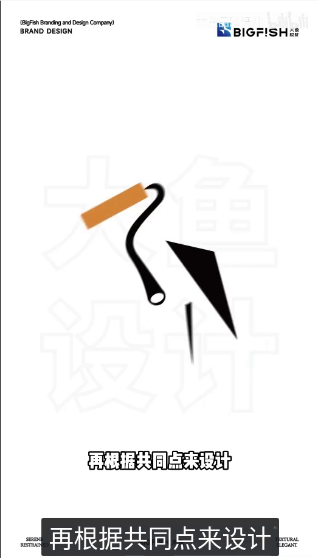

- **作者明确说法**：「再根据共同点来设计」
- **整理者观察**：两件靠得更近，滚筒刷色块和鹤的色块之间仍有间隙，还没有合上。

### P8 · 滚筒刷色块落到鹤的色块上，完成态

约 4.4s（录屏 23.7s）

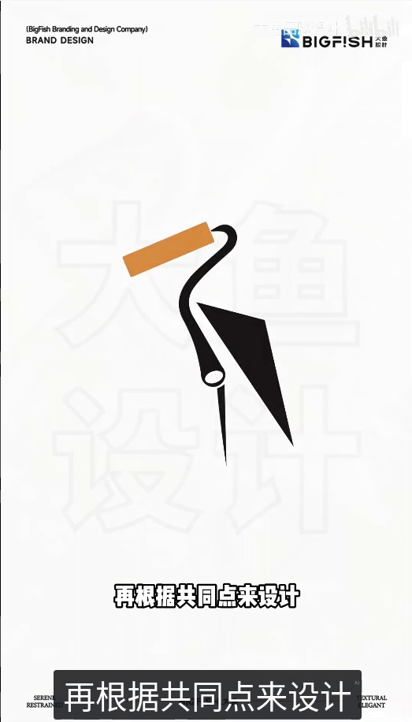

- **作者明确说法**：「再根据共同点来设计」
- **整理者观察**：滚筒刷的色块已经落到鹤的色块上。橙色长方形仍是滚筒，向左斜下横伸；黑色 S 弯金属支架和下方带椭圆孔的原柄落在头颈、前躯的位置；右侧黑色三角形仍是鹤的身和翅，细腿在原柄下方。这是这一案的完成态。

### P9 · 用到展翅鹤的照片上

约 4.9s（录屏 24.2s）

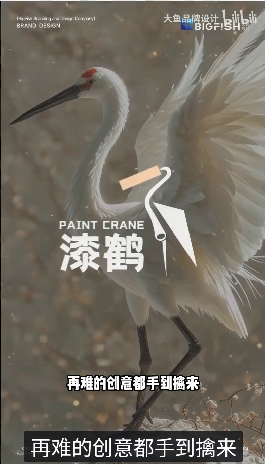

- **作者明确说法**：「再难的创意都手到擒来」
- **整理者观察**：同一枚标志压在一张展翅白鹤的照片上，旁边写着 PAINT CRANE / 漆鹤。

### 思路与前后关系（整理者分析，非作者原话）

沿滚筒金属支架描出的 S 形红线，与鹤颈上延长的红线走向相同；合成后橙滚筒仍向左斜下横伸，黑支架和带孔的原柄落在头颈、前躯的位置，右侧三角仍是鹤的身翅，所以能同时读作滚筒刷和鹤。

---

## 案例一：剪刀 + 飞机 / 剪捷 CLIPJET

### C1 · 一把剪刀

约 7.0s（录屏 26.3s）

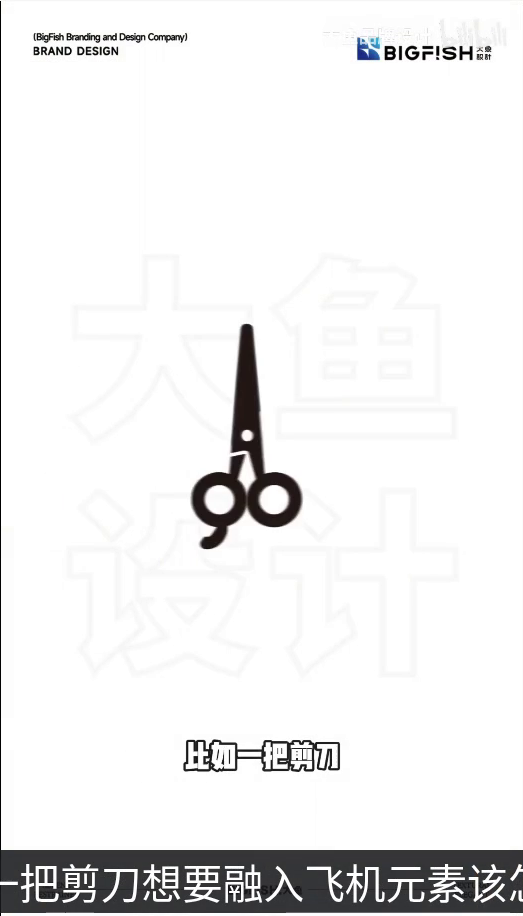

- **作者明确说法**：「比如一把剪刀」
- **播放器字幕**：「比如一把剪刀想要融入飞机元素该怎么办」
- **整理者观察**：白底上是一把黑色闭合的剪刀，刀尖朝上，两个圈形手柄在下。

### C2 · 剪刀与飞机照片并置

约 8.7s（录屏 28.0s）

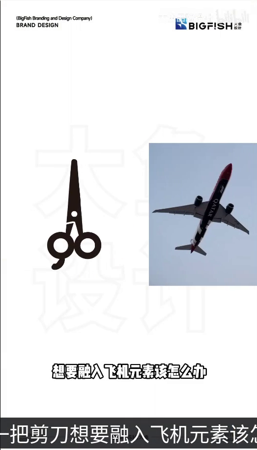

- **作者明确说法**：「想要融入飞机元素该怎么办」
- **播放器字幕**：「比如一把剪刀想要融入飞机元素该怎么办」
- **整理者观察**：左侧仍是那把闭合剪刀，右侧出现一张飞机的照片，机身有红色条纹，在浅色天空中。

### C3 · 刀刃和机翼各套红框

约 11.1s（录屏 30.4s）

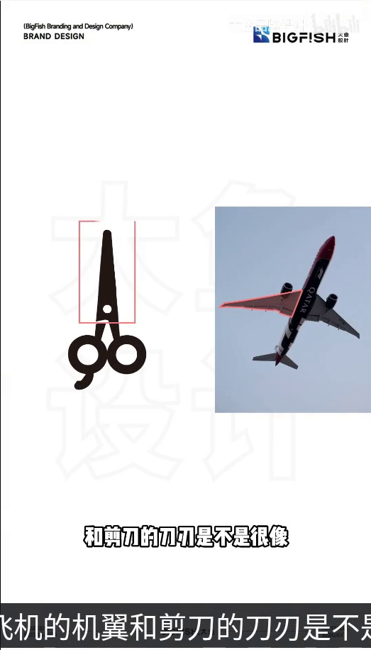

- **作者明确说法**：「和剪刀的刀刃是不是很像」
- **播放器字幕**：「你看飞机的机翼和剪刀的刀刃是不是很像」
- **整理者观察**：剪刀的刀刃、飞机的机翼上各套了一个红色方框。

### C4 · 标出相同点

约 12.8s（录屏 32.1s）

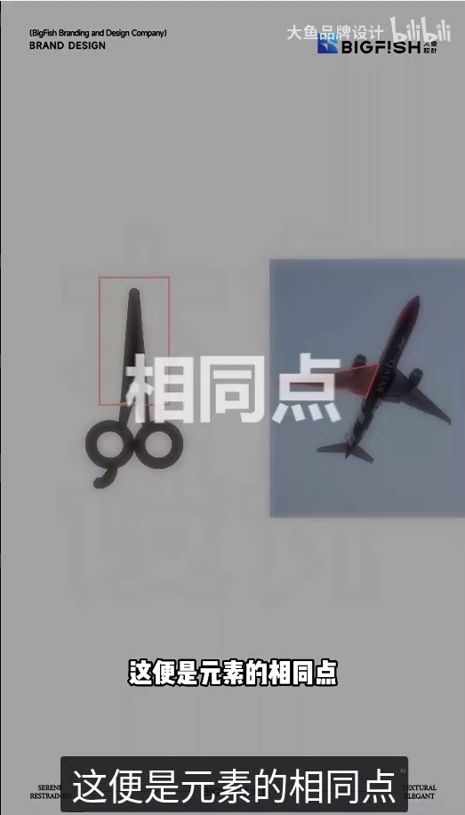

- **作者明确说法**：「这便是元素的相同点」
- **整理者观察**：画面正中出现「相同点」三个大字。刀刃和机翼上的红框都还在，飞机照片仍在右侧。

### C5 · 剪刀先转过来

约 14.2s（录屏 33.5s）

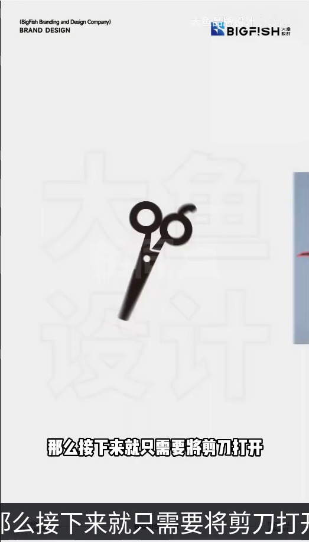

- **作者明确说法**：「那么接下来就只需要將剪刀打开」
- **播放器字幕**：「那么接下来就只需要将剪刀打开」
- **整理者观察**：右侧飞机照片还剩一条边，正在退出。剪刀转到斜向，刀尖朝左下，两个手柄转到右上，此时还没有张开。

### C6 · 剪刀继续打开

约 14.9s（录屏 34.2s）

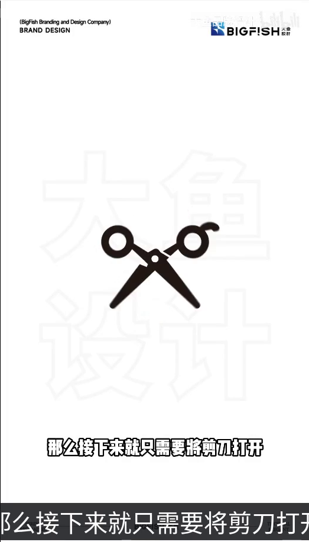

- **作者明确说法**：「那么接下来就只需要將剪刀打开」
- **播放器字幕**：「那么接下来就只需要将剪刀打开」
- **整理者观察**：剪刀继续打开，两刃和两个手柄已经分成四臂，还没有张到最大。

### C7 · 剪刀完全打开

约 15.2s（录屏 34.5s）

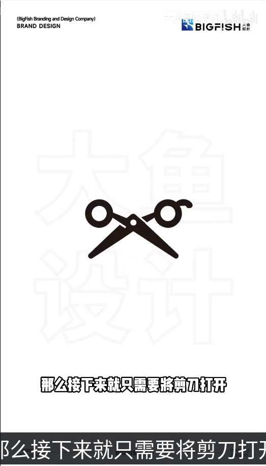

- **作者明确说法**：「那么接下来就只需要將剪刀打开」
- **播放器字幕**：「那么接下来就只需要将剪刀打开」
- **整理者观察**：剪刀已经完全打开，两刃、两个手柄呈四臂交叉，看起来像俯视的飞机平面。

### C8 · 中央出现淡淡的机身影

约 16.1s（录屏 35.4s）

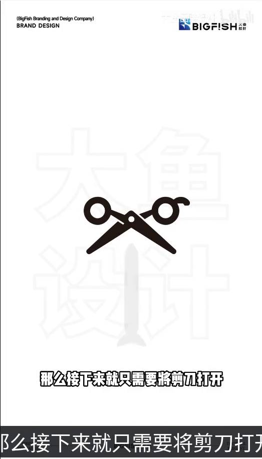

- **作者明确说法**：「那么接下来就只需要將剪刀打开」
- **播放器字幕**：「那么接下来就只需要将剪刀打开」
- **整理者观察**：张开的剪刀还在，中央下方出现一道浅色的机身影，还没有填实。

### C9 · 加入实心的机舱

约 16.2s（录屏 35.5s）

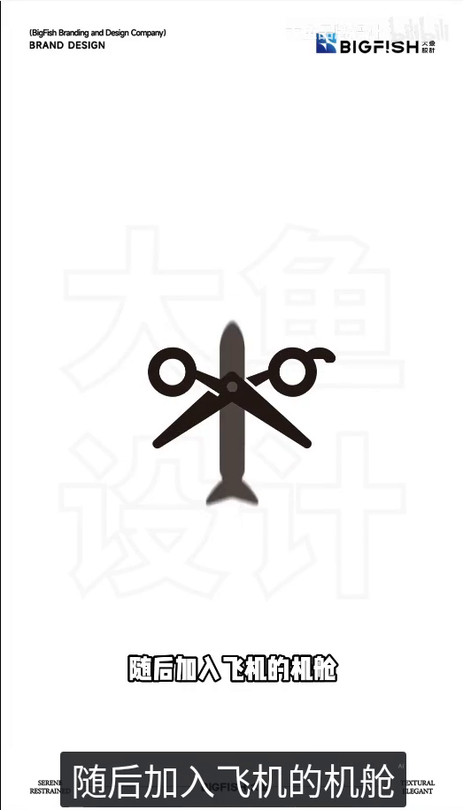

- **作者明确说法**：「随后加入飞机的机舱」
- **整理者观察**：中央加上实心的机头、机身和尾翼，与打开的剪刀合在一起。

### C10 · 标志完成

约 17.6s（录屏 36.9s）

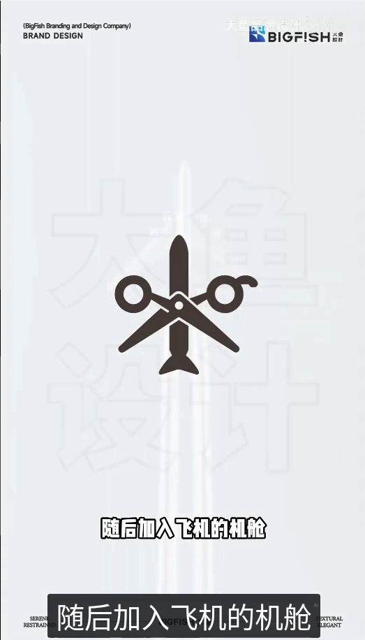

- **作者明确说法**：「随后加入飞机的机舱」
- **整理者观察**：同一枚标志已经稳定，浅色底上隐约有尾迹。这是这一案的完成态。

### C11 · 用到蓝天飞机照片上

约 17.8s（录屏 37.1s）

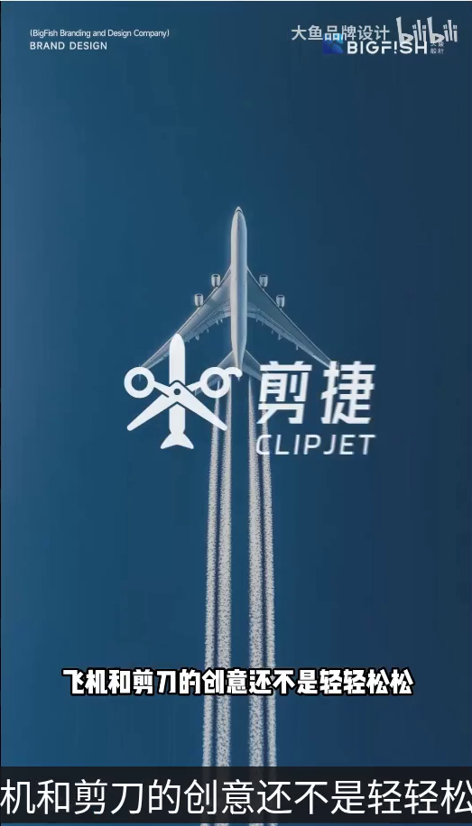

- **作者明确说法**：「飞机和剪刀的创意还不是轻轻松松」
- **整理者观察**：白色标志压在一张蓝天仰视、带四道白尾迹的飞机照片上，右侧写着 剪捷 / CLIPJET。

### 思路与前后关系（整理者分析，非作者原话）

刀刃和机翼的外形相近，红框标出之后，把剪刀打开成俯视的四臂，再在中央加上机身，同一件就能同时读作剪刀和飞机。

---

## 案例二：小熊 + 闹钟 / BEAR CLOCK 萌熊铃

### B1 · 对话框

约 20.4s（录屏 39.7s）

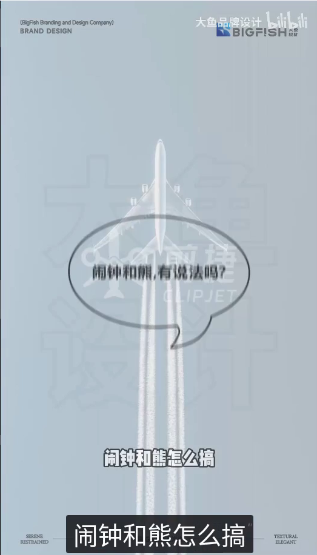

- **作者明确说法**：「闹钟和熊怎么搞」
- **整理者观察**：上一案的蓝天应用正在淡出。画面上有一个对话气泡，写着「闹钟和熊,有说法吗?」。

### B2 · 先画一只小熊

约 23.1s（录屏 42.4s）

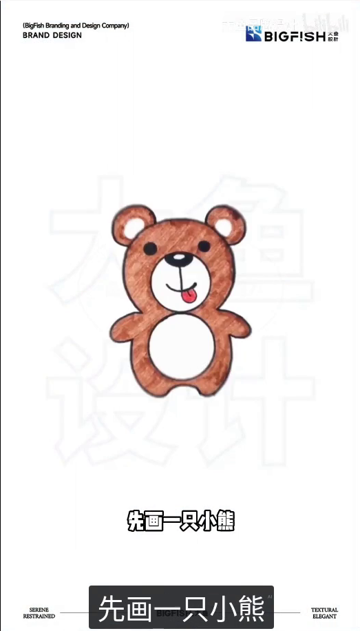

- **作者明确说法**：「先画一只小熊」
- **整理者观察**：白底上是一只手绘的棕色小熊，圆耳、两点黑眼、吐着舌头，肚子是一块白椭圆。

### B3 · 把肚子当表盘

约 24.4s（录屏 43.7s）

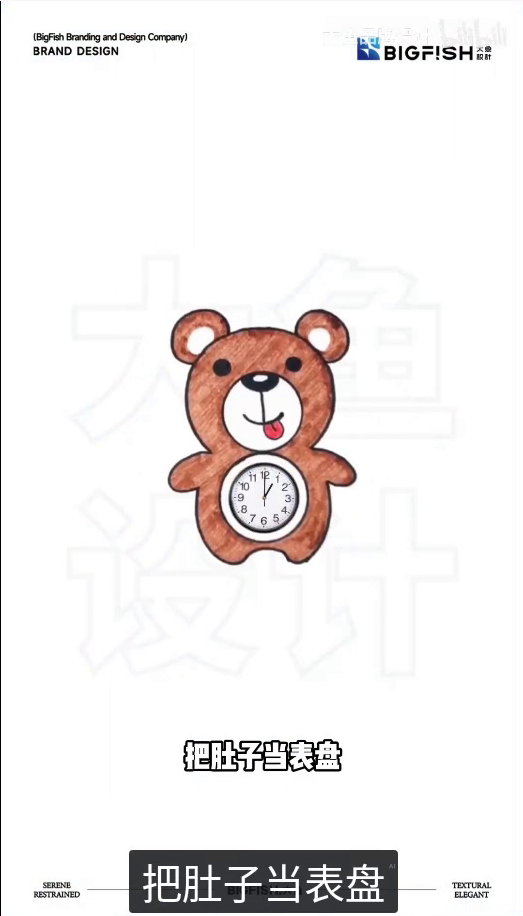

- **作者明确说法**：「把肚子当表盘」
- **整理者观察**：小熊还在，白肚上画了一个带数字刻度和指针的表盘。

### B4 · 这个方案被放下

约 26.1s（录屏 45.4s）

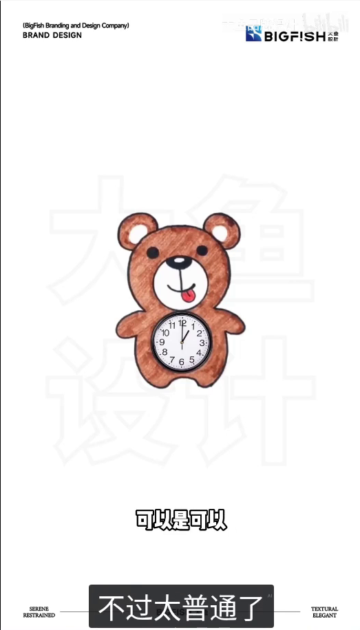

- **作者明确说法**：「可以是可以」
- **播放器字幕**：「不过太普通了」
- **整理者观察**：画面仍是把表盘画在熊肚上的那只小熊，没有打叉，也没有把熊拿掉。

### B5 · 改画一个闹钟轮廓

约 27.3s（录屏 46.6s）

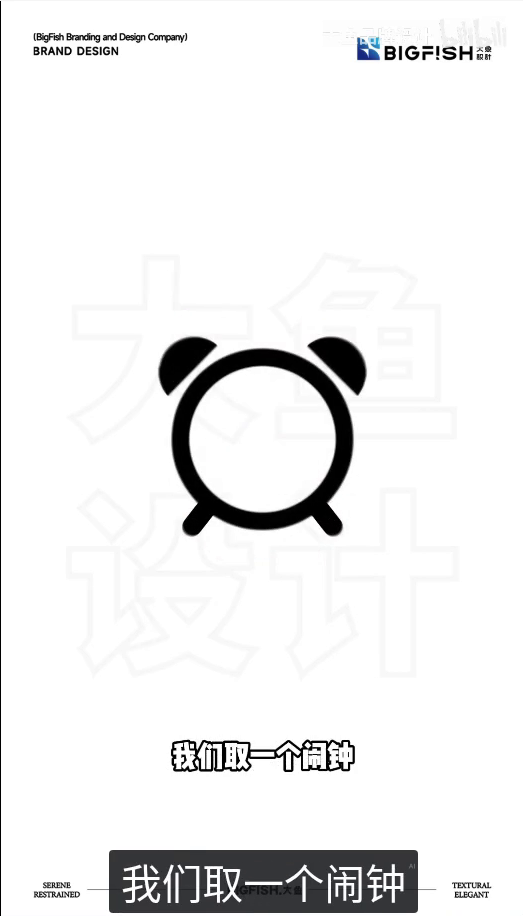

- **作者明确说法**：「我们取一个闹钟」
- **整理者观察**：小熊已经换掉，换成一个黑色闹钟轮廓：顶上两只铃，下面两只脚，中间是空的圆表盘。

### B6 · 画出时针与分针

约 28.7s（录屏 48.0s）

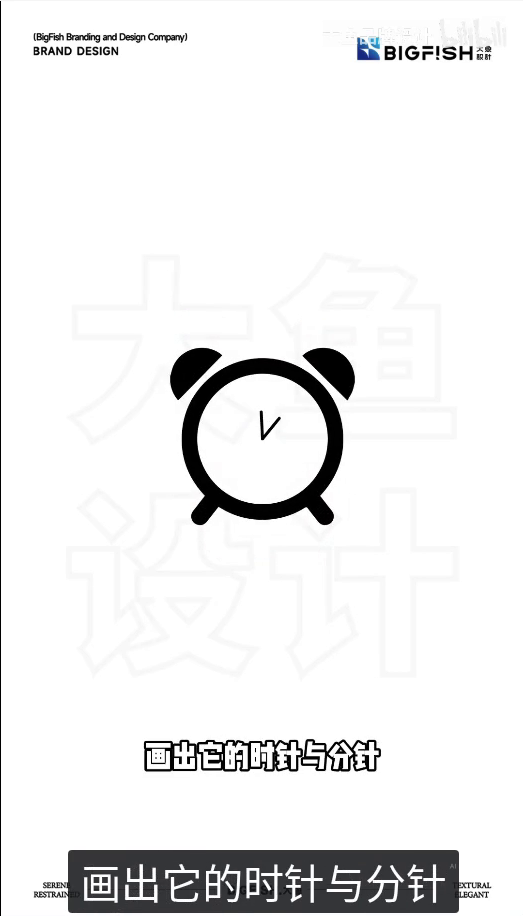

- **作者明确说法**：「画出它的时针与分针」
- **整理者观察**：表盘里画出两根靠在一起的指针，落在下半部，呈朝下的小夹角。

### B7 · 指针转到朝左

约 30.0s（录屏 49.3s）

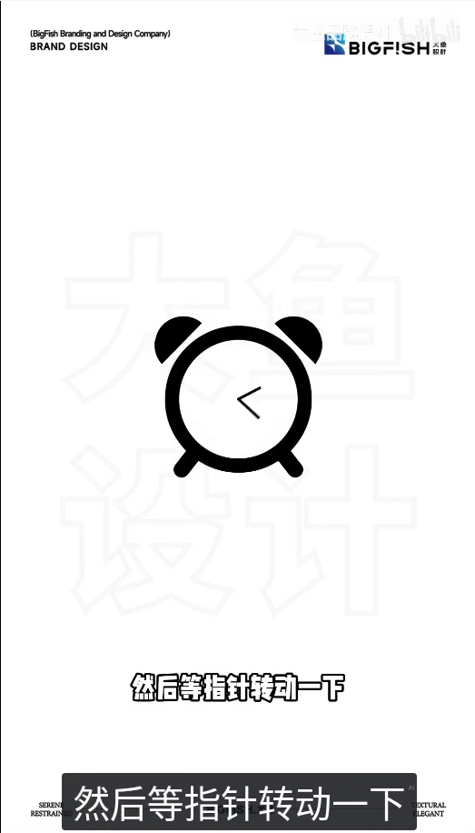

- **作者明确说法**：「然后等指针转动一下」
- **整理者观察**：两根指针一起转到左侧，仍靠在一起。

### B8 · 指针转到右上

约 31.3s（录屏 50.6s）

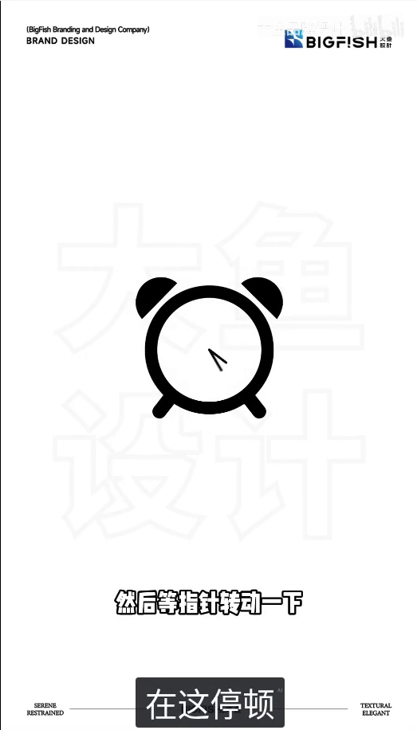

- **作者明确说法**：「然后等指针转动一下」
- **播放器字幕**：「在这停顿」
- **整理者观察**：指针转到右上方，两根仍靠在一起。

### B9 · 指针停在朝上的夹角

约 32.2s（录屏 51.5s）

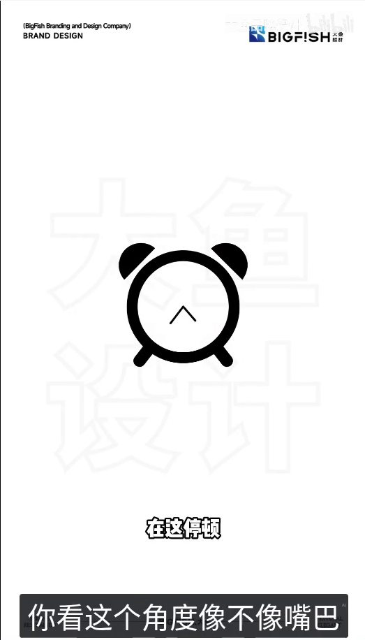

- **作者明确说法**：「在这停顿」
- **播放器字幕**：「你看这个角度像不像嘴巴」
- **整理者观察**：两根指针停在表盘正中，合并成一个朝上的小夹角。

### B10 · 鼻子开始出现

约 34.0s（录屏 53.3s）

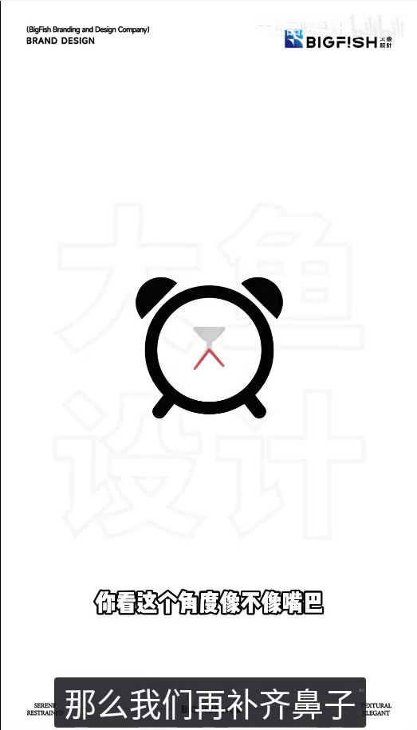

- **作者明确说法**：「你看这个角度像不像嘴巴」
- **播放器字幕**：「那么我们再补齐鼻子」
- **整理者观察**：朝上的夹角还在，上方开始出现一个浅色的倒三角。

### B11 · 鼻子填实

约 34.8s（录屏 54.1s）

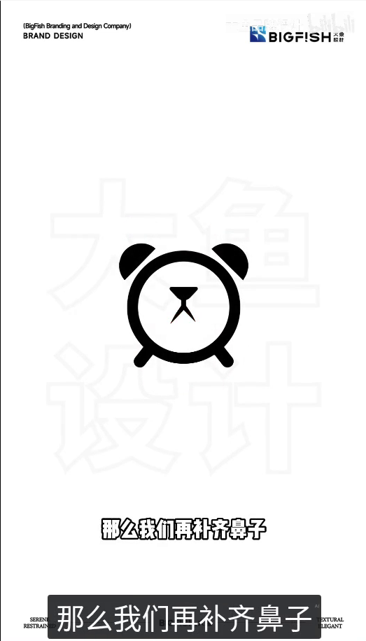

- **作者明确说法**：「那么我们再补齐鼻子」
- **整理者观察**：倒三角已经填成黑色，和下面朝上的夹角连在一起。此时顶上的铃铛仍与钟壳同色，还没有另外上色。

### B12 · 铃铛填成深褐色

约 35.5s（录屏 54.8s）

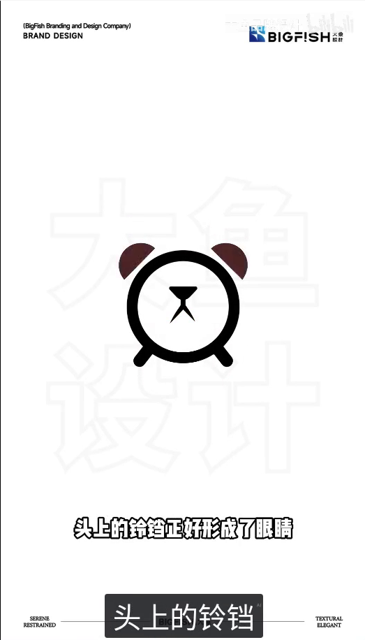

- **作者明确说法**：「头上的铃铛正好形成了眼睛」
- **播放器字幕**：「头上的铃铛」
- **整理者观察**：顶上两只铃填成深褐色。钟面没有另加眼点。

### B13 · 铃铛改成粉色

约 36.1s（录屏 55.4s）

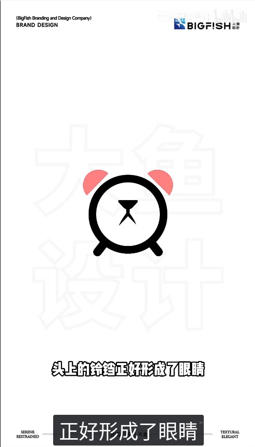

- **作者明确说法**：「头上的铃铛正好形成了眼睛」
- **播放器字幕**：「正好形成了眼睛」
- **整理者观察**：两只铃改成粉色。钟面仍然没有另加眼点。

### B14 · 铃铛回到深褐色，完成态

约 36.6s（录屏 55.9s）

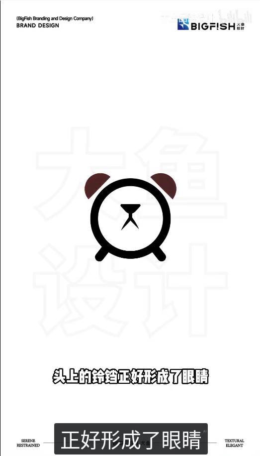

- **作者明确说法**：「头上的铃铛正好形成了眼睛」
- **播放器字幕**：「正好形成了眼睛」
- **整理者观察**：两只铃从粉色直接回到深褐色，鼻子和朝上的夹角仍在。这是这一案的完成态。

### B15 · 用到卡通熊的画面上

约 37.8s（录屏 57.1s）

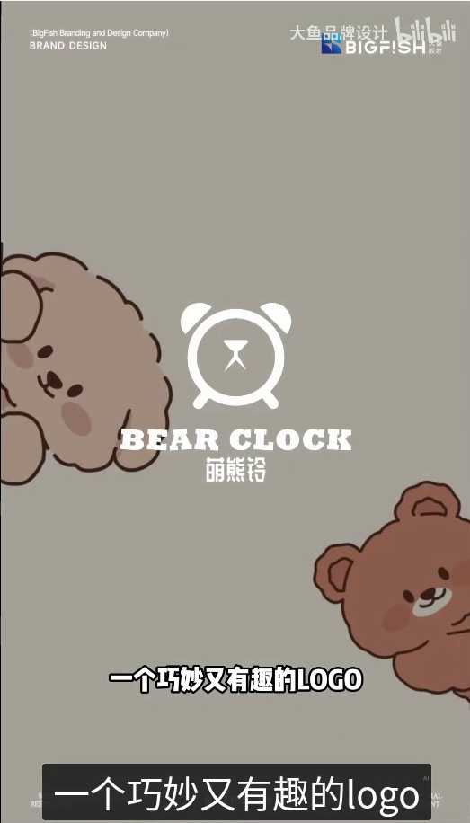

- **作者明确说法**：「一个巧妙又有趣的LOGO」
- **播放器字幕**：「一个巧妙又有趣的logo」
- **整理者观察**：白色标志压在灰米色底上，左右各有一只卡通熊，下方写着 BEAR CLOCK / 萌熊铃。

### 思路与前后关系（整理者分析，非作者原话）

把表盘画在熊肚上被放下之后，改从闹钟轮廓入手：指针停成朝上的夹角，再补上鼻子；作者说头上的铃铛正好形成了眼睛，两只铃在钟壳上方，外形也像一对耳，钟面没有另加眼点，所以能同时读作闹钟和熊脸。

---

## 收束

### R1 · 三例并列

约 40.8s（录屏 60.1s）

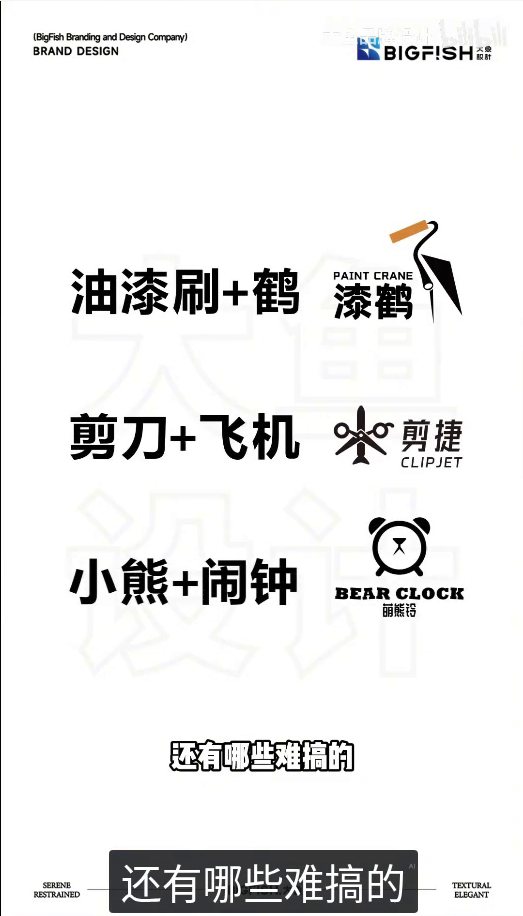

- **作者明确说法**：「还有哪些难搞的」。其后：「别急 我会出手」
- **播放器字幕**：其后先作「别急」，再作「我会出手」
- **整理者观察**：白底上三行并列：油漆刷+鹤，配 PAINT CRANE / 漆鹤；剪刀+飞机，配 剪捷 / CLIPJET；小熊+闹钟，配 BEAR CLOCK / 萌熊铃。
