# [只要打开思维，LOGO设计也就简简单单](https://www.bilibili.com/video/BV1Psew6eEcM/)｜大鱼品牌设计

文中「约 00:mm」是按播放器时钟校准的近似时刻，误差约 ±1s；括号内为录屏精确秒。

## 案例一：AMG 与汉堡 / AMIGO

### AG1 · 原形：直排 AMG 与汉堡照片

约 00:01（录屏 51.400s）

- **作者明确说法**：「LOGO设计其实很简单」
- **整理者观察**：这是播放中的原形，不是起播前的暂停预览。白底左侧是直排无衬线字母 AMG，右侧是一张汉堡照片。两件还是分开的，没有收成组合标。

### AG2 · A 的横笔到下缘，呈空心三角

约 00:02（录屏 52.100s）

- **作者明确说法**：「LOGO设计其实很简单」
- **整理者观察**：A 的横笔到了下缘，呈空心三角：黑框，内为白空腔。M、G 和右侧的汉堡照片还在。录屏在 51.833s 到 52.100s 之间有 0.267s 空隙，横笔如何落到下缘，这一段没有捕到；本帧已经是空心三角。52.133s 到 52.467s 还有 0.333s 空隙，空隙之后的 52.467s 仍是空心三角 A，加上 M、G 和汉堡。

### AG3 · 三字叠到缩小中的汉堡上

约 00:02（录屏 52.567s）

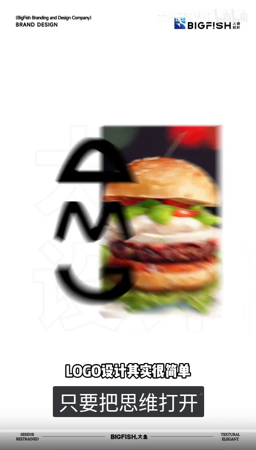

- **作者明确说法**：「LOGO设计其实很简单」
- **整理者观察**：三个字母带着运动模糊，叠到正在缩小的汉堡照片上，仍可依稀读出上面是 A、中间是 M、下面是 G。

### AG4 · 黑标成形，照片残影还在

约 00:03（录屏 53.200s）

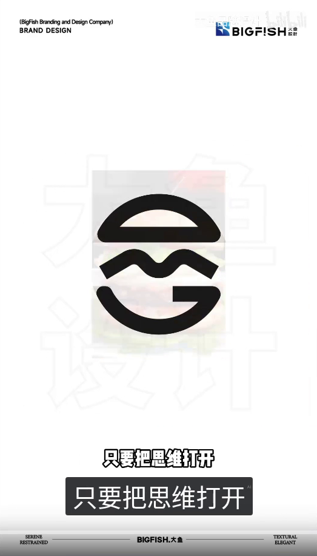

- **作者明确说法**：「只要把思维打开」
- **整理者观察**：黑标已经能看清楚：上部是一条粗拱，下面一道底横，两者围出白空腔；中间是一道波浪笔；最下是 G 形的碗。汉堡照片的残影还在。

### AG5 · 白底黑净标

约 00:03（录屏 53.400s）

- **作者明确说法**：「只要把思维打开」
- **整理者观察**：白底上的黑色净标已经稳住，结构与上一帧相同：上部一条粗拱加底横围出白空腔，中间是独立的波浪笔，再下是 G 形碗。照片残影已经看不见。这是这一案线标的黑色完成态。录屏在 53.433s 到 53.800s 之间有 0.367s 空隙，应用到照片上的起幅没有捕到。

### AG6 · 用到汉堡照片上，AMIGO

约 00:04（录屏 54.400s）

- **作者明确说法**：「字母也会有无数种变化」
- **整理者观察**：同一件标志反白，叠在汉堡照片上。字标为「AMIGO」，其下较小的是「HAMBURG」。

### 思路与前后关系（整理者分析，非作者原话）

播放中先给出直排 AMG 和汉堡照片。A 的横笔落到下缘，呈空心三角，再和 M、G 一起叠到缩小中的汉堡上，收成黑标：上部的粗拱和底横围出白空腔，中间是波浪，下面是 G 形的碗，看起来像汉堡的剖面。用到照片上时，字标写成「AMIGO」和「HAMBURG」。片尾回顾没有收这一案。这是整理者根据可见结构作的归纳，片内只说了「只要把思维打开」「字母也会有无数种变化」。

---

## 案例二：EK 与双盘 / 伊卡影视

### EK1 · 气泡：E 和 K、影视

约 00:07（录屏 56.733s）

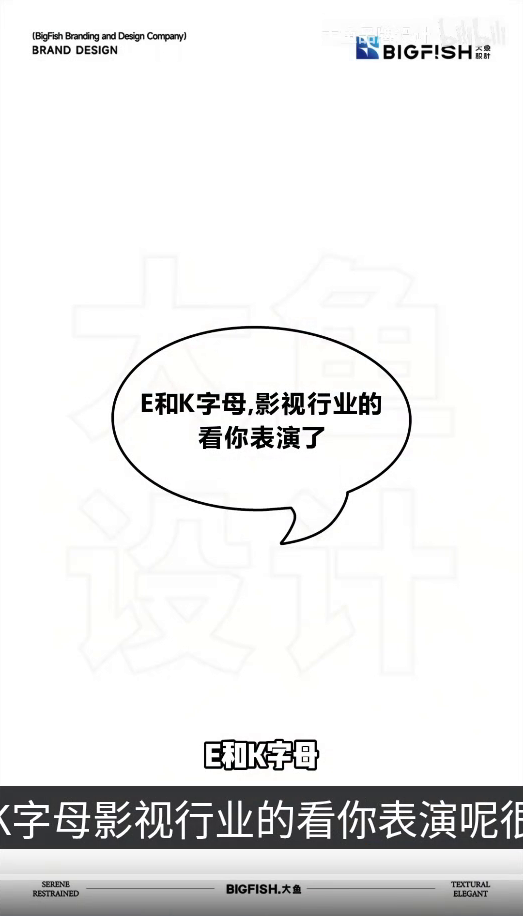

- **作者明确说法**：「E和K字母」。同一画面上，气泡里两行写着「E和K字母,影视行业的」「看你表演了」。
- **整理者观察**：白底中央是一个线框圆角气泡，尾朝右下。片内这一帧是「E和K字母」，没有逗号；气泡第一行在「母」后有逗号，并把后两句写在一起。片内后两句是分开出现的：约 56.867s「影视行业的」，约 58.000s「看你表演了」。

### EK2 · 先见单独的 K

约 00:09（录屏 59.300s）

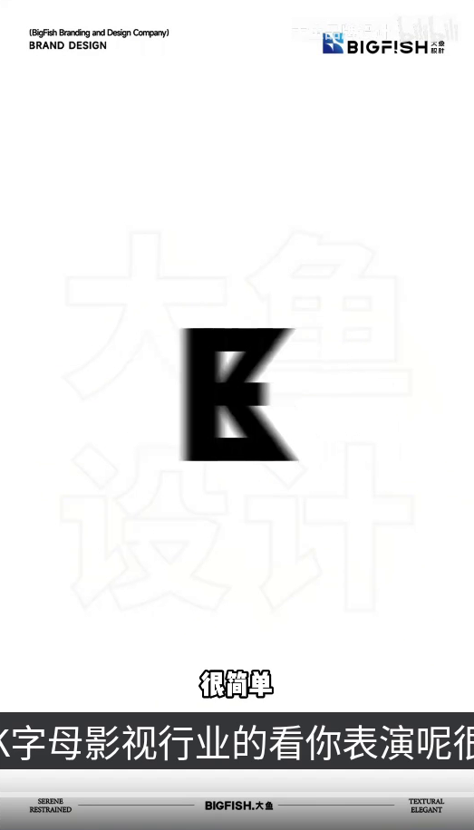

- **作者明确说法**：「很简单」
- **整理者观察**：白底上是一个单独的黑体 K，还没有 E。录屏在 58.767s 到 59.300s 之间有 0.533s 空隙，K 是怎样进入画面的，这一段没有捕到；本帧已经是单独的 K。

### EK3 · E 出现在 K 左侧

约 00:09（录屏 59.400s）

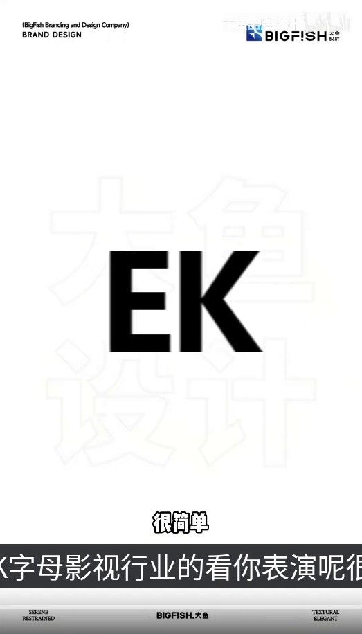

- **作者明确说法**：「很简单」
- **整理者观察**：E 已经出现在 K 左侧，两字并排。高度仍与上一帧单独的 K 相近，还没有贴紧，也还没有变扁。

### EK4 · 两字间距拉开，高度仍高

约 00:09（录屏 59.600s）

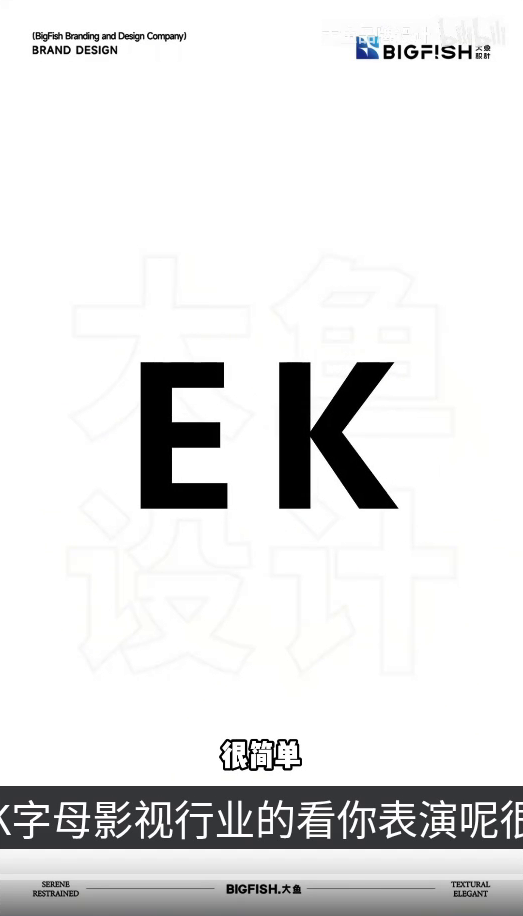

- **作者明确说法**：「很简单」
- **整理者观察**：两字之间的空隙比 59.400s 更宽，高度仍高。这是这一段里间距最开、字母仍高的状态。

### EK5 · 已经变扁，中间仍有空隙

约 00:10（录屏 60.133s）

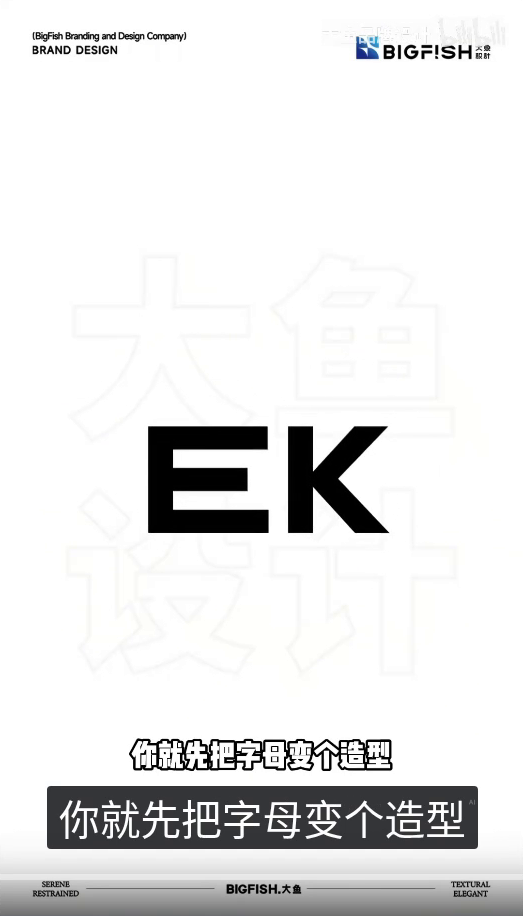

- **作者明确说法**：「你就先把字母变个造型」
- **整理者观察**：从约 59.700s 起，两字一边收窄间距，一边把高度压低。到本帧，字母已经明显比 59.600s 更扁，中间仍留着一道空隙，还没有贴紧。这是 60.133s 到 60.633s 这 0.500s 空隙之前的最后一帧。空隙里两字如何收到最后的贴紧高度，没有捕到。

### EK6 · 两字已经贴紧，高度更扁

约 00:11（录屏 60.633s）

- **作者明确说法**：「你就先把字母变个造型」
- **整理者观察**：空隙之后的这一帧，两字已经贴紧，高度也更扁。E 仍是上、中、下三横，中横较短；E 与 K 之间留着一条白缝，K 有自己的竖笔和上下斜笔。

### EK7 · 贴紧后的稳定态，还没有盘

约 00:13（录屏 62.800s）

- **作者明确说法**：「这个时候或许还看不出行业」
- **整理者观察**：贴紧、变扁后的 EK 保持到本帧，还没有出现盘。E 的中横仍然较短，两字之间的白缝还在。约 62.833s 仍无盘。录屏在 62.833s 到 63.233s 之间有 0.400s 空隙，第一只盘是怎样长出的，这一段没有捕到。

### EK8 · 左上已有一盘，右侧一个小点

约 00:13（录屏 63.233s）

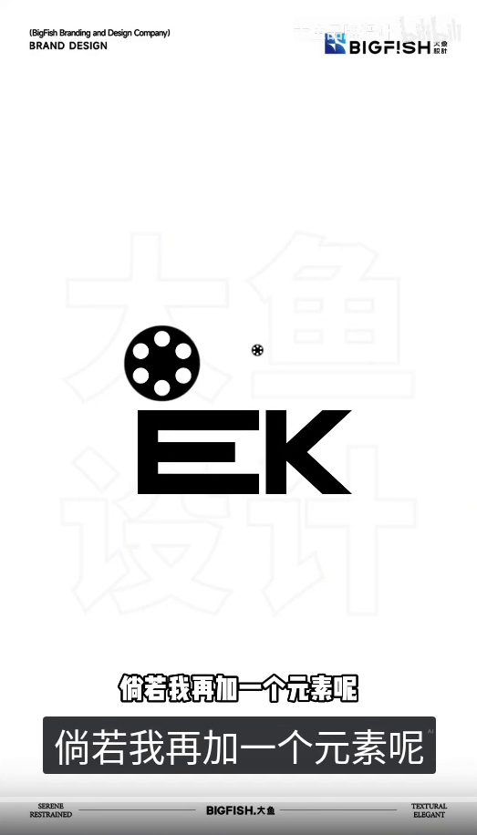

- **作者明确说法**：「倘若我再加一个元素呢」
- **整理者观察**：空隙之后的这一帧，左上已经有一只带盘孔的盘，右侧还有一个小点。第二只盘还没有成形。

### EK9 · 双盘

约 00:13（录屏 63.333s）

- **作者明确说法**：「倘若我再加一个元素呢」
- **整理者观察**：已经是两只盘：左盘较小、略低，右盘较大、略高，各有一圈盘孔。下面仍是贴紧的 EK。

### EK10 · 白底黑净标

约 00:14（录屏 64.000s）

- **作者明确说法**：「倘若我再加一个元素呢」
- **整理者观察**：白底上的黑色净标已经稳住：上面是大小两盘，下面是贴紧的 EK，两字之间仍有白缝。这是这一案线标的黑色完成态。录屏在 64.167s 到 64.533s 之间有 0.367s 空隙，应用到照片上的起幅没有捕到。

### EK11 · 用到深色波点背景上，伊卡影视

约 00:16（录屏 66.400s）

- **作者明确说法**：「这样的LOGO是不是形象又直观」
- **整理者观察**：同一件标志反白，叠在深色波点背景上。标志下方是「EK · MOVIES」，其下是「伊卡影视」。

### 思路与前后关系（整理者分析，非作者原话）

先用气泡提出字母 E、K 和影视。画面上先出现单独的 K，再在左侧加上 E。两字先拉开间距，随后一边收紧一边压低高度；60.133s 已经明显变扁，中间还有空隙，60.633s 起贴紧、更扁，并一直保持到加盘之前。E 仍是三横，中横较短，与 K 之间留着白缝，看起来还是两个字母。然后先在左上加出一只盘，右侧一个小点，再长成大小两盘，像一对胶片盘，和贴紧的 EK 收成投影机形的净标。用到背景上时，字标写成「EK · MOVIES」和「伊卡影视」。这是整理者根据变形步骤作的归纳，片内说的是「你就先把字母变个造型」「倘若我再加一个元素呢」「这样的LOGO是不是形象又直观」。

---

## 案例三：MA 与群山 / 麻山民宿

### MA1 · 气泡：麻山民宿

约 00:17（录屏 67.600s）

- **作者明确说法**：「老师老师」。同一画面上，气泡里两行写着「老师老师,麻山民宿」「就交给你了哦」。
- **整理者观察**：白底中央是一个线框圆角气泡，尾朝右下。片内这一帧是「老师老师」；后两句分开出现，约 68.400s「麻山民宿」，约 69.233s「就交给你喽」。气泡第一行在「师」后有逗号，第二行是「就交给你了哦」，与片内的「喽」不同。

### MA2 · 「麻山」二字

约 00:21（录屏 70.800s）

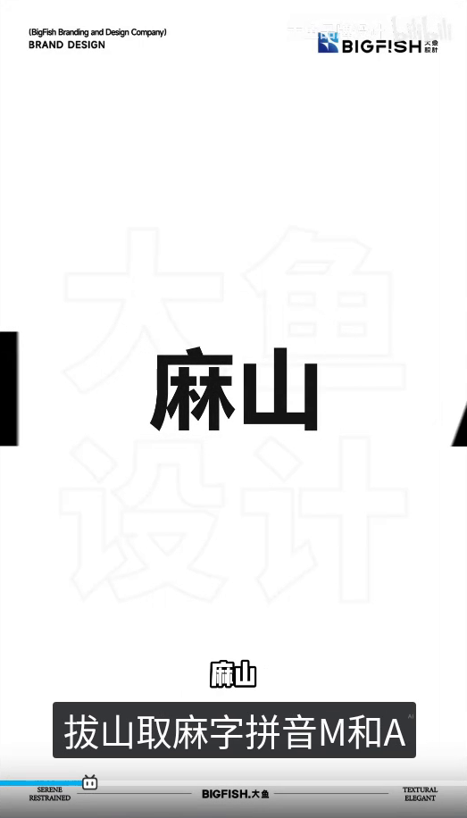

- **作者明确说法**：「麻山」
- **播放器字幕**：「拔山取麻字拼音M和A」
- **整理者观察**：白底上是汉字「麻山」，还不是拉丁字母。录屏在 69.833s 到 70.233s 之间有 0.400s 空隙，「麻山」如何进入画面没有捕到；约 70.233s 起已经是「麻山」二字。播放器字幕这一帧已经写成「拔山取麻字拼音M和A」，与片内不同。

### MA3 · 换成横排 MA

约 00:21（录屏 71.000s）

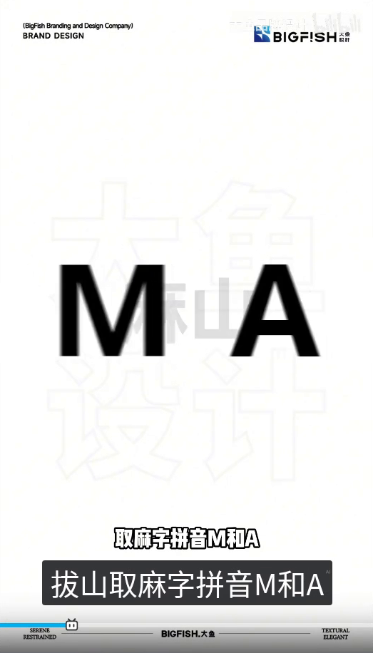

- **作者明确说法**：「取麻字拼音M和A」
- **播放器字幕**：「拔山取麻字拼音M和A」
- **整理者观察**：汉字「麻山」已经换成横排无衬线字母 MA。片内是「取麻字拼音M和A」，没有「拔山」；播放器字幕多出「拔山」。

### MA4 · MA 叠在群山照片上

约 00:22（录屏 72.433s）

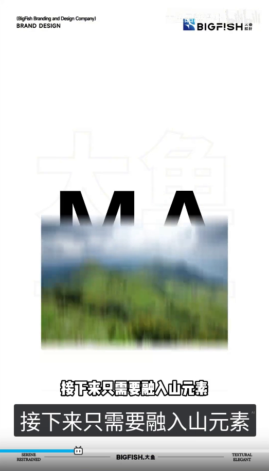

- **作者明确说法**：「接下来只需要融入山元素」
- **整理者观察**：字母 MA 叠在绿色群山照片上。约 72.500s 字母开始退去。录屏在 72.500s 到 72.900s 之间有 0.400s 空隙，字母如何完全退掉没有捕到。

### MA5 · 只剩群山照片

约 00:23（录屏 73.000s）

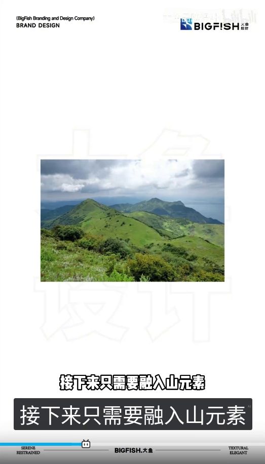

- **作者明确说法**：「接下来只需要融入山元素」
- **整理者观察**：字母已经看不见，只剩下群山照片。

### MA6 · MA 再次出现

约 00:24（录屏 74.533s）

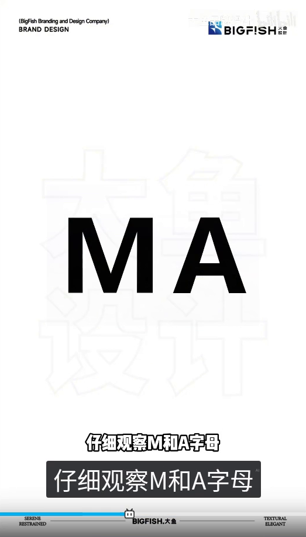

- **作者明确说法**：「仔细观察M和A字母」
- **整理者观察**：白底上再次出现黑色的横排 MA，此时仍是全黑。

### MA7 · 上半开始泛出绿色

约 00:25（录屏 75.800s）

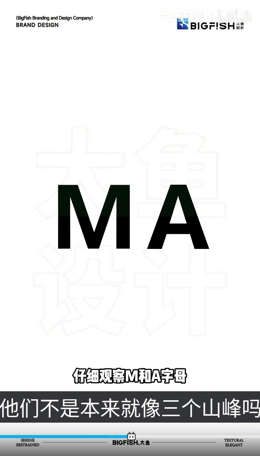

- **作者明确说法**：「仔细观察M和A字母」
- **整理者观察**：约 75.633s 到 75.767s 仍是全黑。本帧起，字母上半开始泛出很暗的绿，下半仍是黑色。

### MA8 · 上半绿、下半黑

约 00:26（录屏 76.400s）

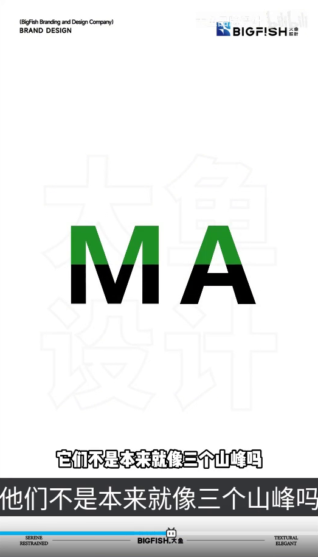

- **作者明确说法**：「他们不是本来就像三个山峰吗」
- **播放器字幕**：「它们不是本来就像三个山峰吗」
- **整理者观察**：约 75.967s 到 77.267s，字母稳定为上半绿、下半黑。分界是一条近水平线，大约在字母中腰：M 的两个上峰和上段是绿色，下腿是黑色；A 的三角顶是绿色，横笔和下腿是黑色。三个峰顶因此被标成绿色。这一帧正处于这段稳定状态里。76.467s 到 76.967s 有 0.500s 空隙，空隙两端都已经是这种上绿下黑。播放器字幕把「他们」写成了「它们」。

### MA9 · 回到全黑

约 00:27（录屏 77.500s）

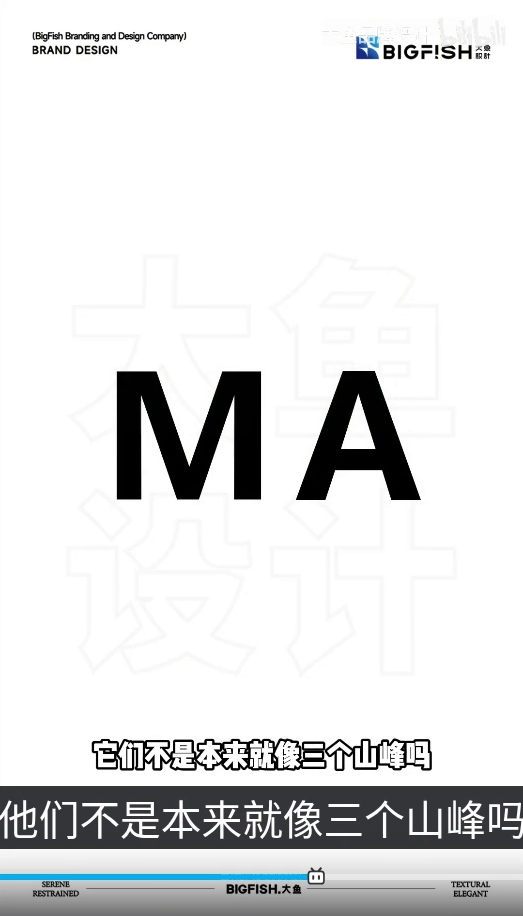

- **作者明确说法**：「他们不是本来就像三个山峰吗」
- **整理者观察**：约 77.333s 到 77.400s，上半的绿褪成很暗；本帧起恢复全黑，仍是拉丁 MA。录屏在 77.833s 到 78.267s 之间有 0.433s 空隙，字母怎样开始变成山形，这一段没有捕到。

### MA10 · 已向三峰变化

约 00:28（录屏 78.267s）

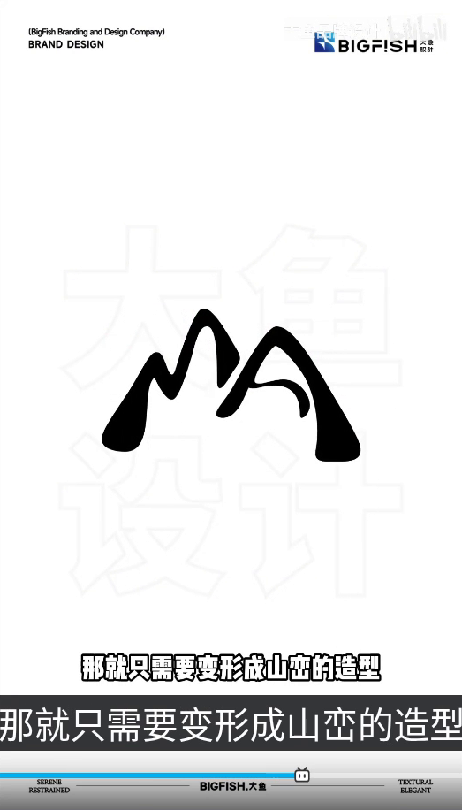

- **作者明确说法**：「那就只需要变形成山峦的造型」
- **整理者观察**：空隙之后的第一帧，已经是向三峰变化的中态：峰起得更高，外侧坡脚开始变圆，仍能读出左边是 M、右边是 A。此后到约 79.200s，这一形继续收成山峦。

### MA11 · 三峰山峦净标

约 00:29（录屏 79.200s）

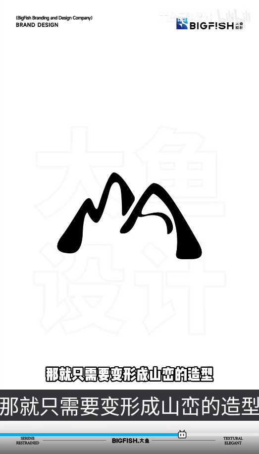

- **作者明确说法**：「那就只需要变形成山峦的造型」
- **整理者观察**：白底上的黑色净标已经稳住。三峰仍可读成 M 与 A：左为 M 的双峰，右为 A 的尖峰。A 的横笔从左腿接出，向右下弯曲，尖端与右腿之间有白缝。两外侧坡脚较粗，下端圆顿。这是这一案线标的黑色完成态。录屏在 79.200s 到 79.600s 之间有 0.400s 空隙，应用到照片上的起幅没有捕到。

### MA12 · 用到黄昏山峰照片上，麻山民宿

约 00:31（录屏 81.400s）

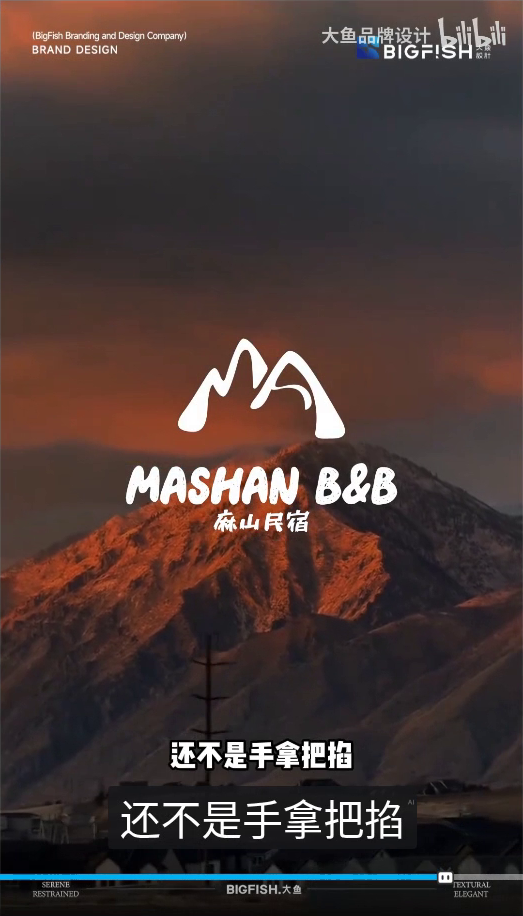

- **作者明确说法**：「还不是手拿把掐」
- **整理者观察**：同一件标志反白，叠在黄昏山峰照片上。字标为「MASHAN B&B」，其下是「麻山民宿」。

### 思路与前后关系（整理者分析，非作者原话）

先用气泡提出麻山民宿，再给出汉字「麻山」，换成拼音字母 MA，把 MA 叠到群山照片上又退去，然后让 MA 再次单独出现。随后字母上半变成绿色、下半仍是黑色，三个峰顶被标成绿色；作者在这一段说「他们不是本来就像三个山峰吗」。绿色退去后，字母收成三峰山峦：左峰来自 M 的双峰，右峰来自 A 的尖峰，A 的横笔仍从左腿接出，向右下弯，尖端与右腿之间留着白缝，外侧坡脚圆顿。上半的绿色是把三个峰顶标出来的可见提示。用到照片上时，字标写成「MASHAN B&B」和「麻山民宿」。这是整理者根据可见步骤作的归纳；片内说的是「取麻字拼音M和A」「仔细观察M和A字母」「他们不是本来就像三个山峰吗」「那就只需要变形成山峦的造型」。

---

## 案例四：LITON 与塔吊 / 莱腾工业

### LT1 · 气泡与片内：塔吊

约 00:34（录屏 84.200s）

- **作者明确说法**：「LOTON塔吊」。同一画面上，气泡里两行写着「什么时候轮到我呀」「LITON塔吊,求求了」。
- **播放器字幕**：「赖ten塔掉」
- **整理者观察**：白底中央是一个线框圆角气泡，尾朝右下。片内这一帧可见为「LOTON塔吊」（第二字是圆形的 O）；气泡第二行写成「LITON塔吊,求求了」，有逗号，并用 LITON。播放器字幕是「赖ten塔掉」。片内「求求了」「塔吊吗」是稍后分开出现的。

### LT2 · 原形：完整单词 LITON

约 00:36（录屏 86.467s）

- **作者明确说法**：「塔吊吗」
- **整理者观察**：白底上是完整的横排无衬线单词 LITON。录屏在 86.133s 到 86.467s 之间有 0.333s 空隙，单词如何进入画面没有捕到；本帧已经是完整单词。约 86.800s 片内说「让我们一个一个来」，约 87.833s 说「首先是字母L」，这两帧单词仍完整在画面上。

### LT3 · L 正在脱离并旋转

约 00:38（录屏 88.100s）

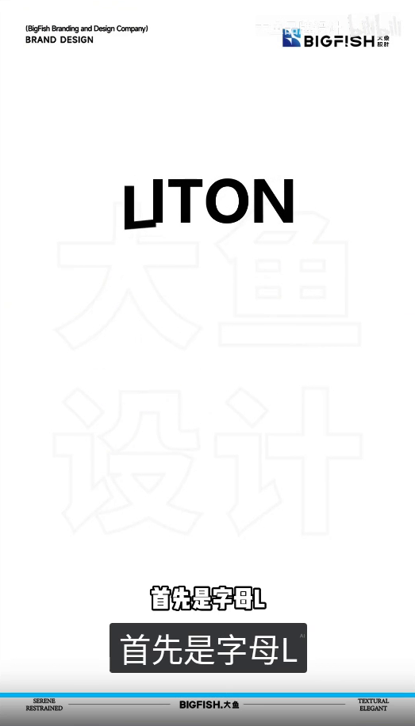

- **作者明确说法**：「首先是字母L」
- **整理者观察**：约 88.000s 起，L 从单词左端脱离并旋转。本帧里 L 已经转斜，与 I 交叠，右侧仍是 TON。还没有落到下方。

### LT4 · L 落在 ITON 下方，长臂向右上

约 00:38（录屏 88.267s）

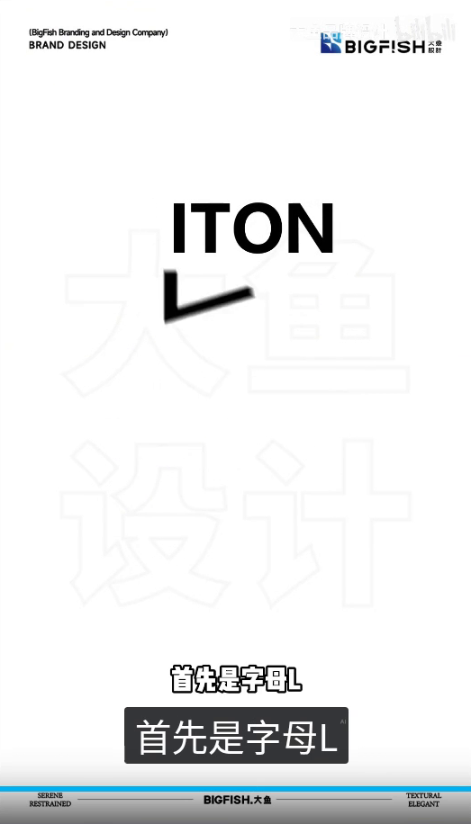

- **作者明确说法**：「首先是字母L」
- **整理者观察**：L 已经落在 ITON 下方，形状是左端短竖、长臂向右上。此后直到净标，这个 L 一直留在上方作斜臂。

### LT5 · I 仍与 TON 齐头，空隙之前

约 00:39（录屏 88.767s）

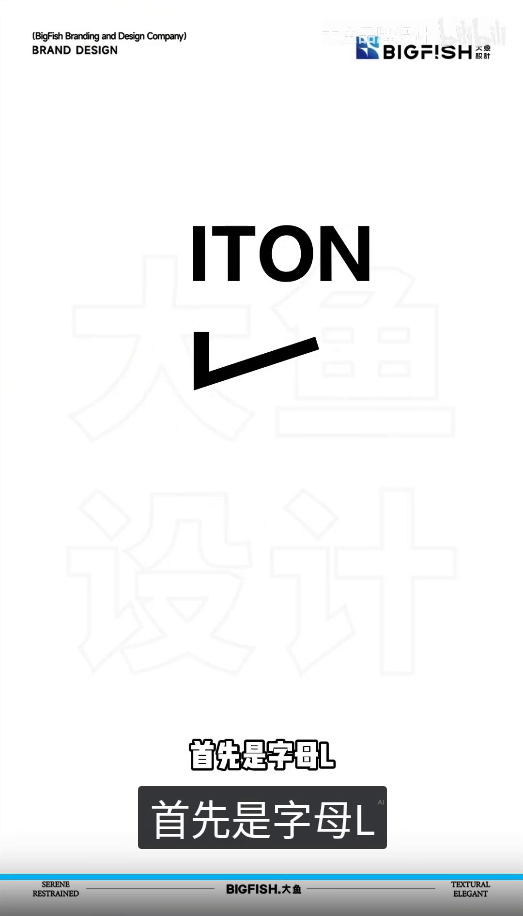

- **作者明确说法**：「首先是字母L」
- **整理者观察**：上方仍是完整的 ITON，I 还与 TON 齐头；下方仍是向右上的 L 斜臂。这是 88.767s 到 89.233s 这 0.467s 空隙之前的最后一帧。I 开始离开齐头位置的更早过程，若落在空隙里，没有捕到。

### LT6 · I 已下移，仍在 TON 左侧

约 00:39（录屏 89.233s）

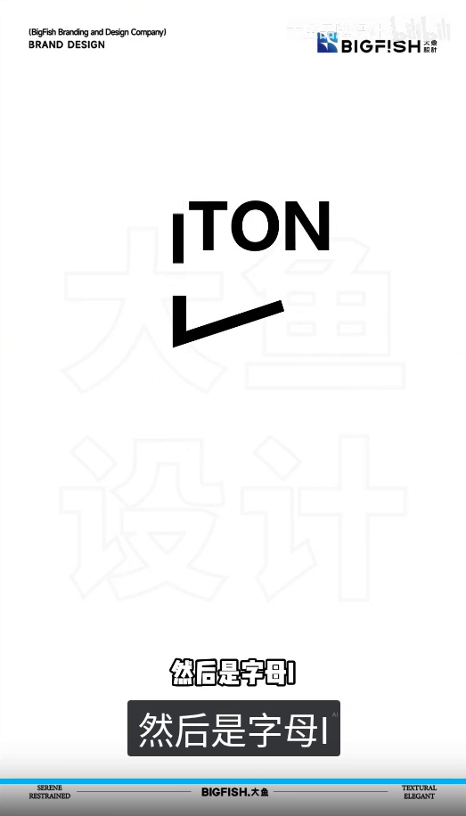

- **作者明确说法**：「然后是字母I」
- **整理者观察**：空隙之后的这一帧，I 已经从 TON 的齐头位置下移，仍在 TON 左侧、L 斜臂上方。L 仍是向右上的斜臂。I 是单独下移的，L 没有跟着改位置。

### LT7 · I 经过 L 的左竖

约 00:39（录屏 89.433s）

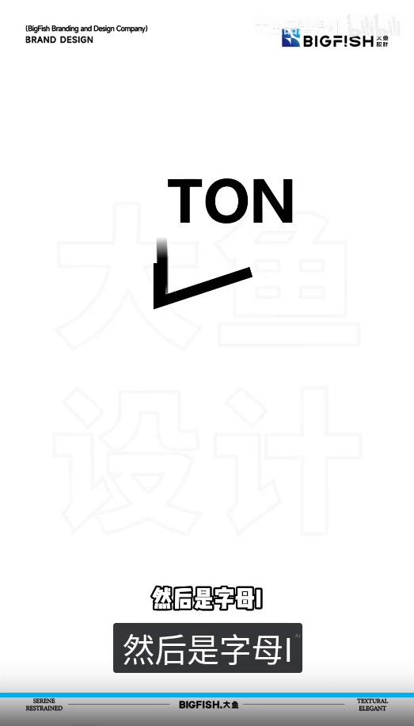

- **作者明确说法**：「然后是字母I」
- **整理者观察**：I 带着运动模糊，正经过 L 的左竖往下落。上方剩下 TON。L 仍是向右上的斜臂。

### LT8 · I 已落到 L 下方

约 00:39（录屏 89.600s）

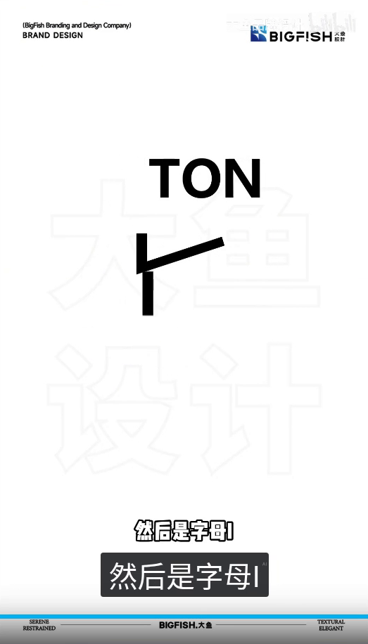

- **作者明确说法**：「然后是字母I」
- **整理者观察**：I 已经落到 L 下方，与 L 的左竖之间有空隙。上方仍是 TON。L 仍是向右上的斜臂。这一叠放保持到约 90.067s。录屏在 90.067s 到 90.533s 之间有 0.467s 空隙，T 怎样离开 TON、开始下落，这一段没有捕到。

### LT9 · T 正经过 L 臂下落，ON 已在臂右上

约 00:40（录屏 90.533s）

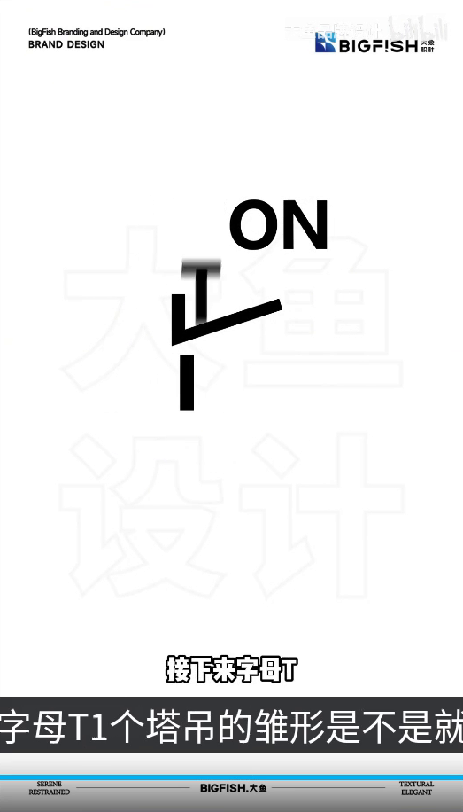

- **作者明确说法**：「接下来字母T」
- **整理者观察**：空隙之后的这一帧，ON 已经到了 L 臂右上；T 正带着运动模糊经过 L 臂往下落。I 仍在 L 下方。L 仍是上方那条向右上的斜臂。T 也是单独下移的。

### LT10 · T 已落到 I 下方，尚无长底横

约 00:41（录屏 91.200s）

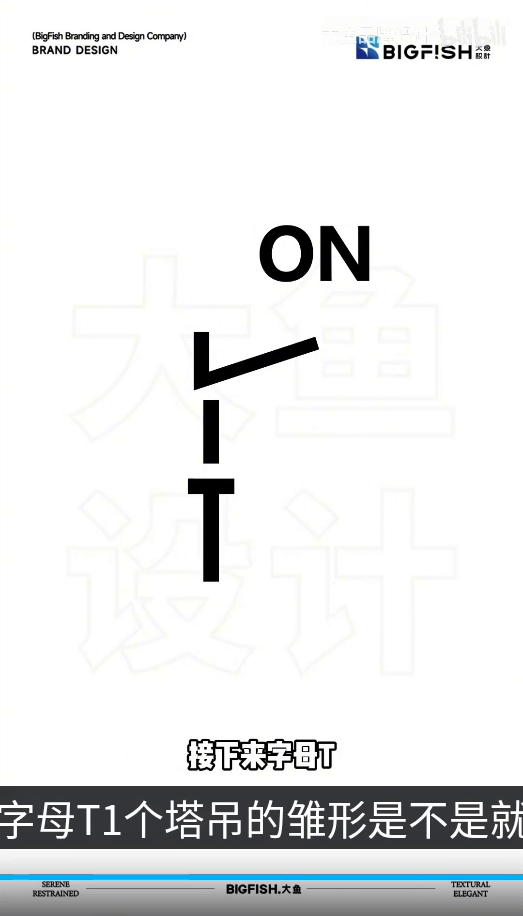

- **作者明确说法**：「接下来字母T」
- **整理者观察**：约 90.733s 起，T 已经落到 I 下方。本帧叠放清楚：最上是 L 的向右上斜臂，其下是 I，再下是 T，T 有顶横和竖笔，此时还没有长底横。ON 在臂的右上。片内这一帧仍是「接下来字母T」；约 91.267s 起换成「一个塔吊的雏形是不是就出来了」。约 91.433s 到 91.867s、92.767s 到 93.167s 两处空隙前后，这一叠放没有新的换位。

### LT11 · ON 沿臂下滑

约 00:43（录屏 93.533s）

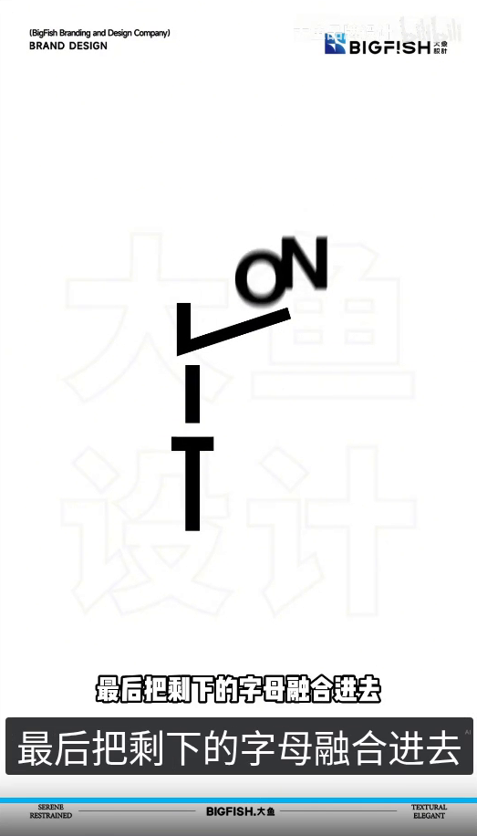

- **作者明确说法**：「最后把剩下的字母融合进去」
- **整理者观察**：约 93.467s 起，ON 沿着 L 的斜臂往下滑。本帧里 ON 已经离开臂的右上，正走在臂上。L、I、T 的上下位置没有变，T 仍只有顶横和竖笔。

### LT12 · N 在中、O 在下，尚无细缆和长底横

约 00:44（录屏 94.000s）

- **作者明确说法**：「最后把剩下的字母融合进去」
- **整理者观察**：N 已经落到中段，在 I 右侧；O 落到下方，在 T 右侧。O 是圆环，腔内是白空腔。L 仍是上方斜臂，I 在 L 下，T 在 I 下，仍只有顶横和竖笔。这一帧还看不见从臂垂下的细线，也还没有 T 下方的长底横。约 94.133s 仍是这一状态。录屏在 94.133s 到 94.467s 之间有 0.333s 空隙，细缆和长底横是怎样出现的，这一段没有捕到。

### LT13 · 已见细缆和后加的长底横

约 00:44（录屏 94.467s）

- **作者明确说法**：「最后把剩下的字母融合进去」
- **整理者观察**：空隙之后的这一帧，已经看见从 L 臂右段垂到 O 上缘的细线，以及 T 下方后加的向右长底横。底横伸到 O 下方，不与 O 相粘。O 仍是圆环，腔内是白空腔。各字位置与上一帧相同。

### LT14 · 白底黑净标

约 00:45（录屏 95.033s）

- **作者明确说法**：「最后把剩下的字母融合进去」
- **整理者观察**：白底上的黑色净标已经稳住，按位置是：最上为 L，左端短竖，长臂向右上；L 下方是 I，与臂不粘连；I 下方是独立的 T，有顶横、竖笔，加上后加的向右长底横；N 在 I 右侧；细缆从 L 臂右段垂下，从 N 近旁接到 O 的上缘；O 在 T 右侧，是圆环，腔内为白空腔。这是这一案线标的黑色完成态。录屏在 95.500s 到 96.067s 之间有 0.567s 空隙，应用到照片上并配上字标的起幅没有捕到。

### LT15 · 用到暮色塔架照片上，莱腾工业

约 00:46（录屏 96.400s）

- **作者明确说法**：「字母的创意是不是根本没什么难的」
- **整理者观察**：同一件标志反白，叠在暮色塔架、塔吊照片上。各字位置与净标相同。O 的空腔里透出的是背景塔架的结构与高光。标志右侧是竖排「莱腾工业」，再右侧是整词顺时针旋转 90° 的竖排「LITON INDUSTRY」。

### 思路与前后关系（整理者分析，非作者原话）

先用气泡提出塔吊，再给出完整单词 LITON，然后按 L、I、T、其余字母的顺序移位，而不是从空白里依次单独长出这三个字母。L 从左端脱离并旋转，落在下方，成为左端短竖、长臂向右上的斜臂，之后一直留在这个位置。I 单独从 TON 左侧下移，经过 L 的左竖，落到 L 下方。T 再单独离开上方的 TON，经过 L 臂，落到 I 下方，此时只有顶横和竖笔。ON 先到臂的右上，再沿臂下滑，N 落到中段、O 落到下方。随后才加上从臂垂到 O 的细缆，以及 T 下方那条向右的长底横。完成后，L 是吊臂，I 和 T 叠成塔身，细缆吊着空心的 O，长底横托在下面，同一件标既能读成塔吊，也能读回 LITON 这五个字母。O 始终是空腔：白底上是白空腔，用到照片上时腔内透出塔架。用到照片上时，字标写成「莱腾工业」和竖排旋转的「LITON INDUSTRY」。这是整理者根据各字可见位置作的归纳；片内说的是「让我们一个一个来」「首先是字母L」「然后是字母I」「接下来字母T」「一个塔吊的雏形是不是就出来了」「最后把剩下的字母融合进去」。

---

## 收束：三例并列

约 00:49（录屏 99.200s）

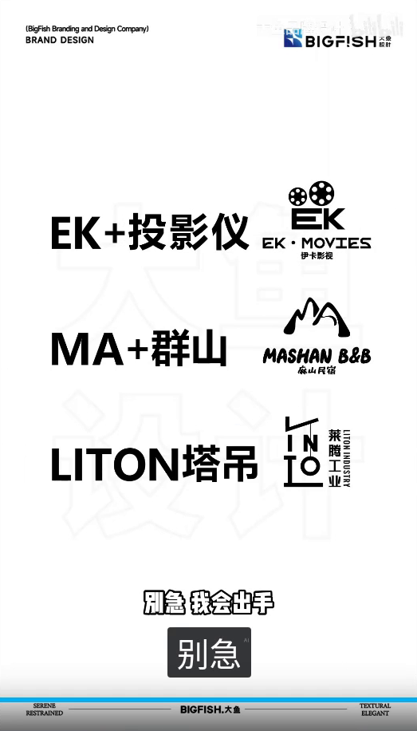

- **作者明确说法**：「别急 我会出手」
- **播放器字幕**：「别急」
- **整理者观察**：白底上是三行。左列是「EK+投影仪」「MA+群山」「LITON塔吊」；右列分别是三件净标，以及「EK · MOVIES」与「伊卡影视」、「MASHAN B&B」与「麻山民宿」、「莱腾工业」与竖排「LITON INDUSTRY」。左列是回顾里的配方写法，右列才是各案用到的字标。没有 AMIGO 一行。片内「别急」和「我会出手」之间有空格；这一帧的播放器字幕只见到「别急」。约 98.200s 第一行已经完整，下两行还在两侧进入；录屏在 98.200s 到 98.667s 之间有 0.467s 空隙，下两行如何就位没有捕到。约 98.667s 起三行已经稳住。
