# [看得懂的设计才是好设计！](https://www.bilibili.com/video/BV1QtbP6zEoC/)｜大鱼品牌设计

约视频时刻按本条录屏实测，约等于录屏秒减去 71.0s，范围 ±1s。图是录屏裁切，不是原片逐帧。

## 案例一：字母 G 与牛 / GUANLINGNIU・关岭牛

### GL1 · 开播前预览：字母 G 与黄牛照片

约预览（录屏 0.000s）

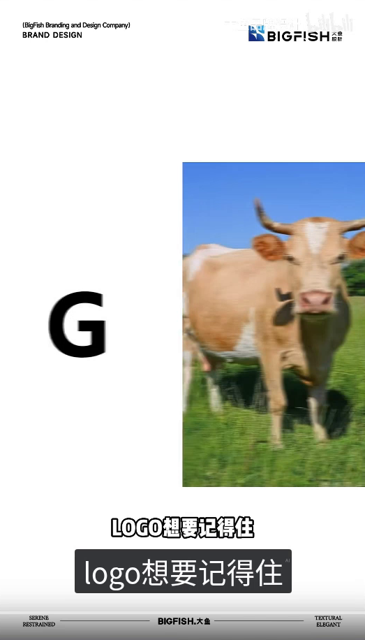

- **作者明确说法**：「LOGO想要记得住」
- **播放器字幕**：「logo想要记得住」
- **整理者观察**：这是开播前的暂停预览。白底上已经是设计源图：左边一个大写黑色 G，右边一张照片，蓝天草地里站着一头浅褐白花的黄牛。两件还是分开的。

### GL2 · 播放中仍是 G 与牛照片

约 2s（录屏 73.300s）

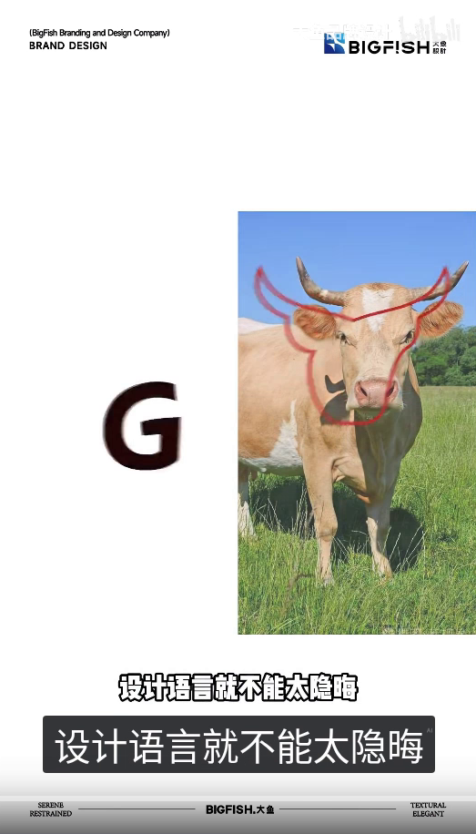

- **作者明确说法**：「设计语言就不能太隐晦」
- **整理者观察**：开播后源图还在。73.233 片内仍是「LOGO想要记得住」，这一帧才换成这句话；播放器字幕从 73.200 起已经先换成这句。73.400 仍是 G 和牛照片，G 略淡。此后录屏有 73.400→74.067 约 0.667s 的空隙，没有录到红标出现的中间过程。

### GL3 · 半透明红色牛头：外缘还有浅色叠边

约 3s（录屏 74.067s）

- **作者明确说法**：「设计语言就不能太隐晦」
- **整理者观察**：白底上已经是红色牛头：左右两只上弯的角。下部是红色粗笔写成的 G，G 内部是白腔；上部有两条斜向的浅缝，把左右角和额隔开。这一帧的红还是半透明的，外缘有一圈浅于本体的叠边。74.067 到 74.133 都是这一态。

### GL4 · 白底上的红色净标

约 3s（录屏 74.400s）

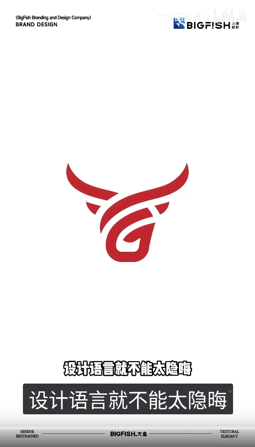

- **作者明确说法**：「设计语言就不能太隐晦」
- **整理者观察**：结构与上一帧相同，红色已经压实，外缘那圈浅色叠边收掉了。74.367 到 74.433 都是白底上的这一净标。74.500 起画布开始略离纯白；74.667 到 74.733 背景已是偏暖的浅灰，应用照片开始透出来，不再是白底净标。此后录屏有 74.733→75.367 约 0.633s 的空隙，没有录到应用完全铺上的中间过程。

### GL5 · 用到草原照片上，GUANLINGNIU／关岭牛

约 5s（录屏 76.000s）

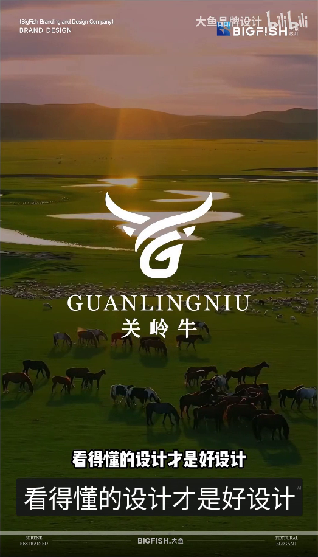

- **作者明确说法**：「看得懂的设计才是好设计」
- **整理者观察**：浅色牛头标用到一张夕光草原、远处有河湾、近处有畜群的照片上，结构与红净标相同。上行英文是连写的全大写 GUANLINGNIU，字距较宽；下行中文是「关 岭 牛」三字，字间留白。这一案没有进入片尾三行回顾。

### 思路与前后关系（整理者分析，非作者原话）

开播前的预览里就已经放上字母 G 和黄牛照片。播放中这两件还保持分开，随后在白底上收成红色牛头：角是上弯的双角，头身里是 G。最先录到的红标还带着半透明和浅色叠边，随后颜色压实，成为白底净标。再把它用到草原照片上，字标写成 GUANLINGNIU 和「关岭牛」。这是整理者根据可见结构作的归纳，片内说的是「LOGO想要记得住」「设计语言就不能太隐晦」「看得懂的设计才是好设计」。

---

## 案例二：字母 G 与鹿 / 闺中鹿·GUIZHONGLU

### LZ1 · 气泡：闺中鹿，用字母 G

约 8s（录屏 78.500s）

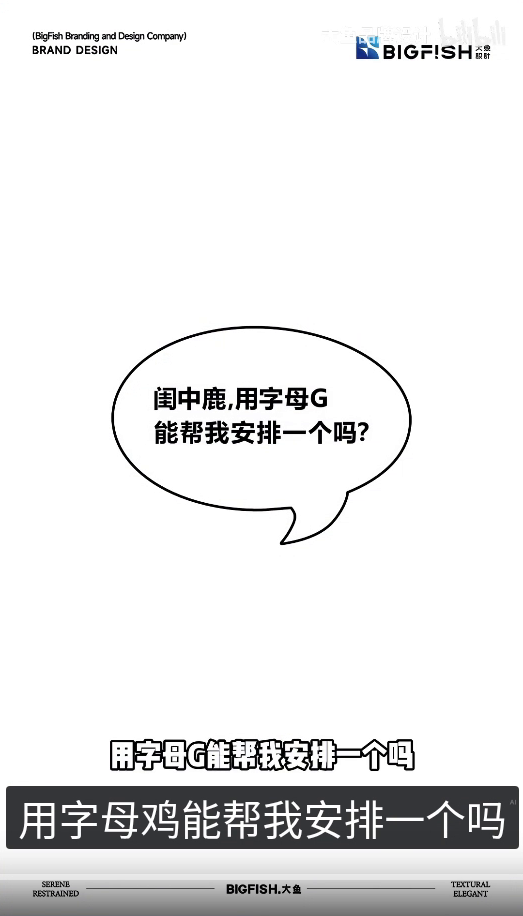

- **作者明确说法**：「用字母G能帮我安排一个吗」
- **播放器字幕**：「用字母鸡能帮我安排一个吗」
- **整理者观察**：白底上出现对话泡，两行是「闺中鹿,用字母G」和「能帮我安排一个吗?」。首字是「闺」，字母是拉丁 G，逗号在「鹿」后。77.000 片内已经出现「闺中鹿」；播放器字幕从 76.867 起写成「归中路」。

### LZ2 · 只留下大写 G

约 9s（录屏 80.000s）

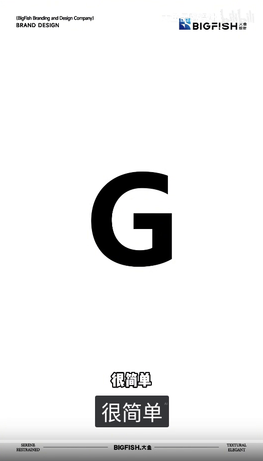

- **作者明确说法**：「很简单」
- **整理者观察**：气泡已经抽走，白底上只剩一个黑色大写 G。80.767 起片内是「我们观察一下字母G」，播放器字幕写成「我们观察一下字母鸡」。

### LZ3 · 紫色只涂在 G 的内栏

约 12s（录屏 82.700s）

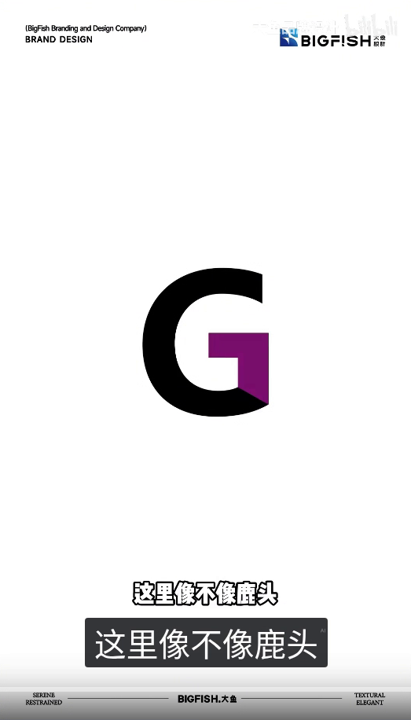

- **作者明确说法**：「这里像不像鹿头」
- **整理者观察**：G 的本体仍是黑色，只有内侧那一截横栏是紫色。这是局部提示，还不是整字变紫。片内这句从 82.133 起出现。此后录屏有 82.700→83.433 约 0.733s 的空隙，没有录到整字变紫的中间过程。

### LZ4 · 整个 G 变成深紫

约 12s（录屏 83.500s）

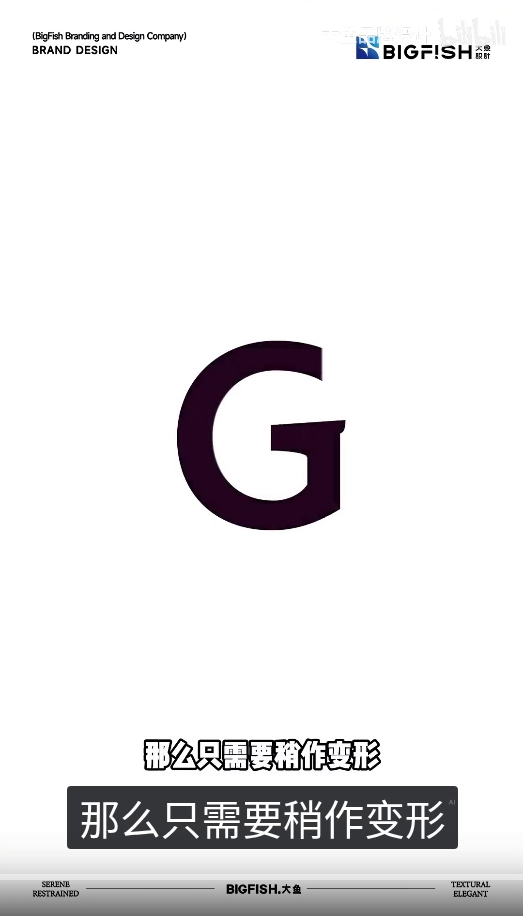

- **作者明确说法**：「那么只需要稍作变形」
- **整理者观察**：整个 G 已经是深紫色，还没有鹿角。83.433 到 84.033 片内都是这句话。此后录屏有 84.033→84.733 约 0.700s 的空隙，没有录到鹿角出现的中间过程。

### LZ5 · 内横收成吻，上方是独立的三叉鹿角

约 14s（录屏 84.733s）

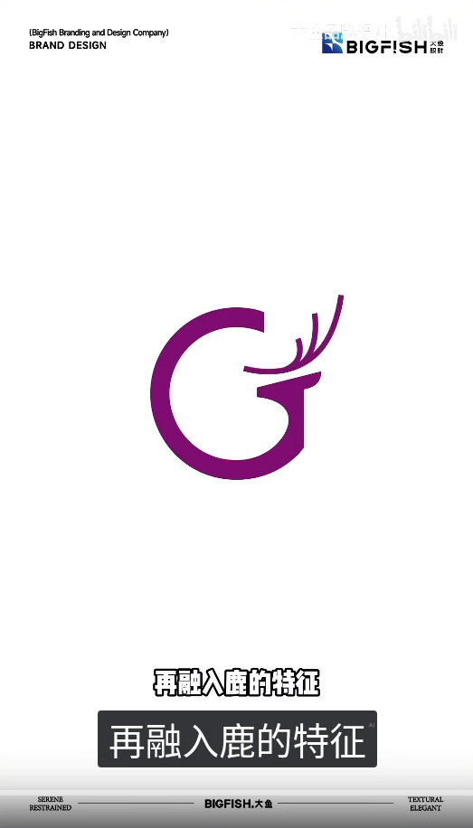

- **作者明确说法**：「再融入鹿的特征」
- **整理者观察**：G 内侧横笔的前端已经收成尖吻。它的上方是一条独立的弧形枝：一条横底上伸出三枝鹿角，朝向右上。角的下缘和吻端之间有一条清楚的白缝，角并不从内栏上端连出来。85.300 仍是这一净标。此后录屏有 85.300→86.033 约 0.733s 的空隙，没有录到应用铺上的中间过程。

### LZ6 · 用到水边鹿照片上，闺中鹿·GUIZHONGLU

约 16s（录屏 87.300s）

- **作者明确说法**：「是不是轻轻松松」
- **播放器字幕**：「是不是轻轻松松MK加咖啡」
- **整理者观察**：浅色标志用到一张鹿站在水边的照片上，结构与紫净标相同。字标是「闺中鹿·GUIZHONGLU」：首字是门字框的「闺」，中间是间隔点，英文全大写连写。86.033 起已经是这一应用，当时片内是「一个简约又形象的LOGO」，播放器字幕里的 logo 是小写。

### 思路与前后关系（整理者分析，非作者原话）

先用对话泡提出「闺中鹿」和字母 G，再只留下 G。观察时先把内侧横栏标成紫色，随后整个 G 变成深紫。再把内横前端收成吻，并在上方单独加上三叉鹿角，角和吻之间留白。用到水边鹿的照片上，字标写成「闺中鹿·GUIZHONGLU」。这是整理者根据可见结构作的归纳，片内说的是「用字母G能帮我安排一个吗」「很简单」「我们观察一下字母G」「这里像不像鹿头」「那么只需要稍作变形」「再融入鹿的特征」「一个简约又形象的LOGO」「是不是轻轻松松」。

---

## 案例三：字母 MK 与咖啡 / MK · COFFEE

### MK1 · 气泡：MK+咖啡

约 19s（录屏 89.900s）

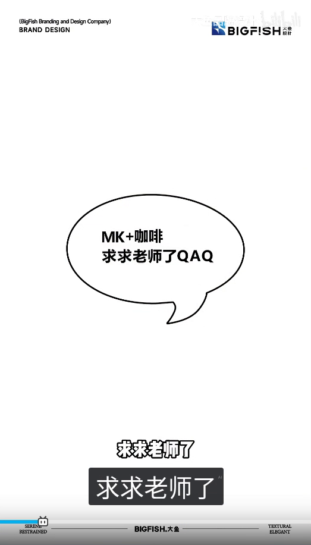

- **作者明确说法**：「求求老师了」
- **整理者观察**：白底上出现对话泡，两行是「MK+咖啡」和「求求老师了QAQ」。片内和播放器字幕都是「求求老师了」，没有 QAQ。88.600 片内先是「MK加咖啡」；当时播放器字幕还停在上一句长句上。

### MK2 · 找出共同笔画：两竖分开，带着低亮的深红棕色

约 22s（录屏 93.167s）

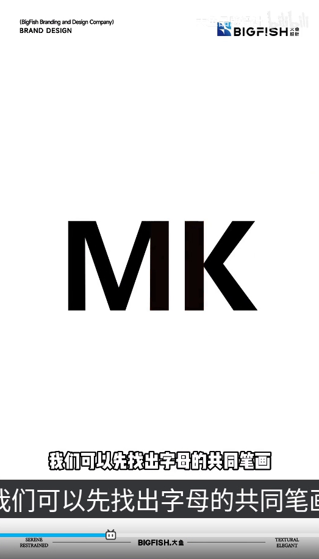

- **作者明确说法**：「我们可以先找出字母的共同笔画」
- **整理者观察**：粗黑体的 M 和 K 并排。M 的右竖和 K 的左竖明显分开，中间是一条清楚的白缝，两竖并不重叠。这两竖颜色近黑，但带着一层很低亮的深红棕色；M 左侧那一竖仍接近纯黑。91.800 起，这两条相邻竖笔上已经能看到同类色偏。91.200 片内是「这个也不难」。此后录屏有 93.167→93.933 约 0.767s 的空隙，没有录到字母改成衬线体的中间过程。

### MK3 · 衬线重构：上下错开，中间仍留白缝

约 23s（录屏 94.000s）

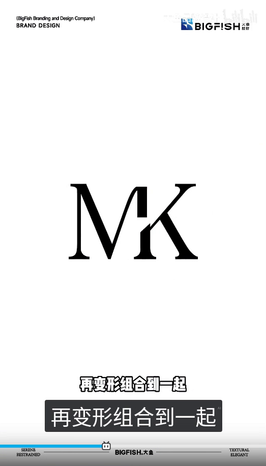

- **作者明确说法**：「再变形组合到一起」
- **整理者观察**：已经改成高对比的衬线 MK。M 的右上是一截短竖，K 的左侧是斜笔，两笔上下错开，中间仍有白缝，并没有接到一起，也不是共用一根竖。这一帧还没有咖啡豆。片内这句从 93.933 起出现。

### MK4 · 咖啡豆开始替掉 M 的右上短竖

约 24s（录屏 95.233s）

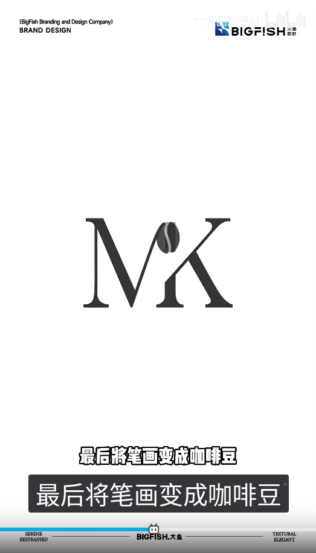

- **作者明确说法**：「最后將笔画变成咖啡豆」
- **播放器字幕**：「最后将笔画变成咖啡豆」
- **整理者观察**：M 右上原来那截短竖的位置上，已经出现一枚还偏灰的咖啡豆，中缝可见。K 的斜笔和下方短竖仍是独立的，没有和豆子连成一件。片内这一帧「將」是繁体，「后」是简体；播放器字幕里的「将」是简体。95.800、96.533 片内仍是「將」。

### MK5 · 豆子压实，K 仍独立

约 26s（录屏 96.533s）

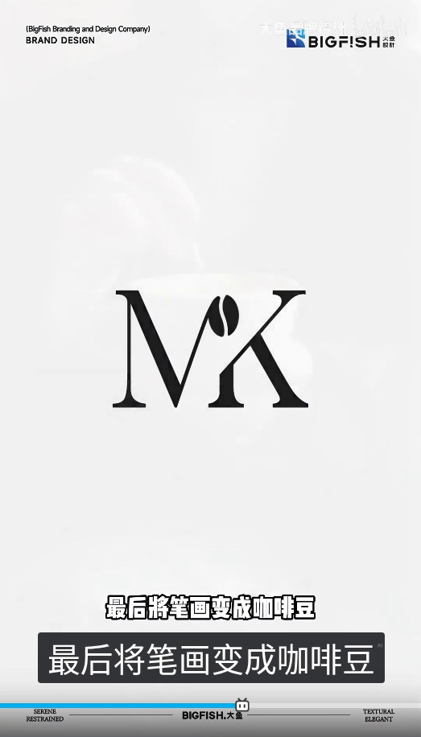

- **作者明确说法**：「最后將笔画变成咖啡豆」
- **播放器字幕**：「最后将笔画变成咖啡豆」
- **整理者观察**：豆子已经压成实黑，带一条浅色中缝，位置仍是原来 M 右上短竖的位置。K 还是独立的。背景不再是纯白，已经开始透出杯子和蒸汽。此后 97.133 片内是「你看」，播放器字幕已经超前到下一句；97.133→97.900 约 0.767s 的空隙里，应用还在继续铺上。

### MK6 · 用到捧杯照片上，MK · COFFEE

约 27s（录屏 98.467s）

- **作者明确说法**：「一个简约又耐看的LOGO」
- **播放器字幕**：「一个简约又耐看的logo是不是……」
- **整理者观察**：浅色标志用到一张双手捧着杯子的暗调照片上，结构与上一帧相同。字标只有英文 MK · COFFEE，中间是间隔点，两词都是全大写，没有中文店名。97.900 片内首次出现「一个简约又耐看的LOGO」；99.200 片内收成「是不是出来了」。

### 思路与前后关系（整理者分析，非作者原话）

先用对话泡提出 MK 和咖啡，再并排放上黑体 M 和 K。相邻的两竖中间留着白缝，这两竖带着低亮的深红棕色，用来提示共同笔画。随后改成衬线体：M 的右上短竖和 K 的左斜笔上下错开，中间仍留缝，还没有豆子。再把 M 右上那截短竖换成咖啡豆，K 保持独立。用到捧杯照片上，字标写成 MK · COFFEE。这是整理者根据可见结构作的归纳，片内说的是「MK加咖啡」「求求老师了」「这个也不难」「我们可以先找出字母的共同笔画」「再变形组合到一起」「最后將笔画变成咖啡豆」「你看」「一个简约又耐看的LOGO」「是不是出来了」。

---

## 案例四：字母 R 与自行车 / REVOLUTION・革命骑行

### RV1 · 气泡：用字母 R 做自行车

约 31s（录屏 101.767s）

- **作者明确说法**：「用字母R应该怎么设计呢」
- **整理者观察**：白底上出现对话泡，三行是「我是做自行车的」「用字母R应该怎么」「设计呢?」。100.500 片内先是「我是做自行车的」，播放器字幕从 99.733 起已经超前到这句。

### RV2 · 对比方案：线描自行车的车架上写着 R

约 32s（录屏 103.500s）

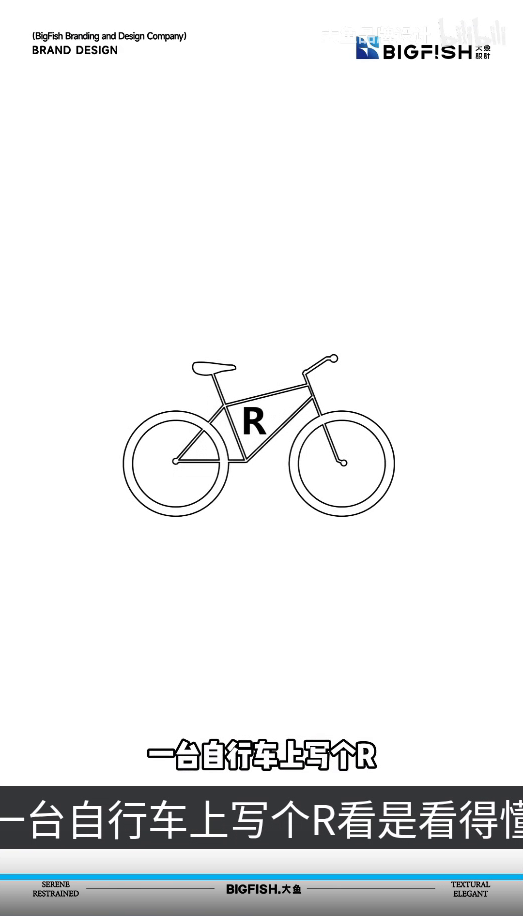

- **作者明确说法**：「一台自行车上写个R」
- **播放器字幕**：「一台自行车上写个R看是看得懂……」
- **整理者观察**：这是被拿来对照的方案，不是后来的标志。画面是一辆带座、把、两轮和三角车架的线描车，主三角里写着一个正体 R。104.533 片内是「看是看得懂」；105.667、106.267 片内是「但未免太普通了」。此后录屏有 106.267→106.967 约 0.700s 的空隙，线描车在这段里被撤掉。

### RV3 · 回退：只留下正体 R

约 36s（录屏 107.000s）

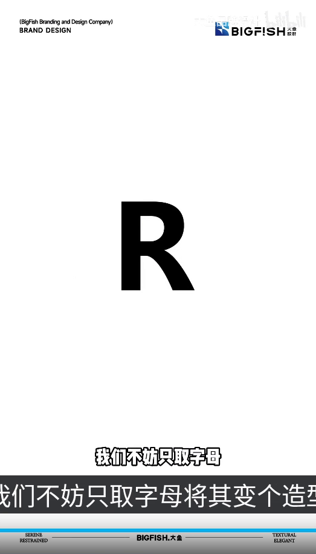

- **作者明确说法**：「我们不妨只取字母」
- **播放器字幕**：「我们不妨只取字母将其变个造型」
- **整理者观察**：线描车已经撤掉，白底上只剩一个正体黑色 R。这是回退到只取字母，不是又一个对比方案。片内这句从 106.967 起出现。

### RV4 · R 拉成斜切的运动形

约 37s（录屏 108.267s）

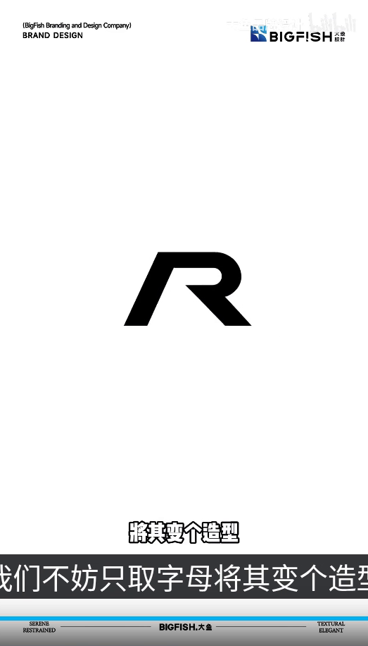

- **作者明确说法**：「將其变个造型」
- **播放器字幕**：「我们不妨只取字母将其变个造型」
- **整理者观察**：R 已经拉成左竖外斜、右腿斜切的运动形，仍是单独字母，还没有轮，也没有盔。片内「將」是繁体。

### RV5 · 左轮开始出现，还没有盔

约 38s（录屏 108.900s）

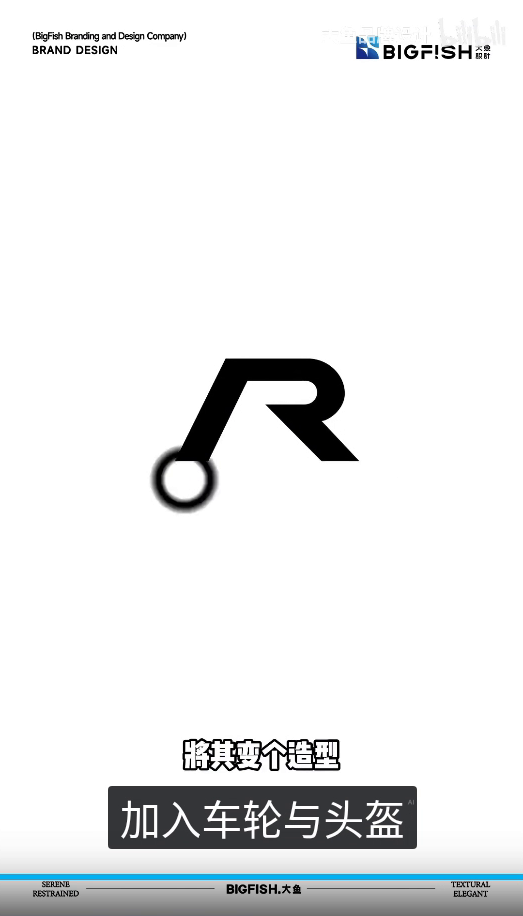

- **作者明确说法**：「將其变个造型」
- **播放器字幕**：「加入车轮与头盔」
- **整理者观察**：左下已经出现一只边缘发虚的车轮，108.800 时这只轮更小、更淡。右轮和头盔都还没有。片内「將」是繁体。此后录屏有 108.900→109.567 约 0.667s 的空隙，没有录到右轮和头盔落下的中间过程。

### RV6 · 轮和盔已经加上，还没有闪电，笔画与轮圈叠在一起

约 39s（录屏 109.567s）

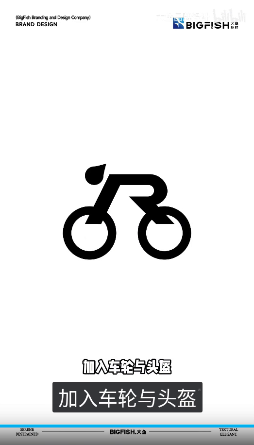

- **作者明确说法**：「加入车轮与头盔」
- **整理者观察**：左右两只车轮和左上那枚泪滴形头盔都已经在。R 的左腿压在左轮上，右斜腿压在右轮上，轮圈仍是闭合的，没有开口，也还没有闪电。109.567 到 109.967 都是这一态。110.033 起，左轮里开始冒出很淡的闪电尖。

### RV7 · 半透明叠色：轮圈与 R 重叠，闪电已经可见

约 39s（录屏 110.233s）

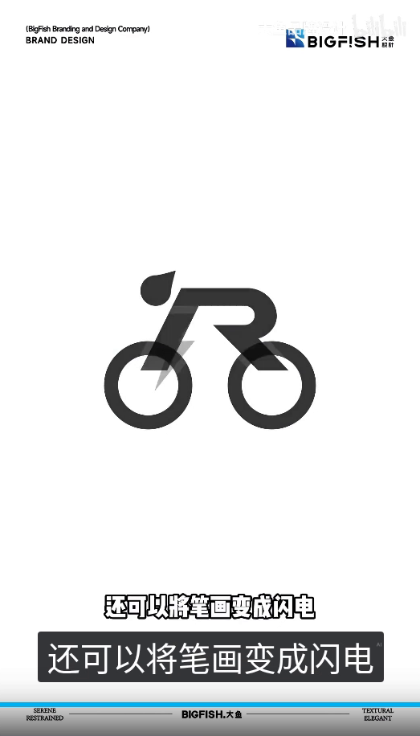

- **作者明确说法**：「还可以將笔画变成闪电」
- **播放器字幕**：「还可以将笔画变成闪电」
- **整理者观察**：标志整体变成半透明的灰。轮圈和 R 仍然叠在一起，重叠处颜色更深。左轮里已经能看见一道闪电。110.167 已经是这一态。片内「將」是繁体。此后录屏有 110.233→110.867 约 0.634s 的空隙，没有录到重叠被撤开、开口留白的中间过程。

### RV8 · 净标：轮圈上方开口，闪电与斜腿都隔着白缝

约 40s（录屏 110.867s）

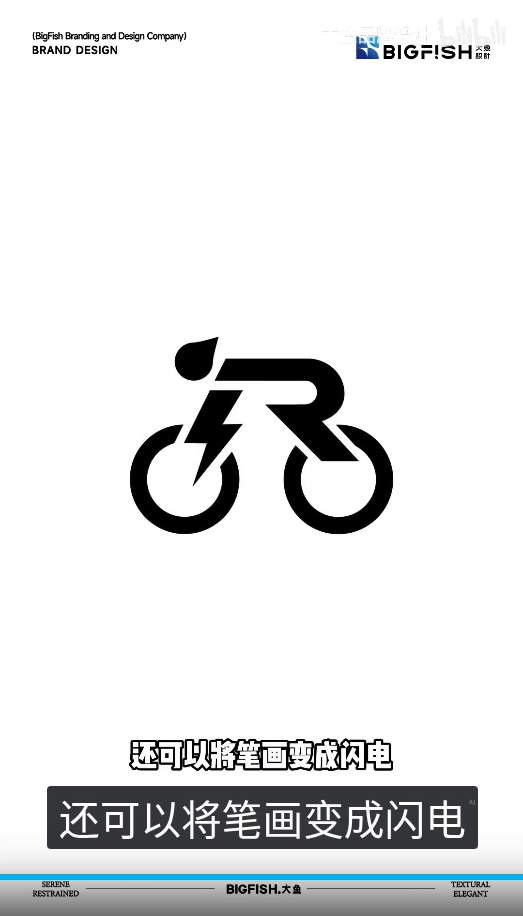

- **作者明确说法**：「还可以將笔画变成闪电」
- **播放器字幕**：「还可以将笔画变成闪电」
- **整理者观察**：黑色已经压实。左轮上方开口，和中间那道实心闪电隔着白缝；右轮上方也开口，和 R 的右斜腿隔着白缝。原先压在轮上的重叠已经撤掉。左上是尖朝右的泪滴形头盔，R 构成车身。112.533 仍是白底上的这一净标；112.767 起背景开始偏灰，应用照片开始透出。112.167 起片内换成「凸显急速的概念」，播放器字幕写成「凸显极速的概念」。此后录屏有 112.833→113.467 约 0.633s 的空隙，没有录到应用完全铺上的中间过程。

### RV9 · 用到骑手近景上，REVOLUTION／革命骑行

约 42s（录屏 113.500s）

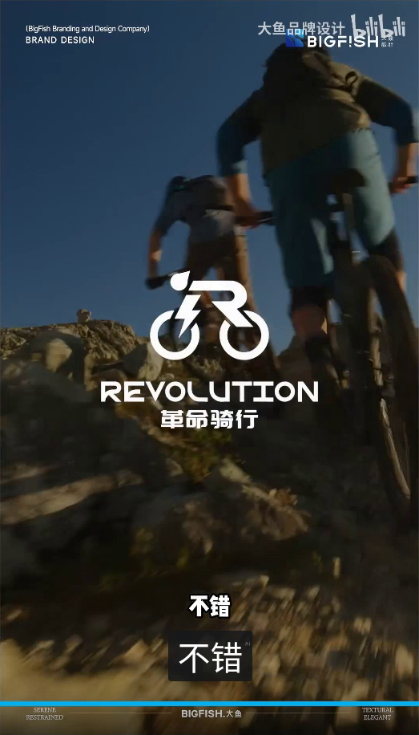

- **作者明确说法**：「不错」
- **整理者观察**：浅色标志用到一张偏暗的骑手近景照片上，结构与黑净标相同。上行英文是全大写、字距较宽的 REVOLUTION，下行中文是「革命骑行」四字。片内这句从 113.467 起出现。

### RV10 · 用到林道照片上

约 44s（录屏 114.767s）

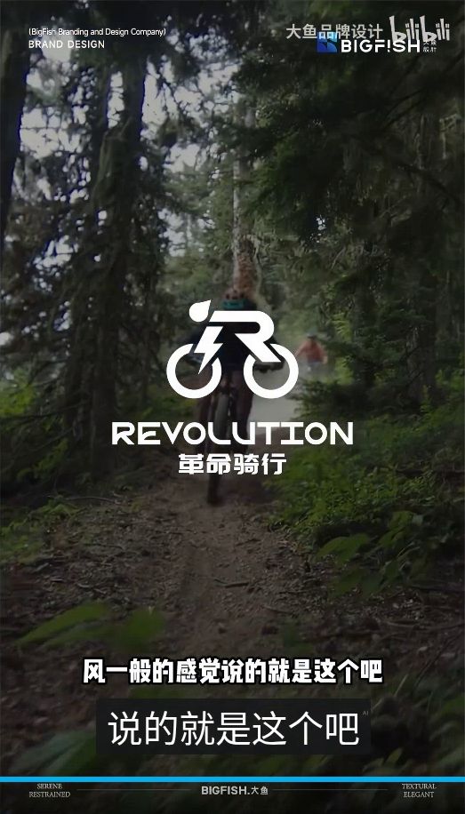

- **作者明确说法**：「风一般的感觉说的就是这个吧」
- **播放器字幕**：「说的就是这个吧」
- **整理者观察**：同一套浅色标志和字标，用到另一张林间土路、车手背向镜头的照片上。114.000 片内已经是这句长句，当时播放器字幕还只是「风一般的感觉」。

### 思路与前后关系（整理者分析，非作者原话）

先用对话泡提出用字母 R 做自行车。先出现的是一辆线描车上写着 R 的对照方案，作者说「但未免太普通了」，随后把车撤掉，只留下 R。R 先拉成斜切的运动形，再从左下淡入一只车轮；空隙之后，左右两轮和头盔都在了，但笔画还压在轮圈上，还没有闪电。接着整枚变成半透明叠色，闪电在左轮里显现。再收成黑色净标：两轮上方开口，闪电和右斜腿都与轮圈隔着白缝。最后用到骑手近景和林道两张照片上，字标写成 REVOLUTION 和「革命骑行」。这是整理者根据可见结构作的归纳，片内说的是「用字母R应该怎么设计呢」「一台自行车上写个R」「看是看得懂」「但未免太普通了」「我们不妨只取字母」「將其变个造型」「加入车轮与头盔」「还可以將笔画变成闪电」「凸显急速的概念」「不错」「风一般的感觉说的就是这个吧」。

---

## 收束：三行回顾

约 45s（录屏 116.500s）

- **作者明确说法**：「还有没有难搞的」
- **整理者观察**：白底上是三行回顾，没有关岭牛／片头那一案。第一行是「G+鹿元素」，右侧是紫色 G 加鹿角，以及「闺中鹿·GUIZHONGLU」；第二行是「MK+咖啡」，右侧是 MK 加豆标，以及「MK · COFFEE」；第三行是「R+自行车」，右侧是自行车标，以及 REVOLUTION／革命骑行。116.067 起已经是这三行，片内同一句。117.400 起片内是「别急 我会出手」，「急」和「我」之间有空；播放器字幕只有「我会出手」。
