# 只要将理念转化为元素,logo设计也就手拿把掐｜大鱼品牌设计

## 案例一：9 与大象

### 九1 · 9 与大象照片并置

约 0.8s（录屏 10.8s）

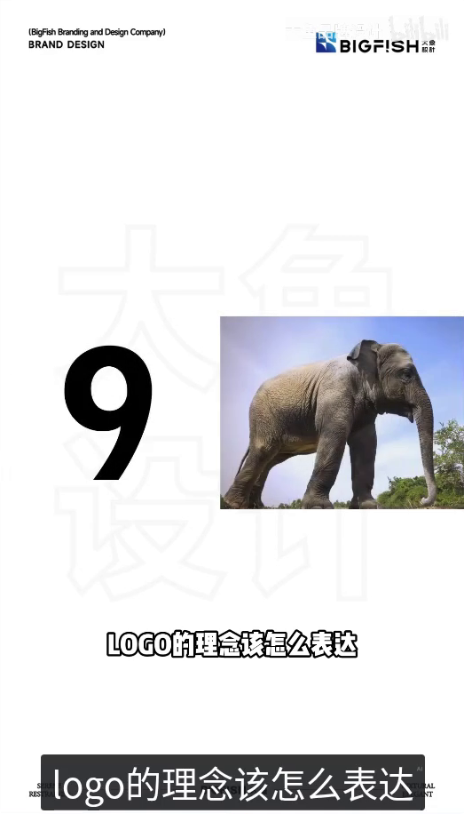

- **作者明确说法**：「LOGO的理念该怎么表达」
- **播放器字幕**：「logo的理念该怎么表达」
- **整理者观察**：白底上左侧是黑色印刷体数字 9，右侧是一张大象的彩色照片，两者分开，还没有套叠。

### 九2 · 9 叠到象照上

约 2.2s（录屏 12.2s）

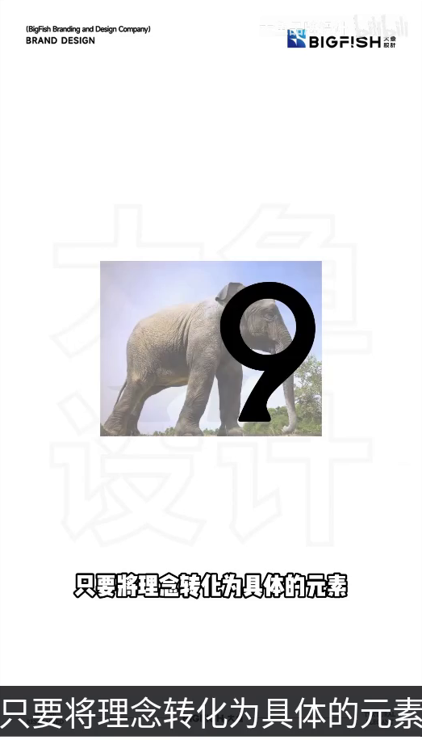

- **作者明确说法**：「只要將理念转化为具体的元素」
- **整理者观察**：大象照片移到画面中央。黑色的 9 叠在象的头和鼻一侧，照片的象身、天空和地面都还在。

### 九3 · 照片未去，左侧已现黑色象身

约 2.4s（录屏 12.4s）

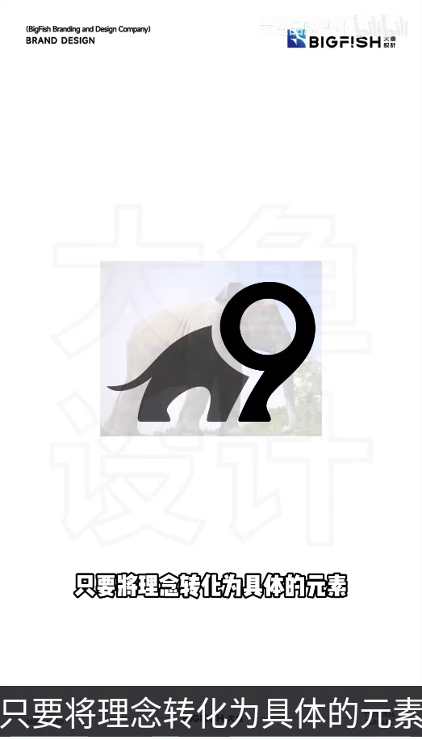

- **作者明确说法**：「只要將理念转化为具体的元素」
- **整理者观察**：照片还没有拿掉，天空、地面和象的浅色体表仍可见。左侧已经叠上一块黑色象身剪影，带出尾巴和腿；右侧的印刷体 9 仍压在头颈位置。这是由照片叠合转向黑色图形的中间态。

### 九4 · 黑色 9 象图形

约 3s（录屏 13s）

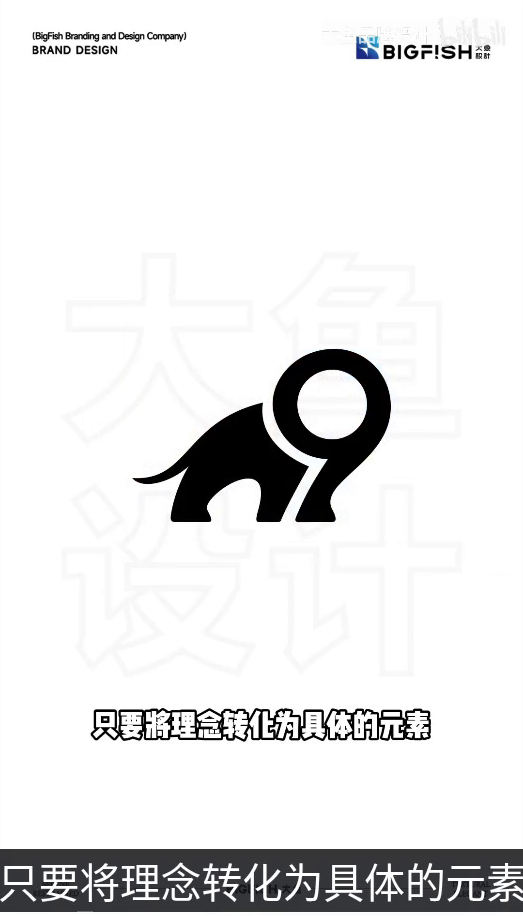

- **作者明确说法**：「只要將理念转化为具体的元素」
- **整理者观察**：彩色照片已经不在。白底上只剩一枚黑色图形：左侧是象的身、尾和腿，右侧 9 的字腔留作头部，竖笔落下成为前肢。

### 九5 · 反白用到象群照片上

约 4.2s（录屏 14.2s）

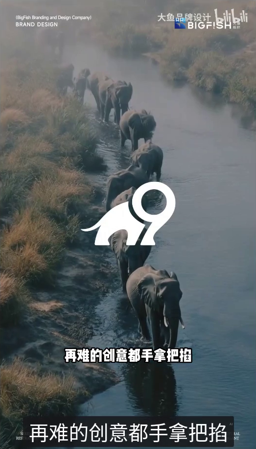

- **作者明确说法**：「再难的创意都手拿把掐」
- **整理者观察**：完成态标志反白，压在河边象群的照片上。轮廓与九4同类。

### 思路与前后关系（整理者分析，非作者原话）

先把印刷体 9 和大象照片分开并置（九1），再把 9 叠到象的头颈一侧（九2）。照片还未拿掉时，左侧已经收出黑色的象身、尾和腿（九3），随后照片退去，只留下这枚黑色 9 象图形（九4），并反白用到象群照片上（九5）。9 的圈笔落在头部位置，竖笔成为前肢，左侧块面补出象身与尾巴，所以同一枚图形既能读出数字 9，也能读出一头象。

---

## 案例二：蜂蜜与很棒

### 蜜1 · 蜂蜜+很棒，怎么搞

约 6.1s（录屏 16.1s）

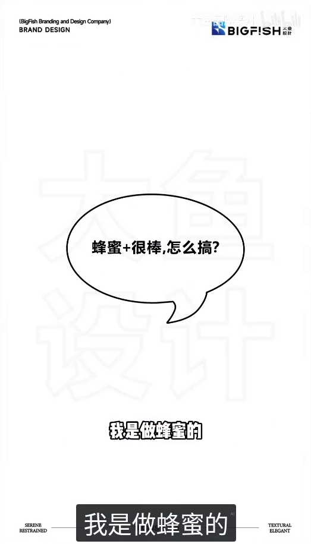

- **作者明确说法**：「我是做蜂蜜的」
- **整理者观察**：白底上一个线框气泡，内文为两行「蜂蜜+很棒,怎么搞?」。片内大字此时是「我是做蜂蜜的」。

### 蜜2 · 很棒、蜂蜜二字

约 9.2s（录屏 19.2s）

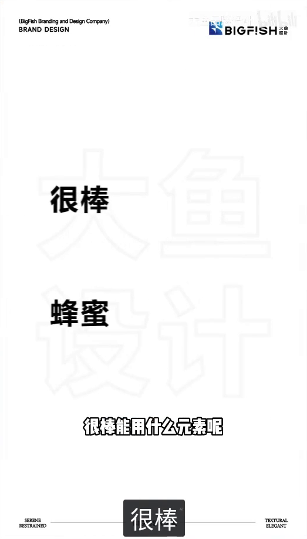

- **作者明确说法**：「很棒能用什么元素呢」
- **播放器字幕**：「很棒」
- **整理者观察**：气泡已不在。白底上下排列着黑体「很棒」和「蜂蜜」，还没有照片，也还没有箭头。

### 蜜3 · 大拇指照片

约 10.6s（录屏 20.6s）

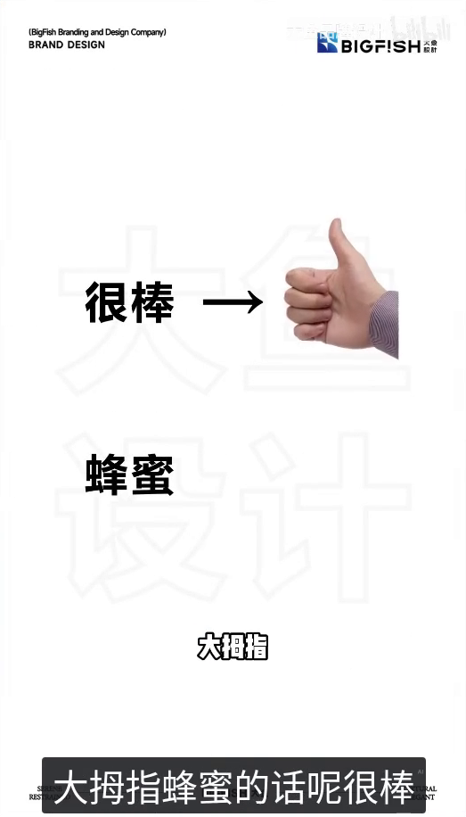

- **作者明确说法**：「大拇指」
- **播放器字幕**：「大拇指蜂蜜的话呢很棒」
- **整理者观察**：「很棒」右侧出现黑色箭头，箭头指向一张竖起拇指的手部照片。下方「蜂蜜」仍单独排着，还没有对应的图形。

### 蜜4 · 蜂蜜一侧也加上箭头

约 11.6s（录屏 21.6s）

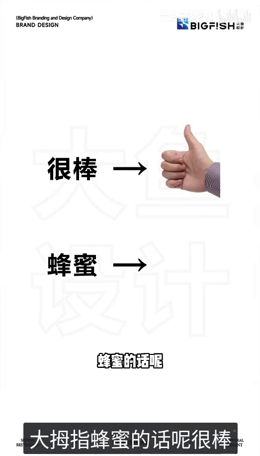

- **作者明确说法**：「蜂蜜的话呢」
- **播放器字幕**：「大拇指蜂蜜的话呢很棒」
- **整理者观察**：「蜂蜜」右侧也出现黑色箭头。大拇指照片仍在「很棒」一侧，蜂蜜这边箭头尽头还是空的。

### 蜜5 · 圈出「棒」字

约 12.9s（录屏 22.9s）

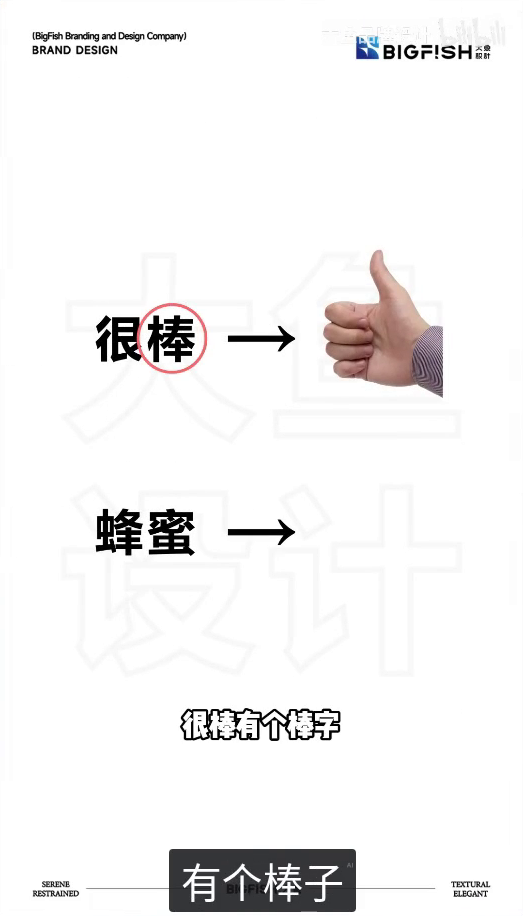

- **作者明确说法**：「很棒有个棒字」
- **播放器字幕**：「有个棒子」
- **整理者观察**：一个红色圆圈套在「很棒」的「棒」字上。拇指照片和「蜂蜜→」的位置与蜜4同类。

### 蜜6 · 搅拌棒与拇指对照

约 13.8s（录屏 23.8s）

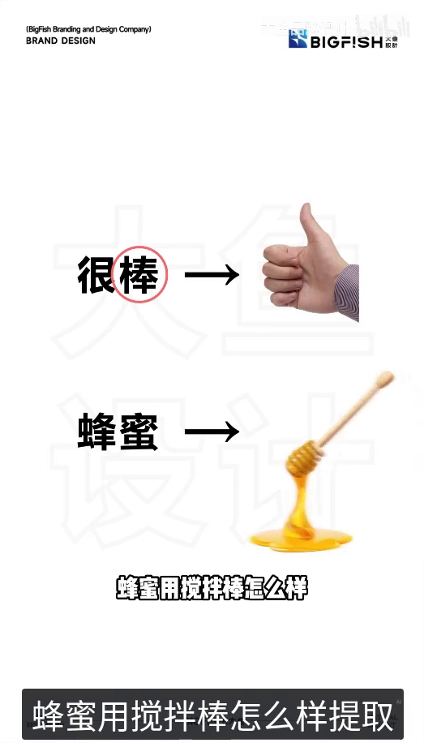

- **作者明确说法**：「蜂蜜用搅拌棒怎么样」
- **播放器字幕**：「蜂蜜用搅拌棒怎么样提取」
- **整理者观察**：「蜂蜜→」下方出现一张蜂蜜搅拌棒的照片，棒头带着蜜。上方的拇指照片还在，两边第一次同时对照。

### 蜜7 · 四根黄色横条

约 15.2s（录屏 25.2s）

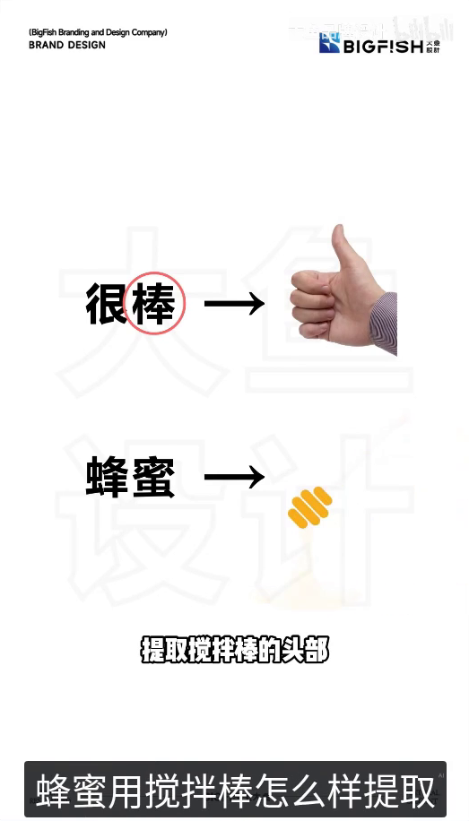

- **作者明确说法**：「提取搅拌棒的头部」
- **播放器字幕**：「蜂蜜用搅拌棒怎么样提取」
- **整理者观察**：搅拌棒照片换成四根上下排列的黄色圆角横条，略微倾斜，是提炼棒头凹槽轮廓。拇指照片仍在右上，「棒」字上的红圈也还在。

### 蜜8 · 红圈移到拇指上

约 16.7s（录屏 26.7s）

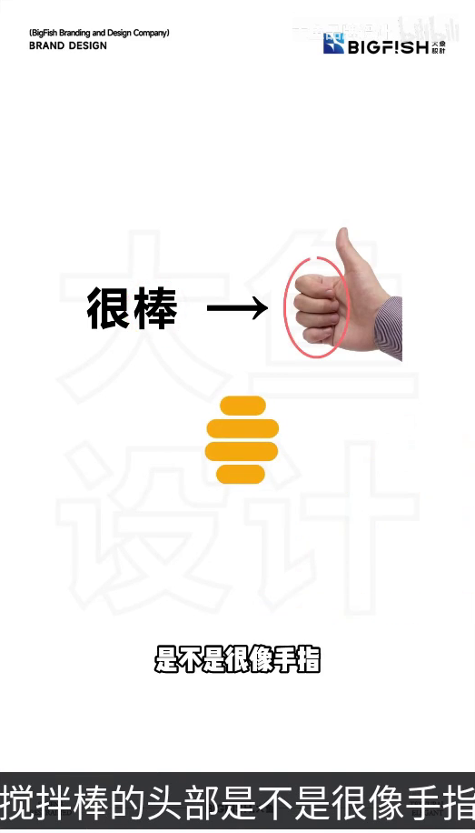

- **作者明确说法**：「是不是很像手指」
- **播放器字幕**：「搅拌棒的头部是不是很像手指」
- **整理者观察**：四根黄条和拇指照片都还在，形态与蜜7同类。红色圆圈从「棒」字移到拇指照片上。

### 蜜9 · 黄条叠到拇指照片上

约 18.2s（录屏 28.2s）

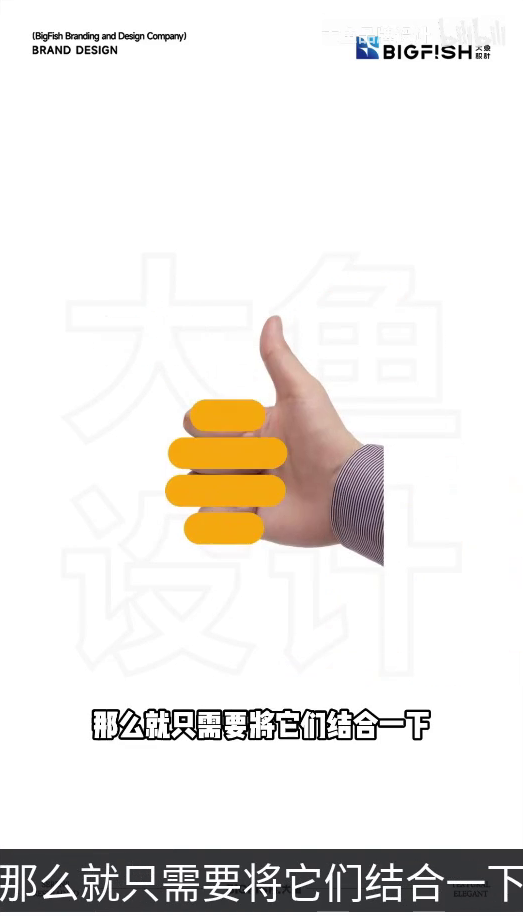

- **作者明确说法**：「那么就只需要將它们结合一下」
- **整理者观察**：文字和对照排版已经收掉。竖起的拇指照片居中，四根黄条叠在指节位置，最上和最下两根略短。

### 蜜10 · 去掉照片，留下黄条与黑拇指

约 18.8s（录屏 28.8s）

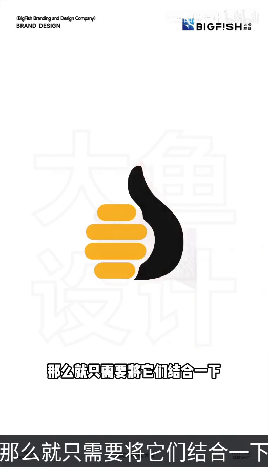

- **作者明确说法**：「那么就只需要將它们结合一下」
- **整理者观察**：手部照片已经不在。四根黄条仍在左侧，右侧换成一笔黑色的拇指轮廓。这是完成态标志。

### 蜜11 · 反白用到淌蜜照片上

约 20s（录屏 30s）

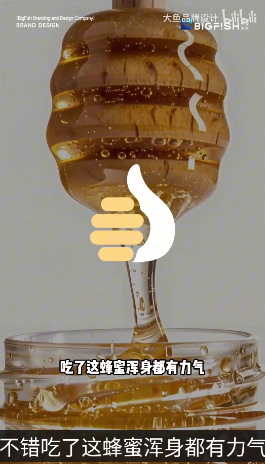

- **作者明确说法**：「吃了这蜂蜜浑身都有力气」
- **播放器字幕**：「不错吃了这蜂蜜浑身都有力气」
- **整理者观察**：蜂蜜罐和搅拌棒向下淌蜜的照片上，压着同一枚标志：黄条仍在，拇指笔划改为白色。

### 思路与前后关系（整理者分析，非作者原话）

气泡先提出「蜂蜜+很棒」（蜜1），再分别写出这两个词（蜜2）。「很棒」一侧对上竖起的拇指（蜜3），并圈出「棒」字（蜜5）；「蜂蜜」一侧对上搅拌棒（蜜4、蜜6），再按「提取搅拌棒的头部」换成四根黄条（蜜7）。片内问「是不是很像手指」之后，把黄条叠回拇指指节上（蜜8、蜜9），去掉照片，留下黄条加黑色拇指笔划（蜜10），并用到淌蜜的照片上（蜜11）。四根黄条既来自棒头，又叠在指节上像并拢的手指，再与拇指笔划合成一枚图形，因而可以同时读出「很棒」的拇指，和蜂蜜搅拌棒的头部。

---

## 案例三：合作无上限

### 合1 · 合作无上限，这个理念能表达吗

约 22.2s（录屏 32.2s）

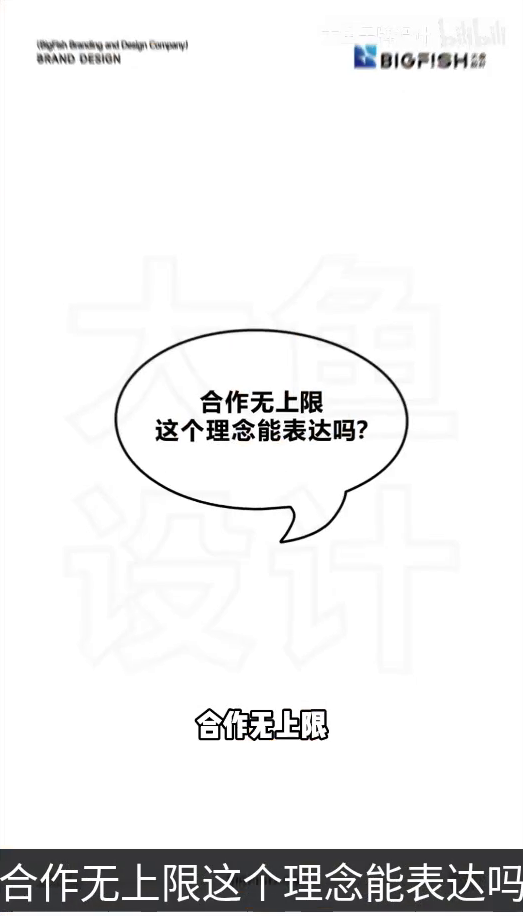

- **作者明确说法**：「合作无上限」
- **播放器字幕**：「合作无上限这个理念能表达吗」
- **整理者观察**：线框气泡里是两行「合作无上限 / 这个理念能表达吗?」。片内大字此时只有第一行。

### 合2 · 无限符号

约 25s（录屏 35s）

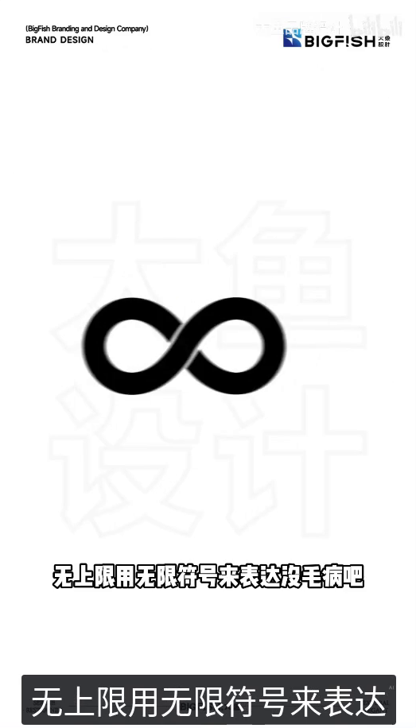

- **作者明确说法**：「无上限用无限符号来表达没毛病吧」
- **播放器字幕**：「无上限用无限符号来表达」
- **整理者观察**：白底中央是一个尚未拆开的黑色无限符号。

### 合3 · 左右标上 1 和 2

约 27.5s（录屏 37.5s）

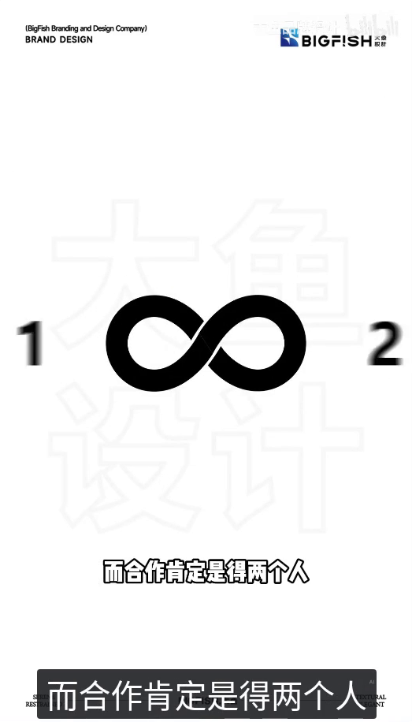

- **作者明确说法**：「而合作肯定是得两个人」
- **整理者观察**：无限符号仍连在一起。左侧出现数字「1」，右侧出现「2」。

### 合4 · 从中缝分成两环

约 29.2s（录屏 39.2s）

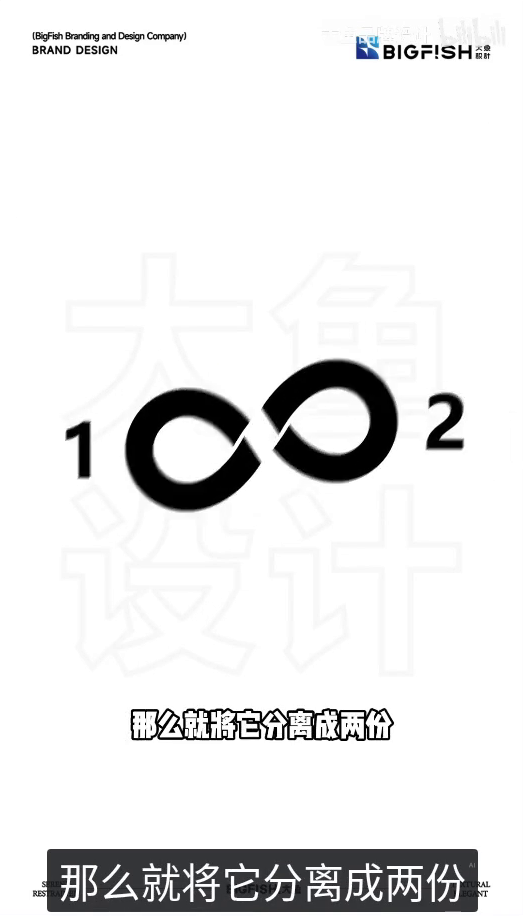

- **作者明确说法**：「那么就將它分离成两份」
- **整理者观察**：符号在中央交叉处断开，成为左右两个开口的环。1、2 两个数字还在两侧。

### 合5 · 两环收成相向的两个人形

约 30.7s（录屏 40.7s）

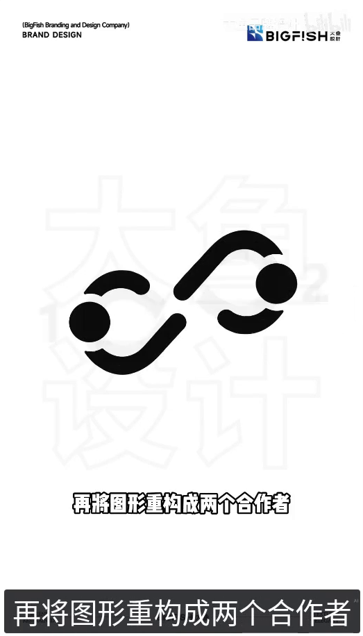

- **作者明确说法**：「再將图形重构成两个合作者」
- **整理者观察**：两个开口环已经扭转：各有一个圆形的头部，身体是弯笔划，中间伸出相向的斜臂。1、2 数字已经基本看不见。这是头部和手臂出现后的清晰态。

### 合6 · 两个人形仍分开

约 32.6s（录屏 42.6s）

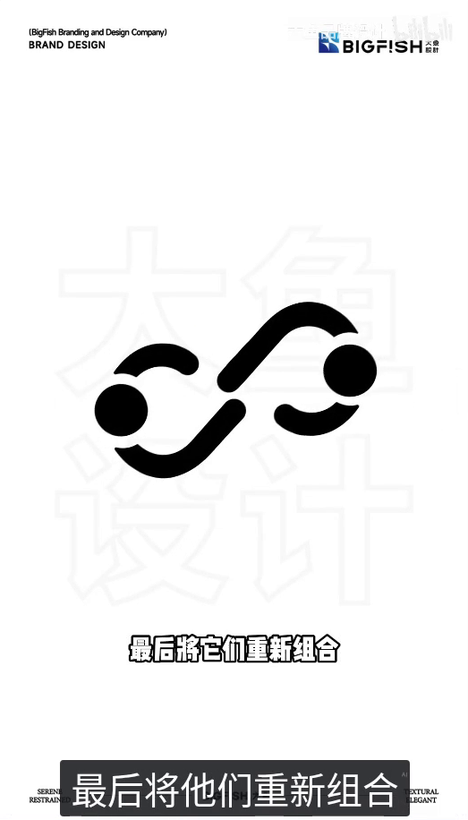

- **作者明确说法**：「最后將它们重新组合」
- **播放器字幕**：「最后将他们重新组合」
- **整理者观察**：仍是合5同类的两个相向人形，彼此分开，中间的斜臂还没有交叠成一体。

### 合7 · 互锁成组合标

约 32.9s（录屏 42.9s）

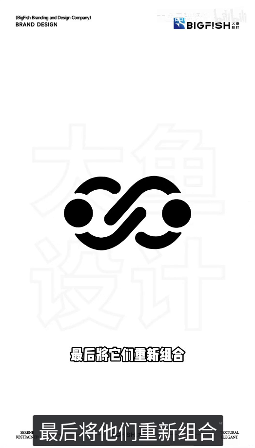

- **作者明确说法**：「最后將它们重新组合」
- **播放器字幕**：「最后将他们重新组合」
- **整理者观察**：两个带圆头的人形收到一起，中间的斜臂交叉互锁，外形仍能看出无限符号的交叉。

### 合8 · 反白用到人物照片上

约 34.2s（录屏 44.2s）

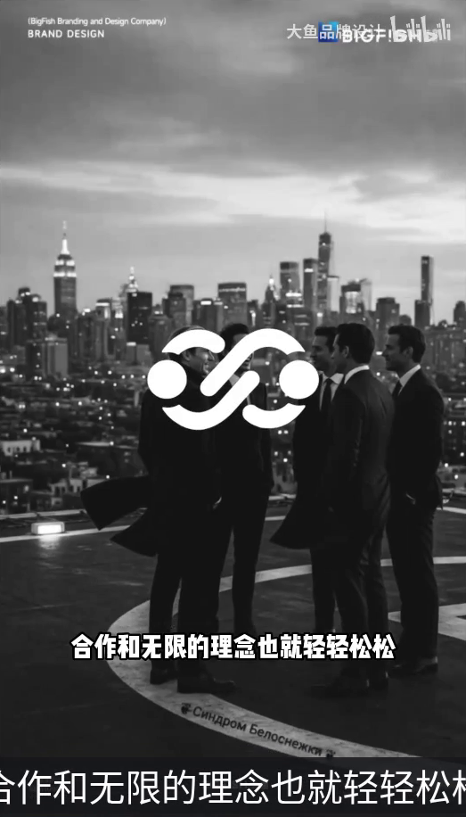

- **作者明确说法**：「合作和无限的理念也就轻轻松松」
- **整理者观察**：黑白照片里，几名深色西装的人站在屋顶平台上，远处是城市天际线。完成态标志反白，压在人物之间。轮廓与合7同类。

### 思路与前后关系（整理者分析，非作者原话）

先提出「合作无上限」（合1），用无限符号来对应「无上限」（合2）。片内说「合作肯定是得两个人」，于是在符号两侧标上 1、2（合3），再按「將它分离成两份」从中缝断开（合4）。断开后的两环被收成两个带圆头、有斜臂的相向人形（合5、合6），最后互锁成一枚组合标（合7），并反白用到人物照片上（合8）。互锁之后，中间交叉仍让人读出无限符号，左右的圆头和弯笔划又读出两个合作者，所以同一枚图形把「合作」和「无上限」收在一起。

---

## 案例四：水产与向上

### 蟹1 · 水产+向上的感觉，你行吗

约 37.1s（录屏 47.1s）

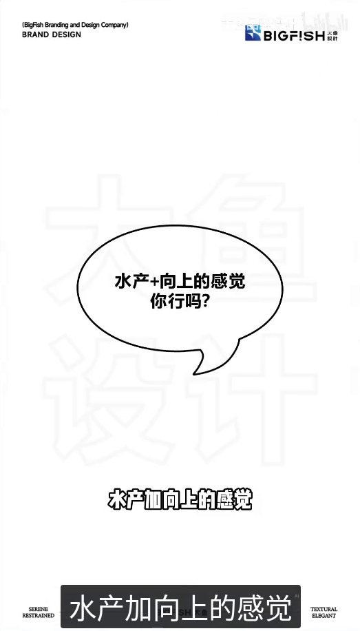

- **作者明确说法**：「水产加向上的感觉」
- **整理者观察**：线框气泡里是两行「水产+向上的感觉 / 你行吗?」。片内大字此时是第一行的说法。

### 蟹2 · 「向上」二字

约 39.8s（录屏 49.8s）

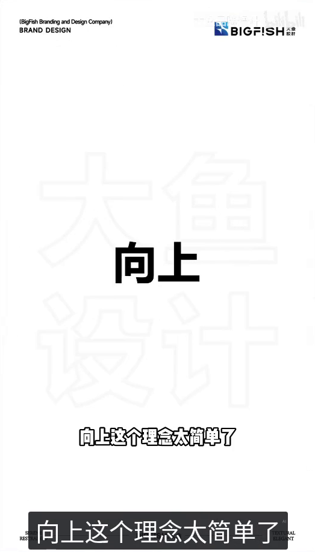

- **作者明确说法**：「向上这个理念太简单了」
- **整理者观察**：白底中央是黑体「向上」，还没有箭头。

### 蟹3 · 黑色向上箭头

约 41s（录屏 51s）

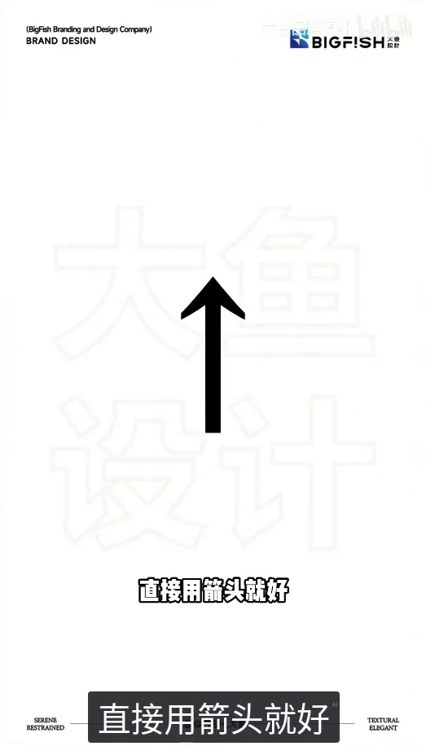

- **作者明确说法**：「直接用箭头就好」
- **整理者观察**：「向上」二字已换成一个实心的黑色向上箭头，此时还没有圆形。

### 蟹4 · 在箭头下方画出圆形

约 43.2s（录屏 53.2s）

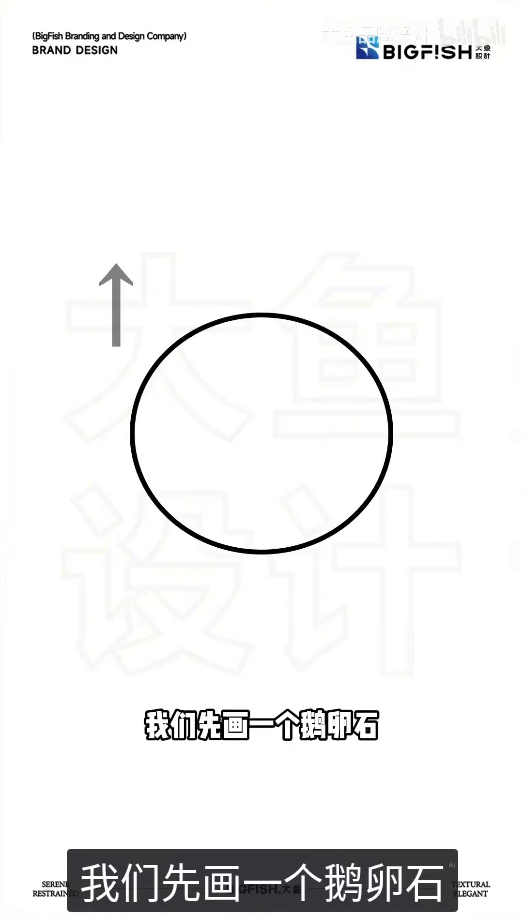

- **作者明确说法**：「我们先画一个鹅卵石」
- **整理者观察**：原先的实心箭头收成较细的描边，仍停在上方。下方正在画出一个黑色圆圈，圆内还是空的。

### 蟹5 · 圆填实，细箭头仍在上方

约 43.7s（录屏 53.7s）

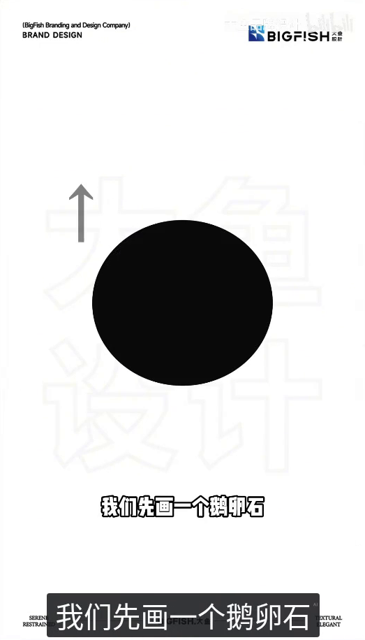

- **作者明确说法**：「我们先画一个鹅卵石」
- **整理者观察**：圆形已经填成实心黑圆。细箭头仍独立停在圆的上方，两者还没有叠在一起。

### 蟹6 · 箭头改成三尖形，叠到圆上

约 44.5s（录屏 54.5s）

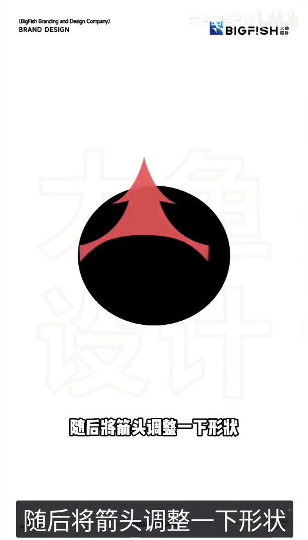

- **作者明确说法**：「随后將箭头调整一下形状」
- **整理者观察**：上方那枚独立的细箭头已经不在。一枚鲑鱼粉色的三尖形叠在黑圆上：上端尖角伸出圆外，左右两臂向两侧张开，但还没有抵到圆周边缘。这是调整形状过程中的清晰中间态。

### 蟹7 · 两臂抵到圆周

约 46s（录屏 56s）

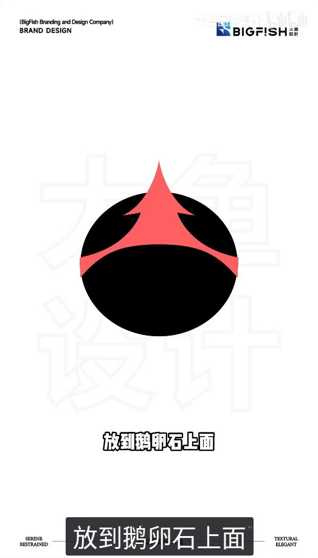

- **作者明确说法**：「放到鹅卵石上面」
- **整理者观察**：粉色三尖形仍叠在黑圆上，上端尖角伸出圆外，左右两臂已经抵到圆周的左右边缘，比蟹6更展开。

### 蟹8 · 相交处变浅，正在剪去

约 47.2s（录屏 57.2s）

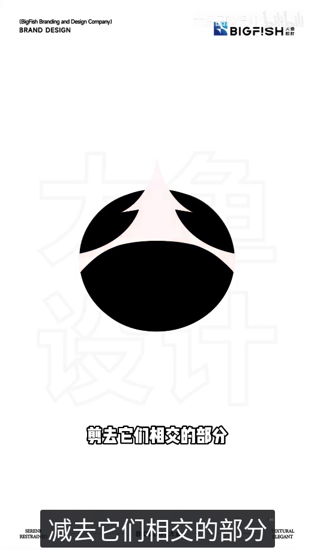

- **作者明确说法**：「剪去它们相交的部分」
- **播放器字幕**：「减去它们相交的部分」
- **整理者观察**：原先实色的粉色块变得很浅，几乎呈白粉色，仍留在与圆相交的位置。黑圆在这一区域已经露出钳状的缺口，浅色块还没有完全去掉。

### 蟹9 · 相交处去掉，上沿尚无凹点

约 47.4s（录屏 57.4s）

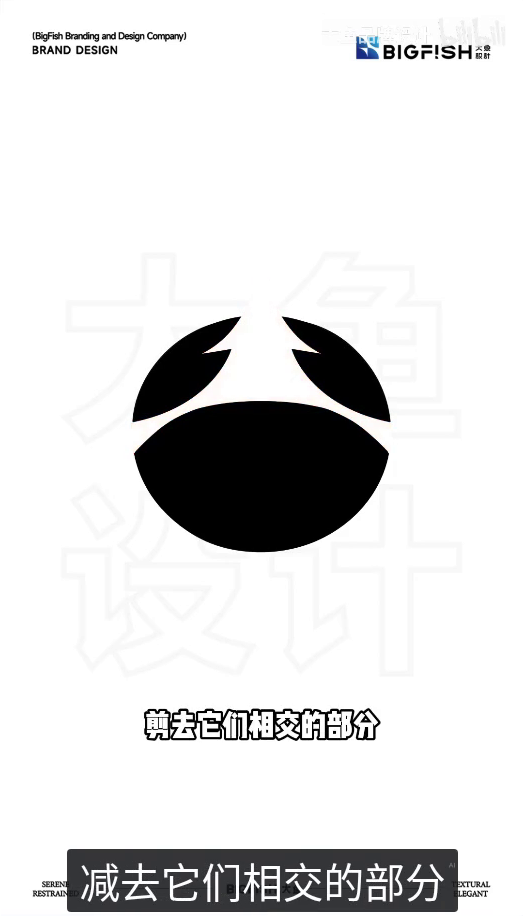

- **作者明确说法**：「剪去它们相交的部分」
- **播放器字幕**：「减去它们相交的部分」
- **整理者观察**：浅色块已经没有了。黑色图形上方留下 V 形缺口和两侧内凹，像一对钳子，下方是椭圆的身体。身体上沿此时仍较平整，还没有后来那两个白色小凹点。

### 蟹10 · 上沿点出两个凹点

约 48.9s（录屏 58.9s）

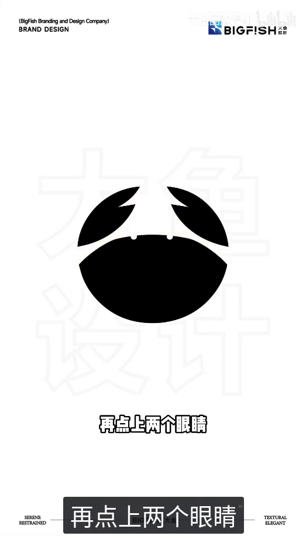

- **作者明确说法**：「再点上两个眼睛」
- **整理者观察**：钳子和身体的大轮廓与蟹9同类。在两钳之间的缺口下方、身体上沿，出现两个咬进黑色块面的白色小凹点。

### 蟹11 · 螃蟹图形完成

约 49.4s（录屏 59.4s）

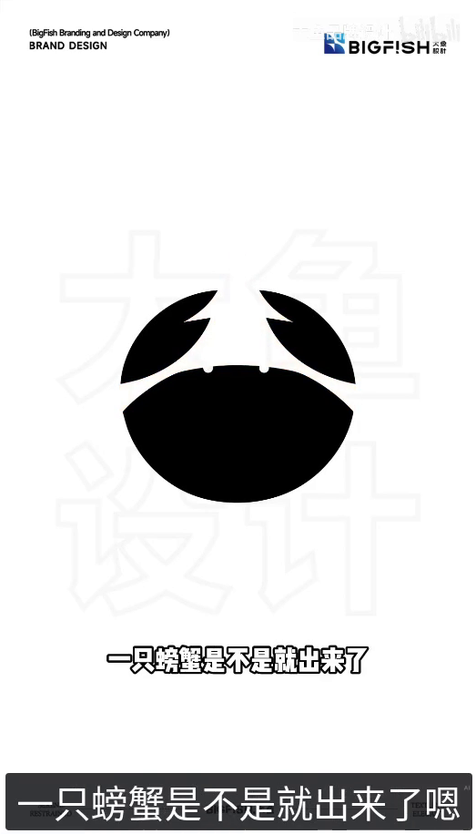

- **作者明确说法**：「一只螃蟹是不是就出来了」
- **播放器字幕**：「一只螃蟹是不是就出来了嗯」
- **整理者观察**：黑色螃蟹形已经稳定：上为两钳，下为身体，上沿两个白色小凹点仍在。这是完成态。

### 蟹12 · 反白用到湖景照片上

约 52s（录屏 62s）

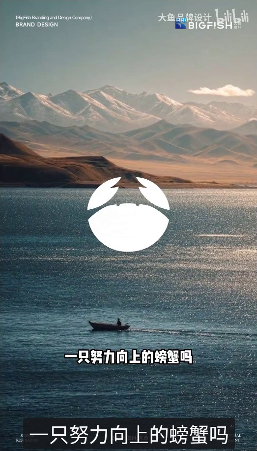

- **作者明确说法**：「一只努力向上的螃蟹吗」
- **整理者观察**：白色螃蟹标压在湖面与山地的风景上，近处有一条小船。轮廓与蟹11同类。原凹点位置在白标上成为两个小透空，随湖面底色显出。

### 思路与前后关系（整理者分析，非作者原话）

先提出「水产加向上的感觉」（蟹1）。「向上」先写成二字（蟹2），再按「直接用箭头就好」换成黑色向上箭头（蟹3）。水产一侧则「先画一个鹅卵石」：先在细箭头下方画出圆，再把圆填实（蟹4、蟹5）。随后把箭头改成三尖形，放到圆上，两臂逐渐抵到圆周（蟹6、蟹7）。按片内「剪去它们相交的部分」，相交的粉色块由实变浅，再被去掉，黑圆上沿留下钳状缺口（蟹8、蟹9）。再按「再点上两个眼睛」，在身体上沿点出两个白色小凹点（蟹10），完成这只螃蟹（蟹11），并反白用到湖景上（蟹12）。剪去相交之后，向上的尖形和左右钳口都来自那枚变形箭头与圆的重叠；两个凹点让这块黑色轮廓被读成螃蟹，因而同一枚图形既留下「向上」，也留下水产里的这只蟹。

---

## 收束：三例并列

约 55s（录屏 65s）

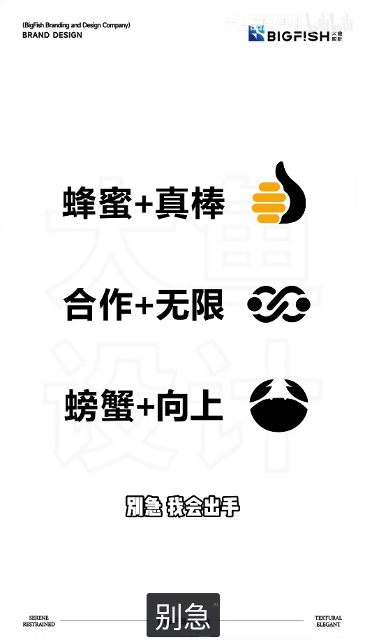

- **作者明确说法**：「别急 我会出手」
- **播放器字幕**：「别急」
- **整理者观察**：三行文字和完成态标志并列，分别为「蜂蜜+真棒」配黄条与黑拇指标、「合作+无限」配互锁人形标、「螃蟹+向上」配螃蟹标。片内没有在本帧再讲解做法。
