# [怎样用名字首字母来设计LOGO？](https://www.bilibili.com/video/BV1UYhx6eEB3/)｜大鱼品牌设计

文中「约 00:mm」是按播放器时钟校准的近似时刻，误差约 ±1s；括号内为录屏精确秒。

## 案例一：字母 JC / JUNCHEN

### JC1 · 原形：分开的 J 和 C

约 00:02（录屏 109.667s）

- **作者明确说法**：「怎样用名字的首字母设计LOGO」
- **整理者观察**：白底上是两枚很大的黑色无衬线字母，J 在左、C 在右，彼此分开，还没有叠在一起，也没有斜切。这是播放中刚给出的原形。

### JC2 · 两字叠成连笔

约 00:02（录屏 109.933s）

- **作者明确说法**：「怎样用名字的首字母设计LOGO」
- **整理者观察**：J 和 C 已经叠在一起，看起来像一枚 jc 连笔。斜切还没有出现，C 的开口里也还没有黑点。

### JC3 · 斜向淡痕出现

约 00:03（录屏 110.567s）

- **作者明确说法**：「怎样用名字的首字母设计LOGO」
- **整理者观察**：连笔还在，一条斜向的淡痕开始划过两字相交的地方，切口还没有完全打开。

### JC4 · 斜切打开，开口里还没有点

约 00:03（录屏 111.000s）

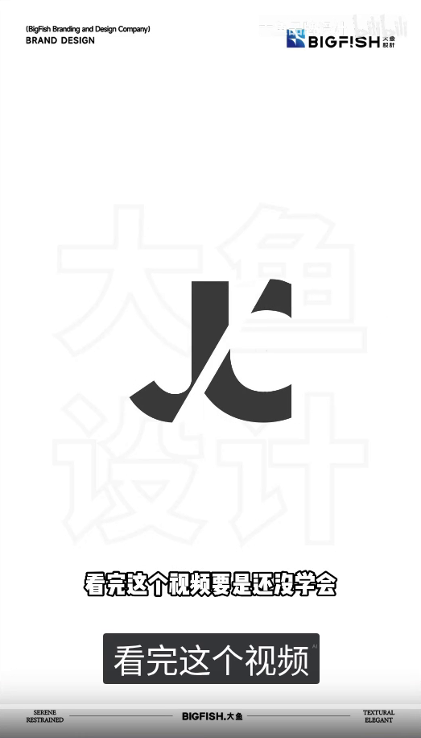

- **作者明确说法**：「看完这个视频要是还没学会」
- **整理者观察**：斜切已经切开，露出一道白色的开口。C 这一侧的开口里还是空的，没有黑点。

### JC5 · 开口里出现独立的黑圆点

约 00:04（录屏 111.267s）

- **作者明确说法**：「看完这个视频要是还没学会」
- **整理者观察**：C 的开口里出现一枚独立的黑色圆点，和周围的笔画不相连。斜切仍然开着。

### JC6 · 黑标稳住

约 00:04（录屏 111.600s）

- **作者明确说法**：「看完这个视频要是还没学会」
- **整理者观察**：斜切的 JC 连笔标已经稳住。J 一侧有斜向开口，C 一侧的开口里仍是那枚独立的黑圆点。这是这一案线标的黑色完成态。

### JC7 · 用到雪山照片上，JUNCHEN

约 00:05（录屏 112.600s）

- **作者明确说法**：「你直接来找我好吧」
- **整理者观察**：同一件标志反白，平面叠在雪山照片上。字标为「JUNCHEN」。

### 思路与前后关系（整理者分析，非作者原话）

播放中先给出分开的 J 和 C。两字叠成连笔后，斜切从淡痕变成打开的白色切口，此时 C 的开口里还没有点；随后开口里出现一枚独立的黑圆点，黑标稳住。用到雪山照片上时，字标写成「JUNCHEN」。

---

## 案例二：NXY / NXY INC

### NXY1 · 对话框

约 00:07（录屏 114.500s）

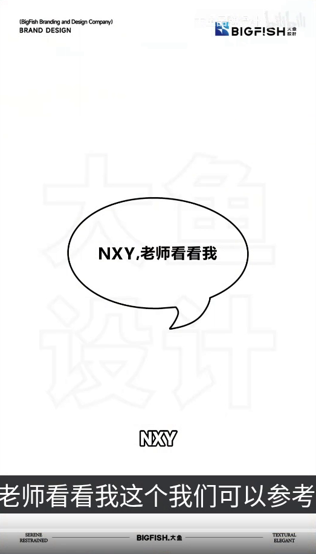

- **作者明确说法**：「老师看看我」。同一画面上，气泡里写着「NXY,老师看看我」。
- **整理者观察**：白底中央是一个线框气泡，尾朝右下。气泡里的字母是 NXY。

### NXY2 · 新百伦参考：相邻竖笔标成红色

约 00:09（录屏 116.600s）

- **作者明确说法**：「这个我们可以参考新百伦」
- **整理者观察**：白底上是并排的无衬线 N 和 B。N 的右竖和 B 的左竖是红色，其余笔画是黑色。红色只标在这两段相邻的竖笔上，不是把整个字母涂满。

### NXY3 · N、B 倾斜并拢，还没有速度线

约 00:10（录屏 117.233s）

- **作者明确说法**：「这个我们可以参考新百伦」
- **整理者观察**：N 和 B 已经向右倾斜、靠在一起，接近后来的 NB 标志外形，但 N 上还没有速度线，仍是实地黑块。

### NXY4 · 速度线稳住

约 00:10（录屏 117.600s）

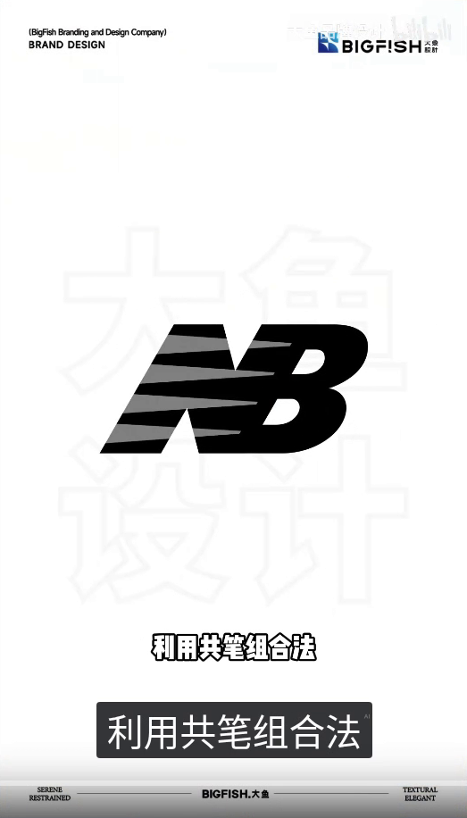

- **作者明确说法**：「利用共笔组合法」
- **整理者观察**：倾斜的 NB 已经收成标志的样子，N 上出现一组横向的速度线。

### NXY5 · 标下加上 new balance

约 00:11（录屏 118.500s）

- **作者明确说法**：「利用共笔组合法」
- **整理者观察**：带速度线的 NB 标下方，出现小写的「new balance」。

### NXY6 · 原形：三个分开的字母 NYX

约 00:12（录屏 119.367s）

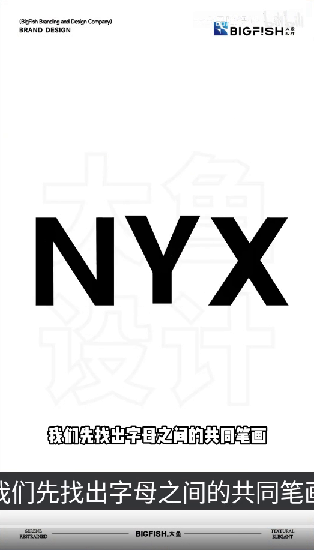

- **作者明确说法**：「我们先找出字母之间的共同笔画」
- **整理者观察**：白底上是三个分开的黑色无衬线字母，从左到右是 N、Y、X，还不是气泡里的 NXY。三字都是黑色，还没有提示色。

### NXY7 · 局部红、蓝提示色

约 00:13（录屏 120.300s）

- **作者明确说法**：「我们先找出字母之间的共同笔画」
- **整理者观察**：颜色只标在局部笔画上，不是整字填色。N 的斜笔是红的，左右竖仍是黑的；Y 的左上斜笔是红的，右上斜笔是蓝的，下竖是黑的；X 从左下到右上的那一笔是浅蓝的，另一笔仍是黑的。

### NXY8 · 提示色明显变暗，三字仍分开

约 00:14（录屏 121.233s）

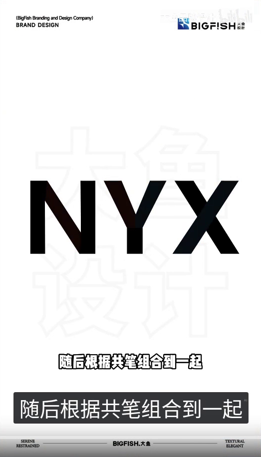

- **作者明确说法**：「随后根据共笔组合到一起」
- **整理者观察**：提示色明显变暗，颜色趋近黑色，但仍看得出 N、Y 上的暗红，以及 Y、X 上的暗蓝残色。三个字母仍是分开的 NYX，还没有收成一枚标。

### NXY9 · 三字略靠近，仍可分开来读

约 00:14（录屏 121.633s）

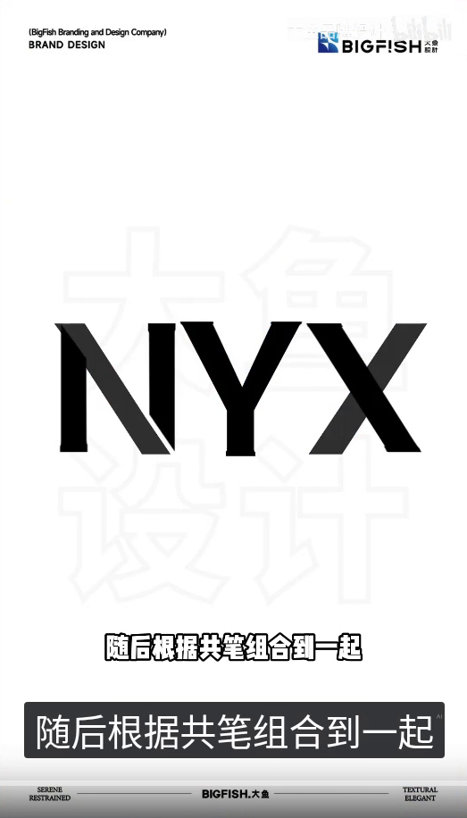

- **作者明确说法**：「随后根据共笔组合到一起」
- **整理者观察**：N、Y、X 比上一帧更靠近一些，但仍是三枚可以分开来读的字母，衬线连笔还没有出现。

### NXY10 · 衬线连笔标

约 00:14（录屏 122.033s）

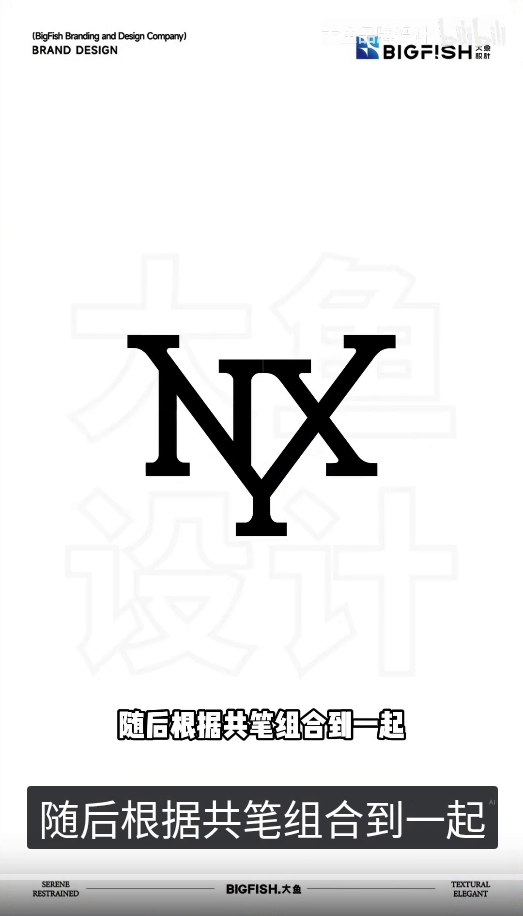

- **作者明确说法**：「随后根据共笔组合到一起」
- **整理者观察**：画面已是带衬线的 NYX 连笔标，Y 穿在 N 和 X 中间。上一帧 121.633s 仍是略靠近的分写字母，到本帧之间的过渡中态待核。

### NXY11 · 用到布料照片上，NXY INC

约 00:15（录屏 122.800s）

- **作者明确说法**：「一个高级又国际化的LOGO」
- **整理者观察**：同一件标志反白，平面叠在米色垂坠布料的照片上。字标为「NXY INC」，和气泡里的 NXY、所画的 NYX 并不写成同一串字母。

### 思路与前后关系（整理者分析，非作者原话）

先用新百伦做共笔示范：把相邻竖笔标成红色，再让 N、B 倾斜并拢，然后才出现速度线和「new balance」字标。接着画出 N、Y、X 三个字母，用红、蓝标出局部笔画（Y 的左右斜笔分别是红和蓝），提示色变暗后再靠拢。121.633s 仍是分写略靠近的 NYX，到衬线成标之间的过渡中态待核。用到布料照片上时，字标写成「NXY INC」。

---

## 案例三：SLY / SAILIUYE

### SLY1 · 对话框

约 00:18（录屏 125.533s）

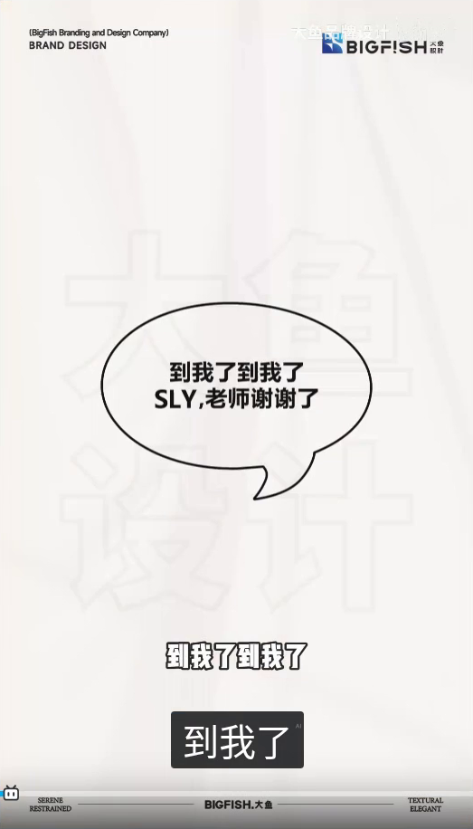

- **作者明确说法**：「到我了到我了」。同一画面上，气泡里两行写着「到我了到我了」「SLY,老师谢谢了」。
- **整理者观察**：白底中央是一个线框气泡，尾朝右下。

### SLY2 · 圣罗兰参考：分开的 Y、S、L

约 00:21（录屏 129.000s）

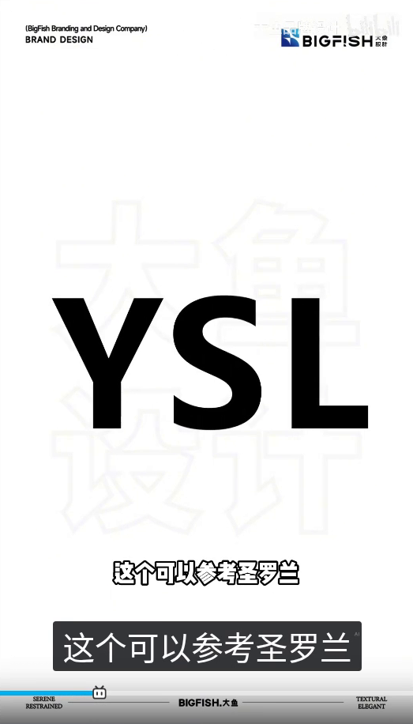

- **作者明确说法**：「这个可以参考圣罗兰」
- **整理者观察**：白底上是三个分开的黑色无衬线字母，从左到右是 Y、S、L，还没有交叉。

### SLY3 · Y、S、L 开始上下交叉

约 00:22（录屏 130.000s）

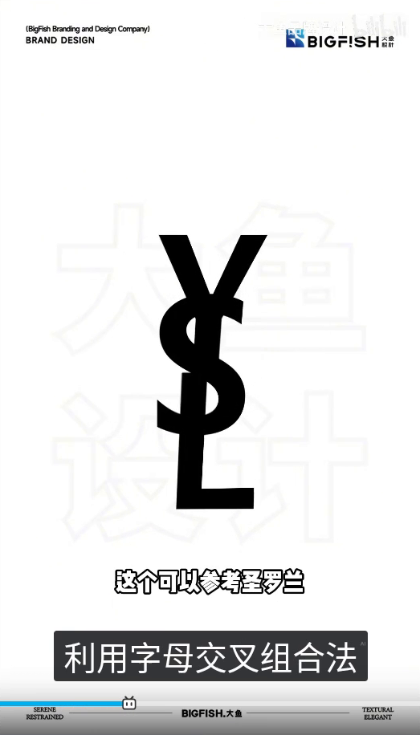

- **作者明确说法**：「这个可以参考圣罗兰」
- **整理者观察**：三个字母已经上下穿插，收成一枚竖向的交叉连笔，细部还没有完全修完。

### SLY4 · 交叉标配上 YVESSAINTLAURENT collection

约 00:23（录屏 131.000s）

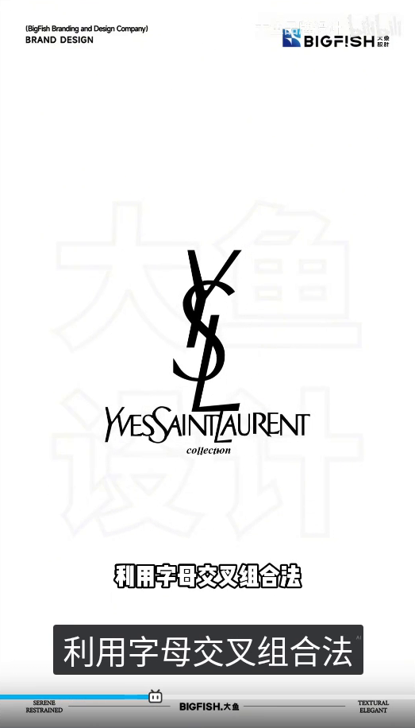

- **作者明确说法**：「利用字母交叉组合法」
- **整理者观察**：交叉标已经修好。标下是连写的「YVESSAINTLAURENT」，再下方是斜体小写的「collection」。

### SLY5 · 原形：分开的 S、L、Y

约 00:24（录屏 131.767s）

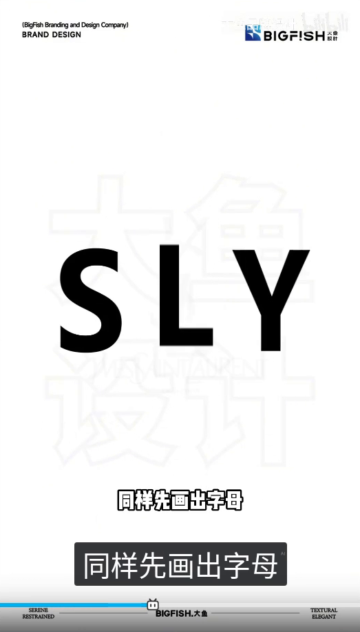

- **作者明确说法**：「同样先画出字母」
- **整理者观察**：白底上换成三个分开的黑色无衬线字母，从左到右是 S、L、Y，还没有交叉。

### SLY6 · 交叉叠紧

约 00:26（录屏 133.100s）

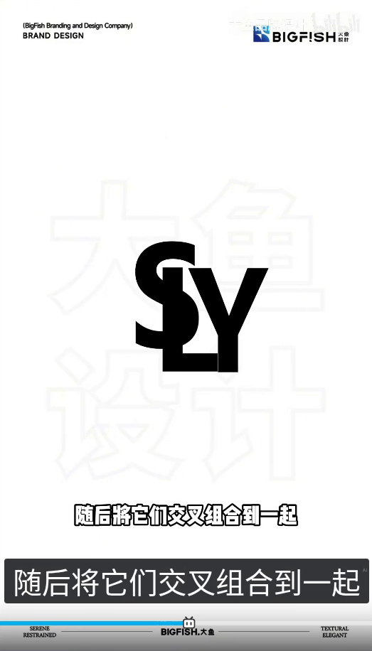

- **作者明确说法**：「随后將它们交叉组合到一起」
- **整理者观察**：三个字母已经交叉叠紧，收成一枚黑色的组合标。上一帧可看清的分写是 132.667s 仍分开的 S、L、Y，到本帧之间的过渡中态待核。

### SLY7 · 开始衬线、手写变形

约 00:27（录屏 134.500s）

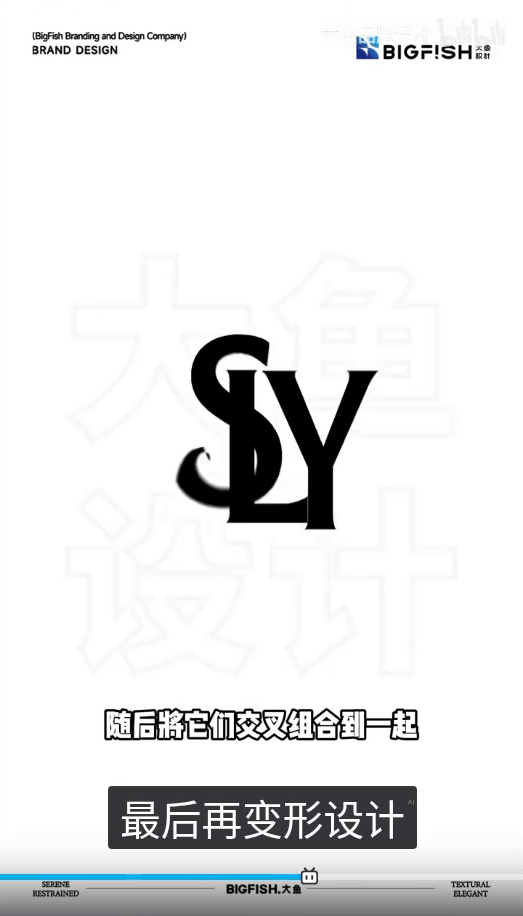

- **作者明确说法**：「随后將它们交叉组合到一起」
- **整理者观察**：交叉标开始变形，笔画长出曲线和衬线，还没有收到后来的脚本样子。

### SLY8 · 变形继续

约 00:27（录屏 134.733s）

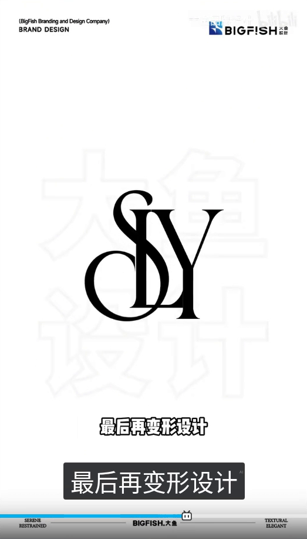

- **作者明确说法**：「最后再变形设计」
- **整理者观察**：曲线和字脚继续生长，已经接近后来的脚本标，细部还没有完全收稳。

### SLY9 · 白底净标

约 00:28（录屏 135.267s）

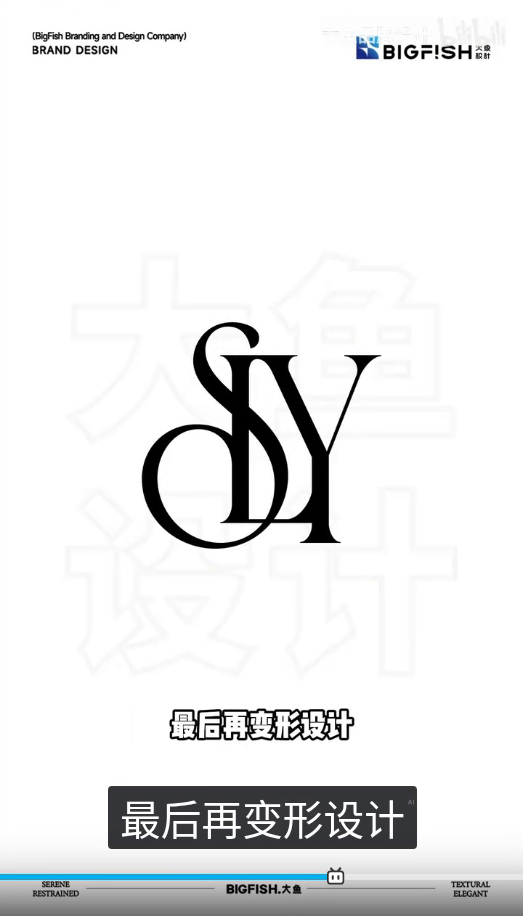

- **作者明确说法**：「最后再变形设计」
- **整理者观察**：白底上的脚本标已经收稳，这是这一案线标的黑色完成态。

### SLY10 · 用到蕨叶与白花照片上，SAILIUYE

约 00:28（录屏 135.733s）

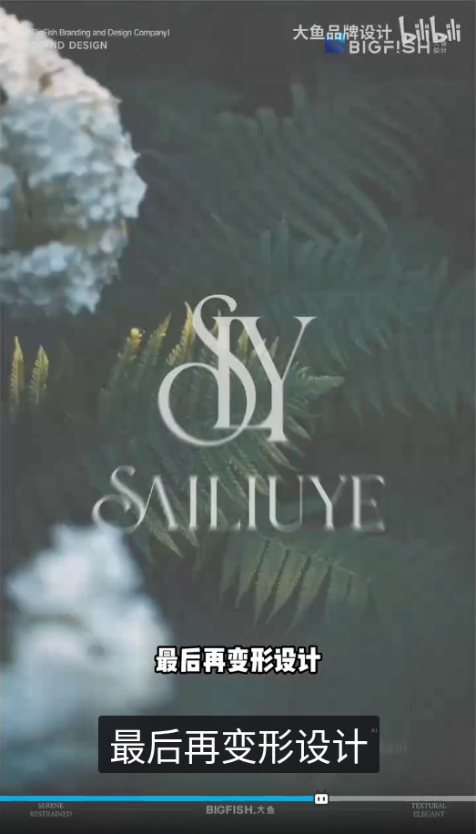

- **作者明确说法**：「最后再变形设计」
- **整理者观察**：同一件标志反白，平面叠在深色蕨叶和白花的照片上。字标为「SAILIUYE」。

### 思路与前后关系（整理者分析，非作者原话）

先参考圣罗兰，把 Y、S、L 逐步交叉成标，并配上「YVESSAINTLAURENT」和「collection」。再画出分开的 S、L、Y。132.667s 仍是分写，到交叉叠紧之间的过渡中态待核。随后把叠紧的标再变成脚本，到 135.267s 收成白底净标。用到蕨叶与白花照片上时，字标写成「SAILIUYE」。

---

## 案例四：LTT / LTT.STUDIO

### LTT1 · 对话框

约 00:31（录屏 138.633s）

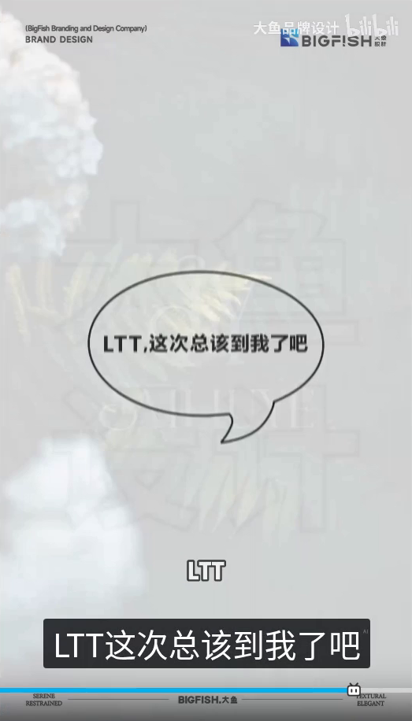

- **作者明确说法**：「LTT」。同一画面上，气泡里写着「LTT,这次总该到我了吧」。
- **整理者观察**：白底中央是一个线框气泡，尾朝右下。

### LTT2 · 原形：三个分开的字母 L、T、T

约 00:34（录屏 141.200s）

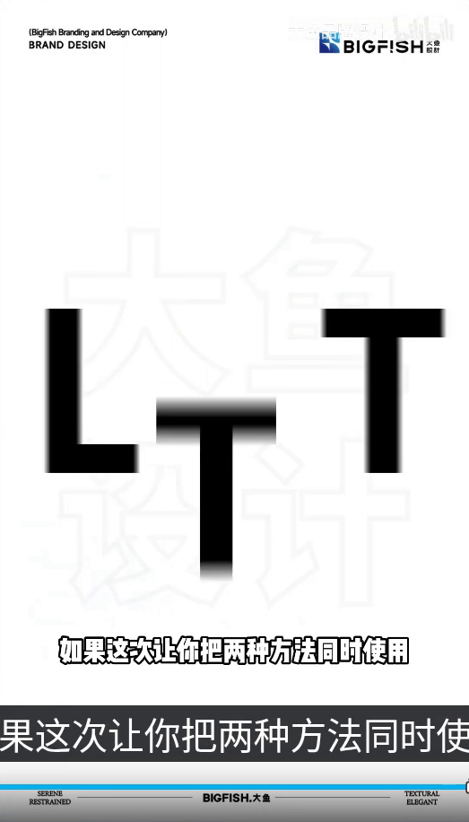

- **作者明确说法**：「如果这次让你把两种方法同时使用」
- **整理者观察**：白底上是三个分开的黑色无衬线字母，从左到右是 L、T、T，还没有衬线，也没有提示色。

### LTT3 · 同时标出两种方法

约 00:34（录屏 141.733s）

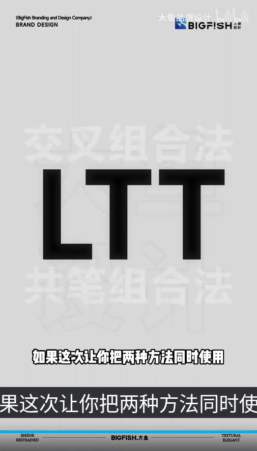

- **作者明确说法**：「如果这次让你把两种方法同时使用」
- **整理者观察**：底子换成灰色。三个字母仍在中间；上方写着「交叉组合法」，下方写着「共笔组合法」。这是画面上的方法标题，不是片内字。

### LTT4 · L 的底横和第一个 T 的顶横整段标红

约 00:38（录屏 145.267s）

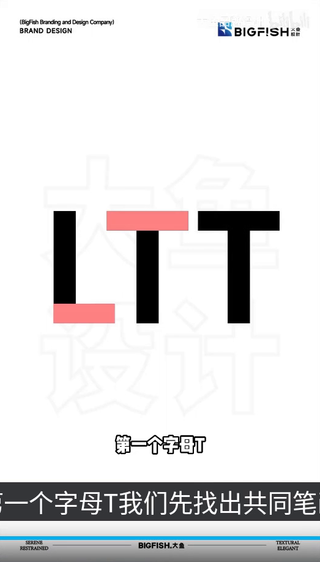

- **作者明确说法**：「第一个字母T」
- **整理者观察**：L 的底横是整段红色，第一个 T 的顶横也是整段红色，不是只红左半。第二个 T 仍是全黑。竖笔都是黑色。红色只标在这两段横笔上，不是把字母通体涂满。

### LTT5 · 红条转成暗红，还没有撤尽

约 00:39（录屏 146.567s）

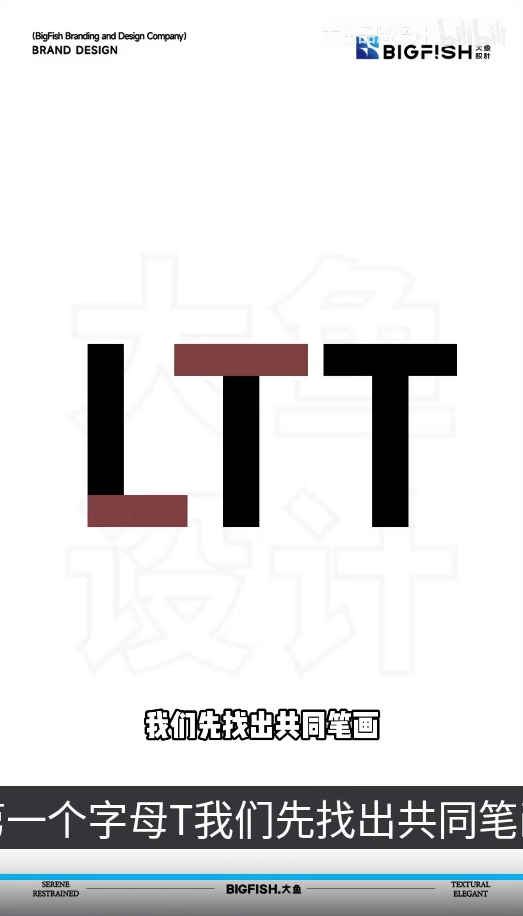

- **作者明确说法**：「我们先找出共同笔画」
- **整理者观察**：两段横笔仍清楚看得出是暗红，不是黑色。三字仍分开。

### LTT6 · 提示色撤尽，三字仍是黑色分写

约 00:39（录屏 146.767s）

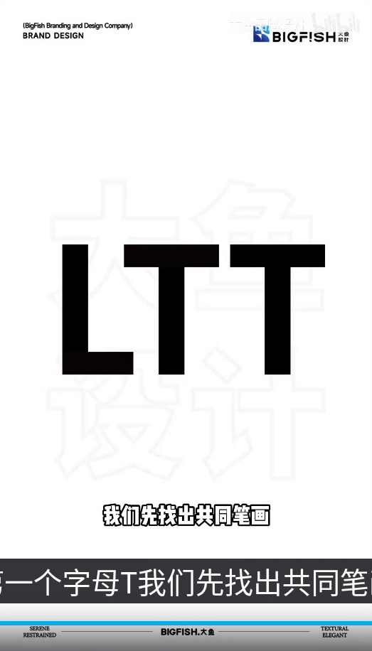

- **作者明确说法**：「我们先找出共同笔画」
- **整理者观察**：红条已经撤尽，三个字母都是黑色，仍是分开的无衬线 L、T、T。

### LTT7 · 仅 L 和第一个 T 变成斜体衬线，右边第二 T 仍直立

约 00:39（录屏 147.067s）

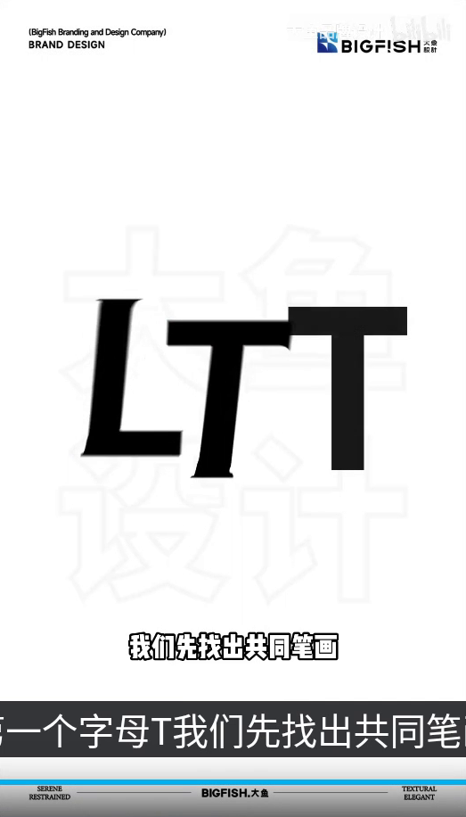

- **作者明确说法**：「我们先找出共同笔画」
- **整理者观察**：只有 L 和第一个 T 变成带衬线的斜体，两者仍是分开的字，还没有收成共笔。右边第二个 T 仍是直立、没有衬线。

### LTT8 · L 与第一个 T 正在改形趋近，尚分开，右 T 变灰

约 00:40（录屏 147.167s）

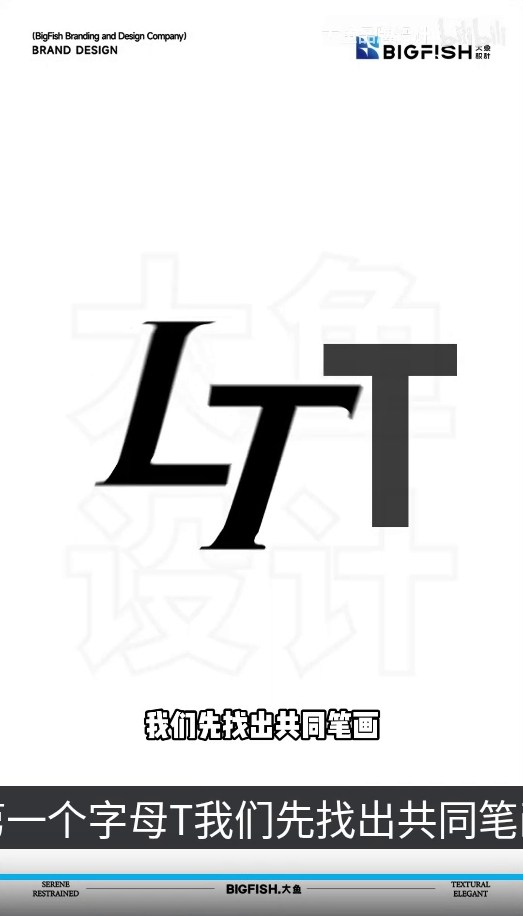

- **作者明确说法**：「我们先找出共同笔画」
- **整理者观察**：L 和第一个 T 正在改形、互相趋近，但中间仍分开，还没有叠在一起。右侧第二个 T 已经变成灰色。

### LTT9 · LT 共笔稳住，右侧留下灰色的 T

约 00:40（录屏 147.833s）

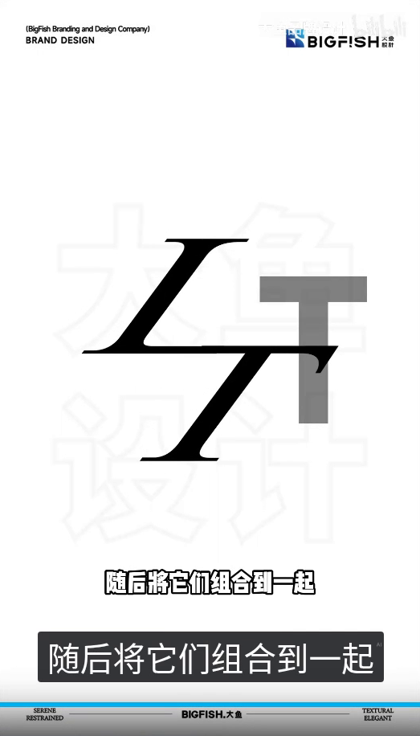

- **作者明确说法**：「随后將它们组合到一起」
- **整理者观察**：L 和第一个 T 已经收成一枚带衬线的共笔连笔。右侧第二个 T 变成灰色，仍留在原来的位置。

### LTT10 · 右侧的 T 由灰转粉，开始移入

约 00:42（录屏 149.200s）

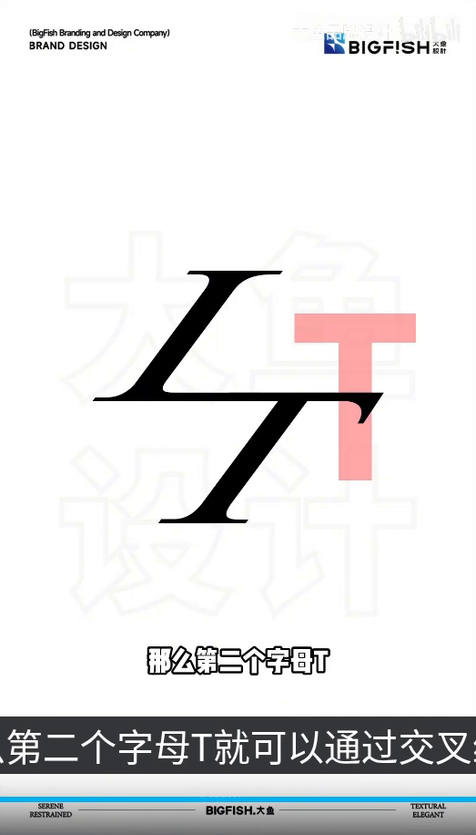

- **作者明确说法**：「那么第二个字母T」
- **整理者观察**：右侧那个 T 由灰色转成粉色，开始向已经收好的 LT 连笔靠近。它不是新出现的字母。

### LTT11 · 右侧粉 T 与 LT 右端横笔交叠

约 00:42（录屏 149.800s）

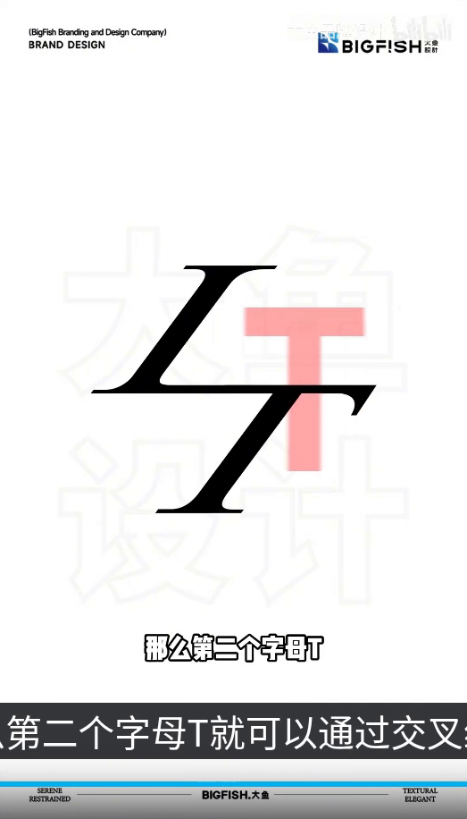

- **作者明确说法**：「那么第二个字母T」
- **整理者观察**：粉色的第二个 T 仍在 LT 连笔的右侧，只与 LT 右端的横笔交叠，还没有移到中心。到 150.300s 才进入中心交叉。

### LTT12 · 粉 T 正在交叉

约 00:43（录屏 150.300s）

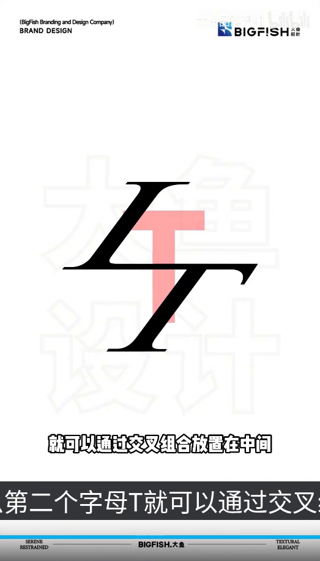

- **作者明确说法**：「就可以通过交叉组合放置在中间」
- **整理者观察**：第二个 T 仍是粉红色，正在从中间穿过 LT 连笔。

### LTT13 · 交叉中的 T 转为褐色

约 00:43（录屏 150.833s）

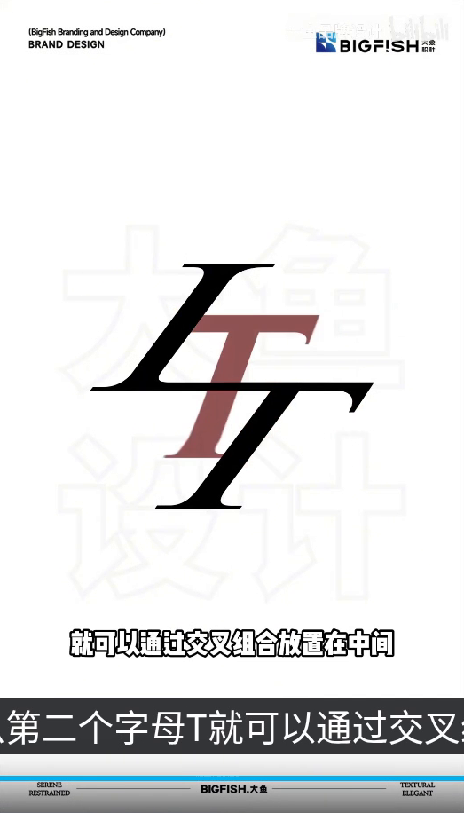

- **作者明确说法**：「就可以通过交叉组合放置在中间」
- **整理者观察**：正在交叉的那个 T 已经由粉转褐，还明显不是黑色。

### LTT14 · 褐色变深，接近黑色

约 00:43（录屏 151.067s）

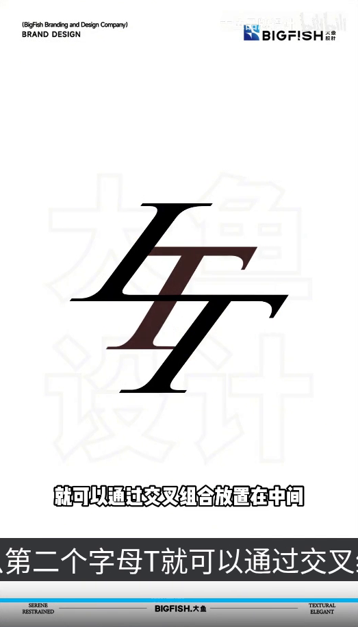

- **作者明确说法**：「就可以通过交叉组合放置在中间」
- **整理者观察**：褐色已经明显变深，接近黑色，但还带一点褐色，不是完全的黑标。

### LTT15 · 全黑相连的交叉标

约 00:44（录屏 151.567s）

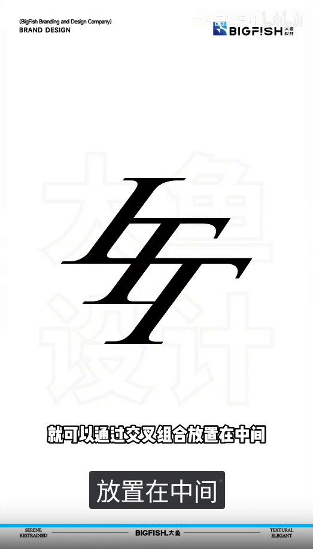

- **作者明确说法**：「就可以通过交叉组合放置在中间」
- **整理者观察**：交叉标已经收成全黑，笔画在相交处连在一起。中间留着的白色是字怀。这是这一案线标的黑色完成态。

### LTT16 · 用到林间照片上，LTT.STUDIO

约 00:45（录屏 152.400s）

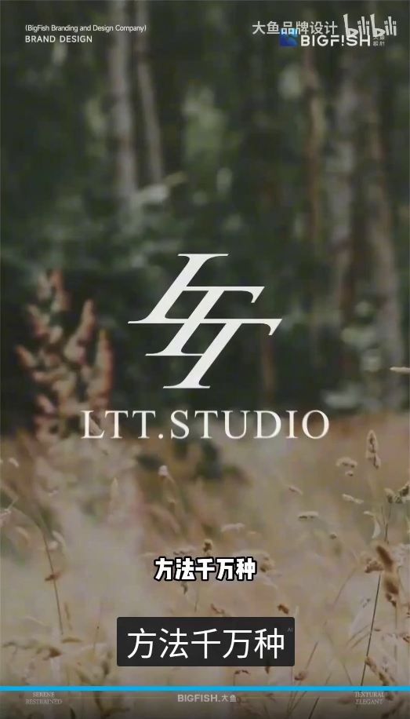

- **作者明确说法**：「方法千万种」
- **整理者观察**：同一件标志反白，平面叠在林间草地和树干的照片上。字标为「LTT.STUDIO」。

### 思路与前后关系（整理者分析，非作者原话）

先给出 L、T、T 三个字母，并同时标出「交叉组合法」和「共笔组合法」。用红色标出 L 的底横和第一个 T 的顶横；红条变暗后撤尽。随后只有 L 和第一个 T 改成斜体衬线，右边第二个 T 仍直立、没有衬线。L 和第一个 T 继续改形、趋近，但此时仍分开，右侧 T 转为灰色；再把 L 和第一个 T 收成共笔，右侧留下灰色的第二个 T。这个 T 转成粉色后，先在右侧与 LT 右端横笔交叠，到 150.300s 才进入中心交叉，颜色由粉转褐，再接近黑色，最后收成全黑相连的交叉标。用到林间照片上时，字标写成「LTT.STUDIO」。

---

## 收束：三例并列

约 00:48（录屏 155.500s）

- **作者明确说法**：「还有哪些难搞的」
- **整理者观察**：白底两列三行并列，没有片头的 JC 和 JUNCHEN。左列写着「NXY」、「SLY」、「LTT」；右列各配对应的完成态标志，以及字标「NXY INC」、「SAILIUYE」、「LTT.STUDIO」。
