# [只要选对方法，任何LOGO设计都能游刃而解](https://www.bilibili.com/video/BV1VEn26uEt5)｜大鱼品牌设计

## 导入：V 与 A

### V1 · 白底上分开的 V 和 A

约 0.3s（录屏 13.4s）

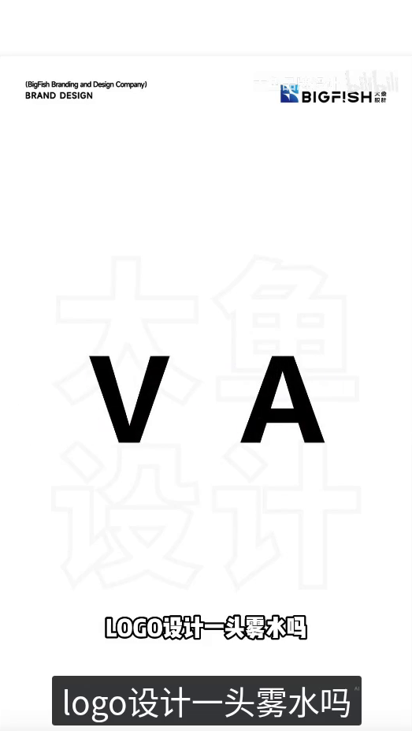

- **作者明确说法**：「LOGO设计一头雾水吗」
- **播放器字幕**：「logo设计一头雾水吗」
- **整理者观察**：白色底上，左侧是黑色正体 V，右侧是黑色正体 A，两字分开。

### V2 · DNA 照片上仍大致分开的珊瑚字

约 0.7s（录屏 13.8s）

- **作者明确说法**：「LOGO设计一头雾水吗」
- **播放器字幕**：「logo设计一头雾水吗」
- **整理者观察**：画面换成一张倾斜的蓝色 DNA 照片。V 和 A 仍大致分开，颜色变为珊瑚红。

### V3 · 两条错开的珊瑚色带形

约 1.0s（录屏 14.1s）

- **作者明确说法**：「LOGO设计一头雾水吗」
- **播放器字幕**：「logo设计一头雾水吗」
- **整理者观察**：两字已收成珊瑚色带形，A 的横梁已经没有了。V 的右端在上、去横梁后 A 的左端在下，相对错开，中间留有空隙，仍是两条分开的带子，并没有接在一起。

### V4 · 两端开始相向弯曲

约 1.2s（录屏 14.3s）

- **作者明确说法**：「LOGO设计一头雾水吗」
- **播放器字幕**：「logo设计一头雾水吗」
- **整理者观察**：V 的右端开始向下弯，去横梁后 A 的左端开始向上、向左弯。两端仍上下错开，中间还有空隙。

### V5 · 弯成上下相向的弧带

约 1.3s（录屏 14.4s）

- **作者明确说法**：「LOGO设计一头雾水吗」
- **播放器字幕**：「logo设计一头雾水吗」
- **整理者观察**：两端进一步弯成上下相向的弧，中间留出近圆形的空隙。两带在中间交错，但仍可看见缝，没有接成一笔。

### V6 · 照片淡出，黑标呈互扣弧带

约 1.9s（录屏 15.0s）

- **作者明确说法**：「其实只要选对了方法」
- **整理者观察**：DNA 照片正在淡出，带子已变成黑色。中间是上下相向的弧带交错，留有斜向白缝和圆形内空，仍未接成一笔。

### V7 · 白底上的黑标

约 2.5s（录屏 15.6s）

- **作者明确说法**：「其实只要选对了方法」
- **整理者观察**：照片已撤下，白色底上只剩这枚黑色标志。中间是上下相向的弧带，夹着斜向白缝和圆形内空，两笔交错互扣，但没有接成一笔。

### V8 · 白标用到照片上

约 3.8s（录屏 16.9s）

- **作者明确说法**：「再难的创意都迎刃而解」
- **整理者观察**：白色标志压在一张带虹彩的 DNA 照片上，中间同样是上下相向的弧带、斜向白缝和圆形内空。白标出现，期间未见过渡。

### 思路与前后关系（整理者分析，非作者原话）

这枚标志能同时读作 V 和 A，是因为左侧仍保留 V 的开口，右侧保留去掉横梁后的 A 的斜边；V 的右端与 A 的左端弯曲后上下交错、互扣，中间留出圆形内空和斜向白缝，两笔并未接成一笔。

---

## 案例一：A 与 M

### A1 · 画面气泡提出 A 和 M

约 4.9s（录屏 18.0s）

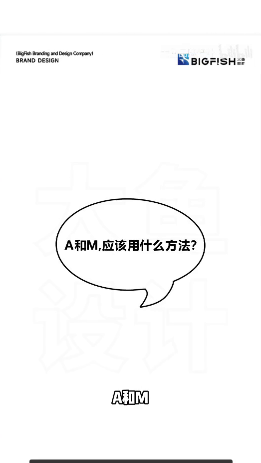

- **作者明确说法**：「A和M」
- **播放器字幕**：「A和M应该用什么方法」
- **整理者观察**：白色底上有一个对话气泡，写着「A和M,应该用什么方法?」。

### A2 · 给出裁切分离法

约 7.1s（录屏 20.2s）

- **作者明确说法**：「这个可以用裁切分离法」
- **整理者观察**：画面中央出现方法标题「裁切分离」。

### A3 · 只取正体 A

约 8.4s（录屏 21.5s）

- **作者明确说法**：「我们只取字母A」
- **播放器字幕**：「我们只取字母A将它变个造型」
- **整理者观察**：画面中央出现黑色正体 A。

### A4 · A 改成尖角菱形字腔

约 9.7s（录屏 22.8s）

- **作者明确说法**：「將它变个造型」
- **播放器字幕**：「我们只取字母A将它变个造型」
- **整理者观察**：A 改成尖角菱形字腔，期间未见过渡；下部随后分离。此时仍是一块相连的图形。

### A5 · 下部开始分离，出现白缝

约 10.5s（录屏 23.6s）

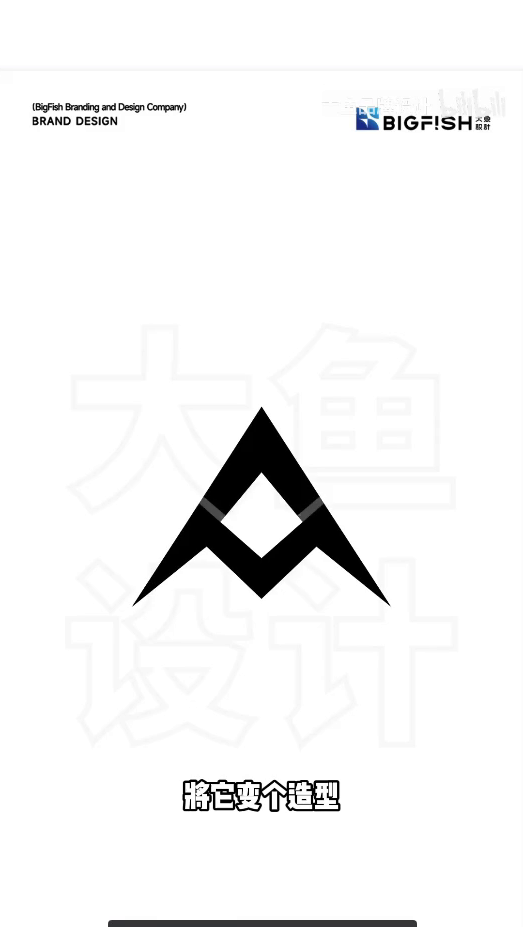

- **作者明确说法**：「將它变个造型」
- **播放器字幕**：「再裁剪一下笔画」
- **整理者观察**：下半部已可见两个肩和中央下折的 M 形折线，上下之间开始出现白缝。

### A6 · 上下白缝更清楚

约 10.8s（录屏 23.9s）

- **作者明确说法**：「再裁剪一下笔画」
- **整理者观察**：上下白缝更清楚。上部是倒 V 形尖顶，下部是带两个肩和中央下折的 M 形折线；中间的菱形白腔由上下共同围出。

### A7 · 上部为黑、下部为珊瑚的组合

约 12.1s（录屏 25.2s）

- **作者明确说法**：「分离出来的部分是不是就得到了M」
- **整理者观察**：上部是黑色倒 V 形尖顶，下部是珊瑚/粉色、带两个肩和中央下折的 M，已经分成两块；菱形白腔仍由上下共同围出。

### A8 · 全黑的山形 AM 标志

约 13.5s（录屏 26.6s）

- **作者明确说法**：「分离出来的部分是不是就得到了M」
- **整理者观察**：上下两块都变成黑色，合成一枚山形标志。下部仍是带两个肩和中央下折的 M。

### A9 · 白标用到一摞书的照片上

约 14.5s（录屏 27.6s）

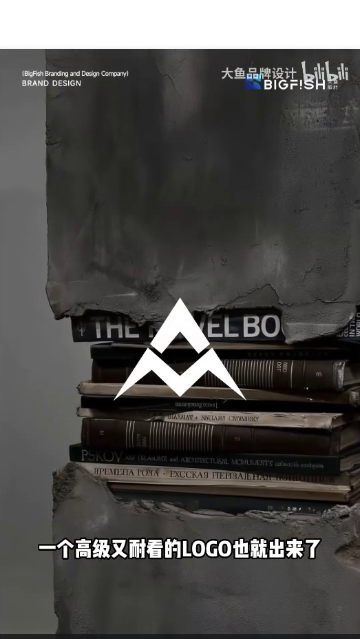

- **作者明确说法**：「一个高级又耐看的LOGO也就出来了」
- **播放器字幕**：「一个高级又耐看的logo也就出来了」
- **整理者观察**：白色山形标志压在一张照片上，照片里是一摞书，放在一个凹龛中。

### 思路与前后关系（整理者分析，非作者原话）

改成尖角菱形字腔后，A 的外轮廓仍在；上下白缝把下半部分离出来，那一部分有两个肩和中央下折，本身就是 M 的走势，中间的菱形白腔由上下共同围出，所以上下可以同时读作 A 和 M。

---

## 案例二：W 与 M

### W1 · 画面气泡提出 W、M 和箭头

约 16.4s（录屏 29.5s）

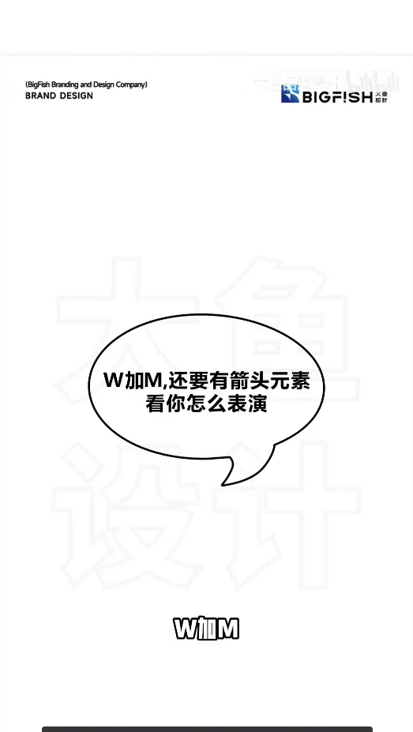

- **作者明确说法**：「W加M」
- **播放器字幕**：「W加M还要有镜头元素」
- **整理者观察**：白色底上有一个对话气泡，两行字分别是「W加M,还要有箭头元素」和「看你怎么表演」。

### W2 · 给出复制翻转法

约 20.3s（录屏 33.4s）

- **作者明确说法**：「这个可以用到复制翻转法」
- **整理者观察**：画面中央出现方法标题「复制翻转」。

### W3 · W 叠在 M 上

约 23.0s（录屏 36.1s）

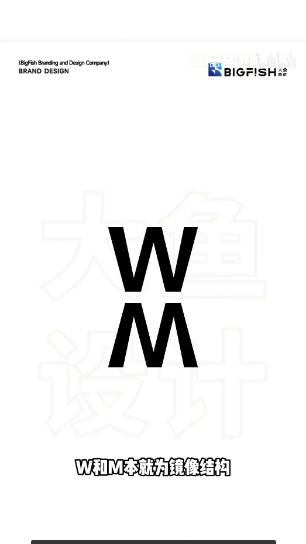

- **作者明确说法**：「W和M本就为镜像结构」
- **整理者观察**：黑色的 W 叠在黑色的 M 上方，两字上下相对。

### W4 · 只取一个 W

约 24.7s（录屏 37.8s）

- **作者明确说法**：「那么我们就可以只取一个W字母」
- **播放器字幕**：「那么我们就可以只取一个W字母同样变形设计」
- **整理者观察**：M 已撤下，画面中央只剩一个黑色的 W。

### W5 · 压扁后的 W

约 26.9s（录屏 40.0s）

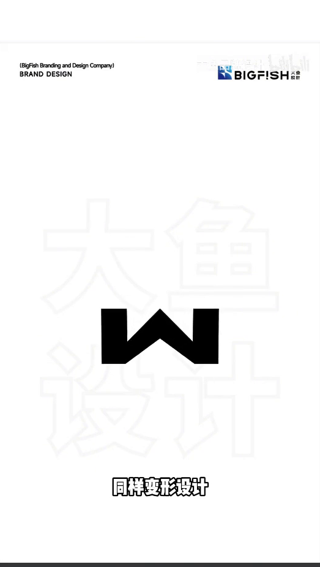

- **作者明确说法**：「同样变形设计」
- **播放器字幕**：「那么我们就可以只取一个W字母同样变形设计」
- **整理者观察**：W 被压扁，笔画更接近水平。

### W6 · 翻转后隐约见到 M 的残影

约 27.6s（录屏 40.7s）

- **作者明确说法**：「随后复制翻转得到字母M」
- **整理者观察**：压扁的 W 上方，隐约出现翻转后的残影。

### W7 · 完成的黑色领结形

约 27.7s（录屏 40.8s）

- **作者明确说法**：「随后复制翻转得到字母M」
- **整理者观察**：上下合在一起，成为一枚黑色领结形标志。

### W8 · 缩短笔画，中间留出白缝

约 29.9s（录屏 43.0s）

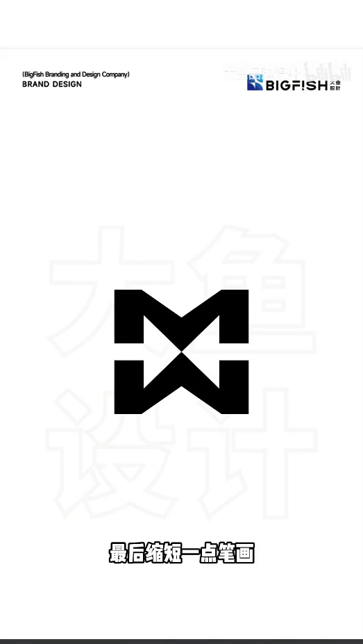

- **作者明确说法**：「最后缩短一点笔画」
- **播放器字幕**：「最后缩短一点笔画箭头是不是也出来了」
- **整理者观察**：笔画缩短，标志中间留出一条白缝。

### W9 · 中间出现相向的珊瑚色箭头提示

约 31.6s（录屏 44.7s）

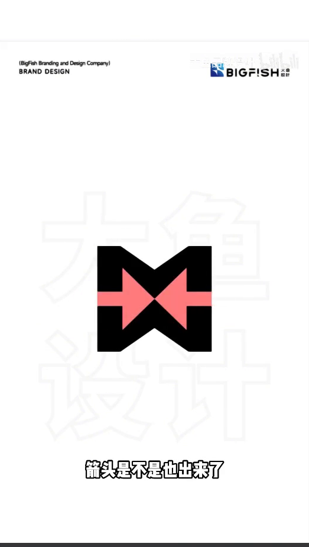

- **作者明确说法**：「箭头是不是也出来了」
- **播放器字幕**：「最后缩短一点笔画箭头是不是也出来了」
- **整理者观察**：中间出现一对珊瑚色色块，左侧尖端朝右、右侧尖端朝左，柄从黑色块面中穿过，形成相向的箭头提示。

### W10 · 白标用到室内照片上

约 33.0s（录屏 46.1s）

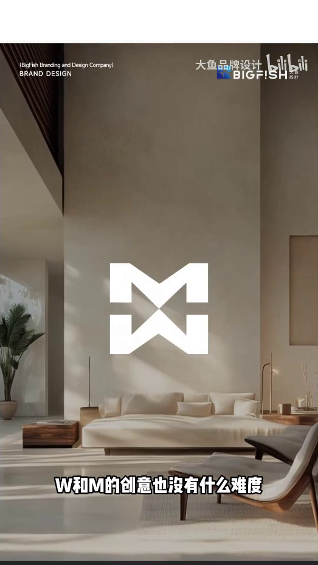

- **作者明确说法**：「W和M的创意也没有什么难度」
- **整理者观察**：白色领结形标志压在一张室内照片上，可见沙发、灯和绿植。

### 思路与前后关系（整理者分析，非作者原话）

W 压扁后再复制翻转，上下合在一起仍分别读作 W 和 M；中间的珊瑚色相向色块只是把箭头提示出来。

---

## 案例三：G 与 B

### G1 · 画面气泡提出健身房加 G 和 B

约 34.7s（录屏 47.8s）

- **作者明确说法**：「健身房加字母G和B」
- **播放器字幕**：「健身房加字母鸡合璧」
- **整理者观察**：白色底上有一个对话气泡，两行字分别是「健身房+字母G和B」和「你行吗?」。

### G2 · 给出拟物法

约 37.6s（录屏 50.7s）

- **作者明确说法**：「这个我们只需要用到拟物法」
- **整理者观察**：画面中央出现方法标题「拟物法」。

### G3 · 取一只哑铃的照片

约 40.0s（录屏 53.1s）

- **作者明确说法**：「我们取一只哑铃」
- **播放器字幕**：「而女巫法顾名思义」
- **整理者观察**：画面是一只哑铃的照片：两端是配重片，中间是握柄，放在底座上。

### G4 · 珊瑚色 G 和 B 叠在哑铃上

约 41.9s（录屏 55.0s）

- **作者明确说法**：「就是將字母模拟出物品的造型」
- **播放器字幕**：「就是将字母模拟出物品的造型」
- **整理者观察**：珊瑚色的 G 和 B 分别叠在哑铃两端的配重位置上。

### G5 · 仍是普通粗圆字

约 43.5s（录屏 56.6s）

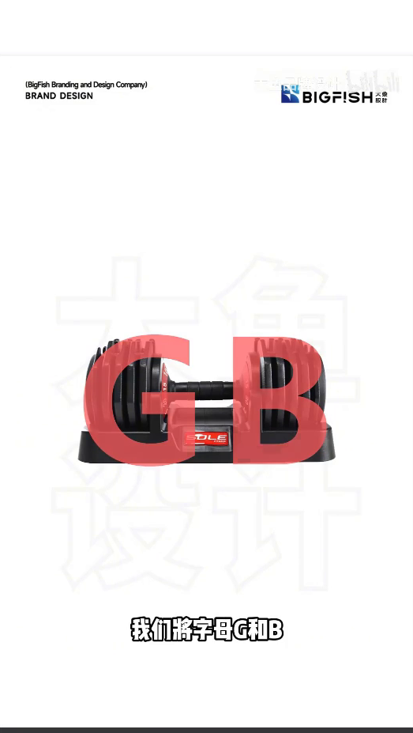

- **作者明确说法**：「我们將字母G和B」
- **播放器字幕**：「我们将字母G和B根据哑铃的轮廓变形」
- **整理者观察**：珊瑚色的 G 和 B 仍是普通粗圆字，压在哑铃照片上。

### G6 · 外缘开始切成平面

约 44.1s（录屏 57.2s）

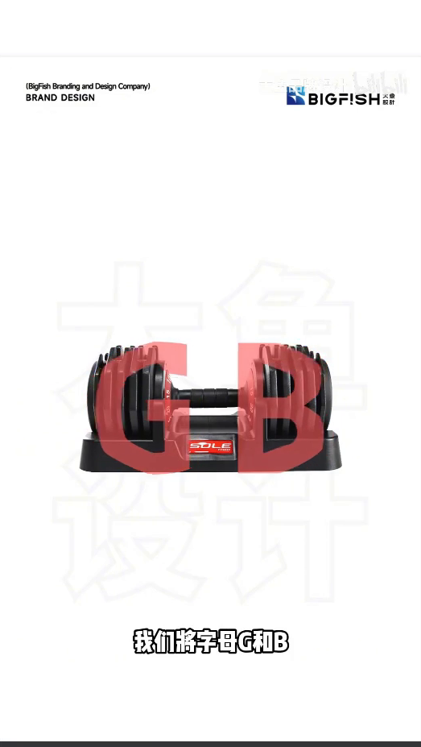

- **作者明确说法**：「我们將字母G和B」
- **播放器字幕**：「我们将字母G和B根据哑铃的轮廓变形」
- **整理者观察**：粗圆字的外缘开始被切齐，G 的顶部和 B 的左侧已出现平面，仍压在哑铃照片上。

### G7 · 已收成棱角几何，仍压在照片上

约 44.7s（录屏 57.8s）

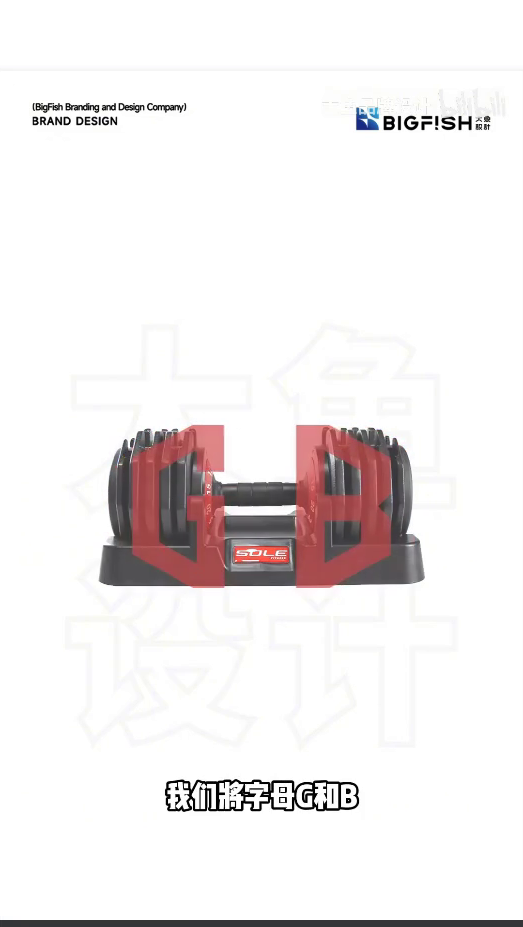

- **作者明确说法**：「我们將字母G和B」
- **播放器字幕**：「我们将字母G和B根据哑铃的轮廓变形」
- **整理者观察**：G 和 B 已收成棱角几何块面，仍是珊瑚色，压在哑铃照片上。

### G8 · 黑块面的 G 和 B 仍分开

约 45.0s（录屏 58.1s）

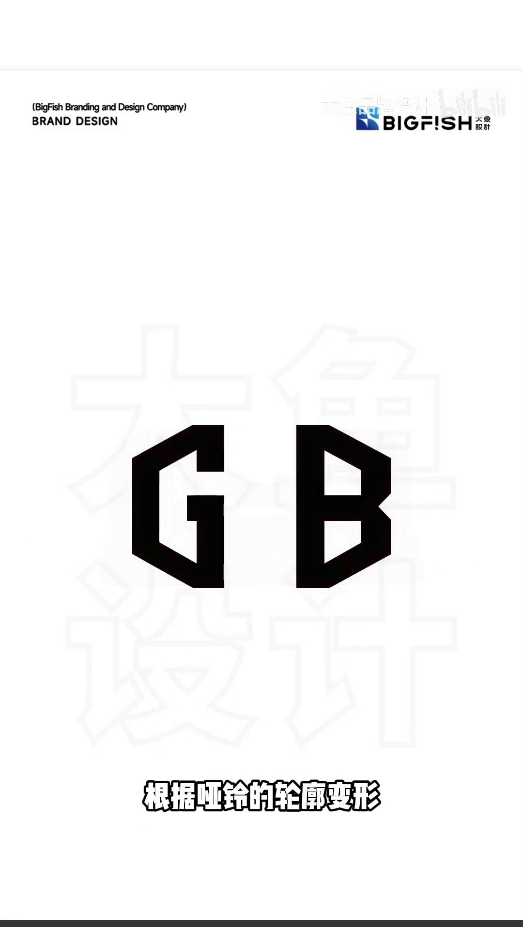

- **作者明确说法**：「根据哑铃的轮廓变形」
- **播放器字幕**：「我们将字母G和B根据哑铃的轮廓变形」
- **整理者观察**：照片已撤下。黑色棱角块面的 G 和 B 左右分开，外形已接近哑铃两端的配重。

### G9 · 中间出现细横条

约 46.1s（录屏 59.2s）

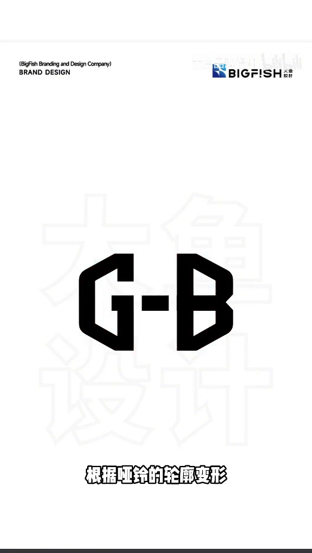

- **作者明确说法**：「根据哑铃的轮廓变形」
- **播放器字幕**：「我们将字母G和B根据哑铃的轮廓变形」
- **整理者观察**：G 和 B 之间多出一条细横条，把两字连起来。

### G10 · 横条已加粗，两字更近

约 46.7s（录屏 59.8s）

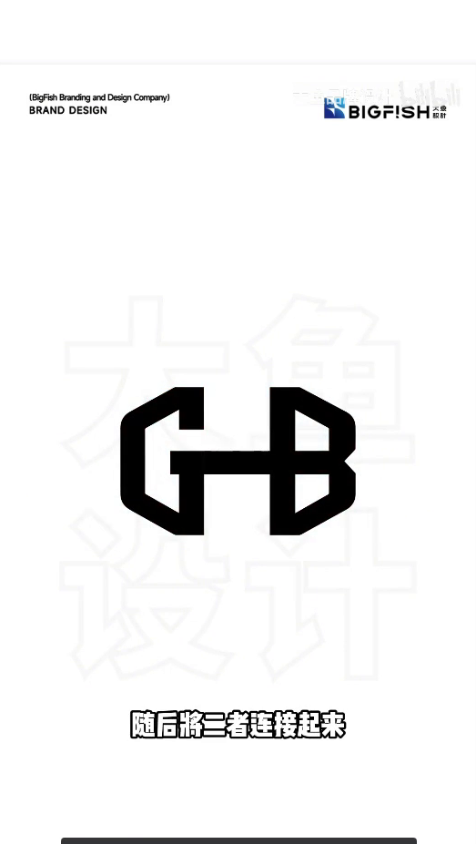

- **作者明确说法**：「随后將二者连接起来」
- **播放器字幕**：「随后将二者连接起来」
- **整理者观察**：连接两字的横条已经加粗，字母间距也收得更近。由前一帧细横条到这一步，中间这一跳的厚度未见。

### G11 · 横条继续加厚

约 47.3s（录屏 60.4s）

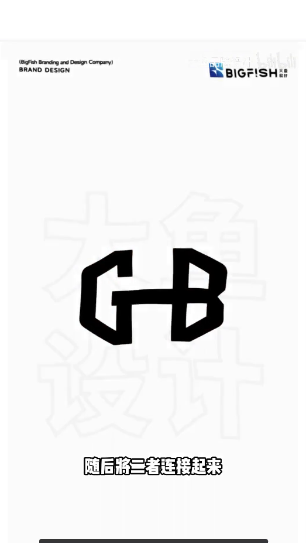

- **作者明确说法**：「随后將二者连接起来」
- **播放器字幕**：「随后将二者连接起来」
- **整理者观察**：中间横条继续加厚，更接近哑铃握柄的体量。

### G12 · 白标用到健身房照片上

约 48.3s（录屏 61.4s）

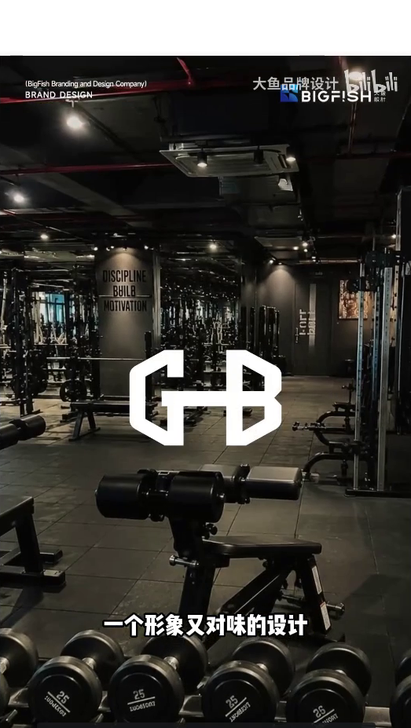

- **作者明确说法**：「一个形象又对味的设计」。其后：「不也手拿把掐」
- **播放器字幕**：「一个形象又对位的设计」。其后亦为「不也手拿把掐」
- **整理者观察**：白色连接标志压在一张健身房内部的照片上，可见器械架和一排哑铃。

### 思路与前后关系（整理者分析，非作者原话）

G、B 由普通粗圆字收成贴合哑铃两端配重的棱角块面，再用横条把两字连起来，所以能同时读作字母和一只哑铃。

---

## 收束

### R1 · 三枚完成标志并列表

约 51.1s（录屏 64.2s）

- **作者明确说法**：「还有哪些难搞的」。其后：「别急 我会出手」
- **播放器字幕**：其后作「别急」
- **整理者观察**：白底上列出三组：「字母A+M」配山形 AM 标志，「箭头+WM」配领结形标志，「哑铃+GB」配已用横条连起的 G、B 标志。
