# [只要学会元素融合，LOGO设计你就手拿把掐](https://www.bilibili.com/video/BV1b1YW6vEyd/)｜大鱼品牌设计

文中「约 00:mm」是按播放器时钟校准的近似时刻，误差约 ±1s；括号内为录屏精确秒。

## 案例一：餐叉、汤匙与熊猫 / 熊猫食堂

### PD1 · 开播前预览：叉勺照片与熊猫照片

约 00:00–01（录屏 0.000s，开播前暂停预览）

播放器时钟在预览段多见 00:01/01:00，开播过渡才短暂出现 00:00。此帧是暂停预览截图，不能按录屏 0 秒用偏移公式写成负秒；约视频只标 00:00–01 近似。

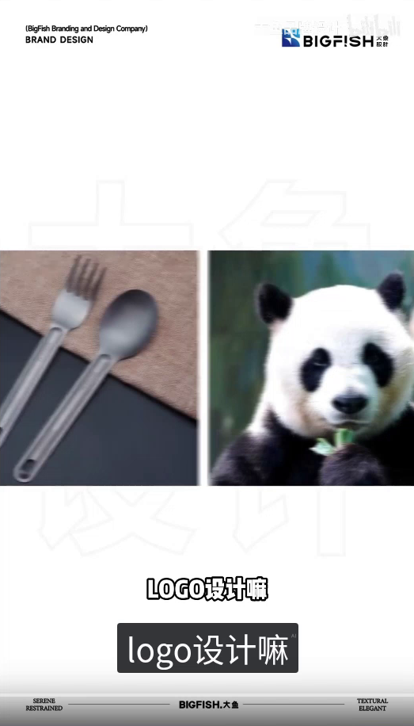

- **作者明确说法**：「LOGO设计嘛」
- **播放器字幕**：「logo设计嘛」
- **整理者观察**：这是开播前的暂停预览，不是播放中的截图。白底上已经是设计源图：左边一张照片里是浅色台面上的四齿餐叉和汤匙，右边一张是正在啃竹的熊猫。两件还是分开的照片。

### PD2 · 珊瑚红提示：叉匙上半段，眼斑描圈，鼻实红

约 00:02（录屏 82.067s）

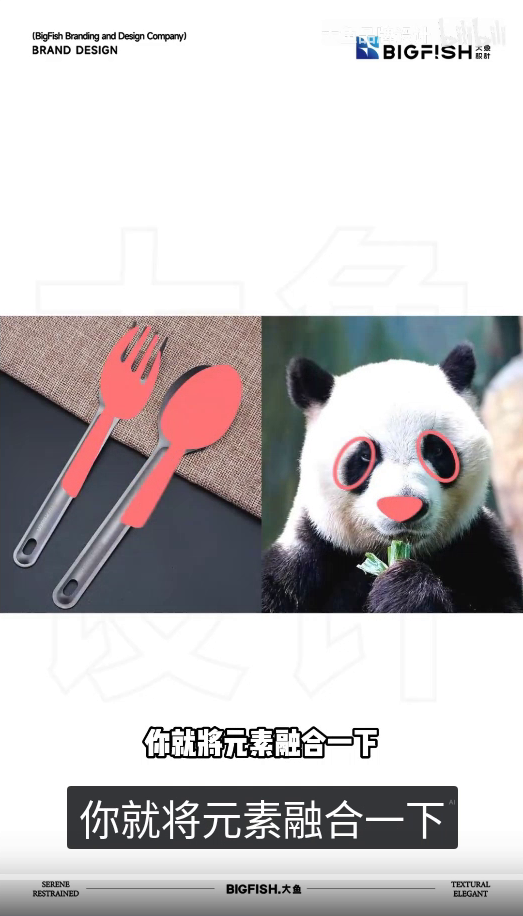

- **作者明确说法**：「你就将元素融合一下」
- **整理者观察**：开播后源图还在。珊瑚红已经覆盖到：餐叉的齿、叉头，以及柄的上半段，柄的下段（含末端开孔）仍是灰金属色；汤匙的匙心和柄的上半段是珊瑚红，柄的下段仍是灰色。熊猫两枚眼斑是珊瑚红描出的圈，圈里仍露出原来的黑色眼区；鼻头是一块实心的珊瑚红。82.000 时红已经出现，但那一帧片内还是「LOGO设计嘛」，本帧才换成这句话。

### PD3 · 抽出后的珊瑚叉、匙和鼻形

约 00:03（录屏 82.600s）

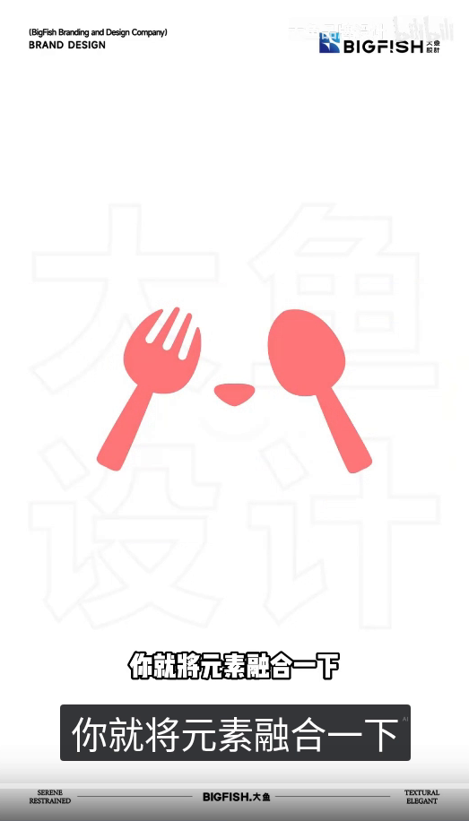

- **作者明确说法**：「你就将元素融合一下」
- **整理者观察**：照片已经抽走，白底上留下珊瑚红的四齿叉、珊瑚红的汤匙，以及中间一枚实心的圆三角鼻，这时还没有微笑弧。82.467、82.500 已经是这一形态，但那两帧上还留着淡淡的长方形照片残底，所以包内用更清楚的 82.600；82.633 与本帧同构。

### PD4 · 抽出后的黑色净标

约 00:03（录屏 82.833s）

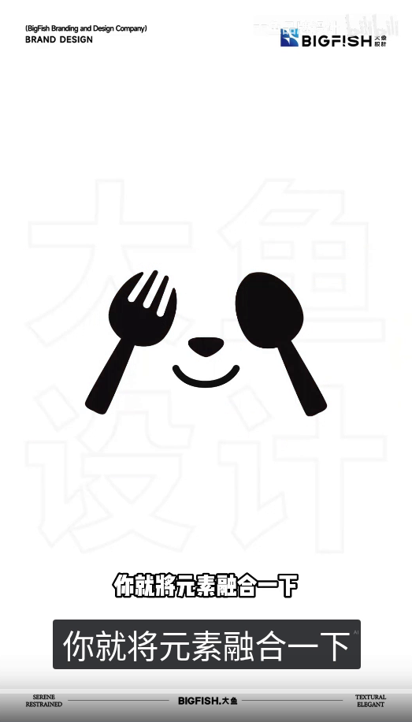

- **作者明确说法**：「你就将元素融合一下」
- **整理者观察**：照片已经抽走，留下黑色净标。左边是四齿叉，齿朝右上、柄朝左下，叉头本身就是左眼斑；右边是汤匙，匙心朝上、柄朝右下，匙心本身就是右眼斑。两件之间是朝下的圆三角实心鼻，鼻下一道微笑弧。没有在中间另外画两只眼睛。

### PD5 · 用到树上熊猫照片上，熊猫食堂

约 00:04（录屏 84.033s）

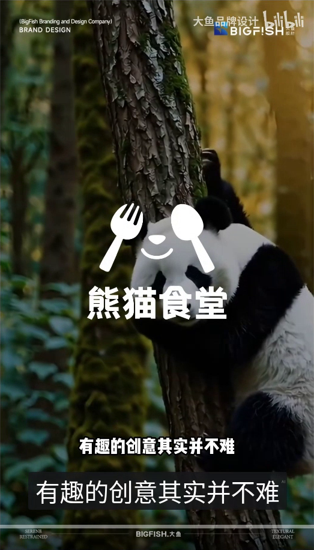

- **作者明确说法**：「有趣的创意其实并不难」
- **整理者观察**：白色标志用到一张熊猫趴在树上的照片上，结构与黑净标相同。下方是粗体中文「熊猫食堂」四字，没有英文。这一案没有进入片尾三行回顾。

### 思路与前后关系（整理者分析，非作者原话）

开播前的预览里就已经放上叉勺照片和熊猫照片。播放中先用珊瑚红标出要取的部分：叉和匙都是头加上柄的上半段，熊猫是眼斑的轮廓圈和实心的鼻。照片淡去之后，白底上先留下珊瑚红的四齿叉、汤匙和中间的实心鼻形小块。随后颜色转深，收成黑色净标，并出现微笑弧。叉头和匙心就是左右眼斑，中间是鼻和微笑。再用到树上熊猫的照片上，字标写成「熊猫食堂」。这是整理者根据可见结构作的归纳，片内说的是「LOGO设计嘛」「你就将元素融合一下」「有趣的创意其实并不难」。

---

## 案例二：字母 KICK 与炸鸡 / KICK · 香酥鸡

### KK1 · 气泡：kick+炸鸡

约 00:06（录屏 85.633s）

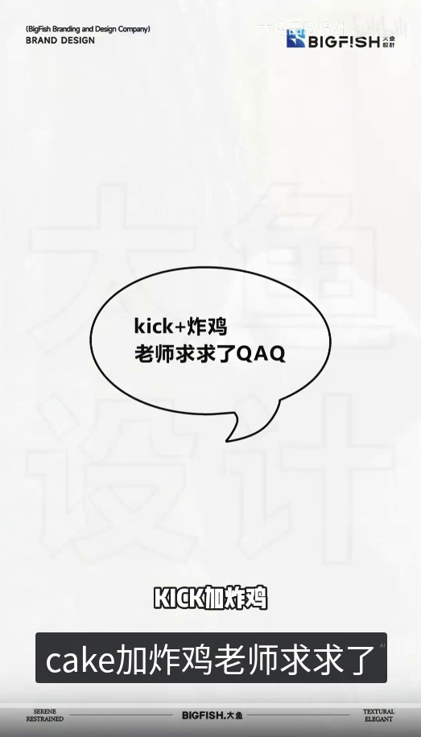

- **作者明确说法**：「KICK加炸鸡」
- **播放器字幕**：「cake加炸鸡老师求求了」
- **整理者观察**：白底上出现对话泡，两行是「kick+炸鸡」和「老师求求了QAQ」。kick 是小写，中间是加号，QAQ 紧接在「了」后面。当帧片内写的是「KICK加炸鸡」，还没有「求求了」；「老师求求了」要到稍后才出现，而且片内没有 QAQ。

### KK2 · 炸鸡盒上写着小写 kick

约 00:08（录屏 87.733s）

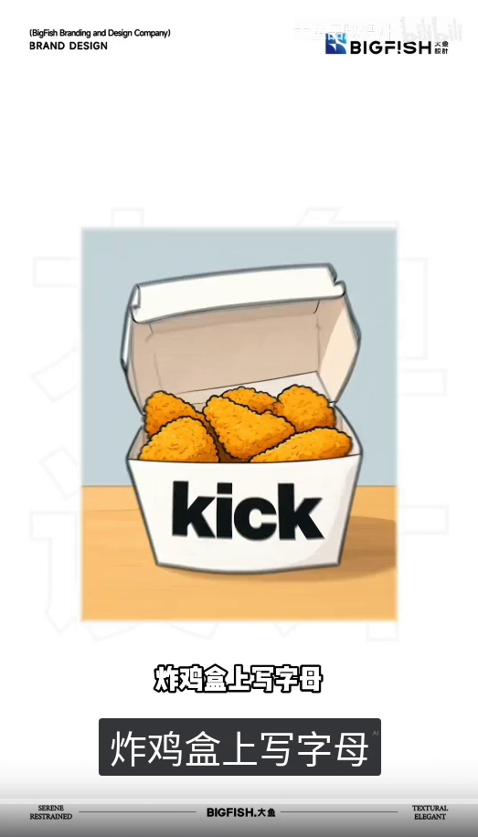

- **作者明确说法**：「炸鸡盒上写字母」
- **整理者观察**：画面是一张打开的白盒炸鸡插画，盒子正面写着粗黑的小写 kick。

### KK3 · 只留下大写 KICK

约 00:10（录屏 90.367s）

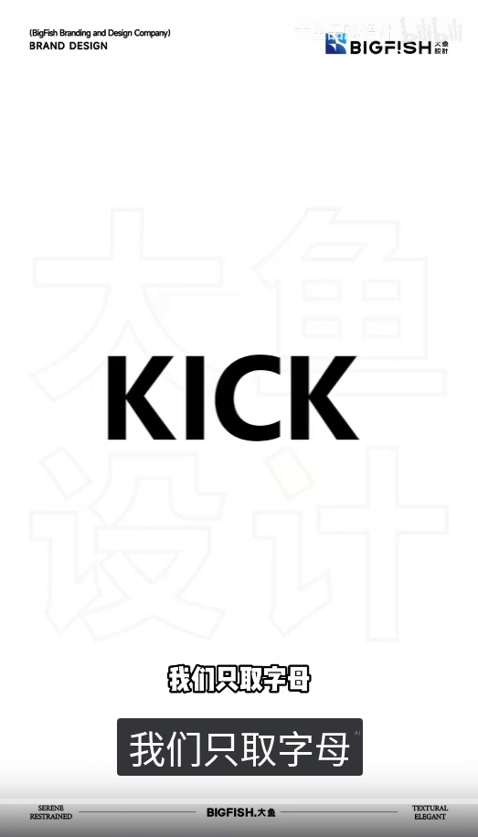

- **作者明确说法**：「我们只取字母」
- **整理者观察**：盒子已经抽走，白底上只剩四个分开的大写字母 K、I、C、K。

### KK4 · 首枚 K 转成朝右的鸡头

约 00:13（录屏 92.833s）

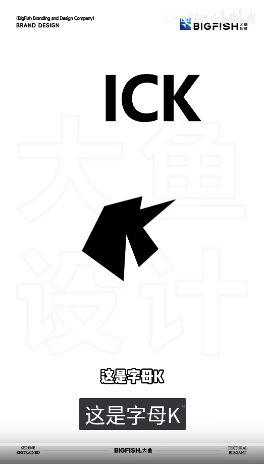

- **作者明确说法**：「这是字母K」
- **整理者观察**：左边第一个 K 已经脱离、旋转，收成鸡的头颈胸：左侧是较厚的背部，右上伸出长尖的喙，右下还有一截较短的尖。鸟头朝右。

### KK5 · I 落到头的左上方

约 00:14（录屏 93.800s）

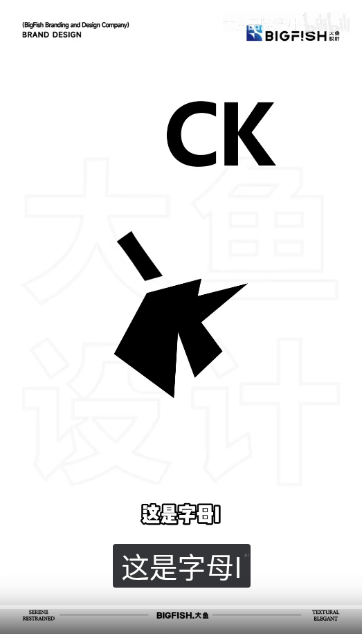

- **作者明确说法**：「这是字母I」
- **整理者观察**：字母 I 变成一截倾斜的短矩形，停在头的左上方，还没有和头顶粘死。它后来成为冠上最左侧的那一条。

### KK6 · C 变成头上的月牙形眼睛

约 00:15（录屏 95.033s）

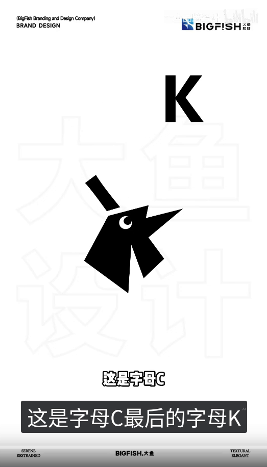

- **作者明确说法**：「这是字母C」
- **播放器字幕**：「这是字母C最后的字母K」
- **整理者观察**：字母 C 已经落到头上，成为一枚白色的 C 形／月牙形镂空眼，开口朝右上。它是眼睛的负形，开口朝右上。

### KK7 · 最后的 K 正在头上方下落

约 00:16（录屏 95.600s）

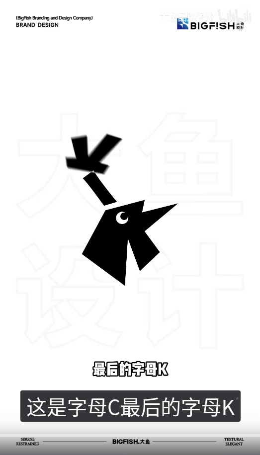

- **作者明确说法**：「最后的字母K」
- **播放器字幕**：「这是字母C最后的字母K」
- **整理者观察**：剩下的那个 K 还辨认得出字形，带着模糊，正在头上方旋转下落。此后录屏有 95.933→96.133 约 0.200s 的空隙，没有录到它转到鸡冠朝向的中间状态。

### KK8 · 冠已经落下，左侧 I 仍是一整条

约 00:16（录屏 96.200s）

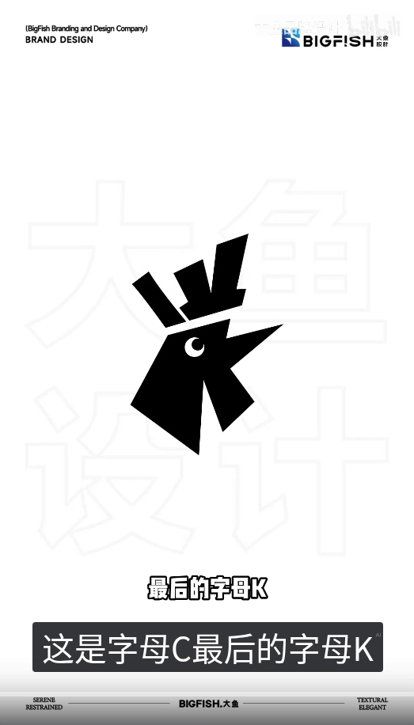

- **作者明确说法**：「最后的字母K」
- **播放器字幕**：「这是字母C最后的字母K」
- **整理者观察**：最后的 K 已经落成头顶的冠，和左侧那条 I 排在一起。此时左侧的 I 仍是一整条倾斜矩形，中间没有断开。C 形眼睛还在。片内这一帧仍是「最后的字母K」。

### KK9 · 左冠条上出现灰带，尚未断开

约 00:17（录屏 96.867s）

- **作者明确说法**：「你看」
- **播放器字幕**：「你看一只公鸡」
- **整理者观察**：96.833 起，左侧这条 I 的上端开始出现一道深灰横带；到本帧灰带更清楚，但条仍连成一件，还没有被缝切开。

### KK10 · 浅缝首次贯通左冠条

约 00:17（录屏 96.967s）

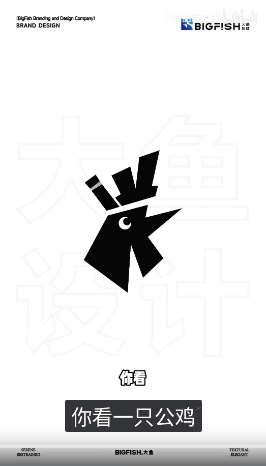

- **作者明确说法**：「你看」
- **播放器字幕**：「你看一只公鸡」
- **整理者观察**：这是浅色缝第一次贯通的画面。上端分出一小段，下段还在，缝里还偏浅灰，上端还没有收成小点。97.133 白缝更清楚，上段仍是一截短矩形。

### KK11 · 白底净标：左冠已是小点加短条

约 00:18（录屏 97.800s）

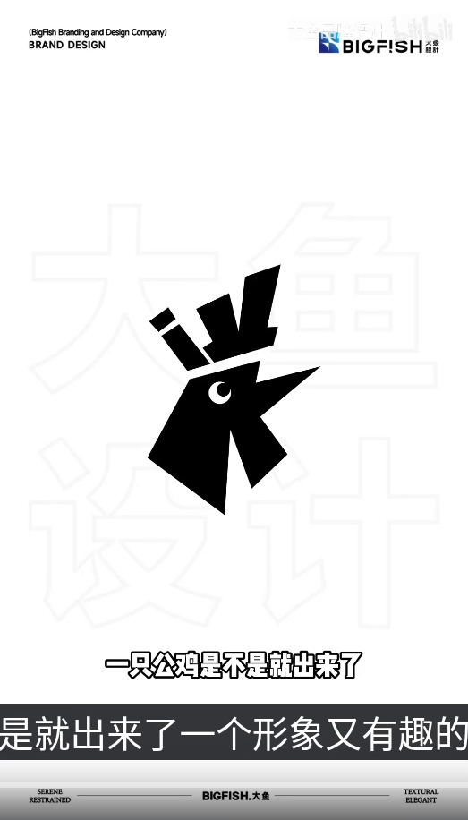

- **作者明确说法**：「一只公鸡是不是就出来了」
- **播放器字幕**：「是就出来了一个形象又有趣的」
- **整理者观察**：白底上的净标已经稳定。左侧冠条收成上端一个小点（短平行四边形）和下面一条短条，中间留白，看起来像小写 i。98.000 仍是这个样子。这是应用之前就已经完成的变化。

### KK12 · 用到炸鸡照片上，KICK · 香酥鸡

约 00:19（录屏 99.300s）

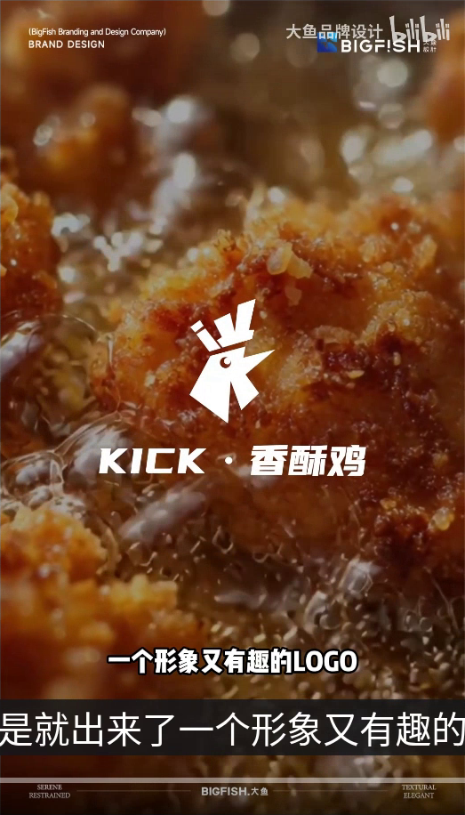

- **作者明确说法**：「一个形象又有趣的LOGO」
- **播放器字幕**：「是就出来了一个形象又有趣的」
- **整理者观察**：白色公鸡标用到炸鸡特写上，朝右，月牙形眼睛还在。左冠条保持着上一帧白底净标的断开形态：上端小点，下面短条。下方字标是全大写 KICK、中间一个间隔点「·」，然后是中文「香酥鸡」。

### 思路与前后关系（整理者分析，非作者原话）

先从炸鸡盒上取出四个大写字母。第一个 K 转成朝右的鸡头，I 落到头左上方成为冠的左侧条，C 变成头上的月牙形眼睛，最后那个 K 落到头顶当冠。冠落下之后，左侧那条 I 仍是一整条；随后条上先出现灰带，再被浅缝贯通，到白底净标时已经收成上端小点加短条，再用到炸鸡照片上，字标写成 KICK · 香酥鸡。这是整理者根据可见结构作的归纳，片内说的是「炸鸡盒上写字母」「我们只取字母」「这是字母K」「这是字母I」「这是字母C」「最后的字母K」「你看」「一只公鸡是不是就出来了」「一个形象又有趣的LOGO」。

---

## 案例三：圆拼图与变色龙 / CHAMELEON 玩具城

### CM1 · 气泡：用变色龙来设计一个玩具行业的LOGO怎么搞?

约 00:22（录屏 102.000s）

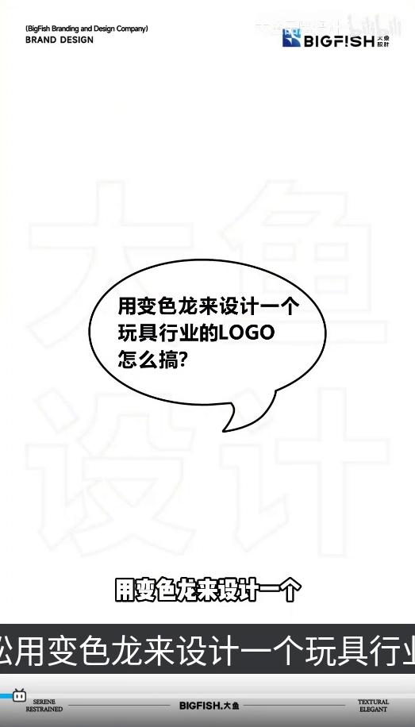

- **作者明确说法**：「用变色龙来设计一个」
- **播放器字幕**：「用变色龙来设计一个玩具行」
- **整理者观察**：对话泡是三行：「用变色龙来设计一个」「玩具行业的LOGO」「怎么搞?」。问号在「搞」后面。片内这一帧只到前半句，「玩具行业的LOGO怎么搞」要稍后再出现，片内没有问号。

### CM2 · 四块圆形拼图

约 00:26（录屏 106.400s）

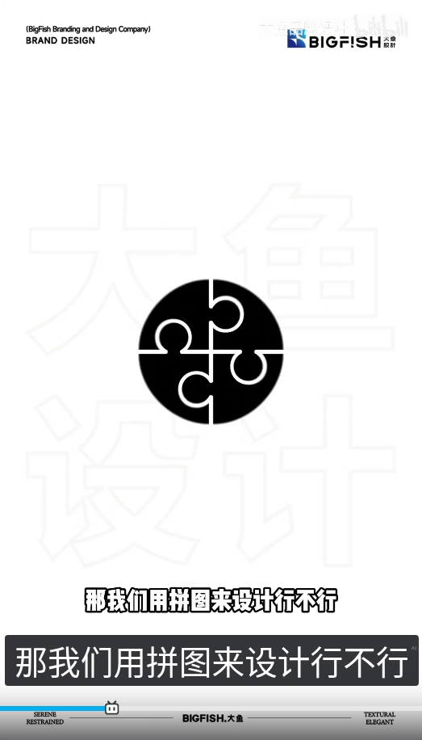

- **作者明确说法**：「那我们用拼图来设计行不行」
- **整理者观察**：黑色正圆被十字缝分成四块四分之一，每条缝上各有一枚圆形互锁凸起。

### CM3 · 右下那一块开始变灰

约 00:28（录屏 107.767s）

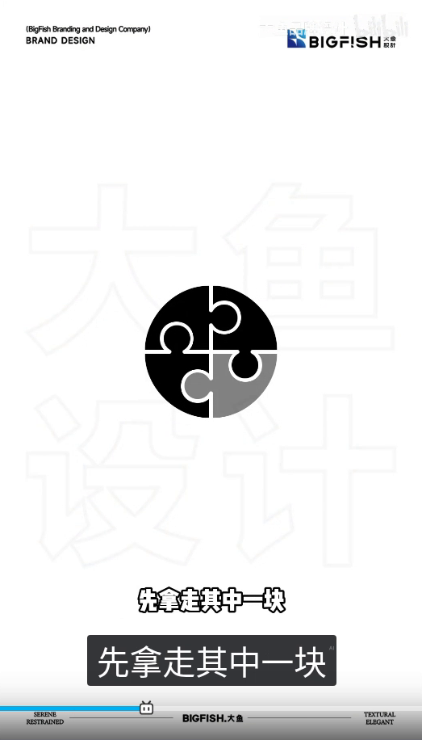

- **作者明确说法**：「先拿走其中一块」
- **整理者观察**：右下（东南）那一块正在变灰，准备被拿走。

### CM4 · 右下块已经拿走

约 00:28（录屏 108.100s）

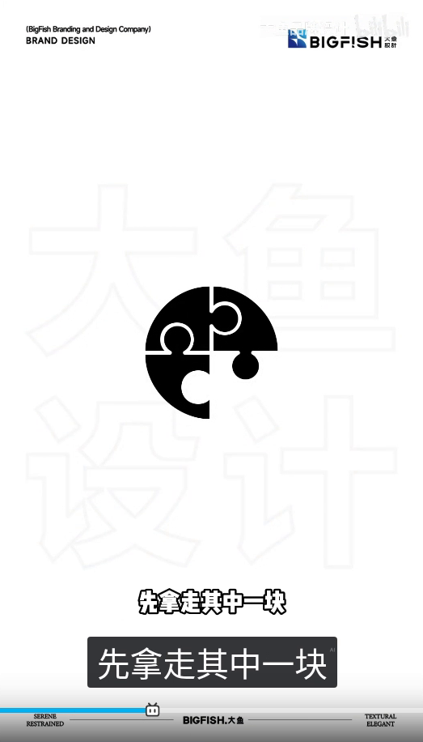

- **作者明确说法**：「先拿走其中一块」
- **整理者观察**：右下块已经去掉。左下块右侧露出圆形槽口；右上块原来插进右下块的圆形凸起，变成悬在缺口旁的黑圆头。被拿走的这一块没有再回到画面，也没有拿去当眼睛。

### CM5 · 右头块放大，悬空圆凸脱离

约 00:29（录屏 109.200s）

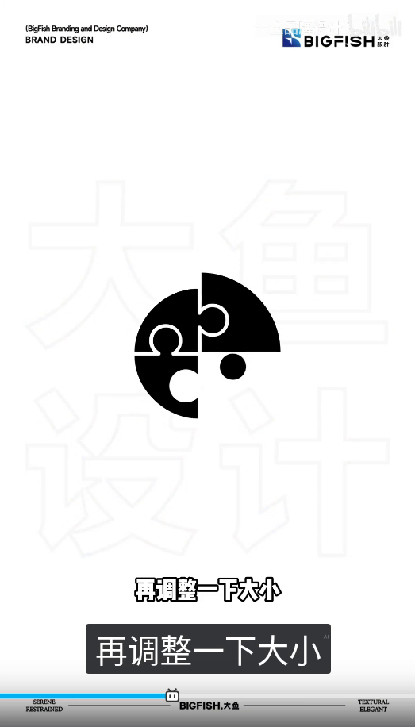

- **作者明确说法**：「再调整一下大小」
- **整理者观察**：右侧（头）那一块已经放大，超出左边两块的尺度。原先连着的圆凸脱离，成为头下方一枚独立的黑圆。左边上下两块仍在原来的相对位置。

### CM6 · 头上新开一枚白圆眼

约 00:30（录屏 110.167s）

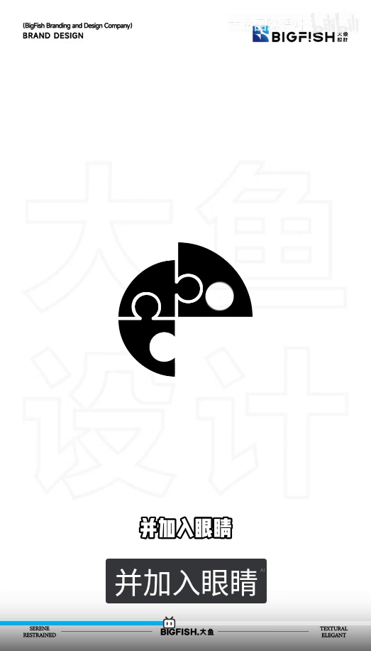

- **作者明确说法**：「并加入眼睛」
- **整理者观察**：放大后的右头块上新开了一枚白圆。先前那枚脱离的黑圆已经不在。这只眼是新加的。绿色（此时仍是黑）尾块上的圆缺口，是去块留下的槽。

### CM7 · 黄、绿、粉配色，白圈黑瞳

约 00:32（录屏 111.800s）

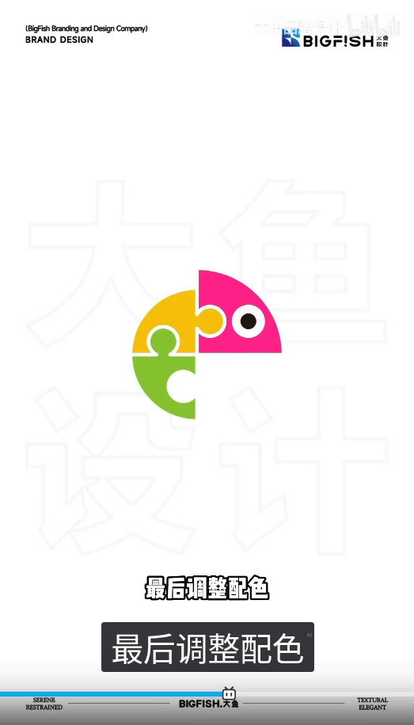

- **作者明确说法**：「最后调整配色」
- **整理者观察**：左上块是黄，左下块是黄绿，放大的右头块是品红／粉。头朝右，粉色头上是一枚白圈、黑瞳的眼睛。左下绿块带着去块留下的圆缺口，像弯尾。此后录屏有 111.933→112.133、112.600→112.800 两段各约 0.200s 的空隙，落在配色之后、上应用之前。

### CM8 · 用到变色龙照片上，CHAMELEON 玩具城

约 00:34（录屏 113.700s）

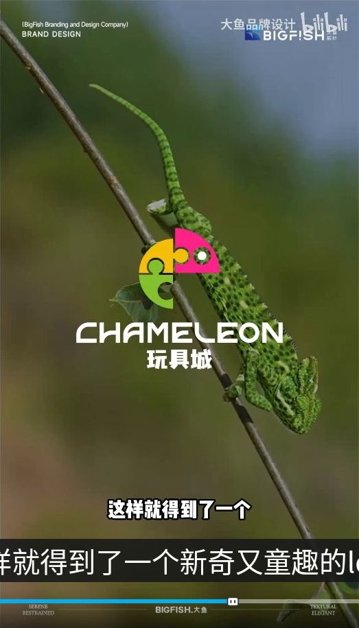

- **作者明确说法**：「这样就得到了一个」
- **播放器字幕**：「样就得到了一个新奇又童趣的l」
- **整理者观察**：彩色标志用到一张枝上绿变色龙的照片上。眼睛和上一帧白底不同：外环已经露底，透出后面的枝干和背景，内心是实白，相当于把白底上的黑瞳反了过来。下方字标是字距较宽的全大写 CHAMELEON，再下面居中写着中文「玩具城」三字。

### 思路与前后关系（整理者分析，非作者原话）

先用四块圆形拼图做底，拿走右下那一块，再把右侧的头块放大，去掉悬空的圆凸，在头上新开一只眼，最后涂成黄、绿、粉。白底上这只眼是白圈黑瞳；用到照片上时，外环改成露底、内心为白。字标写成 CHAMELEON 和「玩具城」。这是整理者根据可见结构作的归纳，片内说的是「那我们用拼图来设计行不行」「先拿走其中一块」「再调整一下大小」「并加入眼睛」「最后调整配色」「凸显变色龙的特点」「这样就得到了一个」「新奇又童趣的LOGO」。

---

## 案例四：酒、李白与 BUFF / 李白的BUFF

### BF1 · 气泡：我是开酒馆的，名字叫李白的BUFF

约 00:36（录屏 116.200s）

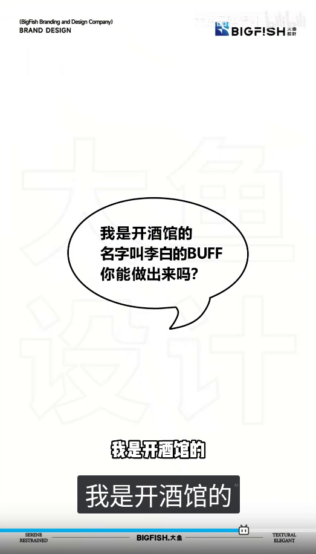

- **作者明确说法**：「我是开酒馆的」
- **整理者观察**：对话泡是三行：「我是开酒馆的」「名字叫李白的BUFF」「你能做出来吗?」。BUFF 是全大写，末行有问号。片内这一帧只到第一句，后面两句稍后才分开出现，片内「吗」后面没有问号。

### BF2 · 把元素写成三行：酒、李白、BUFF

约 00:40（录屏 119.933s）

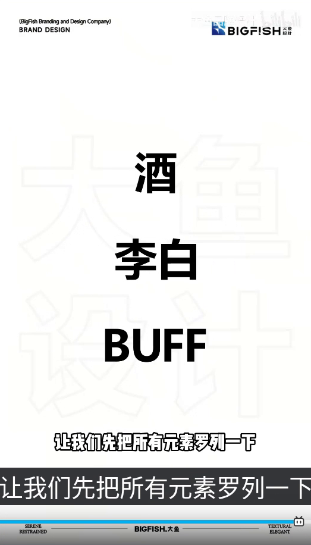

- **作者明确说法**：「你能做出来吗」
- **整理者观察**：画面列出三行文字，只有三项：酒、李白、BUFF。左边后来出现的折线是指引线。

### BF3 · 李白插画，腰间有酒壶

约 00:44（录屏 123.500s）

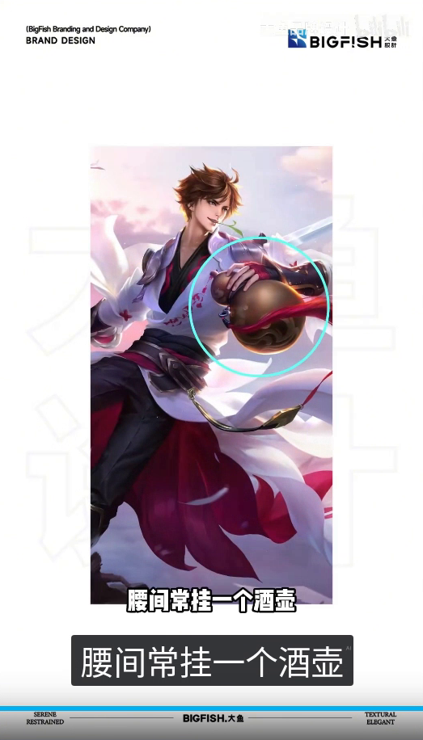

- **作者明确说法**：「腰间常挂一个酒壶」
- **整理者观察**：这是一幅人物插画，用来说明腰间的酒壶，稍后画面会回到三行文字。

### BF4 · 两枚橙色葫芦照片

约 00:47（录屏 126.733s）

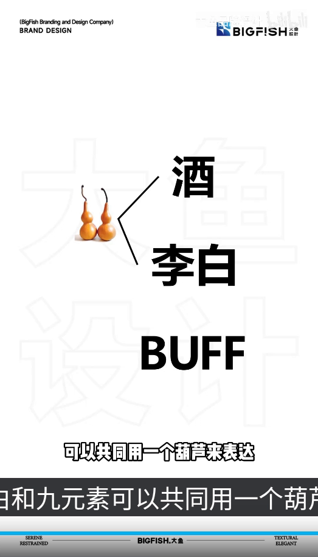

- **作者明确说法**：「可以共用一个葫芦来表达」
- **播放器字幕**：「白和九元素可以共用一个葫芦」
- **整理者观察**：文字左侧出现两枚并排的橙色葫芦照片，茎向外弯，是两只并排的橙色葫芦照片，茎向外弯。三行字和那条折线还在。

### BF5 · 单圈几何：外八红、内八蓝

约 00:52（录屏 131.533s）

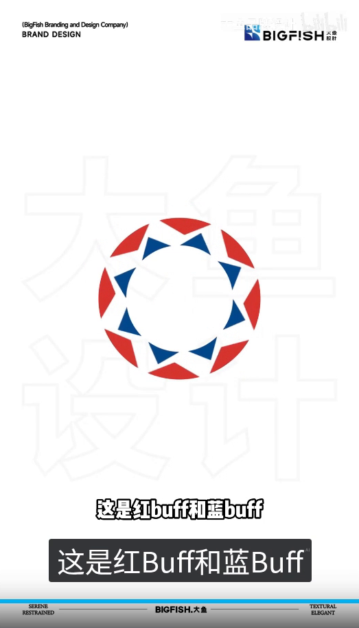

- **作者明确说法**：「这是红buff和蓝buff」
- **播放器字幕**：「这是红Buff和蓝Buff」
- **整理者观察**：文字和葫芦照片已经收掉，留下一个圆环。外圈是八枚红色的弧形／chevron 段，内圈是八枚朝内的蓝色三角，红蓝相间、同一圆心，一共八红八蓝。靠近顶部的两枚蓝三角分在顶红的左右两侧，并不压在正顶上。

### BF6 · 红圈与蓝圈错位重叠

约 00:53（录屏 132.800s）

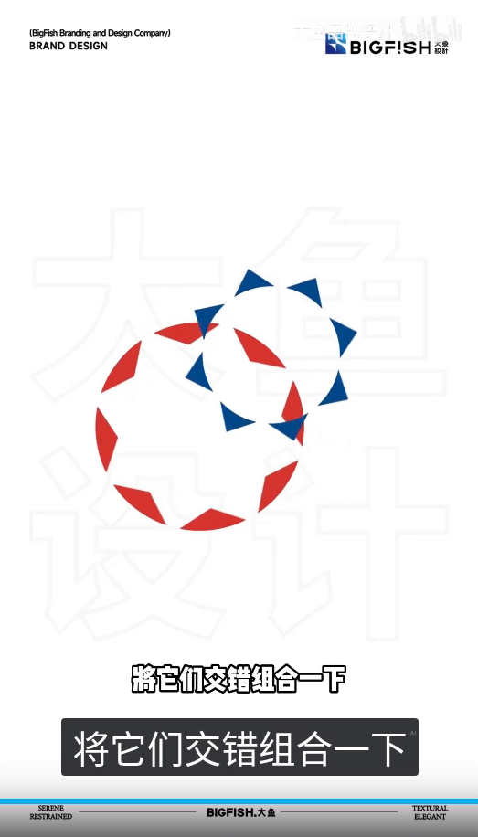

- **作者明确说法**：「将它们交错组合一下」
- **整理者观察**：红段留作左下的主圈，蓝三角移到右上另成一圈，两圈错开叠加，外形开始像上下双圆的葫芦，间距还没有收到后来的终态。

### BF7 · 双圈已经收拢，浅灰壶嘴中态

约 00:54（录屏 133.667s）

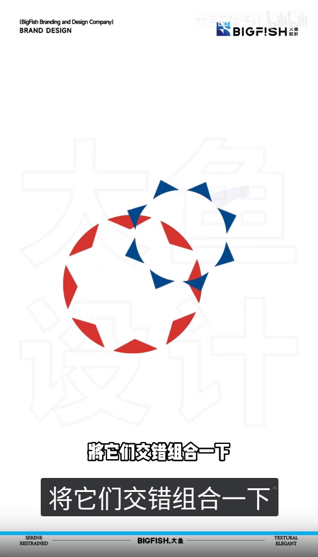

- **作者明确说法**：「将它们交错组合一下」
- **整理者观察**：两圈已经收到葫芦轮廓，左下是红圈，右上是蓝圈，互相重叠。蓝圈右上已隐约出现浅灰壶嘴中态：从蓝顶右三角的右侧向右伸出一道浅灰矩形，下边略呈弧，尚未变为实蓝。未见酒滴。

### BF8 · 加上右上壶嘴和一滴清酒

约 00:55（录屏 134.767s）

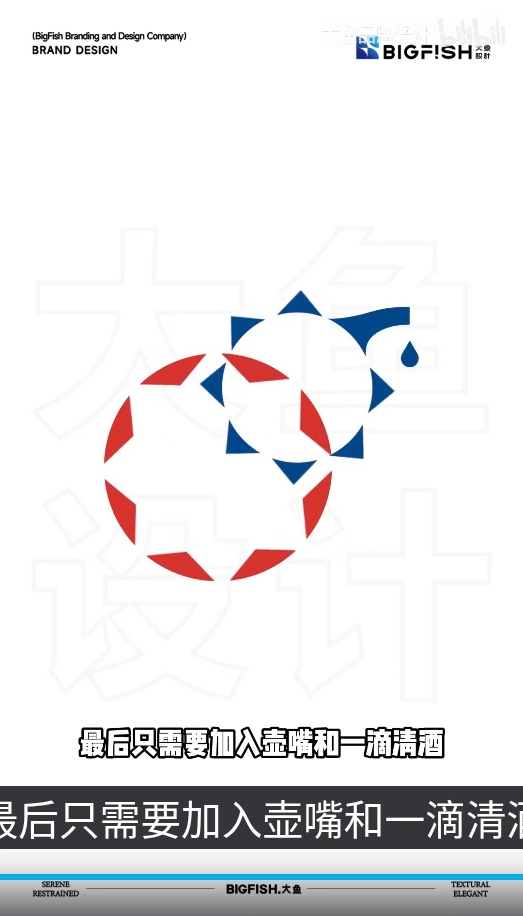

- **作者明确说法**：「最后只需要加入壶嘴和一滴清酒」
- **整理者观察**：壶嘴在上蓝圈的右上方，由蓝色折面组成，开口朝右。一滴深蓝色、尖朝上、圆头朝下的泪滴形清酒，挂在壶嘴右下方，和壶嘴不相接，中间有空隙。它不在左圈上，也不贴死在嘴口。

### BF9 · 用到夜色城镇照片上，李白的BUFF

约 00:56（录屏 136.300s）

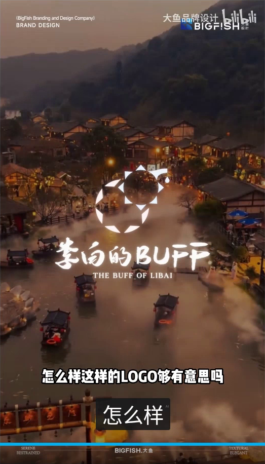

- **作者明确说法**：「怎么样这样的LOGO够有意思吗」
- **播放器字幕**：「怎么样」
- **整理者观察**：浅色双圈葫芦标用到一张夜色河边城镇的照片上，右上仍有壶嘴和外挂的酒滴。上行是笔刷感的「李白的BUFF」，下行是字距较宽的全大写英文 THE BUFF OF LIBAI，「LIBAI」连在一起写。

### 思路与前后关系（整理者分析，非作者原话）

先把酒、李白、BUFF 三项文字列出来，再用李白插画和两枚葫芦照片说明「葫芦」这个共同点。几何阶段先做成同一圆环上外八红、内八蓝，再把红圈和蓝圈错位重叠；收拢之后先形成双圈葫芦，蓝圈右上已隐约出现浅灰壶嘴中态，此时尚未变为实蓝，也还没有酒滴。然后再加上右上实蓝壶嘴和一滴不相接的清酒，用到夜色城镇照片上，字标写成「李白的BUFF」和 THE BUFF OF LIBAI。这是整理者根据可见结构作的归纳，片内说的是「让我们先把所有元素罗列一下」「可以共用一个葫芦来表达」「这是红buff和蓝buff」「将它们交错组合一下」「最后只需要加入壶嘴和一滴清酒」「怎么样这样的LOGO够有意思吗」。

---

## 收束：三例并列

### SB1 · 三行回顾

约 00:59（录屏 139.300s）

- **作者明确说法**：「还有没有难搞的」
- **播放器字幕**：「别急」
- **整理者观察**：上一完整应用态到回顾板之间，录屏有 139.100→139.300 约 0.200s 空隙。回顾只有三行，没有把片头的「熊猫食堂」算进来。左列是 KICK+炸鸡、变色龙+玩具、李白+酒+BUFF；右列是对应的完成标，以及 KICK · 香酥鸡、CHAMELEON／玩具城、李白的BUFF／THE BUFF OF LIBAI。

### SB2 · 别急我会出手

约 00:59（录屏 139.467s）

- **作者明确说法**：「别急我会出手」
- **播放器字幕**：「别急」
- **整理者观察**：回顾板还在。片内是一行六字「别急我会出手」，「急」和「我」之间没有空开。播放器字幕这一帧仍只显示「别急」，「我会出手」要稍后再出现。
