# [想要LOGO有创意，就必须结合实际元素](https://www.bilibili.com/video/BV1cDJy61E4i)｜大鱼品牌设计

## 案例一：S + 抽屉柜 / SSA KITCHENS & CABINETS

### SSA1 · 字母 S 和双抽屉柜的照片

约 0.7s（录屏 17.0s）

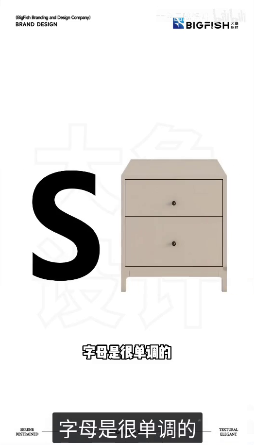

- **作者明确说法**：「字母是很单调的」
- **整理者观察**：白底上，左侧是黑色字母 S，右侧是一张浅米色双抽屉柜的照片：上下两屉、两只深色圆拉手、四只锥形腿。两件东西并放，还没有叠在一起。

### SSA2 · S 拉方，叠到柜上

约 1.1s（录屏 17.4s）

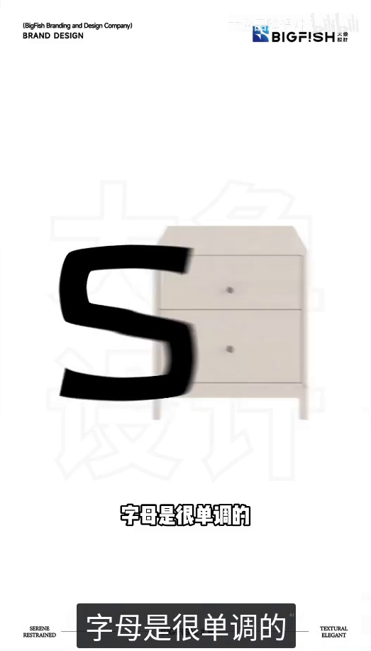

- **作者明确说法**：「字母是很单调的」
- **整理者观察**：S 已经被拉得更方、更厚，叠到柜的照片上，屉面、拉手和锥形腿都还看得见。边缘略有发虚，几何完成态看下一帧。

### SSA3 · 收成几何形 S

约 1.7s（录屏 18.0s）

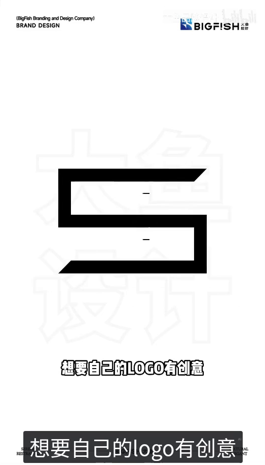

- **作者明确说法**：「想要自己的LOGO有创意」
- **整理者观察**：柜的照片已经退去，留下一件几何形的 S：三层横笔构成 S 的走向，右上角和左下角切了斜角，上下两个开口里只有极淡的短痕，还没有形成短条。

### SSA4 · 开口里出现浅灰短矩形

约 2.5s（录屏 18.8s）

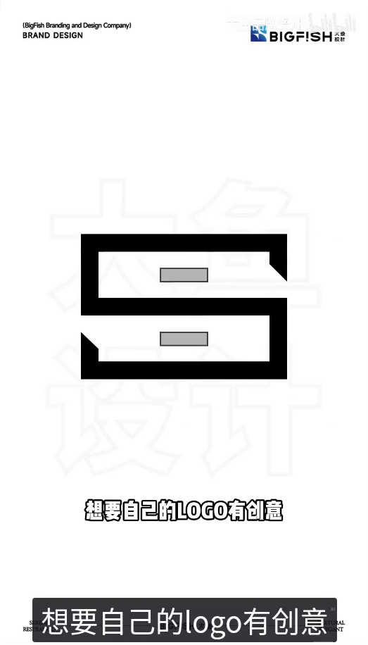

- **作者明确说法**：「想要自己的LOGO有创意」
- **整理者观察**：上下两个开口的中部各出现一块浅灰短矩形，颜色还不是黑的。

### SSA5 · 短条收成黑色，成标

约 2.9s（录屏 19.2s）

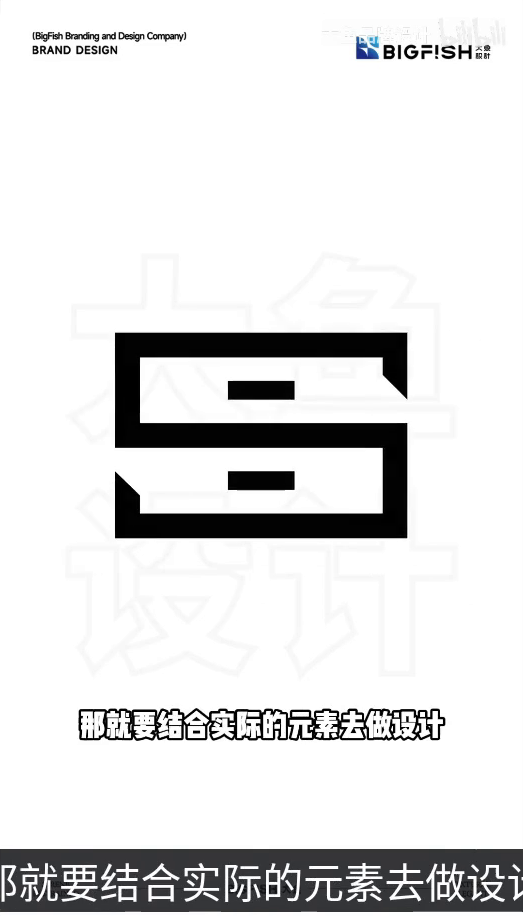

- **作者明确说法**：「想要自己的LOGO有创意」
- **整理者观察**：两根短横已经收成黑色，仍停在两个开口的中部。这是这一案线标的完成态。

### SSA6 · 用到厨柜照片上，SSA / KITCHENS & CABINETS

约 3.7s（录屏 20.0s）

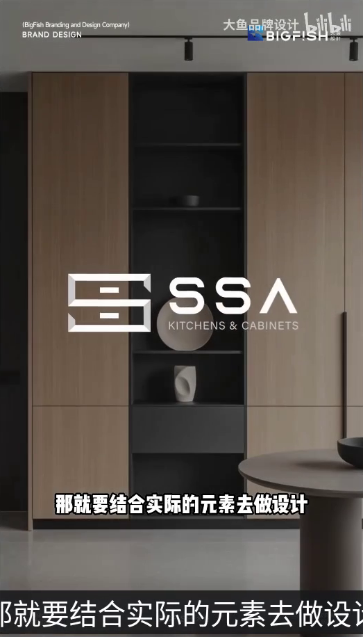

- **作者明确说法**：「那就要结合实际的元素去做设计」
- **整理者观察**：同一件标志反白，压在木色厨柜的照片上：深色开放格里有白陶，前景有圆桌。右侧字标为 SSA，A 没有横笔，近 Λ 形；其下是 KITCHENS & CABINETS。

### 思路与前后关系（整理者分析，非作者原话）

几何形 S 的上下开口像两层屉腔，开口里的短横与柜的双屉相呼应，把屉的结构收进同一套轮廓里。

---

## 案例二：CM + 瓷瓶 / CIMU 瓷慕

### CM1 · 对话框

约 5.7s（录屏 22.0s）

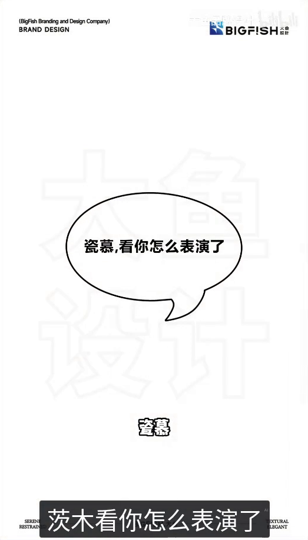

- **作者明确说法**：「瓷慕,看你怎么表演了」。同一对话框画面上，片内下方先写「瓷慕」，随后改为「看你怎么表演了」。
- **整理者观察**：气泡里写着「瓷慕,看你怎么表演了」。

### CM2 · 「瓷慕」二字

约 7.7s（录屏 24.0s）

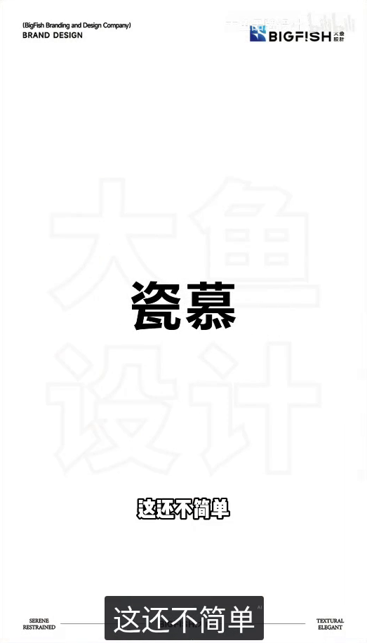

- **作者明确说法**：「这还不简单」
- **整理者观察**：白底正中是「瓷慕」两个黑字。

### CM3 · 提取首字母 CM

约 8.7s（录屏 25.0s）

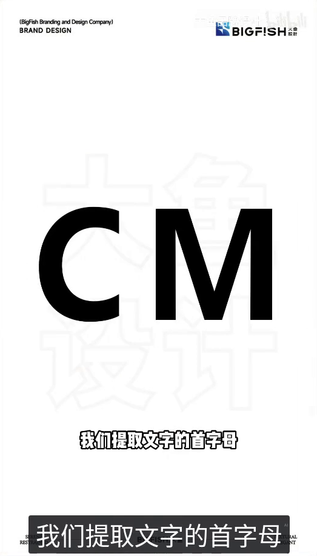

- **作者明确说法**：「我们提取文字的首字母」
- **整理者观察**：大号黑体 C 和 M 并排。

### CM4 · 字母叠靠，收成花瓶（中间态）

约 10.2s（录屏 26.5s）

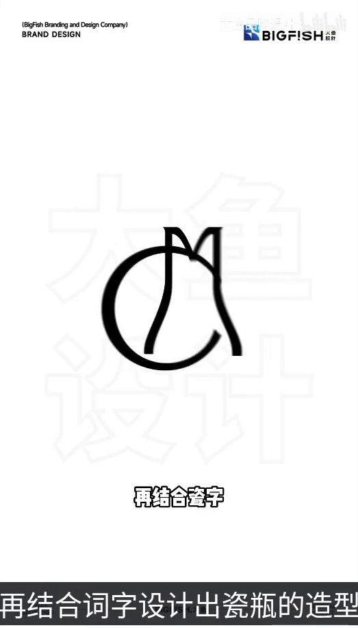

- **作者明确说法**：「再结合瓷字」
- **播放器字幕**：「再结合词字设计出瓷瓶的造型」
- **整理者观察**：C 开始圈住左侧，M 向上收成瓶口的尖峰，瓶腹的内轮廓线已经出现，右侧也冒出一段尾巴。26.4 两字叠靠时发虚，这里用结构已经可读的邻帧；线描收稳看下一帧。

### CM5 · 收成线描花瓶

约 10.7s（录屏 27.0s）

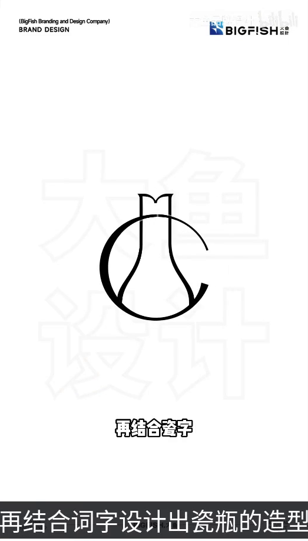

- **作者明确说法**：「再结合瓷字」。同一线描画面上，片内随后改为「设计出瓷瓶的造型」。
- **播放器字幕**：「再结合词字设计出瓷瓶的造型」
- **整理者观察**：C 的厚弧绕在瓶身外侧，右侧留一段尾巴；M 的两个尖峰当作瓶口；瓶腹由两条内轮廓线收成。此时瓶口和瓶腹都还没有星。

### CM6 · 星在瓶口中

约 12.7s（录屏 29.0s）

- **作者明确说法**：「最后加入一点星光点缀」
- **整理者观察**：一颗四角星加在瓶口中央。左右两条瓶颈竖线此时已经在，由 M 的两道外竖向下接到瓶腹。

### CM7 · 星下移到瓶腹，顶部中央到星出现竖线

约 12.9s（录屏 29.2s）

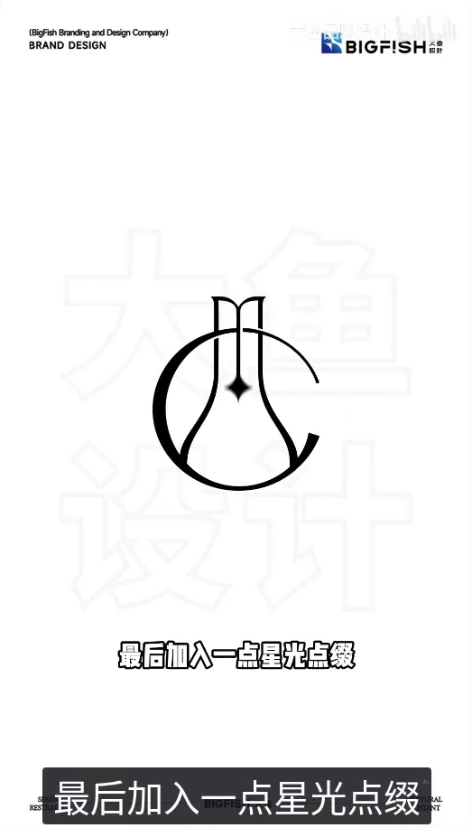

- **作者明确说法**：「最后加入一点星光点缀」
- **整理者观察**：星已经下移到瓶腹。M 顶部中央的凹点向下添出一条竖线，末端落在星上。左右两条瓶颈竖线仍由 M 的两道外竖接到瓶腹。这是这一案线标的完成态。

### CM8 · 用到瓷瓶照片上，CIMU 瓷慕 / Skin Care

约 14.7s（录屏 31.0s）

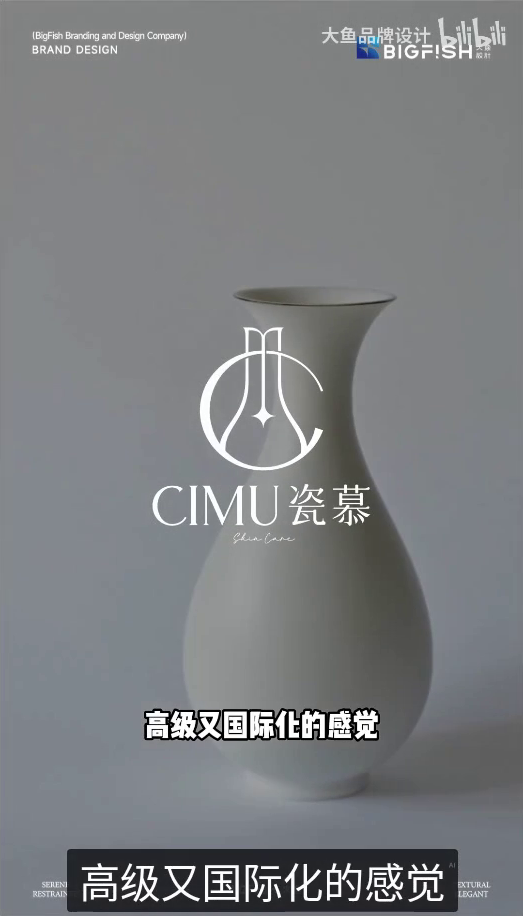

- **作者明确说法**：「高级又国际化的感觉」。同一应用画面上，片内随后改为「还不是手拿把掐」。
- **整理者观察**：同一件线标反白，压在一张白瓷花瓶的照片上：灰底、梨形瓶身、深色口沿。字标为 CIMU 瓷慕，其下是脚本字 Skin Care。

### 思路与前后关系（整理者分析，非作者原话）

M 的两道外竖弯成瓶颈和瓶身，C 环抱成圆瓶轮廓，共用的线条同时读成字母和花瓶。顶部中央再向下添一条竖线连到星，作为瓶腹里的点缀。

---

## 案例三：eG + 古玩 / 壹阁古玩

### eG1 · 对话框

约 17.7s（录屏 34.0s）

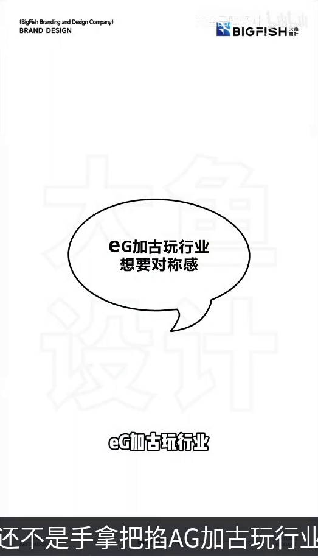

- **作者明确说法**：「eG加古玩行业 / 想要对称感」。同一对话框画面上，片内下方先写「eG加古玩行业」，随后改为「想要对称感」。
- **整理者观察**：气泡分两行写着「eG加古玩行业」「想要对称感」。

### eG2 · 小写 e 和大写 G

约 19.7s（录屏 36.0s）

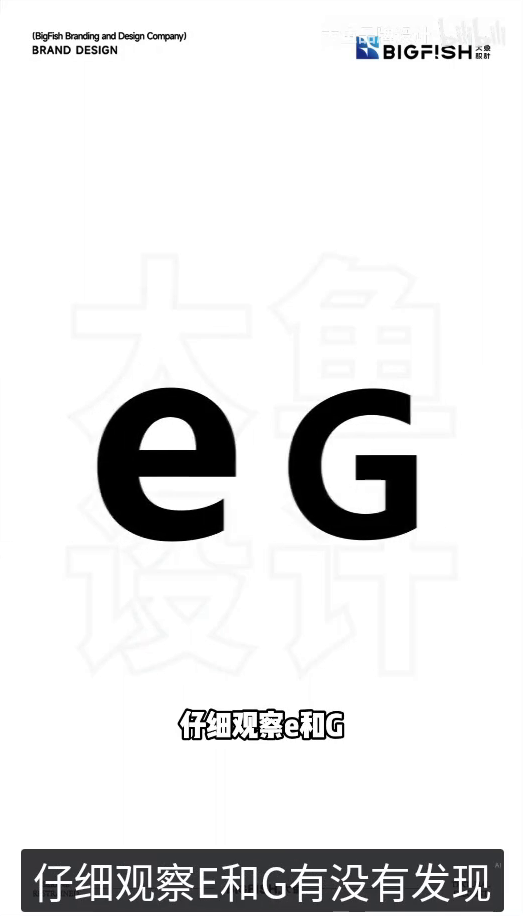

- **作者明确说法**：「仔细观察e和G」
- **整理者观察**：左侧是小写 e，右侧是大写 G。

### eG3 · 翻转中间态：e 被横向压扁

约 20.7s（录屏 37.0s）

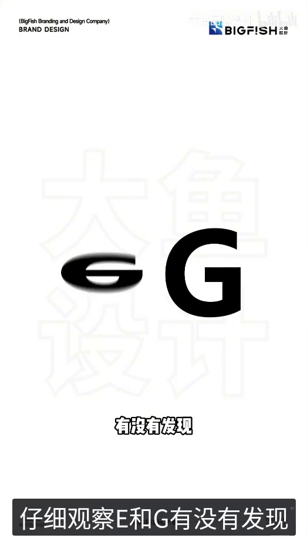

- **作者明确说法**：「有没有发现」
- **整理者观察**：左侧的 e 被横向压扁，边缘带着运动模糊；右侧 G 还是原来的样子。这是翻转中间态，下一步停稳。

### eG4 · 翻转对照：左字停在「6」形

约 21.7s（录屏 38.0s）

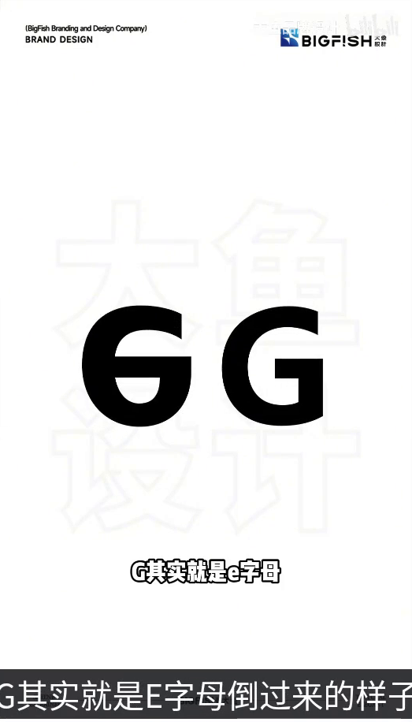

- **作者明确说法**：「G其实就是e字母」
- **整理者观察**：左侧已经停在一个像「6」的字形，右侧仍是 G。这是翻转对照后的清晰一帧，不是另选字母重做的一套方案。

### eG5 · 回到 e 和 G

约 22.7s（录屏 39.0s）

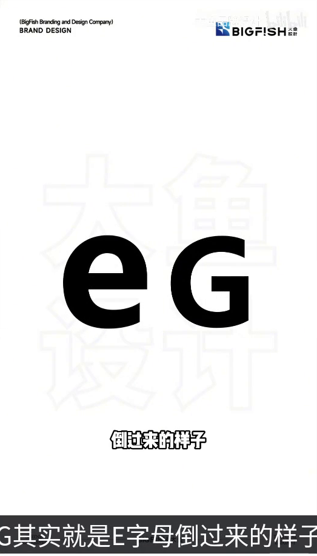

- **作者明确说法**：「倒过来的样子」
- **整理者观察**：左侧又回到小写 e，右侧仍是 G。

### eG6 · 收成左半模块

约 23.9s（录屏 40.2s）

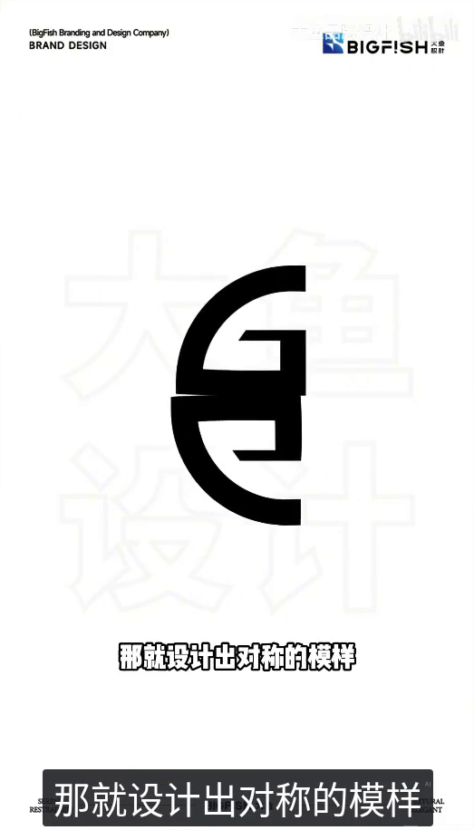

- **作者明确说法**：「那就设计出对称的模样」
- **整理者观察**：e 和 G 已经收成一件半模块：左侧是厚弧，弧内上下两对横齿，中间一道横带，右缘齐整。

### eG7 · 模块转到左半圆位置

约 24.5s（录屏 40.8s）

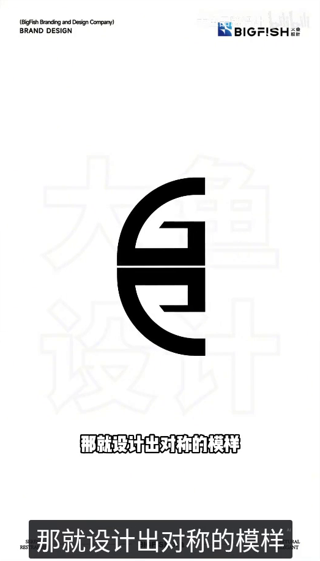

- **作者明确说法**：「那就设计出对称的模样」
- **整理者观察**：同一件模块已经转到左侧，外沿更接近半圆，横齿朝右，右缘仍是一条齐缝。此时还只有这一半。

### eG8 · 复制旋转后两半拼合（中间态）

约 25.3s（录屏 41.6s）

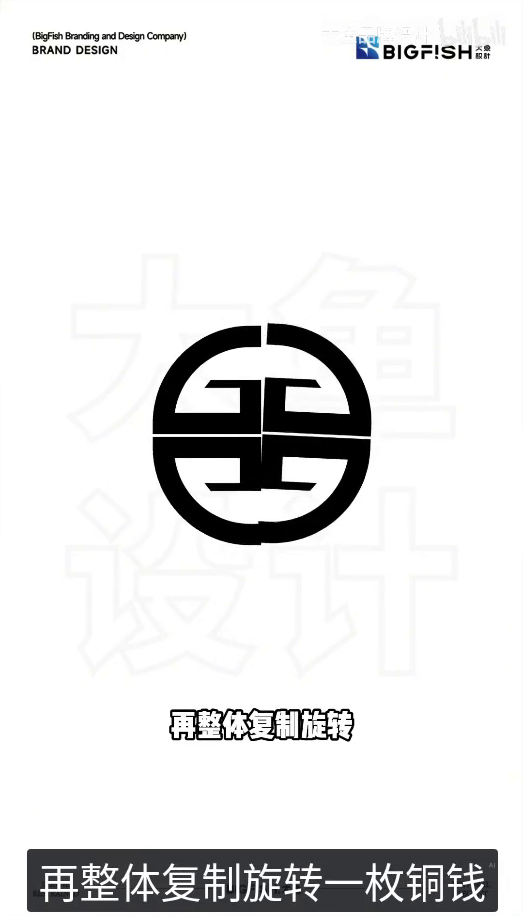

- **作者明确说法**：「再整体复制旋转」
- **整理者观察**：另一半已经转到对面，两半拼成近圆轮廓。中间一条横带，一条竖向细缝上下贯穿，上下各有留白腔。此时中央的竖缝还是倾斜的，外弧也略有参差；结构和成标已经一致，成标看下一张。

### eG9 · 成标

约 26.7s（录屏 43.0s）

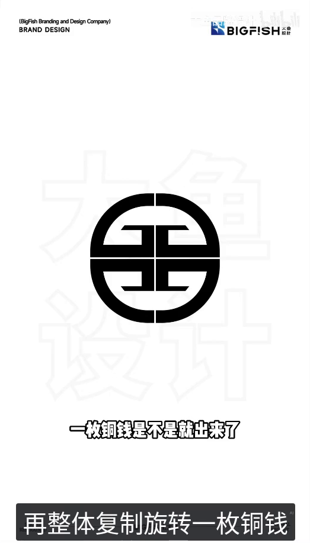

- **作者明确说法**：「一枚铜钱是不是就出来了」
- **整理者观察**：近圆轮廓由左右两段弧组成，12 点和 6 点各留一条缝；中间一条黑色横带；一条竖向细缝从上到下贯穿。正中心是黑色的横、竖粗条，被白色细十字缝切开。白空间在上下两腔，以及左右模块里的齿状空隙。这是这一案线标的完成态。

### eG10 · 用到铜钱照片上，壹阁古玩

约 28.7s（录屏 45.0s）

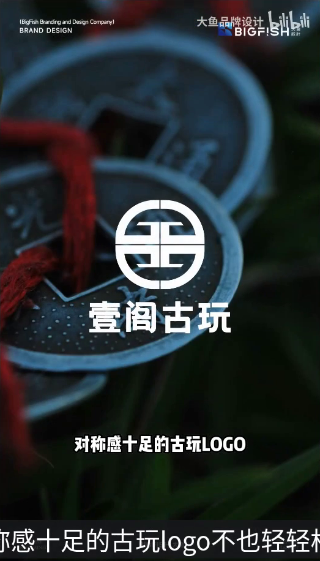

- **作者明确说法**：「对称感十足的古玩LOGO」。同一应用画面上，片内随后改为「不也轻轻松松」。
- **整理者观察**：同一件标志反白，压在铜钱的照片上：深色金属钱重叠，穿红绳，底下是草。字标为「壹阁古玩」。

### 思路与前后关系（整理者分析，非作者原话）

先用 e 的翻转对照出与 G 相近的骨架，再收成半模块左右重复，既保住字母的相似结构，又拼出对称的近圆轮廓。

---

## 案例四：H、W + 宠物零食 / WONDER HOUSE 奇迹小屋

### WH1 · 对话框

约 31.7s（录屏 48.0s）

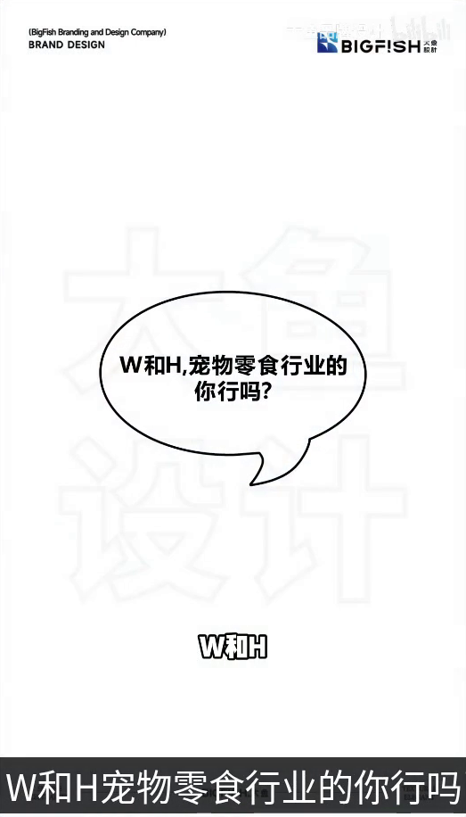

- **作者明确说法**：「W和H,宠物零食行业的你行吗？」。同一对话框画面上，片内下方依次出现「W和H」「宠物零食行业的」「你行吗」。
- **整理者观察**：气泡写着「W和H,宠物零食行业的你行吗？」。

### WH2 · 字母 H

约 34.7s（录屏 51.0s）

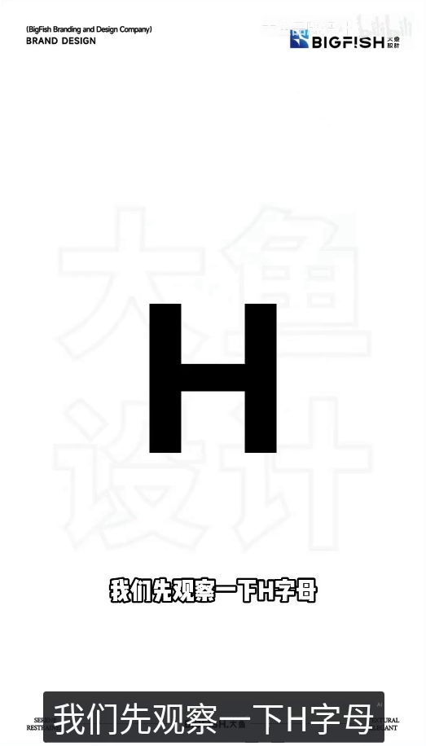

- **作者明确说法**：「我们先观察一下H字母」
- **整理者观察**：白底上是一个黑色大写字母 H。

### WH3 · H 变圆骨（中间态）

约 36.1s（录屏 52.4s）

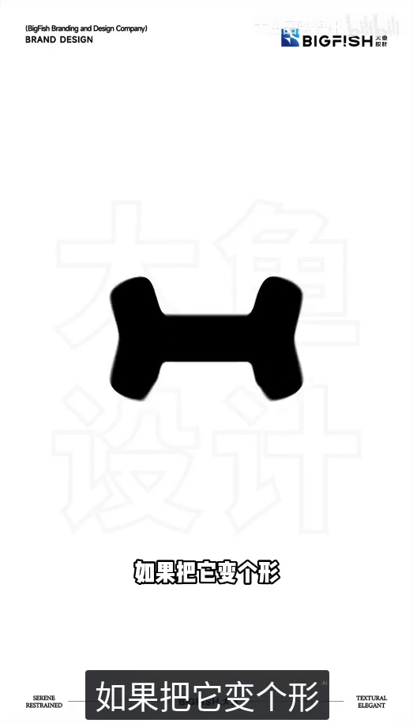

- **作者明确说法**：「如果把它变个形」
- **整理者观察**：H 的两竖加厚、向外略张开，四端开始变圆，已经显出骨头的轮廓，边缘略有发虚。收稳后的骨头看下一帧。

### WH4 · 收成骨头

约 36.7s（录屏 53.0s）

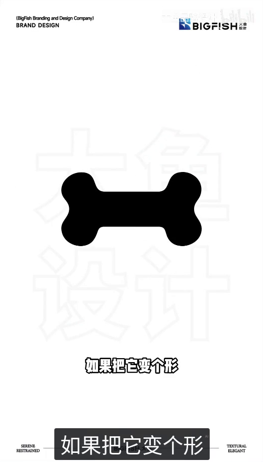

- **作者明确说法**：「如果把它变个形」。同一骨头画面上，片内随后改为「你觉得像什么」。
- **整理者观察**：H 已经收成一根横放的骨头：两端各两个圆头，中段是厚杠，上沿此时还是平的。

### WH5 · 凹槽成形、出现小点

约 38.3s（录屏 54.6s）

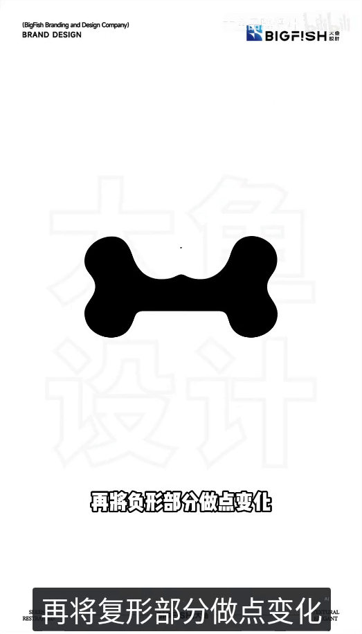

- **作者明确说法**：「再將负形部分做点变化」
- **播放器字幕**：「再将复形部分做点变化」
- **整理者观察**：骨头上沿中段向下凹进一块；凹槽上方已经有一粒极小的墨点，独立悬着，和骨头之间留着一道白缝，并不相连。

### WH6 · 圆点放大

约 38.7s（录屏 55.0s）

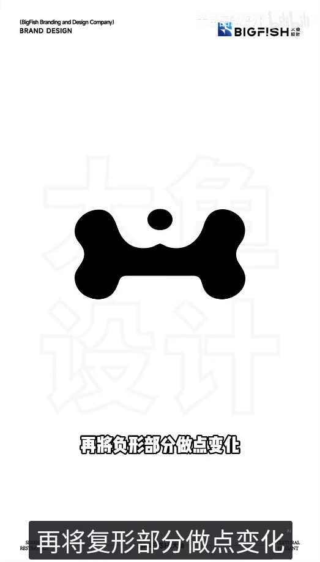

- **作者明确说法**：「再將负形部分做点变化」。同一画面上，片内随后改为「宠物零食的属性是不是就出来了」。
- **播放器字幕**：「再将复形部分做点变化」
- **整理者观察**：圆点比上一帧明显放大，仍独立坐在凹槽上方，和骨头之间留着一道白缝。上沿凹槽加上这一粒圆点，可以双读成动物的颜面和鼻子。

### WH7 · W 以折线出现在骨头下方

约 41.9s（录屏 58.2s）

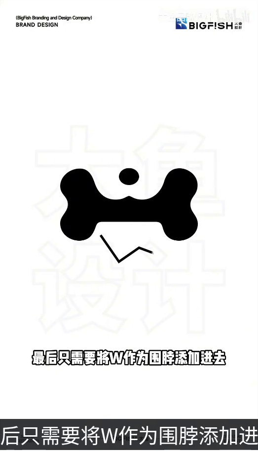

- **作者明确说法**：「最后只需要將W作为围脖添加进去」
- **整理者观察**：骨头下方画出一道 W 形折线，和骨头之间留着白缝，并不相接。

### WH8 · 围脖填实，仍与骨头分离

约 43.7s（录屏 60.0s）

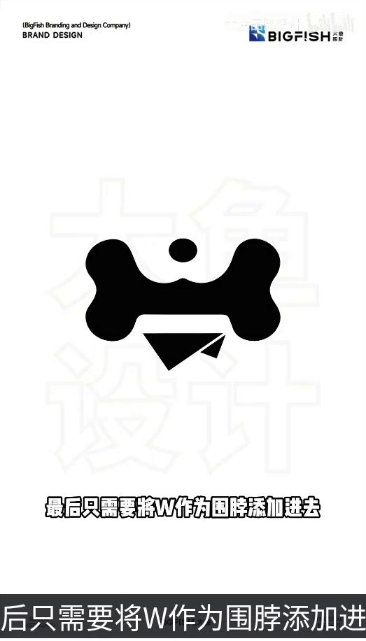

- **作者明确说法**：「最后只需要將W作为围脖添加进去」
- **整理者观察**：折线已经填成围脖：左侧一个朝下的黑三角，右侧一块浅灰折面。围脖的上沿与骨头下沿之间仍有白缝，两者并不相连。这是这一案线标的完成态。

### WH9 · 用到狗的照片上，WONDER HOUSE / 奇迹小屋

约 44.7s（录屏 61.0s）

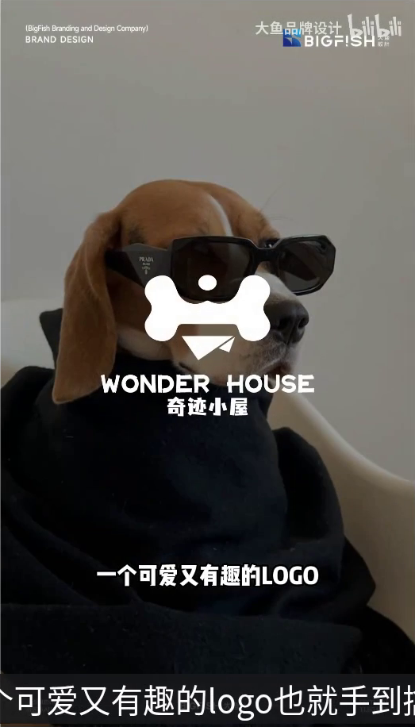

- **作者明确说法**：「一个可爱又有趣的LOGO」。同一应用画面上，片内随后改为「也就手到擒来」。
- **整理者观察**：同一件标志反白，压在一只戴墨镜、裹着黑毯的狗的照片上。字标为 WONDER HOUSE，其下是「奇迹小屋」。骨头与圆点、骨头与围脖之间的缝里，都能看见照片的暗部，三件仍然是分开的。

### 思路与前后关系（整理者分析，非作者原话）

H 收成骨头后，上沿凹槽加上独立圆点，骨形同时可以读成动物脸，两侧圆头兼作耳朵或面颊。W 再做成仍分离的围脖，把宠物属性再推进一步。

---

## 收束：三例并列

约 47.7s（录屏 64.0s）

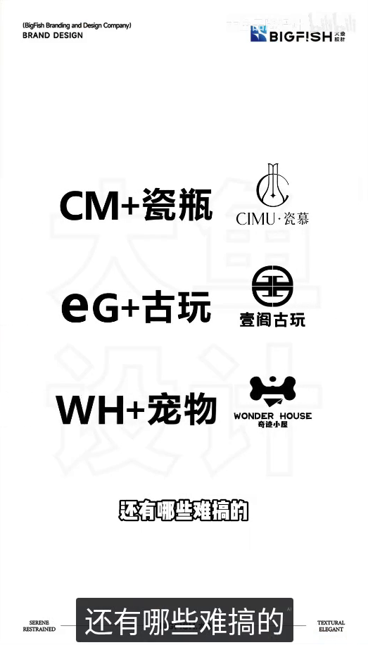

- **作者明确说法**：「还有哪些难搞的」。收束画面出现前后，片内随后改为「别急 我会出手」。
- **整理者观察**：三行并列：左侧写着「CM+瓷瓶」「eG+古玩」「WH+宠物」，右侧各配对应的完成态标志和字标 CIMU·瓷慕、壹阁古玩、WONDER HOUSE / 奇迹小屋。本片开头的 SSA 没有出现在这块回顾板上。
