# [简约轻奢风格丨LOGO设计主流](https://www.bilibili.com/video/BV1fLpk6rEev)｜大鱼品牌设计

## 案例一：箭头 + 蜂鸟 / ARROW BIRD

### AB1 · 箭头和蜂鸟照片

约 0.4s（录屏 23.1s）

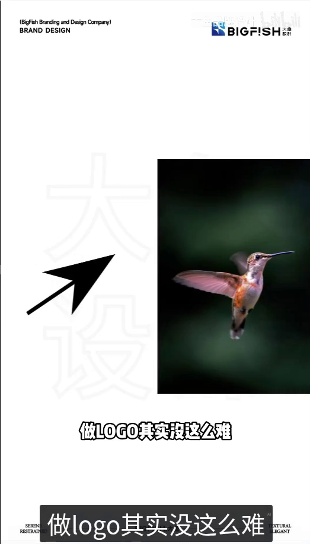

- **作者明确说法**：「做LOGO其实没这么难」
- **整理者观察**：白底上，左侧是一支指向右上的黑色箭头，右侧是一张展翅蜂鸟的照片，细长的喙朝右。两件东西并放，还没有叠在一起。

### AB2 · 箭头头部和头喙叠上红形

约 1.3s（录屏 24.0s）

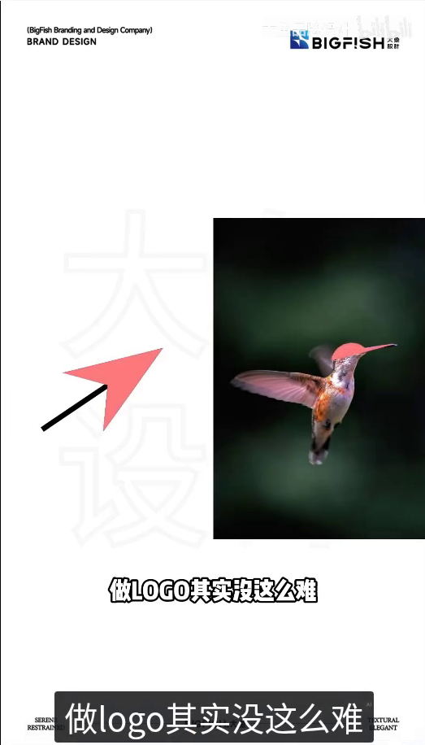

- **作者明确说法**：「做LOGO其实没这么难」
- **整理者观察**：箭头的头部改成珊瑚红，箭杆仍是黑的。蜂鸟的头顶和喙上叠了一块同色的实心红形，是色块压在照片上，不是细描线。

### AB3 · 红形与箭头靠拢（中间态）

约 1.7s（录屏 24.4s）

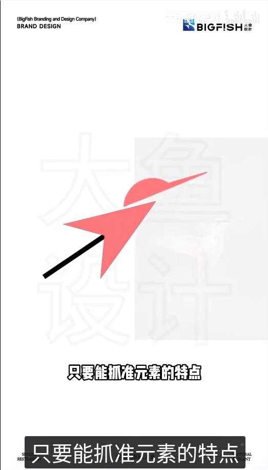

- **作者明确说法**：「只要能抓准元素的特点」
- **整理者观察**：蜂鸟照片淡成浅影。红穹顶带着长喙，已经和红色箭头靠在一起，左下还留着黑箭杆。头与身之间有一道白缝，还没有收成一件黑色标志。

### AB4 · 收成黑色几何鸟，成标

约 2.3s（录屏 25.0s）

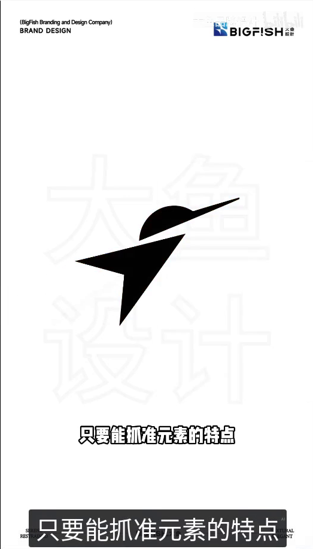

- **作者明确说法**：「只要能抓准元素的特点」
- **整理者观察**：已经收成一只全黑的几何鸟：上面是半圆头，右边伸出细长喙，左边是箭头形的身，原来的箭杆收成向下的尖。头与身之间仍留着一道白缝。这是这一案线标的完成态。

### AB5 · 用到蜂鸟照片上，ARROW BIRD

约 2.8s（录屏 25.6s）

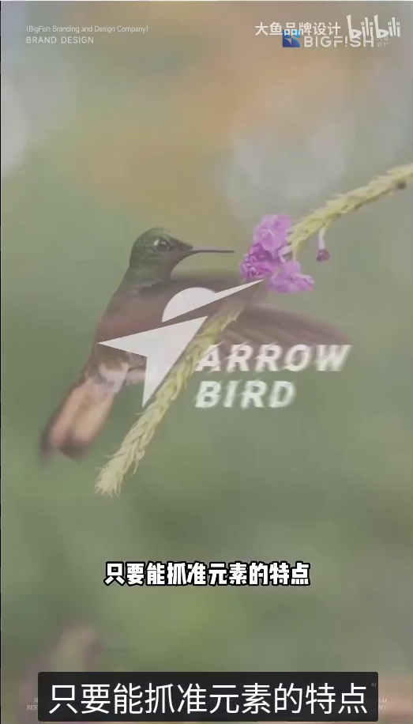

- **作者明确说法**：「只要能抓准元素的特点」
- **整理者观察**：同一件标志反白，压在紫花枝上的蜂鸟照片上。右侧字标为 ARROW BIRD，字母带斜向切口。

### 思路与前后关系（整理者分析，非作者原话）

箭头的方向和蜂鸟头喙一致，先把头喙的轮廓从照片上收出来，再和箭头合成一只几何鸟，头与身之间仍留一道缝。

---

## 案例二：C + 跳跳糖 / VC BOOM 维C炸药

### VC1 · 对话框

约 5.3s（录屏 28.0s）

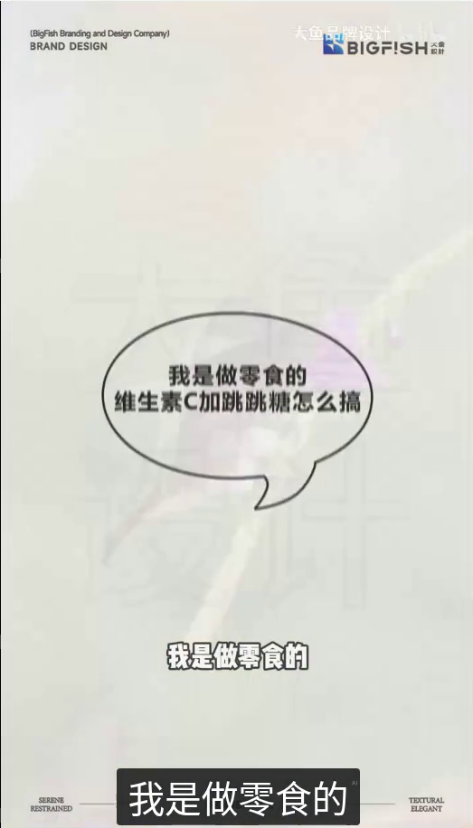

- **作者明确说法**：「我是做零食的」。同一对话框画面上，气泡里写着「我是做零食的 / 维生素C加跳跳糖怎么搞」。
- **整理者观察**：浅底上出现对话气泡，分两行写着零食和维生素 C 加跳跳糖的题目。

### VC2 · 粗黑体字母 C

约 8.9s（录屏 31.6s）

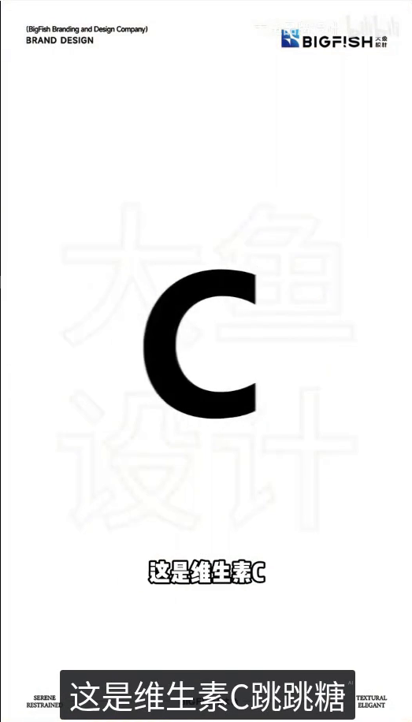

- **作者明确说法**：「这是维生素C」
- **整理者观察**：白底正中是一个粗黑体字母 C。

### VC3 · 跳跳糖包装（说明）

约 10.0s（录屏 32.8s）

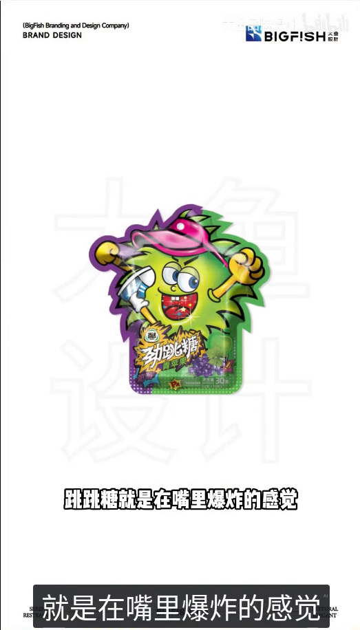

- **作者明确说法**：「跳跳糖就是在嘴里爆炸的感觉」
- **整理者观察**：粗 C 被一份彩色包装取代：绿色刺状吉祥物，包装上可见「劲跳糖」字样。这是在说明产品，随后会回到字母 C，并不是被丢掉的一条标志路径。

### VC4 · 回到字母 C

约 11.5s（录屏 34.2s）

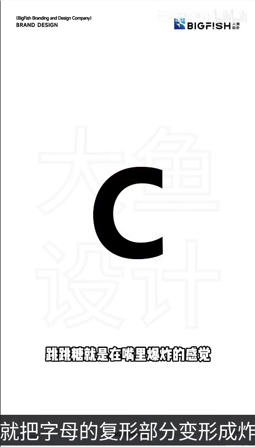

- **作者明确说法**：「跳跳糖就是在嘴里爆炸的感觉」
- **播放器字幕**：「那就把字母的复形部分变形成炸弹」
- **整理者观察**：包装已经退去，画面回到粗黑体 C。

### VC5 · C 的开口收圆（中间态）

约 12.5s（录屏 35.2s）

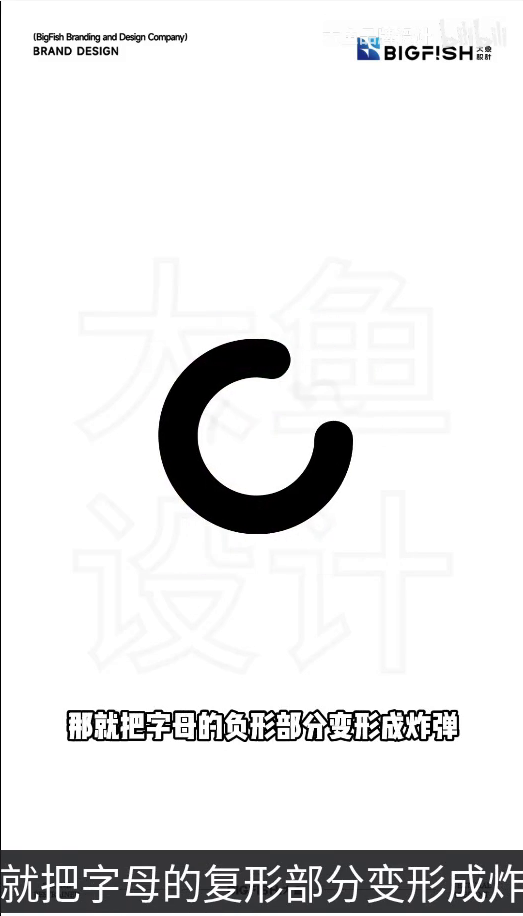

- **作者明确说法**：「那就把字母的负形部分变形成炸弹」
- **播放器字幕**：「那就把字母的复形部分变形成炸弹」
- **整理者观察**：C 的开口收窄，轮廓更接近粗圆环，缺口留在右侧。引线还没有出现。

### VC6 · 负形圆弹加上引线，成标

约 13.5s（录屏 36.2s）

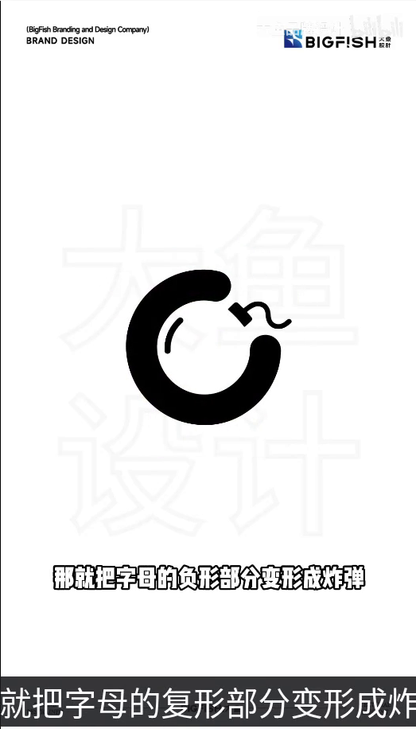

- **作者明确说法**：「那就把字母的负形部分变形成炸弹」
- **播放器字幕**：「那就把字母的复形部分变形成炸弹」
- **整理者观察**：缺口处伸出一段弯曲引线，负形的圆腔读成弹体，内沿有一小块高光。这是这一案线标的完成态。

### VC7 · 用到糖果照片上，VC BOOM / 维C炸药

约 14.4s（录屏 37.1s）

- **作者明确说法**：「一个有趣的创意还不是手拿把掐」
- **整理者观察**：同一件标志反白，压在一簇彩色软糖的照片上。照片本身带着体积和高光；标志是平面白标。字标为 VC BOOM，其下是「维C炸药」。

### 思路与前后关系（整理者分析，非作者原话）

把粗 C 的负形收成圆弹并加上引线，对应「嘴里爆炸」的产品感觉。应用时平面白标叠在本身带体积的糖果照片上。

---

## 案例三：AM + 能源 / AIR MAGIC ENERGY 艾尔能源

### AM1 · 对话框

约 16.6s（录屏 39.3s）

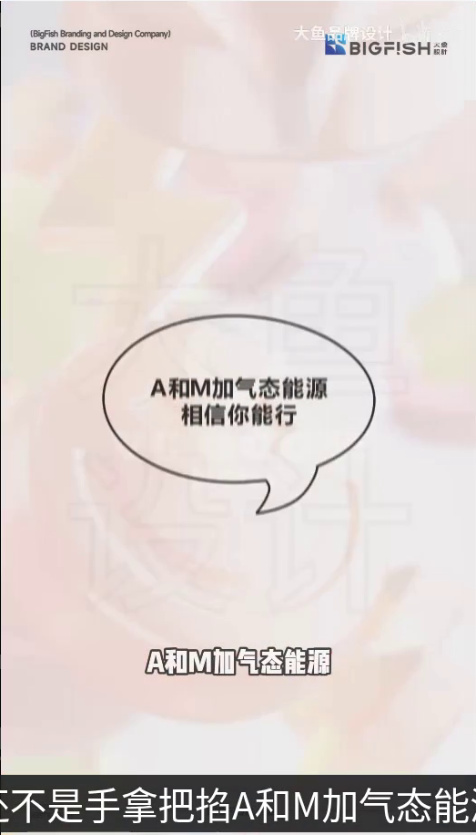

- **作者明确说法**：「A和M加气态能源」。同一对话框画面上，气泡里写着「A和M加气态能源 / 相信你能行」。
- **整理者观察**：浅底上出现对话气泡，分两行写着 A、M 和气态能源的题目。

### AM2 · 字母 A 和 M

约 19.7s（录屏 42.5s）

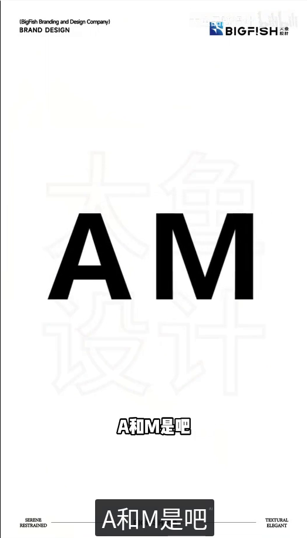

- **作者明确说法**：「A和M是吧」
- **整理者观察**：大号黑体 A 和 M 并排。A 是常规的三角顶，横画在。

### AM3 · 燃气灶蓝色火焰的照片

约 20.5s（录屏 43.2s）

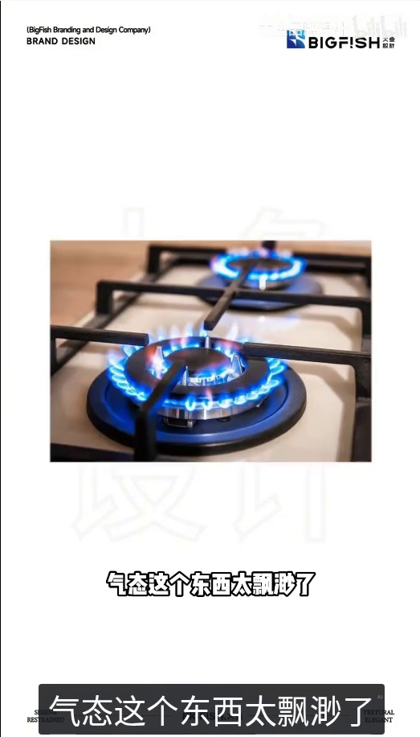

- **作者明确说法**：「气态这个东西太飘渺了」
- **整理者观察**：画面换成一张燃气灶的照片，灶眼上是蓝色火焰。

### AM4 · 回到字母 AM

约 22.8s（录屏 45.5s）

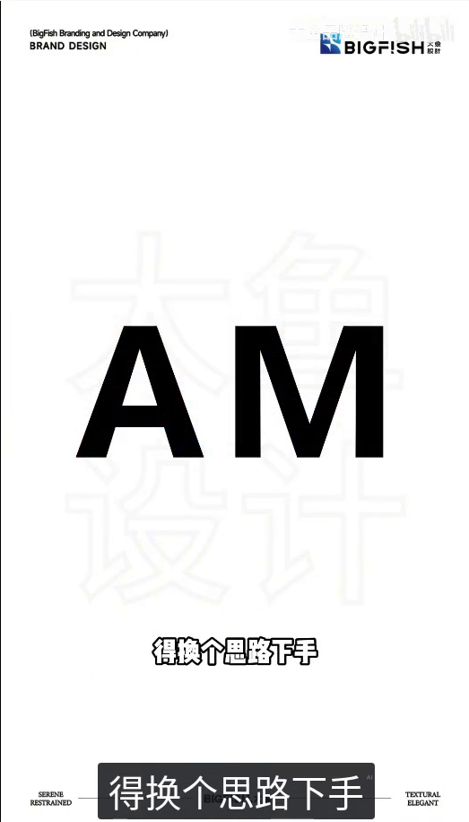

- **作者明确说法**：「得换个思路下手」
- **整理者观察**：灶具照片退去，A 和 M 回到白底，A 的横画仍在。

### AM5 · A 弯成穹顶、M 收成下凹弧（中间态）

约 23.6s（录屏 46.3s）

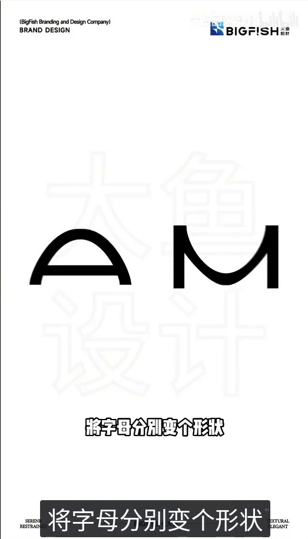

- **作者明确说法**：「將字母分別变个形狀」
- **整理者观察**：A 的尖顶已经弯成穹顶，底部那一道粗黑横画还在；M 的中部收成下凹的弧，两边仍是两竖。两形还左右并排，没有上下叠放。

### AM6 · 分别变形后的稳态

约 23.9s（录屏 46.6s）

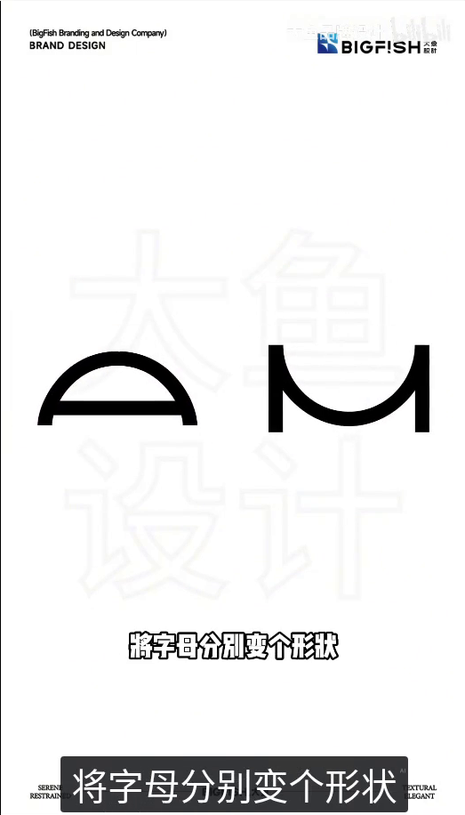

- **作者明确说法**：「將字母分別变个形狀」
- **整理者观察**：形状已经稳住：左边是带粗黑横画的穹顶，横画就是上半圆的底杠；右边是两竖加一条下凹弧。仍是左右并排。

### AM7 · 一上一下叠放，中间留着白缝

约 25.3s（录屏 48.0s）

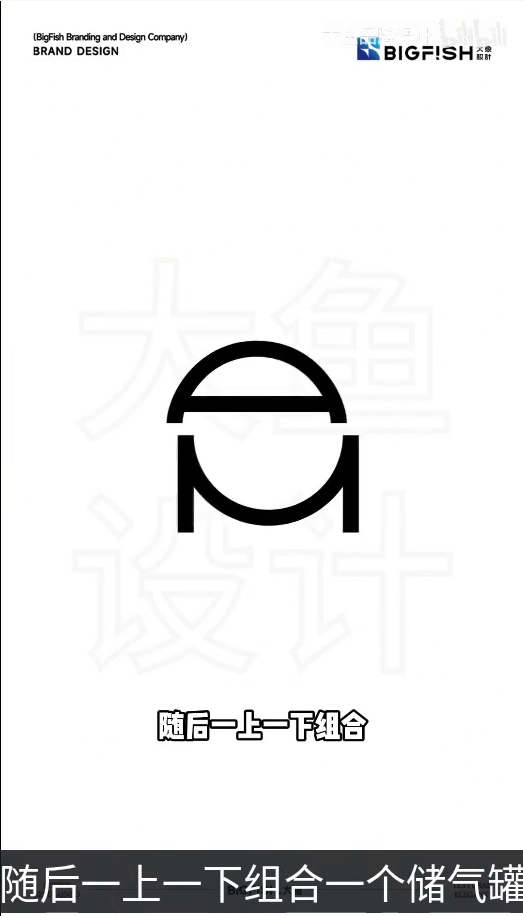

- **作者明确说法**：「随后一上一下组合」
- **整理者观察**：带横画的穹顶已经移到 M 的上方。上下两件之间留着一道明显的白缝，还没有连成一体。横画仍是上半圆自带的底杠。

### AM8 · 叠到储气罐照片上，缝还在

约 25.7s（录屏 48.4s）

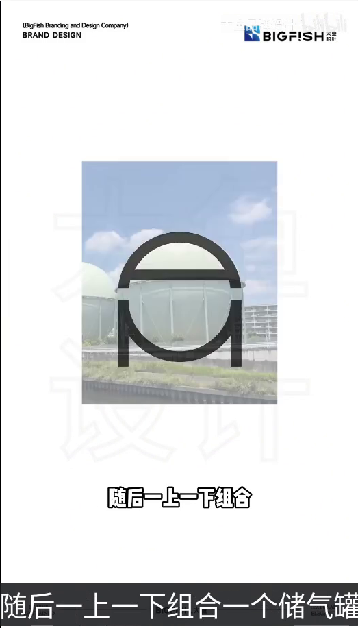

- **作者明确说法**：「随后一上一下组合」
- **整理者观察**：同一构图叠到一张球形储气罐的照片上。横画下沿与下面 M 的上沿之间仍有一条亮缝，照片从缝里透出来。

### AM9 · 白底上的储气罐形，上下仍然分离

约 27.5s（录屏 50.2s）

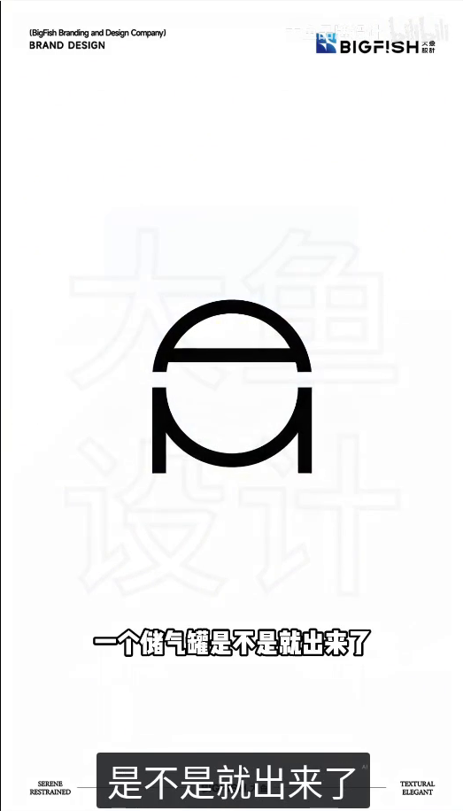

- **作者明确说法**：「一个储气罐是不是就出来了」
- **整理者观察**：照片退去，白底上只留下这件上下叠放的标志。横画下方与 M 上沿之间的白缝仍在，两件仍然是分开的。

### AM10 · 用到罐群照片上，AIR MAGIC ENERGY / 艾尔能源

约 28.5s（录屏 51.2s）

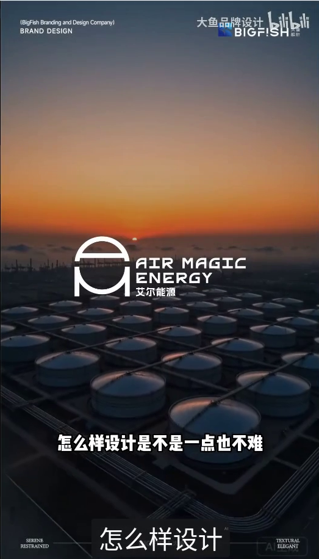

- **作者明确说法**：「怎么样设计是不是一点也不难」
- **整理者观察**：同一件标志反白，压在日落时一片储罐阵的照片上。上半是带横画的穹顶，下半是两竖加下凹弧；横画下沿与 M 上沿之间仍留着一道缝，缝里能看见照片里的天空。字标为 AIR MAGIC ENERGY，其下是「艾尔能源」。

### 思路与前后关系（整理者分析，非作者原话）

A 收成带横画的穹顶，M 收成两竖加下凹弧，上下一叠就读成储气罐。横画是穹顶自带的底杠，上下两件之间一直留着缝，应用到照片上时缝里仍能看见背景。

---

## 案例四：X + 指南针 / 未知数 X · exploration

### X1 · 对话框

约 30.5s（录屏 53.2s）

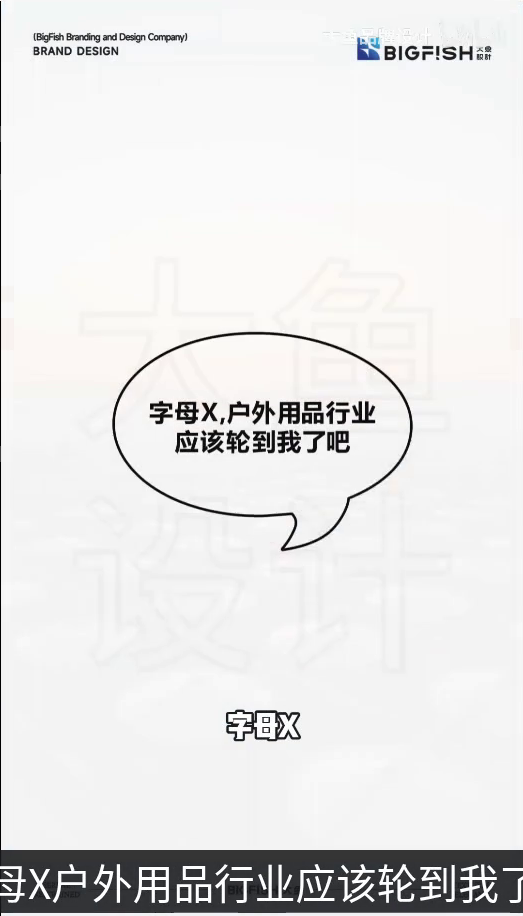

- **作者明确说法**：「字母X」。同一对话框画面上，气泡里写着「字母X,户外用品行业应该轮到我了吧」。
- **整理者观察**：白底上出现对话气泡，写着字母 X 和户外用品行业的题目。

### X2 · 导航手机

约 35.6s（录屏 58.3s）

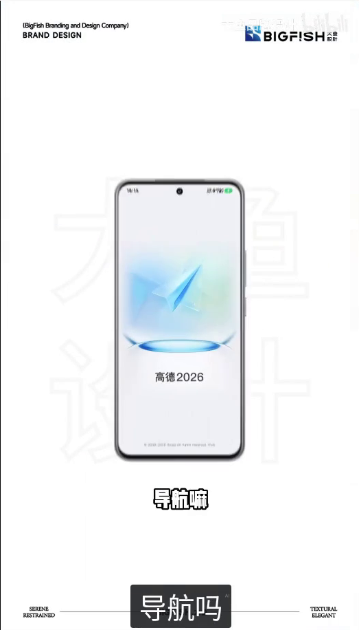

- **作者明确说法**：「导航嘛」
- **整理者观察**：画面正中是一部白色手机，屏幕上是浅蓝绿色的导航图形，下部写着「高德2026」。

### X3 · 问号

约 37.1s（录屏 59.8s）

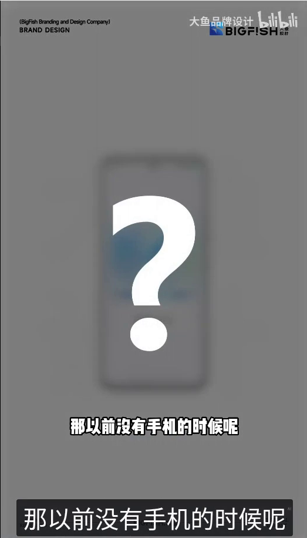

- **作者明确说法**：「那以前没有手机的时候呢」
- **整理者观察**：灰底上出现一个巨大的白色问号，底下隐约还能看见虚化的手机。

### X4 · 指南针

约 38.5s（录屏 61.2s）

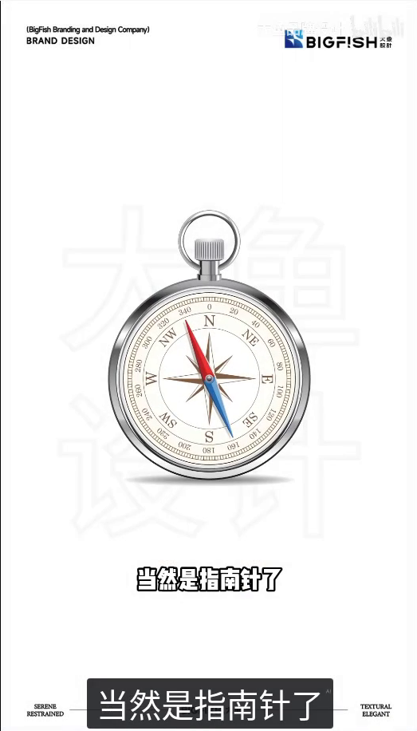

- **作者明确说法**：「当然是指南针了」
- **整理者观察**：一只写实的金属指南针，表盘上有 N、S、E、W 和度数圈，中间是红蓝指针。此时盘上还没有字母 X。

### X5 · 指南针盘上叠上标准 X

约 39.4s（录屏 62.2s）

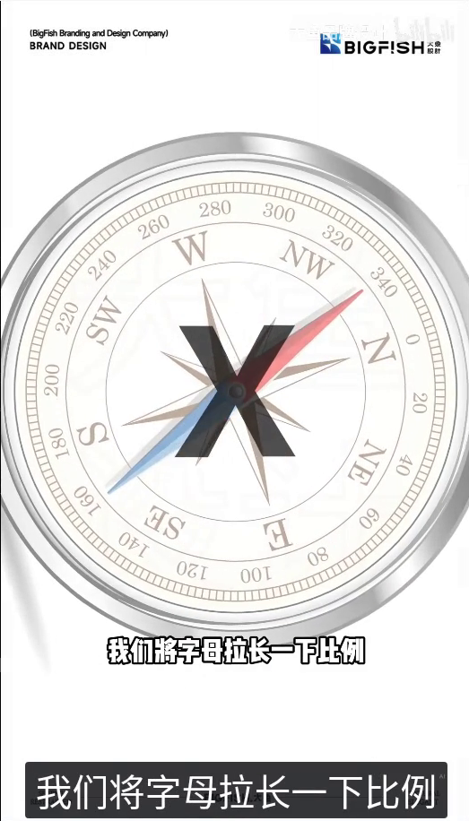

- **作者明确说法**：「我们將字母拉长一下比例」
- **整理者观察**：指南针放大后，表盘正中叠上一个标准黑体 X，还没有拉长。指南针仍在。

### X6 · X 拉成指针，指南针还在

约 39.9s（录屏 62.6s）

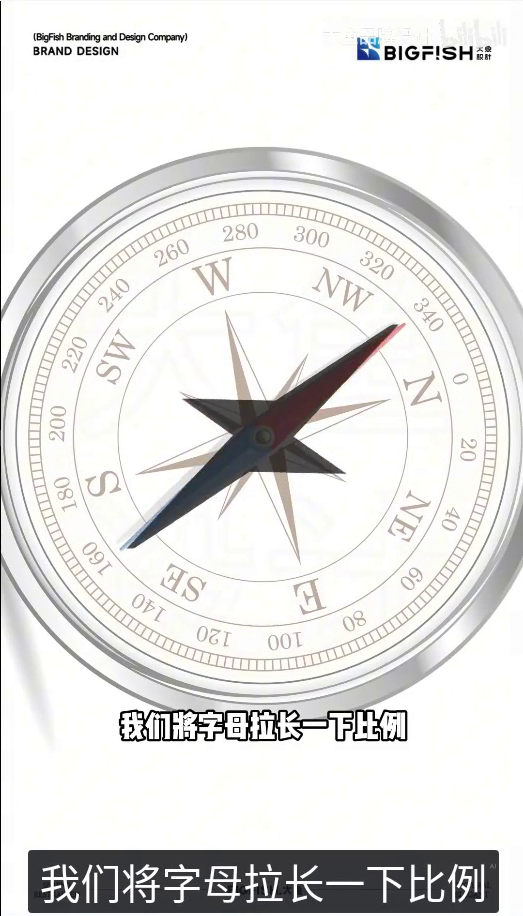

- **作者明确说法**：「我们將字母拉长一下比例」
- **整理者观察**：X 已经沿红蓝指针的斜向拉长，长轴朝向表盘的 N，大约是右上到左下。此时指针仍是一整块，中间还没有白缝。指南针表盘仍在。

### X7 · 中间出现白色斜缝（中间态）

约 40.7s（录屏 63.4s）

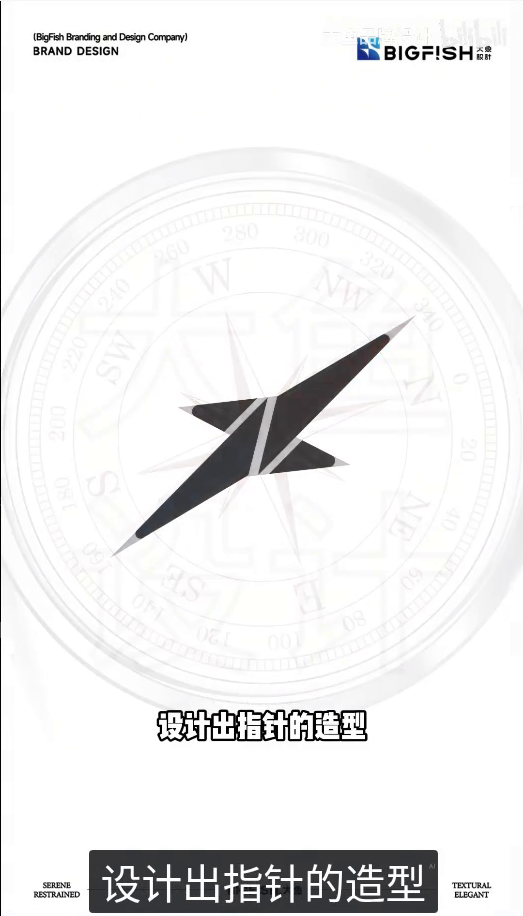

- **作者明确说法**：「设计出指针的造型」
- **整理者观察**：指针中间出现白色斜缝，把黑色形体剖成几块，折线已经看得出来。指南针的表盘正在变淡，还没有完全退去。

### X8 · 白底上的折线指针

约 41.3s（录屏 64.0s）

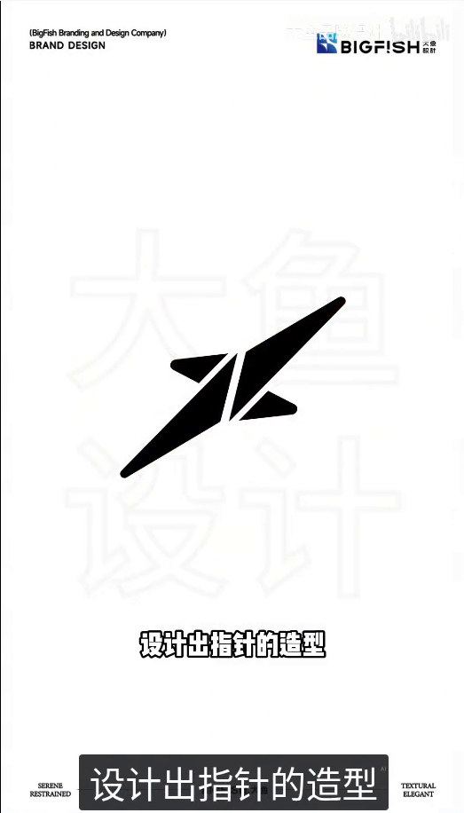

- **作者明确说法**：「设计出指针的造型」
- **整理者观察**：指南针已经退去。白底上只留下这支拉长的指针：中间一道白色斜缝连成折线，把标志分成几块黑片。此时还没有刻度。

### X9 · 灰色刻度出现（中间态）

约 41.9s（录屏 64.6s）

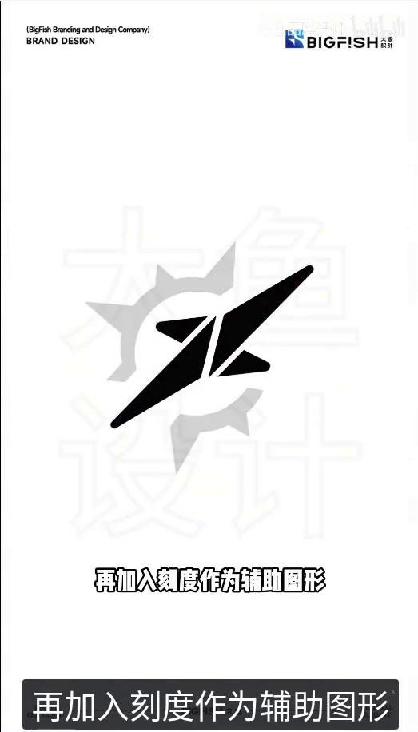

- **作者明确说法**：「再加入刻度作为辅助图形」
- **整理者观察**：指针周围开始加上灰色的环和尖刺，颜色还不是黑的。外环在长轴两侧各留出大缺口，长指针从缺口里穿出。这是加入刻度的中间态，还不是成标。

### X10 · 刻度收成黑色，成标

约 42.2s（录屏 64.9s）

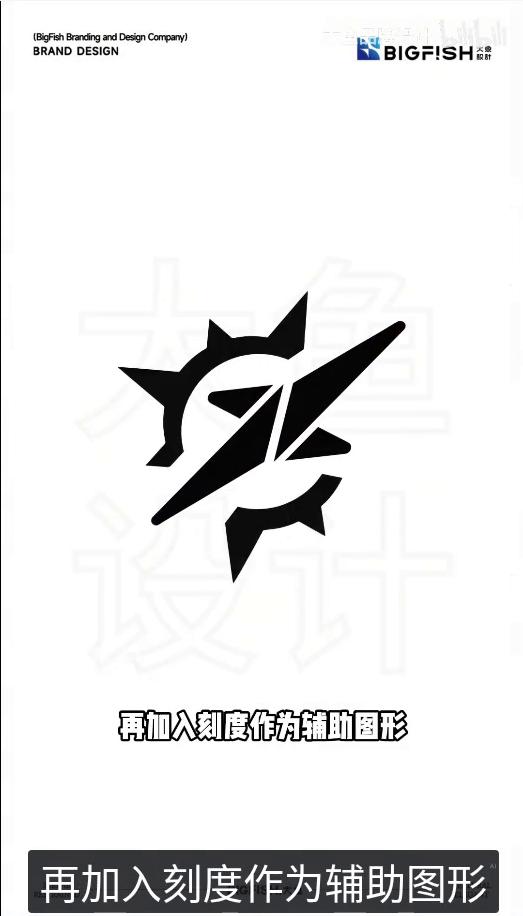

- **作者明确说法**：「再加入刻度作为辅助图形」
- **整理者观察**：环和尖刺已经收成黑色。外环在长轴两侧各留出大缺口，给拉长的指针穿过；中间的白斜缝仍在。这是这一案线标的完成态。

### X11 · 用到森林照片上，未知数 / X · exploration

约 44.1s（录屏 66.9s）

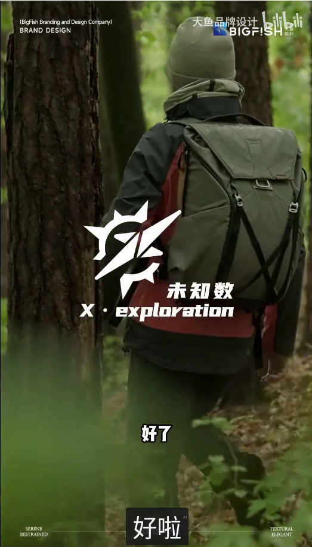

- **作者明确说法**：「好了」
- **整理者观察**：同一件标志反白，压在森林里一个背绿色登山包的人的背影上。字标为「未知数」，其下是 X · exploration，exploration 小写，中间是点号。

### 思路与前后关系（整理者分析，非作者原话）

把「导航」从手机推到没有手机时的指南针，再把 X 沿指针对角拉长，并用白色斜缝剖成折线指针。外圈刻度在长轴两侧留出大缺口，让指针穿过去。

---

## 收束：三例并列

约 48.0s（录屏 70.7s）

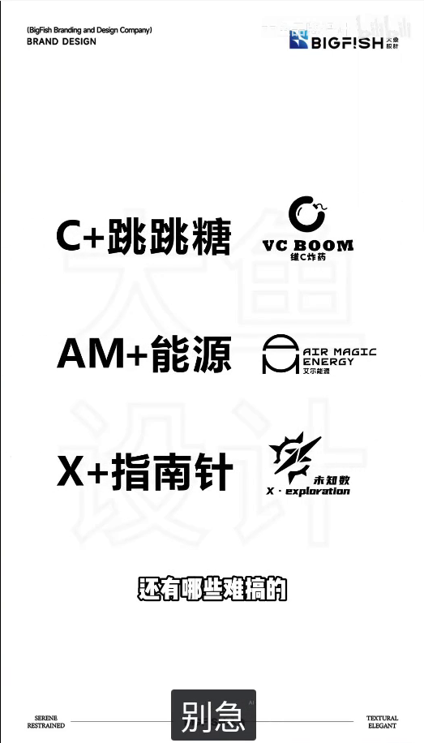

- **作者明确说法**：「还有哪些难搞的」。收束画面出现前后，片内随后改为「别急 我会出手」。
- **整理者观察**：三行并列：左侧写着「C+跳跳糖」「AM+能源」「X+指南针」，右侧各配对应的完成态标志和字标 VC BOOM / 维C炸药、AIR MAGIC ENERGY / 艾尔能源、未知数 / X · exploration。AM 那一行的黑标上，横画下方与 M 之间同样留着缝。本片开头的 ARROW BIRD 没有出现在这块回顾板上。
