# [学会这些方法，logo设计你就手拿把掐](https://www.bilibili.com/video/BV1i2pF6nET5)｜大鱼品牌设计

## 案例一：字母 K + O / KQ clinical

### KQ1 · 字母 K 和 O，旁边是鲸尾照片

约 0.75s（录屏 24.0s）

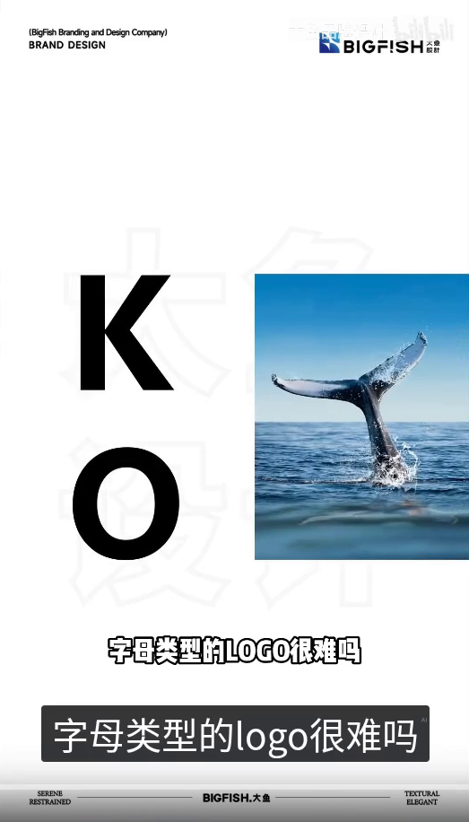

- **作者明确说法**：「字母类型的LOGO很难吗」
- **整理者观察**：左边上下排着无衬线的 K 和 O，右边是一张鲸尾出水的照片，两者分开并置。

### KQ2 · K 开始弯曲

约 1.35s（录屏 24.6s）

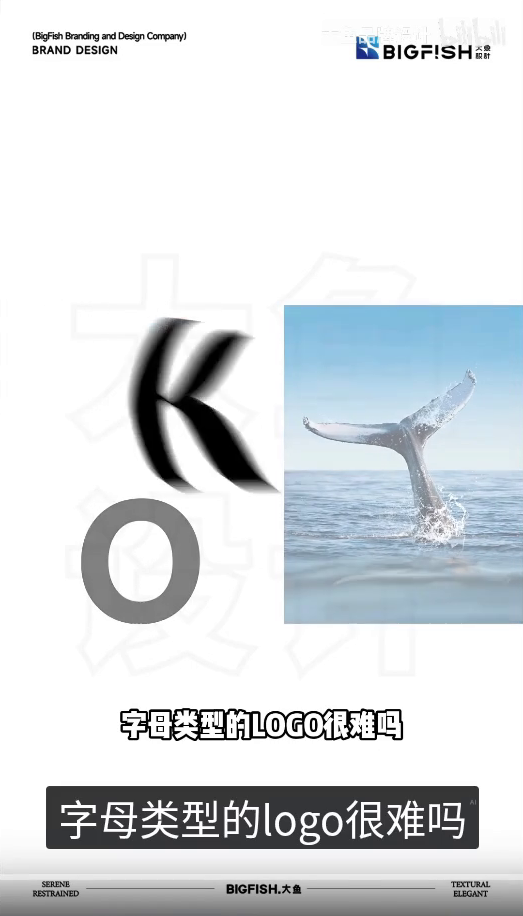

- **作者明确说法**：「字母类型的LOGO很难吗」
- **整理者观察**：K 的竖笔和两臂开始弯曲，带着运动残影；下面的 O 和右侧鲸尾照片都还在。

### KQ3 · K 收成叶形，O 和照片在退

约 1.55s（录屏 24.8s）

- **作者明确说法**：「字母类型的LOGO很难吗」
- **整理者观察**：K 已经收成一条弯曲的脊骨和两片尖叶臂。下面的 O 变成浅灰残影，右侧鲸尾照片也明显变淡。

### KQ4 · 照片退去，留下叶形 K

约 1.75s（录屏 25.0s）

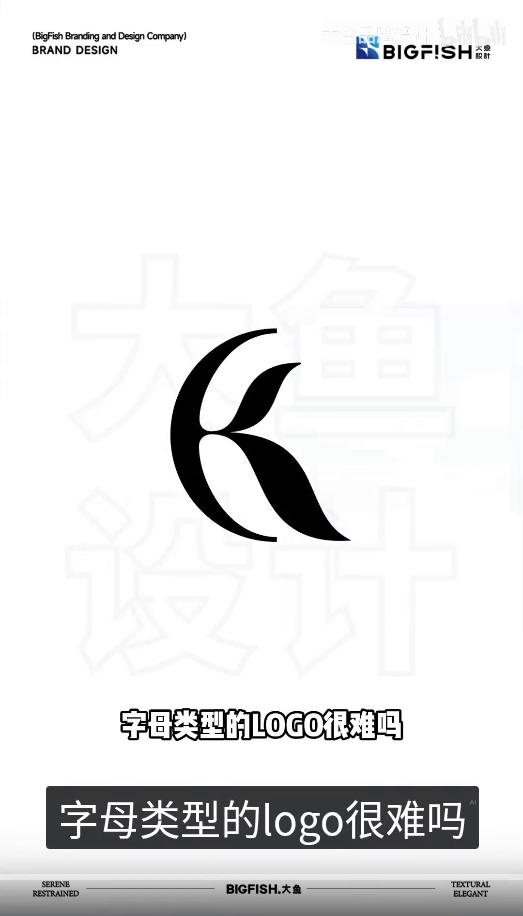

- **作者明确说法**：「字母类型的LOGO很难吗」
- **整理者观察**：鲸尾照片和 O 都已经退去，白底上只剩那枚叶形 K。外侧的环还没有长出来。

### KQ5 · 外侧开始长出圆环

约 2.45s（录屏 25.7s）

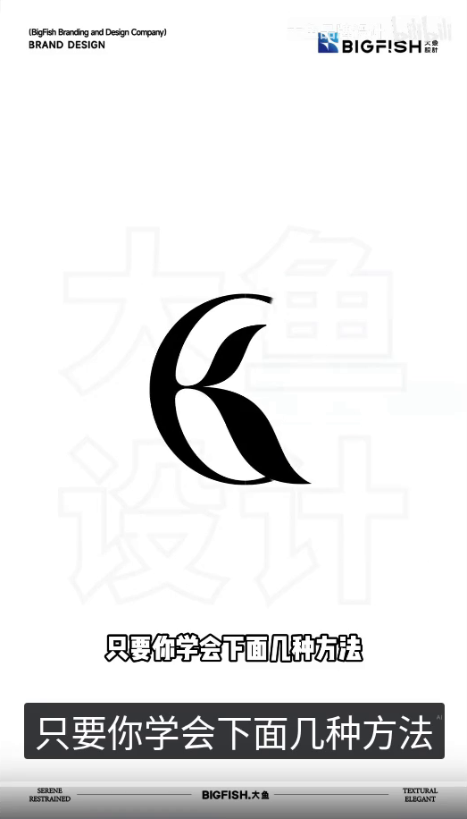

- **作者明确说法**：「只要你学会下面几种方法」
- **整理者观察**：叶形 K 的外侧开始长出弧形的环，这时还只包住左上和左下，右侧外弧尚未围到右边；K 下臂的尖端已经向右伸出。

### KQ6 · 成标：环内叶形 K，右下带尾

约 2.75s（录屏 26.0s）

- **作者明确说法**：「只要你学会下面几种方法」
- **整理者观察**：环已经落到右侧开口、右下带尖尾的位置，叶形 K 留在环内。整枚既可以读作环里的 K，也可以读作 Q。这是这一案线标的黑色完成态。

### KQ7 · 用到海面鲸尾照片上，KQ clinical

约 3.75s（录屏 27.0s）

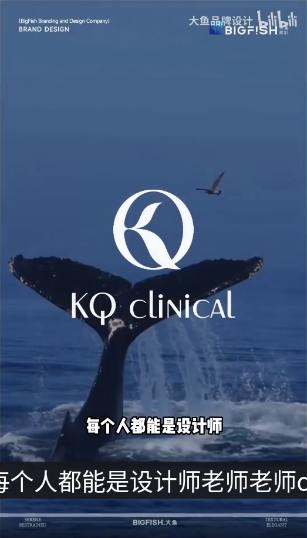

- **作者明确说法**：「每个人都能是设计师」
- **整理者观察**：同一件标志反白，平面叠在海面鲸尾照片上，天上有一只鸟。字标为 KQ clinical：KQ 用的是成标字形，clinical 是小写。

### 思路与前后关系（整理者分析，非作者原话）

K 的两臂叶化，外侧的弧围合过来，与已经右伸的下叶尖端组合，读作 Q；整枚既可以读作环里的 K，也可以读作 Q。用到海面鲸尾照片上时，字标写成「KQ clinical」。

---

## 案例二：C + K 共笔组合法 / CONNECTK

### CK1 · 对话框

约 5.55s（录屏 28.8s）

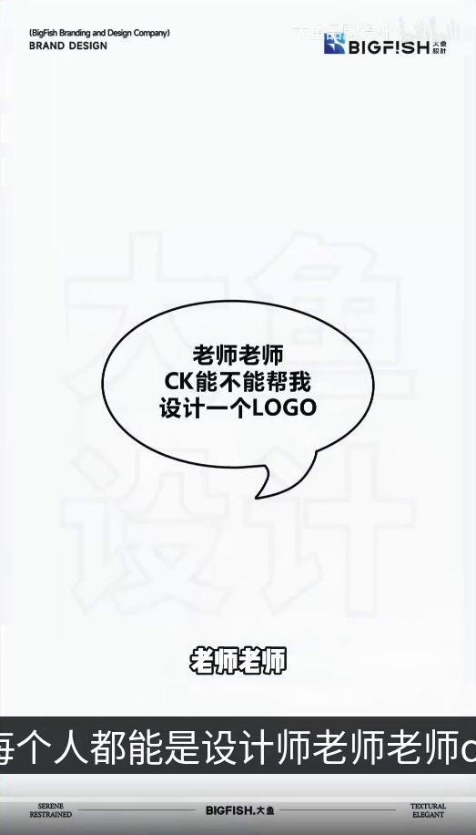

- **作者明确说法**：「老师老师」。同一画面上，气泡里写着「老师老师」「CK能不能帮我」「设计一个LOGO」。
- **整理者观察**：白底中央是一个线框气泡，下面另有一行描边字。

### CK2 · 共笔组合法

约 8.75s（录屏 32.0s）

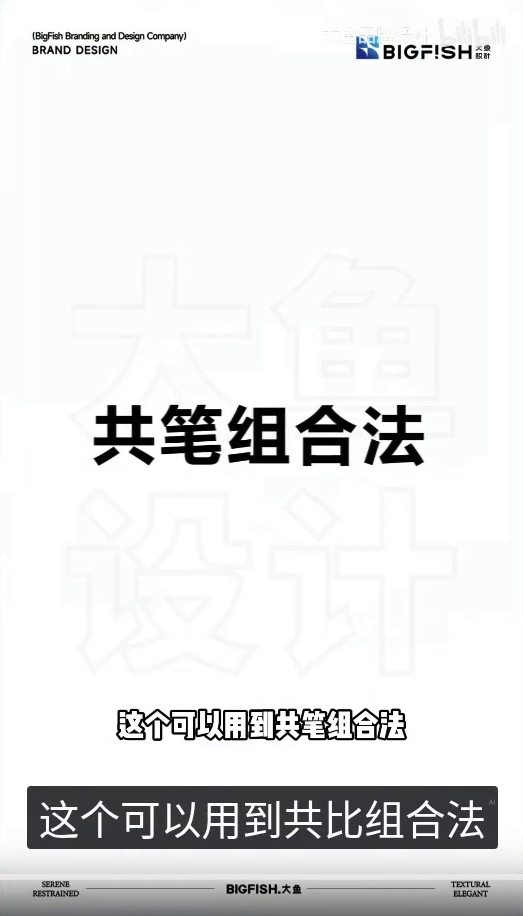

- **作者明确说法**：「这个可以用到共笔组合法」
- **整理者观察**：白底正中是题板「共笔组合法」。

### CK3 · 标出共同笔画

约 10.75s（录屏 34.0s）

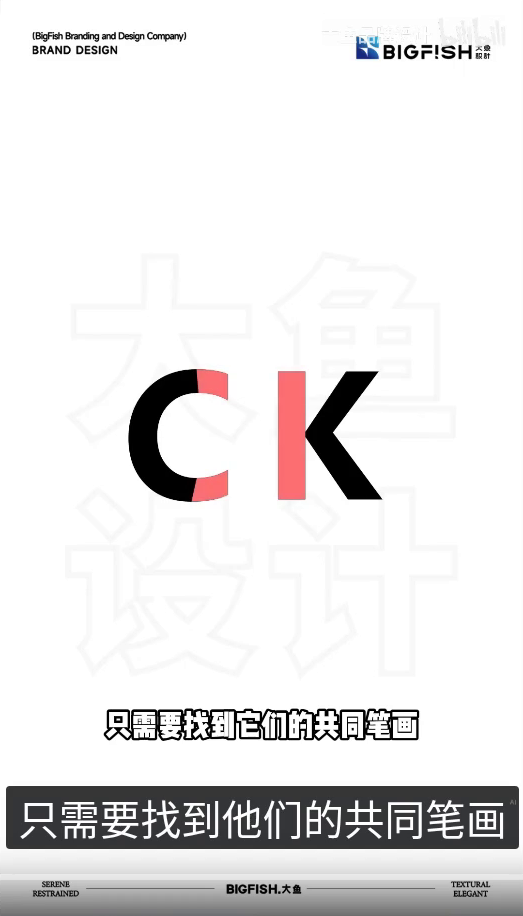

- **作者明确说法**：「只需要找到它们的共同笔画」
- **整理者观察**：开口向右的 C 和右边的 K 仍然分开，中间有白缝。珊瑚红加在 C 开口处的上下两端，以及 K 的整条竖笔上。

### CK4 · 彩色提示撤掉

约 12.35s（录屏 35.6s）

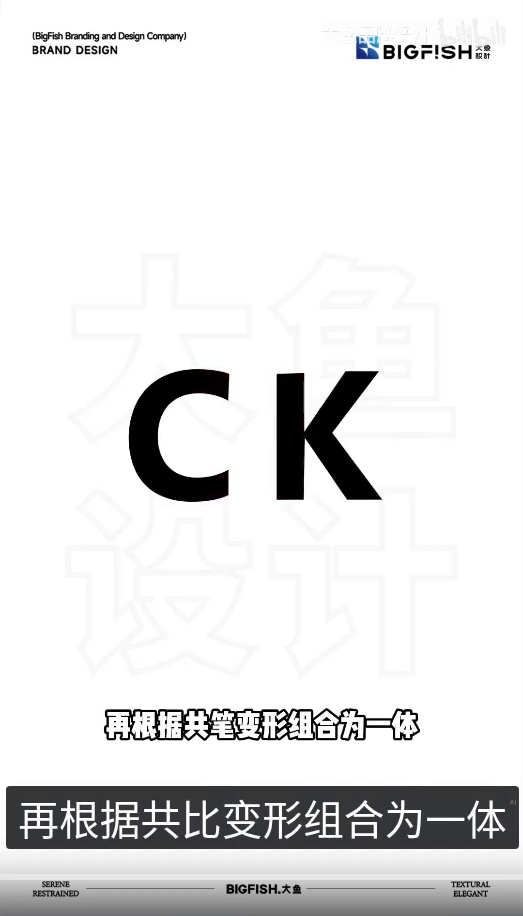

- **作者明确说法**：「再根据共笔变形组合为一体」
- **整理者观察**：彩色提示已经撤掉，C 和 K 仍是两枚分开的黑字，还没有靠到一起。

### CK5 · C 向 K 靠近

约 12.55s（录屏 35.8s）

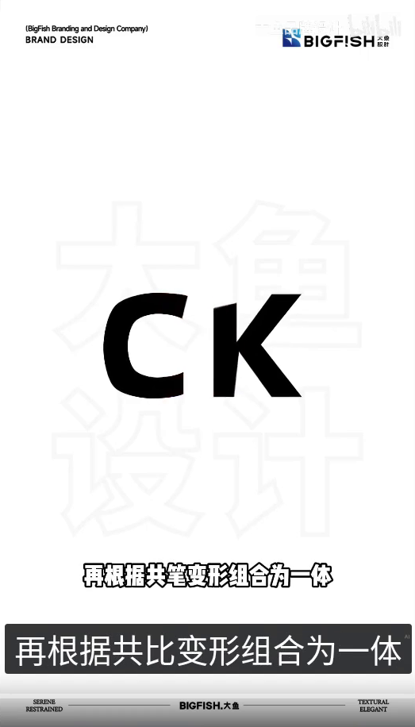

- **作者明确说法**：「再根据共笔变形组合为一体」
- **整理者观察**：C 正在向 K 靠近，两者之间的空隙变窄，还没有接到一起。

### CK6 · 组合成 CK

约 12.95s（录屏 36.2s）

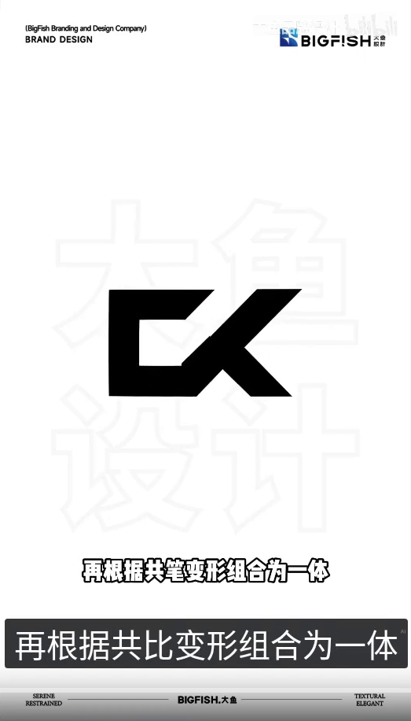

- **作者明确说法**：「再根据共笔变形组合为一体」
- **整理者观察**：C 被收成直角开口的形状，开口仍然留着。它的下横和 K 的左下斜笔连成一笔；上横右端切成斜口，和 K 的上斜之间留着一条白缝。这是这一案线标的黑色完成态。

### CK7 · 用到海边电车照片上，CONNECTK

约 14.75s（录屏 38.0s）

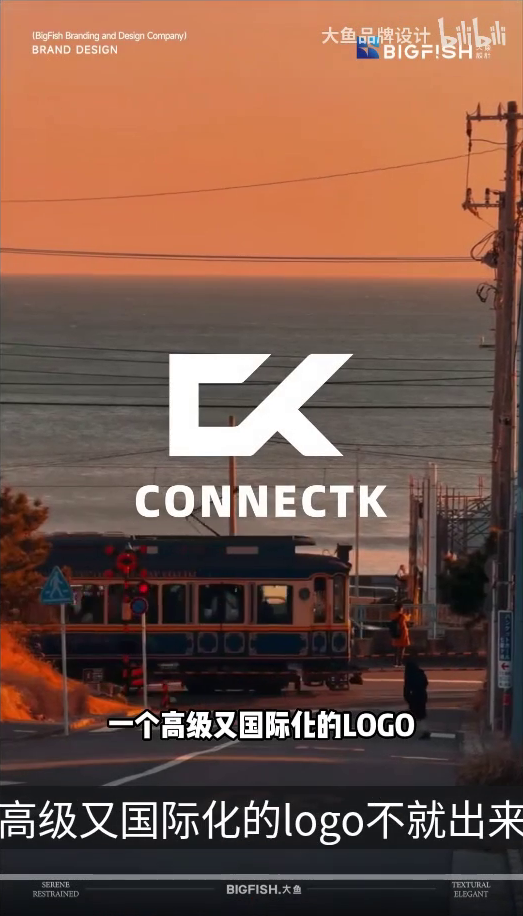

- **作者明确说法**：「一个高级又国际化的LOGO」
- **整理者观察**：同一件标志反白，平面叠在海边日落电车的照片上。字标为 CONNECTK，全大写、连写成一词。

### 思路与前后关系（整理者分析，非作者原话）

开口的 C 被收成直角，下横和 K 的左下斜笔连成一笔，上横右端和 K 的上斜之间留着一条缝，合成一枚 CK。用到海边电车照片上时，字标写成「CONNECTK」。

---

## 案例三：R + X 复制翻转法 / RCAT XOIA

### RX1 · 对话框

约 16.75s（录屏 40.0s）

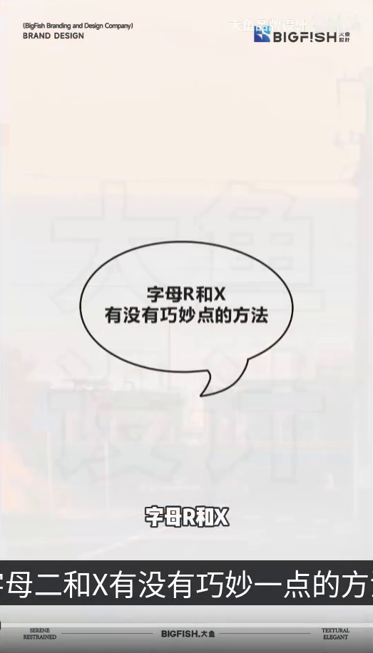

- **作者明确说法**：「字母R和X」。同一画面上，气泡里写着「字母R和X」「有没有巧妙点的方法」。
- **整理者观察**：画面中央是一个线框气泡，下面另有一行描边字。背后还留着上一案海边照片的淡影。

### RX2 · 复制翻转法

约 19.95s（录屏 43.2s）

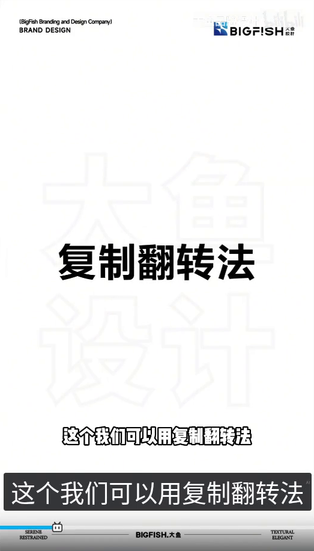

- **作者明确说法**：「这个我们可以用复制翻转法」
- **整理者观察**：白底正中是题板「复制翻转法」。

### RX3 · 先取字母 R

约 21.75s（录屏 45.0s）

- **作者明确说法**：「我们先取字母R」
- **整理者观察**：白底中央是一枚粗无衬线的 R，还没有改造型。

### RX4 · 把 R 变个造型

约 23.55s（录屏 46.8s）

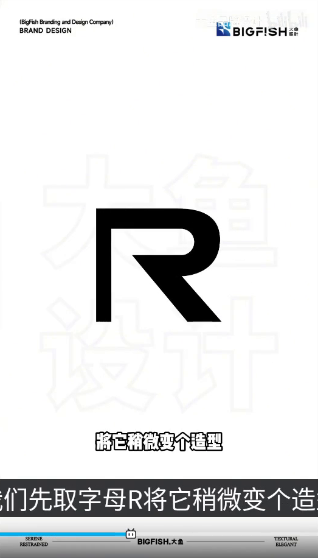

- **作者明确说法**：「將它稍微变个造型」
- **整理者观察**：R 已经改过造型：顶横略向左探出，右边是碗，斜腿向下。这时还是单独一枚。

### RX5 · 第一次左右复制，正在成形

约 23.85s（录屏 47.1s）

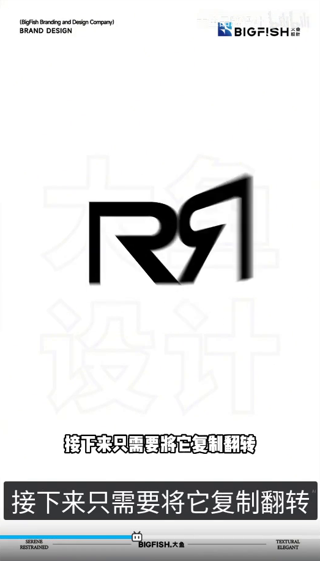

- **作者明确说法**：「接下来只需要將它复制翻转」
- **整理者观察**：原 R 的右侧正在长出一枚左右镜像，右立柱还带着拖影，左右一对还没有完全立定。

### RX6 · 左右成对

约 24.15s（录屏 47.4s）

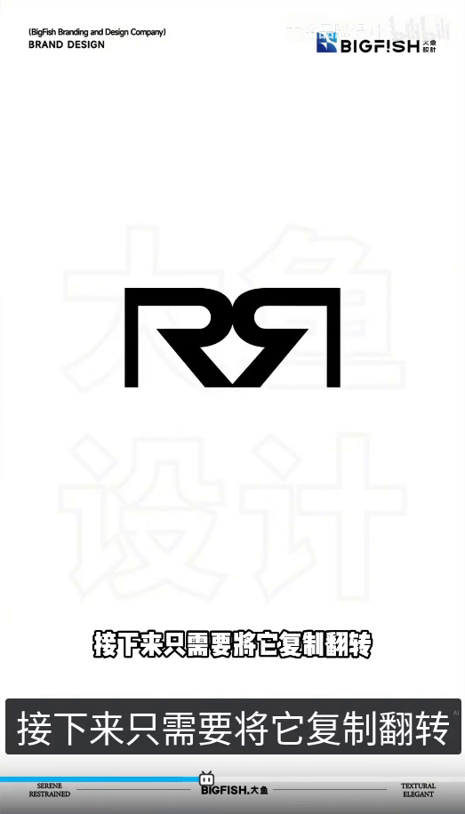

- **作者明确说法**：「接下来只需要將它复制翻转」
- **整理者观察**：左右一对已经立定：左边是原 R，右边是直立的镜像，上面两只碗，两只斜腿向下，在中间交成 V。这时还只有两个朝向，没有上下那一对。

### RX7 · 第二次上下复制，正在叠合

约 24.50s（录屏 47.75s）

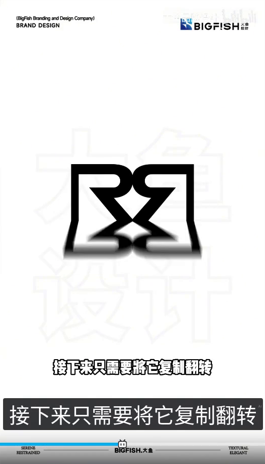

- **作者明确说法**：「接下来只需要將它复制翻转」
- **整理者观察**：整对结构正在和上下翻转的复制叠到一起。上下各两只碗、中间的 X 已经能看出来，下半还带着运动模糊。这是第二次复制的中态。

### RX8 · 收成盒状标

约 24.75s（录屏 48.0s）

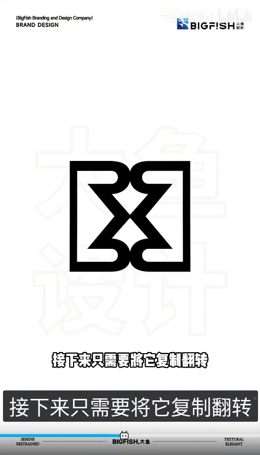

- **作者明确说法**：「接下来只需要將它复制翻转」
- **整理者观察**：盒状标已经立定。上左是原 R，上右是镜像，下左是右镜像翻转后的样子，下右是左 R 翻转后的样子，一共四个朝向。中间的 X，是第一对向下的两腿和第二次复制向上的两腿交在一起形成的。上下沿由两只碗弧在中点相接，左右是竖边。这是这一案线标的黑色完成态。

### RX9 · 中部斜笔标成蓝色

约 25.75s（录屏 49.0s）

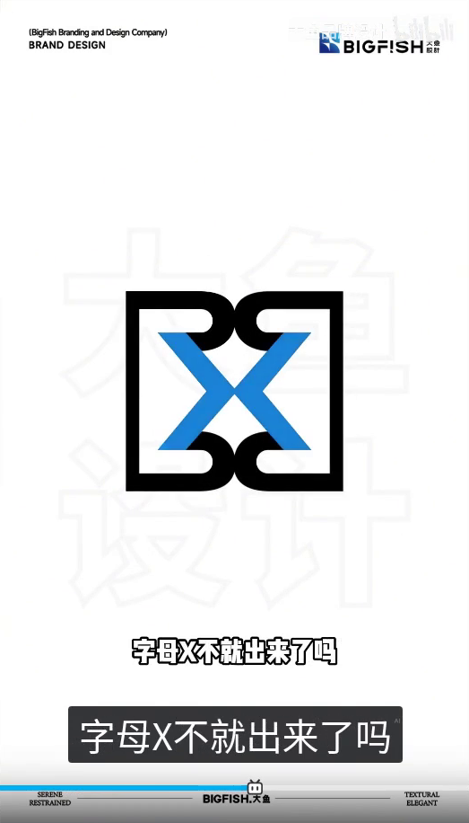

- **作者明确说法**：「字母X不就出来了吗」
- **整理者观察**：标志结构没有再改，中间交叉的斜笔被标成明亮的蓝色，用来指出这里读出的字母 X。

### RX10 · 用到田野照片上，RCAT XOIA

约 28.75s（录屏 52.0s）

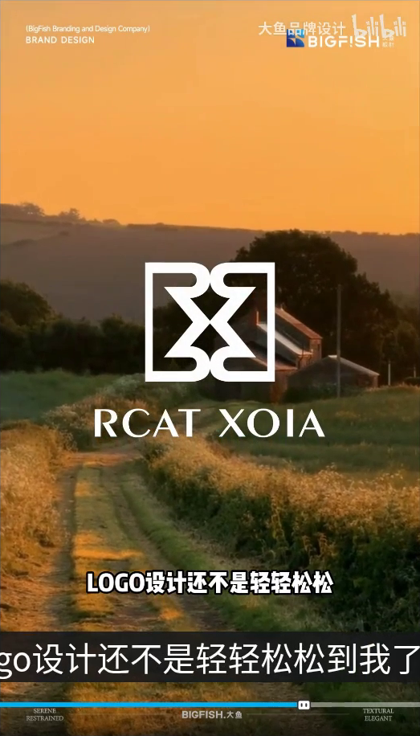

- **作者明确说法**：「LOGO设计还不是轻轻松松」
- **整理者观察**：同一件标志反白，平面叠在田野日落、小径和房屋的照片上。字标为 RCAT XOIA，中间空一格。

### 思路与前后关系（整理者分析，非作者原话）

先把变形后的 R 左右镜像，摆成上两碗、下两腿的一对；再把这一对整体上下翻转叠合，得到四个朝向的 R，中间由两对斜腿交出字母 X。用到田野照片上时，字标写成「RCAT XOIA」。

---

## 案例四：F + S 复制翻转与正负形 / FUDAN STS

### FS1 · 对话框

约 30.75s（录屏 54.0s）

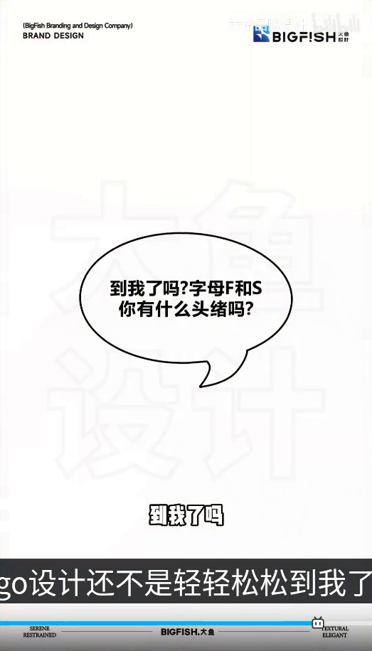

- **作者明确说法**：「到我了吗」。同一画面上，气泡里写着「到我了吗?字母F和S」「你有什么头绪吗?」。
- **整理者观察**：白底中央是一个线框气泡，下面另有一行描边字。

### FS2 · 复制翻转法

约 34.75s（录屏 58.0s）

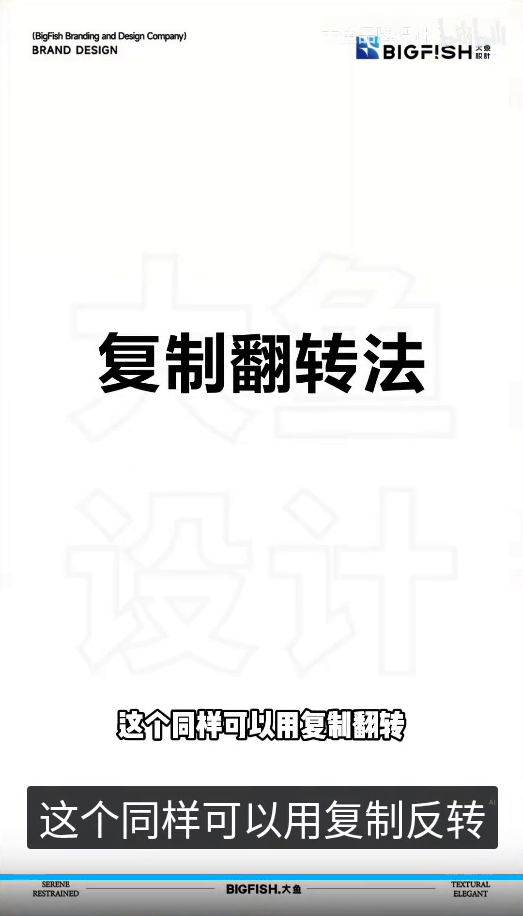

- **作者明确说法**：「这个同样可以用复制翻转」
- **整理者观察**：白底正中是题板「复制翻转法」。

### FS3 · 再写入正负形设计

约 35.75s（录屏 59.0s）

- **作者明确说法**：「同时再融入正负形」
- **整理者观察**：题板变成两行：「复制翻转法」下面新写出「正负形设计」。

### FS4 · 先取字母 F

约 37.75s（录屏 61.0s）

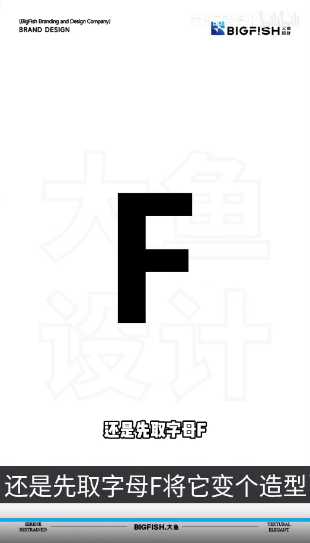

- **作者明确说法**：「还是先取字母F」
- **整理者观察**：白底中央是一枚块状的 F，顶横和中横都只向右，左边没有伸出。

### FS5 · F 的中横向左伸出

约 38.75s（录屏 62.0s）

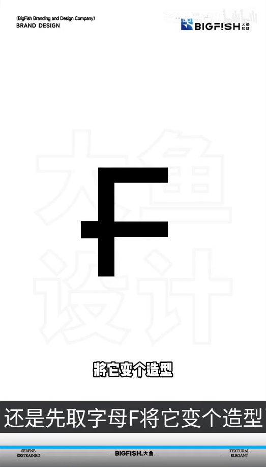

- **作者明确说法**：「將它变个造型」
- **整理者观察**：中横向左穿过竖笔，多出一截左短横；顶横仍然只向右。这时还是单独一枚。

### FS6 · 复制体转到偏角

约 39.20s（录屏 62.45s）

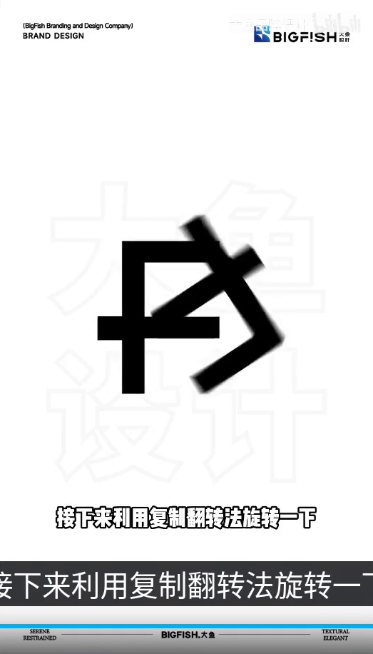

- **作者明确说法**：「接下来利用复制翻转法旋转一下」
- **整理者观察**：左边原来的 F 还在原来的位置；右边的复制体已经转过一截，但还没有转到 180° 直立，带着一点拖影。

### FS7 · 复制体将要直立

约 39.35s（录屏 62.6s）

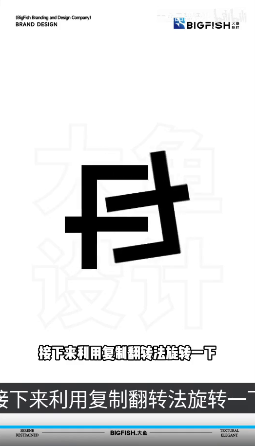

- **作者明确说法**：「接下来利用复制翻转法旋转一下」
- **整理者观察**：右边的复制体已经接近 180° 直立，还留着一点倾斜，还没有完全落到完成位置。

### FS8 · 组合成标

约 39.45s（录屏 62.7s）

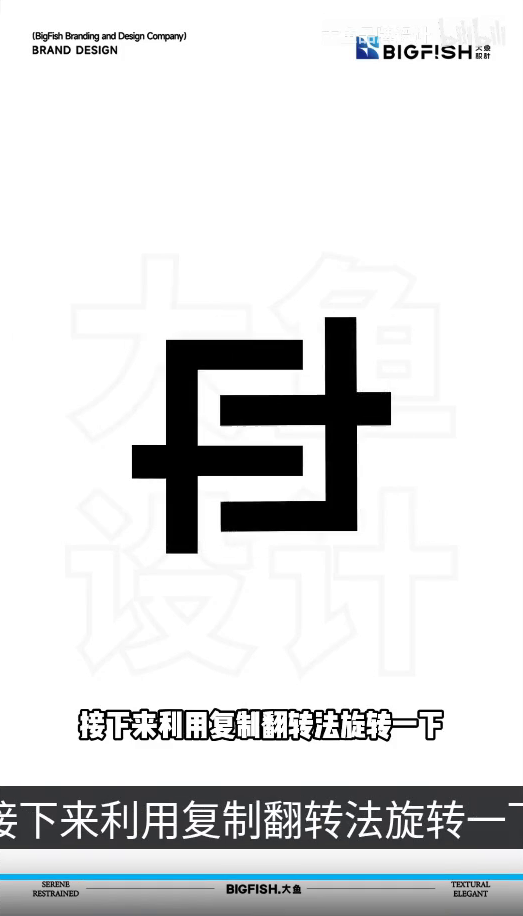

- **作者明确说法**：「接下来利用复制翻转法旋转一下」
- **整理者观察**：右边的复制体已经立定，竖笔在右、横笔朝左，和左边的 F 错位交错排在一起，两枚并不相连。它们之间的白色槽上下贯通，可以读成字母 S。这是这一案线标的黑色完成态。

### FS9 · 中间槽里标出字母 S

约 41.75s（录屏 65.0s）

- **作者明确说法**：「你看」
- **整理者观察**：外围的黑色 F 结构没有改，中间原先的白槽被填成珊瑚红，读成字母 S。

### FS10 · 彩色提示撤掉

约 43.75s（录屏 67.0s）

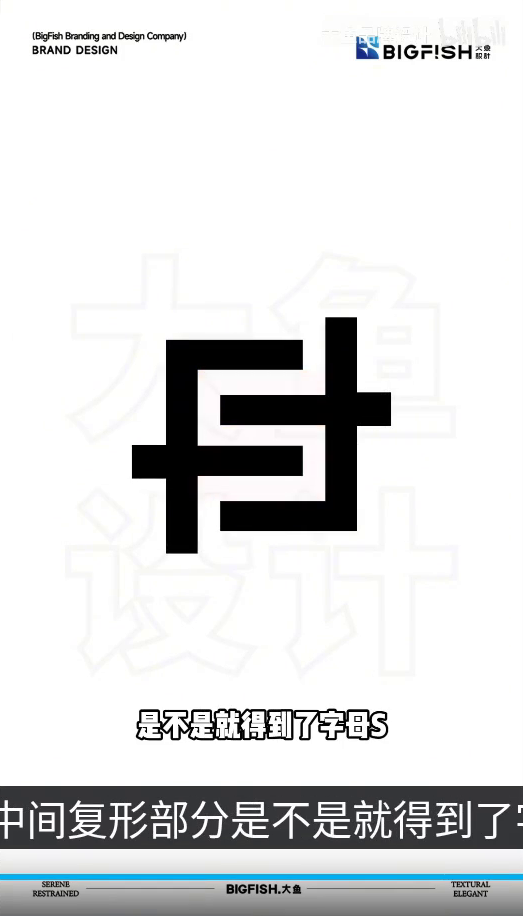

- **作者明确说法**：「是不是就得到了字母S」
- **整理者观察**：红色已经撤掉，回到和 62.7s 相同的全黑组合标。

### FS11 · 用到门廊照片上，FUDAN STS

约 45.75s（录屏 69.0s）

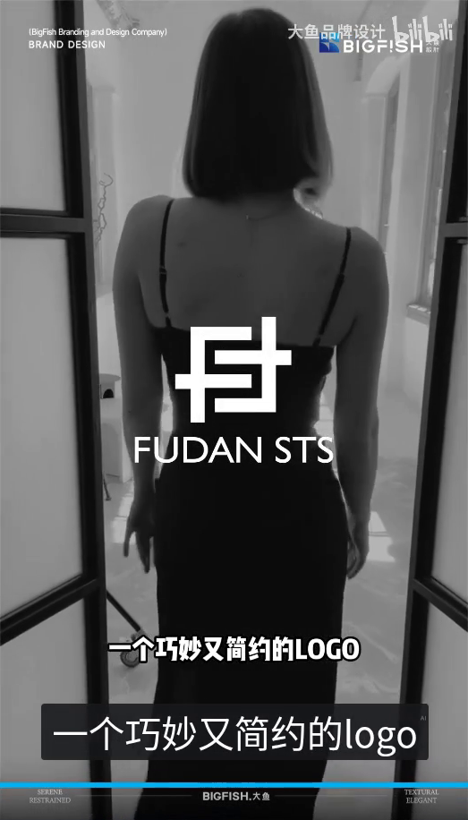

- **作者明确说法**：「一个巧妙又简约的LOGO」
- **整理者观察**：同一件标志反白，平面叠在黑白照片上，照片里是一名女性的背影，走在门廊里。字标为 FUDAN STS，中间空一格。

### 思路与前后关系（整理者分析，非作者原话）

F 的中横向左伸出后，再复制一枚旋转 180°，与左边的 F 错位交错排在一起，两枚并不相连；之间的白槽贯通，读成字母 S。用到人物背影照片上时，字标写成「FUDAN STS」。

---

## 收束：三例并列

约 48.75s（录屏 72.0s）

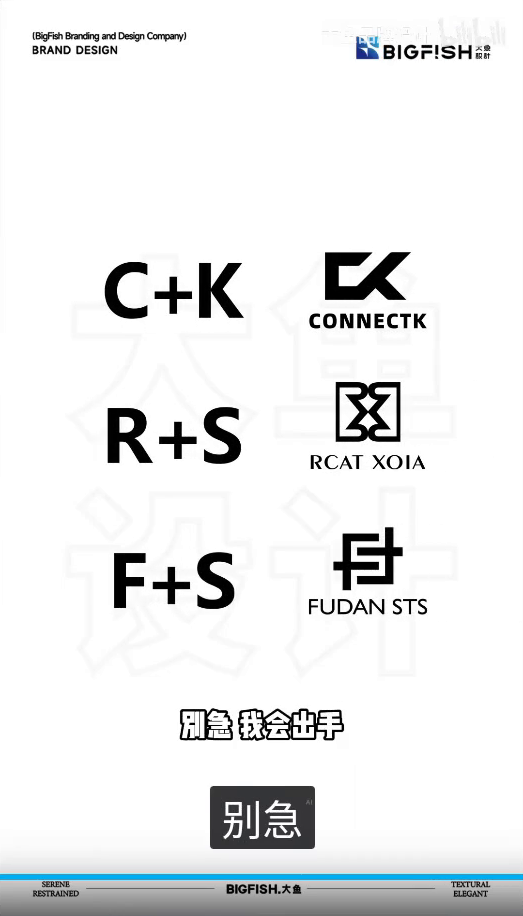

- **作者明确说法**：「别急 我会出手」
- **整理者观察**：白底三行并列，没有片头的 KQ clinical。左侧写着「C+K」、「R+S」、「F+S」；右侧各配对应的完成态标志，以及字标 CONNECTK、RCAT XOIA、FUDAN STS。第二行左侧写的是「R+S」，这一案过程里出题用的是字母 R 和 X。
