# [一个好的LOGO设计，要能看出元素](https://www.bilibili.com/video/BV1mVt46xEgQ/)｜大鱼品牌设计

约视频时刻按本条 0.5× 录屏实测，约等于（录屏秒 − 149.2）÷ 2，范围 ±1s。开播 00:00 以播放器读数为准。图是录屏裁切，不是原片逐帧。

## 案例一：DC 与 DNA 螺旋 / DOETY CPAOTY

### DC1 · 白底起幅，字母尚未入画

约 00:00（录屏 151.067s）

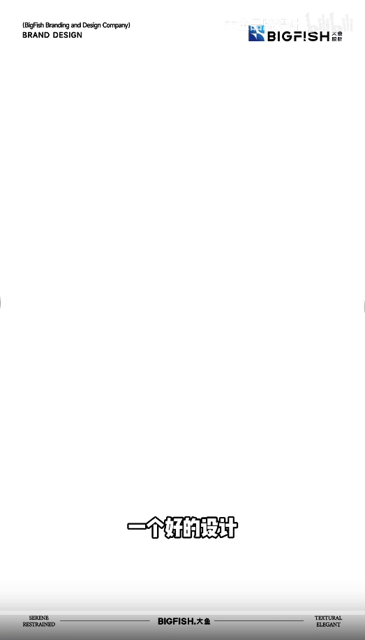

- **作者明确说法**：「一个好的设计」
- **整理者观察**：白底，DC 还没有入画。这一帧播放器读数是 00:00，双条显示正在播放。

### DC2 · 顶端出现一小段螺旋，字母仍未入画

约 1s（录屏 151.400s）

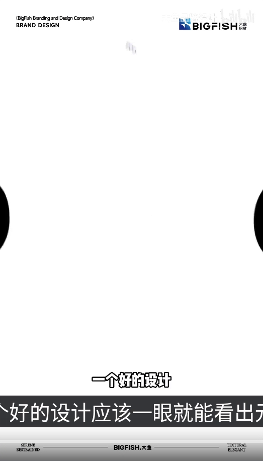

- **作者明确说法**：「一个好的设计」
- **播放器字幕**：「好的设计应该一眼就能看出」可见部分，右缘被裁。
- **整理者观察**：画面顶端已经出现一小段淡蓝白的螺旋，还很短。左右两侧仍是空白，字母还没有进入画面。

### DC3 · D 自左、C 自右移入，螺旋短段落在中上

约 1s（录屏 151.600s）

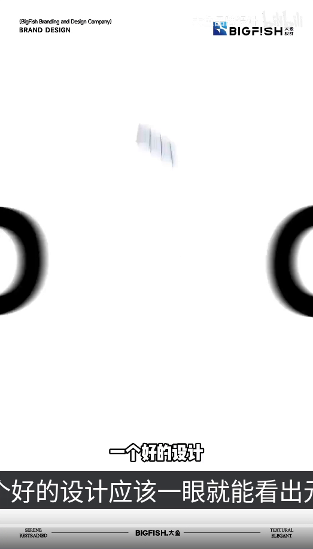

- **作者明确说法**：「一个好的设计」
- **播放器字幕**：「好的设计应该一眼就能看出」可见部分，右缘被裁。
- **整理者观察**：左侧从画外移入一枚黑体 D，这一帧只看见右半边的碗，左竖还在画外；右侧从画外移入一枚黑体 C，这一帧只看见左弧。两字中间偏上是那一段仍短、略带拖影的蓝白螺旋，位置比上一帧的顶缘更低。播放器读数已换到 00:01。

### DC4 · D 与 C 基本落在画内，短螺旋夹在两字之间

约 1s（录屏 151.800s）

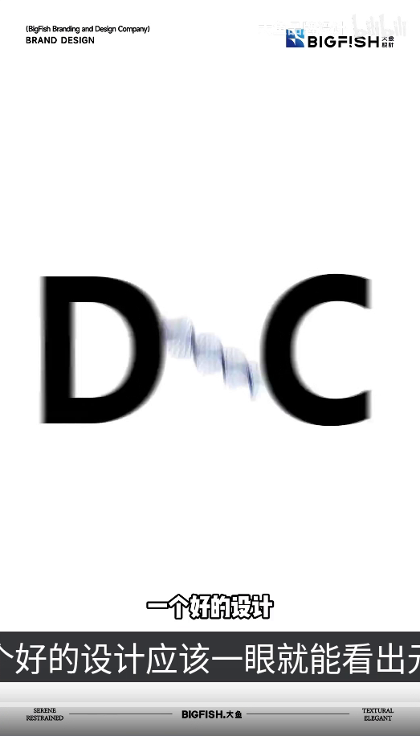

- **作者明确说法**：「一个好的设计」
- **播放器字幕**：「好的设计应该一眼就能看出」可见部分，右缘被裁。
- **整理者观察**：D 和 C 已经基本完整落在画内，仍是黑体。短螺旋夹在两字中间，大约在字母的高度上，略微倾斜，还带一点拖影。

### DC5 · 螺旋短段落到两字下方

约 2s（录屏 152.200s）

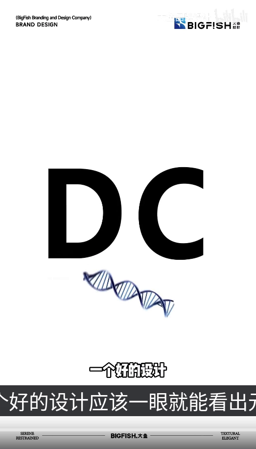

- **作者明确说法**：「一个好的设计」
- **播放器字幕**：「好的设计应该一眼就能看出」可见部分，右缘被裁。
- **整理者观察**：DC 并排稳住。原来夹在两字之间的短螺旋继续向下，落到两字下方的空隙里，仍然不长。

### DC6 · 螺旋变长，从字母中穿过

约 2s（录屏 153.467s）

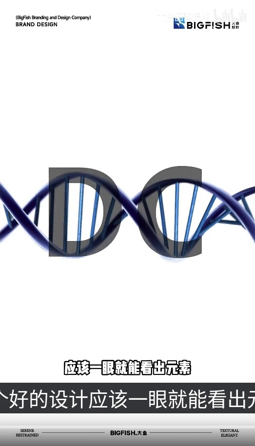

- **作者明确说法**：「应该一眼就能看出元素」
- **播放器字幕**：「好的设计应该一眼就能看出」可见部分，右缘被裁。
- **整理者观察**：螺旋明显变长，从 DC 中间穿过。字母颜色变浅，螺旋的横档和笔画交错在一起。这一帧片内已经换成「应该一眼就能看出元素」。

### DC7 · 双螺旋拉成横贯的长链，与 DC 缠在一起

约 3s（录屏 155.600s）

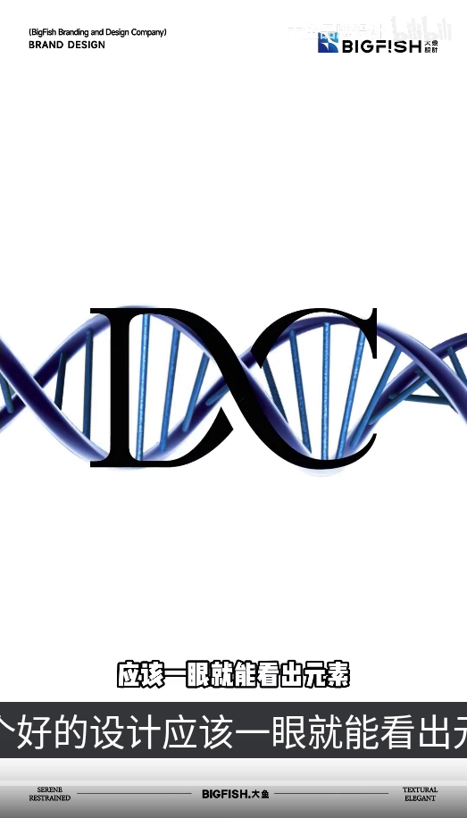

- **作者明确说法**：「应该一眼就能看出元素」
- **播放器字幕**：「好的设计应该一眼就能看出」可见部分，右缘被裁。
- **整理者观察**：双螺旋已经拉成横贯画面的长链，浅色的 DC 和螺旋缠在一起。还没有换上应用用的照片。

### DC8 · 用到金蓝螺旋照片上，DOETY CPAOTY

约 4s（录屏 157.933s）

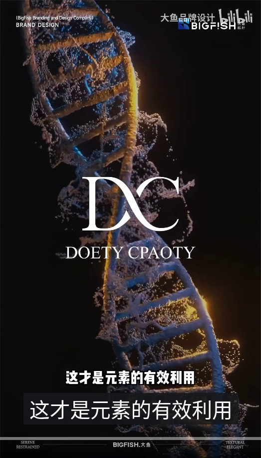

- **作者明确说法**：「这才是元素的有效利用」
- **整理者观察**：浅色衬线 DC 用到一张暗底、带金蓝螺旋的照片上，C 的左弧压在 D 的右竖一带。下方是一行衬线全大写，两词之间有空格：DOETY CPAOTY，从左到右是 D、O、E、T、Y，空一格，C、P、A、O、T、Y。

### 思路与前后关系（整理者分析，非作者原话）

先在白底上让 D 从左侧、C 从右侧移入，顶端的一段短螺旋逐渐下落，先夹在两字中间，再落到下方，随后拉长并从字母中穿过，和 DC 缠成一条横贯的链。最后把浅色 DC 用到金蓝螺旋照片上，字标写成 DOETY CPAOTY。整理者分析：可见结构上，字母与 DNA 螺旋是同时出现、互相穿过缠绕的，两条线索交织在同一画面里。

---

## 案例二：字母 S 与大提琴 / 思丹凝琴行

### S1 · 对话泡提出 S 和大提琴

约 6s（录屏 160.333s）

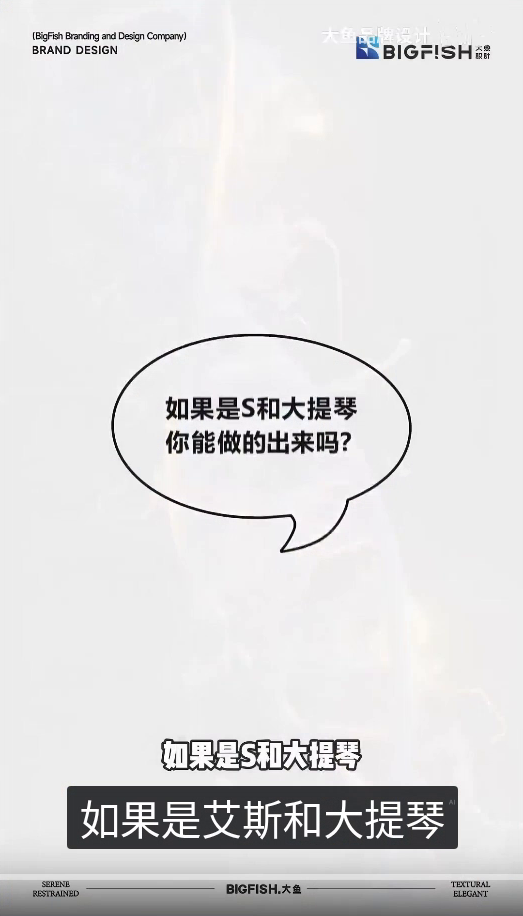

- **作者明确说法**：「如果是S和大提琴」
- **播放器字幕**：「如果是艾斯和大提琴」
- **整理者观察**：白底上是一个对话泡，两行写着「如果是S和大提琴」和「你能做的出来吗?」。这一帧的片内是「如果是S和大提琴」，播放器字幕写成「艾斯」。

### S2 · 白底出现黑体大写 S

约 8s（录屏 165.467s）

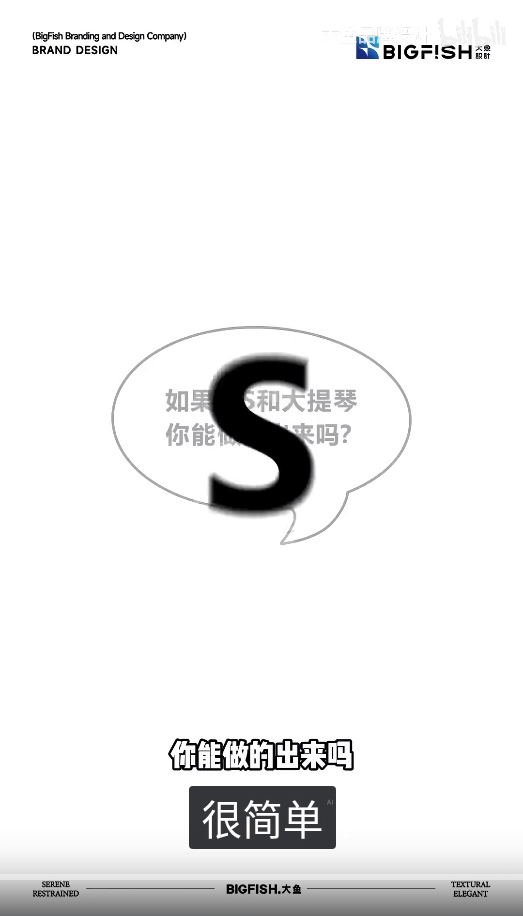

- **作者明确说法**：「你能做的出来吗」
- **播放器字幕**：「很简单」
- **整理者观察**：白底上出现一枚黑体大写 S，还没有书体的粗细变化，下端也没有向下的长线。同帧播放器字幕已经换成「很简单」，片内还停在上一句。

### S3 · 黑体已淡去，书体 S 正在成形

约 10s（录屏 168.800s）

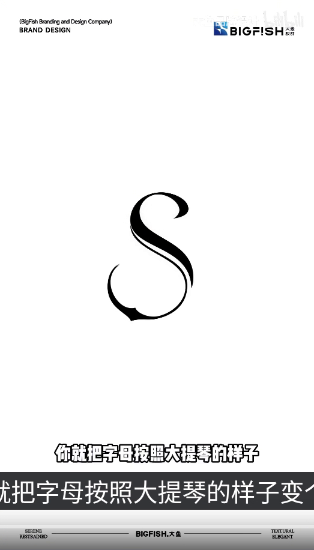

- **作者明确说法**：「你就把字母按照大提琴的样子」
- **播放器字幕**：「就把字母按照大提琴的样子变」可见部分，左缘和右缘被裁。
- **整理者观察**：原来的黑体已经淡去。这一帧是有粗细变化的书体 S：上端弯钩已经写出，下腹圆转也已经收到左下的尖端，比后面 171.200 的下腹略轻。这是黑体淡去、书体成形的中态，还不是后面那一帧收住的纯书体。

### S4 · 纯书体 S，上端是弯钩，没有贯穿直线

约 11s（录屏 171.200s）

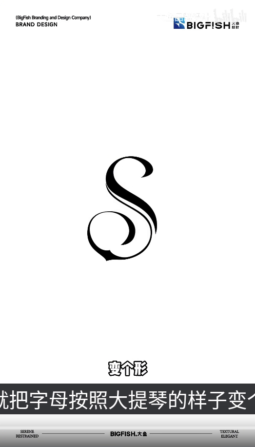

- **作者明确说法**：「变个形」
- **播放器字幕**：「字母按照大提琴的样子」可见部分，右缘被裁。
- **整理者观察**：S 已经收成有粗细变化的纯书体。上端是向右再回转的弯钩收笔，下腹圆转，收在下腹左下的尖端。这一帧还没有贯穿字形的直线，下端也没有向下伸出的长茎。片内已经换成「变个形」。

### S5 · 上端收笔处向右上伸出一截，下端未变

约 11s（录屏 171.467s）

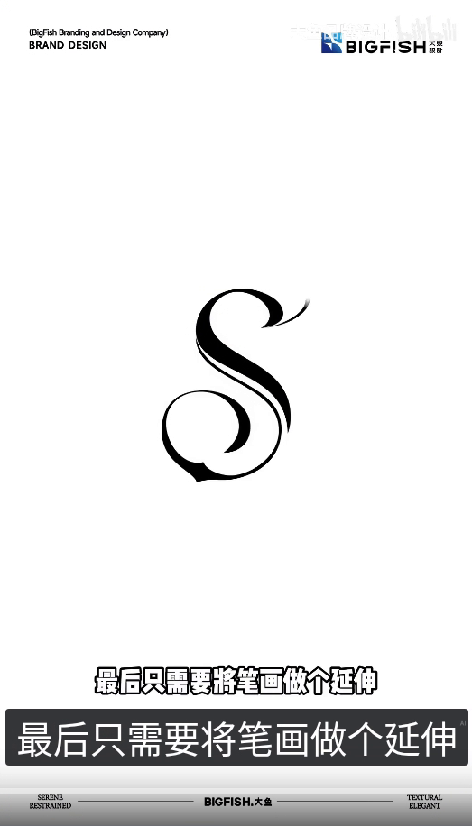

- **作者明确说法**：「最后只需要将笔画做个延伸」
- **整理者观察**：变化先出现在上端。原来的弯钩收笔处多出一截向右上的淡短延伸，下腹的圆转和收尖还没有动。这一帧片内已经换成「最后只需要将笔画做个延伸」。

### S6 · 上端收成小弯钩，一条细直线自钩内向左下斜穿，停在中上

约 11s（录屏 171.800s）

- **作者明确说法**：「最后只需要将笔画做个延伸」
- **整理者观察**：上端的延伸已经弯成一个向上、再向左的小弯钩。一条细的、近乎直的线从这枚新弯钩的内侧出发，向左下斜着穿过原来 S 的上弧，尖端停在字形的中上部。下腹仍是原来的圆转，细线还没有进入下腹，更没有从下面穿出。171.733 已经能看见这条细线，这一帧线略长一些。

### S7 · 细线穿过中腰，进入下腹白地，尚未穿出下沿

约 11s（录屏 172.133s）

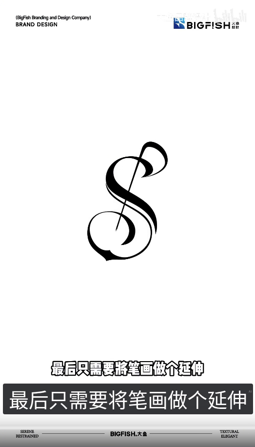

- **作者明确说法**：「最后只需要将笔画做个延伸」
- **整理者观察**：同一条细线继续向下，已经穿过中腰，进入下腹中间的白地，尖端停在下腹里面，还没有从字形下沿穿出去。上端的小弯钩还在。171.933 到 172.133 之间有一段约 0.2s 的空隙，中间可能跳过细线刚进入下腹的位置。

### S8 · 细线从下腹底部穿出，下方出现短尖

约 12s（录屏 172.600s）

- **作者明确说法**：「最后只需要将笔画做个延伸」
- **整理者观察**：细线已经从下腹底部穿出，字形下方出现一截短尖。原来下腹的收笔尖和这条穿出的线接在一起。上端弯钩仍在。172.200 到 172.467 之间还有一段空隙，中间可能跳过刚穿出下沿的位置。

### S9 · 白底收住：上端弯钩、贯穿细直线、下端楔尖

约 13s（录屏 174.400s）

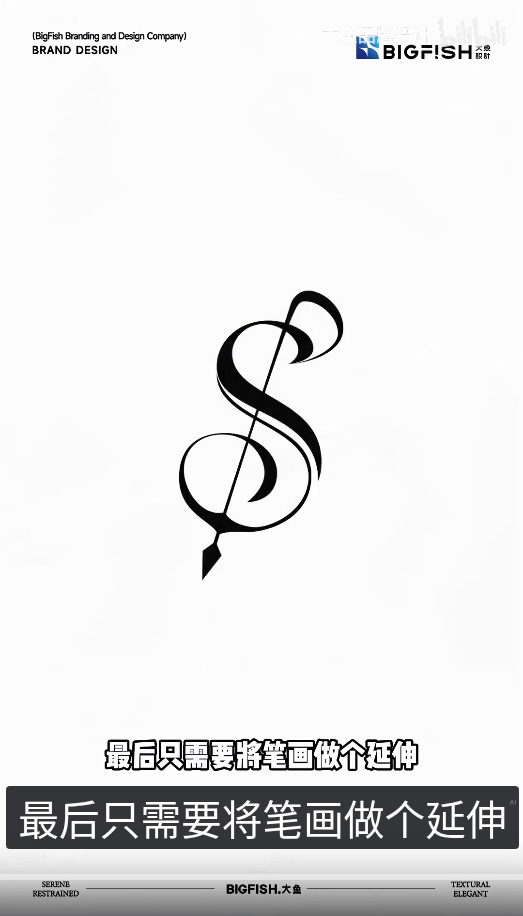

- **作者明确说法**：「最后只需要将笔画做个延伸」
- **整理者观察**：穿出的下端加长，末端收成向下的菱形楔尖。白底上的结构是：上端弯钩，一条细直线从上到下斜着穿过 S，下端是楔尖。这是这一步在白底上收住的形态。

### S10 · 用到大提琴照片上，思丹凝琴行／stunning music store

约 14s（录屏 177.000s）

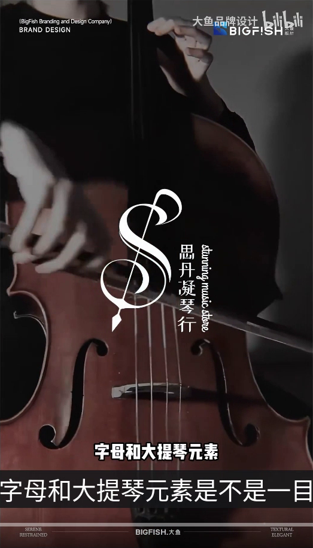

- **作者明确说法**：「字母和大提琴元素」
- **播放器字幕**：「字母和大提琴元素是不是一目」可见部分，右缘被裁。
- **整理者观察**：浅色的 S 用到一张演奏大提琴的照片上，结构与白底净标相同：上端弯钩、贯穿细直线、下端楔尖。右侧是竖排中文五字「思丹凝琴行」，再右是竖排小写英文 stunning music store。175.200 起照片已经出现，当时片内只写「你看」；这一帧片内换成「字母和大提琴元素」。179.200 一带片内再换成「是不是一目了然」。

### 思路与前后关系（整理者分析，非作者原话）

先写出一枚黑体 S，黑体淡去后改成有粗细的书体。变化从顶端开始：上端收笔先向右上延伸，收成小弯钩，一条细直线从钩的内侧向左下斜穿，经过中腰进入下腹，再从下腹底部穿出，末端收成楔尖。最后把浅色的同一形态用到大提琴照片上，字标写成思丹凝琴行和 stunning music store。整理者分析：书体的曲线本身仍保持字母 S；随后自上而下贯穿的细直线，把字形和琴弦联系起来——这是整理者根据后续大提琴照片和片内「字母和大提琴元素」所作的推断，不是画面里写出的名称。

---

## 案例三：字母 A、房屋联想与钥匙 / ALBERT HOTEL

### A1 · 对话泡写出店名

约 16s（录屏 181.733s）

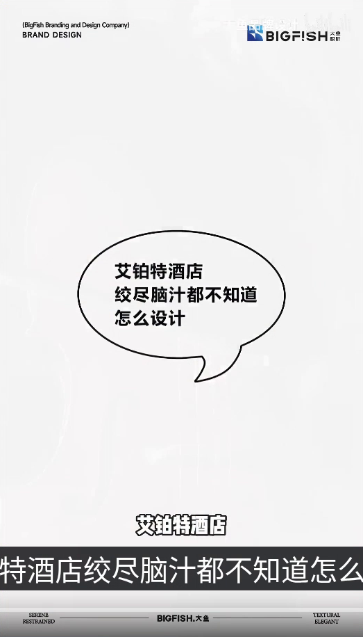

- **作者明确说法**：「艾铂特酒店」
- **播放器字幕**：可见「特酒店绞尽脑汁都不知道怎么」，左缘被裁。
- **整理者观察**：白底上是一个对话泡，三行写着「艾铂特酒店」「绞尽脑汁都不知道」「怎么设计」。店名第二字是钅旁加「白」，即「铂」。这一帧片内只写「艾铂特酒店」。185.267 一带片内换成「都不知道怎么设计」。

### A2 · 白底大字「联想法」

约 20s（录屏 188.333s）

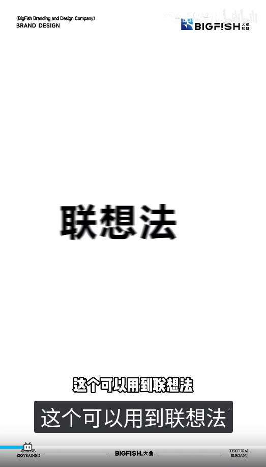

- **作者明确说法**：「这个可以用到联想法」
- **整理者观察**：白底正中是黑体大字「联想法」。188.067 到 188.200 这几个字带着运动模糊入画，这一帧已经看清。

### A3 · 大字换成「酒店」

约 21s（录屏 190.800s）

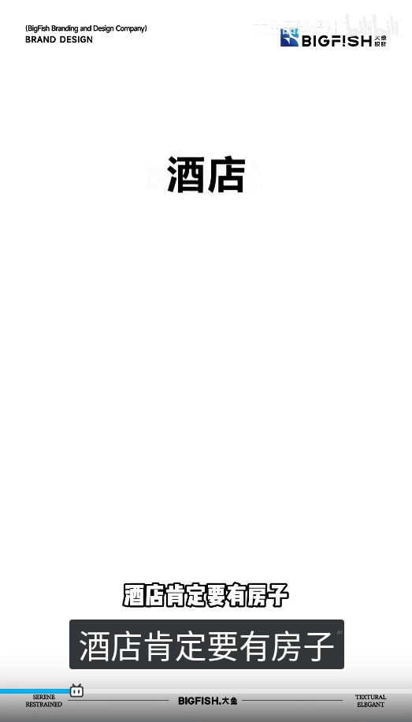

- **作者明确说法**：「酒店肯定要有房子」
- **整理者观察**：正中的大字已经换成「酒店」。190.400 还是将要收掉的「联想法」，之后有一段 0.400s 的空隙，这一帧是空隙之后第一帧已经看清的「酒店」。

### A4 · 「酒店」下面出现「房子」

约 21s（录屏 191.667s）

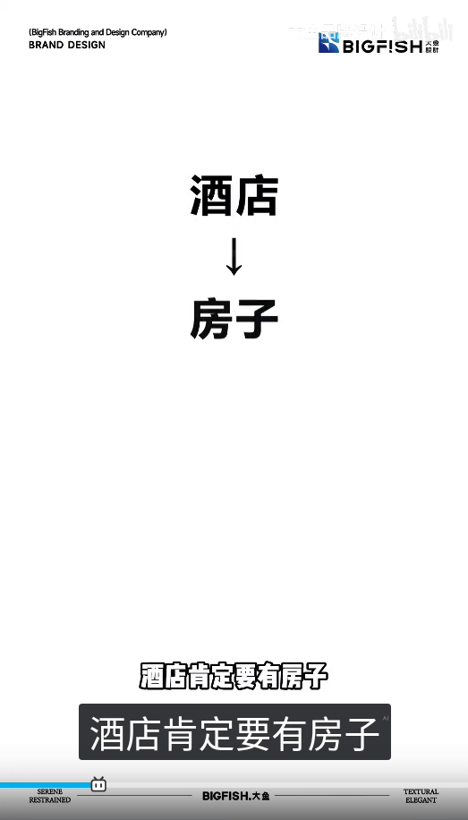

- **作者明确说法**：「酒店肯定要有房子」
- **整理者观察**：上面是「酒店」，一条箭头朝下，下面是「房子」。191.200 到 191.533，「房子」还是虚影或者发虚，这一帧已经看清。

### A5 · 「房子」下左右分出「窗户」和「钥匙」

约 22s（录屏 193.667s）

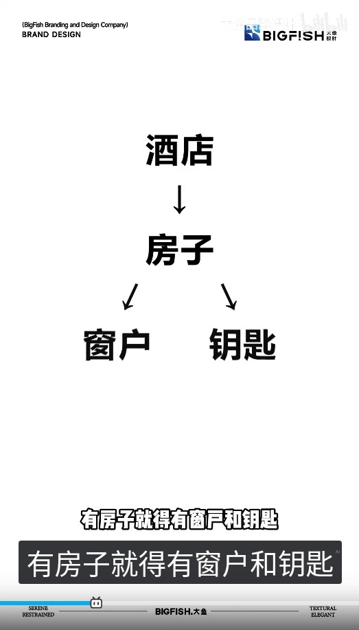

- **作者明确说法**：「有房子就得有窗户和钥匙」
- **整理者观察**：「房子」下面向左下、右下各有一条箭头，左边是「窗户」，右边是「钥匙」。193.133 片内已经换成这句，当时树上还没有这两个词；193.467 已经出现，仍有些发虚，这一帧已经看清。

### A6 · 「钥匙」下面出现「锁孔」

约 24s（录屏 197.533s）

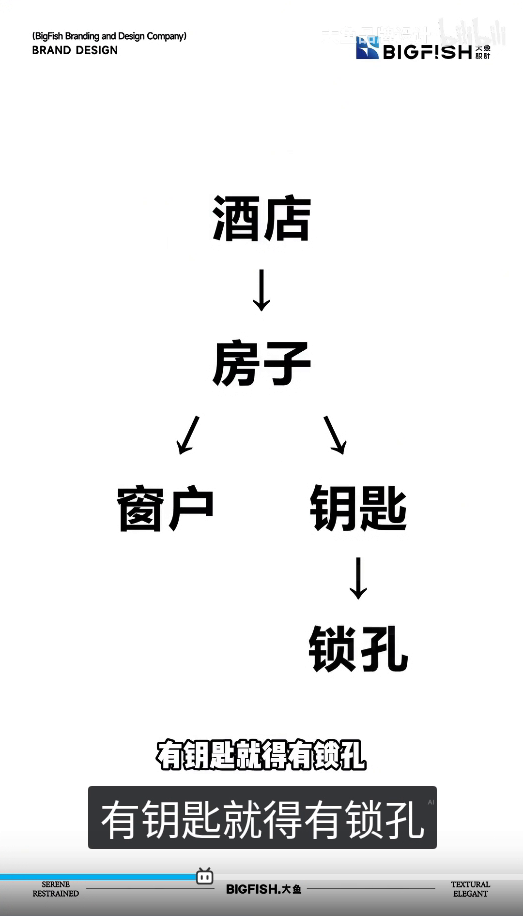

- **作者明确说法**：「有钥匙就得有锁孔」
- **整理者观察**：「钥匙」下面多了一条向下的箭头和「锁孔」，左侧的「窗户」还在。196.800 锁孔还是虚影，197.267 已经能读但仍略虚，这一帧已经看清。196.800 起片内换成这句。

### A7 · 屋顶形黑 A，峰下是 2×2 四格窗，尚未分成钥匙

约 26s（录屏 201.200s）

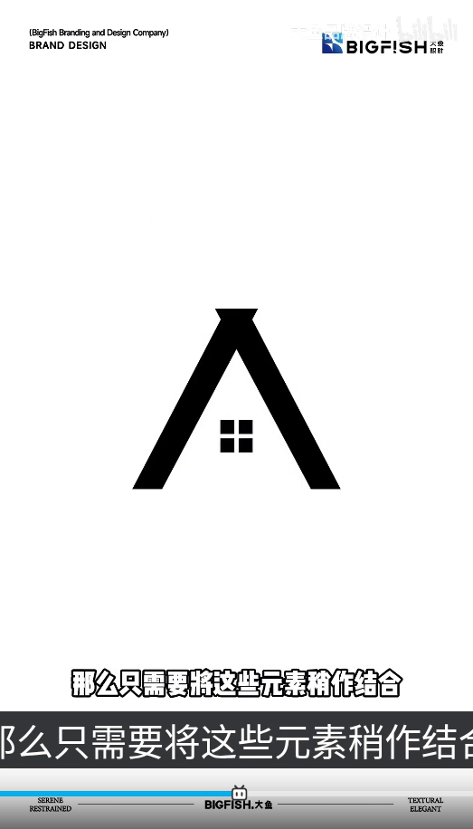

- **作者明确说法**：「那么只需要将这些元素稍作结合」
- **整理者观察**：联想树上的字已经收掉。白底上是一枚屋顶形的黑色 A：顶部有一截短横，两斜边向下张开，中间是白地。峰下的白地里是 2×2 四格窗，格子之间是白缝。这一帧还没有把斜边分成钥匙。200.200 已经是同一外形，背后还残留淡字；这一帧收净。片内 199.400 起换成「那么只需要将这些元素稍作结合」。

### A8 · 屋顶斜边正在分成钥匙杆和圈，四格窗还在

约 27s（录屏 203.800s）

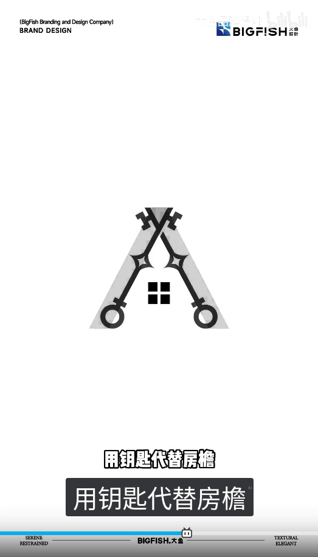

- **作者明确说法**：「用钥匙代替房檐」
- **整理者观察**：原来屋顶形 A 的两斜边还看得见浅灰色的宽边。斜边上已经出现两把钥匙的轮廓：上方交叉的齿、沿斜边向下的杆、中段向内的星形翅，下端是圆形钥匙圈，作为两脚。两杆之间、偏下仍是 2×2 四格窗，格子之间是白缝。窗在这一帧没有收掉。

### A9 · 两把钥匙交叉成 A，中间仍是四格窗

约 28s（录屏 205.133s）

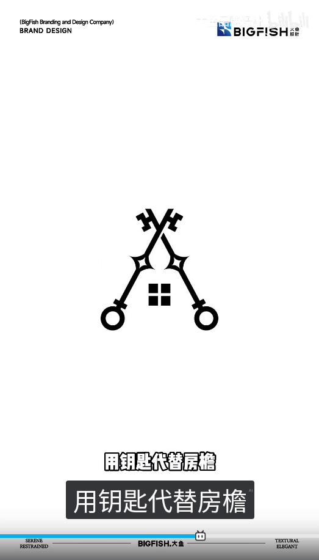

- **作者明确说法**：「用钥匙代替房檐」
- **整理者观察**：原来的两斜边已经分成两把实黑的钥匙，交叉成 A。齿在上方交叉，杆向左下、右下，中段各有一枚向内的星形翅，下端是圆形钥匙圈，作为 A 的两脚。两杆之间、偏下仍是 2×2 四格窗，格子之间是白缝。

### A10 · 四格窗换成一枚锁孔

约 29s（录屏 206.667s）

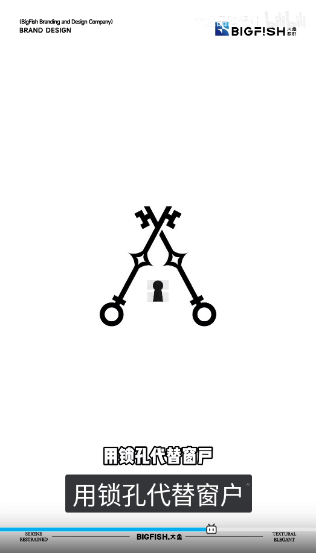

- **作者明确说法**：「用锁孔代替窗户」
- **整理者观察**：两把钥匙的位置不变。原来的四格窗收掉，换成一枚黑色的锁孔剪影，停在两杆之间偏下的位置。

### A11 · 交叉齿上方出现钻石形

约 30s（录屏 209.200s）

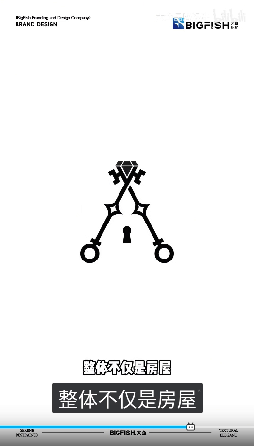

- **作者明确说法**：「整体不仅是房屋」
- **整理者观察**：交叉齿的上方多出一枚钻石形。钥匙、锁孔还在。208.800 仍只有交叉齿，还没有这枚钻石。

### A12 · 钥匙后面叠上一枚粉色的 A

约 31s（录屏 211.800s）

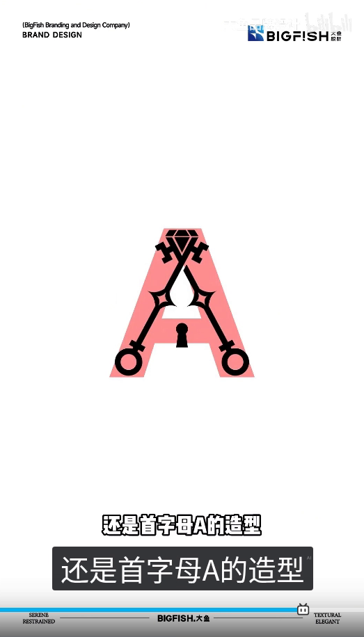

- **作者明确说法**：「还是首字母A的造型」
- **整理者观察**：钥匙、锁孔、钻石都还在。后面叠着一枚粉色的实心 A，把外廓提示出来。211.067 粉色刚开始从钥匙后面透出，当时片内还是「整体不仅是房屋」；211.333 起换成这一句。

### A13 · 用到泳池别墅照片上，ALBERT HOTEL／艾铂特酒店

约 33s（录屏 215.267s）

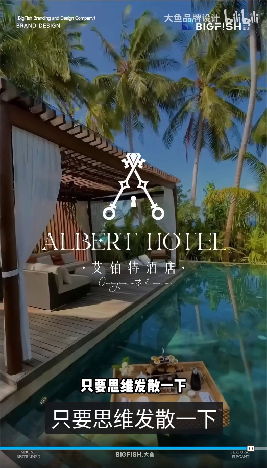

- **作者明确说法**：「只要思维发散一下」
- **整理者观察**：浅色的双钥匙 A 用到一张度假泳池别墅的照片上，结构与前面的钥匙形态相同。下行是衬线全大写 ALBERT HOTEL，两词之间有一枚小菱形分隔；再下一行是点隔的「·艾铂特酒店·」，第二字同样是钅旁加「白」，即「铂」。再下手写英文一行，笔画连在一起，不能确信读成哪几个词，标待核。217.133 一带片内换成「总会有意想不到的创意」。

### 思路与前后关系（整理者分析，非作者原话）

对话泡里先写出店名「艾铂特酒店」。白底大字按联想法往下走：联想法、酒店、房子，再分出窗户和钥匙，钥匙下面再出锁孔。随后收成一枚屋顶形的黑 A，峰下是四格窗；两斜边再分成交叉的钥匙，窗改成锁孔，齿上加上钻石，后面叠一枚粉色的 A 提示外廓。最后把浅色双钥匙 A 用到泳池别墅照片上，字标写成 ALBERT HOTEL 和艾铂特酒店。整理者分析：屋顶的斜边被钥匙的杆、圈和齿替换，窗的位置再换成锁孔，房子轮廓和字母 A 在同一外形里双读。

---

## 案例四：字母 U 与魔方 / UEAT LICSK

### U1 · 对话泡提出 U 和魔方

约 36s（录屏 220.800s）

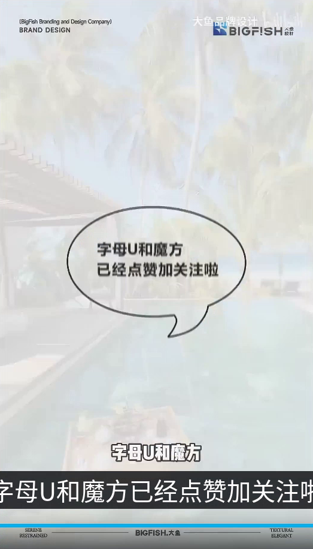

- **作者明确说法**：「字母U和魔方」
- **播放器字幕**：「字母U和魔方已经点赞加关注啦」可见部分，右缘被裁。
- **整理者观察**：对话泡两行写着「字母U和魔方」和「已经点赞加关注啦」。这一帧片内只写「字母U和魔方」。223.267 一带片内换成「已经点赞加关注啦」。

### U2 · 画面中出现实物魔方

约 39s（录屏 226.933s）

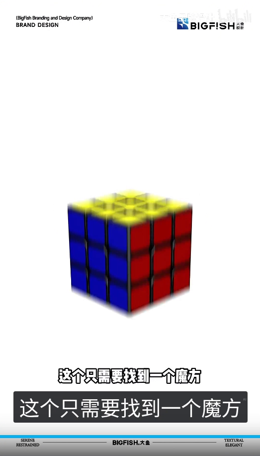

- **作者明确说法**：「这个只需要找到一个魔方」
- **整理者观察**：画面中是一枚实物魔方，彩色贴纸可以看见。还没有收成只剩三面的简化立方。

### U3 · 收成黄顶、蓝左、红右的三面立方

约 40s（录屏 230.000s）

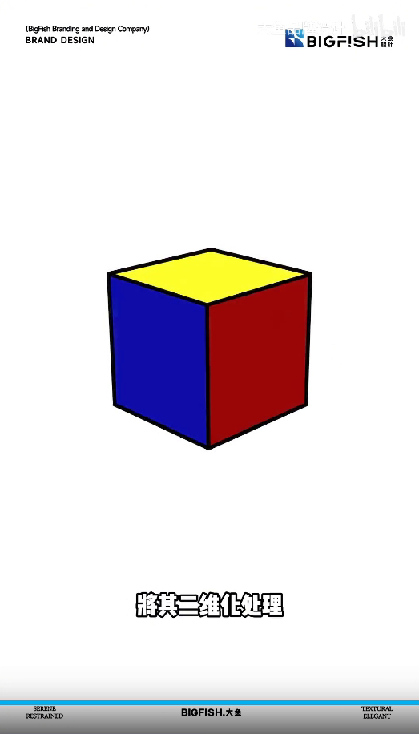

- **作者明确说法**：「将其二维化处理」
- **整理者观察**：实物魔方已经收成一个只看见三面的图形立方：顶面黄色，左面蓝色，右面红色。这一帧没有播放器字幕。

### U4 · 一枚很大的白色 U 覆在立方体前缘

约 41s（录屏 232.067s）

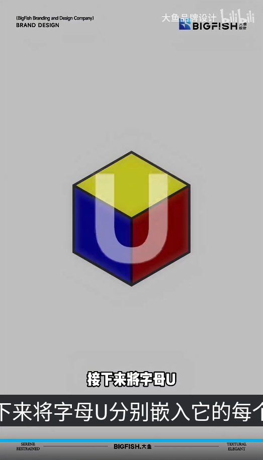

- **作者明确说法**：「接下来将字母U」
- **播放器字幕**：「接下来将字母U分别嵌入它的每个」可见部分，右缘被裁。
- **整理者观察**：一枚很大的白色 U 覆在立方体前缘，横跨蓝色和红色两面，顶边伸到黄顶附近。这一帧还不是每一面各有一枚 U。

### U5 · 这枚 U 扭到各个面上，处于贴面过渡

约 43s（录屏 234.533s）

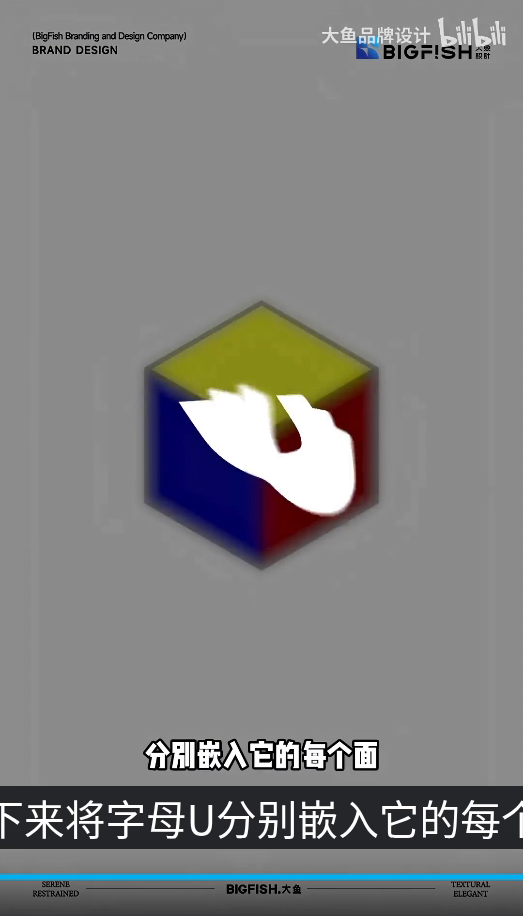

- **作者明确说法**：「分别嵌入它的每个面」
- **播放器字幕**：「接下来将字母U分别嵌入它的每个」可见部分，右缘被裁。
- **整理者观察**：原来那枚大 U 正在扭转变形，笔画在看得见的几个面上甩开，还没有收成每面一枚清楚的 U。233.800 起开始扭转，这一帧片内已经换成「分别嵌入它的每个面」。

### U6 · 三面已现出白 U，左面尚未收齐

约 43s（录屏 234.933s）

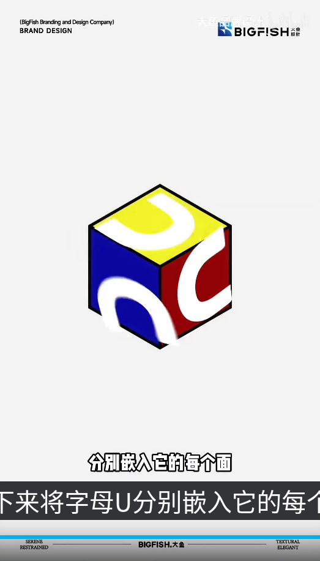

- **作者明确说法**：「分别嵌入它的每个面」
- **播放器字幕**：「接下来将字母U分别嵌入它的每个」可见部分，右缘被裁。
- **整理者观察**：三枚白 U 已经分别落向黄顶、蓝左、红右三个面，但还没有完全收齐：左面（蓝）那枚白 U 明显越过该面下边，两端发虚，仍处过渡。右侧那枚开口向左，像横放的 U。

### U7 · 三个面上各有一枚收齐的白 U，棱上有白缝

约 43s（录屏 235.333s）

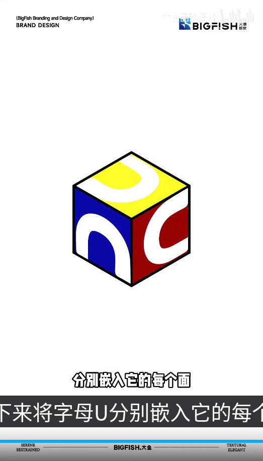

- **作者明确说法**：「分别嵌入它的每个面」
- **播放器字幕**：「接下来将字母U分别嵌入它的每个」可见部分，右缘被裁。
- **整理者观察**：左面越过下边的白 U 已经收回面内，笔画贴齐该面下边和侧棱。黄顶、蓝左、红右三个面上各有一枚清楚的白 U。右侧那枚开口向左，像横放的 U。面与面的棱是浅色的缝，转角略圆。

### U8 · 三枚白 U 改成中灰，色面同时开始变淡

约 44s（录屏 236.667s）

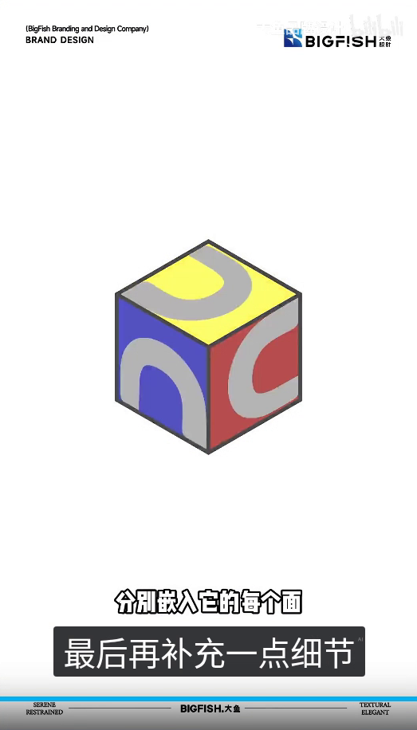

- **作者明确说法**：「分别嵌入它的每个面」
- **播放器字幕**：「最后再补充一点细节」
- **整理者观察**：上一帧 236.533 三枚 U 仍接近白色，黄蓝红色面仍饱和。这一帧三枚 U 已经改成中灰，黄、蓝、红三面同时开始变淡。白 U 改深和色面退去这两个变化在这一步同时出现；236.533 到 236.667 之间有约 0.13s 空隙，看不出哪一项更早。棱线还在。同帧播放器字幕已经换成「最后再补充一点细节」，片内还停在上一句。

### U9 · 三枚 U 改成灰黑，色面继续变淡

约 44s（录屏 236.800s）

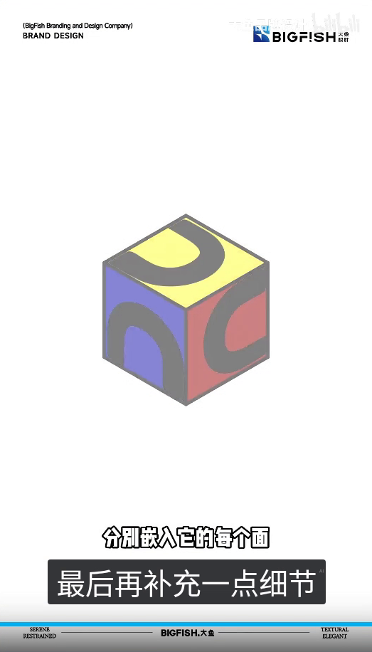

- **作者明确说法**：「分别嵌入它的每个面」
- **播放器字幕**：「最后再补充一点细节」
- **整理者观察**：三个面上的 U 已经从中灰再变成灰黑色，黄、蓝、红三面比上一帧更淡。棱线还在。这不是只撤掉颜色、U 仍保持白色。同帧播放器字幕仍是「最后再补充一点细节」，片内还停在上一句。

### U10 · 白底净标：等轴立方，三面黑 U，棱线仍在

约 44s（录屏 237.133s）

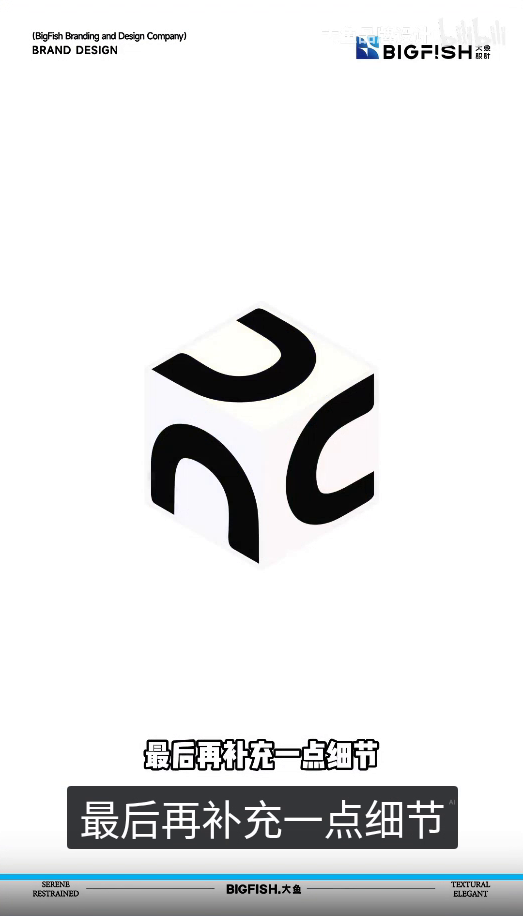

- **作者明确说法**：「最后再补充一点细节」
- **整理者观察**：颜色已经撤掉。白底上仍是等轴立方，顶、左、右三面各有一枚黑色 U，面与面之间的浅色棱线还在。白底让立方体的三个面和纸同色，棱线仍然可以看见。

### U11 · 用到深色体素块照片上，UEAT LICSK

约 46s（录屏 241.400s）

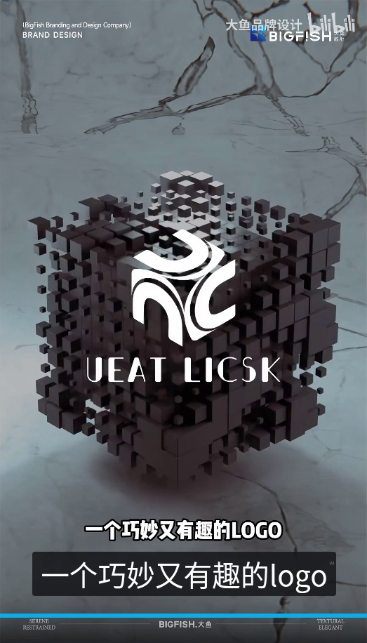

- **作者明确说法**：「一个巧妙又有趣的LOGO」
- **播放器字幕**：「一个巧妙又有趣的logo」
- **整理者观察**：浅色的三面 U 用到一张深色体素块的照片上，结构与白底净标相同。下方是一行宽距无衬线全大写，两词之间有空格：UEAT LICSK，从左到右是 U、E、A、T，空一格，L、I、C、S、K。播放器字幕里的 logo 是小写。239.800 起已经换上这张应用照片，当时片内就是这一句。243.200 一带片内换成「还不是手拿把掐」。

### 思路与前后关系（整理者分析，非作者原话）

先放出实物魔方，再收成只看见黄顶、蓝左、红右的三面立方。一枚很大的白色 U 先覆在前缘，再扭到各个面上，收成看得见的三个面上各有一枚 U，棱上留着浅缝；白 U 改深、色面退去以后，白底上仍是这个等轴立方和三面黑 U。最后把浅色的同一形态用到深色体素块照片上，字标写成 UEAT LICSK。整理者分析：收成净标以后，立方仍保持原来的三面方向，每个面上重复同一枚 U。

---

## 收束：三行回顾

约 49s（录屏 247.200s）

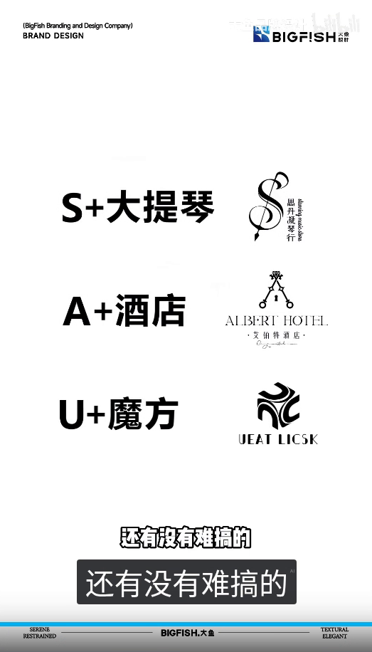

- **作者明确说法**：「还有没有难搞的」
- **整理者观察**：白底上是三行回顾，没有片头 DC 那一案。第一行是「S+大提琴」，右侧是带穿线和下端楔尖的 S，以及思丹凝琴行／stunning music store；第二行是「A+酒店」，右侧是双钥匙 A，以及 ALBERT HOTEL／艾铂特酒店；第三行是「U+魔方」，右侧是三面 U，以及 UEAT LICSK。247.800 起片内换成「别急 我会出手」，「急」和「我」之间有空档；同帧直到 248.600，播放器字幕只有「别急」，到 248.733 才换成「我会出手」。
