# [完美融合才是LOGO设计核心技巧](https://www.bilibili.com/video/BV1maHC6dEZY)｜大鱼品牌设计

## 案例一：钢笔尖 + 女性背影 / GIRLPENS

### GP1 · 钢笔尖和女性背影

约 0.95s（录屏 25.0s）

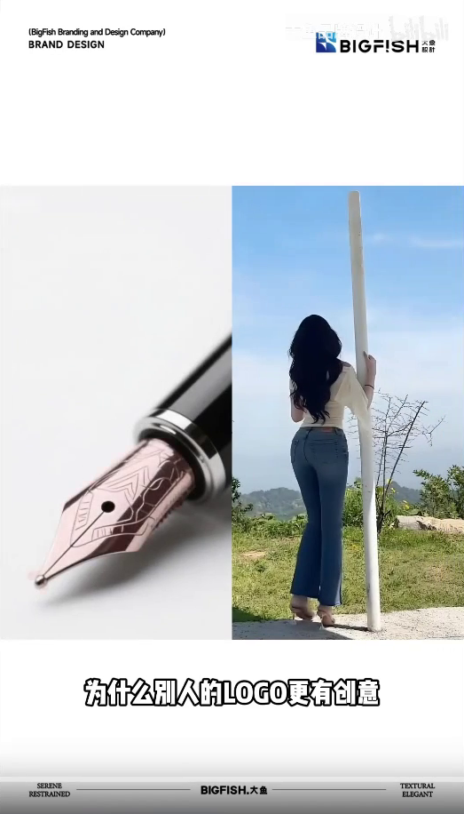

- **作者明确说法**：「为什么别人的LOGO更有创意」
- **整理者观察**：左右并置两张照片，中间没有叠在一起。左边是钢笔尖特写，能看见圆形气孔和中间的细缝；右边是一名女性的背影，穿着浅色短上衣和牛仔裤，手扶着一根白色竖杆，背景是户外风景。

### GP2 · 左侧开始提出笔尖形

约 1.75s（录屏 25.8s）

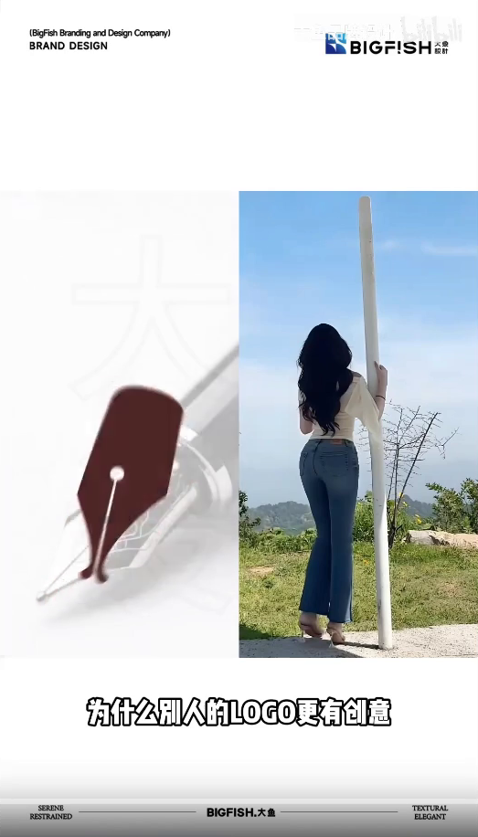

- **作者明确说法**：「为什么别人的LOGO更有创意」
- **整理者观察**：左侧钢笔照片明显变淡，笔尖被提成一块较平的深褐红色形，周围还看得出金属笔身的残影，圆形气孔还在。右侧女性背影照片没有跟着变。这些形还叠在照片上，没有脱离成独立标志。

### GP3 · 左侧换成黑钢笔尖

约 1.95s（录屏 26.0s）

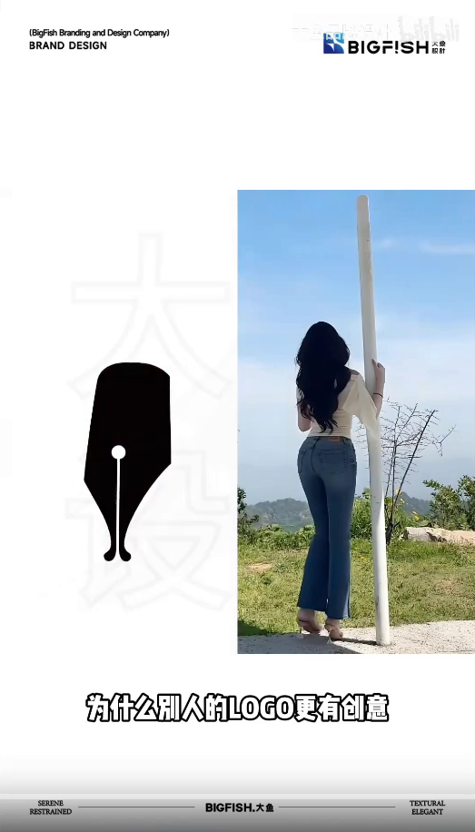

- **作者明确说法**：「为什么别人的LOGO更有创意」
- **整理者观察**：左侧已经是实心黑色钢笔尖剪影：白色圆形气孔、一条细白中缝、两瓣圆头。这时还没有人体的外廓，两瓣仍是笔尖。右侧女性照片仍在。

### GP4 · 已有人体外廓，气孔还是圆的

约 2.95s（录屏 27.0s）

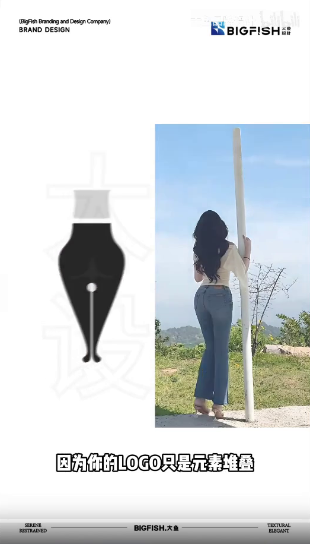

- **作者明确说法**：「因为你的LOGO只是元素堆叠」
- **整理者观察**：这枚笔尖在这一帧已经长出人体外廓。上半是浅灰色的肩胸，和黑色下身之间有一条横向白缝；下身已有髋臀的曲线，两瓣尖端向外撇成脚的样子。气孔仍是圆孔，还没有改成星形。右侧女性照片还在。

### GP5 · 气孔改成星形，照片淡出

约 3.15s（录屏 27.2s）

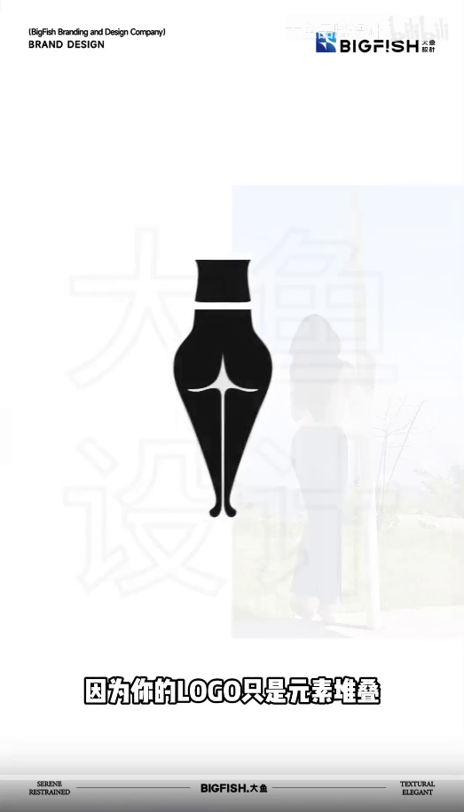

- **作者明确说法**：「因为你的LOGO只是元素堆叠」
- **整理者观察**：上身改成黑色，横向白缝还在；原来的圆气孔改成星形白负形。髋臀和双脚在上一帧已经有了，不是这一帧才长出来。右侧女性照片正在变淡。

### GP6 · 照片退去，黑标稳态

约 3.55s（录屏 27.6s）

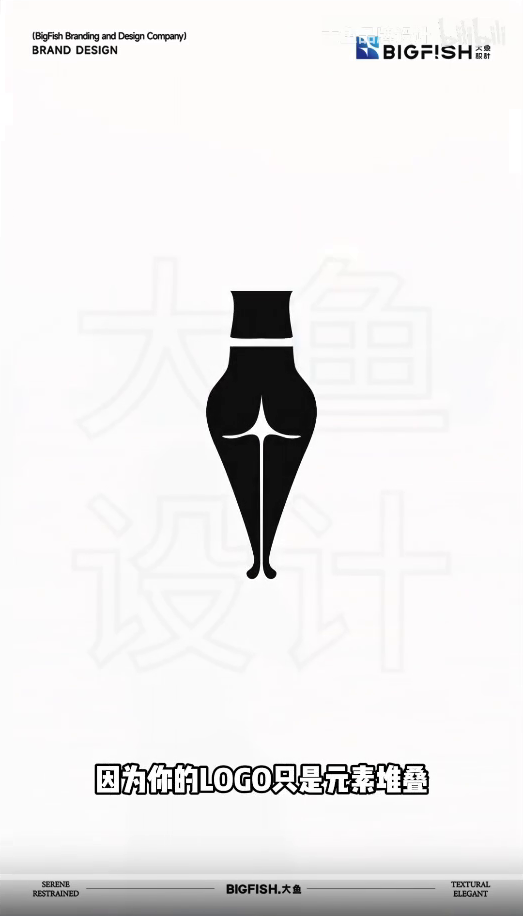

- **作者明确说法**：「因为你的LOGO只是元素堆叠」
- **整理者观察**：照片已经退去，白底上只剩同一枚黑标。结构与上一帧基本相同：黑上身、横白缝、星形负形、髋臀和双脚。这是这一案线标的黑色完成态。

### GP7 · 用到日落照片上，GIRLPENS

约 3.95s（录屏 28.0s）

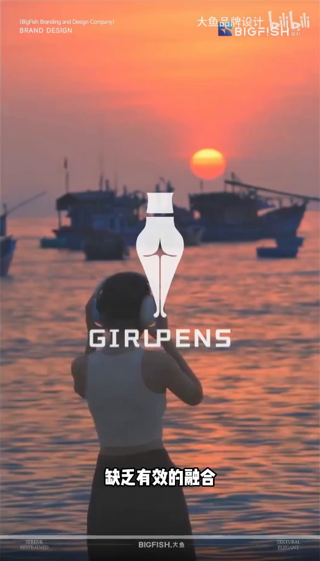

- **作者明确说法**：「缺乏有效的融合」
- **整理者观察**：同一件标志反白，平面叠在日落水面照片上，能看见太阳、船，以及戴着耳机的女性背影，是平面叠加。字标为 GIRLPENS，GIRL 和 PENS 连写成一词。这是同一枚「笔尖 + 女性背影」标用在照片上。

### 思路与前后关系（整理者分析，非作者原话）

钢笔尖和女性背影被收成同一件图形：上身既是笔身也是人的躯干，星形负形既是气孔也像臀缝，两瓣笔尖同时读成双腿。

---

## 案例二：scooter 字母 / 斯库特踏板车

### SC1 · 对话框

约 5.95s（录屏 30.0s）

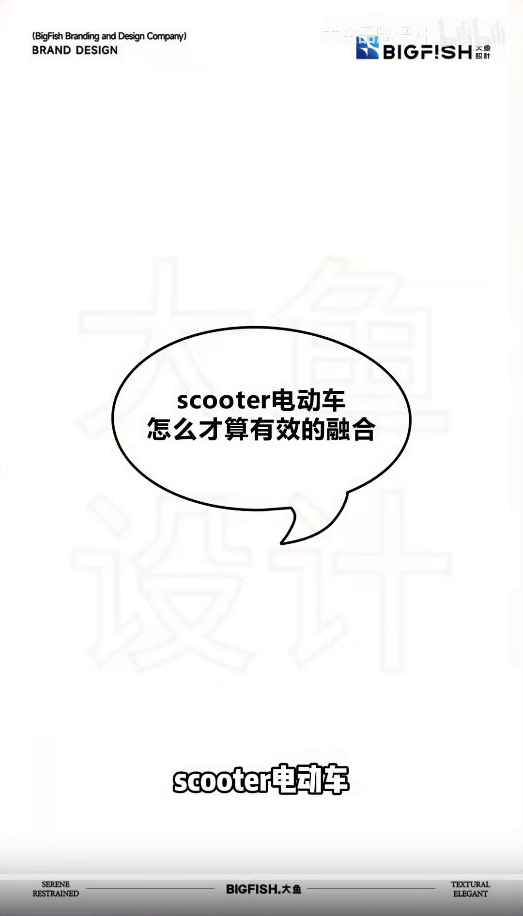

- **作者明确说法**：「scooter电动车」。同一画面上，气泡里写着「scooter电动车」「怎么才算有效的融合」。
- **整理者观察**：白底中央是一个线框气泡，下面另有一行描边字。

### SC2 · 插画和小写 scooter

约 8.95s（录屏 33.0s）

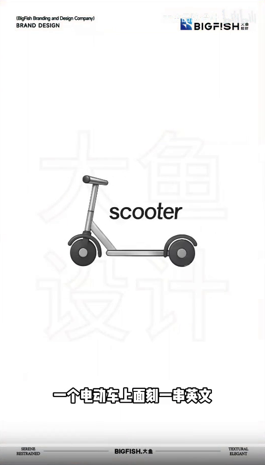

- **作者明确说法**：「一个电动车上面刻一串英文」
- **整理者观察**：左边是一辆灰色踏板车插画，右边是小写的 scooter，两者并排。这是作者用来说明元素堆叠的参考，不是后面那枚成标。

### SC3 · 换成大写 T 的 scooTer

约 12.35s（录屏 36.4s）

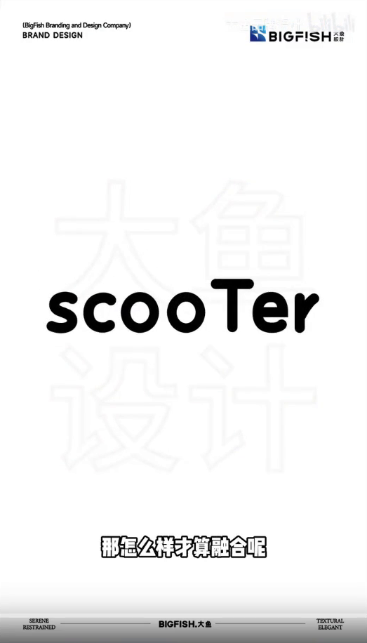

- **作者明确说法**：「那怎么样才算融合呢」
- **整理者观察**：插画已经消失，字标直接换成「scooTer」：T 是大写，有横画，比两边的字母更高。没有看到小写 t 逐渐长出横画的过程。全部仍是黑色。

### SC4 · 两个 o 改成珊瑚红

约 13.95s（录屏 38.0s）

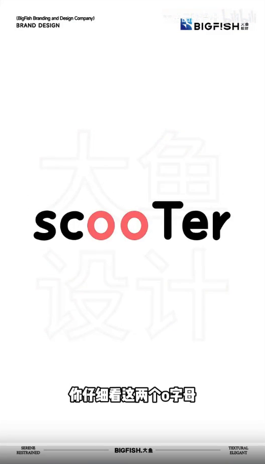

- **作者明确说法**：「你仔细看这两个o字母」。稍后同形未另附图时（约 14.95s，录屏 39.0s），片内改成「像不像两个轮子」。
- **整理者观察**：两个 o 改成珊瑚红，T 和其余字母仍是黑色。

### SC5 · 字母重新排列

约 16.95s（录屏 41.0s）

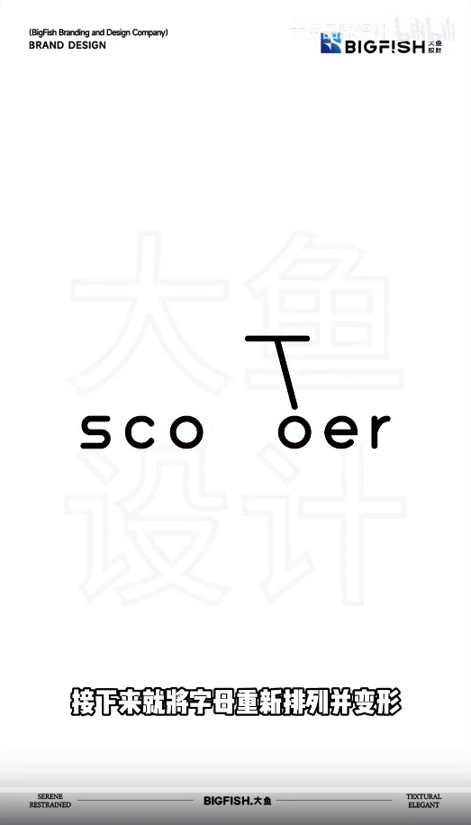

- **作者明确说法**：「接下来就將字母重新排列并变形」
- **整理者观察**：「sco」在左，「oer」在右，T 被抬到右边那个 o 的上方，竖画朝下，还没有和 o 相接。中间还没有水平的踏板线。

### SC6 · T 的竖画下端起钩

约 18.15s（录屏 42.2s）

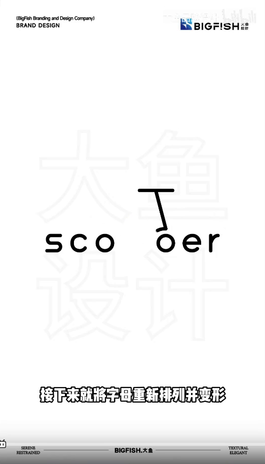

- **作者明确说法**：「接下来就將字母重新排列并变形」
- **整理者观察**：T 的竖画下端向右下方的 o 弯出一小钩，仍然没有水平横线。左边的 o 也还没有出钩。

### SC7 · 水平横线向左生长

约 18.35s（录屏 42.4s）

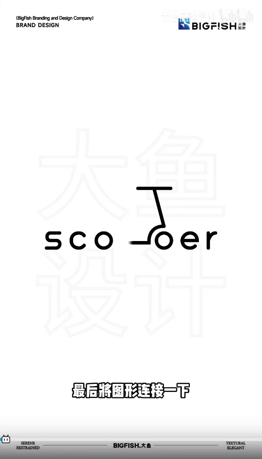

- **作者明确说法**：「最后將图形连接一下」
- **整理者观察**：一条水平横线从右边那个 o 的左侧向左生长，左端还比较虚，尚未接到「sco」的 o。T 的竖画已经弯进右 o 的左上；T 的横画仍留在上方，不是这条水平线搬下来的。原图里看不到某一笔原有笔画改位成这条横线，它是新出现的连接笔。

### SC8 · 连接成踏板车形

约 18.95s（录屏 43.0s）

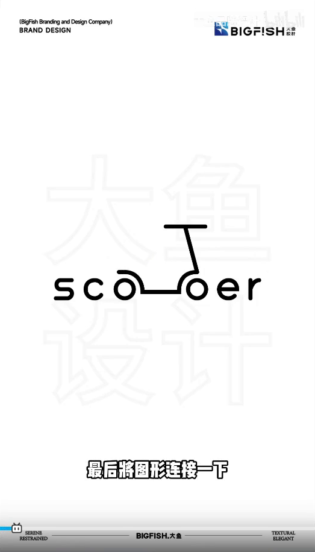

- **作者明确说法**：「最后將图形连接一下」
- **整理者观察**：左边 o 的右上伸出小钩，水平线已经接到右 o，成为踏板。T 的横画作车把，竖画作立管并弯进右 o，像前轮。这是这一案线标的完成态。

### SC9 · 用到廊道照片上，斯库特踏板车

约 19.95s（录屏 44.0s）

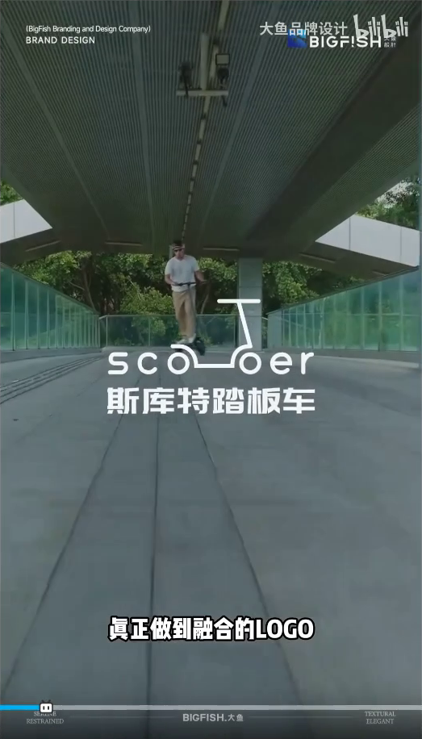

- **作者明确说法**：「眞正做到融合的LOGO」
- **整理者观察**：白色平面标下面写着「斯库特踏板车」，叠在廊道里骑滑板车的人物照片上，是平面叠加。

### SC10 · 用到侧面骑行照片上

约 21.95s（录屏 46.0s）

- **作者明确说法**：「是不是创意十足」
- **整理者观察**：同一件平面标叠到另一张侧面戴盔骑行的照片上，仍是平面叠加。

### 思路与前后关系（整理者分析，非作者原话）

两个 o 被看成轮子；字母重排之后，用一条新的水平连接笔把左右两轮连成踏板，T 的横画留在上方作车把，整词可以同时读成 scooter 和一辆踏板车。

---

## 案例三：R2 → r2 / R2 观察室

### R1 · 对话框

约 22.95s（录屏 47.0s）

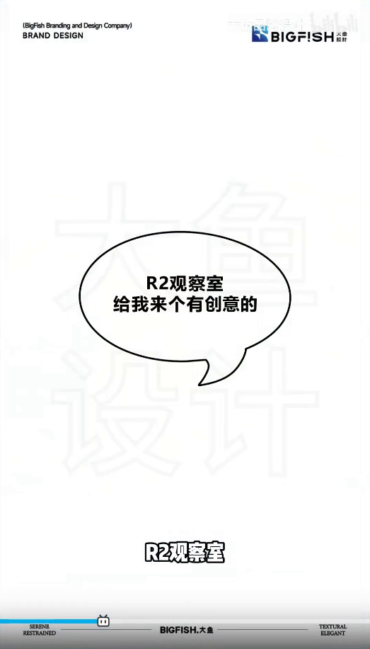

- **作者明确说法**：「R2观察室」。同一画面上，气泡里写着「R2观察室」「给我来个有创意的」。
- **整理者观察**：白底中央是一个线框气泡，下面另有一行描边字。

### R2 · 字母 R 和数字 2

约 25.95s（录屏 50.0s）

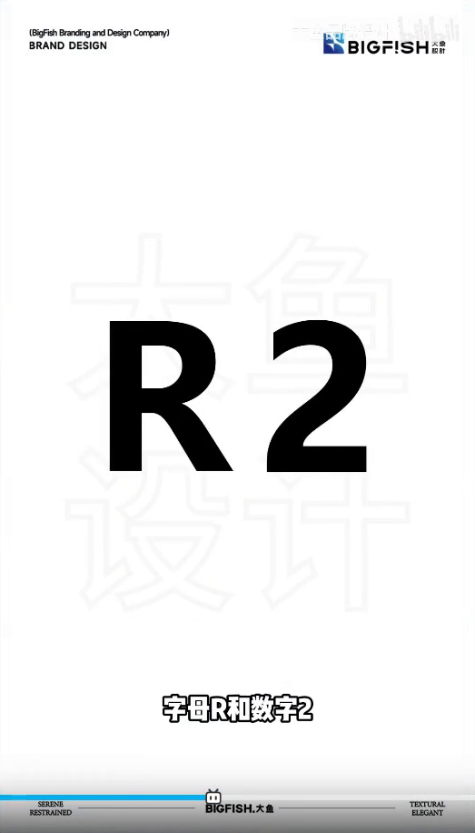

- **作者明确说法**：「字母R和数字2」
- **整理者观察**：粗无衬线的大写 R 和数字 2 左右并排。2 有弧顶和粗横底。这时没有显微镜。

### R3 · 改成小写 r2

约 26.95s（录屏 51.0s）

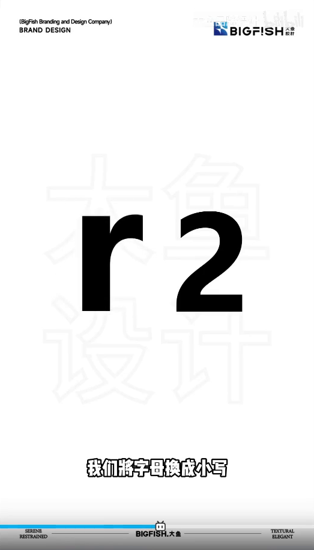

- **作者明确说法**：「我们將字母換成小写」
- **整理者观察**：改成小写 r 和数字 2。r 是粗竖笔加短耳，2 没有改。仍没有显微镜。

### R4 · 开始靠拢变形

约 28.10s（录屏 52.15s）

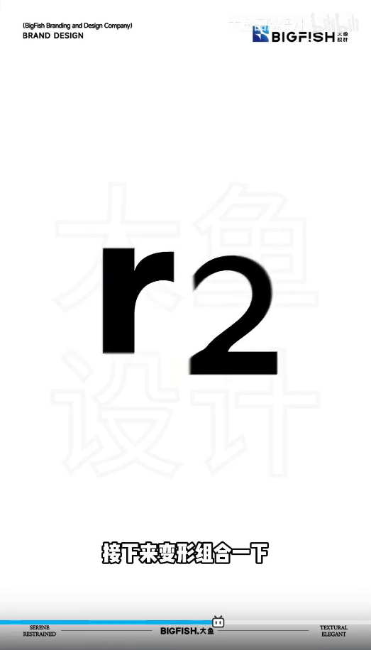

- **作者明确说法**：「接下来变形组合一下」
- **整理者观察**：r 和 2 正在靠拢。2 的上弧向左伸向 r 的耳，横底被拉长，还明显读得出两枚字符。这是变形中间态。此时仍没有显微镜。

### R5 · 细弧已出，内侧还留短钩

约 28.20s（录屏 52.25s）

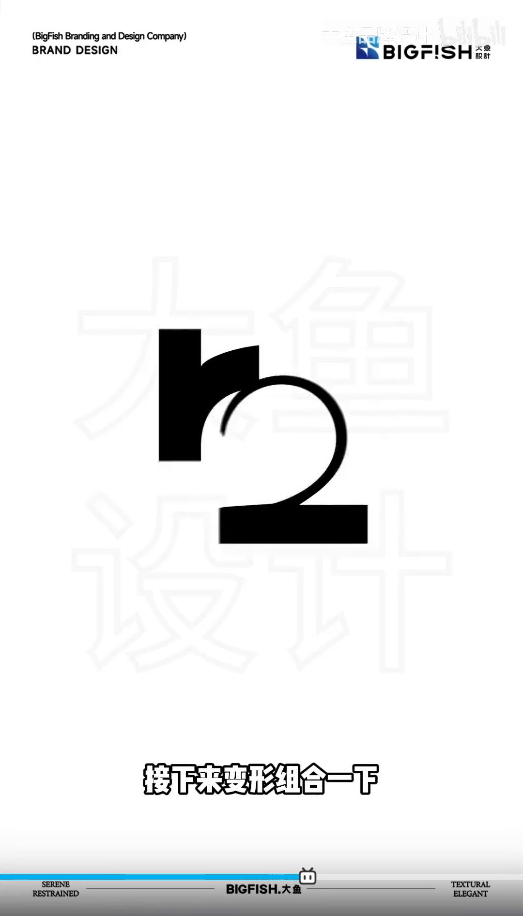

- **作者明确说法**：「接下来变形组合一下」
- **整理者观察**：已经接近完成形。左是 r 竖笔形成的块，耳连在右上；2 的上弧被拉成右侧一条细弧，下端接到横底，左侧是开口，弧的内侧还留着一小截短钩。r 竖笔和底横之间有白缝。仍没有显微镜。

### R6 · 组合标完成，还没有显微镜

约 28.35s（录屏 52.4s）

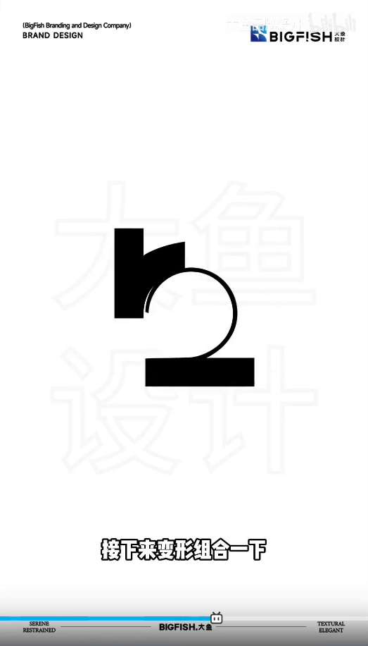

- **作者明确说法**：「接下来变形组合一下」
- **整理者观察**：内侧短钩已经收掉。右侧是 2 的上弧拉成的细的近半圆弧，上端接 r 的耳，下端接 2 的底横，左侧留白开口，不是闭合的圆环。左竖笔和底横不相接，中间有白缝。白底上还没有显微镜照片。这是组合完成后、对照之前的形态。

### R7 · 显微镜上叠上灰色映射

约 28.95s（录屏 53.0s）

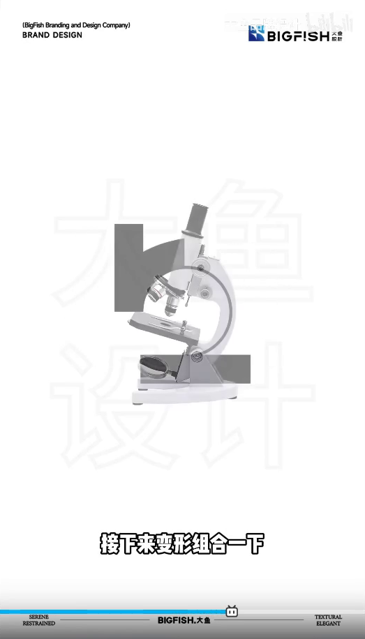

- **作者明确说法**：「接下来变形组合一下」
- **整理者观察**：写实的白色显微镜照片上，叠着灰色色块：左侧一块灰矩形盖在镜筒一带，右下方一条灰横条盖在底座位置。这是把刚完成的组合标映射到照片上的对照。显微镜参考出现在组合标完成之后。

### R8 · 撤去灰块

约 29.95s（录屏 54.0s）

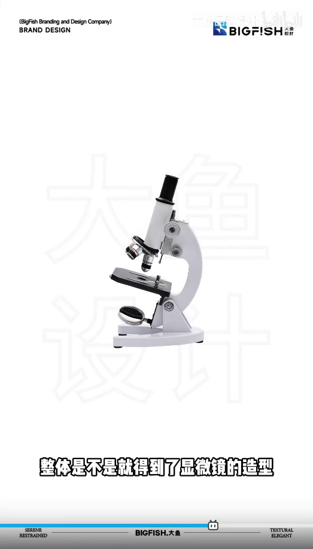

- **作者明确说法**：「整体是不是就得到了显微镜的造型」
- **整理者观察**：灰色色块撤去，只留下显微镜照片。这是对照用的参考，不是废案，也不是立体成标。

### R9 · 灰色映射再次叠上

约 30.95s（录屏 55.0s）

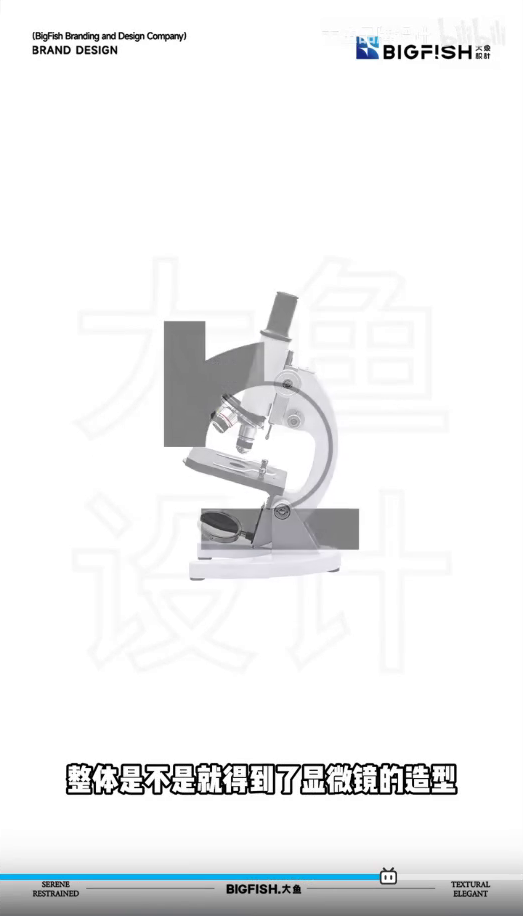

- **作者明确说法**：「整体是不是就得到了显微镜的造型」
- **整理者观察**：与 53.0s 相同的灰色映射再次叠到同一张显微镜照片上。这一步是映射对照的回返，不是新的变形。

### R10 · 回到黑标

约 31.95s（录屏 56.0s）

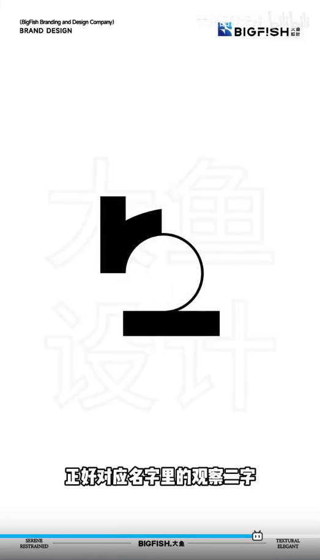

- **作者明确说法**：「正好对应名字里的观察二字」
- **整理者观察**：照片退去，回到白底上的黑组合标，结构与 52.4s 相同。左侧是 r 的竖笔，右上是短耳；中部不是闭合的圆环，而是 2 的上弧拉成的细的近半圆弧，上端接 r 的耳，下端接底横，左侧留白开口。左竖笔和底横之间有白缝。这是对照结束后回到的成标。

### R11 · 用到深色底上，R2 观察室

约 33.95s（录屏 58.0s）

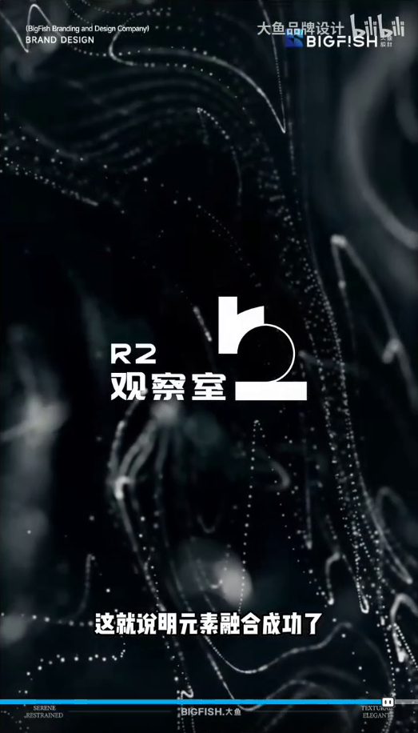

- **作者明确说法**：「这就说明元素融合成功了」
- **整理者观察**：白色平面标旁边的字标是首行「R2」、次行「观察室」，叠在深色抽象底上，是平面叠加。

### 思路与前后关系（整理者分析，非作者原话）

先把 R 换成小写 r，再把 r 的竖笔、短耳和数字 2 的上弧、横底收成一枚左侧开口的组合标，然后才用显微镜照片做映射对照。细弧、竖笔和底横可以同时读成 r2 和显微镜的侧影。

---

## 案例四：东字 + 芭蕉扇 / 东家古玩

### D1 · 对话框

约 36.95s（录屏 61.0s）

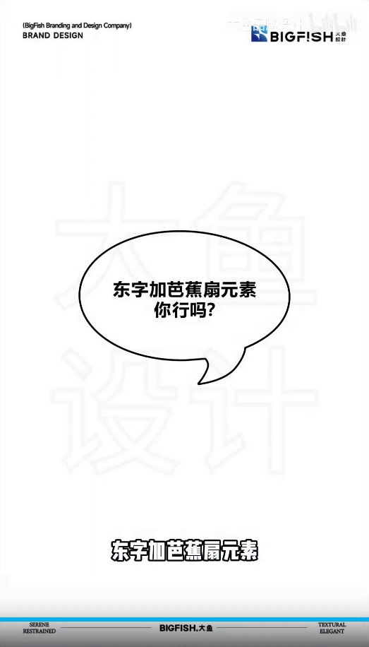

- **作者明确说法**：「东字加芭蕉扇元素」。同一画面上，气泡里写着「东字加芭蕉扇元素」「你行吗?」。
- **整理者观察**：白底中央是一个线框气泡，下面另有一行描边字。

### D2 · 简体「东」和芭蕉扇

约 38.95s（录屏 63.0s）

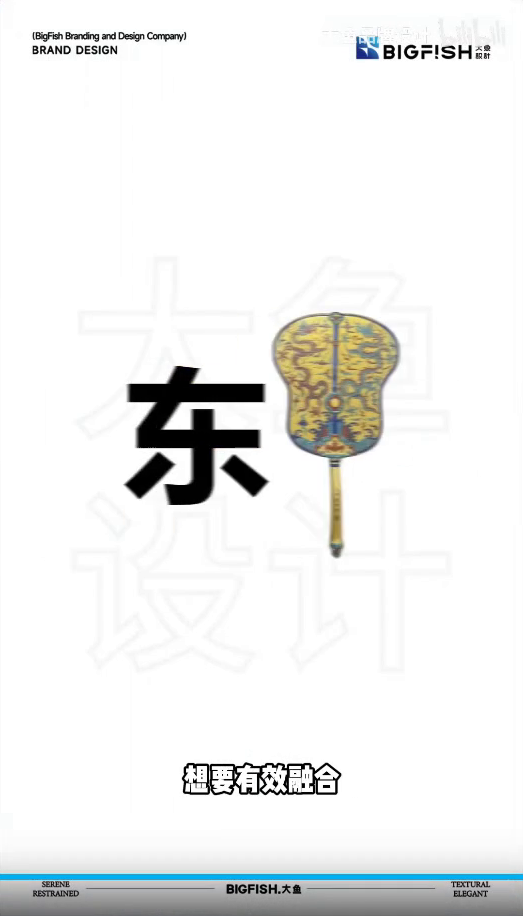

- **作者明确说法**：「想要有效融合」
- **整理者观察**：左边是简体「东」，右边是绘龙金面的芭蕉扇照片，柄朝下。两者分开，还没有叠上。

### D3 · 找共同点

约 40.95s（录屏 65.0s）

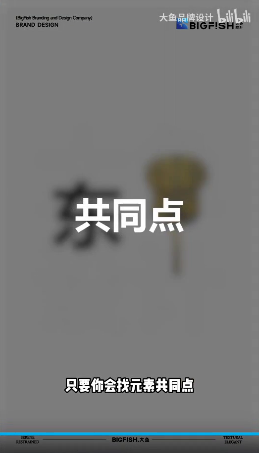

- **作者明确说法**：「只要你会找元素共同点」
- **整理者观察**：画面蒙上灰幕，原来的「东」和扇都变淡，正中出现大字「共同点」。

### D4 · 换成繁体「東」，仍分开

约 42.95s（录屏 67.0s）

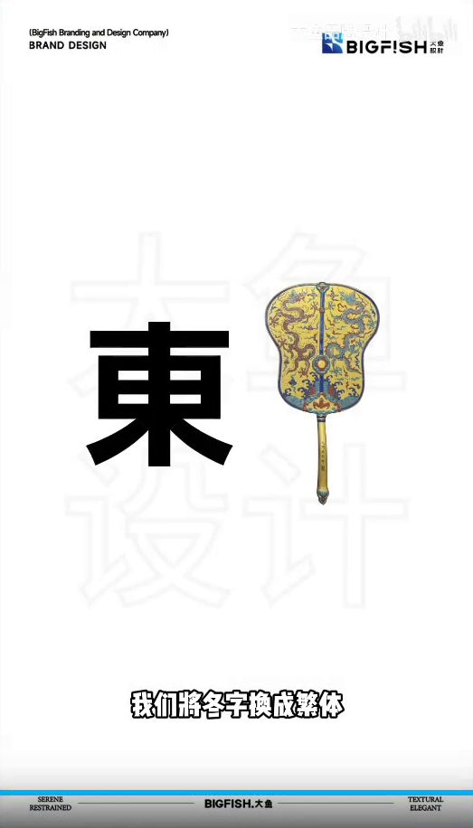

- **作者明确说法**：片内作「我们將…字換成繁体」；「將」和「字」之间那一字字幕特写仍不能确定，待核。
- **整理者观察**：左边换成繁体「東」，中间能看见「日」，右边扇还在。两者仍分开，还没有收到扇廊里。

### D5 · 对照结构

约 44.95s（录屏 69.0s）

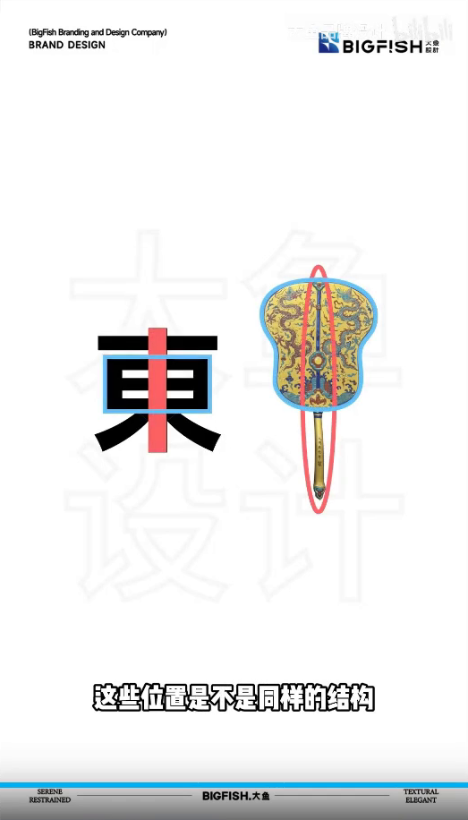

- **作者明确说法**：「这些位置是不是同样的结构」
- **整理者观察**：「東」的中轴覆着红竖条，中部「日」外有蓝框；扇面有蓝廊，柄和中轴有红椭圆。两者仍分开。

### D6 · 東开始收形，还是中态

约 46.35s（录屏 70.4s）

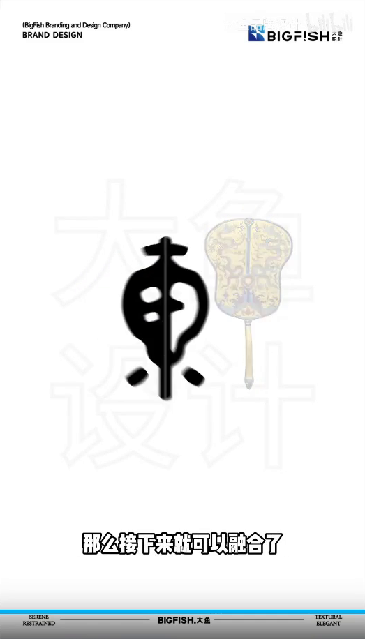

- **作者明确说法**：「那么接下来就可以融合了」
- **整理者观察**：这是中间态，不是完成形。「東」的外廓开始变圆、向扇面靠，但顶上仍是一笔长横，下面的撇、捺仍是两小段短斜笔，还没有收成顶上的三瓣结，柄的两侧也还没有圆点。右边的扇照片仍在。

### D7 · 收进扇廊，成标

约 46.95s（录屏 71.0s）

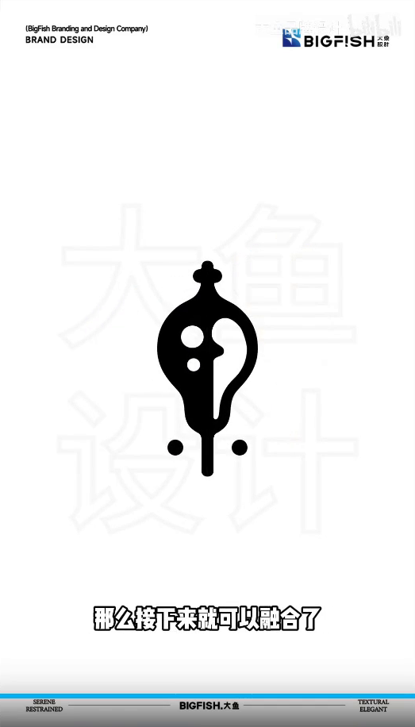

- **作者明确说法**：「那么接下来就可以融合了」
- **整理者观察**：完成态。外廓收成扇叶形，顶部是三瓣结，下方是柄，柄的左右各有一个圆点。扇面里用留白保留「東」的结构：左侧两个圆孔、中间竖缝、右侧大块弧形留白。扇照片已经退去。这是这一案线标的完成态。

### D8 · 用到山水照片上，东家古玩

约 47.95s（录屏 72.0s）

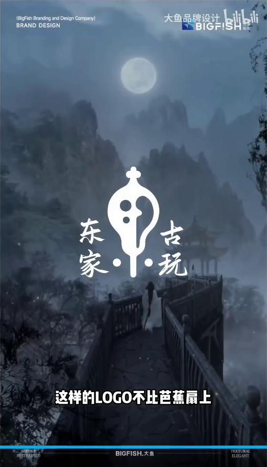

- **作者明确说法**：这一帧是「这样的LOGO不比芭蕉扇上」。稍后同画面镜头移动时（约 48.95s，录屏 73.0s），片内改成「写个冬字更有意思吗」。两句都按原字引用，不补后文。
- **整理者观察**：同一件标志反白，平面叠在月下山水栈道照片上，能看见白衣人物背影和亭台。字标左右分置：左为「东」「家」，右为「古」「玩」，柄的两侧是两点，读作「东家古玩」。这里用的是简体「东」，不是「東」。

### 思路与前后关系（整理者分析，非作者原话）

繁体「東」的中轴、中宫，和芭蕉扇的中轴、扇面被拿来对照；東收进扇廊之后，顶结、扇面和柄可以同时读成字和扇。用到照片上时，字标回到简体的「东家古玩」。

---

## 收束：三例并列

约 51.95s（录屏 76.0s）

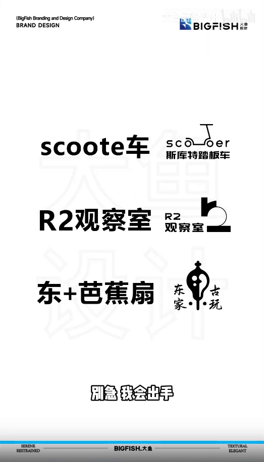

- **作者明确说法**：「别急 我会出手」
- **整理者观察**：白底三行并列，没有片头的 GIRLPENS。左侧写着「scoote车」、「R2观察室」、「东+芭蕉扇」；右侧各配对应的完成态标志和字标「斯库特踏板车」、「R2 观察室」、「东家·古玩」。
