# [只要学会这种方法，LOGO设计你就手拿把掐](https://www.bilibili.com/video/BV1neaG6nEzA/)｜大鱼品牌设计

文中「约 00:mm」是按播放器时钟校准的近似时刻，误差约 ±1s；括号内为录屏精确秒。

## 案例一：字母 H / SPECIAL HOUSE / 快乐小屋

### H1 · 原形：黑色无衬线 H

约 00:01（录屏 20.2s）

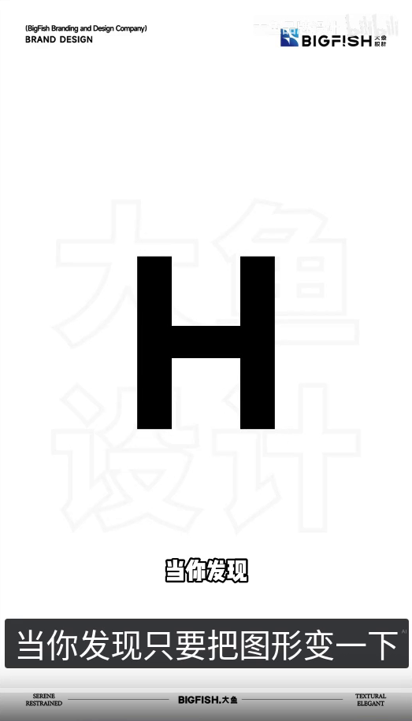

- **作者明确说法**：无对应解说
- **整理者观察**：白底中央是一枚很大的黑色无衬线 H，两端没有衬线，横笔是一条对齐的水平线，还没有改形，也没有颜色提示。

### H2 · 加上衬线，横笔仍对齐

约 00:02（录屏 21.0s）

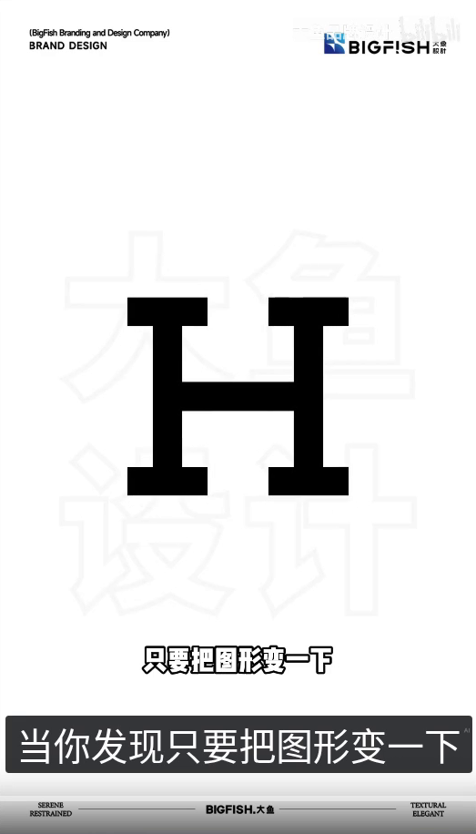

- **作者明确说法**：「只要把图形变一下」
- **整理者观察**：H 的上下两端已经加上衬线，仍是全黑。中间的横笔还是一条对齐的水平线，还没有错开。

### H3 · 横笔错开成台阶，空隙青色已极浅泛出

约 00:03（录屏 21.7s）

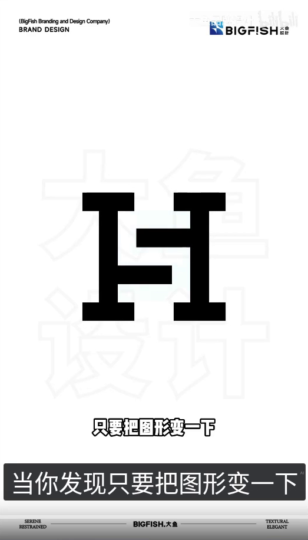

- **作者明确说法**：「只要把图形变一下」
- **整理者观察**：黑笔已经错开成台阶：左半段偏低，右半段偏高。空隙里已有极浅的青色泛出，还没有像下一帧那样转成鲜明的青色块。

### H4 · 青色填进空白

约 00:04（录屏 22.5s）

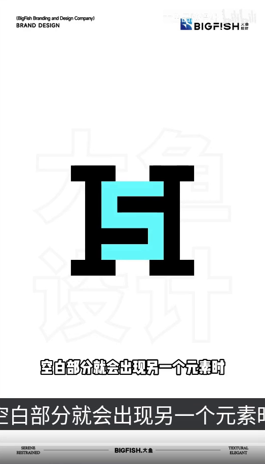

- **作者明确说法**：「空白部分就会出现另一个元素时」
- **整理者观察**：青色只填在两条竖笔和错开横笔围出的空白里，不是把整个 H 涂满。这块青色看起来像一个折返的 S，作者没有给它命名。

### H5 · 青色撤掉，留下错开的黑 H

约 00:05（录屏 23.6s）

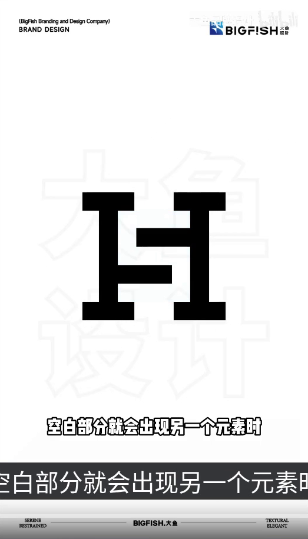

- **作者明确说法**：无对应解说
- **整理者观察**：青色已经撤尽，留下带衬线、横笔左低右高的黑色 H。这是这一案线标的黑色完成态。

### H6 · 用到麦田风车照片上，SPECIAL HOUSE / 快乐小屋

约 00:06（录屏 24.5s）

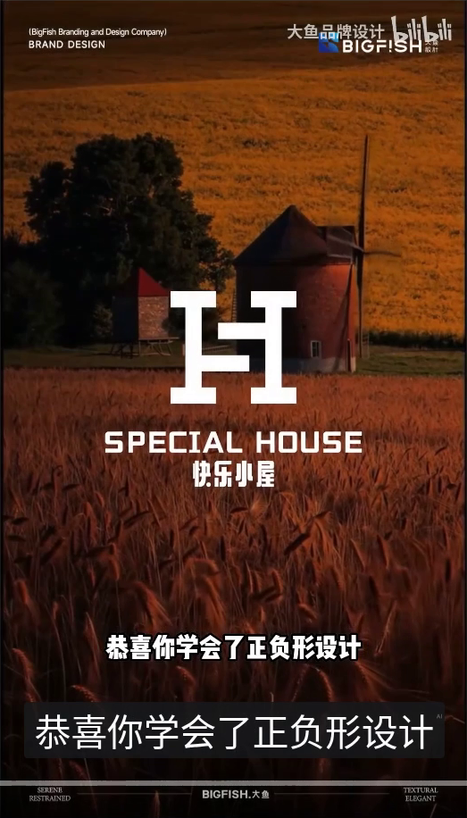

- **作者明确说法**：「恭喜你学会了正负形设计」
- **整理者观察**：同一件标志反白，平面叠在麦田和风车的照片上，不是立体模型。字标为「SPECIAL HOUSE」和「快乐小屋」。

### 思路与前后关系（整理者分析，非作者原话）

先给无衬线的黑色 H 加上衬线，再把横笔错开成左低右高的台阶；错开后的空隙里已有极浅的青色泛出，到下一帧才转成鲜明的青色填进空白，并不是把整个 H 涂满。青色撤掉后，留下带衬线、横笔错开的黑标。用到麦田风车照片上时，字标写成「SPECIAL HOUSE」和「快乐小屋」。

---

## 案例二：字母 G + 铅笔 / 几何文具 / GEOMETRY STATIONERY

### G1 · 对话框

约 00:09（录屏 28.0s）

- **作者明确说法**：「用字母G结合铅笔能怎么做」。同一画面上，气泡里写着「用字母G结合铅笔」「能怎么做?给点头绪吧」。
- **整理者观察**：白底中央是一个线框气泡，尾朝右下。

### G2 · 原形：黑色字母 G

约 00:11（录屏 30.2s）

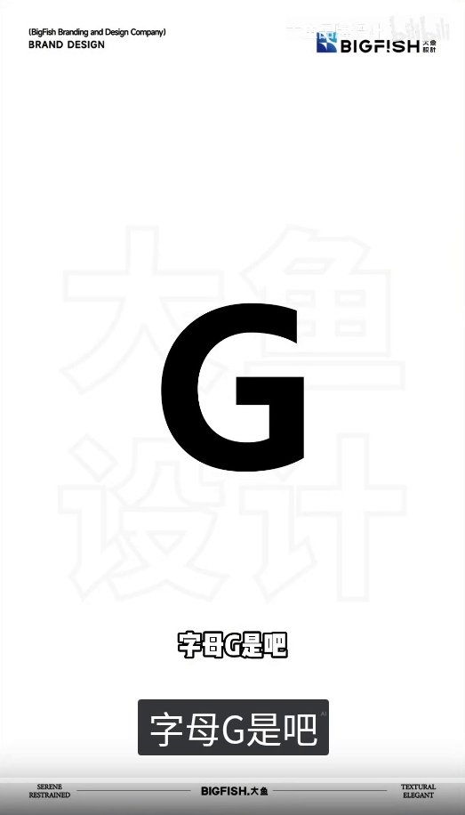

- **作者明确说法**：「字母G是吧」
- **整理者观察**：白底中央是一枚很大的黑色无衬线 G，开口和字怀都还在，旁边还没有铅笔。

### G3 · 右侧单独画出一支铅笔，笔尖朝下

约 00:12（录屏 31.1s）

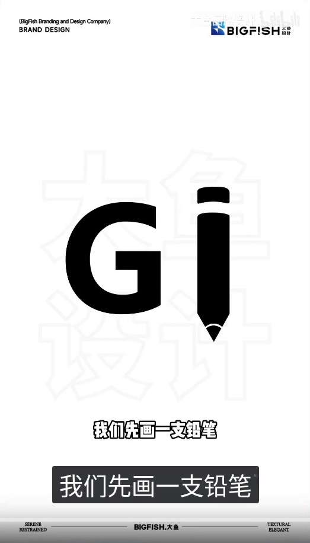

- **作者明确说法**：「我们先画一支铅笔」
- **整理者观察**：G 的右侧单独立着一支黑色铅笔，两者没有碰到。笔尖在下、朝下，锥面上有一块白高光；顶端是带一圈缝的圆形橡皮帽。

### G4 · 铅笔开始转色，并移向开口、倾斜

约 00:13（录屏 31.77s）

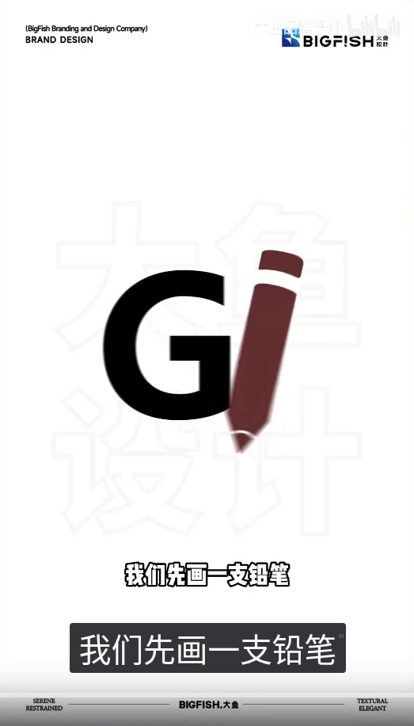

- **作者明确说法**：「我们先画一支铅笔」
- **整理者观察**：铅笔已经转成褐色，开始向 G 的开口靠近并倾斜。它并没有先以全黑、直立的样子完全进入开口，转色和位移是叠在一起发生的。

### G5 · 粉色铅笔倾斜叠在 G 上，笔尖朝左下

约 00:13（录屏 32.2s）

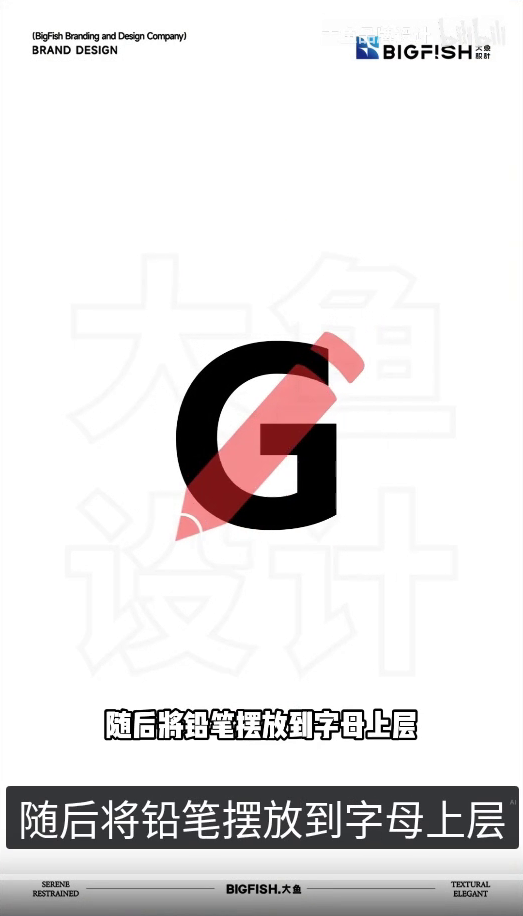

- **作者明确说法**：「随后將铅笔摆放到字母上层」
- **整理者观察**：铅笔已经变成粉红色，斜叠在 G 上层。倾斜之后，笔尖朝左下。这时的 G 仍是原来的字形，开口和字怀都还在。

### G6 · 原形 G 上叠着铅笔

约 00:15（录屏 34.0s）

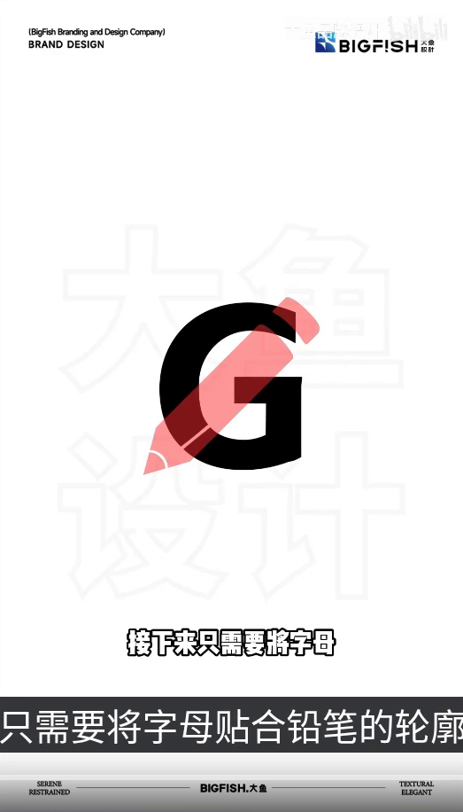

- **作者明确说法**：「接下来只需要將字母」
- **整理者观察**：铅笔已经摆稳，G 仍是原来的字形：开口和字怀都还清楚。贴合轮廓的变形还没有开始。

### G7 · 贴形开始

约 00:15（录屏 34.2s）

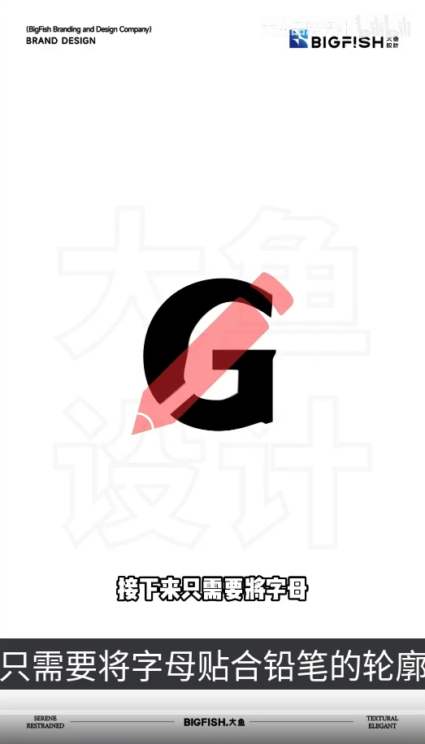

- **作者明确说法**：「接下来只需要將字母」
- **整理者观察**：G 开始贴着铅笔的轮廓变形，字怀正在收拢，右侧的短笔还没有收完。铅笔仍叠在上面，笔尖朝左下。

### G8 · 贴形中态：左半收成托住铅笔的钵

约 00:15（录屏 34.27s）

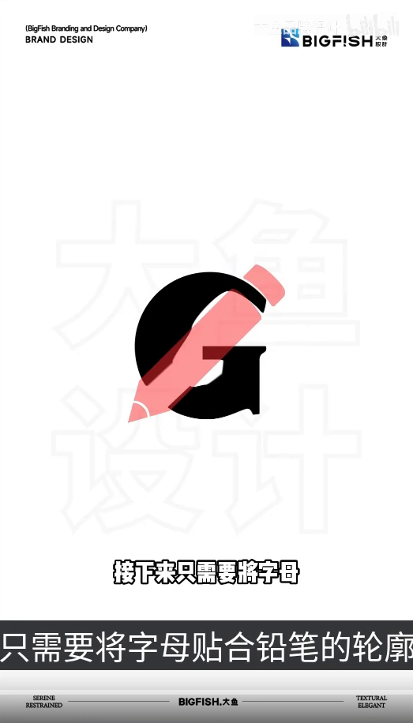

- **作者明确说法**：「接下来只需要將字母」
- **整理者观察**：左半已经收成托住铅笔的钵，原来的字怀正在合上；右侧短笔还明显露在外面，尚未收稳。

### G9 · 贴形中态：右侧短笔继续在收

约 00:15（录屏 34.33s）

- **作者明确说法**：「接下来只需要將字母」
- **整理者观察**：钵形更清楚了，右侧仍留着一截短笔，比前一帧短一些，还没有完全收成后来的稳态。

### G10 · 贴形稳住，铅笔还在上面

约 00:16（录屏 34.5s）

- **作者明确说法**：「接下来只需要將字母」
- **整理者观察**：G 已经贴着铅笔轮廓稳住：左半是托住笔身的钵，右下留着一截短笔。粉红色铅笔仍叠在上面，还没有撤。

### G11 · 铅笔正在撤掉

约 00:18（录屏 36.8s）

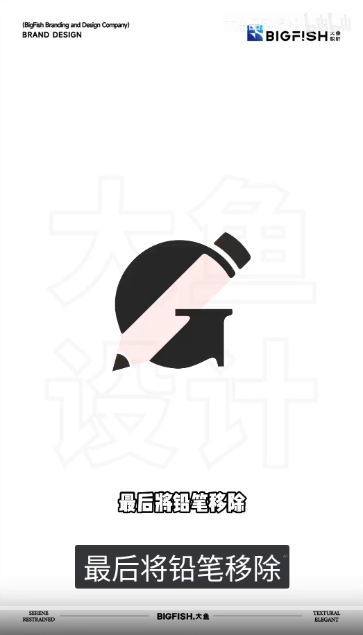

- **作者明确说法**：「最后將铅笔移除」
- **整理者观察**：粉红色的铅笔正在变淡、撤掉，下面已经露出沿笔身切开的白色负形。

### G12 · 成标：铅笔形白负形和分离的笔尖

约 00:18（录屏 37.2s）

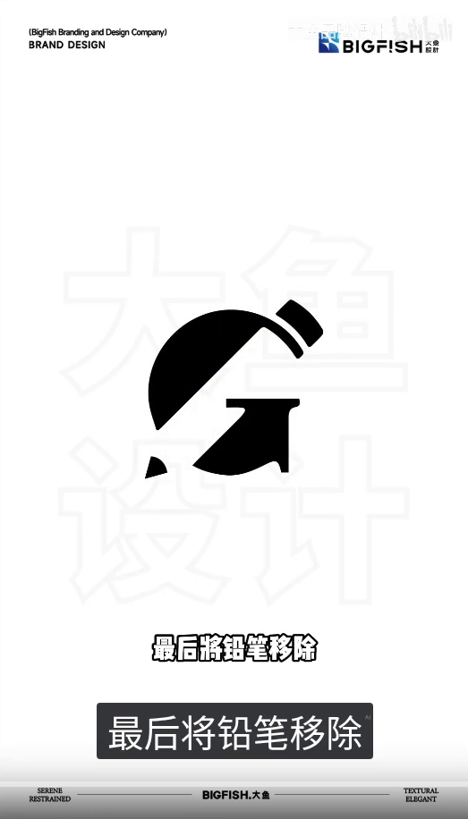

- **作者明确说法**：「最后將铅笔移除」
- **整理者观察**：铅笔已经撤尽。黑标被一道斜向的白色负形切开，形状像一支铅笔；左下另有一小块分离的黑色三角，是笔尖；右上是带一道白缝的橡皮帽。这是这一案线标的黑色完成态。

### G13 · 用到暗色铅笔照片上，几何文具 / GEOMETRY STATIONERY

约 00:20（录屏 38.8s）

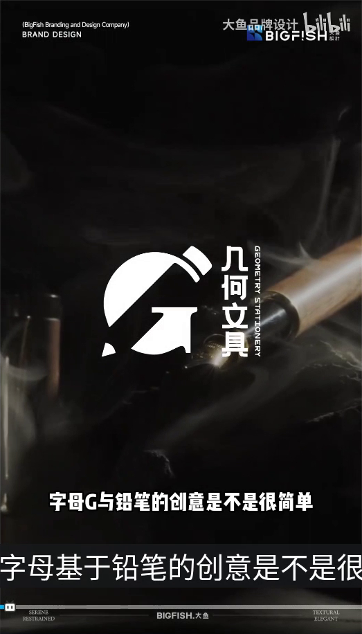

- **作者明确说法**：「字母G与铅笔的创意是不是很简单」
- **整理者观察**：同一件标志反白，平面叠在暗色铅笔和木杆的照片上。字标为竖排「几何文具」和竖排「GEOMETRY STATIONERY」。

### 思路与前后关系（整理者分析，非作者原话）

先在 G 右侧单独画出一支笔尖朝下的铅笔，两者还没有碰到。铅笔随后转成粉红色，边向开口移动边倾斜，叠到仍是原形的 G 上层，倾斜后笔尖朝左下。G 这时还没有改形；接着才贴着铅笔轮廓逐步收成钵形，笔仍叠在上面。铅笔撤掉后，黑标里留下铅笔形的白色负形，左下有一小块分离的黑色笔尖，右上是带白缝的橡皮帽。用到暗色铅笔照片上时，字标写成「几何文具」和「GEOMETRY STATIONERY」。

---

## 案例三：手 + 蜡烛 / 手 · 烛 · 光 / hand fire light

### HD1 · 对话框

约 00:23（录屏 41.8s）

- **作者明确说法**：「你到底行不行」。同一画面上，气泡里写着「手与蜡烛」「你到底行不行?」。
- **整理者观察**：白底中央是一个线框气泡，尾朝右下。

### HD2 · 线描：一只手托着蜡烛

约 00:25（录屏 43.8s）

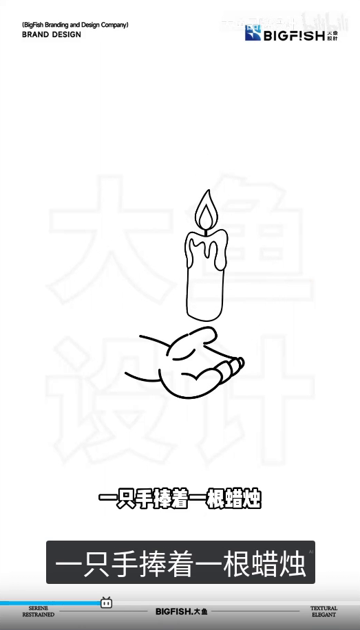

- **作者明确说法**：「一只手捧着一根蜡烛」
- **整理者观察**：白底上是线描，不是写实照片。一只手托在下面，上方是一根带火焰的蜡烛。

### HD3 · 这也太普通了

约 00:25（录屏 44.4s）

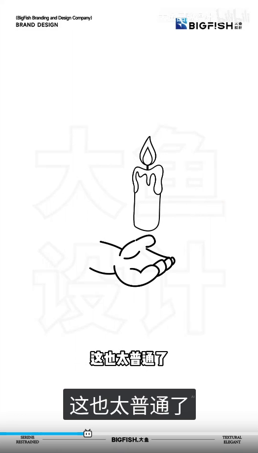

- **作者明确说法**：「这也太普通了」
- **整理者观察**：画面仍是刚才那幅线描，手和蜡烛都没有改成标志。

### HD4 · 换成无奈摊手，「这个眞不行」

约 00:27（录屏 45.6s）

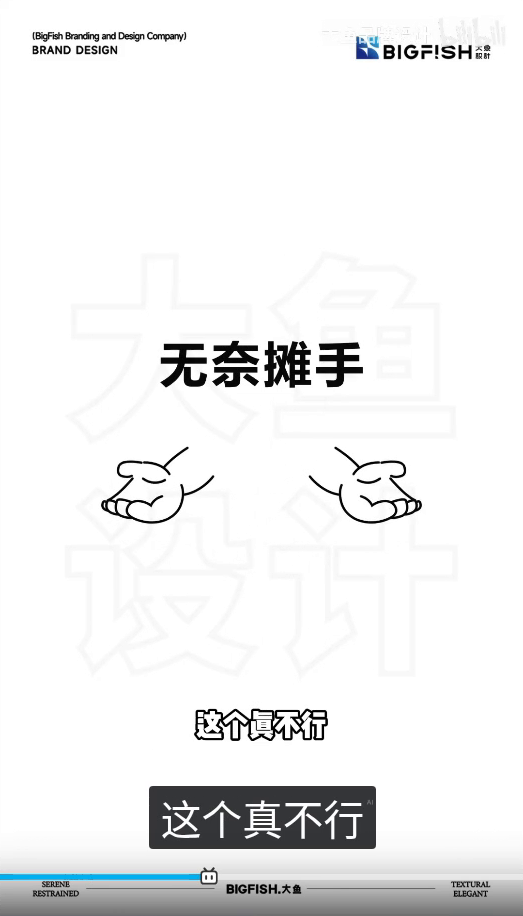

- **作者明确说法**：「这个眞不行」
- **整理者观察**：刚才那只托着蜡烛的手已经被换成左右两只线描摊手，画面上方出现标题「无奈摊手」。这是另起的一稿，不是把前一张线描改形。

### HD5 · 「抱歉了」

约 00:27（录屏 46.23s）

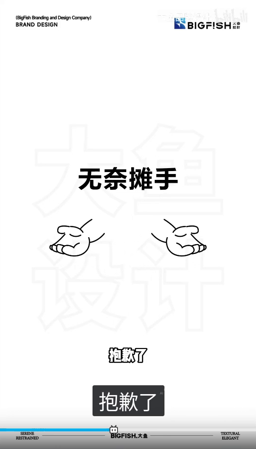

- **作者明确说法**：「抱歉了」
- **整理者观察**：画面仍是「无奈摊手」和左右两只线描摊手，还没有收拢，也还没有改成黑色剪影。

### HD6 · 「逗你呢」

约 00:28（录屏 47.03s）

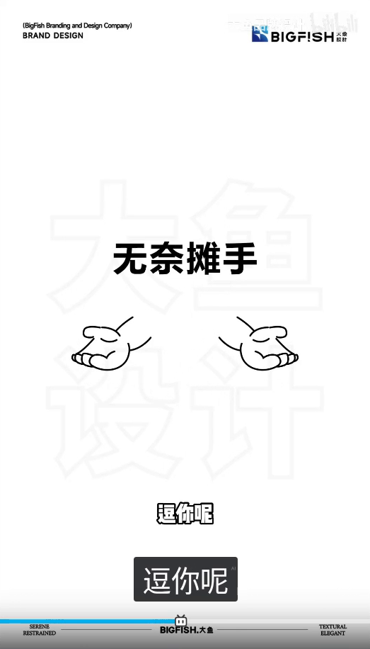

- **作者明确说法**：「逗你呢」
- **整理者观察**：画面几乎没有变化，仍是线描摊手和标题「无奈摊手」。

### HD7 · 收拢开始：仍是线描摊手

约 00:29（录屏 47.7s）

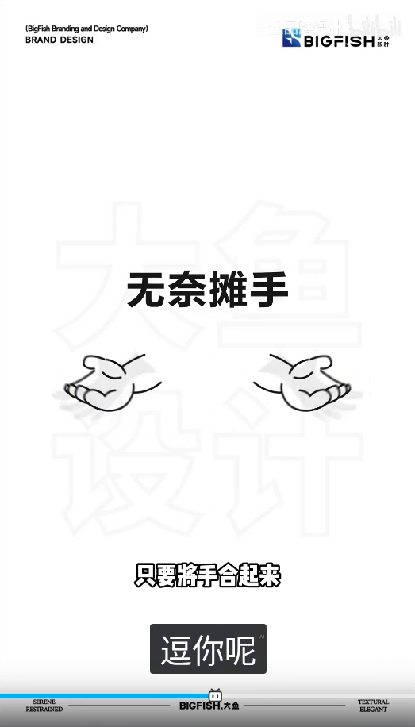

- **作者明确说法**：「只要將手合起来」
- **整理者观察**：片内已经说到把手合起来，但这一帧仍是线描摊手，标题「无奈摊手」还在，还没有改成黑色剪影。

### HD8 · 改成黑色剪影，两手仍分开

约 00:29（录屏 48.0s）

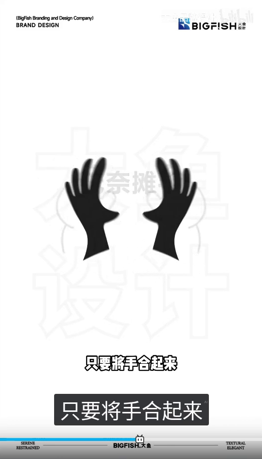

- **作者明确说法**：「只要將手合起来」
- **整理者观察**：两只手已经改成黑色剪影，指尖朝上，中间还隔着较宽的空隙。标题「无奈摊手」正在退去，只剩下残影。

### HD9 · 两只黑手靠拢

约 00:29（录屏 48.2s）

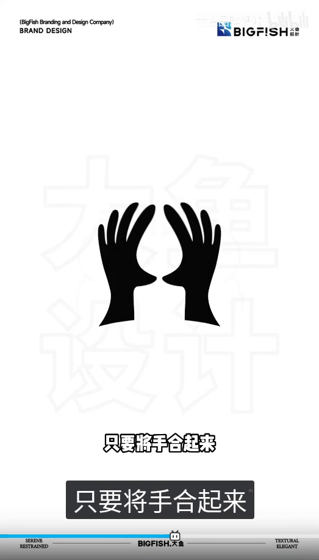

- **作者明确说法**：「只要將手合起来」
- **整理者观察**：两只黑色手剪影继续向中间靠拢，指尖朝上。中间已经留出蜡烛形的空白，还没有颜色提示。

### HD10 · 缝里出现粉红色提示

约 00:30（录屏 49.3s）

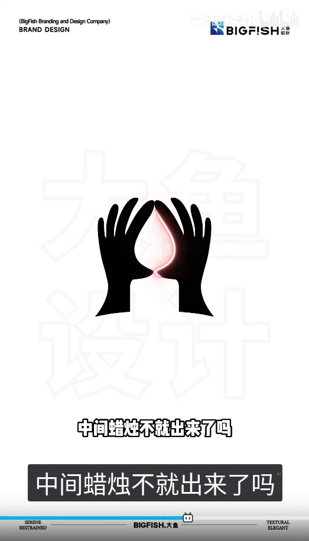

- **作者明确说法**：「中间蜡烛不就出来了吗」
- **整理者观察**：粉红色只出现在两手之间蜡烛形的缝里，并沿着缝的边缘发亮，不是把两只手填成粉红色。

### HD11 · 成标：撤掉粉色后的双手和蜡烛形留白

约 00:31（录屏 50.0s）

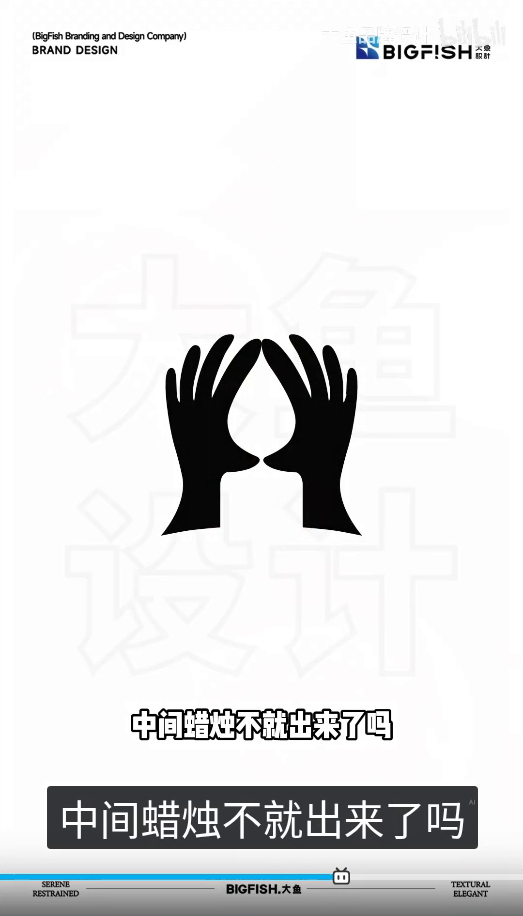

- **作者明确说法**：「中间蜡烛不就出来了吗」
- **整理者观察**：粉红色已经撤尽。两手食指尖在顶端最窄处贴上，中间没有一条贯通的白缝把两指分开；拇指与拇指之间则是很宽的留白开口，蜡烛形的空白从这里展开。这是这一案线标的黑色完成态。

### HD12 · 用到蜡烛照片上，手 · 烛 · 光 / hand fire light

约 00:32（录屏 51.2s）

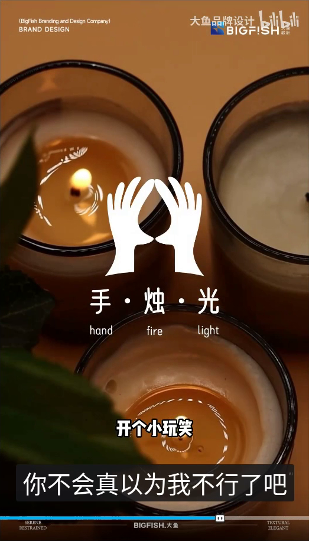

- **作者明确说法**：「开个小玩笑」
- **整理者观察**：同一件标志反白，平面叠在暖色蜡烛照片上。字标为「手 · 烛 · 光」，下面一行小写「hand fire light」。

### 思路与前后关系（整理者分析，非作者原话）

先给出一幅线描：一只手托着蜡烛。作者说「这也太普通了」之后，换成左右两只摊手，并配上标题「无奈摊手」，先后说「这个眞不行」「抱歉了」「逗你呢」。这是试做回退，不是把第一张线描改成标志。再说「只要將手合起来」时，线描摊手开始收拢，随即改成黑色剪影并向中间靠拢。两手之间的缝里闪过粉红色提示，颜色只在缝里，没有把两手填实；撤色后留下蜡烛形的白留白。食指尖在顶端最窄处贴上，拇指之间是大开口。用到蜡烛照片上时，字标写成「手 · 烛 · 光」和 hand / fire / light。

---

## 案例四：字母 S + 海马 / SWEET SEAHORSE

### S1 · 对话框

约 00:35（录屏 54.0s）

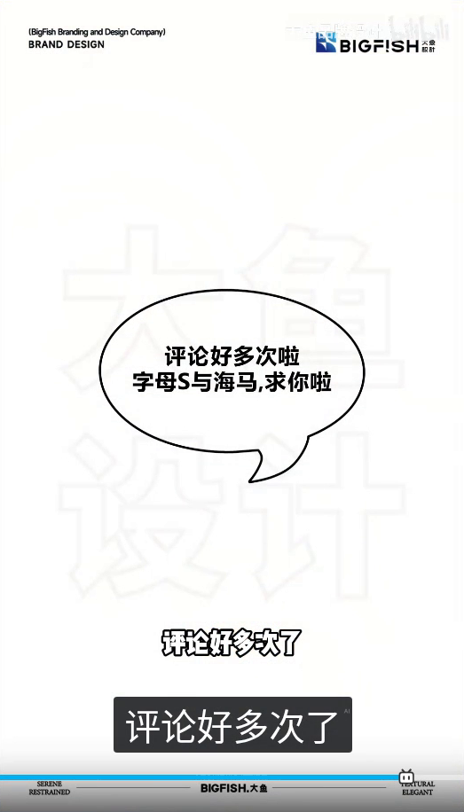

- **作者明确说法**：「评论好多次了」。同一画面上，气泡里写着「评论好多次啦」「字母S与海马,求你啦」。
- **整理者观察**：白底中央是一个线框气泡，尾朝右下。

### S2 · 海马原形，还没有箭头

约 00:39（录屏 57.5s）

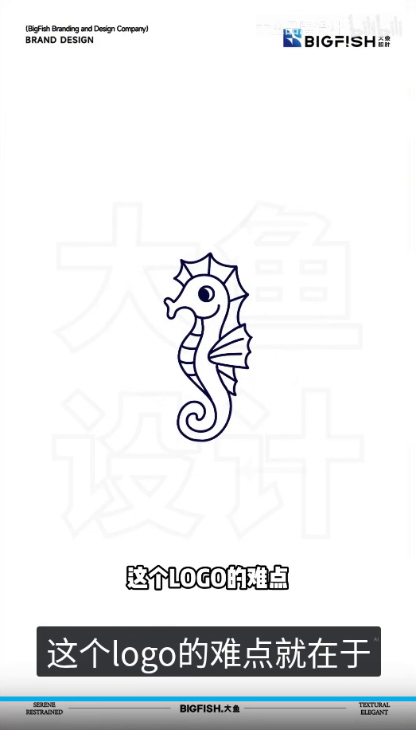

- **作者明确说法**：「这个LOGO的难点」
- **整理者观察**：白底中央是一只线描海马，不是照片。头和吻朝左，尾巴在下面卷着，画面上还没有箭头。

### S3 · 加上同方向箭头，都朝左

约 00:40（录屏 59.1s）

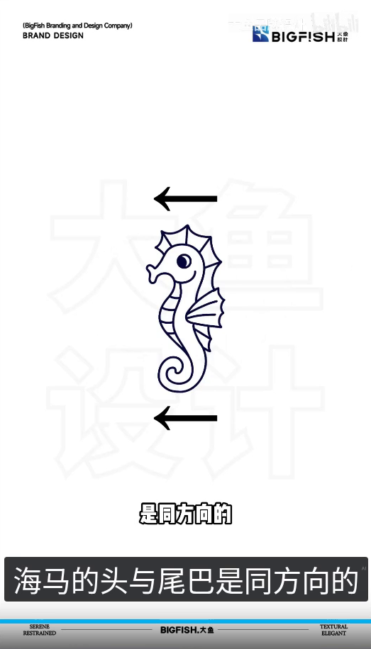

- **作者明确说法**：「是同方向的」
- **整理者观察**：海马上方和下方各出现一支黑色箭头，两支都朝左，标出头和尾巴是同一方向。

### S4 · 字母 S 出现：两端粉、中段黑

约 00:41（录屏 60.33s）

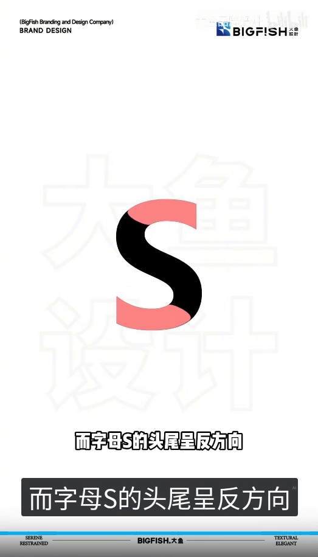

- **作者明确说法**：「而字母S的头尾呈反方向」
- **整理者观察**：字母 S 出现时已经是上端、下端粉红色，中段黑色，不是先出现一枚全黑的 S 再整体改色。这一帧还没有箭头。粉红色只在两端，不是把整个 S 填满。

### S5 · 加上反向箭头

约 00:42（录屏 61.0s）

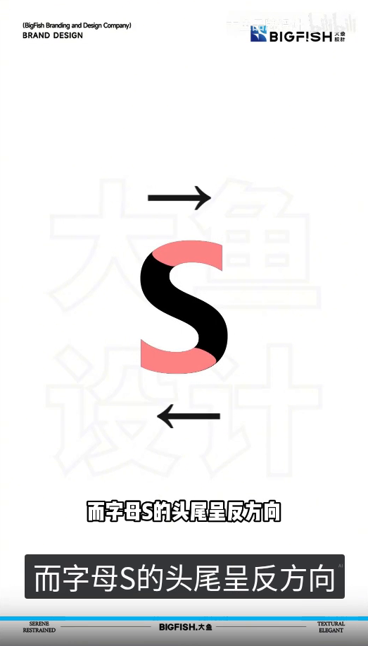

- **作者明确说法**：「而字母S的头尾呈反方向」
- **整理者观察**：S 仍是两端粉、中段黑。上方出现朝右的箭头，下方出现朝左的箭头，和海马那一对同向箭头相反。

### S6 · 粉端和箭头正在撤掉

约 00:44（录屏 63.2s）

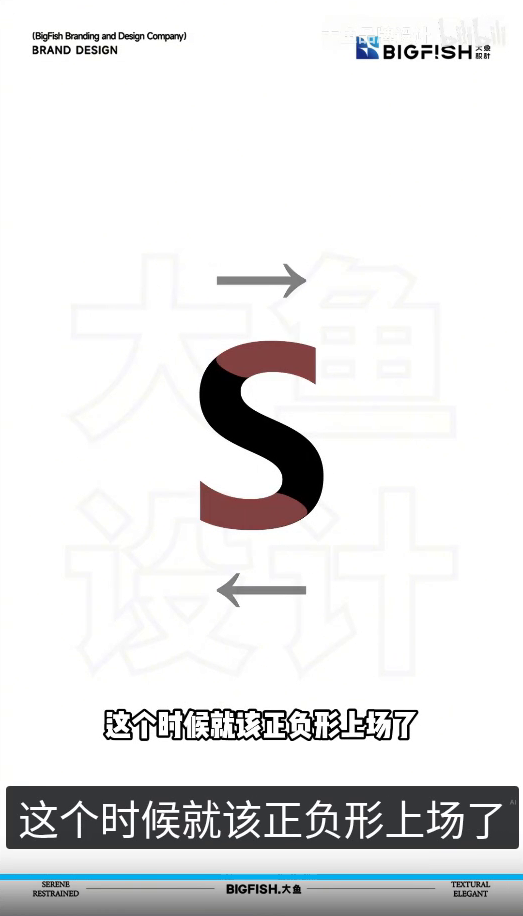

- **作者明确说法**：无对应解说
- **整理者观察**：两端的粉红色正在变暗，反向箭头同时变灰、退去。颜色撤回和后面的变形是分开的。

### S7 · 全黑的 S，还没有变形

约 00:46（录屏 65.0s）

- **作者明确说法**：「將字母S变形一下」
- **整理者观察**：粉端和箭头已经撤尽，留下一枚全黑的常规 S，上方还没有裁出白头，下方也还没有延长。

### S8 · 上方白头开始出现

约 00:46（录屏 65.3s）

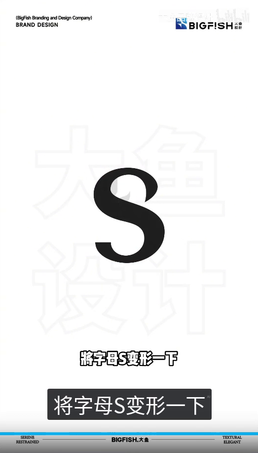

- **作者明确说法**：「將字母S变形一下」
- **整理者观察**：上方空白里开始出现浅浅的白色裁切，头部轮廓还不稳定，还没有看清吻的方向。

### S9 · 上方白头中态

约 00:46（录屏 65.4s）

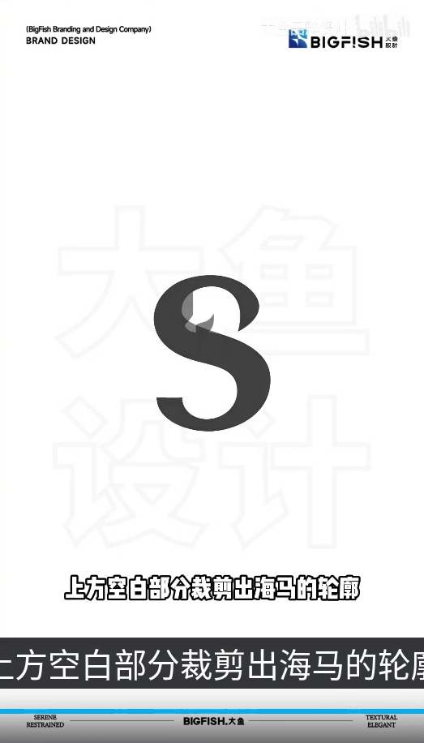

- **作者明确说法**：「上方空白部分裁剪出海马的轮廓」
- **整理者观察**：整字一度发灰，上方的白色头部正在显现，轮廓还没有完全稳住。

### S10 · 上方白头稳住：吻朝左，黑翘尖嵌入白头

约 00:47（录屏 65.8s）

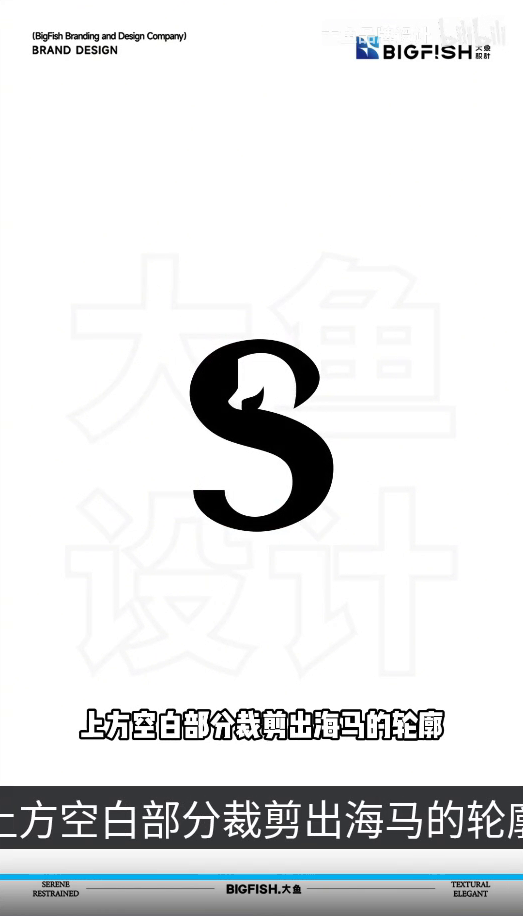

- **作者明确说法**：「上方空白部分裁剪出海马的轮廓」
- **整理者观察**：上方的白色负形已经稳住，是海马的头，吻明显朝左，不是朝右。中段上沿伸出一小截黑色翘尖，嵌入白头里面。下方笔画这时还没有延长。

### S11 · 下方笔画开始延长

约 00:49（录屏 67.73s）

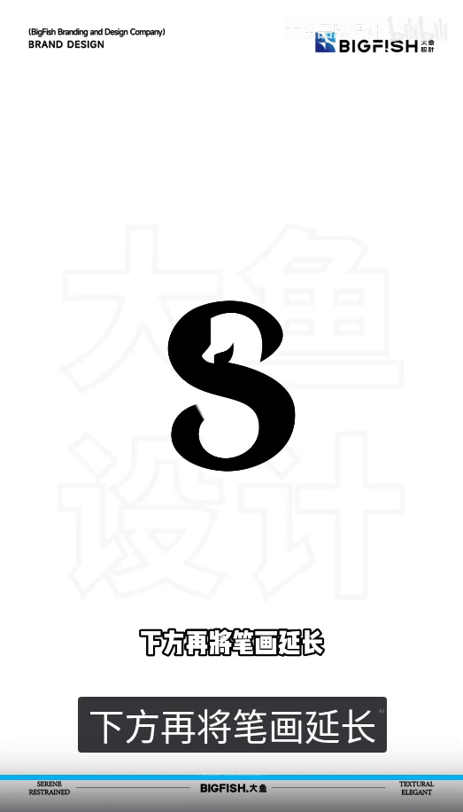

- **作者明确说法**：「下方再將笔画延长」
- **整理者观察**：上方的白头和黑色翘尖已经稳住。下方的黑色笔画开始延长，还没有卷成螺旋。

### S12 · 下方卷成螺旋

约 00:49（录屏 68.2s）

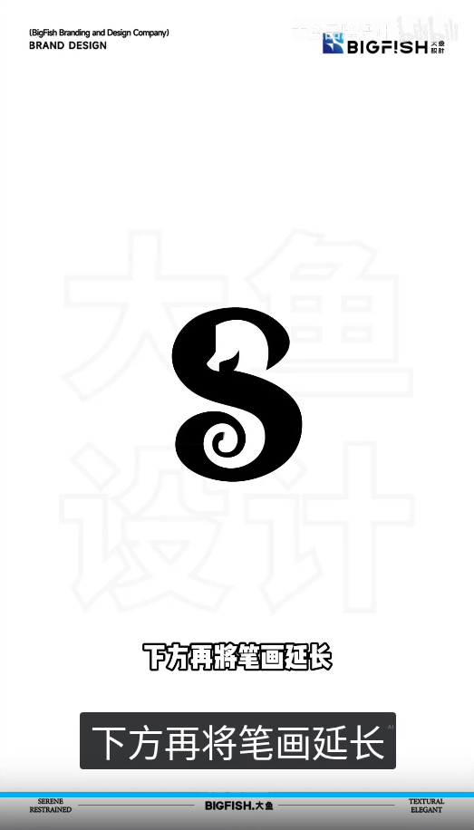

- **作者明确说法**：「下方再將笔画延长」
- **整理者观察**：下方延长出去的黑笔已经卷成螺旋，螺旋中心留着白色。上方仍是朝左的白头和嵌入其中的黑色翘尖。

### S13 · 成标：白头左吻与下端螺旋

约 00:50（录屏 68.8s）

- **作者明确说法**：「下方再將笔画延长」
- **整理者观察**：下端螺旋已经稳住，中心是白色。上方白色负形仍是吻朝左的海马头，黑色小翘尖嵌入白头。这是这一案线标的黑色完成态。

### S14 · 用到海马与珊瑚照片上，SWEET SEAHORSE

约 00:51（录屏 70.0s）

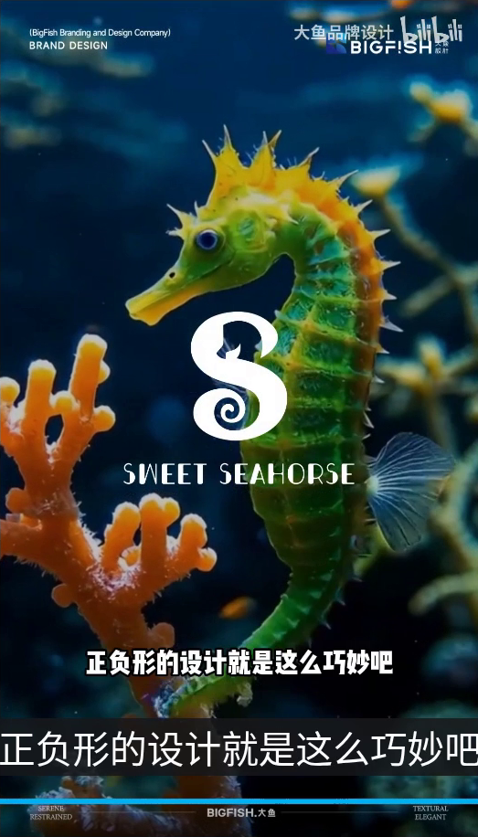

- **作者明确说法**：「正负形的设计就是这么巧妙吧」
- **整理者观察**：同一件标志反白，平面叠在彩色海马和珊瑚的照片上。字标为「SWEET SEAHORSE」。

### 思路与前后关系（整理者分析，非作者原话）

先给出线描海马，再用两支都朝左的箭头标出头尾同向。字母 S 出现时已经是两端粉、中段黑，随后才加上反向箭头。粉端和箭头一起撤掉，留下还没有变形的全黑 S。先在上方空白裁出海马的头，吻朝左，中段伸出黑色小翘尖嵌入白头；再把下方笔画延长，卷成螺旋。用到海马与珊瑚的照片上时，字标写成「SWEET SEAHORSE」。

---

## 收束：三例并列

约 00:56（录屏 74.5s）

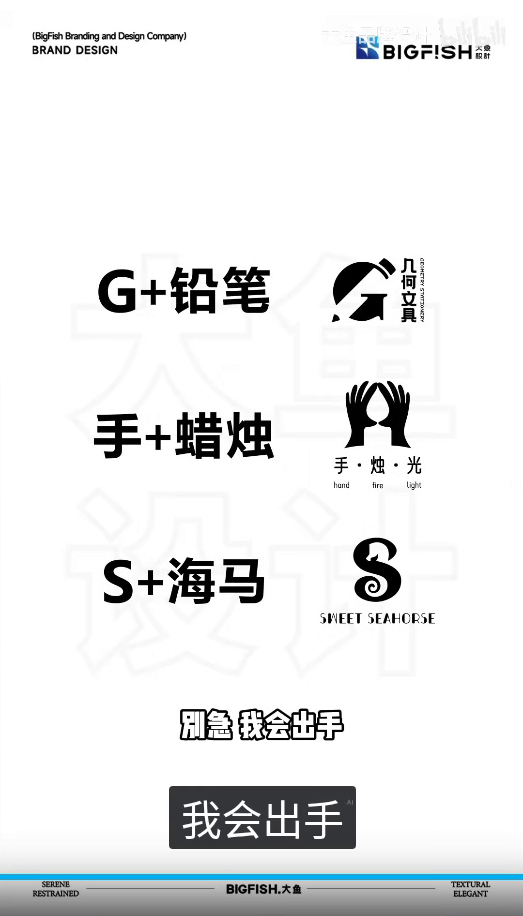

- **作者明确说法**：「别急 我会出手」
- **整理者观察**：白底三行并列，没有片头的 H 和 SPECIAL HOUSE。左侧写着「G+铅笔」、「手+蜡烛」、「S+海马」；右侧各配对应的完成态标志，以及字标几何文具 / GEOMETRY STATIONERY、手·烛·光 / hand fire light、SWEET SEAHORSE。
