# LOGO想要有创意，你得学会指鹿为马｜大鱼品牌设计

## 案例一：N 与指南针

### N1 · 字母N和指南针怎么搞

约 5.5s（录屏 49s）

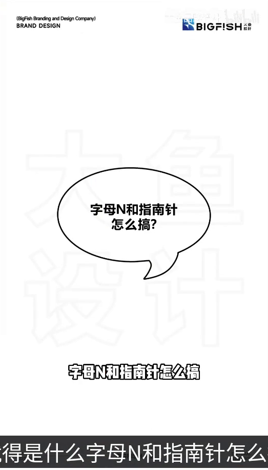

- **作者明确说法**：「字母N和指南针怎么搞」
- **整理者观察**：白底上一个线框气泡，内文为两行「字母N和指南针怎么搞?」，句末有问号。片内大字是同一句，没有问号。

### N2 · 指南针与字母 N 并置

约 7.1s（录屏 50.6s）

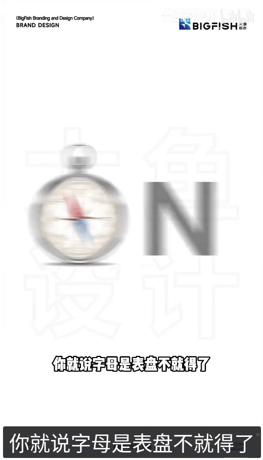

- **作者明确说法**：「你就说字母是表盘不就得了」
- **整理者观察**：左侧是一枚写实指南针（表盘、金属圈和原有的红蓝指针都在），右侧是灰色正体字母 N，两者分开，还没有套叠。

### N3 · 半透明 N 叠在指南针上

约 7.5s（录屏 51s）

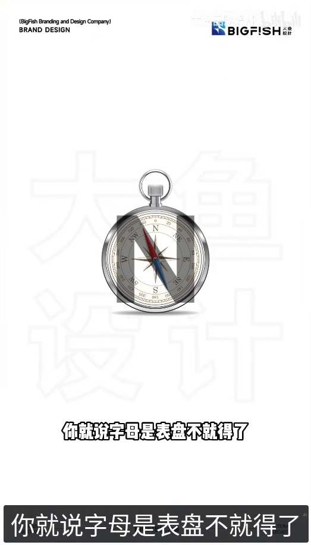

- **作者明确说法**：「你就说字母是表盘不就得了」
- **整理者观察**：指南针居中。一层半透明的灰色正体 N 叠在表盘上，左竖、斜笔、右竖都还在，表盘刻度和原有指针从笔画空隙和半透明笔画里仍看得清。右侧不再单独放一个 N。此后约到录屏 52.2s，这一形态基本没有再变。

### N4 · 黑色 N 压在表盘上

约 8.9s（录屏 52.4s）

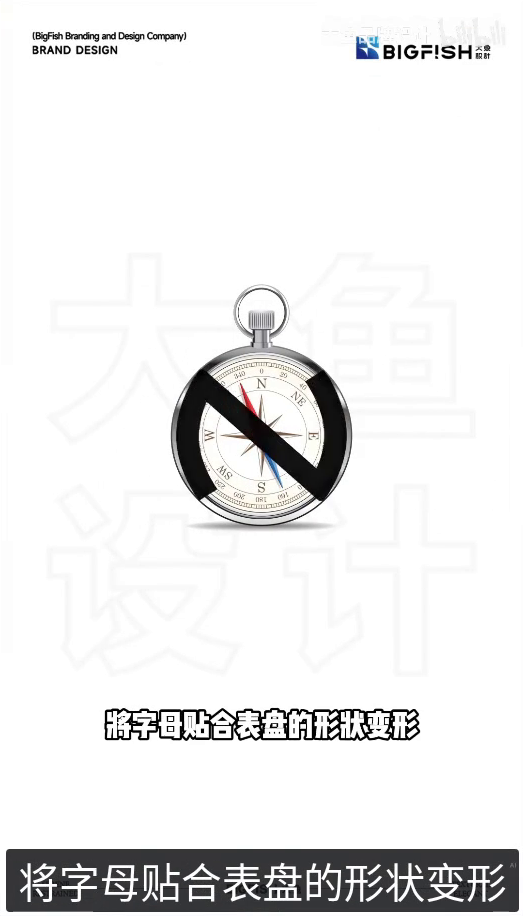

- **作者明确说法**：「將字母贴合表盘的形状变形」
- **整理者观察**：叠在指南针上的 N 变为不透明的黑色粗笔画，斜笔尤其醒目；左右竖笔仍较直。表盘、金属圈和原有指针还在笔画空隙里。

### N5 · 竖笔按圆轮廓收弯，照片还在

约 10.1s（录屏 53.6s）

- **作者明确说法**：「將字母贴合表盘的形状变形」
- **整理者观察**：左右竖笔的外侧开始沿表盘圆弧弯曲，斜笔仍在。指南针的表盘、金属圈和提钮都还在，尚未拿掉。

### N6 · 照片去掉，尚无指针

约 10.3s（录屏 53.8s）

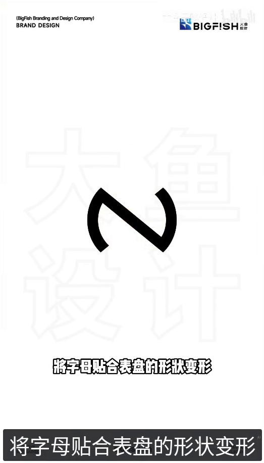

- **作者明确说法**：「將字母贴合表盘的形状变形」
- **整理者观察**：写实指南针已经不在，只剩按圆形轮廓收弯左右竖笔的黑色 N。本帧还没有后来的四向标志指针。

### N7 · 指针淡入

约 10.7s（录屏 54.2s）

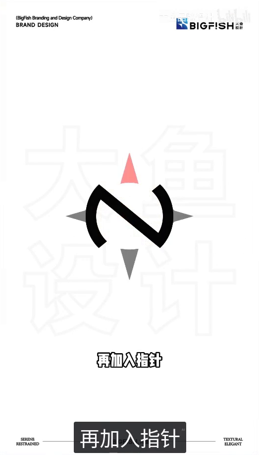

- **作者明确说法**：「再加入指针」
- **整理者观察**：变形后的黑 N 仍在。四向尖已经出现，但颜色较淡：上为浅红色三角，下和左右为浅灰色尖。

### N8 · 指针实色

约 11.3s（录屏 54.8s）

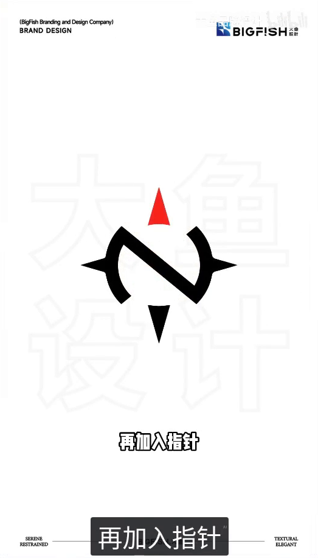

- **作者明确说法**：「再加入指针」
- **整理者观察**：指针已加实：上为红色三角，下为黑色三角，左右各一黑尖。N 的弯曲轮廓与 N7 同类。

### N9 · 反白用到山景照片上

约 12.5s（录屏 56s）

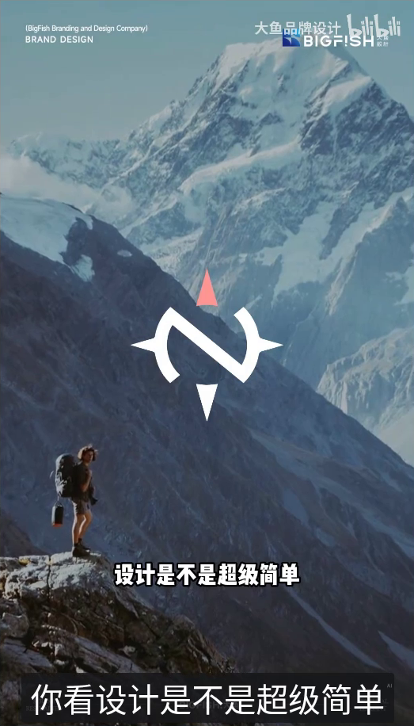

- **作者明确说法**：「设计是不是超级简单」
- **播放器字幕**：「你看设计是不是超级简单」
- **整理者观察**：完成态标志反白压在山景与徒步者的照片上，红色上针仍可辨。

### 思路与前后关系（整理者分析，非作者原话）

先把写实指南针和正体 N 分开并置（N2），片内说「你就说字母是表盘不就得了」。随后把 N 叠到指南针照片上（N3），半透明时仍能同时认出字母和表盘；再把笔画加实（N4）。按「將字母贴合表盘的形状变形」，左右竖笔收到圆形轮廓上（N5），然后拿掉照片，只留变形后的 N（N6）。再按「再加入指针」，从淡到实补上四向尖（N7、N8），最后把反白后的这一形态放到山景照片上（N9）。斜笔始终留着，用来认出这仍是字母 N；同时左右竖笔外侧沿圆盘弧边收弯，再用上红下黑、左右对称的方位尖，加强指南针的联想。

---

## 案例二：C 与天鹅

### C1 · C字母怎么融入天鹅啊

约 14.5s（录屏 58s）

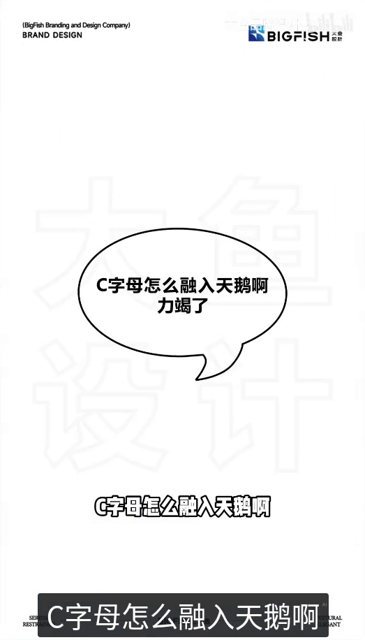

- **作者明确说法**：「C字母怎么融入天鹅啊」
- **整理者观察**：线框气泡里已有两行，第二行是「力竭了」。片内大字此时只有第一行。

### C2 · 力竭了

约 15.7s（录屏 59.2s）

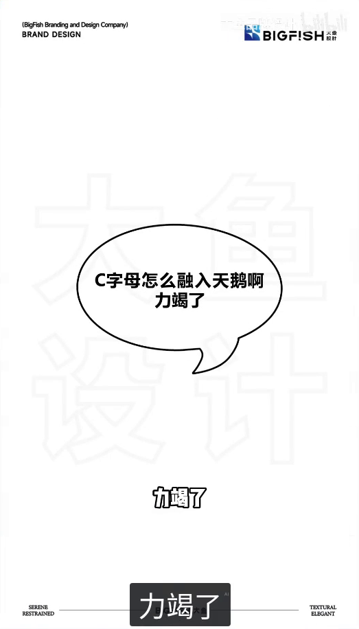

- **作者明确说法**：「力竭了」
- **整理者观察**：仍是同一气泡画面，片内大字改为气泡里的第二行。

### C3 · 常规黑 C

约 16.9s（录屏 60.4s）

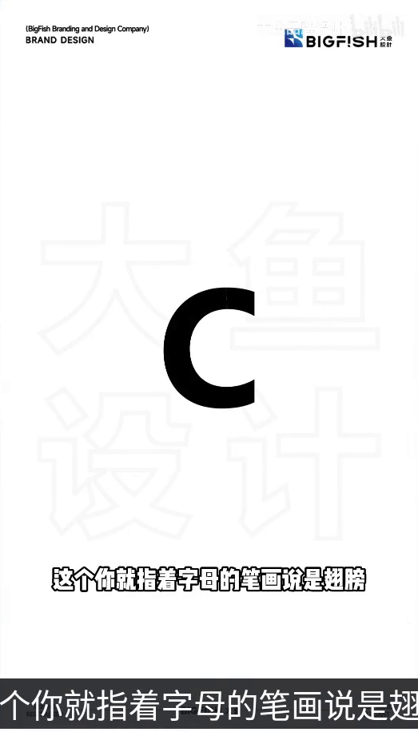

- **作者明确说法**：「这个你就指着字母的笔画说是翅膀」
- **整理者观察**：白底上一个尚未变形的黑色常规字母 C，主弧还没有换色。

### C4 · 粉色标出主弧

约 17.1s（录屏 60.6s）

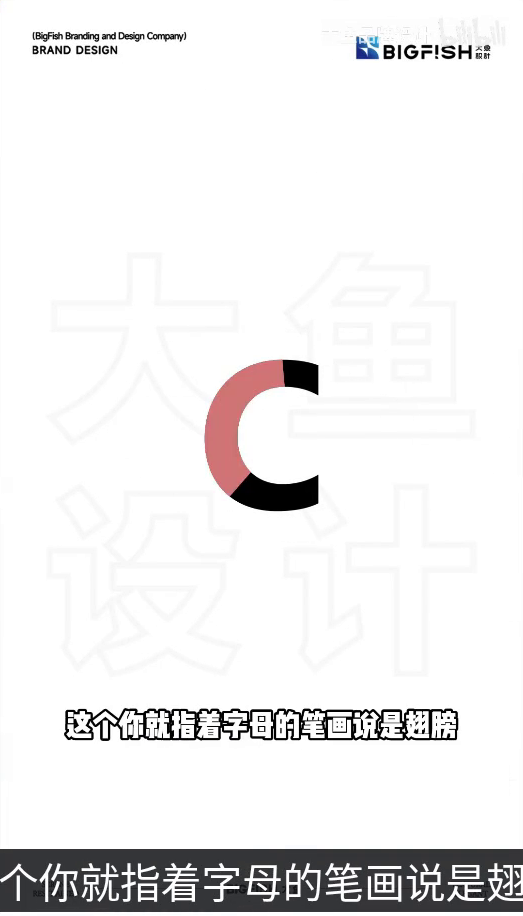

- **作者明确说法**：「这个你就指着字母的笔画说是翅膀」
- **整理者观察**：外形仍是字母 C。主弧改为粉／鲑肉色，上下两端仍是黑色。还没有收成天鹅剪影。

### C5 · 恢复为黑 C

约 19.5s（录屏 63s）

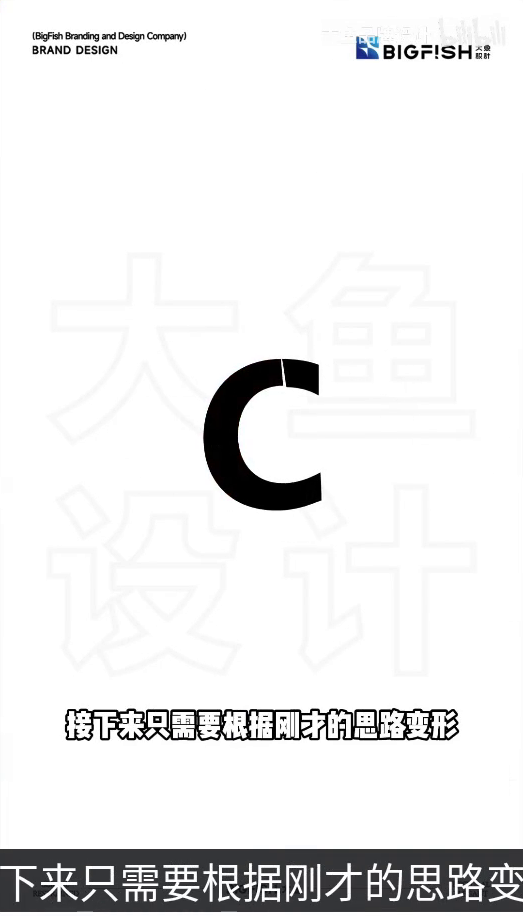

- **作者明确说法**：「接下来只需要根据刚才的思路变形」
- **整理者观察**：字母重新全黑，外形仍是 C。上端有一道细切口。尚未拉出后来的侧向剪影。

### C6 · 变形后的侧向剪影

约 19.7s（录屏 63.2s）

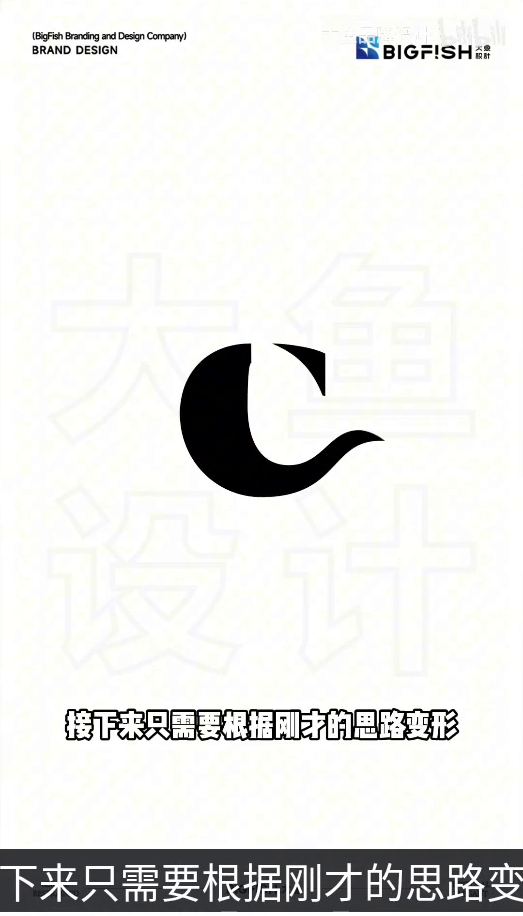

- **作者明确说法**：「接下来只需要根据刚才的思路变形」
- **整理者观察**：黑块左侧变厚变圆，右上收成短尖，右下拉出长而尖的收尾，整体可看成侧向的天鹅剪影。本帧还没有腿。

### C7 · 开始延长出腿

约 21.1s（录屏 64.6s）

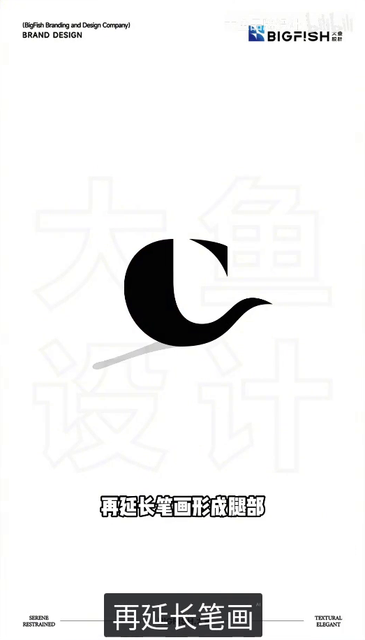

- **作者明确说法**：「再延长笔画形成腿部」
- **播放器字幕**：「再延长笔画」
- **整理者观察**：剪影主体与 C6 同类。主体左下伸出一道浅灰色斜笔，还未加实。

### C8 · 腿部实黑

约 21.5s（录屏 65s）

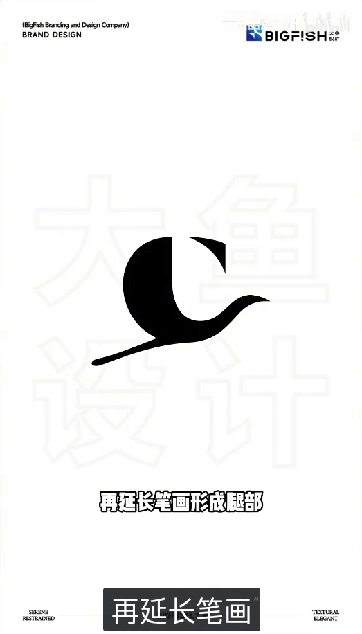

- **作者明确说法**：「再延长笔画形成腿部」
- **整理者观察**：那一笔腿已经实黑，末端略粗。

### C9 · 反白用到天鹅照片上

约 22.9s（录屏 66.4s）

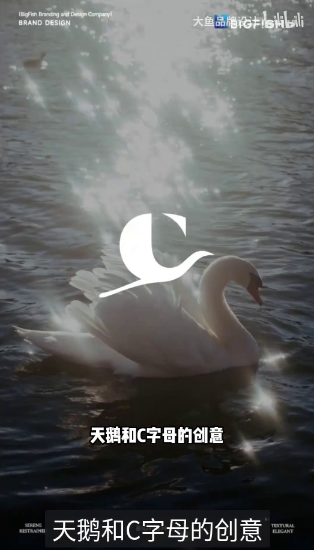

- **作者明确说法**：「天鹅和C字母的创意」
- **整理者观察**：完成态标志反白压在水面天鹅的照片上。

### C10 · 还不是手拿把掐

约 24.5s（录屏 68s）

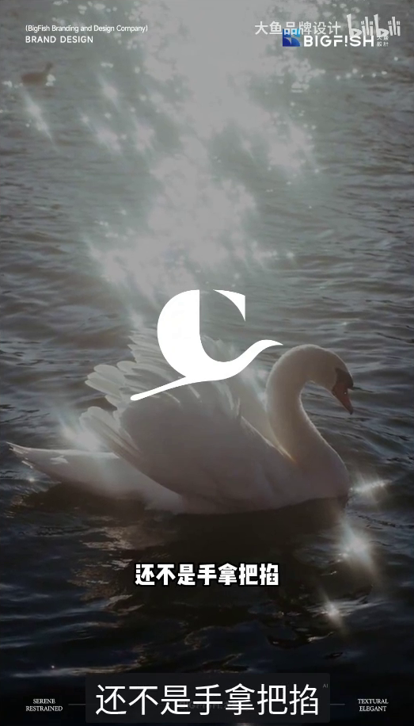

- **作者明确说法**：「还不是手拿把掐」
- **整理者观察**：场景与标志与 C9 同类，只是字幕换句。

### 思路与前后关系（整理者分析，非作者原话）

气泡先提出「C字母怎么融入天鹅啊」（C1）。作者明确「指着字母的笔画说是翅膀」：先出现常规黑 C（C3），再用粉色标出主弧（C4），随后恢复成黑 C（C5）。再按「根据刚才的思路变形」收成侧向剪影（C6），并按「再延长笔画形成腿部」向下拉出一笔（C7、C8）。完成态反白用到水面天鹅照片上（C9、C10）。这里不是在一枚完整的 C 旁边另加一只鸟，而是把已经点出来的主弧理解为翅与身，再把整字压成侧向剪影；向下延长的那一笔则帮助把剪影关联到站立的天鹅。以上只依据可见轮廓，作者没有另说这样收的原因。

---

## 案例三：CD 与咖啡豆

### CD1 · 用CD有说法吗

约 26.5s（录屏 70s）

- **作者明确说法**：「用CD有说法吗」
- **播放器字幕**：「咖啡馆用CD有说法吗」
- **整理者观察**：线框气泡写着「咖啡馆,用CD字母有说法吗?」，比片内多出「咖啡馆」「字母」和问号，中间有逗号。

### CD2 · 整颗咖啡豆

约 28.5s（录屏 72s）

- **作者明确说法**：「我们就用咖啡豆沒问题吧」
- **整理者观察**：白底中央是一整颗咖啡豆，中缝还在。

### CD3 · 用 1、2 标出两半

约 30.3s（录屏 73.8s）

- **作者明确说法**：「你再看咖啡豆是不是有两半」
- **整理者观察**：仍是同一颗豆。绿色数字「1」「2」分别标在中缝左右两半上。

### CD4 · C、D 与豆对照

约 32.3s（录屏 75.8s）

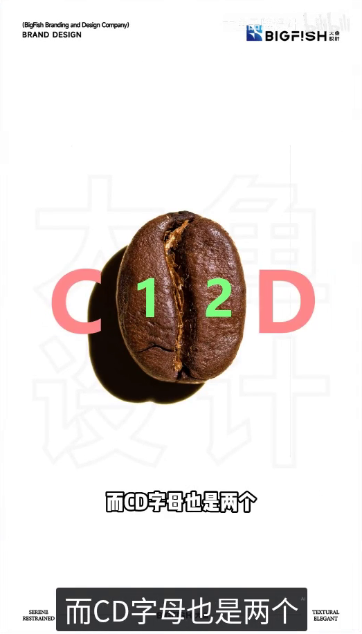

- **作者明确说法**：「而CD字母也是两个」
- **整理者观察**：豆和绿色 1、2 仍在。粉色字母 C 在左、D 在右，位于豆的两侧，尚未压进豆里，也还不是豆形标志。

### CD5 · C、D 压到豆缘

约 33.5s（录屏 77s）

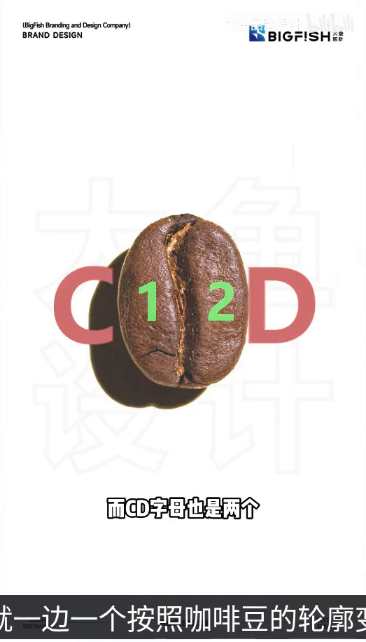

- **作者明确说法**：「而CD字母也是两个」
- **整理者观察**：C、D 向内移到豆的左右边缘上。

### CD6 · 正体 CD 一边一个

约 33.7s（录屏 77.2s）

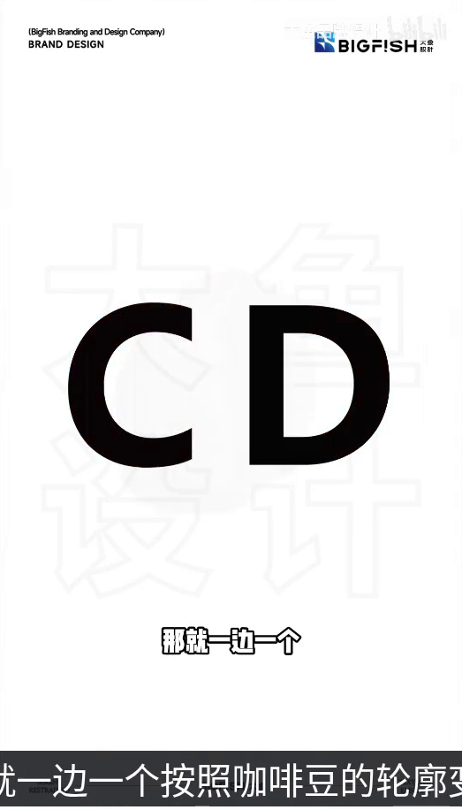

- **作者明确说法**：「那就一边一个」
- **整理者观察**：咖啡豆照片和绿色数字已经不在。白底上只剩黑体正体 C、D，左右并置，还没有按豆的轮廓变形。

### CD7 · 字幕改为按轮廓变形，字形未改

约 34.5s（录屏 78s）

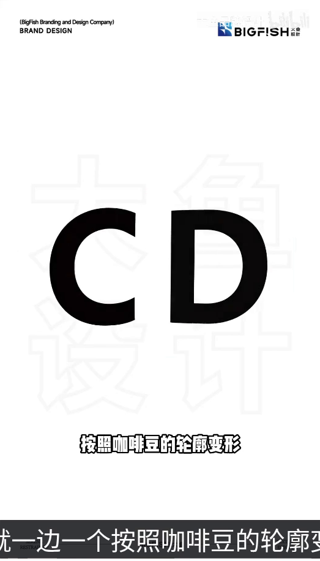

- **作者明确说法**：「按照咖啡豆的轮廓变形」
- **整理者观察**：C、D 仍是与 CD6 同类的正体字母，轮廓还没有收成豆形。

### CD8 · 收成豆形

约 35.1s（录屏 78.6s）

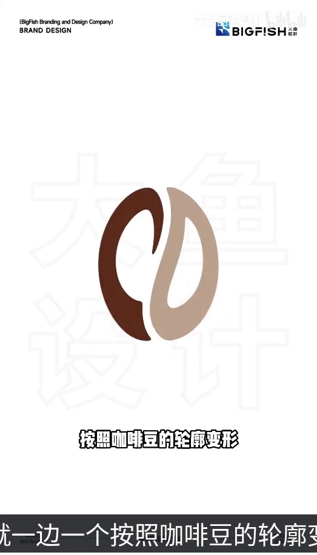

- **作者明确说法**：「按照咖啡豆的轮廓变形」
- **整理者观察**：两个字母已收成一枚椭圆豆形：左半深褐，带向内的开口；右半浅褐，带字腔。这是完成态标志，不是照片里的那颗豆。

### CD9 · 用到桌面照片上

约 36.5s（录屏 80s）

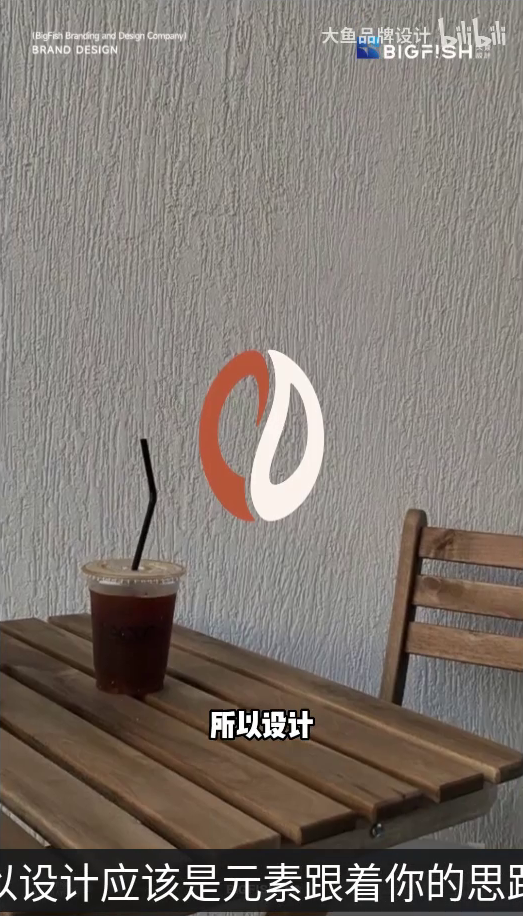

- **作者明确说法**：「所以设计」
- **播放器字幕**：「所以设计应该是元素跟着你的思路走」
- **整理者观察**：木桌、冰咖啡和椅子的照片上，墙面压着一枚橙褐与乳白的豆形标志。

### CD10 · 元素跟着你的思路走

约 37.5s（录屏 81s）

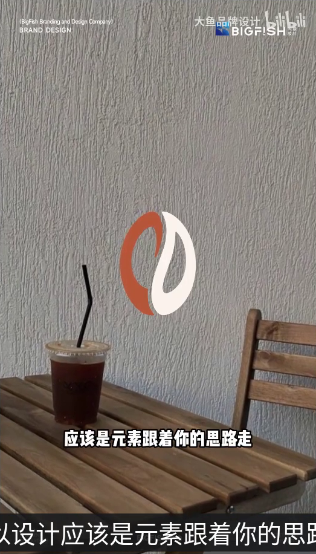

- **作者明确说法**：「应该是元素跟着你的思路走」
- **整理者观察**：场景与标志与 CD9 同类，只是片内大字接到后半句。

### 思路与前后关系（整理者分析，非作者原话）

先提出咖啡馆用 CD 有没有说法（CD1），随即说「我们就用咖啡豆沒问题吧」（CD2）。用 1、2 标出同一颗豆的两半（CD3），再把 C、D 两个字母摆到豆的两侧对照（CD4、CD5）。然后只留下正体 CD，「那就一边一个」（CD6）；再按「按照咖啡豆的轮廓变形」收成两半豆形（CD7、CD8），并用到冰咖啡的桌面照片上（CD9）。片内收在「应该是元素跟着你的思路走」（CD10）。C、D 两个字母分别对应豆的左右两半，字母的数量与原物「有两半」的结构对得上，并不是把字母和咖啡豆做无关拼贴。

---

## 收束：三例并列

约 40.5s（录屏 84s）

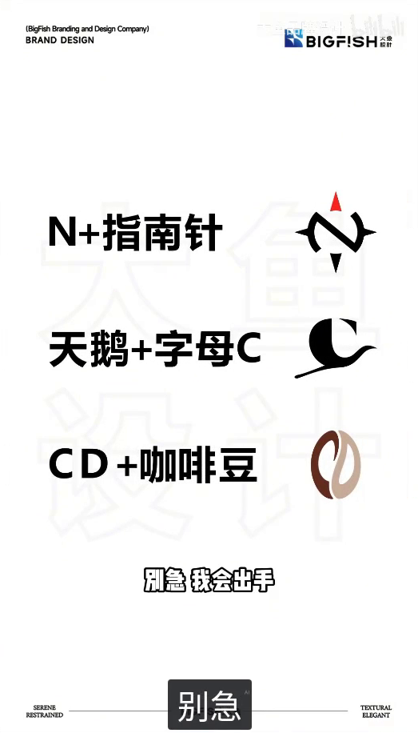

- **作者明确说法**：「别急我会出手」
- **播放器字幕**：「别急」
- **整理者观察**：左侧文字为「N+指南针」「天鹅+字母C」「CD+咖啡豆」，右侧是三个完成态标志。片内没有在本帧再讲解做法。
