# 只要分清主次，LOGO 设计也就手拿把掐｜大鱼品牌设计

## 案例一：Q 与铅笔

### Q1 · 两元素并置

约 6s（录屏 90s）

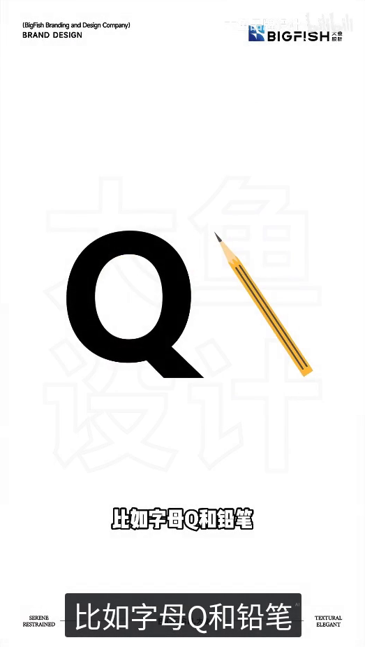

- **作者明确说法**：「比如字母Q和铅笔」
- **整理者观察**：白底上，黑色常规字母 Q 在左，一支黄色铅笔斜放在右，两者分开，互不套叠。

### Q2 · 铅笔为主体，顶端一小 Q

约 8s（录屏 92s）

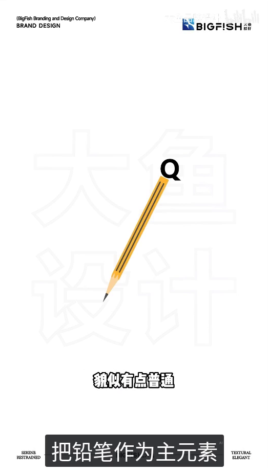

- **作者明确说法**：「貌似有点普通」
- **播放器字幕**：「把铅笔作为主元素」
- **整理者观察**：铅笔变成画面主体，斜向居中；一个较小的黑色 Q 接在铅笔顶端。

### Q3 · 回退到两元素并置

约 9s（录屏 93s）

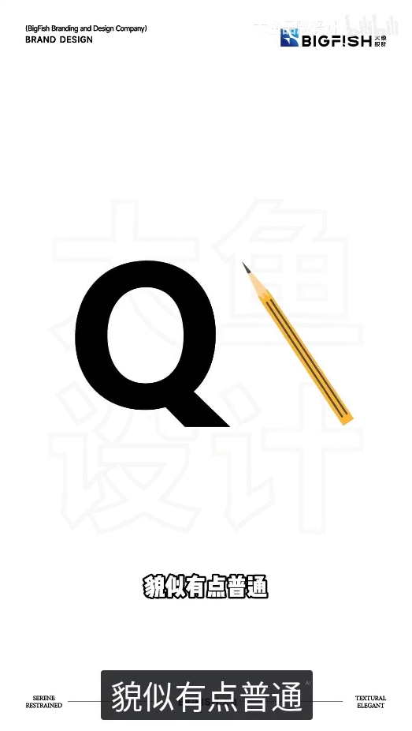

- **作者明确说法**：「貌似有点普通」
- **整理者观察**：画面回到与 Q1 相近的布局：大 Q 在左，铅笔在右，互不套接。

### Q4 · 只留字母 Q

约 10.5s（录屏 94.5s）

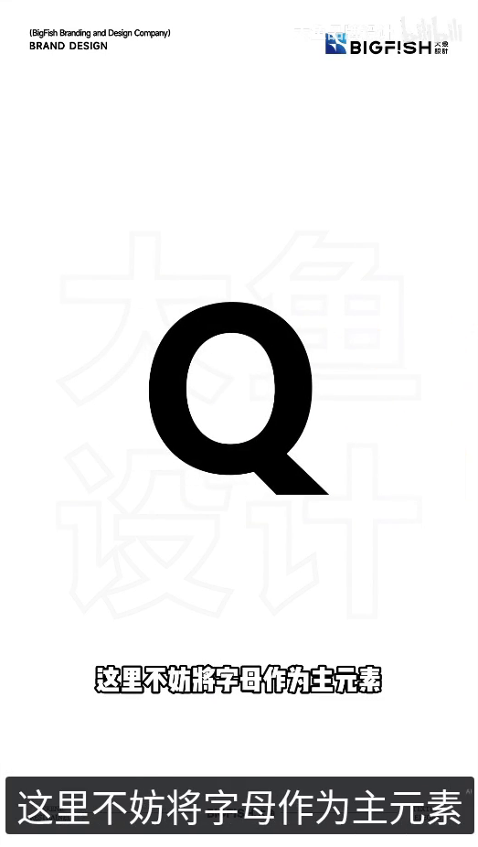

- **作者明确说法**：「这里不妨將字母作为主元素」
- **整理者观察**：铅笔已不在画面里，只剩黑色常规 Q，尾部仍是普通斜切。

### Q5 · 尾部开始变形

约 11s（录屏 95s）

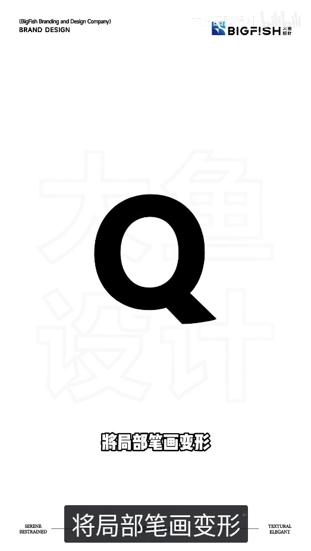

- **作者明确说法**：「將局部笔画变形」
- **整理者观察**：Q 的尾部相对 Q4 略变短、变钝，仍全黑，字腔内还没有三角。

### Q6 · 粗圆尾与伸进字腔的黑三角

约 11.5s（录屏 95.5s）

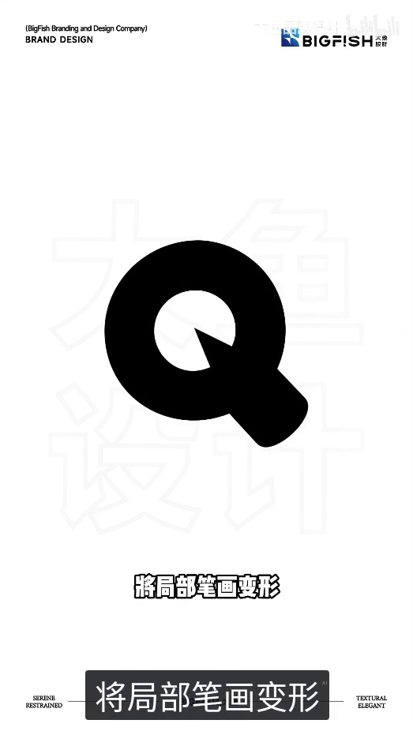

- **作者明确说法**：「將局部笔画变形」
- **整理者观察**：尾部变成粗圆头；一道黑色三角从尾部方向伸进白色字腔，尖朝圆心。整字仍是实心黑，没有浅色块，也不是白色镂空。

### Q7 · 黑 Q 上的灰黑三角

约 12s（录屏 96s）

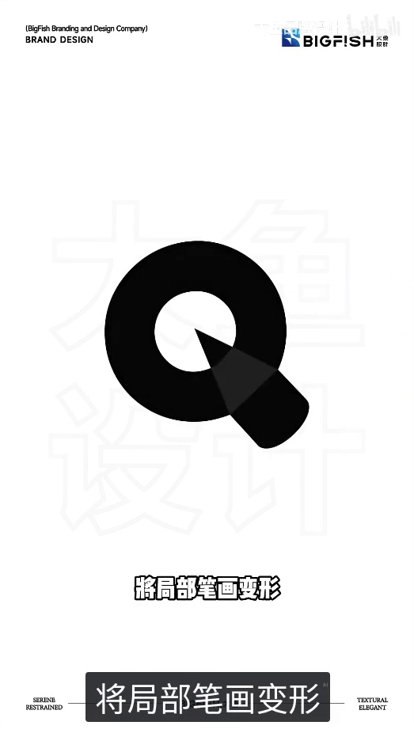

- **作者明确说法**：「將局部笔画变形」
- **整理者观察**：结构与 Q6 同类，但压在 Q 笔画上的那截三角呈灰黑色块，伸进字腔的尖仍暗。整字仍不是白色镂空。本帧尚未出现「形成副元素」。

### Q8 · 浅色三角块出现

约 12.2s（录屏 96.2s）

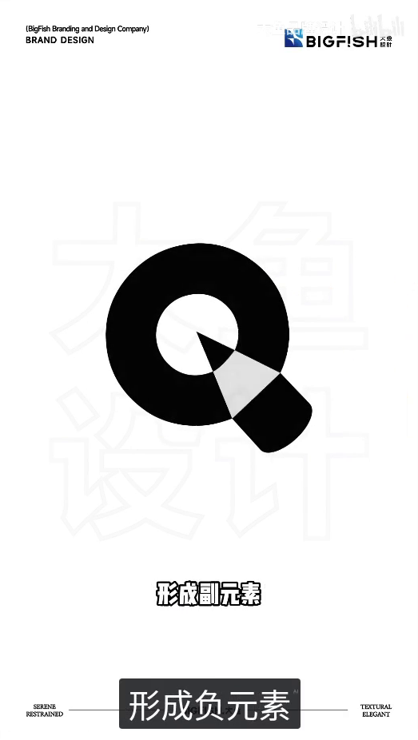

- **作者明确说法**：「形成副元素」
- **播放器字幕**：「形成负元素」
- **整理者观察**：仍是黑色 Q，白色圆字腔，尾部仍是实心黑圆头。三角分成两部分：伸进字腔的尖为黑色；落在 Q 笔画上的一截变为浅色（近白）三角块。这不是把整个字母挖成白色镂空。浅色块与「副元素 / 负元素」这两个用字如何对应，作者没有再解释。

### Q9 · 反白标志用到照片上

约 14s（录屏 98s）

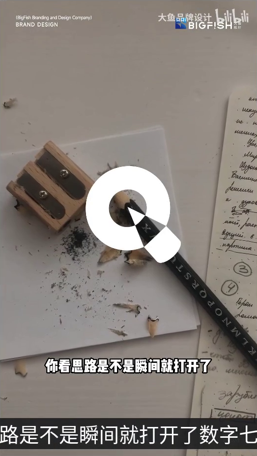

- **作者明确说法**：「你看思路是不是瞬间就打开了」
- **整理者观察**：浅色桌面照片上有木制双孔卷笔刀、铅笔屑、黑色铅笔和手写纸页。白色 Q 形标志压在画面中，字腔和浅色三角处露出照片。铅笔屑是照片里的静物。

### 思路与前后关系（整理者分析，非作者原话）

先是字母与实物分开并置（Q1）。把铅笔放到主体、把 Q 缩到顶端之后（Q2），片内说「貌似有点普通」，并回到并置（Q3）。随后作者明确「这里不妨將字母作为主元素」，只留下 Q（Q4）。再按「將局部笔画变形」（Q5–Q7），把尾部改成带圆头、三角伸进字腔的形态，并在笔画上留出浅色三角块（Q8，片内称「形成副元素」）。这样主识别仍是字母 Q，局部笔画带上铅笔的尖与杆头特征，两者可以同时被认出。最后把反白的这一形态放到卷笔刀与铅笔的照片上（Q9）。

---

## 案例二：7 与麋鹿

### 7-1 · 麋鹿照片

约 19s（录屏 103s）

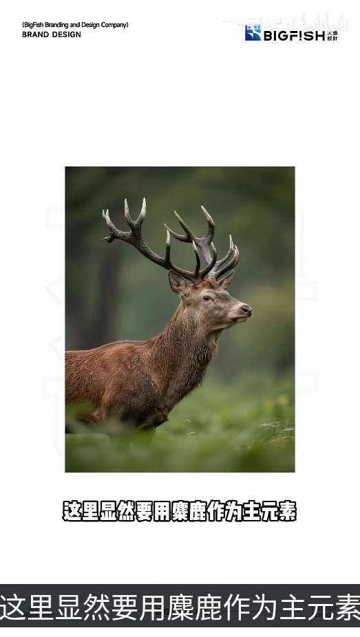

- **作者明确说法**：「这里显然要用麋鹿作为主元素」
- **整理者观察**：白底中央是一张矩形照片，一只带角的鹿侧立在绿色背景里。数字 7 尚未出现。作者在字幕里称「麋鹿」。

### 7-2 · 标准 7 叠在照片上

约 20s（录屏 104s）

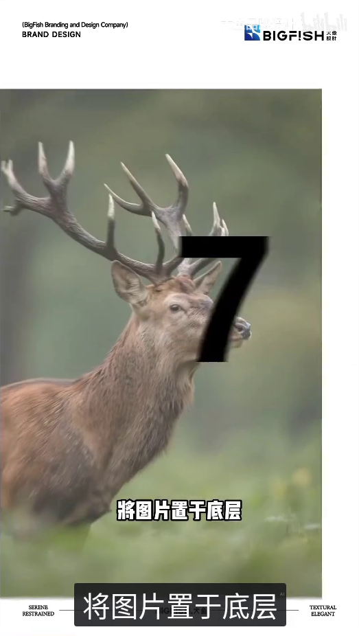

- **作者明确说法**：「將图片置于底层」
- **整理者观察**：照片放大、更近地充满画面；一个尚未变形的黑色标准数字 7 叠在鹿头附近。本帧已经同时看见照片与标准 7。

### 7-3 · 仍是标准 7

约 21s（录屏 105s）

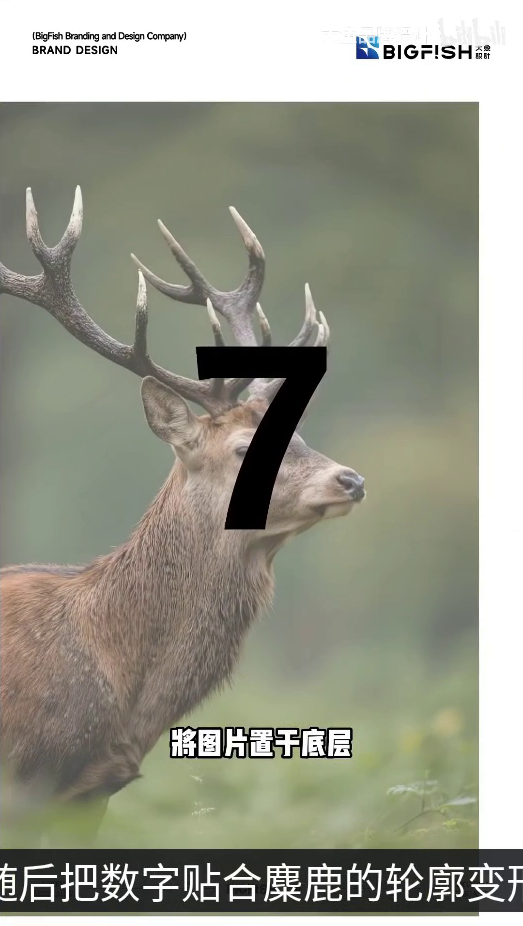

- **作者明确说法**：「將图片置于底层」
- **播放器字幕**：「随后把数字贴合麋鹿的轮廓变形」（末字被裁）
- **整理者观察**：7 仍是横平竖直的标准字形，位置略有调整，轮廓尚未按鹿形改。片内字幕尚未换成「贴合」。

### 7-4 · 数字整体贴合轮廓变形

约 21.5s（录屏 105.5s）

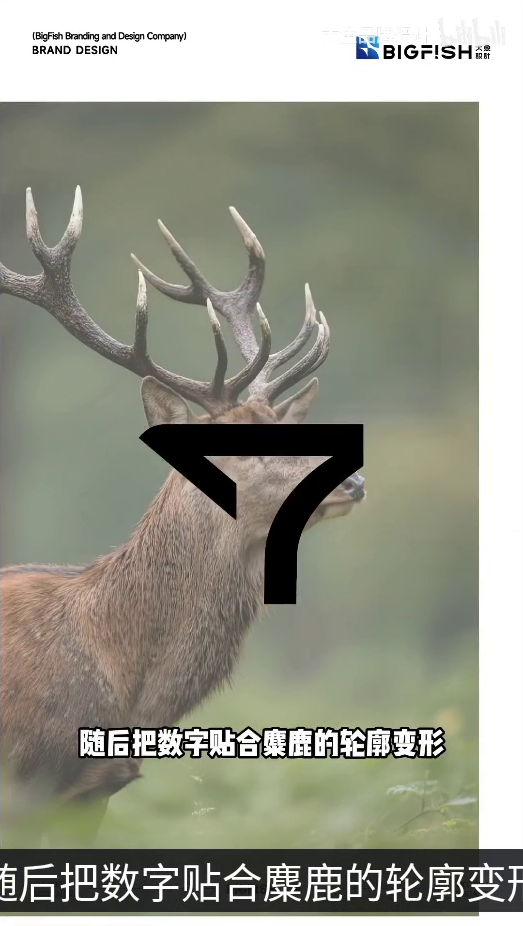

- **作者明确说法**：「随后把数字贴合麋鹿的轮廓变形」
- **整理者观察**：7 作为整体被改形：左端斜下，横画右端微微上翘，横画中有一处 V 形凹口，竖画仍向下。本帧一次看见的是整体结果。照片仍在下面。

### 7-5 · 变形后仍压在底图上

约 22s（录屏 106s）

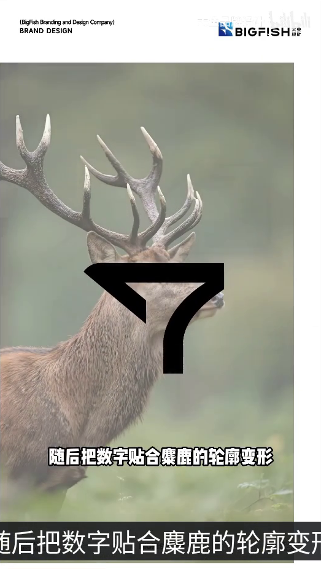

- **作者明确说法**：「随后把数字贴合麋鹿的轮廓变形」
- **整理者观察**：标志轮廓与 7-4 同类，照片还在。取景略有变化（鹿角更完整地进入画面上方），但底图没有去掉。

### 7-6 · 底图去掉，字幕尚未换句

约 22.5s（录屏 106.5s）

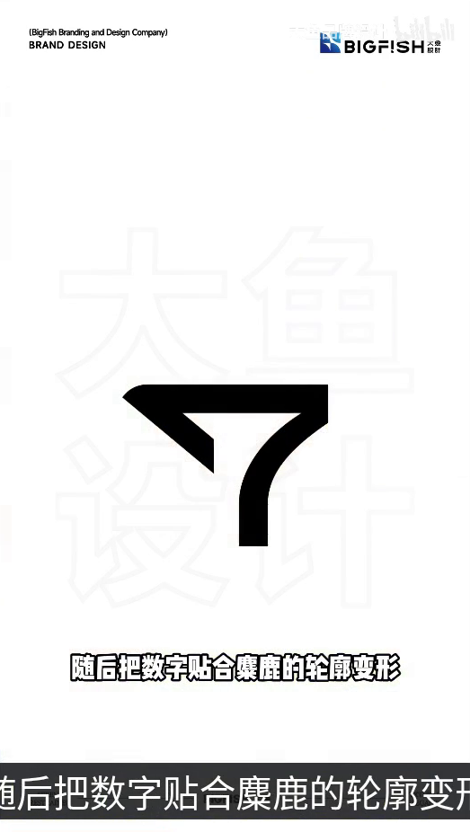

- **作者明确说法**：「随后把数字贴合麋鹿的轮廓变形」
- **整理者观察**：照片已不在，变形后的黑色 7 落在白底上，角尚未加上。去底图是画面变化；本帧片内没有另写「去掉图片」。

### 7-7 · 加角中间态

约 23.5s（录屏 107.5s）

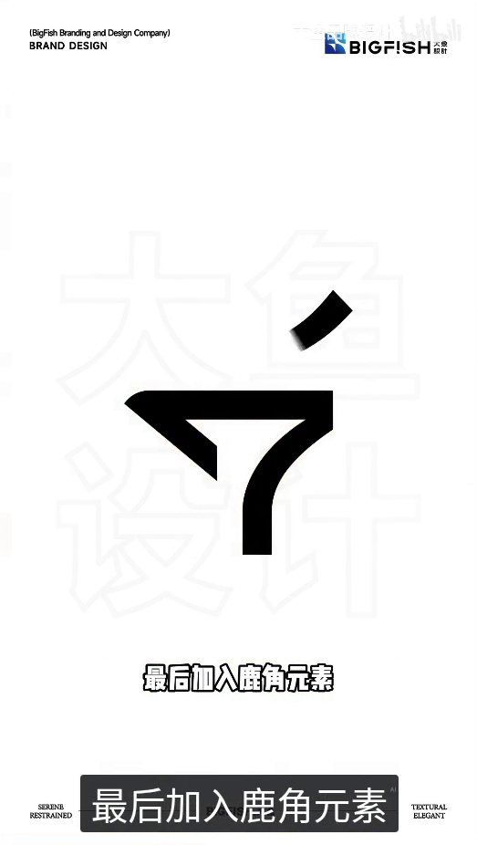

- **作者明确说法**：「最后加入鹿角元素」
- **整理者观察**：7 的主体已定，右上方只出现一道短弧，左端略有虚边，左侧重弧还没有。

### 7-8 · 两道弧形鹿角齐全

约 24s（录屏 108s）

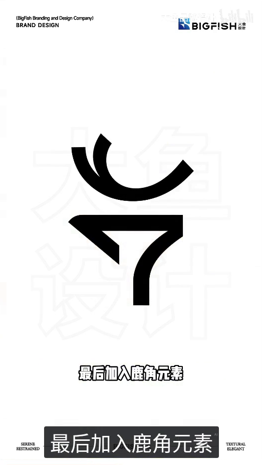

- **作者明确说法**：「最后加入鹿角元素」
- **整理者观察**：7 上方现有两道黑色弧线，左短右长，构成鹿角。

### 7-9 · 反白用到雪林照片上

约 25s（录屏 109s）

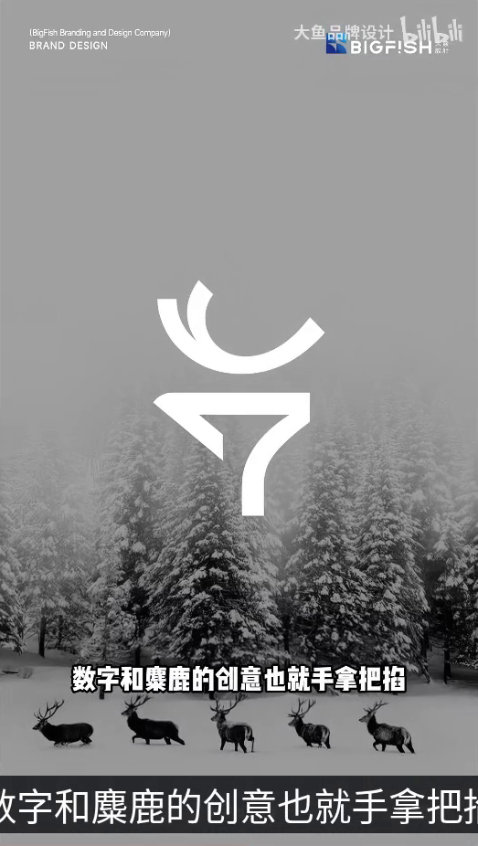

- **作者明确说法**：「数字和麋鹿的创意也就手拿把掐」
- **整理者观察**：灰色雪林照片上，标志改为白色；画面下方有一排较小的鹿。这是应用场景。

### 思路与前后关系（整理者分析，非作者原话）

作者先点明「这里显然要用麋鹿作为主元素」，给出鹿的照片（7-1），再把图片放在底层并叠上尚未变形的数字 7（7-2、7-3）。随后「把数字贴合麋鹿的轮廓变形」（7-4、7-5）：7 的整体外形被照片里的头颈轮廓约束。去掉底图后（7-6），数字已经带有这一轮廓，但角尚未出现；再「加入鹿角元素」（7-7 为中间态，7-8 为完成），用两道弧把「鹿」的辨识补足。最后将反白标志放到雪林照片上（7-9）。

---

## 案例三：B 与家居

### B1 · 先给出部分家居种类

约 32s（录屏 116s）

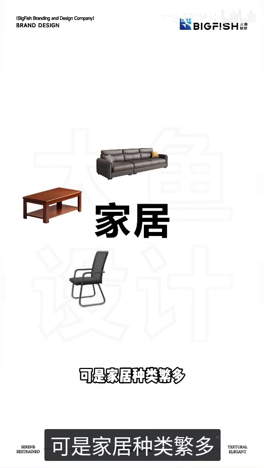

- **作者明确说法**：「可是家居种类繁多」
- **整理者观察**：中央黑体「家居」二字，周围是沙发、木茶几、一把椅子，还没有床头柜和灯。

### B2 · 种类再增多

约 33s（录屏 117s）

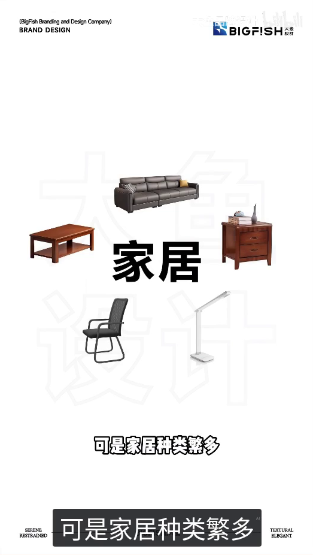

- **作者明确说法**：「可是家居种类繁多」
- **整理者观察**：在 B1 的三类之外，右侧出现木制床头柜，右下出现白色台灯。字母 B 尚未出现。

### B3 · 客户并没有给出具体的种类

约 34s（录屏 118s）

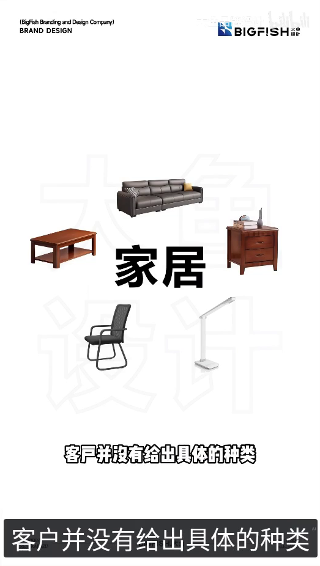

- **作者明确说法**：「客户并没有给出具体的种类」
- **整理者观察**：画面仍是 B2 的五类家居与中央「家居」二字，字母 B 尚未出现。这是作者随后改用字母作主之前，片内给出的理由。

### B4 · 普通实心 B

约 35.5s（录屏 119.5s）

- **作者明确说法**：「所以不妨用字母作为主要元素」
- **整理者观察**：白底上一个普通黑色实心 B，中竖还看不出后来的细缝，也还不是空心线框。家居照片已不在。

### B5 · 仍是实心 B，中竖有细缝

约 37s（录屏 121s）

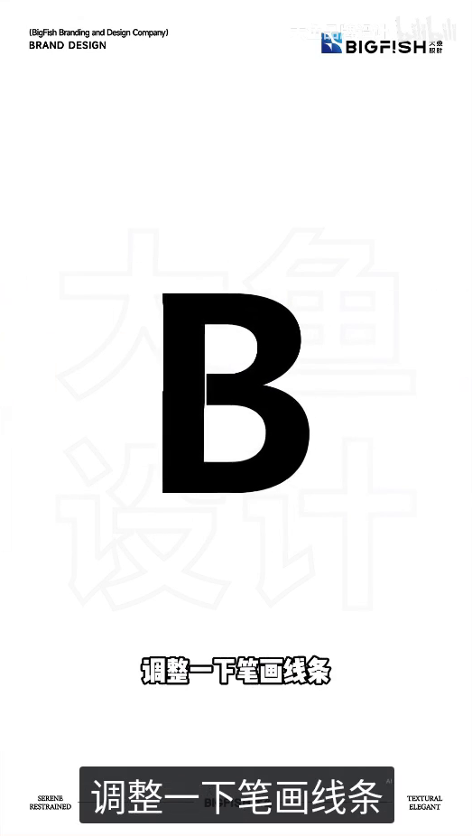

- **作者明确说法**：「调整一下笔画线条」
- **整理者观察**：字母仍是实心填黑。中竖中段可见一道很细的竖缝。

### B6 · 空心线框

约 37.5s（录屏 121.5s）

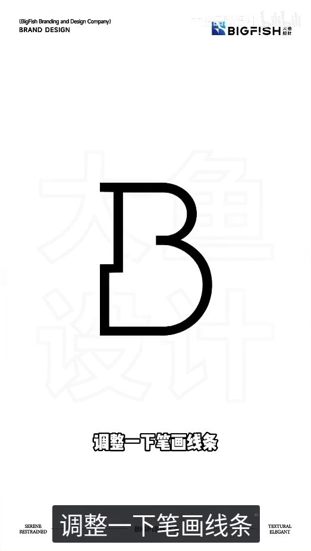

- **作者明确说法**：「调整一下笔画线条」
- **整理者观察**：B 变为空心线框。左竖中段有台阶状外凹，上下两腔仍由左竖连成一体，还没有上下断开。

### B7 · 与上一帧几乎同一结构

约 38s（录屏 122s）

- **作者明确说法**：「调整一下笔画线条」
- **整理者观察**：与 B6 对照，仍是同一空心线框 B，左竖中段台阶仍在，上下腔仍连在一起。逐像素比较只能看到描边约一像素级的粗细或位置差，左竖没有被切断，也没有出现明确开口。上下分离见下一帧。

### B8 · 上下分离（尚无吊灯头）

约 38.5s（录屏 122.5s）

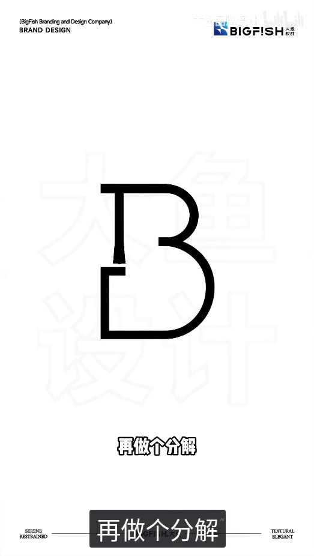

- **作者明确说法**：「再做个分解」
- **整理者观察**：字母在中腰断开：上半是带上腔的一截，下半像带底的「D」形框，左竖不再连成一根。上段左竖下端是平齐或略收的线端，还没有菱形灯头。

### B9 · 菱形灯头出现，字幕尚未换句

约 39s（录屏 123s）

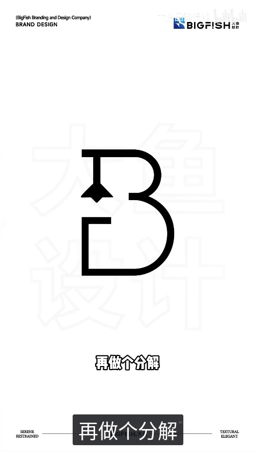

- **作者明确说法**：「再做个分解」
- **整理者观察**：上段左竖下端出现向下的实心菱形，看起来像灯头；下段线框仍像桌面与支撑。图形变化先于「吊灯和书桌……」这句字幕。

### B10 · 图形未再改，字幕点出吊灯和书桌

约 39.5s（录屏 123.5s）

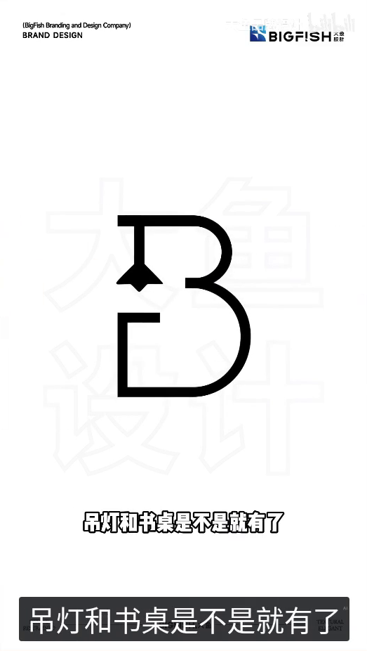

- **作者明确说法**：「吊灯和书桌是不是就有了」
- **整理者观察**：标志轮廓与 B9 相同，没有椅子。作者用这句字幕点出吊灯和书桌。

### B11 · 还缺点什么

约 41s（录屏 125s）

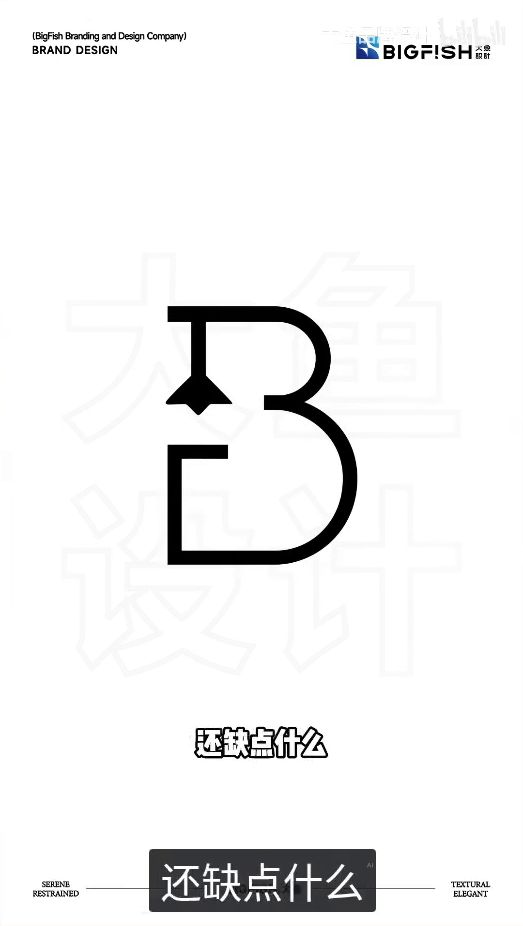

- **作者明确说法**：「还缺点什么」
- **整理者观察**：图形仍是吊灯加书桌，下腔里还没有椅子。

### B12 · 椅背局部

约 42s（录屏 126s）

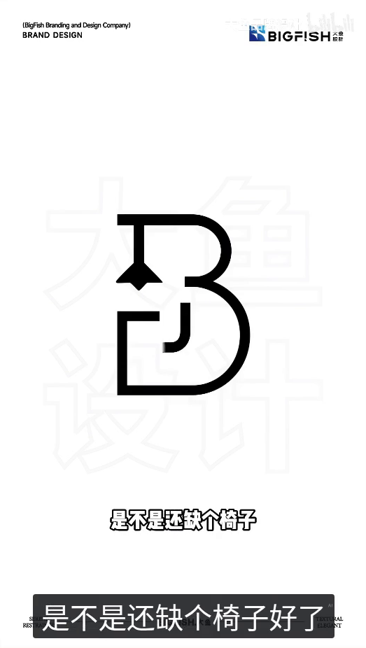

- **作者明确说法**：「是不是还缺个椅子」
- **播放器字幕**：「是不是还缺个椅子好了」
- **整理者观察**：书桌下腔里出现一道向下的椅背轮廓，下端略有虚边，还没有座面和椅腿。

### B13 · 椅子完整

约 42.5s（录屏 126.5s）

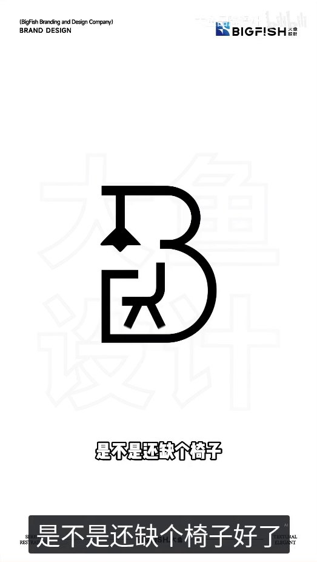

- **作者明确说法**：「是不是还缺个椅子」
- **播放器字幕**：「是不是还缺个椅子好了」
- **整理者观察**：下腔里的椅子已经完整：靠背、座面和两只外撇的腿都在。

### B14 · 应用照片上的独立「好了」

约 43.3s（录屏 127.3s）

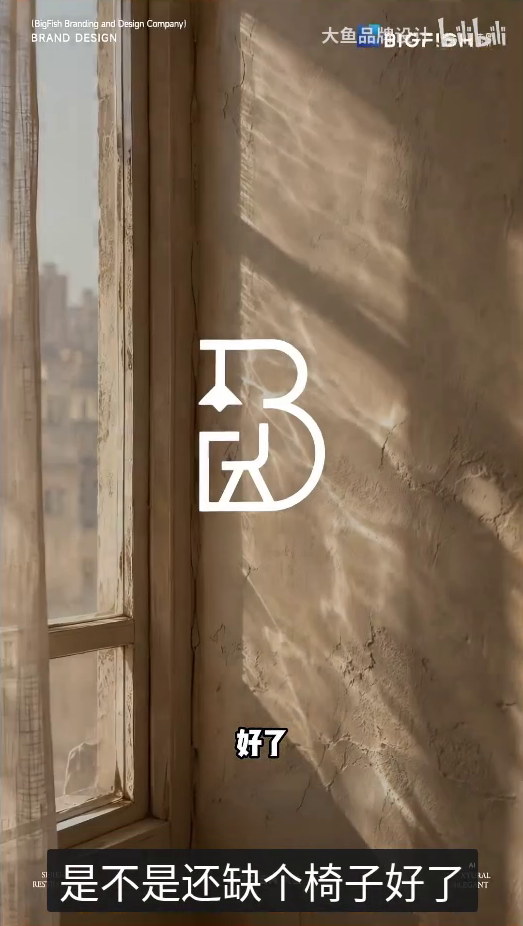

- **作者明确说法**：「好了」
- **播放器字幕**：「是不是还缺个椅子好了」
- **整理者观察**：白色线框标志压在窗边、墙面光影的室内照片上。本帧在应用照片出现的同时，片内给出独立的「好了」。

### B15 · 同一应用照

约 44.5s（录屏 128.5s）

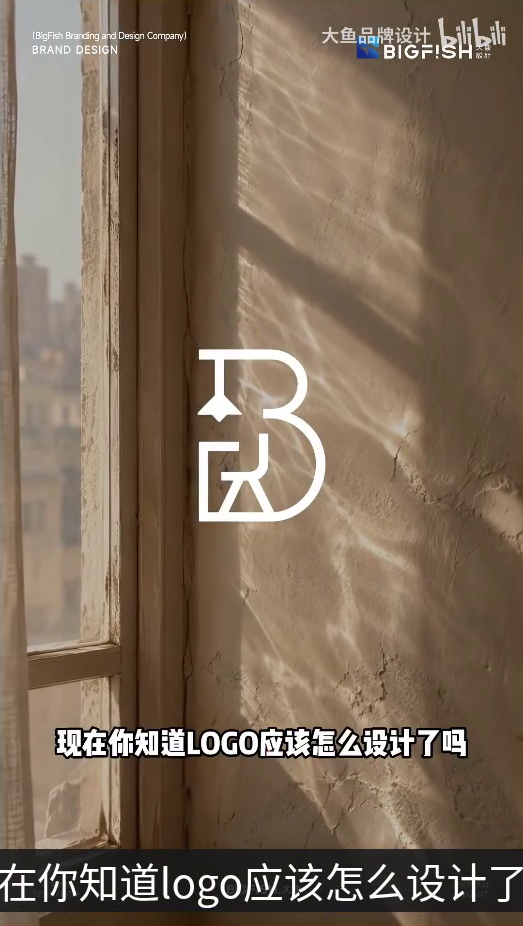

- **作者明确说法**：「现在你知道LOGO应该怎么设计了吗」
- **整理者观察**：场景与标志与 B14 同类，只是字幕换句。片内句末「吗」清楚可见，「LOGO」为大写。

### 思路与前后关系（整理者分析，非作者原话）

作者先展示家居种类多（B1、B2），并明确「客户并没有给出具体的种类」（B3）。接着才说「所以不妨用字母作为主要元素」（B4）。可见这里没有先指定一件外部实物当作唯一主图形，而是用字母 B 的轮廓去容纳多种家具：线框调整并分解之后，上段成为吊灯、下段成为书桌（B8–B10），下腔里再补上椅子（B12–B13）。一件标志里同时读出灯、桌、椅，对应前面「种类繁多」、且客户未给出具体种类。

---

## 收束：三例并列

约 47s（录屏 131s）

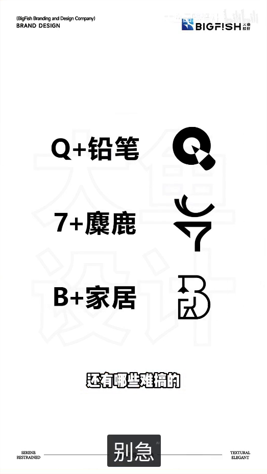

- **作者明确说法**：「还有哪些难搞的」
- **播放器字幕**：「别急」
- **整理者观察**：左侧文字为「Q+铅笔」「7+麋鹿」「B+家居」，右侧是三个完成态标志。片内没有在本帧再讲解做法。
