# [LOGO想要记得住，这些方法别用错](https://www.bilibili.com/video/BV1sdHh6QEzh)｜大鱼品牌设计

## 案例一：企鹅 + 高尔夫球杆 / 企鹅·高尔夫俱乐部 / PENGUIN GOLF

### PG1 · 原形：企鹅照片和高尔夫球杆并置

约 1.0s（录屏 21.5s）

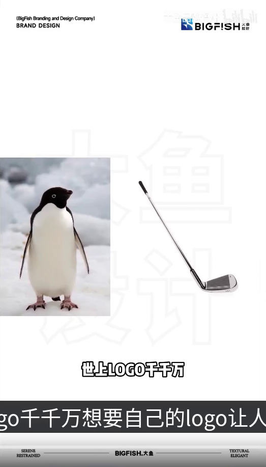

- **作者明确说法**：「世上LOGO千千万」
- **整理者观察**：左边是一张彩色企鹅照片，右边是一把高尔夫球杆，两者分开并置，还没有叠在一起。

### PG2 · 给企鹅和球杆描上红轮廓

约 1.15s（录屏 21.65s）

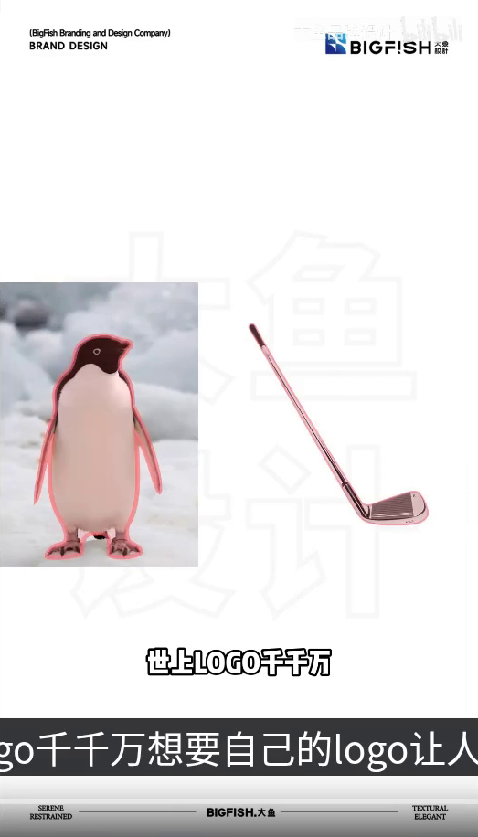

- **作者明确说法**：「世上LOGO千千万」
- **整理者观察**：企鹅和球杆上都描出了红粉色的轮廓，照片和球杆还在原来的位置。

### PG3 · 企鹅剪影离开照片，球杆仍在右侧

约 1.80s（录屏 22.3s）

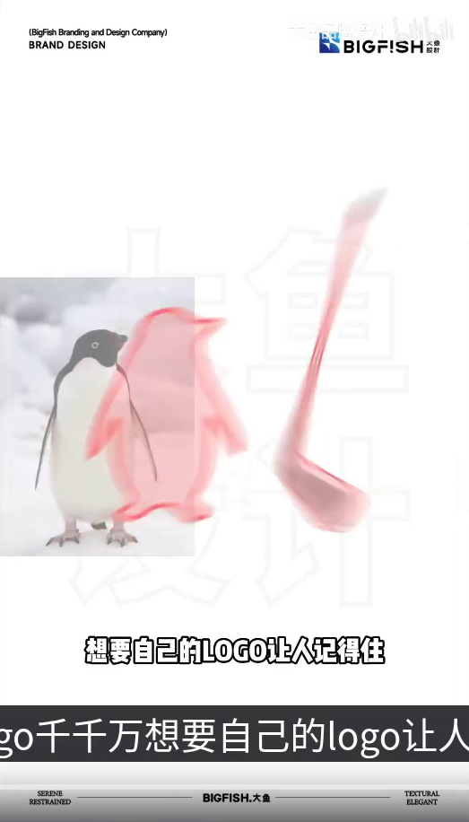

- **作者明确说法**：「想要自己的LOGO让人记得住」
- **整理者观察**：粉红色的企鹅剪影已经离开照片，照片还留在左边。球杆仍在右边，没有进到企鹅里；杆头朝下，长柄朝上，杆身带着运动残影。

### PG4 · 球杆转到斜向，杆头尚未完全进入

约 1.85s（录屏 22.35s）

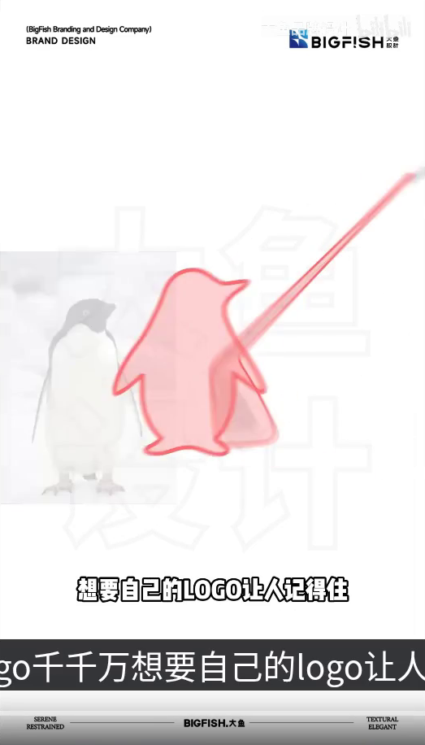

- **作者明确说法**：「想要自己的LOGO让人记得住」
- **整理者观察**：球杆已经转到斜向，长柄朝右上从颈部穿出头外；杆头正从身体右下往肚子里送，还有一部分露在外面。企鹅和球杆在这里相交，但还没有落到完成位置。左边的照片明显变淡。

### PG5 · 杆头落入腹内，长柄穿出颈部

约 1.95s（录屏 22.45s）

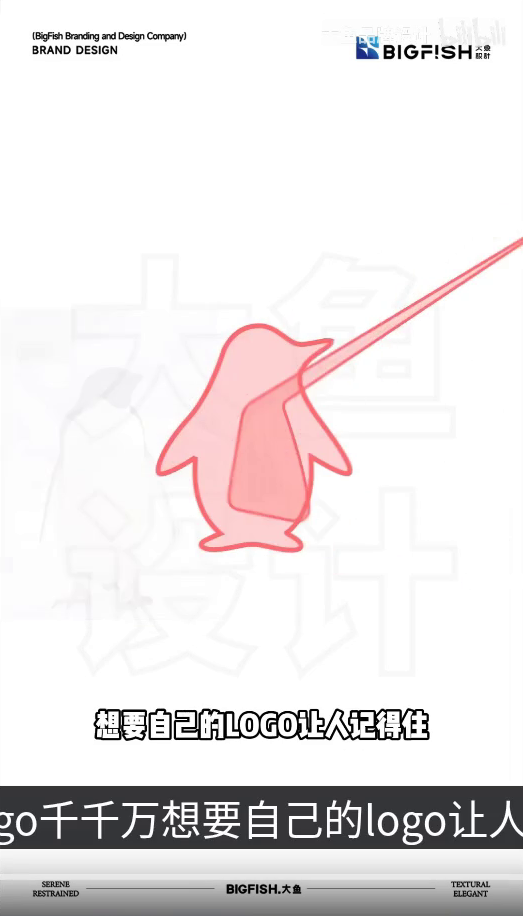

- **作者明确说法**：「想要自己的LOGO让人记得住」
- **整理者观察**：杆头已经落在肚子里，能看出杆头的形状；长柄朝右上从颈部穿出，身体外面还留着一段柄。整枚仍是粉红色填充和红色轮廓。左边的照片快要退去。

### PG6 · 嵌入后的粉红轮廓稳态

约 2.15s（录屏 22.65s）

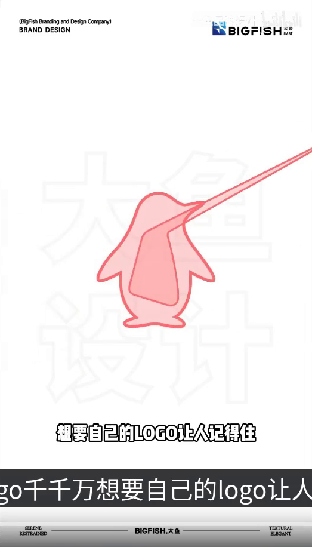

- **作者明确说法**：「想要自己的LOGO让人记得住」
- **整理者观察**：照片已经退去。结构与上一帧相同：杆头在腹内，长柄朝右上穿出颈部，体外仍有一段柄。还是粉红色填充和红色轮廓。

### PG7 · 身体转成灰色

约 2.5s（录屏 23.0s）

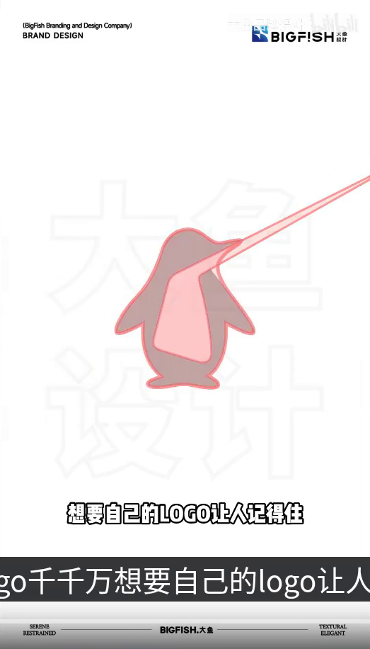

- **作者明确说法**：「想要自己的LOGO让人记得住」
- **整理者观察**：身体由粉转成灰色，杆头和柄还偏粉红色。体外的长柄还在。

### PG8 · 转成黑白，体外仍留淡柄

约 2.60s（录屏 23.1s）

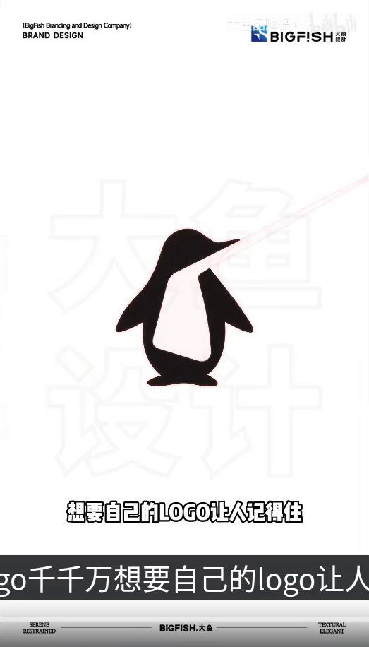

- **作者明确说法**：「想要自己的LOGO让人记得住」
- **整理者观察**：身体已经是黑色。肚子里的白色留白是杆头的形状，一道斜向的白缝从腹部通到颈部，是球杆的长柄；黑脑袋的斜下缘是这条白缝切出来的边。体外还留着一条很淡的柄。

### PG9 · 成标：体外的柄已经没有了

约 3.1s（录屏 23.6s）

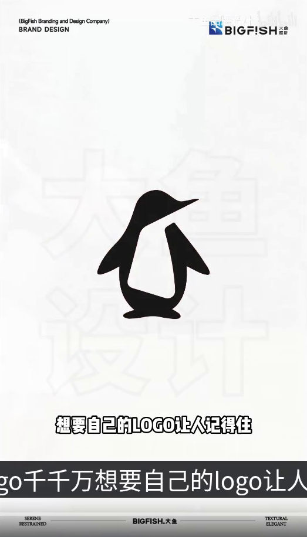

- **作者明确说法**：「想要自己的LOGO让人记得住」
- **整理者观察**：体外的柄已经没有了。腹部的白色留白是杆头的形状，通颈的斜白缝是柄。这是这一案线标的黑色完成态。

### PG10 · 用到高尔夫球场画面上，企鹅·高尔夫俱乐部 / PENGUIN GOLF

约 3.5s（录屏 24.0s）

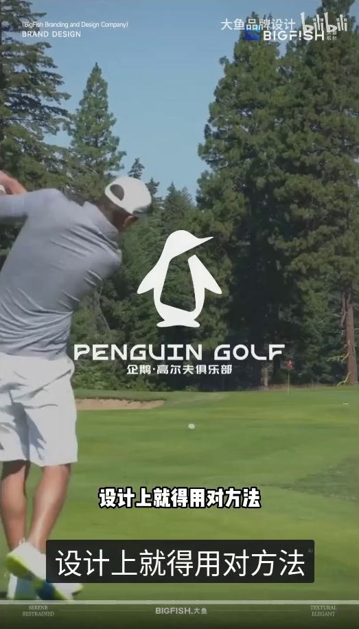

- **作者明确说法**：「设计上就得用对方法」
- **整理者观察**：同一件标志反白，平面叠在高尔夫球场的画面上，能看到击球者的腿和草地。字标为「企鹅·高尔夫俱乐部」和「PENGUIN GOLF」。

### 思路与前后关系（整理者分析，非作者原话）

企鹅和球杆先分开并置，再描上轮廓。球杆转到斜向之后，杆头落入肚子里，长柄从颈部朝右上穿过。转成黑白时，腹部的白色留白就是杆头，通颈的斜白缝就是柄。用到高尔夫球场画面上时，字标写成「企鹅·高尔夫俱乐部」和「PENGUIN GOLF」。

---

## 案例二：字母 H + 锤子 正负形设计 / HAMMER CONSTRUCTION

### HM1 · 对话框

约 5.7s（录屏 26.2s）

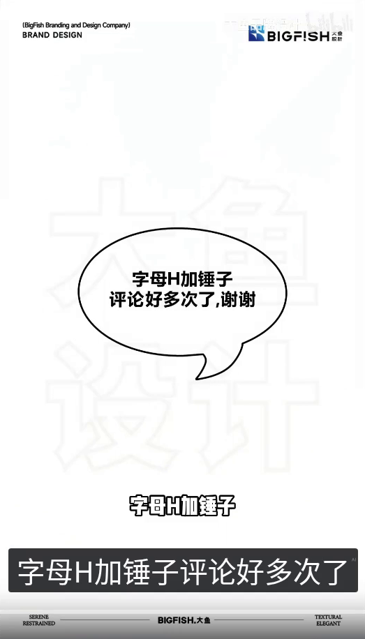

- **作者明确说法**：「字母H加锤子」。同一画面上，气泡里写着「字母H加锤子」「评论好多次了,谢谢」。
- **整理者观察**：白底中央是一个线框气泡，下面另有一行描边字。

### HM2 · 正负形设计

约 8.9s（录屏 29.4s）

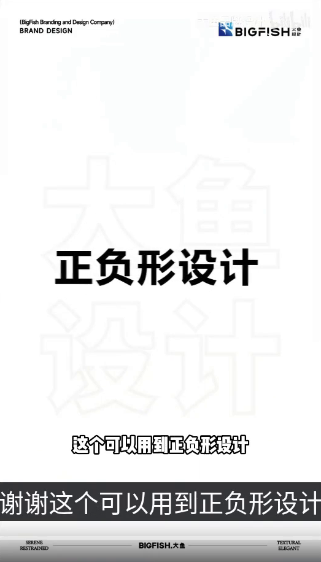

- **作者明确说法**：「这个可以用到正负形设计」
- **整理者观察**：白底正中是题板「正负形设计」。

### HM3 · 先画一个字母 H

约 10.3s（录屏 30.8s）

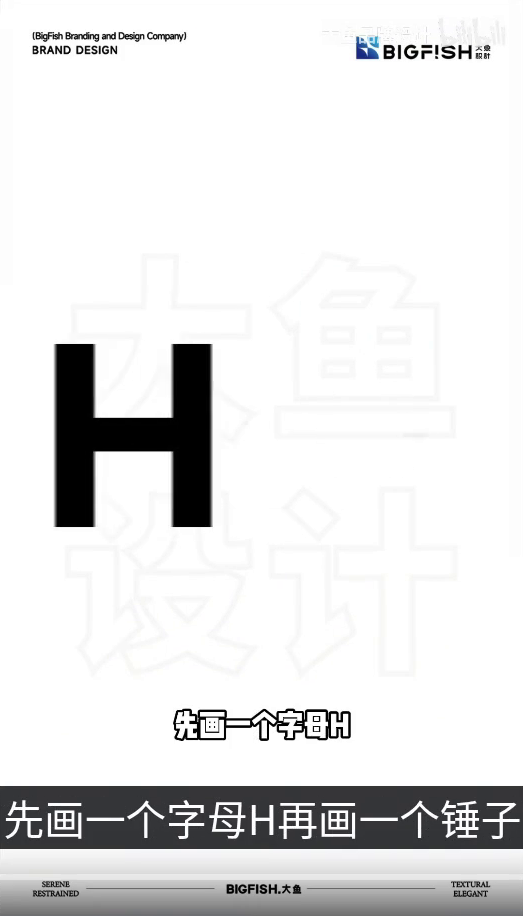

- **作者明确说法**：「先画一个字母H」
- **整理者观察**：白底左侧是一枚很大的黑色无衬线 H，右边还没有锤子。

### HM4 · 再画一个锤子，并置

约 12.7s（录屏 33.2s）

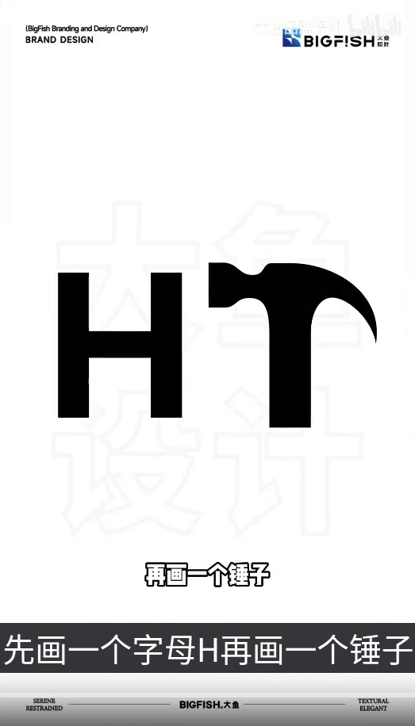

- **作者明确说法**：「再画一个锤子」
- **整理者观察**：黑色爪锤出现在右边，和左边的 H 分开并置，还没有叠到一起。

### HM5 · 锤子转红，开始向左移

约 12.9s（录屏 33.4s）

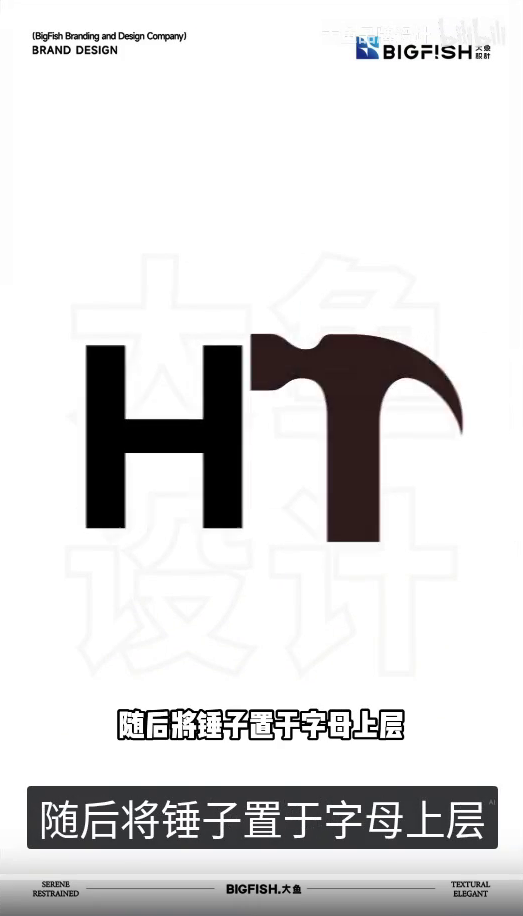

- **作者明确说法**：「随后將锤子置于字母上层」
- **整理者观察**：锤子由黑转成棕红色，并开始向左移动，还没有完全叠到 H 上。

### HM6 · 红锤正在叠上 H

约 13.1s（录屏 33.6s）

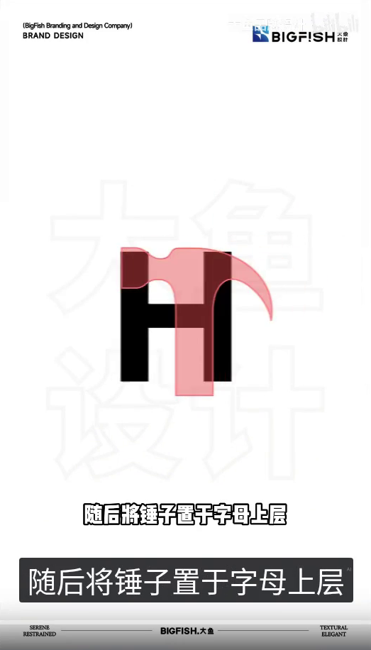

- **作者明确说法**：「随后將锤子置于字母上层」
- **整理者观察**：红色锤子已经叠到 H 上一部分，还带着移动的中间状态，没有完全落稳。

### HM7 · 半透明红锤叠在 H 上层

约 13.3s（录屏 33.8s）

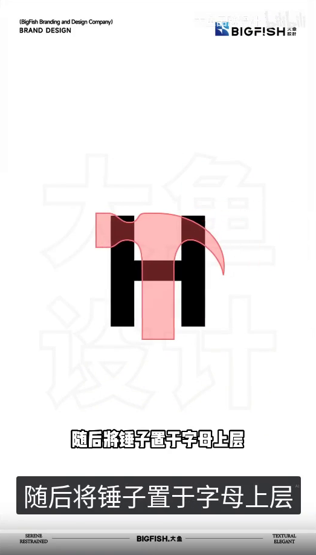

- **作者明确说法**：「随后將锤子置于字母上层」
- **整理者观察**：半透明的粉红锤子已经叠在黑色 H 的上层，位置稳定下来。H 的外形这时还没有跟着锤子改。

### HM8 · H 的两竖上沿开始跟着锤腹弧化

约 15.1s（录屏 35.6s）

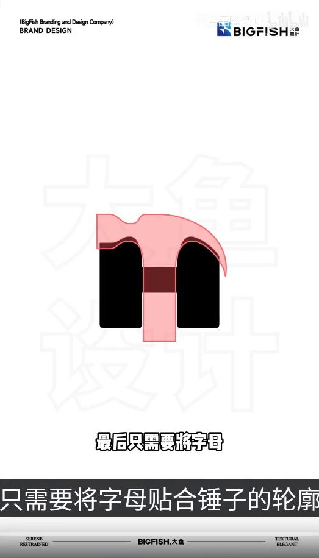

- **作者明确说法**：「最后只需要將字母」
- **整理者观察**：两竖的上沿已经跟着锤子腹部的弧线弯下来，沿曲线还留着细细的红边或浅边。最上面那条黑帽条还没有出现，H 的中横还在。

### HM9 · 字母贴合锤子的轮廓

约 15.9s（录屏 36.4s）

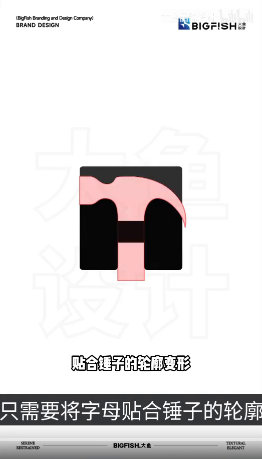

- **作者明确说法**：「贴合锤子的轮廓变形」
- **整理者观察**：顶部新出现一条黑帽条，下方黑色已经贴着锤子的轮廓收拢。粉锤仍是完整的一把，头和柄连在一起，爪伸到黑块右边外面，柄的下端略探出底边。

### HM10 · 撤掉红色，还留着一点浅粉

约 16.1s（录屏 36.6s）

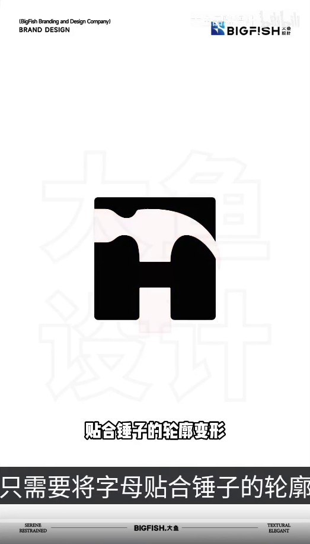

- **作者明确说法**：「贴合锤子的轮廓变形」
- **整理者观察**：粉色已经撤出，锤柄和爪端还留着一点浅粉。上方一条黑帽被贯通的白锤头和下方的 H 形黑块隔开，左右两边也被锤面和锤爪切开。锤柄穿过 H 中间那一横时，黑色横笔还在，白锤在这里断开；白柄的下端和 H 下面的字腔重合。

### HM11 · 成标：残粉退去

约 16.5s（录屏 37.0s）

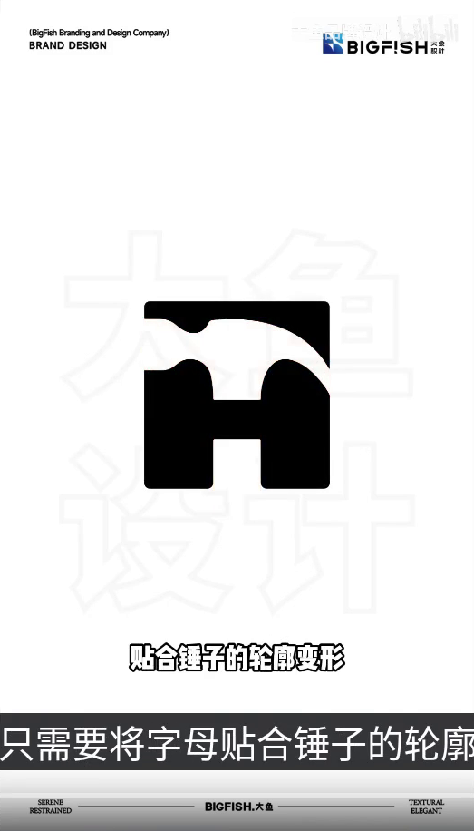

- **作者明确说法**：「贴合锤子的轮廓变形」
- **整理者观察**：浅粉已经退尽，结构和上一帧相同。这是这一案线标的黑色完成态。

### HM12 · 用到夜城画面上，HAMMER CONSTRUCTION

约 17.9s（录屏 38.4s）

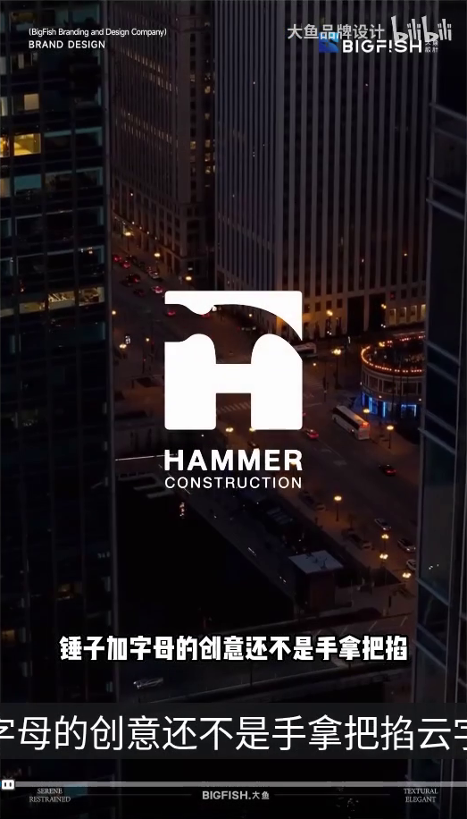

- **作者明确说法**：「锤子加字母的创意还不是手拿把掐」
- **整理者观察**：同一件标志反白，平面叠在夜城航拍的画面上。字标分两行，写成「HAMMER」和「CONSTRUCTION」。

### 思路与前后关系（整理者分析，非作者原话）

黑色的 H 和锤子先分开并置，锤子再改成红色，向左移到 H 上层；随后字母贴着锤子的轮廓改形。撤掉红色之后，上方的黑帽和下方的 H 形黑块被白锤头隔开，柄在 H 的中横处被黑笔断开，白柄下端和 H 下面的字腔重合。用到夜城画面上时，字标写成「HAMMER CONSTRUCTION」。

---

## 案例三：云字 + 星星 元素填充法 / 云谜 / CLOUD AND STARS

### YS1 · 原形：云字

约 23.1s（录屏 43.6s）

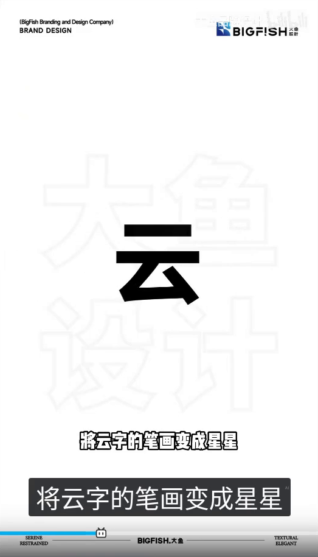

- **作者明确说法**：「將云字的笔画变成星星」
- **整理者观察**：白底中央是一枚「云」字：上面一道短横，下面一道较长的横，底部是厶，厶里有一块白色的三角空隙。

### YS2 · 上横换成一颗小星星

约 23.7s（录屏 44.2s）

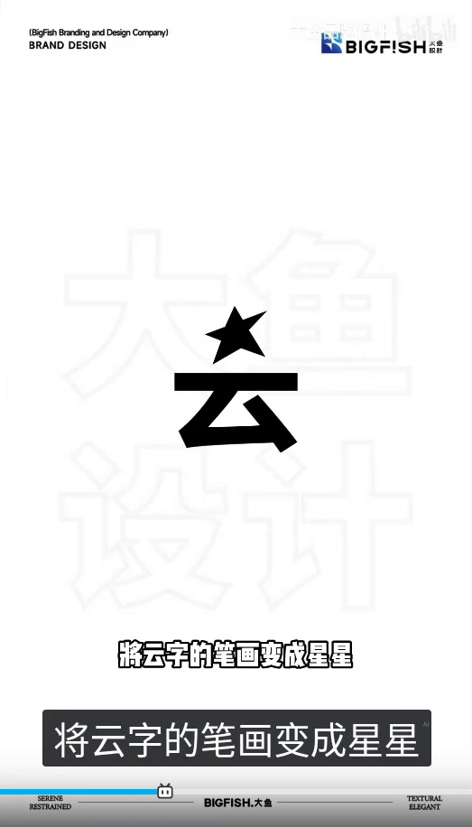

- **作者明确说法**：「將云字的笔画变成星星」
- **整理者观察**：原来的上横被一颗很小的五角星替换掉，第二道横和下面的厶都还在。

### YS3 · 这样太普通了，几何仍保持

约 24.3s（录屏 44.8s）

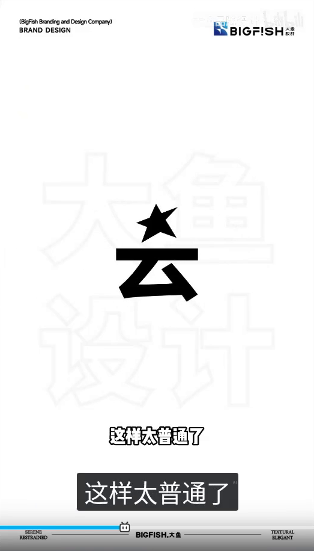

- **作者明确说法**：「这样太普通了」
- **整理者观察**：小星星替换上横的结构没有改，还是原来那一笔。

### YS4 · 把星星放大，原来的上横同时回来

约 25.4s（录屏 45.9s）

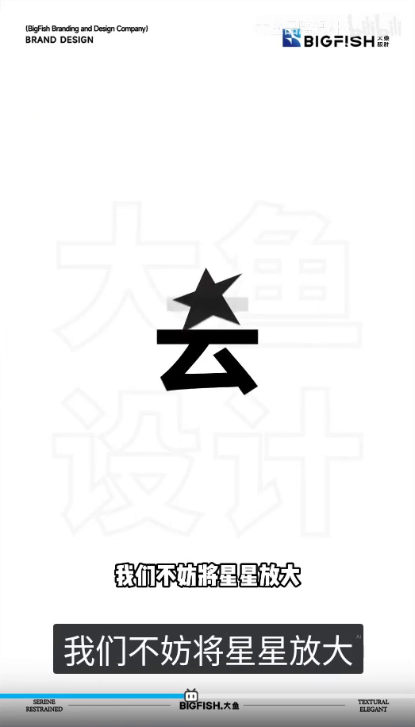

- **作者明确说法**：「我们不妨將星星放大」
- **整理者观察**：星星开始变大，原来的上横同时在放大的星星后面重新出现，云字正在被复原。

### YS5 · 大红轮廓空心星，正中是原来的云

约 25.7s（录屏 46.2s）

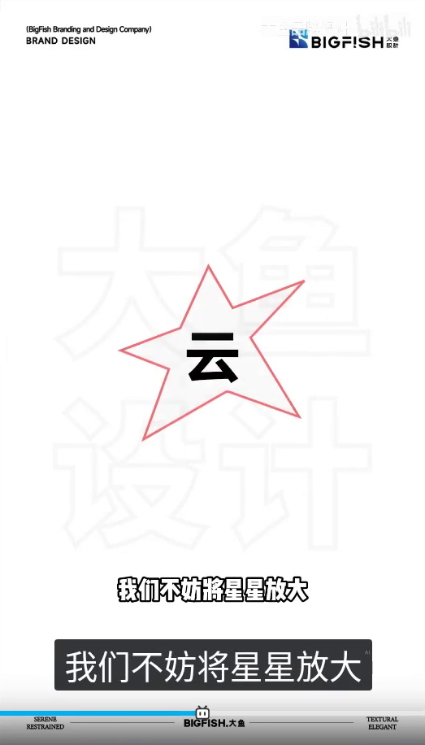

- **作者明确说法**：「我们不妨將星星放大」
- **整理者观察**：已经收成一枚带红色轮廓的空心五角星，正中是原来那枚完整的云字。

### YS6 · 云字开始变形、拉长

约 26.9s（录屏 47.4s）

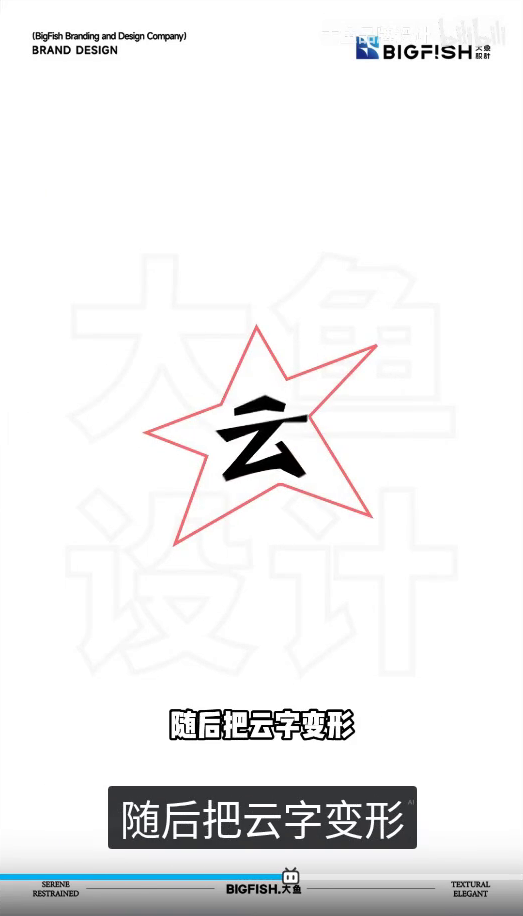

- **作者明确说法**：「随后把云字变形」
- **整理者观察**：云字开始倾斜、拉长，各笔还能认出来，正向星星的尖角伸过去。

### YS7 · 笔画几乎贴到星尖

约 27.05s（录屏 47.55s）

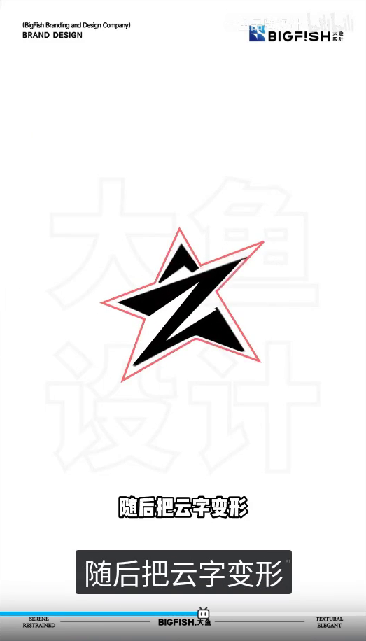

- **作者明确说法**：「随后把云字变形」
- **整理者观察**：笔画继续拉长，几乎贴到红色星尖，还带着一些运动残影。顶部的一笔、中间的折线和右下的延伸已经能分开看。

### YS8 · 填进星星内部，红轮廓还在

约 28.1s（录屏 48.6s）

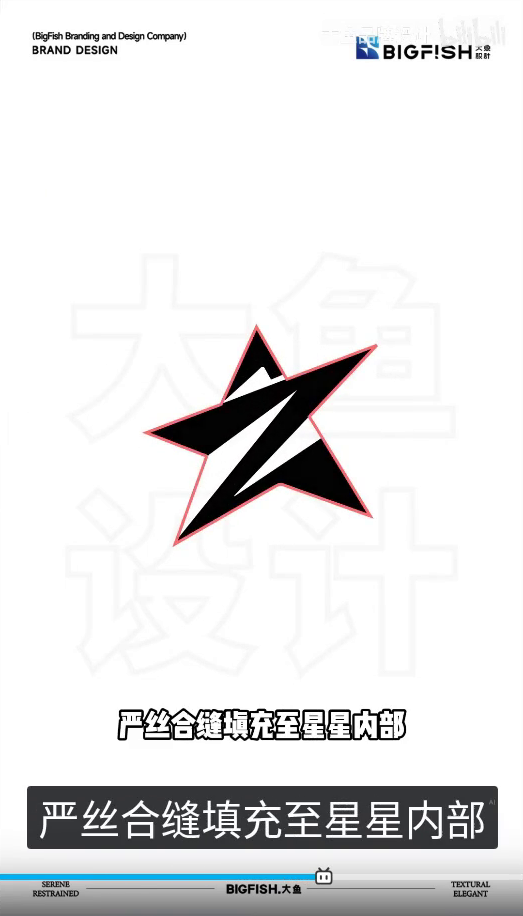

- **作者明确说法**：「严丝合缝填充至星星内部」
- **整理者观察**：黑色笔画已经填进星星里面，红色轮廓还在。顶部有一枚独立的尖角，和下面分开；下面是一块折线形的大块，带着朝左、右上、左下和右下的尖端，白色斜缝把笔画分开，右下那个尖和中间的折线在底部连在一起。

### YS9 · 红轮廓撤掉，成标

约 28.5s（录屏 49.0s）

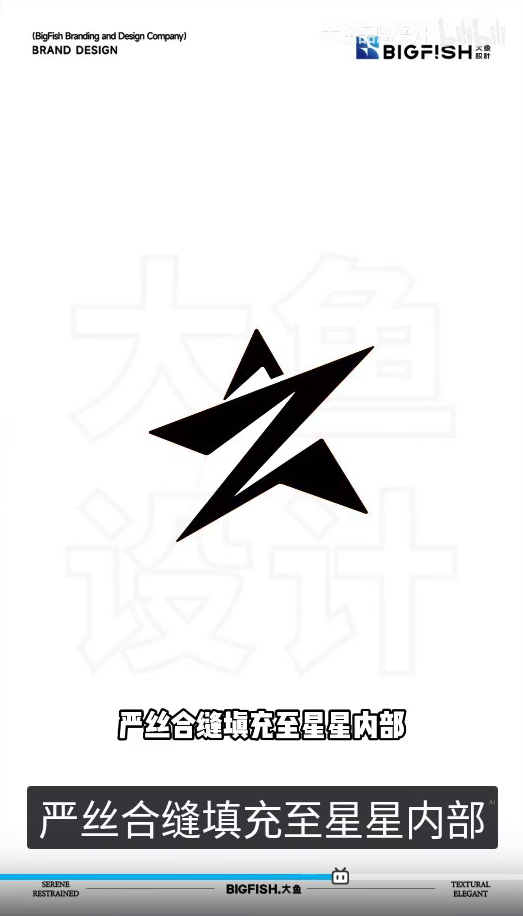

- **作者明确说法**：「严丝合缝填充至星星内部」
- **整理者观察**：红色轮廓已经撤掉。顶部仍是那枚独立的尖角；下面仍是那块折线形大块，带着朝左、右上、左下和右下的尖端，白色斜缝把笔画分开。五角星的外形由这些尖端共同构成。这是这一案线标的黑色完成态。

### YS10 · 用到星空上，云谜 / CLOUD AND STARS

约 30.5s（录屏 51.0s）

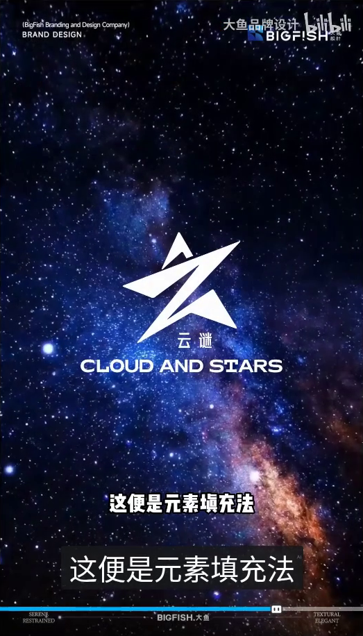

- **作者明确说法**：「这便是元素填充法」
- **整理者观察**：同一件标志反白，平面叠在星空画面上。字标为「云谜」和「CLOUD AND STARS」，两个汉字中间有空隙。

### 思路与前后关系（整理者分析，非作者原话）

先把云字的上横换成一颗小星星；觉得太普通之后，把星星放大，同时把原来的云复原到大星正中，再把云字的笔画拉长，填进星星里。顶部留下一枚独立的尖角，下面是一块带着四个尖端的折线形大块，白斜缝把笔画分开。用到星空画面上时，字标写成「云谜」和「CLOUD AND STARS」。

---

## 案例四：海龟 + 聊天 图形同构法 / 闺聊 / GUILIAO APP

### GL1 · 对话框

约 32.9s（录屏 53.4s）

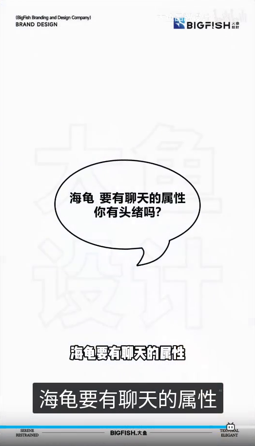

- **作者明确说法**：「海龟要有聊天的属性」。同一画面上，气泡里写着「海龟 要有聊天的属性」「你有头绪吗?」。
- **整理者观察**：白底中央是一个线框气泡，尾朝右下，下面另有一行描边字。

### GL2 · 原形：三点聊天气泡

约 35.5s（录屏 56.0s）

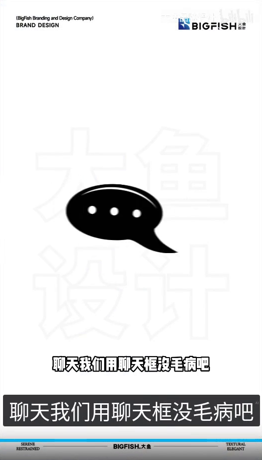

- **作者明确说法**：「聊天我们用聊天框沒毛病吧」
- **整理者观察**：白底中央是一个实心黑色的椭圆聊天气泡，里面横排三个白圆点，尾巴在右下、朝右下。

### GL3 · 先找共同点

约 37.5s（录屏 58.0s）

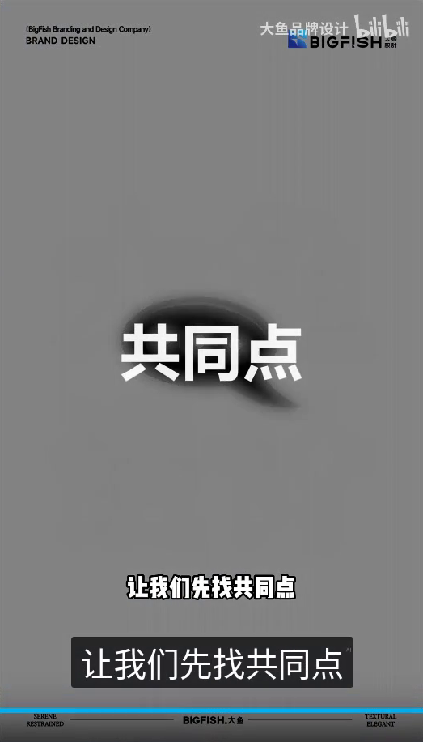

- **作者明确说法**：「让我们先找共同点」
- **整理者观察**：深灰底正中是大字题板「共同点」。

### GL4 · 把海龟照片放在旁边对比

约 38.9s（录屏 59.4s）

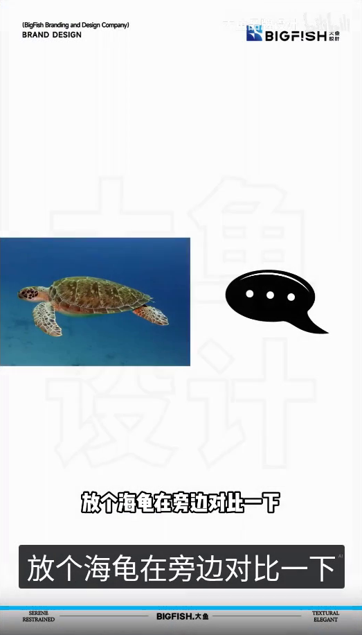

- **作者明确说法**：「放个海龟在旁边对比一下」
- **整理者观察**：左边是一张矩形的彩色海龟照片，海龟在蓝色水里游向左边；右边是原来那个三点聊天气泡，尾巴仍朝右下。两者相邻，没有重叠。

### GL5 · 第一处红轮廓：壳和后鳍

约 40.5s（录屏 61.0s）

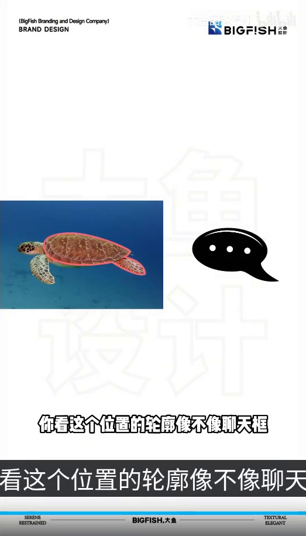

- **作者明确说法**：「你看这个位置的轮廓像不像聊天框」
- **整理者观察**：红色轮廓加在海龟的壳和右侧后鳍上，围成一个圆体加向右收的泡状外形；头和前鳍不在这圈里面。右边的聊天气泡本身没有描红。

### GL6 · 图形同构法

约 42.7s（录屏 63.2s）

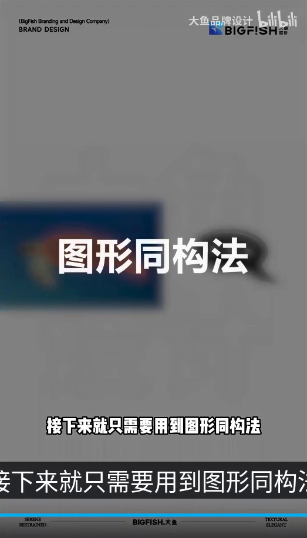

- **作者明确说法**：「接下来就只需要用到图形同构法」
- **整理者观察**：画面正中是题板「图形同构法」，照片和气泡退到后面，变得发虚。

### GL7 · 第二处红轮廓：头和前鳍

约 45.2s（录屏 65.7s）

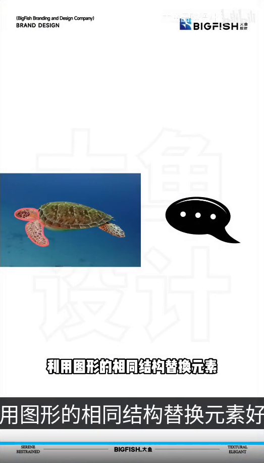

- **作者明确说法**：「利用图形的相同结构替换元素」
- **整理者观察**：红轮廓已经改到头和左边的前鳍上；后鳍和壳不再描红。右边的聊天气泡仍在原来的位置。

### GL8 · 头和前鳍上出现粉红色填充

约 45.35s（录屏 65.85s）

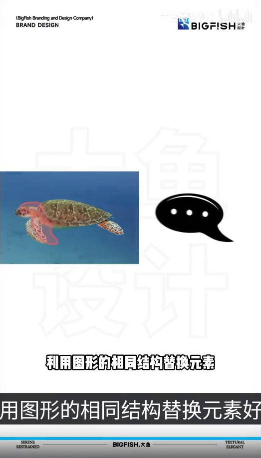

- **作者明确说法**：「利用图形的相同结构替换元素」
- **整理者观察**：头和前鳍上出现一层粉红色的填充，像一层剪影罩在照片上。气泡还在右边。

### GL9 · 照片变淡，气泡向左靠拢

约 45.55s（录屏 66.05s）

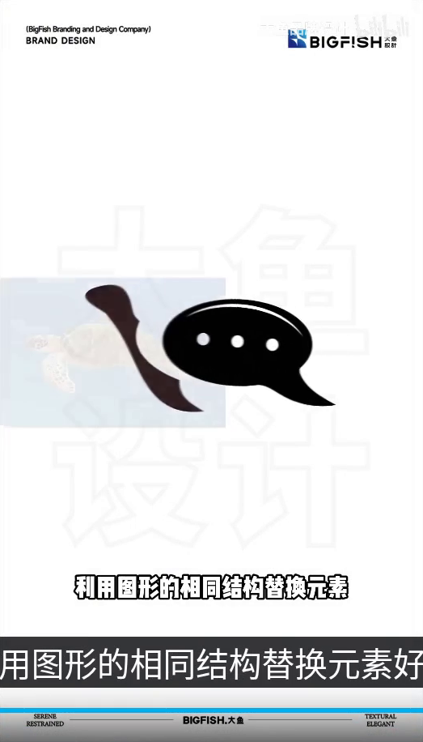

- **作者明确说法**：「利用图形的相同结构替换元素」
- **整理者观察**：照片明显变淡，黑色的头和前鳍已经显出来；聊天气泡正向左移动，还没有完全接到身上，带着运动残影。

### GL10 · 成标：头和前鳍接上三点气泡

约 45.9s（录屏 66.4s）

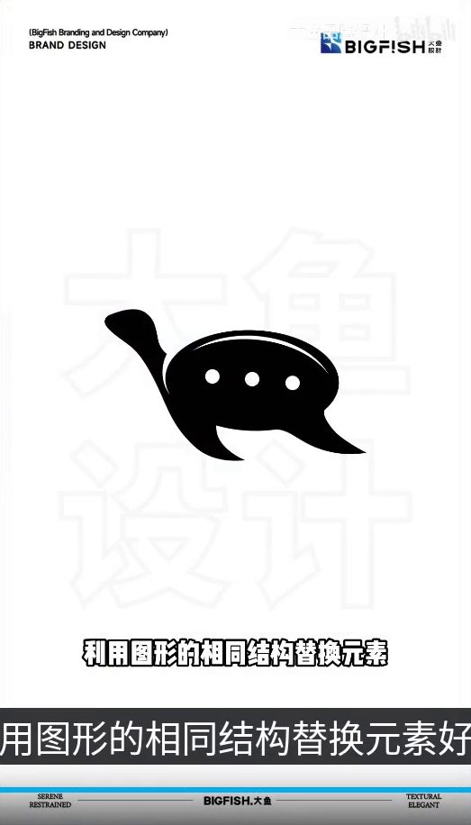

- **作者明确说法**：「利用图形的相同结构替换元素」
- **整理者观察**：照片已经退去。左边是黑色的海龟头和前鳍，身体是原来那个三点聊天气泡，右下的尾巴还是气泡原来的尾巴，前鳍收在气泡左下。这是这一案线标的黑色完成态。

### GL11 · 用到水下海龟画面上，闺聊 / GUILIAO APP

约 47.3s（录屏 67.8s）

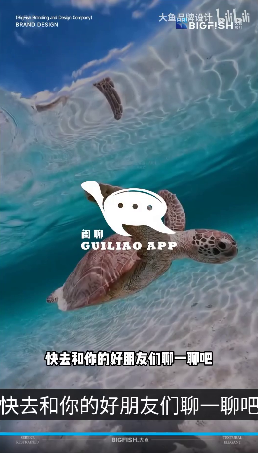

- **作者明确说法**：「快去和你的好朋友们聊一聊吧」
- **整理者观察**：同一件标志反白，平面叠在水下海龟的画面上。字标为「闺聊」和「GUILIAO APP」。

### 思路与前后关系（整理者分析，非作者原话）

先画出一个三点聊天气泡，再把海龟照片放在旁边对比。壳和后鳍这一圈跟气泡外形相近，头和前鳍则留下来。照片退去之后，头和前鳍接到原来的三点气泡上，气泡的尾巴仍朝右下。用到水下画面上时，字标写成「闺聊」和「GUILIAO APP」。

---

## 收束：三例并列

约 50.5s（录屏 71.0s）

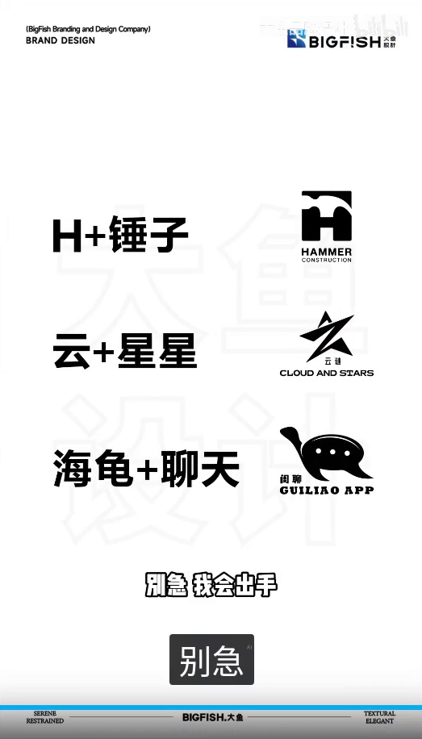

- **作者明确说法**：「别急 我会出手」
- **整理者观察**：白底三行并列，没有片头的企鹅高尔夫。左侧写着「H+锤子」、「云+星星」、「海龟+聊天」；右侧各配对应的完成态标志，以及字标 HAMMER CONSTRUCTION、云谜 / CLOUD AND STARS、闺聊 / GUILIAO APP。
