# [只要找出共同笔画，LOGO设计也就手拿把掐](https://www.bilibili.com/video/BV1x6Y76yEay/)｜大鱼品牌设计

文中「约 00:mm」是按播放器时钟校准的近似时刻，误差约 ±1s；括号内为录屏精确秒。

## 案例一：字母 u 与 m / YOUMENG

### YM1 · 开播前预览：分开的 u 与 m

约 00:00–01（录屏 0.000s，开播前暂停预览）

播放器时钟在预览段多见 00:01/00:44，开播过渡才短暂出现 00:00。此帧是暂停预览截图，不能按录屏 0 秒用偏移公式写成负秒；约视频只标 00:00–01 近似。

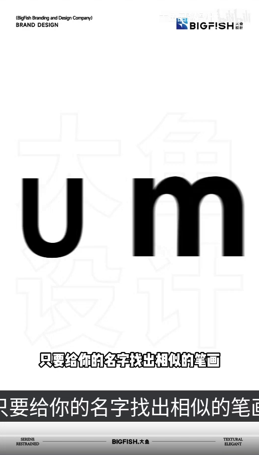

- **作者明确说法**：「只要给你的名字找出相似的笔画」
- **整理者观察**：这是开播前的暂停预览，不是播放中的截图。白底上已经是设计源图：左侧一个几何无衬线小写 u，右侧一个双拱的 m，两字间距较宽，中间有清楚的空白。

### YM2 · 相邻两竖涂红，中间有白缝

约 00:02（录屏 81.267s）

- **作者明确说法**：「只要给你的名字找出相似的笔画」
- **整理者观察**：u 的右竖被涂成红／酒红，色界斜切进碗的右下；m 的左竖是通高的红条。u 的左竖和碗、m 的两道黑拱仍是黑。两条红竖之间有清楚白缝，并没有收成一根。

### YM3 · 红色撤去，两字仍分开

约 00:03（录屏 82.633s）

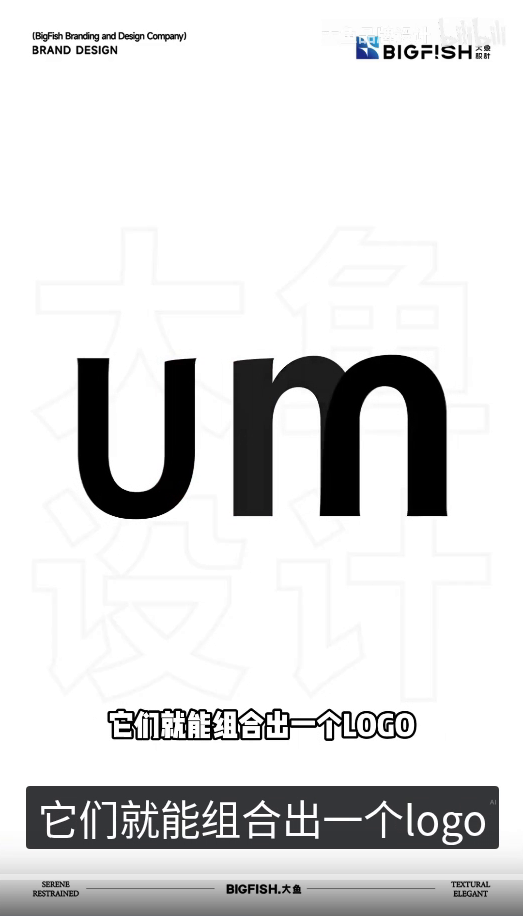

- **作者明确说法**：「它们就能组合出一个LOGO」
- **播放器字幕**：「它们就能组合出一个logo」
- **整理者观察**：红色已经撤去，仍是较粗的无衬线 u 和完整的双拱 m，u 的右竖与 m 的左竖之间仍有白缝。

### YM4 · 改成高对比字体，右侧还留着残影

约 00:03（录屏 82.800s）

- **作者明确说法**：「它们就能组合出一个LOGO」
- **播放器字幕**：「它们就能组合出一个logo」
- **整理者观察**：这一帧和上一帧之间，录屏有 0.167s 空隙。字体已经改成高对比：左边是 U，右侧还留着 m 左竖和第一拱的灰色残影，更右边已经是单拱的 n 形。

### YM5 · 左 U 右 n 形，底和顶是极细的弧线连接

约 00:04（录屏 83.200s）

- **作者明确说法**：「它们就能组合出一个LOGO」
- **播放器字幕**：「它们就能组合出一个logo」
- **整理者观察**：灰色残影已经消失。左边是 U：两竖较粗，顶部有楔形细衬线，底部以极细的弧线相连。右边是 n 形：两竖较粗，底端略向外撇，顶部以极细的弧线相接。两字并排，中间有清楚白缝。看起来像 Un，不是双拱的 Um。

### YM6 · 用到植物照片上，YOUMENG

约 00:05（录屏 84.367s）

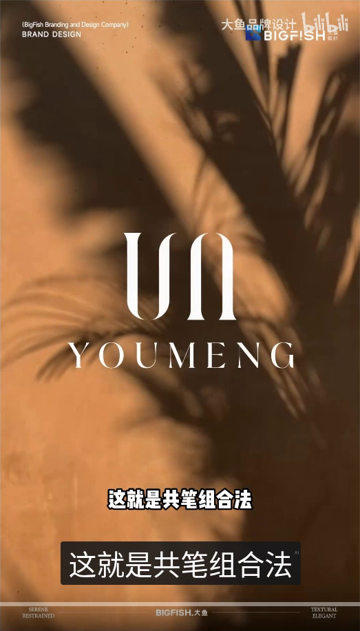

- **作者明确说法**：「这就是共笔组合法」
- **整理者观察**：上一完整白底态到应用之间，录屏有 83.967→84.167 约 0.200s 空隙，没有单独录到「只有照片、还没有字标」的画面。这一帧已经是暖色植物照片，上面是奶油色的字母标，下方写着全大写、宽字距的 YOUMENG，没有中文。

### 思路与前后关系（整理者分析，非作者原话）

开播前的预览里就已经放上小写 u 和双拱 m，两字分开。播放中先把相邻的两竖涂红，红撤去后两字仍分开，再改成高对比字体：左是 U，右是单拱的 n 形，中间仍有白缝；U 的底部、n 的顶部都是极细的弧线连接。用到暖色植物照片上时，字标写成 YOUMENG，没有中文。这一案没有进入片尾三行回顾。这是整理者根据可见结构作的归纳，片内说的是「只要给你的名字找出相似的笔画」「它们就能组合出一个LOGO」「这就是共笔组合法」。

---

## 案例二：字母 C 与 R / CHURUN

### CR1 · 气泡：字母C和R

约 00:07（录屏 86.733s）

- **作者明确说法**：「可以帮我设计一下吗」
- **播放器字幕**：「字母C和R可以帮我设计一下吗」
- **整理者观察**：画面是一个椭圆对话泡，两行写着「字母C和R」「可以帮我设计一下吗?」，第二行末有西文问号。这一帧的片内只有「可以帮我设计一下吗」，没有问号。

### CR2 · 红／酒红提示，两字仍分开

约 00:09（录屏 88.933s）

- **作者明确说法**：「你就找到它们的共同笔画」
- **播放器字幕**：「你就找到他们的共同笔画」
- **整理者观察**：字母飞入之后，录屏有 88.433→88.933 约 0.500s 空隙。这一帧是分开的黑 C 和黑 R。C 的下弧被涂成红／酒红，色界在左侧斜切；R 的横档是压在竖上的红／鲑色矩形。其余笔画仍是黑。提示色不是灰色。

### CR3 · 提示色更亮，偏珊瑚

约 00:10（录屏 89.667s）

- **作者明确说法**：「你就找到它们的共同笔画」
- **播放器字幕**：「你就找到他们的共同笔画」
- **整理者观察**：结构与上一帧相同，两字仍分开。提示色变亮，更偏珊瑚。

### CR4 · 红色撤尽，仍是分开的黑 C、R

约 00:11（录屏 90.233s）

- **作者明确说法**：「你就找到它们的共同笔画」
- **播放器字幕**：「你就找到他们的共同笔画」
- **整理者观察**：上一帧到这一帧之间，录屏有 89.700→90.233 约 0.533s 空隙。红色在两字仍分开时就已经撤尽，成为全黑的 C 和 R，中间仍有空隙。

### CR5 · 叠成一件字母标

约 00:11（录屏 90.767s）

- **作者明确说法**：「再根据共笔组合到一起」
- **整理者观察**：C 和 R 已经叠成一件字母标：开口较大的 C 包住 R 的左上方，C 的下笔划穿过 R 的竖；R 有尖的左上衬线和斜腿。

### CR6 · 出现很淡的圆

约 00:13（录屏 92.067s）

- **作者明确说法**：「再根据共笔组合到一起」
- **播放器字幕**：「最后加个外框」
- **整理者观察**：同一件字母标四周已经出现一圈很淡的浅灰圆。这一帧的片内还没有换成「最后加个外框」。

### CR7 · 圆框完整

约 00:14（录屏 93.000s）

- **作者明确说法**：「最后加个外框」
- **整理者观察**：圆框已经完整，颜色是灰的，圈住整件 CR 字母标。

### CR8 · 用到雪山照片上，CHURUN

约 00:15（录屏 94.100s）

- **作者明确说法**：「高级又简约的LOGO是不是轻轻松松」
- **播放器字幕**：「高级又简约的logo是不是轻轻松松」
- **整理者观察**：白底圆框态到应用之间，录屏有 93.000→93.167 约 0.167s 空隙。这一帧已经是暖光照射的雪山照片，上面是白色的圆框字母标，下方写着全大写、宽字距的 CHURUN，没有中文。

### 思路与前后关系（整理者分析，非作者原话）

先用气泡提出字母 C 和 R。随后给出黑色的 C 和 R，把 C 的下弧和 R 的横档涂成红／珊瑚，颜色在两字仍分开时就撤尽。再把两字叠成一件字母标，然后加上圆框。用到雪山照片上时，字标写成 CHURUN，没有中文。这是整理者根据可见结构作的归纳，片内说的是「可以帮我设计一下吗」「你就找到它们的共同笔画」「再根据共笔组合到一起」「最后加个外框」「高级又简约的LOGO是不是轻轻松松」。

---

## 案例三：字母 K 与 S / KAELUS

### KS1 · 气泡：K和S

约 00:18（录屏 97.000s）

- **作者明确说法**：「K和S能怎么设计呀」
- **整理者观察**：气泡两行写的是「K和S能怎么设计啊」「完全没有头绪」。片内这一帧是「呀」，不是气泡里的「啊」。

### KS2 · 几何 K 与曲 S，分开

约 00:20（录屏 99.900s）

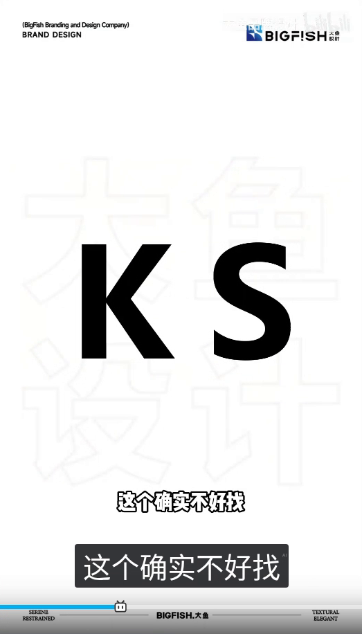

- **作者明确说法**：「这个确实不好找」
- **整理者观察**：左边是几何无衬线的 K（竖加两道斜），右边是经典的曲 S，两字分开，中间空档清楚。

### KS3 · 局部珊瑚：K 的两斜与 S 的上弧

约 00:21（录屏 100.667s）

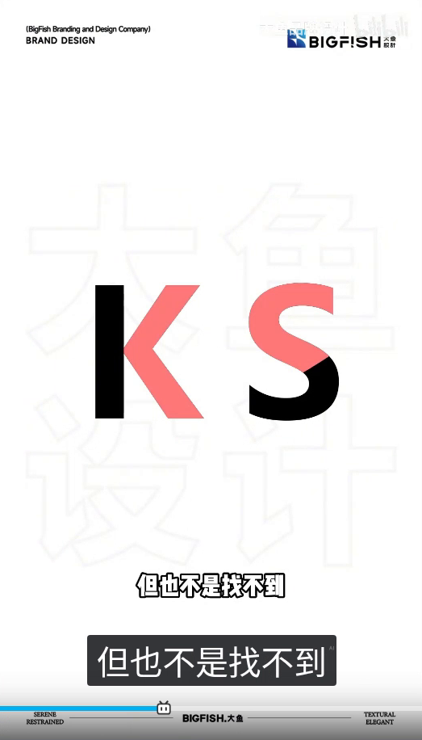

- **作者明确说法**：「但也不是找不到」
- **整理者观察**：上一帧到这一帧之间，录屏有 100.000→100.667 约 0.667s 空隙。珊瑚／粉红不是两字整字变色：K 的竖仍是黑，K 的两道斜是珊瑚；S 的上中弧是珊瑚，下端仍是黑，色界在 S 的右下有一道斜切。S 仍是曲 S，两字仍分开。

### KS4 · 颜色回深，仍是分开的曲 S

约 00:22（录屏 101.267s）

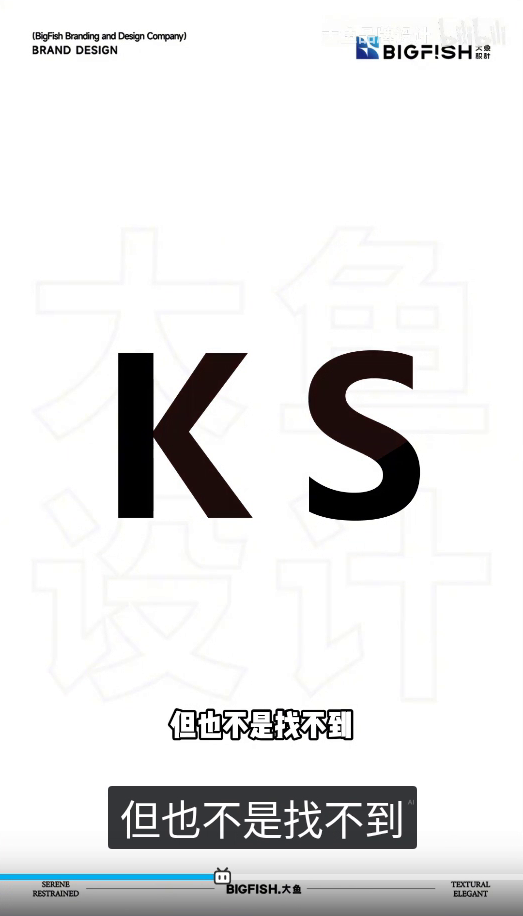

- **作者明确说法**：「但也不是找不到」
- **整理者观察**：提示色已经回深，接近黑。S 仍是曲线，两字仍分开。这是录到的最后一帧「分开的曲 S」。

### KS5 · 两块实心仍分开，右块已是折弯形

约 00:22（录屏 101.967s）

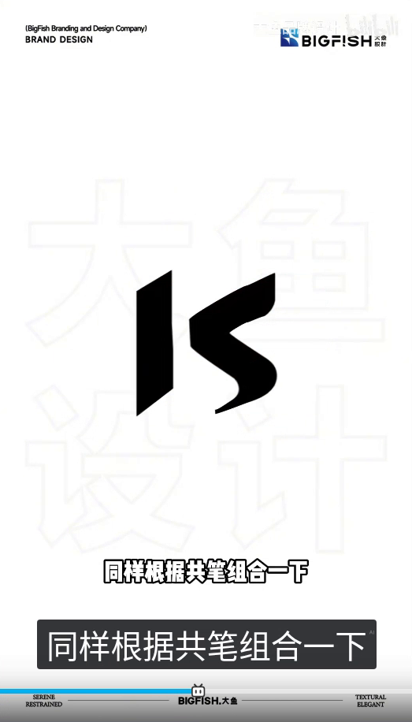

- **作者明确说法**：「同样根据共笔组合一下」
- **整理者观察**：上一帧到这一帧之间，录屏有 101.267→101.967 约 0.700s 空隙，曲 S 改成折弯形的过程没有单独录到。这一帧仍是两块分开的实心：左边是顶底斜切的竖板，右边是带圆转的折弯／S 形实心（上臂、中折、下钩），两块之间留着一道白缝，还没有收拢成一件。右边已经不是经典曲 S，也不是三折锐角折线。

### KS6 · 收拢成一块实心字母标

约 00:23（录屏 102.567s）

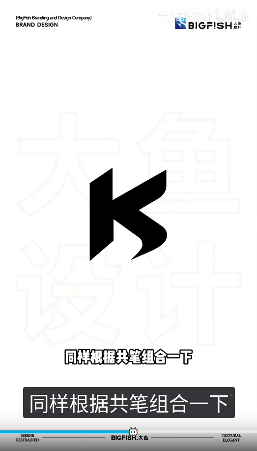

- **作者明确说法**：「同样根据共笔组合一下」
- **整理者观察**：左右两块已经收拢，成为一件填实的黑色字母标，左侧像 K 的竖板，右侧走成折弯的 S 向。

### KS7 · 深灰立体，尚未开口

约 00:24（录屏 103.300s）

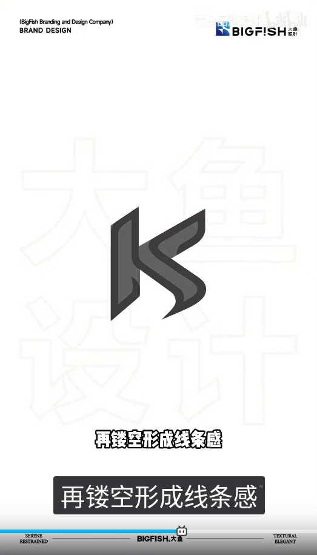

- **作者明确说法**：「再镂空形成线条感」
- **整理者观察**：上一帧到这一帧之间，录屏有 102.567→103.300 约 0.733s 空隙，镂空起手的过程没有单独录到。这一帧已是同一外轮廓的深灰立体／凿刻效果，内侧较亮、外侧较深，还不是完全开口的白槽。

### KS8 · 镂空线构

约 00:24（录屏 103.900s）

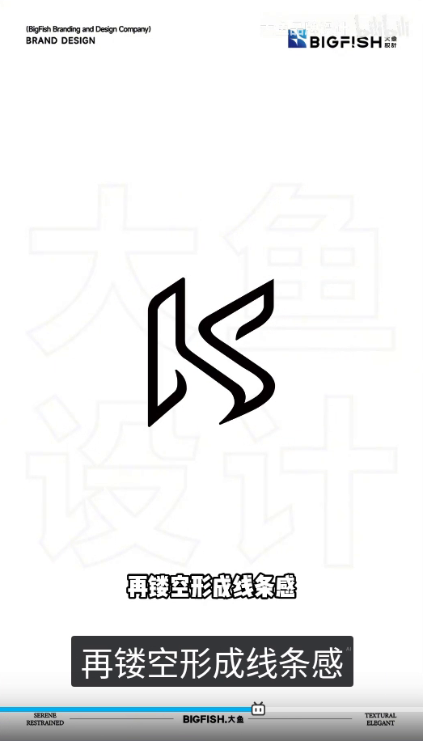

- **作者明确说法**：「再镂空形成线条感」
- **整理者观察**：已经是黑描边、中间开口的白槽：左边一条圆角矩形槽，左下一条钩，右侧两条平行的折弯描边夹着空隙。

### KS9 · 用到人物照片上，KAELUS

约 00:26（录屏 105.233s）

- **作者明确说法**：「一个充满国际感的LOGO」
- **播放器字幕**：「一个充满国际感的logo」
- **整理者观察**：镂空白底态到应用之间，录屏有 103.900→104.600 约 0.700s 空隙。这一帧已经是人物照片（黑高领、石阶／柱），上面是浅色镂空字母标，下方写着全大写的 KAELUS，再下方是带空距的「凯拉斯」。

### 思路与前后关系（整理者分析，非作者原话）

先用气泡提出 K 和 S。随后给出几何 K 和曲 S，把 K 的两斜和 S 的上弧涂成珊瑚，K 的竖和 S 的下端仍是黑；颜色回深时两字仍分开，S 仍是曲线。再往后，右块已经收成折弯形，但左右仍是两块实心、中间有缝，然后才收拢成一件实心字母标，再变成灰的立体效果，最后镂成开口的线构。用到人物照片上时，字标写成 KAELUS，下面有「凯拉斯」。这是整理者根据可见结构作的归纳，片内说的是「K和S能怎么设计呀」「这个确实不好找」「但也不是找不到」「同样根据共笔组合一下」「再镂空形成线条感」「一个充满国际感的LOGO」。

---

## 案例四：字母 J 与 S / JOYSUN

### JS1 · 气泡：J和S

约 00:30（录屏 109.000s）

- **作者明确说法**：「实在是找不出来怎么办」
- **整理者观察**：气泡两行写的是「J和S,实在是找不出来」「怎么办?」，S 后是西文逗号，「办」后有西文问号。片内是一行「实在是找不出来怎么办」，没有逗号，也没有问号。

### JS2 · J 在左、曲 S 在右

约 00:32（录屏 111.200s）

- **作者明确说法**：「那不如自己创造一个」
- **整理者观察**：左边是带左下钩的粗几何 J，右边是曲 S，两字分开。

### JS3 · S 正在撤去

约 00:33（录屏 112.700s）

- **作者明确说法**：「将字母J复制一个」
- **整理者观察**：S 已经变灰，正在撤去。J 仍是黑，右缘略有运动。

### JS4 · 两枚同向的 J

约 00:34（录屏 113.100s）

- **作者明确说法**：「将字母J复制一个」
- **整理者观察**：上一状态到这一帧之间，录屏有 112.800→113.100 约 0.300s 空隙。这一帧已经是两枚粗几何 J，钩都朝左下，S 已经不在。

### JS5 · 同时变细、加上顶横、底钩张开

约 00:35（录屏 114.133s）

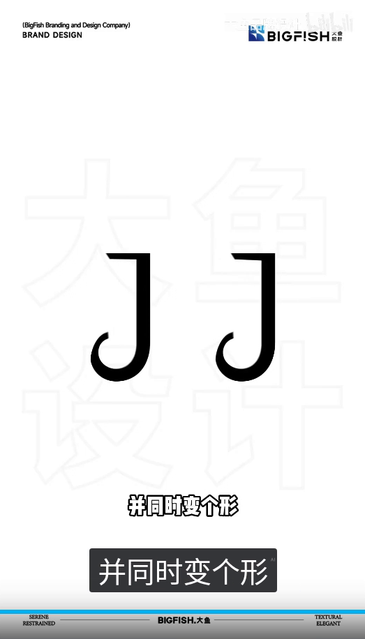

- **作者明确说法**：「并同时变个形」
- **整理者观察**：两枚 J 同时变细，顶上长出朝左的横，底钩张开成更大的圆碗、钩端上挑。两字朝向仍相同，钩都在左下。

### JS6 · 仍是两枚同向的细 J

约 00:35（录屏 114.633s）

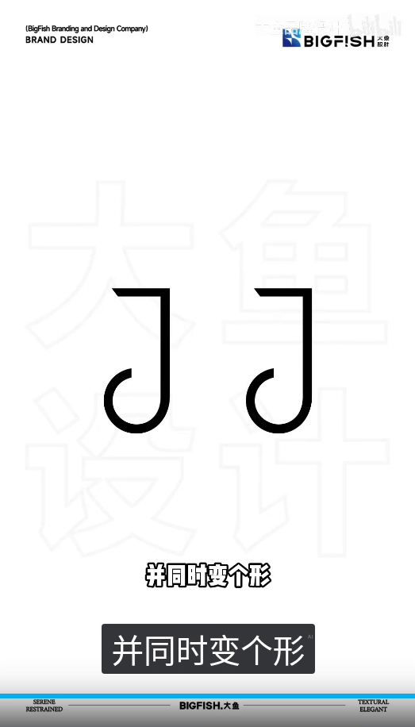

- **作者明确说法**：「并同时变个形」
- **整理者观察**：仍是两枚分开、同向的细 J，钩都在左下。这是翻转、组合之前最后录到的同向状态。

### JS7 · 组合后的首帧，右下尚未收住

约 00:36（录屏 115.200s）

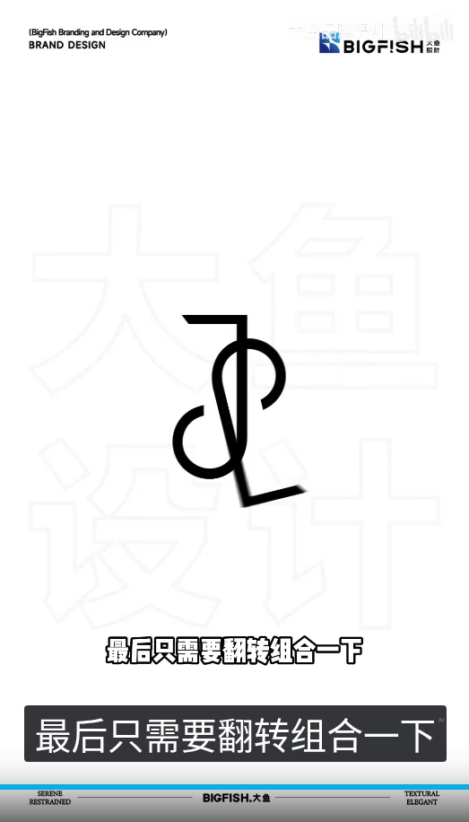

- **作者明确说法**：「最后只需要翻转组合一下」
- **整理者观察**：上一帧到这一帧之间，录屏有 114.633→115.200 约 0.567s 空隙，翻转和组合的过程基本没有单独录到。这一帧已经组到一起，右下还有一笔未收住的横／腿，略带运动模糊。

### JS8 · 蓝色 S 形注记

约 00:37（录屏 116.800s）

- **作者明确说法**：「你看字母S是不是出来了」
- **整理者观察**：字母标已经收紧。中部叠着一道半透明的蓝色 S 形注记，沿着下左弧、中央两竖之间的缝、上右弧描出一条路径。这是讲解用的分析注记，不是标志本身的一部分。

### JS9 · 注记撤去：中央两根平行竖，中间有白缝

约 00:38（录屏 117.933s）

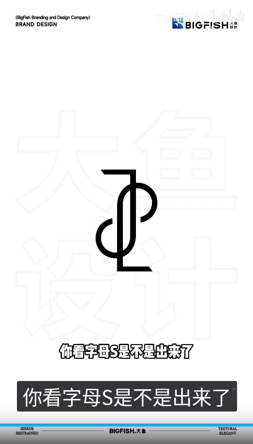

- **作者明确说法**：「你看字母S是不是出来了」
- **整理者观察**：蓝色注记已经撤去。中央是两根平行的竖，中间有清楚白缝，并不是一根竖。朝左的顶横在较右那根竖的上端，较右竖向下接左下弧；较左那根竖向上接右上弧，下端接朝右的底横。白底上没有另外加的椭圆框。

### JS10 · 用到风景照片上，JOYSUN

约 00:40（录屏 119.200s）

- **作者明确说法**：「中间不就是共笔吗」
- **整理者观察**：白底态到应用之间，录屏有 118.167→118.433 约 0.267s 空隙。这一帧已经是风景照片（树、水面、长椅上的人、一只黑白狗、绿色坡地），上面是白色字母标，下方写着全大写、宽字距的 JOYSUN，没有中文。字母标仍是中央两根平行竖、中间有白缝；朝左顶横在较右竖上端，较右竖下接左下弧，较左竖上接右上弧、下端接朝右底横，没有另外的椭圆框。

### 思路与前后关系（整理者分析，非作者原话）

先用气泡提出 J 和 S 不好找。随后给出 J 和曲 S，再撤去 S，留下两枚同向的 J，同时变细、加上朝左的顶横、把底钩张开。再往后组到一起：稳住之后，中央是两根平行竖，中间有白缝；朝左顶横在较右竖上端，较右竖下接左下弧，较左竖上接右上弧、下端接朝右底横，没有另外加的椭圆框。蓝色 S 形注记沿着下左弧、两竖之间的缝和上右弧描出一条路径，随后撤去。用到风景照片上时，字标写成 JOYSUN，没有中文。这是整理者根据可见结构作的归纳。作者在应用帧说「中间不就是共笔吗」，只作为该步原话单列；片内还说了「实在是找不出来怎么办」「那不如自己创造一个」「将字母J复制一个」「并同时变个形」「最后只需要翻转组合一下」「你看字母S是不是出来了」。

---

## 收束：三例并列

### SB1 · 三行回顾

约 00:42（录屏 121.267s）

- **作者明确说法**：「还有没有难搞的」
- **播放器字幕**：「下课还有没有难搞的」
- **整理者观察**：回顾出现前，录屏有 120.733→121.100 约 0.367s 空隙。白底上是三行：C+R 对应带圆框的 CR 字母标和 CHURUN；K+S 对应镂空 KS 字母标、KAELUS 和「凯拉斯」；J+S 对应 JS 字母标和 JOYSUN。没有 YOUMENG／u 与 m 这一行。

### SB2 · 别急 我会出手

约 00:42（录屏 121.800s）

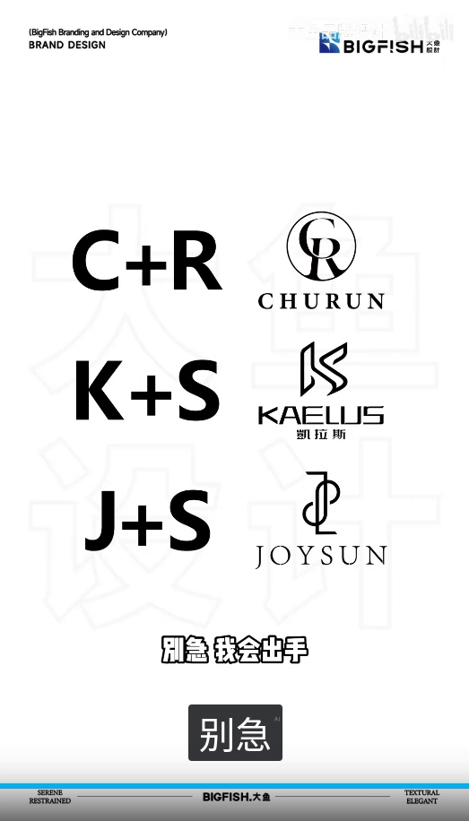

- **作者明确说法**：「别急 我会出手」
- **播放器字幕**：「别急」
- **整理者观察**：三行回顾仍在。片内「别急」和「我会出手」之间有空隙；这一帧的播放器字幕只见到「别急」。
