# [跳出常规，你的LOGO将会变得很有创意](https://www.bilibili.com/video/BV1yhYC62EuK/)｜大鱼品牌设计

文中「约 00:mm」是按播放器时钟校准的近似时刻，误差约 ±1s；括号内为录屏精确秒。

## 案例一：天平与牛 / 牛公平

### NF1 · 原形：金天平与牛

约 00:02（录屏 55.300s）

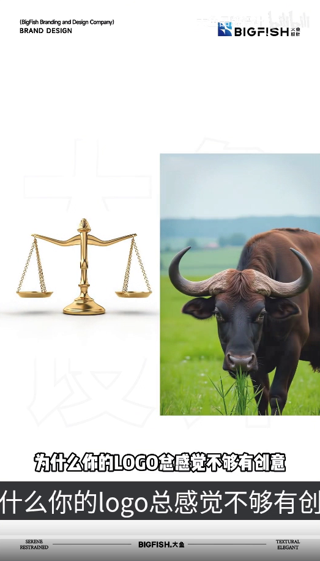

- **作者明确说法**：「为什么你的LOGO总感觉不够有创意」
- **播放器字幕**：「为什么你的logo总感觉不够有创意」
- **整理者观察**：这是播放中的原形。白底左侧是一架金色天平，右侧是一张草地里弯角牛的照片。两件还是分开的，没有收成组合标。

### NF2 · 红帽先自上方落下

约 00:02（录屏 55.867s）

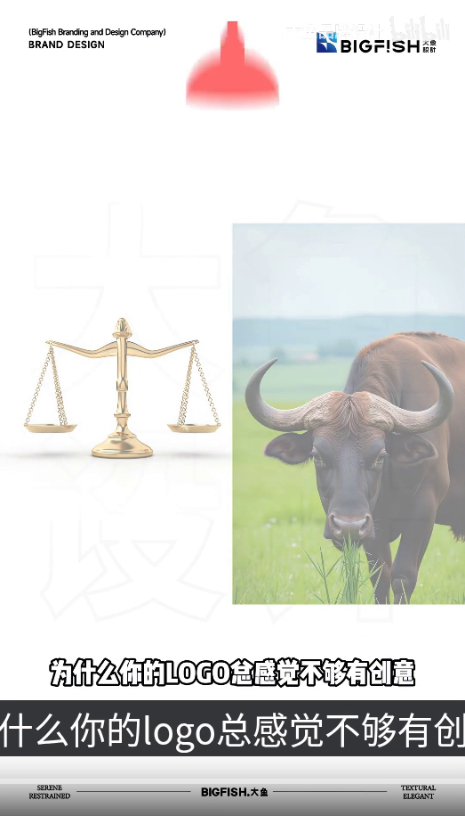

- **作者明确说法**：「为什么你的LOGO总感觉不够有创意」
- **整理者观察**：画面最上沿出现一枚红色帽状体，天平和牛还在原来的位置。

### NF3 · 中央立柱与穹正在下落

约 00:03（录屏 56.000s）

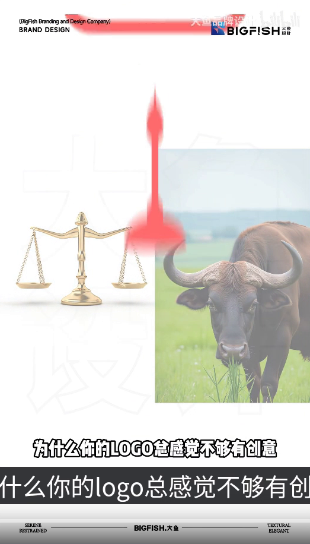

- **作者明确说法**：「为什么你的LOGO总感觉不够有创意」
- **整理者观察**：红色结构已经向下展开成中央立柱，下端带着正在成形的穹底，仍停在半空。梁还没有出现，左右也还没有盘。

### NF4 · 立柱与穹已就位，梁仍在上方

约 00:03（录屏 56.067s）

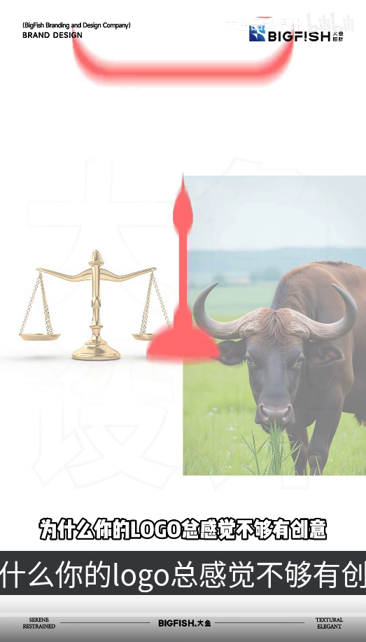

- **作者明确说法**：「为什么你的LOGO总感觉不够有创意」
- **整理者观察**：中央立柱和底部的穹已经就位，立柱顶端有尖。画面上方另有一道红色弯梁，还停在高处，没有落到立柱上。左右仍无盘。

### NF5 · 梁已成形，尚未落到立柱上

约 00:03（录屏 56.167s）

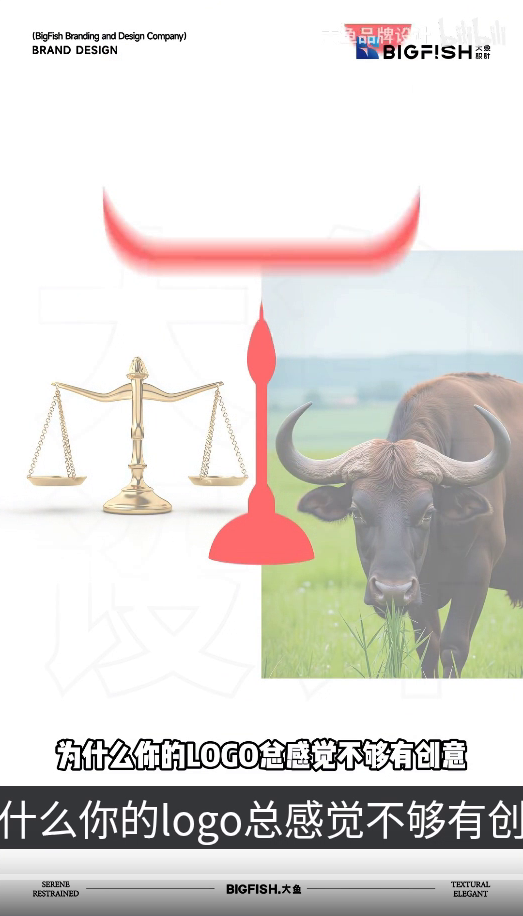

- **作者明确说法**：「为什么你的LOGO总感觉不够有创意」
- **整理者观察**：上方的梁已经收成两端上翘的弯梁，仍和立柱顶端隔开一段距离，还没有就位。左右仍无盘。

### NF6 · 梁接近立柱顶端，左右尚无盘

约 00:03（录屏 56.200s）

- **作者明确说法**：「为什么你的LOGO总感觉不够有创意」
- **整理者观察**：弯梁已经落到立柱上方，尖顶几乎要接到梁，中间还留着很小的空隙。左右都还没有盘。

### NF7 · 梁已就位，最上又见红帽

约 00:03（录屏 56.267s）

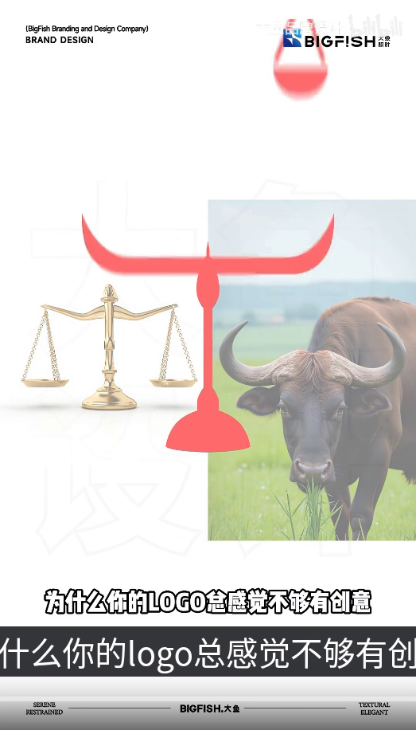

- **作者明确说法**：「为什么你的LOGO总感觉不够有创意」
- **整理者观察**：弯梁已经落到立柱与穹上，尖顶接到梁。左右仍无盘。画面最上沿又出现一枚红色帽状体。

### NF8 · 右侧滴体下落，将落右盘位

约 00:03（录屏 56.400s）

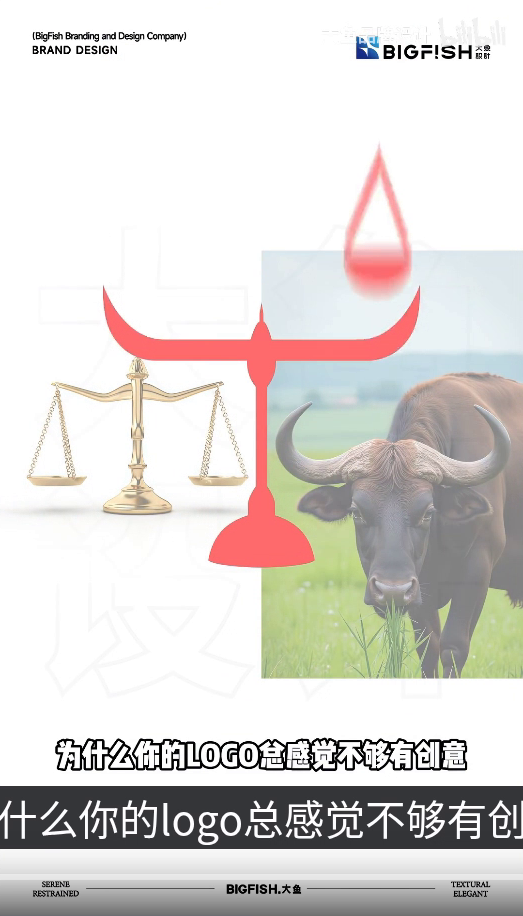

- **作者明确说法**：「为什么你的LOGO总感觉不够有创意」
- **整理者观察**：梁和立柱、穹已经稳住。一滴红色泪滴出现在画面右侧、牛照片上方，正朝右盘的位置下落。左盘仍未出现。

### NF9 · 右盘开始成形

约 00:03（录屏 56.533s）

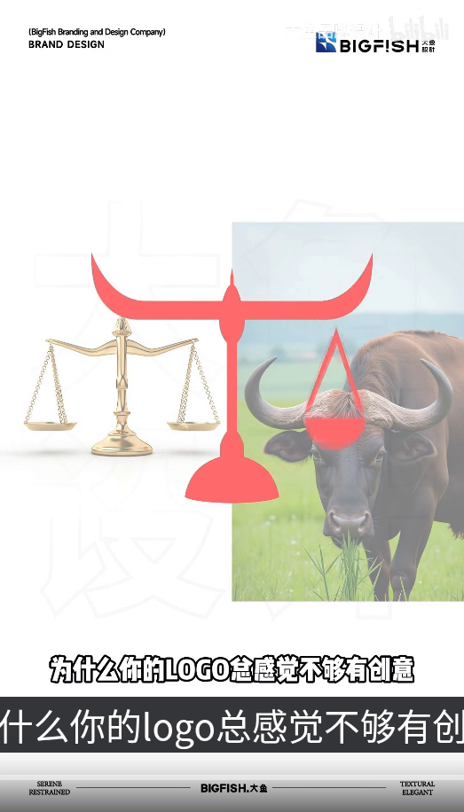

- **作者明确说法**：「为什么你的LOGO总感觉不够有创意」
- **整理者观察**：右盘开始成形：梁的右臂下出现三角吊耳，下面是圆碗。左侧还是空的。

### NF10 · 右盘已就位，左盘尚未出现

约 00:03（录屏 56.667s）

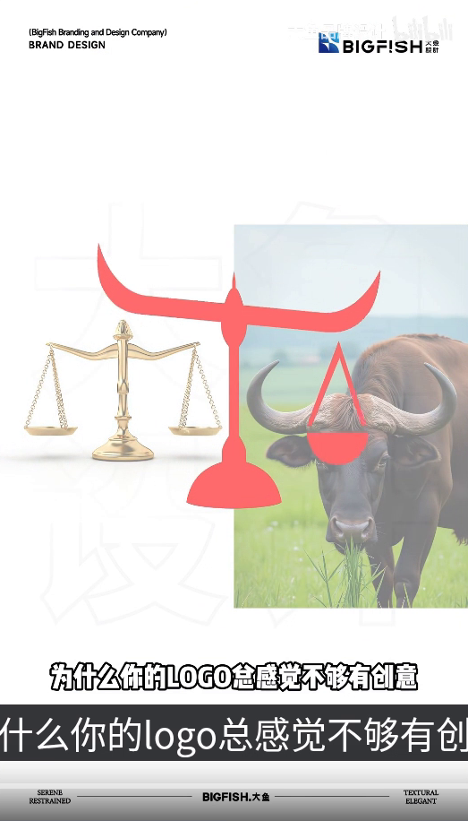

- **作者明确说法**：「为什么你的LOGO总感觉不够有创意」
- **整理者观察**：右盘已经就位，三角吊耳和圆碗都清楚。左盘仍未出现。

### NF11 · 左侧滴体下落，右盘仍在

约 00:03（录屏 56.933s）

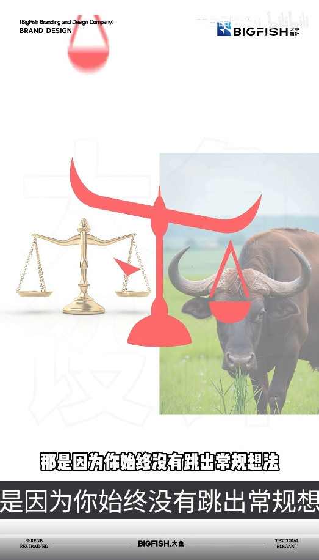

- **作者明确说法**：「那是因为你始终没有跳出常规思维」
- **整理者观察**：右盘保持完整。立柱左侧已经看见一枚小的红色三角。画面最上沿又出现一枚红色帽状体，正朝左盘的位置下落。左盘本身还没有出现。

### NF12 · 左盘正在成形

约 00:04（录屏 57.200s）

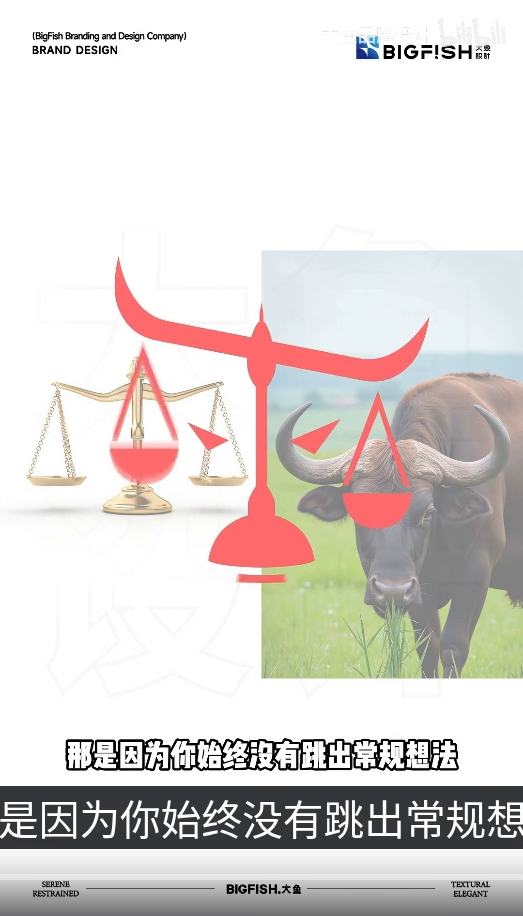

- **作者明确说法**：「那是因为你始终没有跳出常规思维」
- **整理者观察**：左盘正在成形，三角吊耳和圆碗已经能看出来，颜色还略淡。右盘已经稳住。立柱左右两侧都已经看见一枚实心小三角。

### NF13 · 红色完成态

约 00:04（录屏 57.400s）

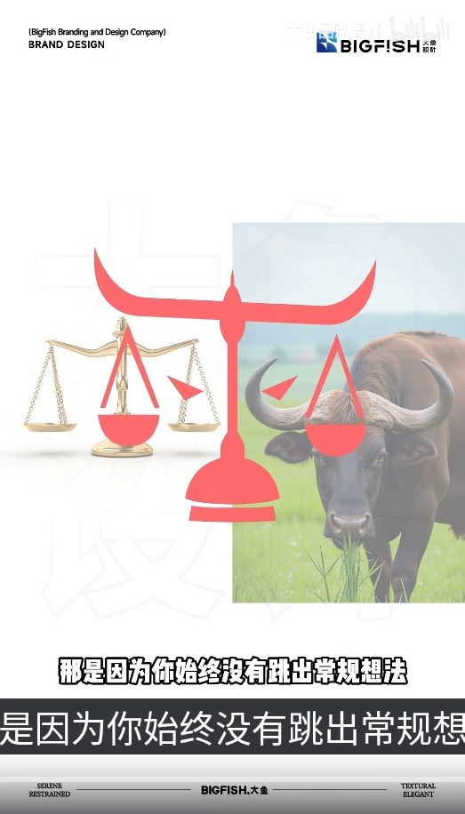

- **作者明确说法**：「那是因为你始终没有跳出常规思维」
- **整理者观察**：红色标志已经完整：两端上翘的弯梁，中央立柱带向上的尖顶，底部是穹和一道短横；左右都是三角吊耳加圆碗。立柱两侧各有一枚实心小三角，左枚尖端朝左上，右枚尖端朝右上。天平和牛的照片还在后面。

### NF14 · 红色转深

约 00:04（录屏 57.900s）

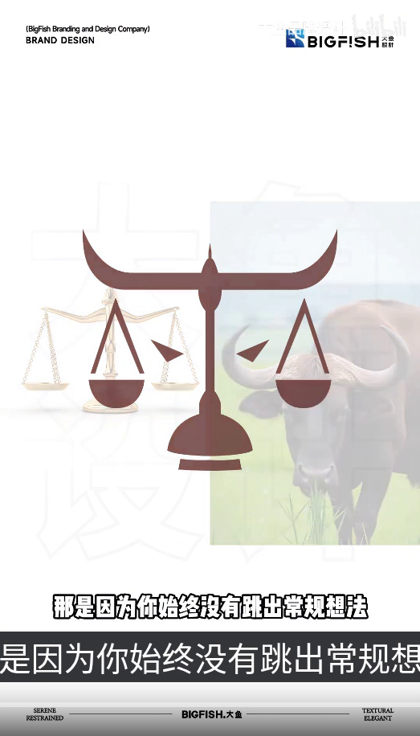

- **作者明确说法**：「那是因为你始终没有跳出常规思维」
- **整理者观察**：标志由亮红转为深褐红，结构与上一帧相同，包括那对尖端朝外上的斜三角。左右的天平和牛照片正在变淡。

### NF15 · 白底黑净标

约 00:05（录屏 58.500s）

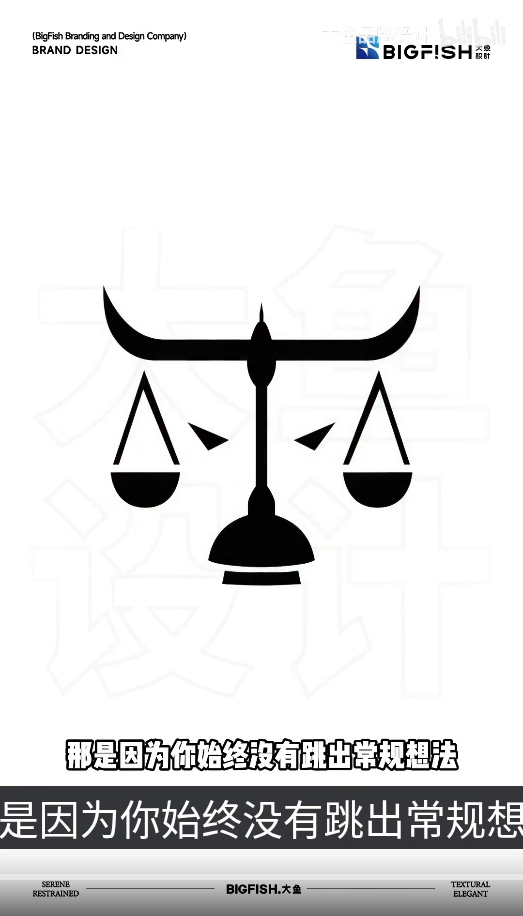

- **作者明确说法**：「那是因为你始终没有跳出常规思维」
- **整理者观察**：白底上的黑色净标已经稳住，结构和红色完成态相同：弯梁、带尖顶的立柱、穹和短横、左右盘，以及立柱两侧那对斜三角——左枚尖端朝左上，右枚尖端朝右上。这是这一案的黑色净标完成态。照片已经看不见。

### NF16 · 用到草地照片上，牛公平

约 00:07（录屏 60.800s）

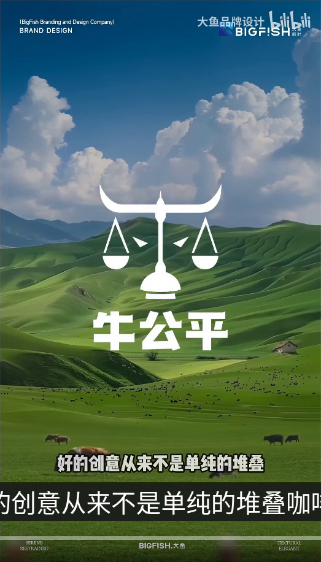

- **作者明确说法**：「好的创意从来不是单纯的堆叠」
- **播放器字幕**：「好的创意从来不是单纯的堆叠咖啡」
- **整理者观察**：同一件标志反白，叠在绿色山地草场、远处有牛群的照片上。标志下方是「牛公平」，没有英文。播放器字幕在「堆叠」之后已经接上「咖啡」，片内这一帧只到「堆叠」。

### 思路与前后关系（整理者分析，非作者原话）

播放中先给出金色天平和弯角牛的照片。红色结构按先后落下：中央立柱和穹先自上落下，梁后落，右盘先落，左盘后落。落成之后，立柱两侧有一对斜三角，左枚尖端朝左上，右枚尖端朝右上，可看作牛的眼睛（整理者推断）。整件标看起来既是一架天平，也像正面的牛头，弯梁像一对角。用到草场照片上时，字标写成「牛公平」，没有英文。片尾回顾没有收这一案。这是整理者根据可见结构作的归纳，片内说的是「为什么你的LOGO总感觉不够有创意」「那是因为你始终没有跳出常规思维」「好的创意从来不是单纯的堆叠」。

---

## 案例二：咖啡杯与咖啡豆 / LUCKY COFFEE

### KF1 · 气泡：咖啡店想要一个有创意又接地气的LOGO

约 00:09（录屏 62.500s）

- **作者明确说法**：「咖啡店想要一个有创意」。同一画面上，气泡里三行写着「咖啡店想要一个」「有创意又接地气的LOGO」「怎么搞啊」。
- **播放器字幕**：「咖啡店想要一个有创意又接地气的 logo」
- **整理者观察**：白底中央是一个线框圆角气泡，尾朝右下。片内这一帧是「咖啡店想要一个有创意」；气泡把后两句也写在一起，第二行的 LOGO 是大写。播放器字幕已经把后半句接上，并且写成小写 logo。

### KF2 · 黑色咖啡杯，尚无豆印

约 00:12（录屏 65.400s）

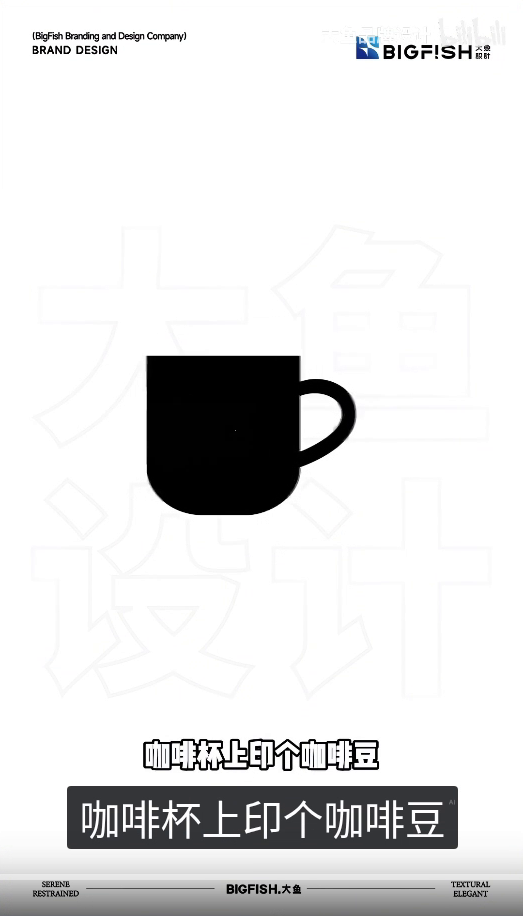

- **作者明确说法**：「咖啡杯上印个咖啡豆」
- **整理者观察**：白底上是一只实心黑色杯子，柄在右侧，杯身上还没有咖啡豆。

### KF3 · 杯上出现带黑弯缝的白色豆印

约 00:12（录屏 65.667s）

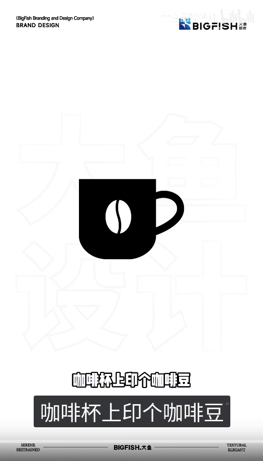

- **作者明确说法**：「咖啡杯上印个咖啡豆」
- **整理者观察**：杯身中央出现一枚白色椭圆豆印，中央有一道黑色弯曲的缝，呈 S 形。杯子仍是黑色，柄在右侧。

### KF4 · 放大前：中缝已撤，白实椭圆

约 00:15（录屏 68.333s）

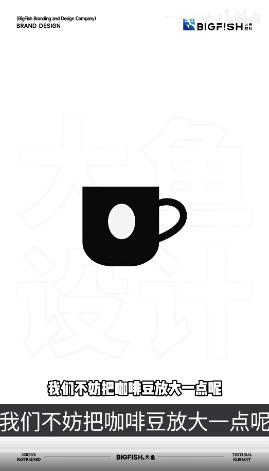

- **作者明确说法**：「我们不妨把咖啡豆放大一点呢」
- **整理者观察**：仍是黑杯、右侧杯柄。白色豆印已经是实心椭圆，中央那道黑弯缝已经撤去。这一帧是放大开始前的邻帧，豆印还没有明显变大。

### KF5 · 原杯淡退，白豆变大

约 00:15（录屏 68.500s）

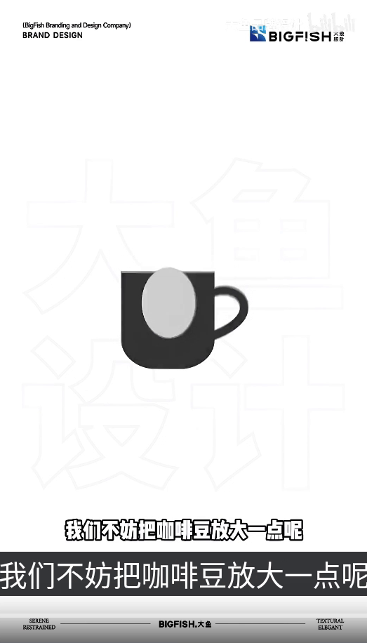

- **作者明确说法**：「我们不妨把咖啡豆放大一点呢」
- **整理者观察**：杯子已经由实黑转为灰，正在淡退；白色豆印明显变大，几乎占满杯面。右侧杯柄还在。

### KF6 · 中态：灰椭圆，杯柄将尽

约 00:15（录屏 68.567s）

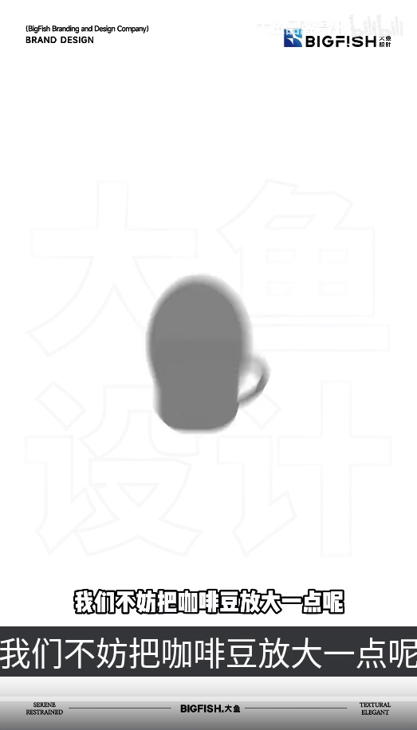

- **作者明确说法**：「我们不妨把咖啡豆放大一点呢」
- **整理者观察**：中间态。白色豆印和灰色杯子已经溶成一个模糊的灰椭圆，原来的杯柄只剩右侧一点淡影，几乎要消失。

### KF7 · 黑椭圆下出现杯的负形

约 00:15（录屏 68.667s）

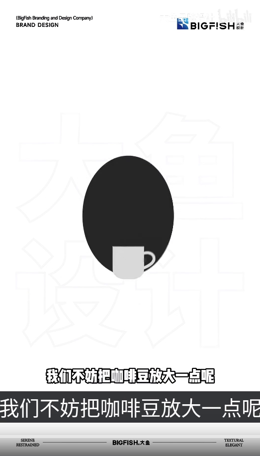

- **作者明确说法**：「我们不妨把咖啡豆放大一点呢」
- **整理者观察**：深色椭圆已经成形，底部出现浅色的杯子负形，柄在右侧。负形的杯子还略灰，还没有收成纯白。这一帧还没有那道波浪裂隙。

### KF8 · 黑椭圆与白色杯负形稳住

约 00:16（录屏 69.200s）

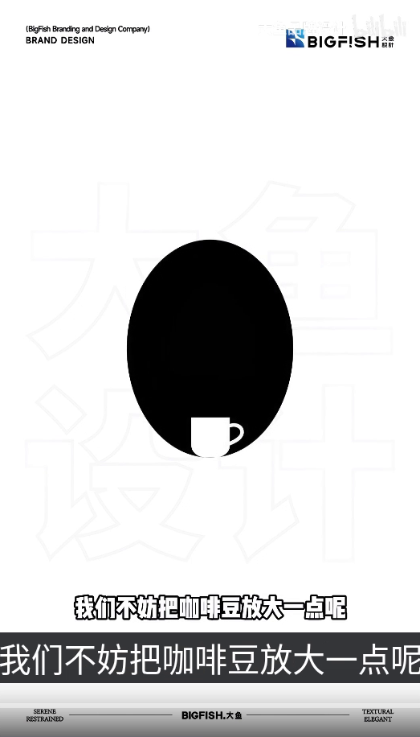

- **作者明确说法**：「我们不妨把咖啡豆放大一点呢」
- **整理者观察**：黑椭圆和底部的白色杯子负形已经稳住，柄在右侧。豆上还没有波浪裂隙。

### KF9 · 灰色波浪中态

约 00:16（录屏 69.800s）

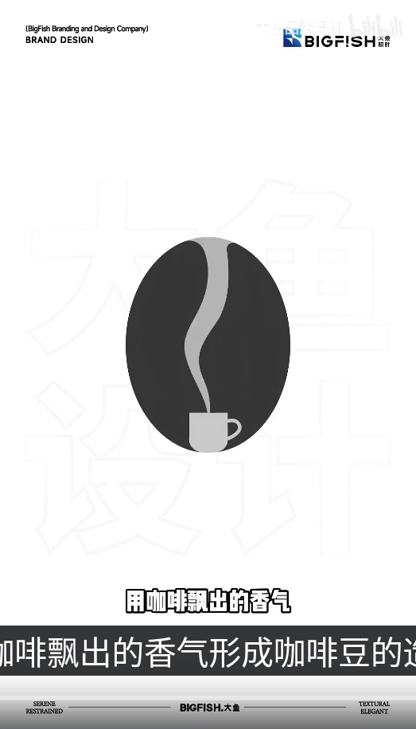

- **作者明确说法**：「用咖啡飘出的香气」
- **播放器字幕**：「用咖啡飘出的香气形成咖啡豆的造型」
- **整理者观察**：深色椭圆上出现一道灰色波浪，从杯口向上穿过豆面；杯子也还是灰色。这是裂隙出现时的中态，还没有收成黑豆、白裂和白杯。播放器字幕已经把下一句接上，片内这一帧只到「用咖啡飘出的香气」。

### KF10 · 白底黑净标

约 00:18（录屏 71.500s）

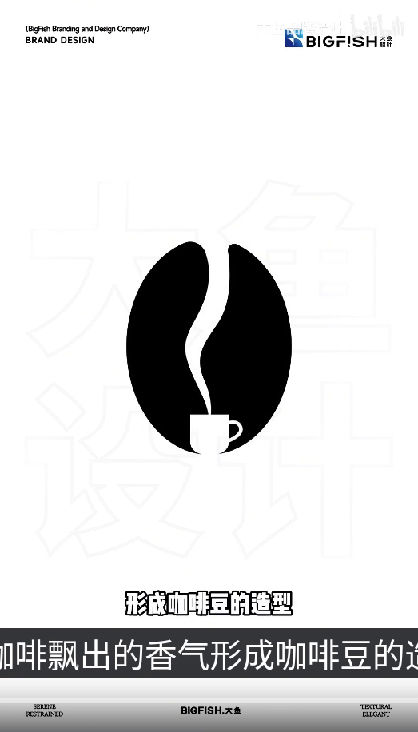

- **作者明确说法**：「形成咖啡豆的造型」
- **播放器字幕**：「用咖啡飘出的香气形成咖啡豆的造型」
- **整理者观察**：白底上的黑色净标已经稳住：黑椭圆是豆，一道白裂自上而下穿过豆面，底部是白色杯子负形，柄在右侧。这是这一案的黑色净标完成态。

### KF11 · 用到咖啡店景上，LUCKY COFFEE

约 00:19（录屏 72.800s）

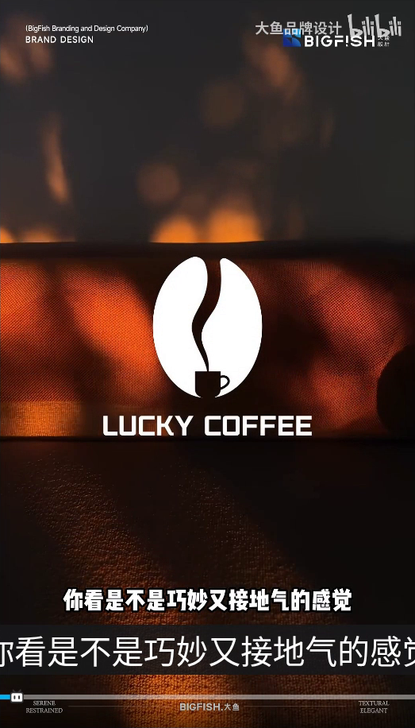

- **作者明确说法**：「你看是不是巧妙又接地气的感觉」
- **整理者观察**：同一件标志反白，叠在暖色咖啡店景照片上。标志下方是「LUCKY COFFEE」，没有中文。

### 思路与前后关系（整理者分析，非作者原话）

先用气泡提出咖啡店要一个有创意又接地气的标志，再给出黑色杯子，在杯上印一枚白豆，中央有一道黑弯缝。随后中缝撤去，白豆成实心椭圆。再将原杯淡退，白豆同时变大，经过灰椭圆的中态，收成黑椭圆，并把原来的杯子留在椭圆底部，成为白色负形。之后用一道波浪从杯口向上穿过豆面，收成咖啡豆上的裂隙。完成之后，同一件标既能读成咖啡豆，也能读出杯。用到店景照片上时，字标写成「LUCKY COFFEE」，没有中文。这是整理者根据可见结构作的归纳，片内说的是「咖啡杯上印个咖啡豆」「我们不妨把咖啡豆放大一点呢」「用咖啡飘出的香气」「形成咖啡豆的造型」「你看是不是巧妙又接地气的感觉」。

---

## 案例三：叶子与蝴蝶 / 一叶蝶护肤中心

### YD1 · 气泡：叶子和蝴蝶能怎么设计

约 00:22（录屏 75.500s）

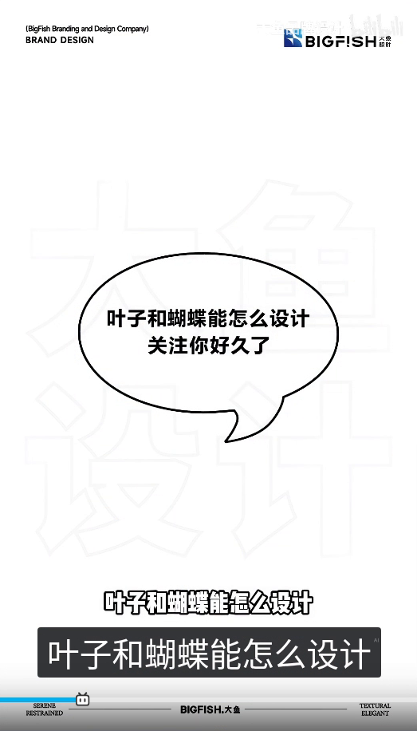

- **作者明确说法**：「叶子和蝴蝶能怎么设计」。同一画面上，气泡里两行写着「叶子和蝴蝶能怎么设计」「关注你好久了」。
- **整理者观察**：白底中央是一个线框圆角气泡，尾朝右下。片内这一帧是「叶子和蝴蝶能怎么设计」；「关注你好久了」写在气泡第二行。

### YD2 · 原形：一片叶子上停着蝴蝶

约 00:25（录屏 78.800s）

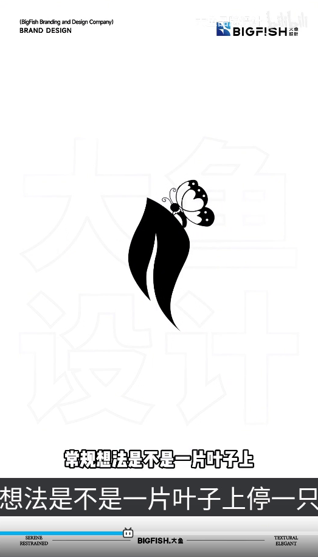

- **作者明确说法**：「常规想法是不是一片叶子上」
- **播放器字幕**：「常规想法是不是一片叶子上停一只」
- **整理者观察**：白底上是一片黑色叶子，叶片内侧有一道弯曲的白脉，越接近下尖越宽。一只装饰性的蝴蝶停在叶子右上缘，翅上有圆点和心形纹样。播放器字幕已经把「停一只」接上，片内这一帧只到「一片叶子上」。

### YD3 · 只取叶子

约 00:28（录屏 81.200s）

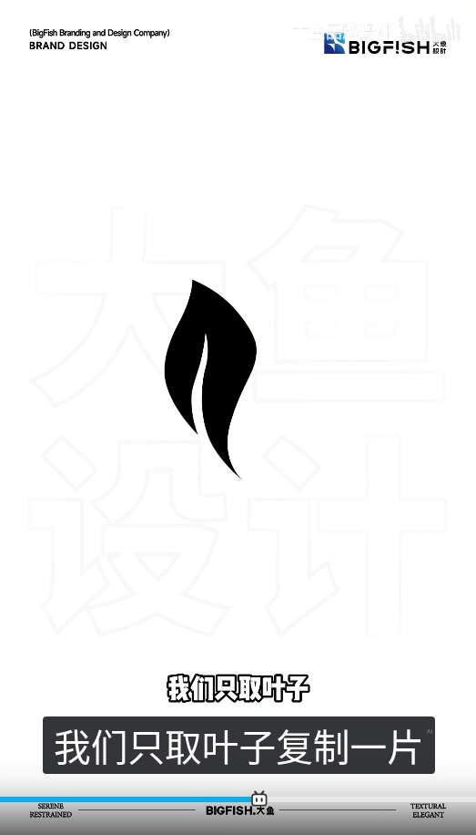

- **作者明确说法**：「我们只取叶子」
- **播放器字幕**：「我们只取叶子复制一片」
- **整理者观察**：蝴蝶已经撤走，白底上只剩原来那一片叶子，白脉仍在。播放器字幕已经把「复制一片」接上，片内这一帧只到「我们只取叶子」。

### YD4 · 第二片正在就位

约 00:28（录屏 81.800s）

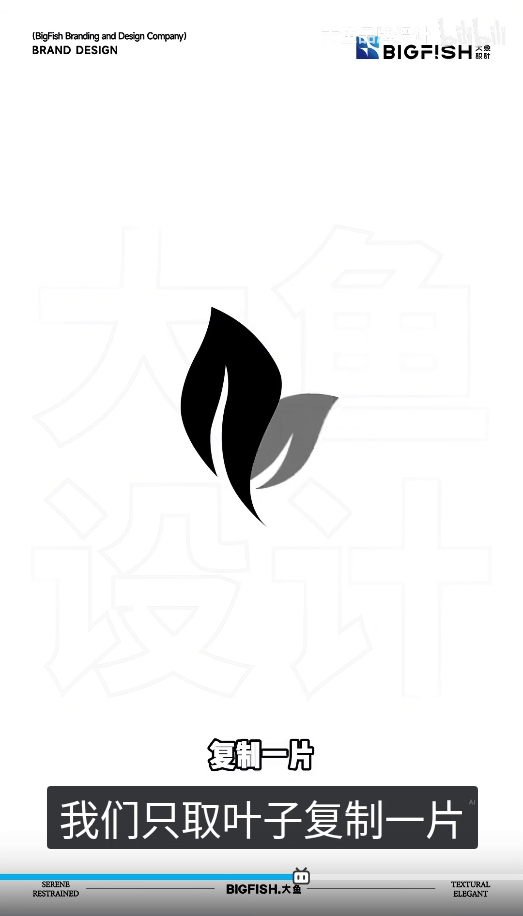

- **作者明确说法**：「复制一片」
- **播放器字幕**：「我们只取叶子复制一片」
- **整理者观察**：原来的叶子还在。右侧出现第二片叶子，颜色还是灰的，比原叶小，方向更接近水平，正在就位。

### YD5 · 两片叶子，尚无躯干

约 00:30（录屏 83.200s）

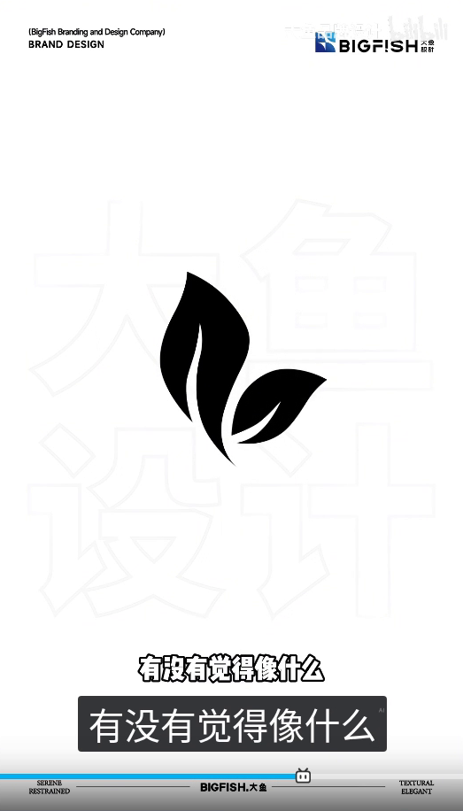

- **作者明确说法**：「有没有觉得像什么」
- **整理者观察**：两片叶子都已经是黑色。左侧较大的一片仍朝上，白脉沿叶片内侧弯曲，下尖处较宽；右侧较小的一片明显缩小，并旋转到更接近水平、尖端朝右的位置，白脉沿它的下缘，走向和原叶同向。两片并不对称。它们在下方靠近，但还没有躯干。

### YD6 · 灰色躯干中态

约 00:30（录屏 83.600s）

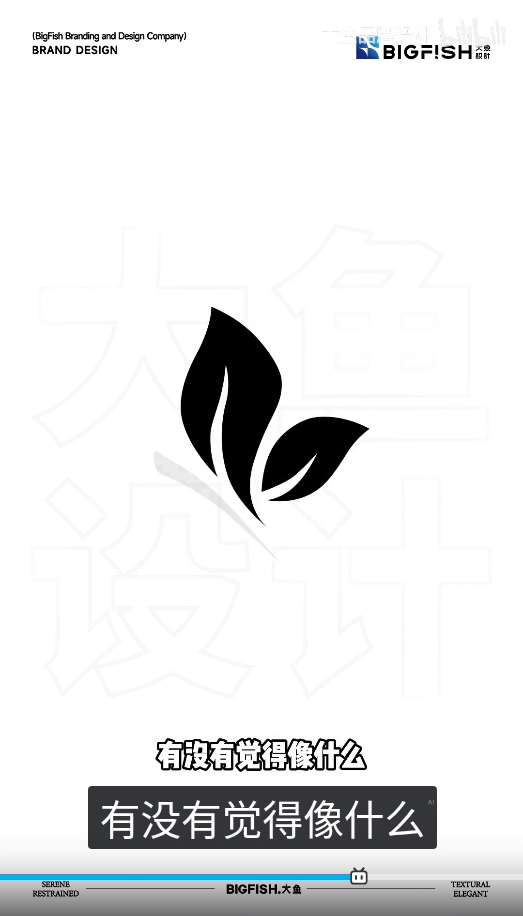

- **作者明确说法**：「有没有觉得像什么」
- **整理者观察**：两片叶子的会合处下方，出现一道浅灰色、尖端朝左下的躯干，还没有收成黑色。

### YD7 · 白底黑净标

约 00:31（录屏 84.400s）

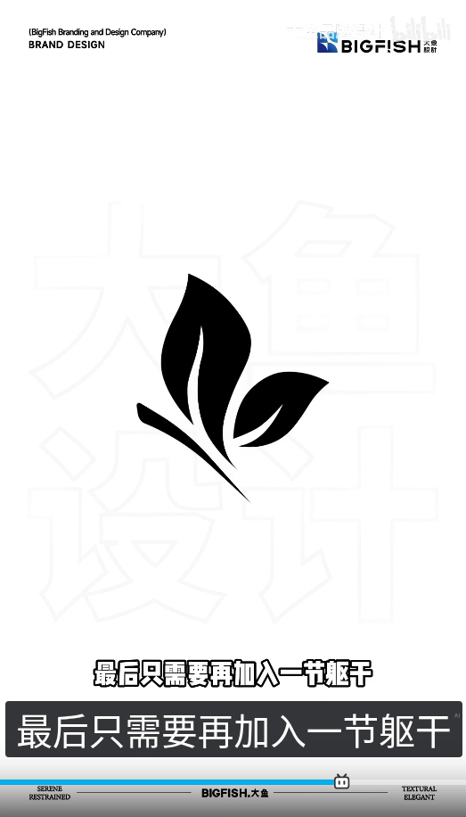

- **作者明确说法**：「最后只需要再加入一节躯干」
- **整理者观察**：白底上的黑色净标已经稳住：两片不对称的叶子加上一节黑色躯干，看起来像一只蝴蝶。这是这一案的黑色净标完成态。

### YD8 · 用到玫瑰照片上，一叶蝶护肤中心

约 00:33（录屏 86.400s）

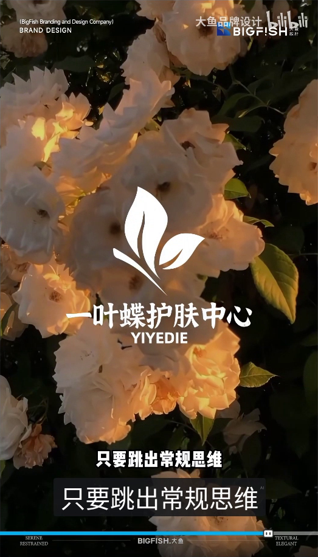

- **作者明确说法**：「只要跳出常规思维」
- **整理者观察**：同一件标志反白，叠在暖色奶油白、带金黄的玫瑰花照片上。标志下方是「一叶蝶护肤中心」，再下方是「YIYEDIE」。

### 思路与前后关系（整理者分析，非作者原话）

先用气泡提出叶子和蝴蝶，再给出一片叶子，上面停着一只装饰蝶。随后只取叶子，再复制一片，并把复制的这一片缩小、旋转后放到原叶右侧。两片不对称，白脉同向。最后在会合处加入一节躯干，收成蝴蝶的形状。用到玫瑰照片上时，字标写成「一叶蝶护肤中心」和「YIYEDIE」。这是整理者根据可见结构作的归纳，片内说的是「常规想法是不是一片叶子上」「我们只取叶子」「复制一片」「有没有觉得像什么」「最后只需要再加入一节躯干」「只要跳出常规思维」。

---

## 案例四：小狗与叉子 / 宠小食

### CX1 · 气泡：宠物餐厅

约 00:36（录屏 89.200s）

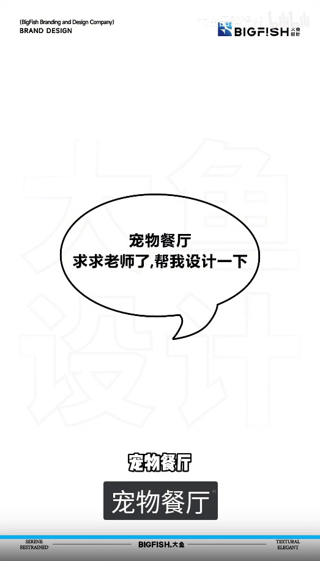

- **作者明确说法**：「宠物餐厅」。同一画面上，气泡里两行写着「宠物餐厅」「求求老师了,帮我设计一下」。
- **整理者观察**：白底中央是一个线框圆角气泡，尾朝右下。片内这一帧是「宠物餐厅」。气泡第二行在「了」后是西文逗号，写的是「求求老师了,帮我设计一下」。

### CX2 · 原形：线描小狗拿着叉子

约 00:39（录屏 92.500s）

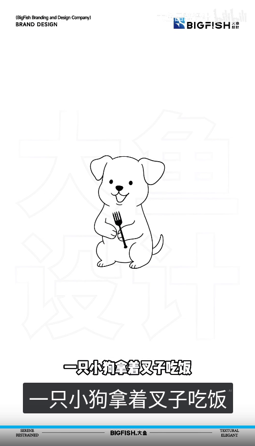

- **作者明确说法**：「一只小狗拿着叉子吃饭」
- **整理者观察**：白底上是一只坐着的线描小狗，两爪握着一把小的黑色叉子。这时叉齿朝上、柄朝下，可以看见四齿。

### CX3 · 放大叉子，小狗还在后面

约 00:41（录屏 94.967s）

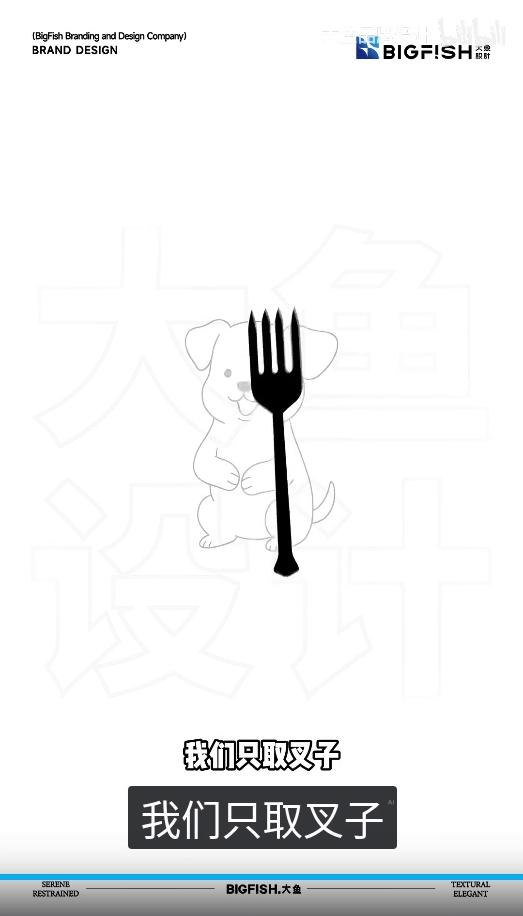

- **作者明确说法**：「我们只取叉子」
- **整理者观察**：叉子已经放大，仍是齿朝上、柄朝下，四齿仍尖。灰色的线描小狗还留在叉子后面。

### CX4 · 只剩叉子

约 00:42（录屏 95.333s）

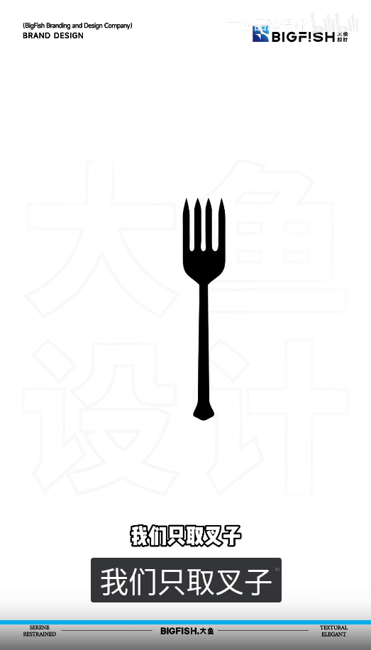

- **作者明确说法**：「我们只取叉子」
- **整理者观察**：小狗已经撤走，白底上只剩叉子，仍是齿朝上、柄朝下，柄还细，四齿仍尖。

### CX5 · 翻面：柄朝上，齿朝下，仍细仍尖

约 00:43（录屏 96.200s）

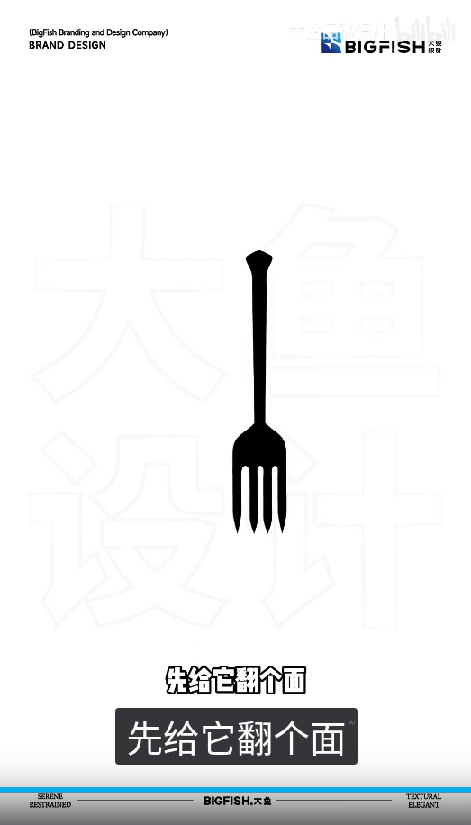

- **作者明确说法**：「先给它翻个面」
- **整理者观察**：叉子已经翻过来，变成柄朝上、齿朝下。柄仍细，上端有一个小的菱形头；四齿下端仍是尖的。

### CX6 · 已经加粗，齿端已趋圆

约 00:44（录屏 97.200s）

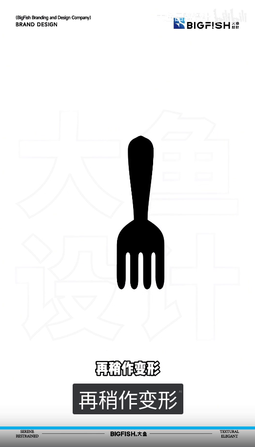

- **作者明确说法**：「再稍作变形」
- **整理者观察**：柄已经加粗，呈上宽下窄。四齿下端已是圆钝的椭圆，齿端已趋圆。

### CX7 · 齿端稳定圆润

约 00:45（录屏 98.400s）

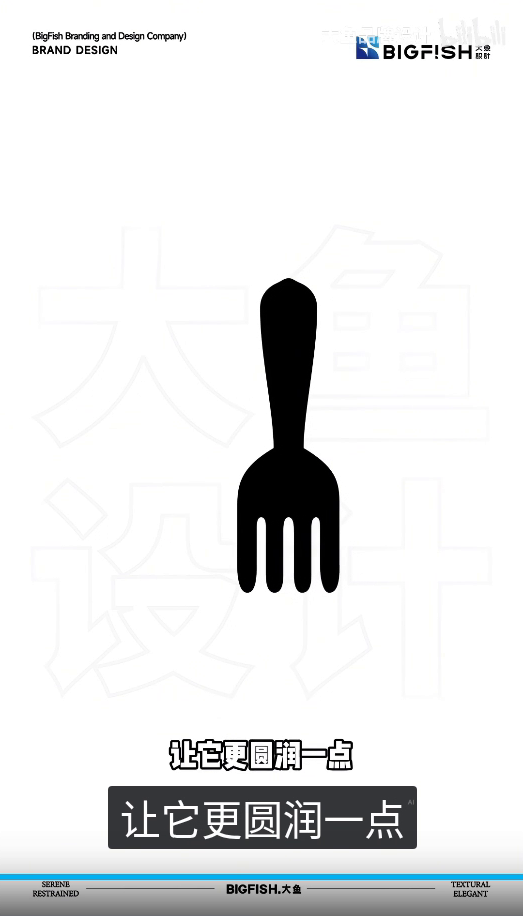

- **作者明确说法**：「让它更圆润一点」
- **整理者观察**：四齿下端已经是稳定的圆润形态。这一帧还只有叉子，没有狗头。

### CX8 · 灰色狗头中态

约 00:46（录屏 99.000s）

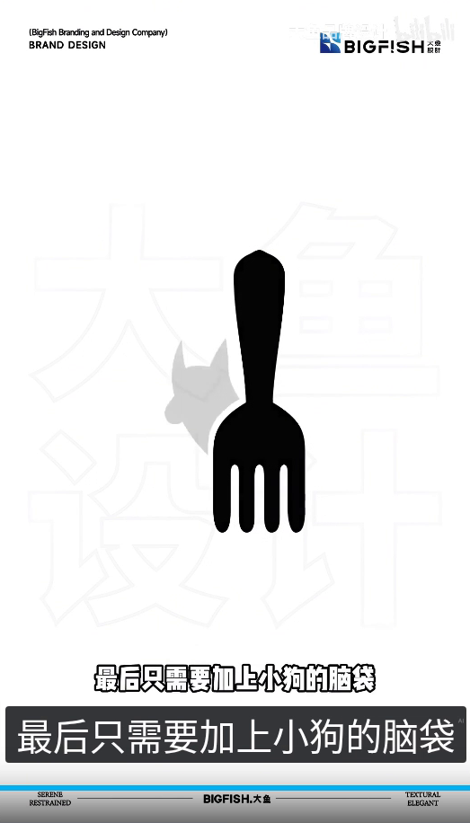

- **作者明确说法**：「最后只需要加上小狗的脑袋」
- **整理者观察**：叉子左侧出现灰色的狗头，还没有收成黑色。头在叉的左肩外侧，两者之间已经能看出空隙。

### CX9 · 白底黑净标，头与叉留白分隔

约 00:46（录屏 99.600s）

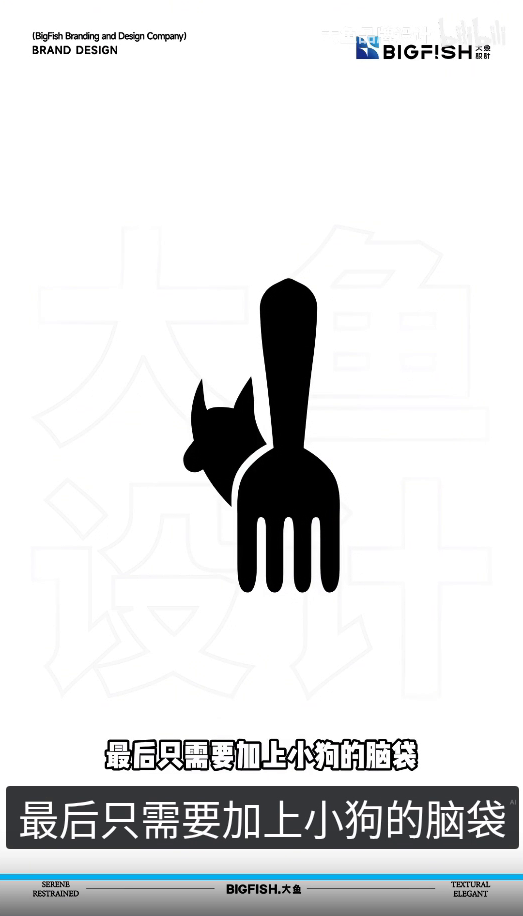

- **作者明确说法**：「最后只需要加上小狗的脑袋」
- **整理者观察**：白底上的黑色净标已经稳住：柄朝上、四齿圆头朝下的叉子，左侧是小狗的头，侧脸、两只尖耳，吻向左。头在叉的左肩外侧，两者之间有一条清楚的白缝，头与叉并未实心接上。这是这一案的黑色净标完成态。

### CX10 · 用到狗的照片上，宠小食

约 00:48（录屏 101.000s）

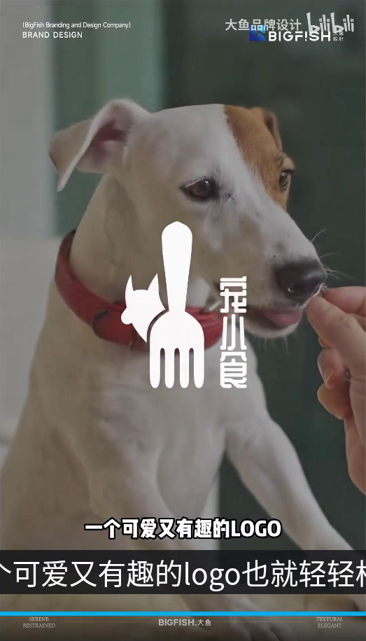

- **作者明确说法**：「一个可爱又有趣的LOGO」
- **播放器字幕**：「一个可爱又有趣的logo也就轻轻松松」
- **整理者观察**：同一件标志反白，叠在一只戴红项圈的狗的照片上。标志右侧是竖排「宠小食」，自上而下是「宠」「小」「食」，没有拼音。头与叉左肩之间的白缝仍在，照片从缝里透出来。播放器字幕把 logo 写成小写，并且已经接上「也就轻轻松松」；片内这一帧是「一个可爱又有趣的LOGO」。

### 思路与前后关系（整理者分析，非作者原话）

先用气泡提出宠物餐厅，再给出一只坐着的线描小狗，两爪握着齿朝上的小叉。随后只取叉子并放大，再翻面，变成柄朝上、齿朝下，这时柄仍细、齿仍尖。再将叉子加粗，柄呈上宽下窄，齿端已趋圆；随后齿端收成稳定的圆润形态。最后在叉的左肩外侧加上小狗的头，头与叉之间留出白缝，并不实心接上。用到照片上时，字标写成竖排「宠小食」，没有拼音。这是整理者根据可见结构作的归纳，片内说的是「一只小狗拿着叉子吃饭」「我们只取叉子」「先给它翻个面」「再稍作变形」「让它更圆润一点」「最后只需要加上小狗的脑袋」「一个可爱又有趣的LOGO」。

---

## 收束：三例并列

约 00:52（录屏 105.200s）

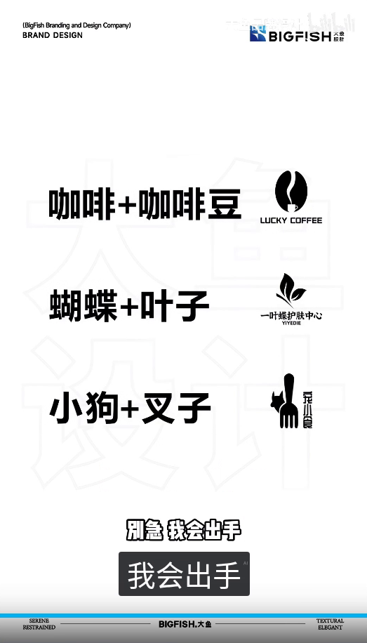

- **作者明确说法**：「别急 我会出手」
- **播放器字幕**：「我会出手」
- **整理者观察**：白底上是三行。左列是「咖啡+咖啡豆」「蝴蝶+叶子」「小狗+叉子」；右列分别是三件净标，以及「LUCKY COFFEE」、「一叶蝶护肤中心」与「YIYEDIE」、竖排「宠小食」。没有「牛公平」一行。片内「别急」和「我会出手」之间有空格；这一帧的播放器字幕只见到「我会出手」。
